# Agent 开发架构选型 · 完全教程

> **视频逐帧还原 + 系统化补全**
>
> 原视频：抖音 @AI产品千媚《Agent 开发架构怎么选？7 个代表项目系统对比》｜[分享链接](https://v.douyin.com/KBn_HS3Q5D4/) ｜ [网页版](https://www.douyin.com/video/7704500449094339875) ｜ 视频 ID `7704500449094339875` ｜ 发布 2026-11-05 ｜ 时长 20:43
>
> 配套文件：[index.html（图文阅读版，20 张 SVG）](index.html)
>
> 姊妹篇：[RAG 评测完全教程（在线阅读）](../rag-evaluation-tutorial/RAG评测完全教程.html) ｜ [Agent 评测体系完全教程（在线阅读）](../agent-evaluation-tutorial/Agent评测体系完全教程.html) ｜ [评测驱动 Agent 迭代 · 完全教程（在线阅读）](../agent-eval-driven-tutorial/Agent评测驱动迭代完全教程.html)

---

## 目录

- [0. 视频速览与保真约定](#0-视频速览与保真约定)
- [1. 全片结构地图](#1-全片结构地图)
- [2. 三层抽象与演进 Framework / Runtime / Harness](#2-三层抽象与演进-framework--runtime--harness)
- [3. 演进带来的影响与七项目的三类划分](#3-演进带来的影响与七项目的三类划分)
- [4. 综合任务类 Claude Agent SDK 与 Deep Agents](#4-综合任务类-claude-agent-sdk-与-deep-agents)
- [5. 编码类 Pi 与 OpenCode](#5-编码类-pi-与-opencode)
- [6. 个人助手类 OpenClaw 与 Hermes Agent](#6-个人助手类-openclaw-与-hermes-agent)
- [7. 特殊存在 DeepSeek Harness](#7-特殊存在-deepseek-harness)
- [8. 七个 Harness 横向对比 两根轴](#8-七个-harness-横向对比-两根轴)
- [9. 怎么用 Harness 三个层次](#9-怎么用-harness-三个层次)
- [10. 回到开头 怎么选](#10-回到开头-怎么选)
- [11. 补充篇 A 专业名词速查 68 条](#11-补充篇-a-专业名词速查-68-条)
- [12. 补充篇 B 七项目事实核对](#12-补充篇-b-七项目事实核对)
- [13. 补充篇 C 架构全景与选型方法](#13-补充篇-c-架构全景与选型方法)
- [14. 补充篇 D 可运行代码](#14-补充篇-d-可运行代码)
- [15. 补充篇 E 常见误区](#15-补充篇-e-常见误区)
- [16. 附录](#16-附录)

---

## 一页速览 整期视频的 6 个结论

| # | 结论 | 位置 |
|---|---|---|
| 1 | **三层抽象不是互相淘汰**：Framework 连接模型与工具，Runtime 管流程·状态·恢复，Harness 提供成套执行机制；上层复用下层 | [第 2 章](#2-三层抽象与演进-framework--runtime--harness) |
| 2 | **演进改变的是开发起点**：过去从模型/工具/数据搭起，现在可直接复用现成 Harness；但简单任务与严格流程场景仍值得用 Framework / Runtime | [第 3 章](#3-演进带来的影响与七项目的三类划分) |
| 3 | **七个项目按主服务场景分三类 + 一个特殊存在**：综合任务（Claude Agent SDK / Deep Agents）、编码（Pi / OpenCode）、个人助手（OpenClaw / Hermes），DeepSeek Harness 以插件化架构自成一类 | [第 3 章](#3-演进带来的影响与七项目的三类划分) |
| 4 | **选型看两根轴**：默认帮你实现了多少机制 × 开放了多少控制权；工具调用、上下文管理、多 Agent 已是通用能力，不构成差异 | [第 8 章](#8-七个-harness-横向对比-两根轴) |
| 5 | **控制权 ≠ 一定越好**：能改的越多，要承担的设计 / 调试 / 维护也越多 | [第 8 章](#8-七个-harness-横向对比-两根轴) |
| 6 | **插件 / SDK / 源码改造解决三个不同问题**：扩展现有 Agent、开发自己的 Agent 产品、改造底层 Harness；开发自己的产品 ≠ 开发自己的 Harness | [第 9 章](#9-怎么用-harness-三个层次) |

---

## 0. 视频速览与保真约定

**【视频原述】**《Agent 开发架构怎么选？7 个代表项目系统对比》，作者 @AI产品千媚，2026-11-05 发布，话题 `#agent开发 #vibecoding #pi #OpenClaw #Claude`。实测时长 **20 分 43.4 秒**（1243.37 秒），1920×1080 横屏 / 30fps：白底手绘风幻灯片 + 左下角主讲人画中画 + 官网/仓库截图穿插 + 底部烧录字幕。

视频开头的金字塔里列出 11 个项目：底层 **LangChain、LangGraph、Claude Agent SDK、Deep Agents**，中层 **Pi、DeepSeek Harness、OpenCode**，顶层 **OpenClaw、Hermes Agent**，配一个大问号「有什么区别」。全片按 4 大章节展开：三层抽象演进 → 七个代表性 Harness 逐个看 → 七个 Harness 横向对比 → 怎么用 Harness。

**三种标记**：

- **【视频原述】**：画面文字或烧录字幕中确实出现过的表述。
- **【按画面重绘】**：把视频手绘图 / 表格按原结构画成矢量图，文字以画面为准。
- **【补充】**：视频未展开、由官方文档与公开资料补齐的术语、事实、架构与代码。

> ⚠️ **保真边界**：平台自动章节（10 段，从 00:36 起）是机器生成的时间码，与画面自带的章节目录（00:37 / 06:27 / 16:47 / 17:33）有几十秒差异；本教程一律以**画面目录与逐帧文字**为准，自动章节单独列在 [16.1](#161-章节时间轴) 并在 [16.3](#163-校正表-ocr-与自动摘要) 标注差异。字幕由 OCR 抽取，个别错字（如「直接与代码？错！」「產市面上的 AgSnt飽」）已按画面与上下文校正；口播按烧录字幕时间线 + 画面文字归纳，未凭空补写台词。

**还原方法**：解析分享短链 → 取视频 ID 与官方详情（10 段自动章节）→ 下载 1080P 原片 77.8 MB → 每 3 秒抽帧 **414 张** → macOS Vision `VNRecognizeTextRequest`（zh-Hans + en-US，accurate，关闭语言纠正）得到 **5,349 行**带坐标文本 → 按 y 坐标分离画面文字与烧录字幕，去重后得到 1,333 行画面文本与 402 行字幕时间线 → 对 4 大章节的关键帧放大逐字目视校对 → 与七个项目的官方资料交叉验证术语与事实。

---

## 1. 全片结构地图

画面自带的章节目录（00:36 帧）与官方详情接口的 10 段章节一起构成目录骨架。

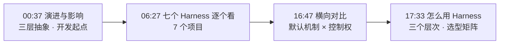

**图 1｜全片结构地图（按画面章节目录与官方章节重绘）**

| 时间（画面目录） | 章节 | 本章 | 核心画面 |
|---|---|---|---|
| 00:37 | 01 Agent 开发架构的演进与影响 | 第 2–3 章 | 三阶段时间轴 2022 / 2024 / 2025；三层抽象；开发起点变化 |
| 06:27 | 02 七个代表性 Harness 逐个看 | 第 4–7 章 | Claude Agent SDK / Deep Agents / Pi / OpenCode / OpenClaw / Hermes Agent / DeepSeek Harness |
| 16:47 | 03 七个 Harness 横向对比 | 第 8 章 | 两根轴坐标图；控制权滑块；设计 / 调试 / 维护 |
| 17:33 | 04 怎么用 Harness | 第 9–10 章 | 三个层次；Pi 的插件 / SDK / 源码改造；选型矩阵 |

画面目录里第二章下列出七个项目与各自时间码：`06:27 Claude Agent SDK`、`08:17 Deep Agents`、`10:10 Pi`、`11:46 OpenCode`、`13:01 OpenClaw`、`14:18 Hermes Agent`、`15:23 DeepSeek Harness`。

> 全片可压成一句话：**三层抽象（Framework / Runtime / Harness）→ 按场景分三类看七个项目 → 用「默认机制 × 控制权」两根轴横向对比 → 按三个层次决定怎么用 → 按任务需求与设计特点对号入座**。

---

**本章语音逐字稿（ASR · 已校正，60 句）**

> `[00:00]` 如果今天让你开发一个 Agent 第一步应该做什么
> `[00:03]` 直接写代码错要先选一个适合你的开源基础框架
> `[00:07]` 现在市面上的 Agent 的开发框架越来越多
> `[00:10]` 从 LangGraph 到 Claude Agent SDK
> `[00:13]` Deep Agents 还有 Pi、DeepSeek Harness
> `[00:15]` 这些项目到底有什么区别应该怎么选
> `[00:18]` 这期视频我们就系统的梳理了 Agent 的开发框架的演进过程
> `[00:22]` 重点对比七个比较有代表性的项目
> `[00:25]` 分析它们各自的基础特点优势和限制
> `[00:28]` 最后再讲一个非常实际的问题
> `[00:30]` 如果我们今天真的要开发一个 Agent
> `[00:32]` 到底应该怎么使用这些框架
> `[00:34]` 那内容比较长
> `[00:35]` 大家可以根据章节直接调到感兴趣的部分
> `[00:37]` 在开始具体选行之前
> `[00:38]` 我们先来看一下 Agent 开发架构的眼睛
> `[00:41]` 大体上可以分成三个阶段
> `[00:43]` 从早期的 Agent framework
> `[00:45]` 到后来的 Agent runtime
> `[00:47]` 再到现在越来越成熟的 Agent harness
> `[00:49]` 第一阶段是 Agent framework
> `[00:51]` 大概在2022年 2023年
> `[00:53]` 随着大语言模型流行起来
> `[00:55]` 大家就开始尝试基于大模型
> `[00:57]` 开发各种应用
> `[00:58]` 但那个时候开发 Agent 的很多基础工作
> `[01:00]` 都要自己完成
> `[01:01]` 比如说怎么调不同的大模型
> `[01:03]` 怎么让模型使用外部的工具
> `[01:05]` 怎么接入知识库
> `[01:06]` 怎么把工具执行的结果返回给模型
> `[01:08]` 让它决定下一步做什么
> `[01:09]` 那如果每开发一个 Agent
> `[01:11]` 都要把这些功能重写一遍
> `[01:12]` 开发成本就太高了
> `[01:14]` 所以就出现了 LangChain、LlamaIndex 这样的开发框架
> `[01:17]` 那他们把模型的调用工具的介入
> `[01:19]` 数据的处理
> `[01:20]` 以及构建 Agent 的一些基础能力封装起来
> `[01:23]` 那开发者不需要每次都从零开始
> `[01:25]` 比如说我们要开发一个电单查询的 Agent
> `[01:27]` 可以先在 LangChain 里面去定义一个 Agent
> `[01:30]` 给它接入电单查询的接口
> `[01:31]` 再配置好提示词和调用的规则
> `[01:33]` 很快就能达出一个基础版本
> `[01:35]` LangChain、LlamaIndexCrewAII
> `[01:37]` 都属于这一类的 free-mark
> `[01:39]` 他们主要解决的是减少重复开发
> `[01:41]` 让 Agent 更容易构建
> `[01:43]` 那第二阶段是 Agent 的 around time
> `[01:45]` 随着 Agent 的执行任务越来越复杂
> `[01:47]` 大家发现
> `[01:48]` 仅仅把模型和工具连接起来还不够
> `[01:51]` 比如我们要开发一个电商选品的 Agent
> `[01:53]` 要先读取商品的信息
> `[01:54]` 然后查询库存、价格、拥机
> `[01:57]` 接着给商品打分
> `[01:58]` 最后再生成选品的结果
> `[02:00]` 这里面的步骤很多
> `[02:02]` 有些必须要按照固定的顺序执行

## 2. 三层抽象与演进 Framework / Runtime / Harness

**【视频原述】**「我们先来看一下 Agent 开发架构演进，可以分成三个阶段：从 Agent Framework、Agent Runtime 再到现在越来越成熟的 Agent Harness。」画面时间轴标注 **2022 / 2024 / 2025**。

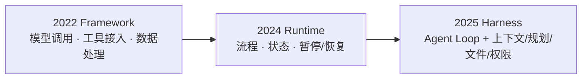

**图 2｜三阶段演进时间轴（2022 / 2024 / 2025）重绘**

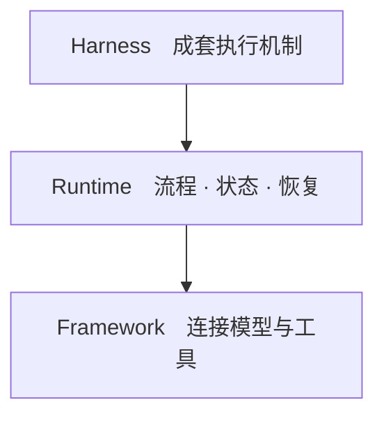

**图 3｜Framework / Runtime / Harness 三层抽象关系重绘**

### 2.1 第一阶段 Agent Framework（2022–2023）

**【视频原述】**「大概在 2022 年，大家就开始尝试基于大模型开发各种应用，但那个时候开发 Agent 的很多基础工作都要自己完成：怎么让模型使用外部的工具、怎么调用不同大模型、怎么接入知识库、怎么把工具执行的结果返回给模型、怎么让模型决定下一步……如果每开发一个 Agent 都要重写一遍，开发成本就太高了。」

画面列出「每个 Agent 都要自己手搓」的四件事：**使用外部工具、调用不同大模型、接入知识库、结果回传给模型**。于是出现了一批把基础能力封装起来的框架：**LangChain、LlamaIndex、CrewAI** 等，覆盖**模型调用 / 工具接入 / 数据处理**。画面示例是「订单查询 Agent」：

```python
from langchain.agents import create_agent

agent = create_agent(
    model="claude-sonnet-4-5",
    tools=[query_order],
    system_prompt="你是订单客服…",
)
```

只需定义提示词、调用规则与工具，很快就能搭出基础版本。**这一类框架主要解决的是「减少重复开发」**。

### 2.2 第二阶段 Agent Runtime（2024）

**【视频原述】**「随着 Agent 执行任务越来越复杂，仅仅把模型和工具连接起来还不够。比如我们要开发一个电商选品 Agent：读取商品信息 → 查询库存·价格·佣金 → 商品打分 → 生成选品结果。这里面的步骤很多，有些需要根据上一步的结果动态决定；如果任务执行到一半失败了，能不能接着之前的进度继续？如果某个环节需要人工确认，能不能先暂停、等用户确认之后再往下走？」

「这已经不只是模型调用 + 工具接入了，我们还需要管理整个任务的执行流程。于是在 2024 年 LangChain 推出了 **LangGraph**，核心就是让开发者能够更明确地控制 Agent 的执行过程。」Runtime 要回答四个问题：

1. **有哪些步骤**
2. **步骤之间怎么流转**
3. **什么时候暂停**（人工确认，先暂停等人确认）
4. **出现异常怎么恢复**（从断点继续，不用重来）

**【视频原述】**「Runtime 解决的是：怎么让 Agent 的执行过程可管、可控。」它在 Framework 之上补的是**流程管理、状态持久化、暂停/恢复与人工介入**。

### 2.3 第三阶段 Agent Harness（2025 起）

**【视频原述】**「第三个阶段是 Agent Harness。随着模型推理与工具调用能力不断提高，Agent 的开发方式又发生了变化：以前开发者往往需要提前把流程安排好，但现在很多任务的流程根本没办法提前规划，也不可能枚举所有情况；现在只给模型一个目标，让它自己规划步骤、调用工具、分析结果，再不断调整下一步的行动。」

画面示例是「研究一家公司的产品」：目标给定后，模型自己决定**搜索资料 → 再搜一轮 → 验证关键信息 → 写代码分析数据 → 整理成报告**。画面还用三个小标签对比了三种执行方式：`01 直线流程`、`02 暂停／恢复`、`03 自主规划`。

**【视频原述】**「模型自主性提高之后，又带来了新的工程问题」——画面给出四个具体追问：

- Agent 连续执行到第 40 步，上下文从 184k 涨到 192k，**上下文越来越长，怎么控制？**
- **文件和中间结果放哪里？**
- **何时调子 Agent？何时停？**
- **工具权限怎么管？**

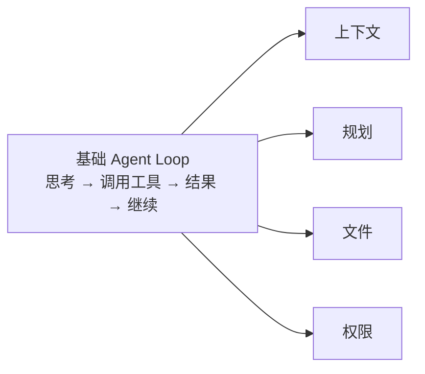

**图 4｜Harness 定义：基础 Agent Loop 与四类能力重绘**

**【视频原述】**「于是 Agent Harness —— 围绕模型的一整套**执行系统**，也因此受到越来越多的关注。基础是 Agent Loop：模型的思考 → 调用工具 → 拿到结果 → 继续执行这个循环；在此之上还提供了上下文管理、规划、文件、权限这四类能力。过去这些能力都得自己手搓，现在现成的 Harness 已经帮我们做好了，我们可以直接使用这套现成的执行系统。」

**【视频原述】**「当然了，Framework、Runtime、Harness 并不是简单的新技术取代旧技术：Harness 复用了 Framework 和 Runtime 的能力。**LangChain 团队**就是一个非常典型的例子——LangChain 主要提供开发基础组件，2024 年推出 LangGraph 做状态管理与持久化执行，2025 年又推出 Deep Agents，在前两者基础上提供一套更完整的 Harness。所以它们是随着模型能力和应用需求变化出现的**不同层次的技术抽象**，不是互相淘汰。」

> **【补充】** 这套三层划分与公开工程资料一致：**Framework** 给开发者定义行为、工具、路由、状态的抽象（LangChain / CrewAI / OpenAI Agents SDK）；**Runtime** 提供持久化执行、会话与进程生命周期、检查点与恢复（LangGraph / Temporal / Inngest）；**Harness** 是「一辆装配好的车」，打包了默认 system prompt、工具注册表、上下文工程、Hook 生命周期、沙箱与权限模型（Claude Code / Codex CLI / Cline）。三者回答的是不同问题，生产系统常同时使用：Framework 编排大流程，每个 Agent 在 Harness 内执行，Runtime 提供环境与状态。详见 [11. 专业名词速查](#11-补充篇-a-专业名词速查-68-条) 与 [13. 架构全景](#13-补充篇-c-架构全景与选型方法)。

---

**本章语音逐字稿（ASR · 已校正，64 句）**

> `[02:04]` 有些则需要根据上一步的结果
> `[02:06]` 决定接下来该怎么做
> `[02:07]` 如果任务执行到一半失败了
> `[02:09]` 能不能接着之前的进度继续
> `[02:12]` 如果某个环节需要人工确认
> `[02:13]` 能不能先暂停
> `[02:14]` 等用户确认之后再往下走
> `[02:16]` 这些已经不只是模型调用和工具接入的事情了
> `[02:20]` 我们还需要办理整个任务的执行流程
> `[02:22]` 保存执行的状态处理中断和恢复
> `[02:25]` 于是在2024年 LangGraph 推出了 LanguRaf
> `[02:28]` 它的核心就是让开发者能够更聪明地
> `[02:31]` 控制 Agent 的执行过程
> `[02:32]` 比如任务有哪些步骤
> `[02:34]` 步骤之间怎么流转
> `[02:35]` 什么时候暂停
> `[02:36]` 以及出现了一场怎么恢复
> `[02:38]` Runtime 解决的是
> `[02:39]` 怎么让 Agent 的执行过程可管理、可恢复
> `[02:42]` 第三个阶段是 Agent harness
> `[02:44]` 随着模型的推理能力
> `[02:46]` 工具调用能力不断提高
> `[02:47]` Agent 的开发方式又发生了变化
> `[02:49]` 以前开发一个复杂的 Agent
> `[02:51]` 开发者往往需要提前把很多执行流程安排好
> `[02:54]` 但现实中有些任务的流程
> `[02:56]` 根本没有办法提前规划
> `[02:57]` 也不可能没去所有的情况
> `[02:59]` 所以我们开始希望只给模型一个目标
> `[03:01]` 让它自己去规划步骤
> `[03:02]` 调用工具、分析结果
> `[03:04]` 再不断地调整下一步的行动
> `[03:06]` 比如让 Agent 帮我们研究一家公司的产品
> `[03:08]` 那模型可以自己决定先搜什么样的资料
> `[03:11]` 哪些信息需要进一步验证
> `[03:12]` 要不要写一段代码分析数据
> `[03:14]` 最后怎么整理成报告
> `[03:16]` 这些步骤
> `[03:17]` 不一定需要开发者提前全部规定好
> `[03:19]` 但是模型的自主性提高之后
> `[03:21]` 又带来了新的工程问题
> `[03:22]` 比如说 Agent 的连续执行几十步
> `[03:24]` 积累了大量的上下文
> `[03:26]` 怎么避免它越来越长
> `[03:27]` 任务执行的过程中文献和中间协会放在哪里
> `[03:30]` 什么时候应该调用自 Agent
> `[03:32]` 什么时候应该停止
> `[03:33]` 怎么管理工具的权限
> `[03:35]` 这些问题逐渐变成了 Agent 开发的重点
> `[03:38]` Agent Harness 因此受到越来越多的关注
> `[03:41]` 那 harness 可以理解成
> `[03:42]` 围绕着模型的一整套执行的系统
> `[03:44]` 它包含基础的 Agent loop
> `[03:46]` 也就是模型的思考、调用工具拿到结果
> `[03:49]` 继续执行这个循环
> `[03:50]` 在此之上还提供了上下文的管理
> `[03:52]` 任务规划、文件系统、工具权限的能力
> `[03:55]` 过去这些能力都得自己手搓
> `[03:57]` 现在成熟的 harness 已经帮我们做好了
> `[03:59]` 我们可以直接使用这套现成的执行系统
> `[04:02]` 再根据业务需求去扩展
> `[04:03]` 当然 Framework runtime harness
> `[04:05]` 并不是简单的新技术取代就技术
> `[04:08]` 实际上 harness 本身就附用了 Framework 和 Runtime 的能力

## 3. 演进带来的影响与七项目的三类划分

**【视频原述】**「那这条技术演进路线影响的是什么呢？影响的就是 **Agent 的开发起点**：过去从模型、工具、数据这些基础组件开始搭；现在如果现成的 Harness 够用，就可以直接复用，不用从零搭。不过，如果你的业务足够简单，或者需要严格的执行流程 / 状态管理，Framework 和 Runtime 依然有价值 —— **并不是所有 Agent 开发都需要 Harness**。」

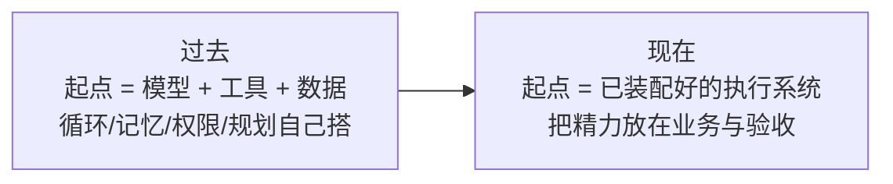

**图 5｜开发起点变化与边界重绘**

**【视频原述】**「讲完技术演进，我们按**主要服务的场景**把这些项目分成三类。」

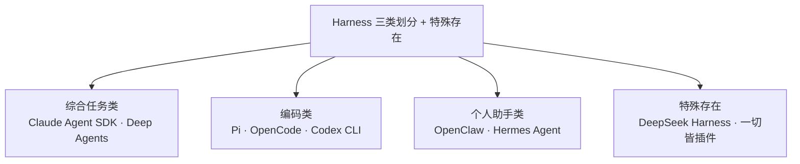

**图 6｜三类场景划分与七个项目归属重绘**

| 类别 | 视频给出的场景词 | 代表项目 | 共同点 |
|---|---|---|---|
| **综合任务类** | 研究、数据分析、文档处理；不局限于某一种业务 | Claude Agent SDK、Deep Agents | 提供比较完整的通用 Harness |
| **编码类** | 代码理解、文件修改、代码执行、执行命令、测试验证 | Pi、OpenCode（以及画面提到的 Codex CLI） | 围绕软件开发场景设计，核心执行机制其实比较相似 |
| **个人助手类** | 多渠道交互、定时任务、长期记忆、持续服务 | OpenClaw、Hermes Agent | 长期运行、记住用户；不只是完成一次任务 |
| **特殊存在** | 不针对具体场景，特点在整个 Harness 高度插件化 · 组合模块 | DeepSeek Harness | 可以通过组合不同的模块，搭出不同执行方式 |

**【视频原述】**「需要说明的是，上面的分类并不是严格的功能边界：各 Harness 的能力已经越来越接近了 —— Coding Agent 也能读取文件、处理数据、生成报告，通用 Agent 也能读写代码、执行命令。它们的主要区别在于**默认提供了哪些能力、针对什么任务做了优化**。另外，个人助手类项目不只是 Harness，而是**完整的 Agent 系统 = Harness + 消息接入 + 任务调度 + …**」

> **【补充】** 视频在 06:21–06:27 之间有一句容易被忽略的限定：Hermes / OpenClaw 这类「完整 Agent 系统」> 单纯 Harness。做选型时要把「执行系统」与「产品外壳」分开看：消息网关、定时任务、用户体系、渠道适配属于 Runtime / 产品层，不是 Harness 本身的职责。这个区分在第 8 章两根轴对比里很关键——三个场景化项目没有落在坐标轴上，正是因为它们的差异主要来自场景外壳。

---

**本章语音逐字稿（ASR · 已校正，56 句）**

> `[04:12]` launching 团队就是一个非常典型的例子
> `[04:14]` 2022年推出了 launching 主要提供 Agent 的开发的技术组建
> `[04:18]` 2024年推出了 LangGraph
> `[04:19]` 补充了状态管理和持久化的执行能力
> `[04:22]` 2025年又推出了 Deep Agents
> `[04:23]` 在前两者的基础上提供一套更加完整的 Agent harness
> `[04:27]` 今天的 Deep Agents 仍然是建立在 launching 和 LangGraph 之上的
> `[04:31]` 所以这三个阶段并不是互相淘汰的关系
> `[04:34]` 而是随着模型能力和应用需求的开发
> `[04:37]` 出现的不同层次的技术抽象
> `[04:39]` 这条技术演进路线影响的是什么呢
> `[04:41]` 影响的就是 Agent 的开发的起点
> `[04:44]` 过去我们可能要从模型工具这些技术组建开始
> `[04:47]` 一点一点去组装一个 Agent
> `[04:48]` 现在如果现成的 harness 的执行机只能满足需求
> `[04:52]` 就可以直接服用
> `[04:53]` 不用再从零搭建
> `[04:54]` 那起点变得更高了
> `[04:55]` 不过你的业务如果足够简单
> `[04:57]` 或者需要严格的执行流程状态管理
> `[04:59]` 那 freemorg 和 Runtime 依然有价值
> `[05:02]` 依然可以用
> `[05:03]` 并不是所有的 Agent 的开发都需要用到 harness
> `[05:06]` 讲完技术的演进
> `[05:07]` 我们再来看看目前有哪些值得关注的 harness
> `[05:10]` 按照主要服务的场景
> `[05:11]` 我把它们分成了三类
> `[05:13]` 第一类是综合任务类的
> `[05:14]` 代表的项目就是 Claude Agent SDK 和 Deep Agents
> `[05:17]` 这类 harness 不局限于某一种业务
> `[05:20]` 可以用于研究数据分析文档处理
> `[05:22]` 代码执行等复杂的任务
> `[05:24]` 第二类是编码类的
> `[05:25]` 代表的项目是 Py 和 OpenCode
> `[05:27]` 另外还有 Codex CLI
> `[05:29]` 这类 harness 最初是围绕着软件开发设计的
> `[05:32]` 重点支持代码的理解文件的修改
> `[05:35]` 执行命令以及测试验证
> `[05:36]` 第三类是个人助手类的
> `[05:38]` 代表的项目是 OpenCode Hormace Agent
> `[05:41]` 这类 Agent 系统更关注长期的记忆
> `[05:43]` 多渠道的交互定时任务
> `[05:45]` 以及持续的为用户去提供服务
> `[05:47]` 除此之外还有一个非常特别的存在
> `[05:49]` 是 DeepSeek Harness
> `[05:51]` 它的特点不是针对于哪种具体的场景
> `[05:54]` 而是在于整个 harness
> `[05:55]` 采用了高度插件化的设计
> `[05:57]` 你可以通过组合不同的模块
> `[05:59]` 把它搭成不同类型的 Agent
> `[06:01]` 需要说明的是
> `[06:02]` 上面的分类并不是严格的功能边界
> `[06:05]` 实际上综合任务类和编码类的 harness 的能力
> `[06:07]` 已经越来越接近了
> `[06:08]` 一个 coding Agent 同样也可以去搜索资料
> `[06:11]` 读取文件处理数据设成报告

## 4. 综合任务类 Claude Agent SDK 与 Deep Agents

**【视频原述】**「首先是综合任务类。典型的代表是 Claude Agent SDK 和 Deep Agents，这两个项目都已经提供了比较完整的 Harness 能力，但设计思路明显不同。」

### 4.1 Claude Agent SDK 把成熟 Harness 封装成可直接用的执行系统

**【视频原述】**「Claude Agent SDK 的本质是把 **Claude Code 的 Harness** 封装成了一套可以直接使用的执行系统。它已经替开发者做好了 Agent Loop、工具的发现与调用、Session 与上下文、以及子 Agent 的执行机制。你只需要配置**自定义工具、Skill、子 Agent 和 Hook**，通过这些定义来改变它的行为，而不能直接替换成另一套机制。」

画面依次展示了 GitHub 仓库 `github.com/anthropics/claude-agent-sdk-python`、`pip install claude-agent-sdk` 与 `$ python agent.py`，并列出「已内置、开箱即用」的能力：`Read · Bash · Grep`、`Session · 上下文`、`子 Agent researcher`。

**【视频原述】**「比如说通过 Hook，你可以在工具调用前检查参数、阻止执行，也可以在执行后去检查结果；还可以自定义系统的提示词。」画面给出 Hook 代码与三条注释：`① 检查参数`、`② 阻止执行`、`③ 执行后检查结果`，并展示 `options = ClaudeAgentOptions(hooks={"PreToolUse": [HookMatcher("Bash", [guard])], "PostToolUse": ...}, system_prompt="你是团队的数据分析助手", allowed_tools=["Bash","Read","query_orders"])`。

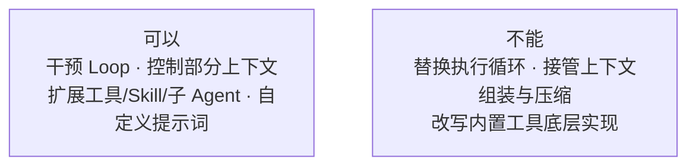

**图 7｜Claude Agent SDK「可以 / 不能」对照重绘**

**【视频原述】**「但它的核心机制是**预置的**：你可以干预 Agent Loop、控制部分上下文的内容、扩展工具，但不能替换整个执行循环、不能接管上下文组装和压缩的机制、也不能改写内置工具的底层实现。这个设计的取舍非常明确：优点是你不需要自己去设计整套执行系统，可以直接复用 Claude Code 的成熟机制，大量减少基础开发工作；限制也在这 —— 如果你需要一套与 Claude Code 不同的执行架构，就可能会受到 SDK 扩展接口的约束。」

> **【视频原述】** 「所以 Claude Agent SDK 适合：**你要认可 Claude Code 默认的执行方式，希望在此基础上快速开发**；如果技术基础相对薄弱、或者可以借助 Vibe Coding 完成开发，它是最值得优先考虑的方案，不需要自己从零搭建 Harness。」

> **【补充】** 官方定位：Claude Agent SDK（原 Claude Code SDK 更名）把 Claude Code 的 agent harness 作为 Python / TypeScript 库暴露，内置文件读写编辑、Bash、Glob/Grep、Web 工具，外加权限系统、Hooks、Subagents、MCP、Skills 与可恢复 Session。Anthropic 同时提供另外三种路径：手写 Message API tool loop（只有自己定义的工具）、Tool Runner（在自定义工具上跑循环）、Managed Agents（Anthropic 托管沙箱）。SDK 是「harness only」——**你仍需自己托管部署**。它的设计前提是「给 Agent 一台计算机」，循环为 `gather context → take action → verify work → repeat`。

### 4.2 Deep Agents 在 LangGraph 之上把执行策略做成可组合模块

**【视频原述】**「Deep Agents 同样提供了比较完整的 Harness。和 Claude Agent SDK 更强调复用一套成熟的执行机制不同，**Deep Agents 更强调开放和可定制**。」

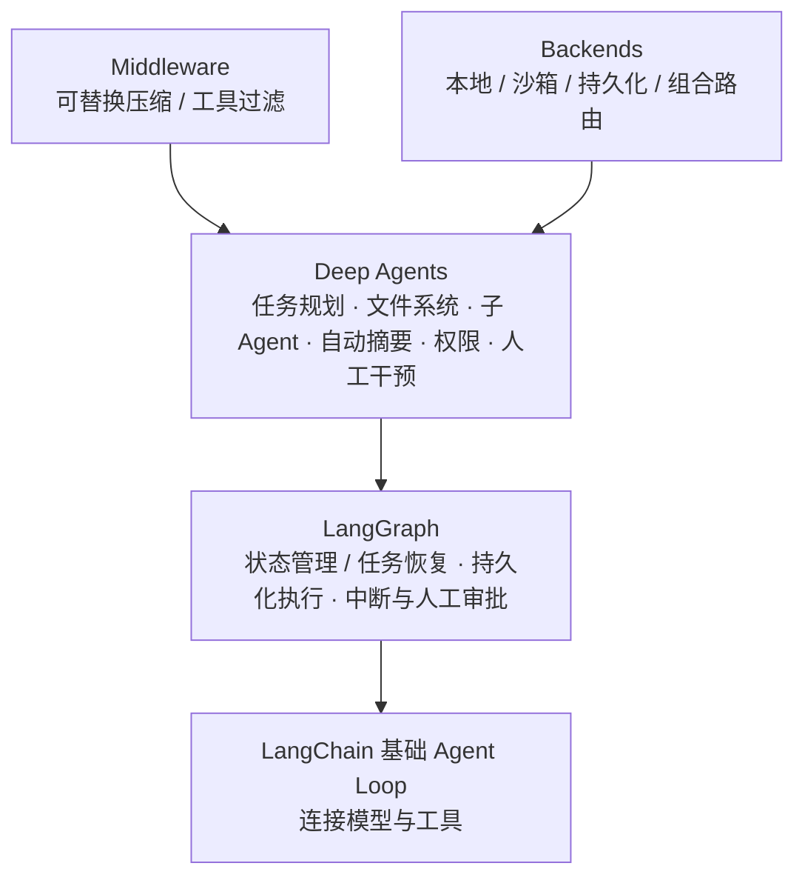

**图 8｜Deep Agents 分层架构与两大特点重绘**

**【视频原述】**「我们前面提到 Deep Agents 是建立在 LangChain / LangGraph 之上的：它自己的 Agent Loop 与状态管理、任务恢复来自 LangGraph，在这个基础上封装了**任务规划、文件系统和子 Agent** 等能力。它有两个特点。」

**特点一：Middleware（中间件）**。「Middleware，也就是中间件，把 Harness 的不同执行策略拆成独立模块，让开发者按需调整。比如说你对默认的上下文压缩方式不满意，可以自定义压缩策略；也可以在模型调用前修改上下文、调整可用工具。」画面代码框出现 `create_deep_agent(model=..., tools=[search, query_db], middleware=[MyCompaction(), ToolFilter()])`，并标注「# 替换压缩策略」「# 调整可用工具」。

**特点二：Backends（可插拔文件系统 / 执行环境）**。「可以灵活选择文件存储 / 执行环境：本地文件、远程沙箱、持久化存储，甚至用 CompositeBackend 把不同路径路由到不同后端，不绑定一种固定环境。你不需要把文件管理和代码执行自己写一遍。」画面给出 `backend=CompositeBackend(default=FilesystemBackend("./work"), routes={"/memories/": StoreBackend()})`。

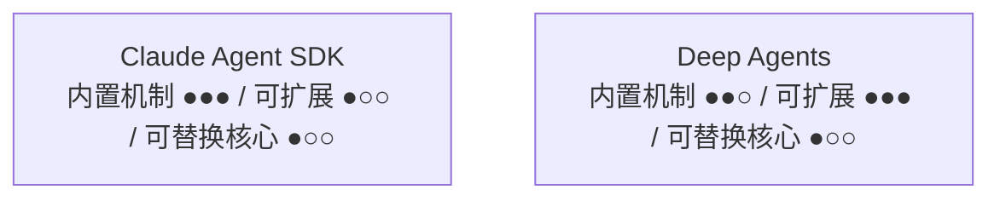

**图 9｜两个综合任务类项目的控制权对照重绘**

**【视频原述】**「相比较 Claude Agent SDK，你对这些内部机制的控制空间更大。」画面用「场景：企业 Agent · 服务多个客户」示意：客户 A / B / C 分别对应数据库、文件存储、沙箱环境。「所以如果你做的是企业的 Agent、需要服务多个客户，对数据的存储和执行环境又有特殊的需求，Deep Agents 的优点是**默认完整，也能定制**；它的限制是灵活性更高，意味着更多技术决策 —— 怎么配合执行环境、怎么组合不同的处理策略、本地运行还是远程沙箱，都要自己定。更适合既想复用成熟 Harness、又想灵活调整执行环境与运行策略的团队。」

> **【补充】** 官方把 Deep Agents 定义为 *"the batteries-included agent harness"*，默认提供 `write_todos` 规划、`ls/read_file/write_file/edit_file/glob/grep` 文件系统、`execute`（沙箱后端）、`task` 子 Agent、自动摘要压缩、声明式文件系统权限与人工审批中断。可插拔后端包括 StateBackend（内存状态）、FilesystemBackend（本地磁盘）、StoreBackend（LangGraph Store 跨线程持久化）、SandboxBackend（Modal / Daytona / Deno）与 CompositeBackend。大工具结果（默认超过约 20k tokens）会自动 offload 到文件系统，上下文里只留路径与预览 —— 这是与 Claude SDK「预置压缩机制」最本质的差别。

---

**本章语音逐字稿（ASR · 已校正，57 句）**

> `[06:13]` 而一个通用 Agent 也可以去读写代码执行命令
> `[06:15]` 它们的主要区别在于
> `[06:17]` 默认提供了哪些工具
> `[06:18]` 针对什么任务做了优化
> `[06:20]` 另外 OpenCode Harness 也不只是 harness
> `[06:22]` 而是一套完整的 Agent 系统
> `[06:24]` 包含了 harness 消息介入任务调度等能力
> `[06:27]` 下面我们就按这几个类别
> `[06:29]` 看看每个项目最有特点的设计是什么
> `[06:31]` 以及它们分别适合什么样的开发需求
> `[06:34]` 首先是综合任务类的
> `[06:35]` 典型的代表是 Claude Agent SDK 和 Deep Agents
> `[06:38]` 这两个项目都已经提供了比较完整的 harness 能力
> `[06:42]` 但设计思路明显不同
> `[06:44]` 先看 Claude Agent SDK
> `[06:46]` Claude Agent SDK 的本质是把 Claude Code 的 harness
> `[06:49]` 封装成了一套可以直接使用的执行系统
> `[06:52]` 它已经替开发者做好了 Agent loop
> `[06:54]` 工具的发现与调用
> `[06:56]` 塞胜和上下文管理
> `[06:57]` 以及紫 Agent 的执行机制
> `[06:59]` 你只需要通过 page hook
> `[07:01]` 自定义的工具 scale 和紫 Agent 的定义来改变它的行为
> `[07:05]` 但是不能把底层的核心实现直接替换成另一套机制
> `[07:09]` 比如说通过 hook
> `[07:10]` 你可以在工具调用前去检查参数
> `[07:12]` 阻止执行也可以在执行后去检查结果
> `[07:15]` 还可以自定义系统的提示词
> `[07:17]` 决定往上下文里补充哪些信息
> `[07:19]` 工具方面
> `[07:20]` 它已经内置了 page 文件操作等基础工具
> `[07:22]` 也支持开发者增加自己的业务工具
> `[07:24]` 但它的核心机制是预制的
> `[07:26]` 你可以干预 Agent loop
> `[07:28]` 却不能任意替换整个执行循环
> `[07:31]` 你可以控制部分上下文的内容
> `[07:33]` 但是不能完全接管上下文组装和压缩的机制
> `[07:35]` 你可以去扩展工具
> `[07:37]` 但是不能直接改型内置工具的底层实现
> `[07:40]` 这个设计的取舍非常明确
> `[07:42]` 优点是你不需要自己去设计整套执行系统
> `[07:44]` 可以直接附用 Claude code 的成熟的机制
> `[07:47]` 减少大量的基础排发工作
> `[07:49]` 限制也在这
> `[07:50]` 你对核心机制的控制权有限
> `[07:52]` 如果你需要一套与 Claude code 的完全不同的执行架构
> `[07:55]` 就可能会受到 sdk 扩展接口的约束
> `[07:57]` 所以 Claude Agent SDK 更适合这样的团队
> `[08:00]` 你要认可 Claude code 默认的执行方式
> `[08:03]` 希望在此基础上快速开发自己的业务的 Agent
> `[08:06]` 对于小白来说
> `[08:07]` 如果基础基础相对薄弱
> `[08:08]` 但有一定的开发能力
> `[08:10]` 或者是可以借助 web coding 完成开发
> `[08:12]` 那它是最值得优先考虑的方案
> `[08:14]` 因为它封装的程度比较高
> `[08:16]` 不需要自己从零搭建 Harness

## 5. 编码类 Pi 与 OpenCode

**【视频原述】**「接下来我们再来看看编码类，代表项目有 Pi 和 OpenCode（另外还有 Codex CLI）。Coding Agent 和综合任务类的 Agent，核心执行机制其实比较相似，区别是围绕软件开发场景设计，所以会更重视**代码搜索、命令执行和测试验证**。」

### 5.1 Pi 极简，把更多设计留给开发者

**【视频原述】**「Pi 最大的特点是**极简**：尽量减少框架预置功能，把设计留给开发者。默认只有四个工具：`read / write / edit / bash`。像任务规划、多 Agent 协作这样的能力，Pi 并没有强制去内置一套固定的方案，而是通过 Extension 自己扩展。」

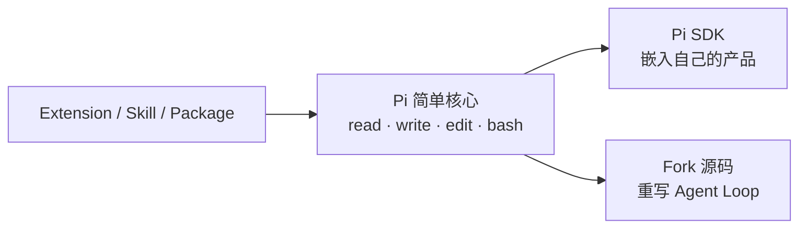

**图 10｜Pi 极简核心与四层扩展路径重绘**

画面展示了 Pi 的 README（`github.com/earendil-works/pi/.../coding-agent/README.md`）与官网 `pi.dev/docs/latest/extensions`：*"Pi is a minimal, extensible agent harness. Adapt Pi to your workflows, not the other way around."*，以及 `tools: read write edit bash`。

**【视频原述】**「而且 Pi 的扩展机制也很开放：不只是加工具，还能深入干预执行过程 —— **拦截工具调用、修改上下文、覆盖内置工具**。」画面给出 `pi.on("tool_call", ...)`、`pi.on("context", trimContext)`、`pi.on("session_before_compact", myCompact)`、`pi.registerTool({ name: "read", ...safeRead })`，并列出官方 Extension 能力：自定义工具、事件拦截、用户交互、自定义 TUI 组件、自定义命令、Provider / MCP Server、权限门、Git checkpoint、路径保护。

**【视频原述】**「那相比 Claude Agent SDK，Pi 在工具实现上的定制空间更大；而且它有 SDK，可以直接把 Agent 能力嵌入自己的产品 —— **OpenClaw 早期就是通过复用 Pi 的能力来构建个人助手的**。如果你想彻底重写 Agent Loop，它开源，可以直接改源码：画面展示了 `agent-loop.ts` 的 while 循环，以及技术团队 A / B / C 各自 fork 出自己的 Harness。」

**【视频原述】**「它的优点是核心简单灵活，不必接受过多预置执行策略；限制就是很多高级能力需要自己组合和维护 —— 记忆、子 Agent、权限、规划都是『待组装』的空位。所以 Pi 更适合希望自己掌握 Agent 执行逻辑、从轻量核心出发开发自己 Agent 产品的团队。」

> **【补充】** Pi（`@mariozechner/pi-coding-agent`，作者 Mario Zechner / badlogic，仓库 `badlogic/pi-mono`，TypeScript，MIT）的官方定位是 *A minimal terminal coding harness*。它刻意不内置 MCP、子 Agent、权限弹窗、Plan 模式、Todo、后台 Bash；系统提示词不到 1000 tokens（对比 Claude Code 约 14,000+；每次请求固定开销 Claude Code ≈32,800 / OpenCode ≈6,900 / Pi <1,000 tokens，为公开社区实测口径，非视频原述）。扩展分三档：Extensions / Skills / Pi Packages（npm 或 git 分发）。SDK 侧的包包括 `pi-ai`（模型与 provider 抽象）、`pi-agent-core`（Agent 循环与工具执行）、`pi-coding-agent`（createAgentSession 等高层 API）、`pi-tui`。

### 5.2 OpenCode 预置一整套软件开发工作机制

**【视频原述】**「如果说 Pi 追求的是极简，那 OpenCode 提供一套比较完整的软件开发工作机制。它不仅内置常用工具，还预置了不同的 Agent：**Build Agent** 负责改代码、跑命令；**Plan Agent** 负责分析问题、给方案，默认不直接修改普通项目文件；还有 **Explore** 等子 Agent 负责搜索、理解代码库。」

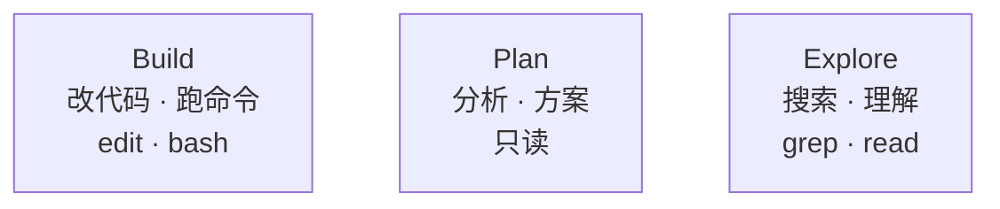

**图 11｜OpenCode 三种预置 Agent 权限表重绘**

**【视频原述】**「不同 Agent 不同任务，使用不同的工具和权限 —— 而且不是写死的，可以增加自己的 Agent。画面示例：`> 给订单列表加分页` 用 Build（`edit src/orders.ts`、`bash npm test`）；`Tab` 切到 Plan：`> 先分析列表为什么慢`（只读分析，不改普通项目文件）；`@explore 找出所有调用 fetchOrders 的地方` → `grep fetchOrders → 6 处`。」

**【视频原述】**「它的优点是已经把读写文件、终端命令、测试这些常用工具和工作机制整合好，开箱即用；如果你想开发自己的 Coding Agent，不需要重新设计整套系统。但它的很多默认机制都围绕软件开发 —— 如果你想做一个完全不同的业务 Agent（比如客服 / 财务），预置逻辑要大量调整。所以 OpenCode 更适合基于成熟开源 Coding Agent 开发自己的编程工具或软件开发 Agent；**反过来，如果目标不是 Coding Agent，就优先考虑 Pi**。」

> **【补充】** OpenCode（Anomaly / 原 SST 团队，MIT，TypeScript + Bun）采用 **client-server 架构**：TUI / Desktop / Web / IDE 扩展作为客户端，本地 HTTP 服务器负责 Agent 运行时、工具执行、会话管理与 LSP 进程；SQLite 持久化会话。模型无关，通过 Models.dev 注册表可接 75+ provider（含本地 Ollama）。差异化能力是 **LSP 集成**：`/init` 自动检测语言并启动对应 LSP server，让 Agent 拿到诊断、跳转定义等 IDE 级信号。公开资料也提示过 client-server 架构带来的额外攻击面（曾出现未认证 RCE 漏洞，已修复）——这是「开箱即用」之外的运维代价。

---

**本章语音逐字稿（ASR · 已校正，63 句）**

> `[08:18]` 接下来是 launching 的 Deep Agents
> `[08:20]` 它和 Claude Agent SDK 一样
> `[08:22]` 也提供了比较完整的 Harness
> `[08:24]` 那两者最大的区别是
> `[08:25]` Claude Agent SDK 更强调
> `[08:27]` 附用一套成熟的执行机制
> `[08:29]` 而 Deep Agents 更强调开放和可定制
> `[08:32]` 那我们前面提到
> `[08:33]` Deep Agents 是建立在 launching 和 LangGraph 之上的
> `[08:36]` 那它的 Agent loop 是由 launching 提供
> `[08:38]` 那状态管理和任务恢复
> `[08:40]` 负责由 LangGraph 负责
> `[08:42]` 它在这个基础上封装了任务规划
> `[08:44]` 杀项文管理文件系统和子 Agent 的能力
> `[08:47]` 它比较有特点的设计有两个
> `[08:49]` 第一个是 Middleware
> `[08:50]` 也就是中间键
> `[08:51]` 那可以理解成
> `[08:51]` 把 Harness 的不同执行策略拆成独立的模块
> `[08:54]` 让开发者安须调整
> `[08:56]` 比如说你对默认的杀项文压缩方式不满意
> `[08:58]` 你就可以直接替换相应的处理策略
> `[09:00]` 也可以在模型调用前去修改上下文
> `[09:03]` 调整可用的工具
> `[09:04]` 那相比较 Claude Agent SDK
> `[09:06]` 你对这些内部机制的控制空间更大
> `[09:08]` 那第二个是 Deep Agents
> `[09:10]` 可以灵活的去选择文件存储和代码的执行环境
> `[09:12]` 比如说 Agent 需要分析数据
> `[09:14]` 生成文件
> `[09:15]` 你可以让它使用本地的文件
> `[09:16]` 也可以让它进入远程的杀项来执行代码
> `[09:19]` 还可以把需要长期保存的信息
> `[09:21]` 放在持久化的存储中
> `[09:23]` 那这样的好处是
> `[09:26]` 都绑定在一种固定的环境里
> `[09:28]` 可以根据不同业务的需求选择合适的实现方式
> `[09:31]` 所以如果你做的是企业的 Agent
> `[09:33]` 需要服务多个客户
> `[09:34]` 对数据的存储和执行环境又有特殊的需求
> `[09:37]` 那这一点会更有价值
> `[09:39]` 那 Deep Agents 的优点是
> `[09:40]` 既提供了一套默认的 Harness
> `[09:42]` 又给开发者保留了更大的定时空间
> `[09:45]` 那它的限制是灵活性更高
> `[09:47]` 那开发者就需要自己做的技术决策就更多
> `[09:49]` 你比如说怎么配合执行环境
> `[09:51]` 怎么组合不同的处理策略
> `[09:52]` 都会增加一定的开发和维护成本
> `[09:55]` 所以 Deep Agents 更适合这样的团队
> `[09:57]` 你即向服用成熟的 Harness
> `[09:58]` 又需要灵活调整上下门
> `[10:00]` 执行环境和运行策略
> `[10:02]` Claude Agent SDK
> `[10:03]` 主要开放的是执行过程中的控制点
> `[10:05]` 而 Deep Agents 则把更多的执行策略做成了
> `[10:08]` 可以配置拓展和组合的模块
> `[10:10]` 那说完综合任务类的
> `[10:12]` 接下来我们再来看看编码类的
> `[10:14]` 也就是 coding Agent Harness
> `[10:15]` 那它代表的项目有派
> `[10:17]` OpenAI code 和 codex CLI
> `[10:19]` coding Agent 和综合任务类的 Agent

## 6. 个人助手类 OpenClaw 与 Hermes Agent

**【视频原述】**「前面介绍的更多围绕 Agent 怎么完成任务，接下来我们看个人助手类。这一类有一个明显的不同：**它们不只是完成一次任务，而是长期运行、记住用户**。而且它们不只是 Harness，而是完整的 Agent 系统 = Harness + 消息接入 + 任务调度 + …」

### 6.1 OpenClaw 个人助手的管理中心

**【视频原述】**「OpenClaw 可以理解成是个人助手的**管理中心**。比如说你可以通过飞书、微信发消息，Gateway 会负责接收消息、识别用户和 Session，再交给 Agent 执行，最后把结果返回给用户。」

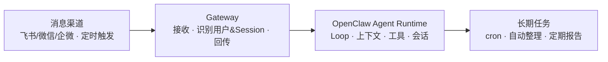

**图 12｜OpenClaw Gateway 架构与长期任务重绘**

**【视频原述】**「它还内置了**定时任务和事件触发**，可以每天自动整理信息、定期生成报告，不用用户每次手动发起。」画面给出 `docs.openclaw.ai/automation/cron-jobs` 与命令 `openclaw cron add --name "早报" --cron "0 9 * * *" --message "整理今天的行…"`。

**【视频原述】**「前面提到 OpenClaw 早期是通过复用 Pi Agent SDK 构建个人助手的；现在它已经发展出了自己的 Agent Runtime，能够独立地管理 Agent Loop、上下文、工具执行和会话，并通过插件扩展能力。**核心价值是把执行能力、消息渠道和长期任务管理整合到了一起**。如果你想搭建一个长期运行的个人助手，不用从零搭消息接入、任务调度和会话管理这些基础设施。限制也很明显：部署和维护成本更高，普通的任务型 Agent 未必需要。」

> **【补充】** OpenClaw 官方文档写明运行的是「源自 pi-mono 的嵌入式 Agent Runtime」：通过 `createAgentSession()` 直接实例化 Pi SDK，而非子进程调用；Gateway 负责渠道、Session 解析、队列串行化与生命周期事件桥接。工作区（`agents.defaults.workspace`）是唯一 cwd，首轮会自动注入 `AGENTS.md`（操作指令）、`SOUL.md`（人格与边界）、`TOOLS.md`、`IDENTITY.md`、`USER.md` 等引导文件；`BOOTSTRAP.md` 为一次性启动仪式，完成后删除。这与「记住用户」的产品诉求直接对应。

### 6.2 Hermes Agent 持续学习，把经验沉淀成 Skill

**【视频原述】**「另一个就是 Hermes。和 OpenClaw 相似的地方是多渠道交互能力、定时任务、长期记忆；它最有特点的是**持续学习机制** —— 不只是让 Agent 记住过去的对话，而是把完成任务的经验沉淀下来。」

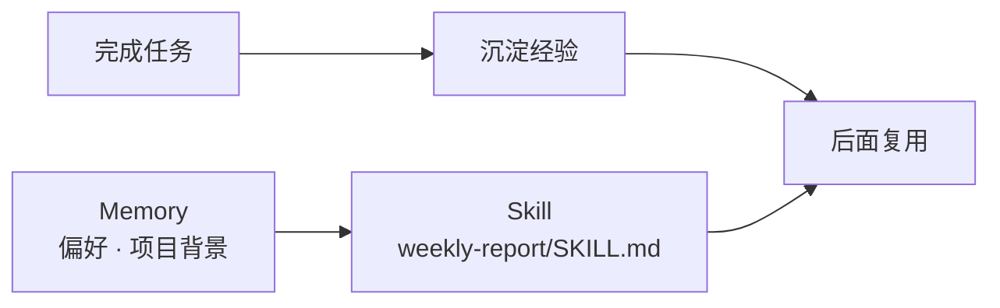

**图 13｜Hermes 持续学习闭环重绘**

**【视频原述】**「这里面有两个核心设计：**Memory 用来保存用户的偏好和长期信息**（画面例子：偏好『结论先行、要数据』，项目背景『电商后台』）；**Skill 则用来保存完成某类任务的方法**。比如说你经常让 Agent 帮你写周报，最开始你需要告诉他周报的结构，写几次之后 Agent 可能会逐渐把这套方法总结出来，存成 Skill（画面：`weekly-report/SKILL.md`），以后再写周报直接复用这套方法就行。」

**【视频原述】**「所以它的特点是把任务执行、记忆和技能积累串起来，让 Agent 在长期使用过程中越用越顺手（画面：第 1 次 10 步 → 第 2 次 6 步 → 第 3 次 3 步）。好处是同一类任务越用越顺手；但**错误的经验也会被沉淀，后面可能就会一直重复这个错误**，所以它也对记忆和技能的修改做人工审批。总结：想要完整个人助手、接入 IM（飞书/微信/企微），可以优先考虑 OpenClaw。」

> **【补充】** Hermes Agent 是 Nous Research 开源的 self-improving agent（Python，MIT），核心是 **E-A-A-S 闭环：Execute → Evaluate → Abstract → Store**：任务完成后反思表现，用 `skill_manage` 把可复用模式写成 Markdown 技能文件，并更新 `MEMORY.md` / `USER.md`；下次遇到相似任务先查技能库与 FTS5 会话索引。内置 40+ 工具，涵盖文件、Shell、浏览器、Web、消息渠道与自然语言 Cron。公开源码分析还指出它是「prompt-cache-first 的同步 ReAct 内核」：系统提示词在会话期间冻结，压缩是唯一允许的改写，新能力默认走 skill / plugin / MCP 而非往核心加工具。视频里「错误经验也会沉淀」正是这类自学习系统的典型风险。

---

**本章语音逐字稿（ASR · 已校正，61 句）**

> `[10:21]` 核心执行机制其实比较相似
> `[10:23]` 区别在于 coding Agent
> `[10:25]` 是围绕着软件开发场景设计的
> `[10:27]` 所以会更重视代码的搜索文件的修改
> `[10:30]` 命令的执行和测试验证
> `[10:32]` 首先是派
> `[10:33]` 派最大的特点是基减
> `[10:35]` 尽可能的减少框架预置的功能
> `[10:36]` 把更多的设计留给了开发者
> `[10:38]` 它内置了基础的 Agent 的 loop
> `[10:40]` 但是默认只有四个工具
> `[10:41]` 读取文件、写入文件、编辑文件和执行命令
> `[10:45]` 那像任务的规划多 Agent 的协作这样的能力
> `[10:48]` 派并没有强制去内置一套固定的方案
> `[10:50]` 而是允许开发者通过 extension 自己扩展
> `[10:53]` 而且派的扩展机制也很开放
> `[10:55]` 不只能增加工具
> `[10:57]` 还能深入干预执行过程
> `[10:58]` 比如说拦截工具的调用
> `[11:00]` 修改上线文、提缓压缩策略
> `[11:02]` 甚至覆盖内置工具的实现
> `[11:04]` 那相比 Claude Agent SDK
> `[11:06]` 它在执行策略和工具实现上的定制空间更大
> `[11:09]` 派还提供 SDK
> `[11:10]` 可以直接把 Agent 的能力嵌入自己的产品
> `[11:12]` 那 OpenClaw 早期就是通过
> `[11:14]` 附用派的能力来构建个人助手的
> `[11:16]` 那另外派的核心代码是开源的
> `[11:18]` 如果你想彻底重新 Agent 的 loop
> `[11:20]` 可以直接改原码
> `[11:21]` 所以很多有能力的技术团队
> `[11:23]` 想要打造自己的 harness 的时候都会选择派
> `[11:26]` 那它的优点是核心简单、灵活
> `[11:29]` 开发者可以根据自己的需求构建 harness
> `[11:31]` 不必接受过多预置的执行策略
> `[11:33]` 那它的限制
> `[11:34]` 就是很多的高级能力需要自己组合和维护
> `[11:37]` 那对于开发者的技术能力是有一定要求的
> `[11:39]` 所以派更适合这样的团队
> `[11:41]` 你希望自己掌握 Agent 的执行逻辑
> `[11:43]` 从一个轻量的核心出发
> `[11:45]` 开发自己 Agent 的产品
> `[11:47]` 那接下来是 OpenCode
> `[11:48]` 如果说派追求的是极简
> `[11:50]` 让开发者自己决定做什么扩展
> `[11:52]` 那 OpenCode 的思路就是提供一套比较完整的
> `[11:55]` 软件开发工作机制
> `[11:56]` 它不仅内置了 Agent 的 loop
> `[11:58]` 还预置了不同的 Agent 的角色和执行方式
> `[12:00]` 比如说标的 Agent 负责世界开发
> `[12:02]` 可以修改代码执行命令
> `[12:04]` planagent 主要负责分析问题指定方案
> `[12:06]` 默认不直接修改普通项目文件
> `[12:09]` 还有 explore 等自 Agent 用于搜索和理解代码库
> `[12:12]` 也就是说 OpenCode 已经帮开发者设计好了
> `[12:15]` 一整套软件开发的工作方式
> `[12:17]` 不同 Agent 负责不同的任务
> `[12:19]` 使用不同的工具和权限
> `[12:20]` 不过这些角色也不是写死的
> `[12:22]` 你可以修改他们的提示词、模型和权限
> `[12:24]` 也可以增加自己 Agent

## 7. 特殊存在 DeepSeek Harness

**【视频原述】**「最后一个 **DeepSeek Harness**，我把它单独拿出来，是因为它的技术设计和前面几个项目都不一样。」画面给出的关键词是 **Everything is a Plugin**（中文常译作「一切皆插件」；括号内为释义，画面原文是英文）。

**【视频原述】**「很多 Harness 都支持插件，但通常只是增加工具 / Skill，或者在固定的执行机制上去扩展功能。不管是 Deep Agents、Pi 还是 OpenClaw，**都有内置 Agent Loop**，区别只在于允许多大程度的干预和改造。」

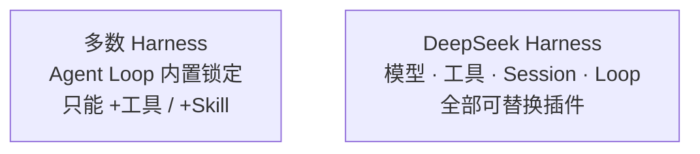

**图 14｜DeepSeek Harness「一切皆插件」对照重绘**

**【视频原述】**「DeepSeek Harness 更进一步：**它把模型、工具、Session、Agent Loop 都设计成了可以替换的插件**。如果你对默认的 Agent Loop 不满意，可以组合插件把它替换掉，而不用直接去改框架的核心代码。」画面展示官方文档 `deepseek-harness.github.io/deepseek-harness/reference/…` 与示意代码：

```typescript
// plugins/my-loop.ts（画面标注：示意）
// 默认 Agent Loop 不满意？写个插件换掉
export const name = "my-agent-loop";
ctx.provide("agent-loop", new PlanThenAct());   // 不改框架核心代码
```

画面左侧两行小字点明底层：`底层：Cordis 插件架构`、`模块协作 · 组合出执行方式`，并列出 `model · tools · session · loop 全部可替换`。

### 7.1 与 Pi 的对比 两种「灵活」不是一回事

**【视频原述】**「它和 Pi 虽然都强调灵活，但思路不同：**Pi 是尽量让核心保持简单**；**而 DeepSeek Harness 是把核心本身也做成了可以替换的模块**。」

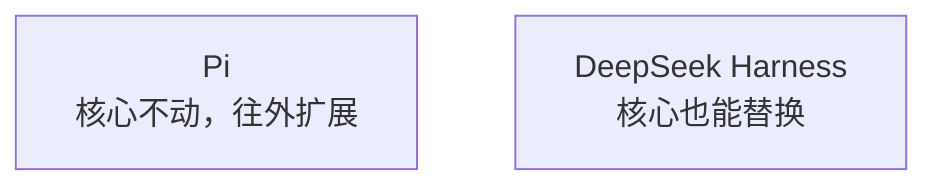

**图 15｜Pi vs DeepSeek Harness 的两种灵活重绘**

| 维度 | Pi | DeepSeek Harness |
|---|---|---|
| 核心策略 | 核心极简且不动，能力往外挂 | 核心拆成服务声明与可替换实现，Loop 也能换 |
| 替换成本 | 加扩展很轻；要重写 Loop 需 fork 源码 | 写插件即可替换，不动框架核心代码 |
| 认知负担 | 低：只需理解 4 个工具与事件接口 | 高：要理解服务声明、实现包、组合点之间的协作 |
| 典型用途 | 从轻量核心出发做自己的 Agent 产品 | 研究不同 Agent Loop、搭自己的 Harness 平台 |

**【视频原述】**「优点是**自由程度非常高**：可以研究不同 Agent Loop，或者想搭建自己的 Agent Harness 平台时，灵活组合底层能力。代价是**开发者需要理解更多的内部机制，模块之间的组合和维护也比较复杂**。更适合想要研究和定制 Harness 底层架构的开发团队，普通业务未必需要这么高的自由度。」

> **【补充】** 官方表述是 *Model + Harness = Agent*：Harness 负责「模型之外的一切」，并通过服务（service）/ 实现包（provider）/ 组合点（composition seam）把能力解耦；`ctx.provide("agent-loop", …)` 属于服务注册式的替换，而非补丁式 Hook。这与 Claude Agent SDK 的 `PreToolUse / PostToolUse`（只能拦截）、Deep Agents 的 Middleware（能替换策略但不能换 Loop）构成一条清晰的**控制粒度阶梯**：*拦截 → 替换策略 → 替换核心*。

---

**本章语音逐字稿（ASR · 已校正，70 句）**

> `[12:26]` 通过插件去扩展功能
> `[12:27]` 它的优点是已经把软件开发
> `[12:29]` 常用的工具和工作机制整合好了
> `[12:31]` 如果你想开发自己的 coding Agent
> `[12:33]` 可以直接附用
> `[12:34]` 不需要重新设计整套系统
> `[12:35]` 但限制也在这
> `[12:36]` 它的很多默认机制
> `[12:38]` 都是围绕着软件开发设计的
> `[12:40]` 如果你想做一个完全不同的业务 Agent
> `[12:42]` 可能需要调整大量的预置逻辑
> `[12:44]` 所以 OpenCode 更适合站的团队
> `[12:46]` 你想要基于一个成熟的开源 coding Agent
> `[12:49]` 直接开发自己的编程工具
> `[12:51]` 或者是软件开发 Agent
> `[12:53]` 反过来
> `[12:54]` 如果你的目标不是 coding Agent
> `[12:56]` 更希望从一个简单的核心出发
> `[12:58]` 自由设计执行方式
> `[12:59]` 那 py 可能更合适
> `[13:01]` 前面介绍了 Claude Agent SDK Deep Agents
> `[13:04]` 以及 py 和 OpenCode
> `[13:06]` 更多是围绕着 Agent
> `[13:07]` 怎么完成任务来设计的
> `[13:08]` 接下来我们看一下个人助手类的
> `[13:11]` 代表的项目就是 OpenClaw 和 Harness
> `[13:13]` 这一类有一个明显的不同
> `[13:15]` 他们不只是完成一次任务
> `[13:17]` 而是希望 Agent 能够长期运行
> `[13:19]` 记住用户的信息
> `[13:20]` 甚至主动发起任务
> `[13:22]` 那先来看 OpenClaw
> `[13:23]` 它的核心设计之一是 getaway
> `[13:25]` 可以理解成是个人助手的管理中心
> `[13:27]` 比如说你可以通过飞书
> `[13:29]` 微信给 Agent 的发送任务
> `[13:31]` getaway 会负责接收消息
> `[13:33]` 识别用户和 session
> `[13:34]` 再交给对应的 Agent 的执行
> `[13:36]` 那最后再把结果返回给用户
> `[13:37]` 它还内置了定时任务事件出发的机制
> `[13:40]` 可以每天自动整理信息
> `[13:42]` 定期生成报告
> `[13:43]` 不用用户每次手动发起
> `[13:45]` 那前面提到 OpenClaw 早期是基于
> `[13:46]` 派的 Agent SDK 构建的
> `[13:48]` 那现在它已经发展出了自己的 Agent runtime
> `[13:51]` 能够独立的管理 Agent loop
> `[13:52]` 上下文工具执行
> `[13:54]` 也可以通过插件去扩展能力
> `[13:55]` 所以 OpenClaw 的核心价值
> `[13:57]` 是把 Agent 的执行能力
> `[13:58]` 消息渠道和长期任务管理整合到了一起
> `[14:01]` 那有了它
> `[14:02]` 如果你想搭建一个长期运行的个人助手
> `[14:05]` 就不需要从零开发消息
> `[14:06]` 介入任务调度和绘画管理
> `[14:08]` 这些基础的设施
> `[14:09]` 那它的现实也很明显
> `[14:10]` 作为一套相对完整的系统
> `[14:12]` 它的部署和维护的成本更高
> `[14:14]` 如果只是想开发一个普通的任务性 Agent
> `[14:16]` 很多能力可能根本用不上
> `[14:18]` 那另一个就是 Hermes
> `[14:19]` 它和 OpenClaw 有很多相似的能力
> `[14:22]` 比如说多渠道的交互能力
> `[14:23]` 定时任务和长期记忆
> `[14:24]` 它最有特点的是持续学习机制
> `[14:27]` 它不只是让 Agent 的记住过去的对话
> `[14:29]` 还希望 Agent 能把完成任务的经验沉淀下来

## 8. 七个 Harness 横向对比 两根轴

**【视频原述】**「7 个项目都介绍完了，我们用一张表来对比一下不同 Harness。最大的差异，**不在于有没有**：工具调用、上下文管理、多 Agent —— 这些已经是比较通用的能力了。」

**【视频原述】**「真正的差异是**它们默认帮开发者实现了什么机制，又开放了多少控制权**。」画面据此画了一张两轴坐标图：纵轴「默认帮你实现了多少机制」（下少上多），横轴「开放了多少控制权」（左少右多）。

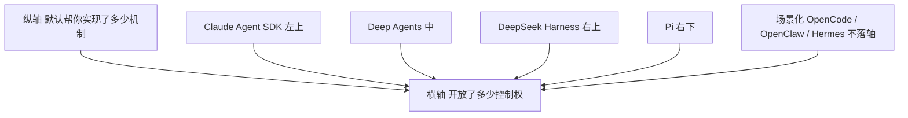

**图 16｜七个 Harness 横向对比坐标图（按视频画面逐点重绘）**

| 项目 | 画面中的定位 | 默认机制 | 开放的控制权 |
|---|---|---|---|
| **Claude Agent SDK** | 预置了成熟的执行机制 | 最多（Claude Code 全套 Harness） | 最少（Hook / 工具 / Skill / 子 Agent） |
| **Deep Agents** | 执行策略做成可组合的模块 | 完整 | 中（Middleware / Backends 可替换策略与环境） |
| **DeepSeek Harness** | 连核心也可换 | 可组装、不预设业务 | 最多（model / tools / session / loop 全可替换） |
| **Pi** | 核心极简，默认机制少 | 最少（4 个工具） | 高（Extension / SDK / fork 三档） |
| **OpenCode** | 场景化设计（不落在两根轴上） | 预置软件开发工作流 | Build / Plan / Explore 与自定义 Agent |
| **OpenClaw** | 场景化设计（不落在两根轴上） | 个人助手 · 长期运行 | Gateway / 渠道 / 会话 / cron 插件 |
| **Hermes Agent** | 场景化设计（不落在两根轴上） | 持续学习 · 经验沉淀 | Memory / Skill 与人工审批 |

> **【补充】** 为什么三个场景化项目不落轴？因为它们的差异主要来自**场景外壳**（消息渠道、定时任务、工作流预置、记忆与技能积累），而不是「默认机制 × 控制权」这一对通用维度。把它们硬塞进坐标图会掩盖真正的选型信号：先判断你要不要这个场景外壳，再在同一场景内比较控制粒度。

### 8.1 但是 控制权 ≠ 一定越好

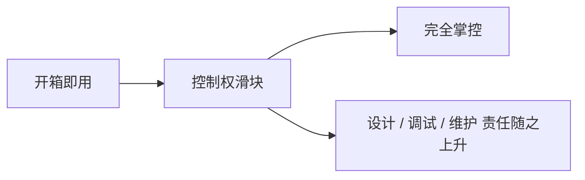

**图 17｜控制权滑块与设计/调试/维护代价重绘**

**【视频原述】**画面用一条滑块给出限制：左端「开箱即用」，右端「完全掌控」，中间一行红字 **「能改的越多，要承担的也越多」**，下面并列三个词：**设计 / 调试 / 维护**。「所以**选型时不只看自由度，还要看默认机制是否符合自己的业务需求**。」

> **【补充】** 把这句话落成可操作的判断：控制权带来的不是「能力」，而是**责任转移**。每多拿到一个可替换点，就要自己回答四件事——默认实现应该是什么、边界条件怎么定、出错如何定位、上游升级后如何回归。若团队没有对应的工程与评测能力，高自由度会直接转化为不稳定。相关验证方法见本系列 [评测驱动 Agent 迭代 · 完全教程（在线阅读）](../agent-eval-driven-tutorial/Agent评测驱动迭代完全教程.html)：改过 Harness 之后，需要靠回归评测证明没有退步。

---

**本章语音逐字稿（ASR · 已校正，69 句）**

> `[14:32]` 留到后面复用
> `[14:33]` 这里面有两个核心设计
> `[14:35]` memory 还有 skill
> `[14:36]` memory 是用来保存用户的偏好
> `[14:38]` 项目背景的长期信息
> `[14:39]` skill 的用来保存完成某类任务的方法
> `[14:42]` 比如说你经常让 Agent 的帮你写诸报
> `[14:44]` 最开始你需要告诉它
> `[14:46]` 诸报的结构重点和写作方式
> `[14:48]` 那写了几次之后
> `[14:49]` Agent 可能会逐渐总结出一套有效的方法
> `[14:51]` 把它存成 skill
> `[14:53]` 以后再写诸报
> `[14:54]` 直接附用这套方法就行
> `[14:55]` 不用每次都重新摸索
> `[14:56]` 所以它的特点是
> `[14:58]` 把任务执行记忆和技能积累连接起来
> `[15:01]` 让 Agent 在长期使用过程中
> `[15:02]` 不断附用过去的经验
> `[15:04]` 这种设计的好处是同一类任务
> `[15:06]` Agent 会越用越顺手
> `[15:07]` 但问题也在这
> `[15:08]` 如果存下了错误的经验
> `[15:10]` 后面可能就会一直重复这个错误
> `[15:12]` 所以它也对记忆和技能的修改
> `[15:14]` 提供了人工的审批机制
> `[15:16]` 总结一下
> `[15:16]` 如果你想要搭建一个完整的个人助手
> `[15:18]` 或者想要 Agent 接入微信
> `[15:20]` 起位飞书等渠道
> `[15:21]` 那可以优先考虑 OpenClaw
> `[15:23]` 最后一个是 deep seek harness
> `[15:25]` 我把它单独拿出来
> `[15:26]` 是因为它的技术设计和前面的几个项目
> `[15:28]` 都不太一样
> `[15:29]` deep seek harness 的特点是
> `[15:31]` everything is a plugin
> `[15:32]` 一切皆插件
> `[15:34]` 那很多的 harness 都支持插件
> `[15:36]` 但通常只是增加工具 scale
> `[15:38]` 或者在固定的执行机制上去扩展功能
> `[15:41]` 无论是 Claude Agent SDK Deep Agents
> `[15:43]` pan 还是 OpenClaw
> `[15:44]` 它们都有内置的 Agent loop
> `[15:46]` 区别只在于允许多大程度的干预和改造
> `[15:49]` deep seek harness 更进一步
> `[15:51]` 它把模型工具 session
> `[15:53]` 甚至最核心的 Agent loop
> `[15:55]` 都设计成了可以提款的插件
> `[15:57]` 也就是说
> `[15:58]` 如果你对默认的 Agent loop 不满意
> `[16:00]` 你可以通过开发
> `[16:01]` 组合插件把它替换掉
> `[16:02]` 而不用直接去改框架的核心代码
> `[16:05]` 它的底层采用 Code 插件架构
> `[16:07]` 把不同的功能组成了相互写作的模块
> `[16:09]` 让你可以组合出不同的执行方式
> `[16:12]` 它和派虽然都强调灵活
> `[16:13]` 但是思路不一样
> `[16:14]` 派是尽量让核心保持简单的开发者
> `[16:17]` 可以在这上面去扩展
> `[16:18]` 而 deep seek harness 是把核心本身
> `[16:21]` 也做成了可以提款的模块
> `[16:22]` 这种设计的优点是
> `[16:24]` 自由程度非常高
> `[16:25]` 如果你想研究不同的 Agent loop 的效果
> `[16:27]` 或者想搭建自己的 Agent harness 平台
> `[16:30]` 那就可以灵活的去组合底层的能力
> `[16:32]` 但是代价就是开发者需要理解更多的内部机制

## 9. 怎么用 Harness 三个层次

**【视频原述】**「已经确定了要用哪个 Harness，然后呢？下载别人的代码来改？还是通过 SDK 开发？**什么才是使用 Harness 的正确姿势？**我认为可以把开发者需求分成三个层次。」

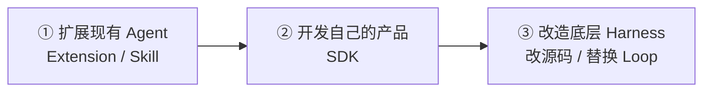

**图 18｜三个层次与 Pi 的三种开发目标重绘**

1. **扩展现有的 Agent**：已有能用的 Agent 产品，只想加功能。
2. **开发自己的 Agent 产品**：自己的界面、业务功能和用户体系，但不想从零开发 Agent Loop。
3. **改造底层的 Harness**：对现成的核心机制都不满意，希望自己修改甚至重新设计。

**【视频原述】**「这三个层次的开发目标不一样，**技术能力要求也不同**。我们就用 Pi 举个例子。」

### 9.1 层次一 Extension / Skill —— 产品还是 Pi

**【视频原述】**「假设你是一名程序员，公司在用 **Pi CLI** 做编程工具，希望它更符合公司开发流程：比如 `+ 自动检查代码规范`、`+ 按要求生成 PR 描述`。你只需要在安装好的 Pi CLI 基础上，通过 **Extension 或 Skill** 加上这些功能，让它变得更符合你们自己的要求 —— **产品还是 Pi**。」

### 9.2 层次二 Pi SDK —— 产品是你的，底层复用 Pi

**【视频原述】**「现在你打算出去创业，做自己的 **AI 编程产品**：界面、用户管理、任务系统、运行测试都要自己做。这个时候就可以用 **Pi SDK**，把 Pi 的执行能力集成到自己的应用里 —— **产品是你的，只是底层复用了 Pi Harness**。」

### 9.3 层次三 改源码 —— 扩展接口不够用时

**【视频原述】**「假设你认为 Pi 默认的 Agent Loop 不够好，想重新设计**模型如何决策、如何执行、整个任务如何循环**，那就需要 fork、改它的核心源码，搭出自己的 Harness。」

**【视频原述】**「所以**插件 · SDK · 源码改造是三个不同的问题**：插件 / Skill 解决『如何扩展现有 Agent』；SDK 解决『复用现成的执行能力，开发自己的应用』；改源码是『现有的扩展接口无法满足需求的时候』才需要。」

> **【视频原述】** 「因此在做技术选型时，要**先想清楚自己的开发目标**：让现有 Agent 更好用 → 插件和 Skill；开发独立的 Agent 产品 → SDK；深入改造 Harness → 才需要关注源码的开放程度。」画面最后强调一句：**「开发自己的 Agent 产品 ≠ 开发自己的 Harness」**。

| 层次 | 开发目标 | 手段 | 产品归属 | 典型成本 |
|---|---|---|---|---|
| ① 扩展现有 Agent | 加功能、贴合流程 | Extension / Skill / Plugin | 还是原产品 | 低：写扩展、跟着上游升级 |
| ② 做自己的产品 | 自己的界面 / 用户 / 业务 | SDK（底层复用 Harness） | 是你的产品 | 中：产品工程 + 版本适配 |
| ③ 改造底层 Harness | 重设计决策 · 执行 · 循环 | fork 源码 / 服务级替换 | 是你的 Harness | 高：长期维护分叉、自行回归 |

> **【补充】** 这三个层次不是「等级高低」，而是**问题边界**。一个常见误判是：为了给产品加一个自定义审批界面就去 fork 整个 Harness；实际上这是层次 ①/② 的问题，用 Hook 或 SDK 就能解决。反过来，若确实要改变 Agent Loop 的决策顺序，靠堆插件通常会导致逻辑散落在多个 Hook 里、难以调试 —— 这时才该进入层次 ③。判断依据是「需求是否落在扩展接口的能力边界内」，而不是「团队想不想掌控源码」。

---

**本章语音逐字稿（ASR · 已校正，61 句）**

> `[16:35]` 模块之间的组合和维护也比较复杂
> `[16:38]` 所以 deep seek harness 更适合想要研究和定制
> `[16:41]` harness 底层架构的开发团队
> `[16:43]` 如果只是一个普通的业务 Agent
> `[16:46]` 未必需要这么高的自由度
> `[16:47]` 气色项目都介绍完了
> `[16:49]` 我们用一张表来对比一下
> `[16:50]` 从这张表可以看出来
> `[16:52]` 不同 harness 最大的差异
> `[16:53]` 不在于有没有工具的调用
> `[16:55]` 沙瞎文管理或者多 Agent
> `[16:57]` 这些已经是比较通用的能力了
> `[16:59]` 真正的区别是
> `[17:00]` 他们默认帮开发者实现了什么机制
> `[17:03]` 又开放了多少控制权
> `[17:05]` Claude Agent SDK 预置了成熟的执行机制
> `[17:07]` Deep Agents 把更多的执行策略做成了可组合的模块
> `[17:11]` 派进可能的保持核心简单
> `[17:13]` deep seek harness 都是连核心机制也可以替换
> `[17:16]` 而 OpenAI codOpenAIen Claude 和 harness
> `[17:18]` 更多体现的是针对特定场景的设计
> `[17:20]` 但是控制权越大
> `[17:21]` 不代表一定就越好
> `[17:23]` 因为可以改的东西多
> `[17:24]` 意味着你要承担的设计
> `[17:26]` 调试和维护工作也越多
> `[17:27]` 所以选型的时候不仅要看自由度
> `[17:29]` 还要看这些默认机制是否符合自己的业务需求
> `[17:33]` ok 经过一番分析
> `[17:35]` 你已经确定了要用哪个 harness 开发
> `[17:37]` 然后呢
> `[17:37]` 它应该怎么用
> `[17:38]` 是直接下载别人的代码来改
> `[17:40]` 还是通过 sdk 开发
> `[17:41]` 什么才是使用 harness 的正确姿势
> `[17:44]` 我认为可以把开发者需求分上三个层次
> `[17:47]` 第一个层次是扩展现有的 Agent
> `[17:49]` 你已经有了一个能用的 Agent 的产品
> `[17:51]` 只是想给它加一些功能
> `[17:53]` 让它更贴合自己的需求
> `[17:54]` 第二个层次是开发自己的 Agent 的产品
> `[17:56]` 你需要自己的产品界面
> `[17:58]` 业务功能和用户体系
> `[17:59]` 但是不想从零开发 Agent 的 loop
> `[18:01]` 第三个层次是彻底改造底层的 harness
> `[18:04]` 你对现成的核心机制都不满意
> `[18:06]` 你希望自己去修改甚至重新设计底层的实现
> `[18:09]` 这三个层次的开发目标不一样
> `[18:11]` 需要的技术能力也不一样
> `[18:13]` 我们就用派举的例子
> `[18:14]` 第一种是扩展现有的产品
> `[18:16]` 假设你是一名程序员
> `[18:17]` 公司内部已经在用派的 cli 去做编程工具
> `[18:20]` 但是你希望它更符合公司的开发流程
> `[18:22]` 比如说修改完代码之后自动检查代码的规范
> `[18:25]` 或者按照团队的要求生成片描述
> `[18:27]` 这个时候你只需要在安装好的派 cli 的基础上
> `[18:30]` 通过 extension 或者是 scale 增加功能的产品还是派
> `[18:34]` 只是变得更符合你们自己的要求
> `[18:36]` 这是第一个层次
> `[18:37]` 第二个层次是开发自己的 Agent 的产品

## 10. 回到开头 怎么选

**【视频原述】**「如果今天要开发一个 Agent，**首先看任务需求**」，画面给出三行对号入座：

| 任务需求 | 选择 | 理由 |
|---|---|---|
| 简单任务、步骤明确 | **Framework**（如 LangChain） | 把模型与工具接起来就够了，不需要自主循环 |
| 严格流程、状态管理 | **Runtime**（如 LangGraph） | 要显式控制步骤、暂停、恢复与人工确认 |
| 需要模型自主探索、持续执行 | **Harness** | 流程无法预先枚举，需要成套执行机制 |

**【视频原述】**「**其次看 Harness 的设计特点**，按需求对号入座」：

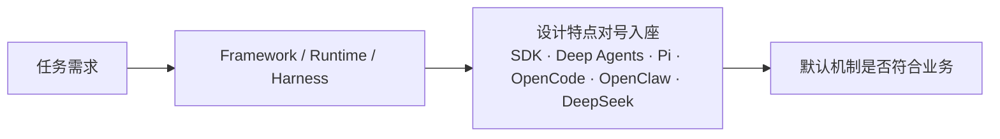

**图 19｜任务需求与 Harness 设计特点的选型矩阵重绘**

| 你的诉求 | 画面给出的建议 |
|---|---|
| 想要开箱即用 | Claude Agent SDK |
| 开源 · 灵活 · 可定制 | Deep Agents |
| 从极简核心出发、自己设计执行机制 | Pi |
| 开发 Coding Agent | OpenCode |
| 做长期的个人助手 / 接入 IM | OpenClaw |
| 连 Agent Loop 都想替换 | DeepSeek Harness |

> **【补充】** 结尾的选型矩阵画面没有单列 Hermes；按第 6 章的定位，它应补在「做长期的个人助手」一栏，与 OpenClaw 并列，差异在于**是否把「经验沉淀成 Skill / 持续学习」作为核心诉求**。此外，矩阵里的「Framework / Runtime」两行不是被 Harness 淘汰的旧选项，而是与第 3 章的边界条件首尾呼应：简单流程与强流程控制仍然是它们的主场。

> **【视频原述】** 全片最后一句：「所以，**Agent 选型的核心，不是哪个框架功能最多，而是它默认的执行机制是否符合你的业务**。」

把整期视频压成一条可执行的判断链：**任务能不能预先枚举流程？**（能 → Framework / Runtime；不能 → Harness）→ **要不要某个场景外壳？**（要 → 先选场景化项目）→ **默认机制是否合用？**（合用 → 直接用；不合用 → 看扩展接口够不够）→ **还不够？**（才考虑 SDK 自建产品或 fork 改造）→ **每改一处，用回归评测证明没有退步**。

---

**本章语音逐字稿（ASR · 已校正，61 句）**

> `[18:39]` 现在你打算出去创业了
> `[18:41]` 做一个面向研发团队的 AI 编程产品
> `[18:44]` 还有自己的产品界面用户管理任务系统
> `[18:47]` 还可以让 Agent 的自动修改代码运行测试
> `[18:49]` 但是你不想从零开发
> `[18:51]` 这个时候就可以用到派的 sdk
> `[18:53]` 把派的执行能力集成到自己的应用里
> `[18:56]` 产品是你自己的
> `[18:57]` 只是底层附用了派的 Harness
> `[18:59]` 这个是第二个层次
> `[19:00]` 第三个层次是改造底层的 Harness
> `[19:02]` 假设你认为派默认的 Agent 的 loop 根本不符合自己的需求
> `[19:06]` 想要重新设计模型如何决策工具如何执行
> `[19:09]` 以及整个任务如何循环
> `[19:10]` 由于派是开源的
> `[19:12]` 你可以直接 fork 代码
> `[19:13]` 改它的核心圆码
> `[19:14]` 搭出自己的 Harness
> `[19:16]` 这就是第三个层次
> `[19:17]` 所以插件 sdk 圆码的改造
> `[19:20]` 其实解决的是三个不同的问题
> `[19:22]` 插件和 scale 主要解决的是如何扩展现有的能力
> `[19:25]` sdk 解决的是附用现成的执行能力开发自己的应用
> `[19:29]` 修改圆码只是当现有的扩展接口无法满足需求的时候
> `[19:32]` 直接改变底层的实现
> `[19:34]` 因此在做基础选行的时候
> `[19:36]` 我们要先想清楚自己的开发目标
> `[19:38]` 如果只是让现有的 Harness 更好用
> `[19:40]` 那优先考虑插件和 scale
> `[19:41]` 如果开发独立的 Harness 的产品
> `[19:43]` 重点看 sdk 和程序化接入的能力
> `[19:46]` 如果要深入改造 Harness
> `[19:48]` 才需要关注圆码的开放程度
> `[19:50]` 以及底层机制是否允许替换
> `[19:52]` 那开发自己的 Agent 的产品
> `[19:53]` 不代表必须开发自己的 Harness
> `[19:56]` 最后再回到开头的问题
> `[19:57]` 如果今天要开发一个 Agent
> `[19:59]` 到底应该怎么选
> `[20:00]` 首先看任务需求
> `[20:02]` 简单流程明确的任务可以选择轻量的 free more
> `[20:04]` 需要严格的流程控制和状态管理
> `[20:06]` 可以考虑 LangGraph
> `[20:08]` 如果是需要自主探索持续执行的复杂任务
> `[20:11]` 优先考虑 Harness
> `[20:12]` 其次看 Harness 的设计特点
> `[20:14]` 想要开箱即用
> `[20:15]` 可以选择 Claude-Agent-sdk
> `[20:17]` 希望开源灵活性和定制
> `[20:20]` 想要从极简的核心出发
> `[20:22]` 自己设计执行机制
> `[20:23]` 可以选择派
> `[20:24]` 开发 coding-Agent 可以考虑 OpenCode
> `[20:26]` 做长期的个人助手
> `[20:27]` 可以考虑 OpenClaw
> `[20:29]` 如果连 Agent 的 loop 都想替换
> `[20:31]` 可以研究 deep-seq-Harness
> `[20:33]` 所以 Agent 的技术选型的核心
> `[20:35]` 不是哪个框架功能最多
> `[20:37]` 而是它默认的执行机制是否符合你的业务
> `[20:40]` 以及你究竟想要多大的控制权

## 11. 补充篇 A 专业名词速查 68 条

**【补充】** 视频口播里出现但没展开的英文名，按「抽象层 → Harness 组件 → 控制与扩展 → 工程与运维 → 项目专有」分组给出定义。所有条目都是本片语境下的含义，不是通用词典释义。

### 11.1 抽象与架构（10 条）

| 术语 | 英文 / 别名 | 释义 | 本片落点 |
|---|---|---|---|
| Agent | 智能体 | 能基于模型输出自主决定下一步、调用工具并持续执行直到达成目标的系统 | 全片对象 |
| Agent Framework | 框架 | 把模型调用、工具接入、数据处理封装成可复用组件的库 | 2022 阶段 |
| Agent Runtime | 运行时 | 管理执行流程、状态持久化、暂停/恢复与人工介入的一层 | 2024 阶段 |
| Agent Harness | 执行系统 / 脚手架 | 围绕模型的成套执行机制：Agent Loop + 上下文 / 规划 / 文件 / 权限 | 2025 阶段；全片主角 |
| Execution System | 执行系统 | 视频对 Harness 的中文叫法，强调「一整套」而非单个组件 | 画面原文 |
| Agent Loop | 主循环 / ReAct 循环 | 模型思考 → 调用工具 → 拿到结果 → 继续，直到满足停止条件 | Harness 的基础 |
| Model + Harness = Agent | — | 模型负责决策，Harness 负责模型之外的一切 | DeepSeek Harness 官方表述 |
| 开发起点 | starting point | 项目从哪一层开始写：从模型/工具搭起，还是直接复用现成 Harness | 第 3 章 |
| 技术抽象层次 | layers of abstraction | 三层不是新旧替代，上层复用下层能力 | 第 2 章结尾 |
| 场景外壳 | product shell | 消息渠道、定时任务、用户体系、渠道适配等产品层能力 | 个人助手类 ≠ 单纯 Harness |

### 11.2 Harness 内部组件（18 条）

| 术语 | 英文 / 别名 | 释义 |
|---|---|---|
| 上下文 | Context | 每轮送给模型的全部信息：系统提示词、历史、工具结果、文件内容 |
| 上下文工程 | Context Engineering | 决定「何时放什么进上下文」的一套策略，含组装、裁剪、检索、卸载 |
| 上下文压缩 | Compaction / Summarization | 上下文接近窗口上限时，把历史摘要化以腾出空间 |
| 工具调用 | Tool Calling / Function Calling | 模型输出结构化调用请求，由 Harness 执行并回填结果 |
| 工具注册表 | Tool Registry | 登记可用工具的名称、参数 schema 与执行函数 |
| 工具模式 | Tool Schema | 工具入参/出参的结构化描述，模型据此生成合法调用 |
| 状态 | State | 任务执行到哪一步、有哪些中间结果的可持久化数据 |
| 检查点 | Checkpointer | 把状态按步骤落盘，支持断点续跑与回放 |
| 会话 | Session | 一次连续交互的上下文与身份容器，可恢复 |
| 记忆 | Memory | 跨会话保留的用户偏好、项目背景与长期信息 |
| 规划 | Planning / Todo | 把目标拆成可跟踪的步骤，如 `write_todos` |
| 子 Agent | Subagent | 主 Agent 委派子任务给独立上下文的 Agent 执行 |
| 技能 | Skill | 以文件形式保存的「某类任务怎么做」的可复用方法 |
| 中间件 | Middleware | 把执行策略（压缩、工具过滤、模型调用前改写）做成可替换模块 |
| 后端 | Backend | 文件存储与代码执行的实际承载环境 |
| 文件后端 | FilesystemBackend / StoreBackend / SandboxBackend | 本地磁盘 / 跨线程持久存储 / 远程沙箱三类实现 |
| 组合后端 | CompositeBackend | 按路径把不同目录路由到不同后端 |
| 沙箱 | Sandbox | 隔离执行环境，限制文件系统与网络权限 |

### 11.3 控制与扩展（16 条）

| 术语 | 英文 / 别名 | 释义 |
|---|---|---|
| 钩子 | Hook | 在生命周期节点插入自定义逻辑，可拦截、校验、阻止 |
| 前后置钩子 | PreToolUse / PostToolUse | 工具调用前检查参数 / 调用后检查结果，典型如 Claude Agent SDK |
| 权限 | Permission / allowed_tools | 限定某 Agent 能调用哪些工具、能否写文件、能否执行 Bash |
| 人工介入 | Human-in-the-loop / 人工审批 | 敏感动作前暂停，等人确认再继续 |
| 插件 / 扩展 | Plugin / Extension | 在不改核心的前提下加工具、加命令、拦事件 |
| 软件开发包 | SDK | 把 Harness 的执行能力作为库嵌入自己的产品 |
| 源码分叉 | Fork | 复制上游源码独立改造，需自行承担合并与回归成本 |
| 模型上下文协议 | MCP | 工具/数据源与 Agent 之间的标准化接入协议 |
| 模型适配器 | Provider / LLM Adapter | 屏蔽不同模型厂商 API 差异的适配层 |
| 服务声明 | Service / Seam | 先声明「需要什么能力」，再由实现包提供，二者解耦 |
| 组合点 | Composition Seam | 多个实现包被装配成一种执行方式的位置 |
| 插件架构 | Cordis | DeepSeek Harness 底层所用的服务注册 / 依赖注入式插件架构 |
| 服务注册 | `ctx.provide("agent-loop", …)` | 用自定义实现替换默认 Agent Loop，不改框架核心代码 |
| 扩展包 | Pi Package | Pi 中按 npm / git 分发的扩展集合 |
| 语言服务协议 | LSP | 让 Coding Agent 获得诊断、跳转定义等 IDE 级信号 |
| 停止条件 / 验证 | Stop Condition / Verification | 判断何时结束循环、结果是否真的达成目标 |

### 11.4 工程与运维（12 条）

| 术语 | 英文 / 别名 | 释义 |
|---|---|---|
| 氛围编程 | Vibe Coding | 借助 AI 完成开发、弱化手写代码的工作方式；视频用它说明 SDK 的低门槛 |
| 网关 | Gateway | 接收渠道消息、识别用户与 Session、调度 Agent 并回传结果 |
| 渠道 | Channel | 飞书 / 微信 / 企业微信 / 邮件等消息入口 |
| 定时任务 | Cron / Automation | 按时间或事件自动触发任务，无需用户每次发起 |
| 队列串行化 | Queue Serialization | 同一会话的消息按序执行，避免并发写坏状态 |
| 持久化执行 | Durable / Persistent Execution | 进程重启后从检查点继续执行 |
| 幂等 | Idempotency | 同一动作重试多次不产生额外副作用 |
| 重试与超时 | Retry / Timeout | 工具失败后的退避重试与单次执行上限 |
| 可观测性 | Trace / Observability | 记录每一步的决策、工具调用与结果，用于归因 |
| 评测与回归 | Evals / Regression | 用固定任务集验证改动没有让旧能力退步 |
| 客户端-服务端架构 | Client-server | TUI / IDE / Web 作为客户端，本地服务承载 Agent 运行时 |
| 技术锁定 | Lock-in | 深度依赖某套默认机制后，迁移成本变高 |

### 11.5 项目专有（12 条）

| 术语 | 释义 |
|---|---|
| Claude Code | Anthropic 的终端 Coding Agent，其执行机制被 Claude Agent SDK 复用 |
| Claude Agent SDK | 把 Claude Code 的 harness 暴露为 Python / TypeScript 库；原 Claude Code SDK 更名 |
| LangGraph | LangChain 团队 2024 年推出的状态图 / 持久化执行 Runtime |
| Deep Agents | LangChain 团队 2025 年推出的 batteries-included agent harness，构建于 LangGraph 之上 |
| Pi / pi-mono | Mario Zechner 的极简 TypeScript coding harness 及其 monorepo |
| Pi SDK | `pi-ai` / `pi-agent-core` / `pi-coding-agent` / `pi-tui` 等可嵌入包 |
| Build / Plan / Explore | OpenCode 预置的三种 Agent：改代码 / 只读分析 / 搜索理解，各自有独立权限 |
| OpenClaw Gateway | 负责渠道接入、Session 解析、串行调度与生命周期事件桥接的控制中心 |
| OpenClaw Agent Runtime | 源自 pi-mono 的嵌入式运行时，现在可独立管理 Loop / 上下文 / 工具 / 会话 |
| Hermes Memory / Skill | 前者存长期信息与偏好，后者存完成某类任务的方法 |
| E-A-A-S | Hermes 的 Execute → Evaluate → Abstract → Store 自改进闭环 |
| Everything is a Plugin | DeepSeek Harness 的设计口号：模型 / 工具 / Session / Loop 全部可替换 |

---

## 12. 补充篇 B 七项目事实核对

**【补充】** 下表把视频原述与公开官方资料并排核对。凡标注「官方」的字段为视频未展开、由项目文档补齐；视频对项目的定位表述一律保留原意。

| 项目 | 官方定位 / 形态 | 默认实现（视频 + 官方） | 开放的控制点 | 主要限制 |
|---|---|---|---|---|
| **Claude Agent SDK** | Anthropic 官方 Python / TS 库；把 Claude Code harness 作为库暴露 | Agent Loop、Read/Bash/Grep 等内置工具、Session 与上下文、子 Agent、权限、Hooks、Skills、MCP | Hook（PreToolUse / PostToolUse）、自定义工具 / Skill / 子 Agent、system_prompt、allowed_tools | 核心机制预置：不能替换整个执行循环、不能接管上下文组装与压缩、不能改写内置工具底层 |
| **Deep Agents** | LangChain 团队的 *batteries-included agent harness*，构建于 LangChain / LangGraph 之上 | `write_todos` 规划、文件系统工具、`execute` 沙箱、`task` 子 Agent、自动摘要、人工审批中断 | Middleware（压缩策略、工具过滤、模型调用前改上下文）、可插拔 Backends（State / Filesystem / Store / Sandbox / Composite） | 灵活意味着更多技术决策：执行环境、策略组合、本地还是沙箱都要自己定 |
| **Pi** | Mario Zechner 的极简 TypeScript 终端 coding harness（`badlogic/pi-mono`，MIT） | 仅 `read / write / edit / bash` 四个工具；刻意不内置 MCP、子 Agent、Plan 模式、Todo、权限弹窗 | Extension（事件拦截、覆盖内置工具）、Skill / Pi Package、Pi SDK、fork 源码改 `agent-loop.ts` | 高级能力是「待组装」的空位，记忆 / 子 Agent / 权限 / 规划都要自己组合维护 |
| **OpenCode** | Anomaly（原 SST）开源 Coding Agent，TypeScript + Bun，client-server 架构，SQLite 持久化 | Build / Plan / Explore 三种预置 Agent 及权限、常用开发工具、测试、LSP 集成、75+ provider | 自定义 Agent（提示词 / 模型 / 权限可分别配置）、插件与配置 | 默认机制都围绕软件开发；做非编码业务 Agent 要大量调整；client-server 增加运维面 |
| **OpenClaw** | 长期运行的个人助手系统；Gateway + 嵌入式 Agent Runtime + 渠道 + 定时任务 | 多渠道接入、Session 解析与队列串行化、cron / 事件触发、工作区引导文件（AGENTS.md / SOUL.md / USER.md 等） | 插件扩展、渠道与 cron 配置、工作区与人格文件 | 部署与维护成本更高；普通任务型 Agent 不必上这套基础设施 |
| **Hermes Agent** | Nous Research 开源的 self-improving agent（Python，MIT） | 多渠道、自然语言 Cron、长期记忆、40+ 工具、FTS5 会话索引、E-A-A-S 经验沉淀 | `skill_manage` 写技能、MEMORY.md / USER.md 更新、技能与记忆修改的人工审批 | 错误经验也会被沉淀并反复复用；自学习结果需要人工审核与回归 |
| **DeepSeek Harness** | 高度插件化的 Harness 研究 / 平台项目；官方表述 *Model + Harness = Agent* | 不预设业务场景；以服务声明 + 实现包 + 组合点装配出执行方式 | model / tools / session / loop 全部可替换；`ctx.provide("agent-loop", …)` 换默认 Loop | 内部机制多、组合与维护复杂；普通业务未必需要这么高的自由度 |

> ⚠️ **核对边界**：视频中的产品定位、优缺点与画面代码均按逐帧文字保留；许可证、语言、内部包名、LSP / FTS5 / E-A-A-S 等实现细节属于【补充】，来自各项目公开文档与仓库。这些项目迭代很快，具体 API 名称请以官方最新文档为准，本表用于理解架构差异，不作为版本兼容承诺。

### 12.1 一张「控制粒度阶梯」表

| 档位 | 能改什么 | 代表 | 对应风险 |
|---|---|---|---|
| L0 配置 | 提示词、工具白名单、模型选择 | 全部项目 | 最低；改动可枚举 |
| L1 拦截 | 工具调用前后校验、阻止、改写结果 | Claude Agent SDK Hook、Pi 事件 | 低；逻辑可能散落多个 Hook |
| L2 替换策略 | 压缩策略、工具过滤、存储与执行环境 | Deep Agents Middleware / Backends | 中；组合爆炸、需回归 |
| L3 替换核心 | Agent Loop 本身、Session 实现 | DeepSeek Harness 服务注册 | 高；需自建验证与评测 |
| L4 分叉源码 | 任何实现 | Pi fork、任何开源项目 | 最高；长期承担合并与维护 |

---

## 13. 补充篇 C 架构全景与选型方法

**【补充】** 视频用「基础 Agent Loop + 四类能力」概括 Harness。下图按公开工程资料补齐完整职责，便于逐项核对七个项目，也便于把「选型」变成可勾选的清单。

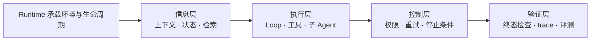

**图 20｜补充：生产级 Harness 通用职责分层**

### 13.1 五步选型法

1. **判定流程可枚举性**：能写出固定步骤 → Framework；需要暂停/恢复/人工确认 → Runtime；流程无法枚举 → 进入下一步。
2. **判定场景外壳**：是否需要 IM 渠道、定时任务、长期记忆、代码库理解？需要则先圈定场景化项目（OpenCode / OpenClaw / Hermes）。
3. **逐项核对默认机制**：上下文压缩、文件系统、子 Agent、权限、停止条件、验证——把「必须自己定」的列出来。
4. **定位控制粒度**：[12.1](#121-一张控制粒度阶梯表) 的 L0–L4，找到满足需求的最低档位；能用 L1 解决就不要上 L3/L4。
5. **评估责任成本**：设计、调试、维护、上游升级回归，以及有没有评测集能证明改动没退步。

### 13.2 需求 → 最低档位对照表

| 需求 | 最低档位 | 典型做法 |
|---|---|---|
| 换个系统提示词 / 限定工具 | L0 | 配置 `system_prompt` / `allowed_tools` |
| 工具执行前拦危险命令 | L1 | `PreToolUse` Hook 检查参数并阻止 |
| 换上下文压缩算法 / 换存储环境 | L2 | 自定义 Middleware / CompositeBackend |
| 改「先规划后执行」的决策顺序 | L3 | 服务注册替换 Agent Loop |
| 连工具执行语义都要重写 | L4 | fork 源码，自建回归评测 |

### 13.3 与评测体系的衔接

本系列前三篇讲的是**怎么证明 Agent 变好了**，本篇讲的是**Agent 的执行系统怎么选**。两者在「验证层」交汇：无论选 L0 还是 L4，只要改动了默认机制，就应该有一组固定任务（Outcome）+ 执行轨迹（Trace）+ 成本 / 时延护栏，用来判断这次改动是进步还是退步。尤其 L3/L4 改了 Loop，表面成功率可能不变，但步骤数、重试次数、工具误用率会明显漂移 —— 这类差异只有 trace 级指标能发现。详见 [评测驱动 Agent 迭代 · 完全教程（在线阅读）](../agent-eval-driven-tutorial/Agent评测驱动迭代完全教程.html) 与 [Agent 评测体系完全教程（在线阅读）](../agent-evaluation-tutorial/Agent评测体系完全教程.html)。

---

## 14. 补充篇 D 可运行代码

**【补充】** 以下四段均为**纯 Python 标准库、可直接运行**的最小实现，用来把本篇的抽象概念变成可触摸的行为：两轴打分、最小 Harness、三档控制粒度、三层次判定。不依赖任何 LLM API。

### 14.1 两轴选型打分器

把「默认机制 × 控制权」两根轴量化：先给项目打四维分，再按业务需求的权重排序。`fit` 越接近需求画像越合适，`cost` 是必须自己承担的责任分。

```python
# harness_select.py —— python3 harness_select.py
PROJECTS = {
    #                 默认机制, 控制权, 场景化, 责任成本(越高越重)
    "Claude Agent SDK": (5, 1, 0, 1),
    "Deep Agents":     (4, 3, 0, 3),
    "OpenCode":        (4, 2, 5, 2),
    "OpenClaw":        (4, 2, 5, 4),
    "Hermes Agent":    (4, 2, 5, 4),
    "Pi":              (1, 4, 0, 4),
    "DeepSeek Harness":(2, 5, 0, 5),
}

def rank(need_default, need_control, need_scenario, cost_tolerance=5):
    """need_* 取 1..5；cost_tolerance 越低越不愿承担维护责任。"""
    rows = []
    for name, (d, c, s, cost) in PROJECTS.items():
        gap = abs(d - need_default) + abs(c - need_control) + abs(s - need_scenario)
        penalty = max(0, cost - cost_tolerance) * 1.5
        rows.append((gap + penalty, name, gap, penalty))
    return sorted(rows)

if __name__ == "__main__":
    print("场景 A：开箱即用做通用任务，团队不想维护底层")
    for score, name, gap, pen in rank(5, 1, 0, cost_tolerance=2)[:3]:
        print(f"  {name:<18} 差距={gap} 责任惩罚={pen} 综合={score}")
    print("场景 B：要自己设计 Loop，且能承担维护")
    for score, name, gap, pen in rank(1, 5, 0, cost_tolerance=5)[:3]:
        print(f"  {name:<18} 差距={gap} 责任惩罚={pen} 综合={score}")
    print("场景 C：做长期个人助手 / 接 IM")
    for score, name, gap, pen in rank(4, 2, 5, cost_tolerance=4)[:3]:
        print(f"  {name:<18} 差距={gap} 责任惩罚={pen} 综合={score}")
```

> **实测输出（择要）**：场景 A 首选 `Claude Agent SDK`（差距 0）；场景 B `DeepSeek Harness` 与 `Pi` 并列第一（差距均为 1）；场景 C 首选 `OpenCode / OpenClaw / Hermes` 这一组场景化项目。分数只用于把讨论结构化，不能替业务判断。

### 14.2 一个能跑起来的最小 Harness

用规则模拟「模型决策」，把 Harness 的五件事做全：工具注册、上下文组装与压缩、权限门、停止条件、trace 记录。运行后会看到完整执行轨迹。

```python
# mini_harness.py —— python3 mini_harness.py
import json

class MiniHarness:
    def __init__(self, tools, allowed, max_steps=6, compact_after=4):
        self.tools, self.allowed = tools, set(allowed)
        self.max_steps, self.compact_after = max_steps, compact_after
        self.ctx, self.trace = [], []

    def _compact(self):
        if len(self.ctx) > self.compact_after:
            head = self.ctx[0]
            self.ctx = [head, {"role": "system", "text": f"[已压缩 {len(self.ctx)-2} 条历史]"}] + self.ctx[-1:]
            self.trace.append("COMPACT")

    def decide(self, goal):
        """规则版模型：没查过就查，查过没写就写，写完就停。"""
        done = {t["tool"] for t in self.trace if isinstance(t, dict)}
        if "search" not in done: return "search", {"q": goal}
        if "write" not in done:  return "write", {"path": "report.md", "text": goal}
        return "finish", {}

    def run(self, goal):
        self.ctx.append({"role": "user", "text": goal})
        for step in range(1, self.max_steps + 1):
            name, args = self.decide(goal)
            if name == "finish":
                self.trace.append({"step": step, "tool": "finish", "result": "done"})
                break
            if name not in self.allowed:                       # 权限门
                self.trace.append({"step": step, "tool": name, "result": "BLOCKED"})
                break
            result = self.tools[name](**args)                  # 执行工具
            self.ctx.append({"role": "tool", "text": json.dumps(result, ensure_ascii=False)})
            self.trace.append({"step": step, "tool": name, "result": result})
            self._compact()                                    # 上下文压缩
        return {"steps": len(self.trace), "context": self.ctx, "trace": self.trace}

TOOLS = {
    "search": lambda q: {"hits": 3, "query": q},
    "write":  lambda path, text: {"path": path, "bytes": len(text)},
}
if __name__ == "__main__":
    h = MiniHarness(TOOLS, allowed=["search"], max_steps=6, compact_after=2)
    print("—— 只放行 search ——")
    print(json.dumps(h.run("调研 Harness 选型"), ensure_ascii=False, indent=2))
    h2 = MiniHarness(TOOLS, allowed=["search", "write"], max_steps=6, compact_after=2)
    print("—— 放行 search + write ——")
    print(json.dumps(h2.run("调研 Harness 选型"), ensure_ascii=False, indent=2))
```

> **实测结论**：只放行 `search` 时，Agent 在第 2 步被权限门 `BLOCKED`，循环提前终止；放行两个工具后走完 `search → write → finish`，并在上下文超过阈值时触发 `COMPACT`。这正好复现了视频里「上下文越来越长怎么控制」「工具权限怎么管」两个追问的最小形态。

### 14.3 三档控制粒度 拦截 → 替换策略 → 替换核心

把 [12.1](#121-一张控制粒度阶梯表) 的 L1/L2/L3 写成一个内核，直观看出每多开一个控制点会发生什么。

```python
# control_granularity.py —— python3 control_granularity.py
class Kernel:
    def __init__(self):
        self.hooks = {"PreToolUse": [], "PostToolUse": []}   # L1
        self.compactor = lambda ctx: ctx[-4:]                 # L2（可替换策略）
        self.loop = self.default_loop                         # L3（可替换核心）

    def provide(self, service, impl):
        if service == "agent-loop": self.loop = impl          # 对应 ctx.provide
        elif service == "compactor": self.compactor = impl

    def default_loop(self, tasks):
        return ["ACT " + t for t in tasks]

    def plan_then_act(self, tasks):
        return ["PLAN " + ",".join(tasks)] + ["ACT " + t for t in tasks]

    def call(self, tool, arg, ctx):
        for hook in self.hooks["PreToolUse"]:
            if hook(tool, arg) is False: return "BLOCKED"
        ctx.append(tool + ":" + arg)
        ctx = self.compactor(ctx)
        for hook in self.hooks["PostToolUse"]: hook(tool, arg)
        return ctx

if __name__ == "__main__":
    k = Kernel()
    k.hooks["PreToolUse"].append(lambda t, a: False if "rm" in a else True)
    print("L1 拦截:", k.call("bash", "rm -rf /", []))
    print("默认 Loop:", k.loop(["read", "write"]))
    k.provide("compactor", lambda c: ["[摘要]"] + c[-1:])     # L2
    print("L2 压缩:", k.call("read", "a.md", ["x:1", "y:2", "z:3", "w:4"]))
    k.provide("agent-loop", k.plan_then_act)                   # L3
    print("L3 换核:", k.loop(["read", "write"]))
```

> **实测输出**：`L1 拦截: BLOCKED`；`默认 Loop: ['ACT read', 'ACT write']`；`L2 压缩: ['[摘要]', 'read:a.md']`；`L3 换核: ['PLAN read,write', 'ACT read', 'ACT write']`。三段分别对应 Claude Agent SDK 的 Hook、Deep Agents 的 Middleware、DeepSeek Harness 的服务注册。

### 14.4 三层次判定器 插件 / SDK / 源码改造

输入你的开发目标，输出应该停在哪个层次，避免「为加个按钮去 fork」。

```python
# three_levels.py —— python3 three_levels.py
def decide(*, own_product=False, custom_ui=False, own_users=False,
           change_loop=False, extension_enough=True):
    if change_loop:
        return ("③ 改造底层 Harness", "fork 源码 / 服务级替换 Loop", "高：自建回归评测")
    if own_product or custom_ui or own_users:
        return ("② 开发自己的 Agent 产品", "用 SDK 复用执行能力", "中：产品工程 + 版本适配")
    if not extension_enough:
        return ("② 或 ③（需先确认接口边界）", "优先确认 SDK 能否覆盖", "中～高")
    return ("① 扩展现有 Agent", "Extension / Skill / Plugin", "低：跟随上游升级")

CASES = [
    ("给公司 Pi CLI 加代码规范检查", dict()),
    ("做自有 AI 编程产品：界面 + 用户体系", dict(custom_ui=True, own_users=True)),
    ("重新设计模型决策与循环顺序", dict(change_loop=True)),
    ("想加审批，但 Hook 参数不够用", dict(extension_enough=False)),
]
if __name__ == "__main__":
    for name, kw in CASES:
        level, how, cost = decide(**kw)
        print(f"{name}\n   → {level} | {how} | 成本 {cost}")
```

> **实测输出（择要）**：加规范检查 → `① 扩展现有 Agent`；自有产品 → `② 开发自己的 Agent 产品`；改循环 → `③ 改造底层 Harness`。与视频第 9 章三个例子一一对应。注意判定顺序：**先问是否要改 Loop，再问是否是自己的产品**，因为改 Loop 的需求不能被 SDK 满足。

---

## 15. 补充篇 E 常见误区

**【补充】** 这一章把视频里隐含的取舍，以及工程实践中最容易踩的坑逐条写明。

| # | 误区 | 为什么错 | 正确做法 |
|---|---|---|---|
| 1 | Harness 是 LangGraph / Framework 的新版本，用了它就该全换掉 | 三层是不同抽象层次，上层复用下层；生产系统常同时用 | Framework 编排大流程，Runtime 管状态与恢复，Agent 在 Harness 内执行 |
| 2 | 所有 Agent 开发都应该上 Harness | 视频明确限定：简单任务 / 严格流程场景，Framework 与 Runtime 依然有价值 | 先看流程是否可枚举，再决定起点 |
| 3 | 按「功能数量」选型 | 工具调用、上下文管理、多 Agent 已是通用能力，不是差异点 | 看「默认实现了什么机制」×「开放了多少控制权」 |
| 4 | 控制权越高越好 | 能改的越多，设计 / 调试 / 维护责任越大 | 取满足需求的**最低控制粒度**（L0–L4） |
| 5 | 把 OpenClaw / Hermes 与 Claude Agent SDK 放在同一根轴上比 | 前者是「完整 Agent 系统 = Harness + 消息接入 + 任务调度」，差异来自场景外壳 | 先判断要不要场景外壳，再在同一场景内比控制粒度 |
| 6 | 开发自己的 Agent 产品 = 要开发自己的 Harness | 视频结尾特意划了不等号；产品外壳与执行系统是两层 | 用 SDK 复用执行能力，把精力放在界面 / 用户 / 业务 |
| 7 | 为了加一个小功能直接 fork 源码 | 把层次 ① 的问题做成层次 ③，长期承担合并成本 | 先确认 Hook / Extension / SDK 是否够用 |
| 8 | 靠堆 Hook 就能改变 Agent Loop 的决策顺序 | 拦截点分散，逻辑隐式、难调试、难回归 | 确实要改决策顺序时，进入服务级替换（L3） |
| 9 | 「可定制」等于「开箱可用」 | Deep Agents 灵活但执行环境、策略组合、沙箱与否都要自己定 | 把技术决策列成清单并逐项确认责任人与验收方式 |
| 10 | 自学习 / Skill 沉淀一定越用越好 | 错误经验也会被沉淀并反复复用（视频明确点出） | 记忆与技能修改加人工审批，并保留回归评测 |
| 11 | 改了默认机制，看成功率没变就算没退步 | Loop 改动常表现为步骤数、重试、工具误用率漂移，成功率可能不变 | 同时看 Outcome 与 Trace，配护栏指标 |
| 12 | SDK 自带权限就等于生产安全 | 权限白名单、审批与沙箱是三件事；client-server 架构还有额外攻击面 | 最小权限 + 人工审批 + 隔离沙箱 + 命令审计 |

### 15.1 按症状归因速查

| 症状 | 优先检查 | 可能落在 |
|---|---|---|
| 上下文越来越长、成本飙升 | 压缩策略、大工具结果是否落盘 | 信息层 / L2 |
| Agent 反复重试不收敛 | 停止条件、验证与超时 | 控制层 / 验证层 |
| 工具被误调用或越权 | 权限白名单、PreToolUse、沙箱 | 控制层 / L1 |
| 改版本后旧任务退步 | 回归评测集与 trace 对比 | 验证层 |
| 长期助手重复同一个错误 | 被沉淀的错误 Skill / Memory | 记忆层 / 人工审批 |

---

## 16. 附录

### 16.1 章节时间轴

**画面自带目录（00:36 帧，逐字）**：

| 时间 | 画面目录 | 本教程 |
|---|---|---|
| 00:37 | 01 Agent 开发架构的演进与影响 | 第 2–3 章 |
| 06:27 | 02 七个代表性 Harness 逐个看 | 第 4–7 章 |
| 16:47 | 03 七个 Harness 横向对比 | 第 8 章 |
| 17:33 | 04 怎么用 Harness | 第 9–10 章 |

**官方详情接口 `chapter_list`（10 段，逐字）**：

| 时间 | 章节名（原文） | 本教程 |
|---|---|---|
| 00:36 | Agent 开发架构的演进 | 第 2–3 章 |
| 06:26 | Claude agent SDK | 4.1 |
| 08:17 | Deep agents | 4.2 |
| 10:09 | Pi | 5.1 |
| 11:46 | OpenCode | 5.2 |
| 13:04 | OpenClaw | 6.1 |
| 14:20 | Hermes | 6.2 |
| 15:23 | DeepSeek harness | 第 7 章 |
| 16:47 | 七个 harness 比较 | 第 8 章 |
| 17:32 | 怎么用 harness 框架 | 第 9–10 章 |

> ⚠️ **差异说明**：两套目录有几十秒偏差：画面目录的七项目时间码是 `06:27 / 08:17 / 10:10 / 11:46 / 13:01 / 14:18 / 15:23`，官方接口为 `06:26 / 08:17 / 10:09 / 11:46 / 13:04 / 14:20 / 15:23`；第四章画面 17:33、接口 17:32。本教程行文一律以**画面目录与逐帧文字**为准，接口章节单独列在这里备查。

### 16.2 配图速查（20 张）

| # | 图名 | 时间点 / 来源 | 所在章节 |
|---|---|---|---|
| 1 | 全片结构地图 | 00:36 画面目录 + 官方章节 | 1 |
| 2 | 三阶段演进时间轴 2022 / 2024 / 2025 | 00:37 画面 | 2 |
| 3 | Framework / Runtime / Harness 三层抽象 | 01 章画面 | 2 |
| 4 | Harness：Agent Loop + 四类能力 | 01 章画面「执行系统」 | 2.3 |
| 5 | 开发起点变化与边界 | 06:00 前后画面 | 3 |
| 6 | 三类场景划分 + 一个特殊存在 | 06:27 画面 | 3 |
| 7 | Claude Agent SDK「可以 / 不能」 | 06:27–08:17 画面 | 4.1 |
| 8 | Deep Agents 分层架构与两大特点 | 08:17–10:10 画面 | 4.2 |
| 9 | 两个综合任务类项目控制权对照 | 09:xx 画面刻度图 | 4.2 |
| 10 | Pi 极简核心与四层扩展路径 | 10:10–11:46 画面 | 5.1 |
| 11 | OpenCode 三种预置 Agent 权限表 | 11:46–13:01 画面 | 5.2 |
| 12 | OpenClaw Gateway 架构与长期任务 | 13:01–14:18 画面 | 6.1 |
| 13 | Hermes 持续学习闭环 | 14:18–15:23 画面 | 6.2 |
| 14 | DeepSeek Harness「一切皆插件」 | 15:23–16:12 画面 | 7 |
| 15 | Pi vs DeepSeek Harness 两种灵活 | 16:12 画面对比 | 7.1 |
| 16 | 七个 Harness 横向对比坐标图 | 16:47–17:21 画面 | 8 |
| 17 | 控制权滑块与设计 / 调试 / 维护 | 17:21 画面 | 8.1 |
| 18 | 三个层次与 Pi 的三种开发目标 | 17:33–19:33 画面 | 9 |
| 19 | 任务需求与设计特点选型矩阵 | 19:57–20:43 画面 | 10 |
| 20 | 【补充】生产级 Harness 通用职责分层 | 公开工程资料，非视频画面 | 13 |

### 16.3 校正表（OCR 与自动摘要）

| 来源写成了 | 正确写法 | 依据 |
|---|---|---|
| 「メ方」「產市面上的 AgSnt飽」等乱码 | 口播断句处无有效画面文字，按上下文不补写台词 | 放大帧 + 字幕时间线 |
| `Agent Lor` / `Agent Looρ` / `Lor` | `Agent Loop` | 15:39 / 15:45 帧放大目视 |
| `pLugins/my-Loop.ts` / `PLanThenAct` / `Gordis` | `plugins/my-loop.ts` / `PlanThenAct` / `Cordis` | 15:57–16:06 帧 + 官方文档命名 |
| `ctx.provide（"agent-Loop"，…）` | `ctx.provide("agent-loop", …)` | 画面示意代码 + 服务命名惯例 |
| `Fr Pi` / `FiPi` / `FI`（散点图标签） | `Pi` | 16:48 / 17:12 / 17:18 帧放大 |
| 「开相即用」「开柏即用」「完全享控」「完全拿控」 | 「开箱即用」「完全掌控」 | 17:21–17:27 滑块画面 + 字幕 |
| 「直接与代码？错！」等字幕断句 | 按画面「下载别人的代码来改？还是通过 SDK 开发？」归纳 | 17:39–17:42 帧 + 字幕上下文 |
| `如 Langchain` / `Deep agents` / `Claude agent SDK`（接口章节名大小写不一） | `LangChain` / `Deep Agents` / `Claude Agent SDK` | 官方 `chapter_list` 章节名 + 仓库大小写 |
| 官方章节 13:04 OpenClaw / 14:20 Hermes | 画面目录 13:01 / 14:18；正文以画面为准，接口值另列 | 00:36 目录帧 vs `chapter_list` |
| 画面滑块 OCR `キ一定越好` | 「**不一定越好**」／「不代表一定就越好」 | 17:21 帧放大 + 字幕「不代表一定就越好」 |
| 画面 URL 的 OCR 大小写混排：`docs.Langchain.com` / `docs.opencLaw.ai` / `pi.dev/docs/Latest` | 规范域名 `docs.langchain.com` / `docs.openclaw.ai` / `pi.dev/docs/latest` | 画面 URL 放大校对 + 官方文档域名，均已验证 200 可达 |
| 「模型自主规划，开发者不再预设步骤」被概括成「完全不需要流程」 | 视频原意是「流程无法预先枚举」，不等于放弃停止条件与验证 | 02 章画面四问 + 第 8 章控制权代价 |

### 16.4 还原方法与资料

1. **视频**：[抖音分享短链](https://v.douyin.com/KBn_HS3Q5D4/) → [网页版直链](https://www.douyin.com/video/7704500449094339875)；标题《Agent 开发架构怎么选？7 个代表项目系统对比》，作者 @AI产品千媚，2026-11-05 09:56:47 发布，时长 20:43.37（1243.37 s），1920×1080 / 30fps，文件 77.8 MB，视频 ID `7704500449094339875`。
2. **逐帧**：每 3 秒抽帧 **414 张**；macOS Vision `VNRecognizeTextRequest`（zh-Hans + en-US，accurate，关闭语言纠正）得到 **5,349 行**带坐标文本；按 y 坐标分离画面文字与烧录字幕，去重后得到 **1,333 行**画面文本与 **402 行**字幕时间线；对 4 大章节的关键帧（三阶段轴、三层抽象、OpenCode 权限表、DeepSeek 插件架构、两轴散点图、三层次图、选型矩阵）放大逐字目视校对。
3. **官方资料核对**（下列链接均为**视频画面中出现过**的文档地址，已逐个验证可访问）：Claude Agent SDK [Python 仓库](https://github.com/anthropics/claude-agent-sdk-python) · [Hooks 文档](https://code.claude.com/docs/en/agent-sdk/hooks)；[Deep Agents 定制文档](https://docs.langchain.com/oss/python/deepagents/customization)；[Pi Extensions](https://pi.dev/docs/latest/extensions)；[OpenCode Agents](https://opencode.ai/docs/agents)；[OpenClaw Cron Jobs](https://docs.openclaw.ai/automation/cron-jobs)；[Hermes Skills](https://hermes-agent.nousresearch.com/docs/user-guide/features/skills)；[DeepSeek Harness Reference](https://deepseek-harness.github.io/deepseek-harness/reference/)。补充的实现细节另参考各项目公开仓库与文档（如 `badlogic/pi-mono`、Nous Research 开源仓库、LangChain 文档）。
4. **本系列互链**：[RAG 评测完全教程（在线阅读）](../rag-evaluation-tutorial/RAG评测完全教程.html)、[Agent 评测体系完全教程（在线阅读）](../agent-evaluation-tutorial/Agent评测体系完全教程.html)、[评测驱动 Agent 迭代 · 完全教程（在线阅读）](../agent-eval-driven-tutorial/Agent评测驱动迭代完全教程.html)；13.3 节的验证层与第三篇指标体系对应。

> ⚠️ **未做的部分（如实说明）**：本轮未做语音逐字转写（ASR），口播内容依据烧录字幕 OCR 时间线 + 画面文字 + 官方章节名归纳；所有标注【视频原述】的句子均能在画面或字幕中找到对应，未凭空补写台词。视频中官网/仓库截图里的细小正文（如 DeepSeek 参考文档的中文段落）因分辨率有限只做结构还原，未逐字转录。

---

*本教程为学习整理产物；视频与项目文档版权归各自作者所有。*

### 16.5 全片语音逐字稿（ASR · 622 段 · 按视频/章节分组）

由离线语音识别还原的完整口播，逐段保留时间码。视频作者制作的烧录字幕为精简重排版，两者不完全逐字对应属正常现象。

**开篇与三层抽象（逐字 · 150 句）**

> `[00:00]` 如果今天让你开发一个 Agent 第一步应该做什么
> `[00:03]` 直接写代码错要先选一个适合你的开源基础框架
> `[00:07]` 现在市面上的 Agent 的开发框架越来越多
> `[00:10]` 从 LangGraph 到 Claude Agent SDK
> `[00:13]` Deep Agents 还有 Pi、DeepSeek Harness
> `[00:15]` 这些项目到底有什么区别应该怎么选
> `[00:18]` 这期视频我们就系统的梳理了 Agent 的开发框架的演进过程
> `[00:22]` 重点对比七个比较有代表性的项目
> `[00:25]` 分析它们各自的基础特点优势和限制
> `[00:28]` 最后再讲一个非常实际的问题
> `[00:30]` 如果我们今天真的要开发一个 Agent
> `[00:32]` 到底应该怎么使用这些框架
> `[00:34]` 那内容比较长
> `[00:35]` 大家可以根据章节直接调到感兴趣的部分
> `[00:37]` 在开始具体选行之前
> `[00:38]` 我们先来看一下 Agent 开发架构的眼睛
> `[00:41]` 大体上可以分成三个阶段
> `[00:43]` 从早期的 Agent framework
> `[00:45]` 到后来的 Agent runtime
> `[00:47]` 再到现在越来越成熟的 Agent harness
> `[00:49]` 第一阶段是 Agent framework
> `[00:51]` 大概在2022年 2023年
> `[00:53]` 随着大语言模型流行起来
> `[00:55]` 大家就开始尝试基于大模型
> `[00:57]` 开发各种应用
> `[00:58]` 但那个时候开发 Agent 的很多基础工作
> `[01:00]` 都要自己完成
> `[01:01]` 比如说怎么调不同的大模型
> `[01:03]` 怎么让模型使用外部的工具
> `[01:05]` 怎么接入知识库
> `[01:06]` 怎么把工具执行的结果返回给模型
> `[01:08]` 让它决定下一步做什么
> `[01:09]` 那如果每开发一个 Agent
> `[01:11]` 都要把这些功能重写一遍
> `[01:12]` 开发成本就太高了
> `[01:14]` 所以就出现了 LangChain、LlamaIndex 这样的开发框架
> `[01:17]` 那他们把模型的调用工具的介入
> `[01:19]` 数据的处理
> `[01:20]` 以及构建 Agent 的一些基础能力封装起来
> `[01:23]` 那开发者不需要每次都从零开始
> `[01:25]` 比如说我们要开发一个电单查询的 Agent
> `[01:27]` 可以先在 LangChain 里面去定义一个 Agent
> `[01:30]` 给它接入电单查询的接口
> `[01:31]` 再配置好提示词和调用的规则
> `[01:33]` 很快就能达出一个基础版本
> `[01:35]` LangChain、LlamaIndexCrewAII
> `[01:37]` 都属于这一类的 free-mark
> `[01:39]` 他们主要解决的是减少重复开发
> `[01:41]` 让 Agent 更容易构建
> `[01:43]` 那第二阶段是 Agent 的 around time
> `[01:45]` 随着 Agent 的执行任务越来越复杂
> `[01:47]` 大家发现
> `[01:48]` 仅仅把模型和工具连接起来还不够
> `[01:51]` 比如我们要开发一个电商选品的 Agent
> `[01:53]` 要先读取商品的信息
> `[01:54]` 然后查询库存、价格、拥机
> `[01:57]` 接着给商品打分
> `[01:58]` 最后再生成选品的结果
> `[02:00]` 这里面的步骤很多
> `[02:02]` 有些必须要按照固定的顺序执行
> `[02:04]` 有些则需要根据上一步的结果
> `[02:06]` 决定接下来该怎么做
> `[02:07]` 如果任务执行到一半失败了
> `[02:09]` 能不能接着之前的进度继续
> `[02:12]` 如果某个环节需要人工确认
> `[02:13]` 能不能先暂停
> `[02:14]` 等用户确认之后再往下走
> `[02:16]` 这些已经不只是模型调用和工具接入的事情了
> `[02:20]` 我们还需要办理整个任务的执行流程
> `[02:22]` 保存执行的状态处理中断和恢复
> `[02:25]` 于是在2024年 LangGraph 推出了 LanguRaf
> `[02:28]` 它的核心就是让开发者能够更聪明地
> `[02:31]` 控制 Agent 的执行过程
> `[02:32]` 比如任务有哪些步骤
> `[02:34]` 步骤之间怎么流转
> `[02:35]` 什么时候暂停
> `[02:36]` 以及出现了一场怎么恢复
> `[02:38]` Runtime 解决的是
> `[02:39]` 怎么让 Agent 的执行过程可管理、可恢复
> `[02:42]` 第三个阶段是 Agent harness
> `[02:44]` 随着模型的推理能力
> `[02:46]` 工具调用能力不断提高
> `[02:47]` Agent 的开发方式又发生了变化
> `[02:49]` 以前开发一个复杂的 Agent
> `[02:51]` 开发者往往需要提前把很多执行流程安排好
> `[02:54]` 但现实中有些任务的流程
> `[02:56]` 根本没有办法提前规划
> `[02:57]` 也不可能没去所有的情况
> `[02:59]` 所以我们开始希望只给模型一个目标
> `[03:01]` 让它自己去规划步骤
> `[03:02]` 调用工具、分析结果
> `[03:04]` 再不断地调整下一步的行动
> `[03:06]` 比如让 Agent 帮我们研究一家公司的产品
> `[03:08]` 那模型可以自己决定先搜什么样的资料
> `[03:11]` 哪些信息需要进一步验证
> `[03:12]` 要不要写一段代码分析数据
> `[03:14]` 最后怎么整理成报告
> `[03:16]` 这些步骤
> `[03:17]` 不一定需要开发者提前全部规定好
> `[03:19]` 但是模型的自主性提高之后
> `[03:21]` 又带来了新的工程问题
> `[03:22]` 比如说 Agent 的连续执行几十步
> `[03:24]` 积累了大量的上下文
> `[03:26]` 怎么避免它越来越长
> `[03:27]` 任务执行的过程中文献和中间协会放在哪里
> `[03:30]` 什么时候应该调用自 Agent
> `[03:32]` 什么时候应该停止
> `[03:33]` 怎么管理工具的权限
> `[03:35]` 这些问题逐渐变成了 Agent 开发的重点
> `[03:38]` Agent Harness 因此受到越来越多的关注
> `[03:41]` 那 harness 可以理解成
> `[03:42]` 围绕着模型的一整套执行的系统
> `[03:44]` 它包含基础的 Agent loop
> `[03:46]` 也就是模型的思考、调用工具拿到结果
> `[03:49]` 继续执行这个循环
> `[03:50]` 在此之上还提供了上下文的管理
> `[03:52]` 任务规划、文件系统、工具权限的能力
> `[03:55]` 过去这些能力都得自己手搓
> `[03:57]` 现在成熟的 harness 已经帮我们做好了
> `[03:59]` 我们可以直接使用这套现成的执行系统
> `[04:02]` 再根据业务需求去扩展
> `[04:03]` 当然 Framework runtime harness
> `[04:05]` 并不是简单的新技术取代就技术
> `[04:08]` 实际上 harness 本身就附用了 Framework 和 Runtime 的能力
> `[04:12]` launching 团队就是一个非常典型的例子
> `[04:14]` 2022年推出了 launching 主要提供 Agent 的开发的技术组建
> `[04:18]` 2024年推出了 LangGraph
> `[04:19]` 补充了状态管理和持久化的执行能力
> `[04:22]` 2025年又推出了 Deep Agents
> `[04:23]` 在前两者的基础上提供一套更加完整的 Agent harness
> `[04:27]` 今天的 Deep Agents 仍然是建立在 launching 和 LangGraph 之上的
> `[04:31]` 所以这三个阶段并不是互相淘汰的关系
> `[04:34]` 而是随着模型能力和应用需求的开发
> `[04:37]` 出现的不同层次的技术抽象
> `[04:39]` 这条技术演进路线影响的是什么呢
> `[04:41]` 影响的就是 Agent 的开发的起点
> `[04:44]` 过去我们可能要从模型工具这些技术组建开始
> `[04:47]` 一点一点去组装一个 Agent
> `[04:48]` 现在如果现成的 harness 的执行机只能满足需求
> `[04:52]` 就可以直接服用
> `[04:53]` 不用再从零搭建
> `[04:54]` 那起点变得更高了
> `[04:55]` 不过你的业务如果足够简单
> `[04:57]` 或者需要严格的执行流程状态管理
> `[04:59]` 那 freemorg 和 Runtime 依然有价值
> `[05:02]` 依然可以用
> `[05:03]` 并不是所有的 Agent 的开发都需要用到 harness
> `[05:06]` 讲完技术的演进
> `[05:07]` 我们再来看看目前有哪些值得关注的 harness
> `[05:10]` 按照主要服务的场景

**代表项目（上）（逐字 · 151 句）**

> `[05:11]` 我把它们分成了三类
> `[05:13]` 第一类是综合任务类的
> `[05:14]` 代表的项目就是 Claude Agent SDK 和 Deep Agents
> `[05:17]` 这类 harness 不局限于某一种业务
> `[05:20]` 可以用于研究数据分析文档处理
> `[05:22]` 代码执行等复杂的任务
> `[05:24]` 第二类是编码类的
> `[05:25]` 代表的项目是 Py 和 OpenCode
> `[05:27]` 另外还有 Codex CLI
> `[05:29]` 这类 harness 最初是围绕着软件开发设计的
> `[05:32]` 重点支持代码的理解文件的修改
> `[05:35]` 执行命令以及测试验证
> `[05:36]` 第三类是个人助手类的
> `[05:38]` 代表的项目是 OpenCode Hormace Agent
> `[05:41]` 这类 Agent 系统更关注长期的记忆
> `[05:43]` 多渠道的交互定时任务
> `[05:45]` 以及持续的为用户去提供服务
> `[05:47]` 除此之外还有一个非常特别的存在
> `[05:49]` 是 DeepSeek Harness
> `[05:51]` 它的特点不是针对于哪种具体的场景
> `[05:54]` 而是在于整个 harness
> `[05:55]` 采用了高度插件化的设计
> `[05:57]` 你可以通过组合不同的模块
> `[05:59]` 把它搭成不同类型的 Agent
> `[06:01]` 需要说明的是
> `[06:02]` 上面的分类并不是严格的功能边界
> `[06:05]` 实际上综合任务类和编码类的 harness 的能力
> `[06:07]` 已经越来越接近了
> `[06:08]` 一个 coding Agent 同样也可以去搜索资料
> `[06:11]` 读取文件处理数据设成报告
> `[06:13]` 而一个通用 Agent 也可以去读写代码执行命令
> `[06:15]` 它们的主要区别在于
> `[06:17]` 默认提供了哪些工具
> `[06:18]` 针对什么任务做了优化
> `[06:20]` 另外 OpenCode Harness 也不只是 harness
> `[06:22]` 而是一套完整的 Agent 系统
> `[06:24]` 包含了 harness 消息介入任务调度等能力
> `[06:27]` 下面我们就按这几个类别
> `[06:29]` 看看每个项目最有特点的设计是什么
> `[06:31]` 以及它们分别适合什么样的开发需求
> `[06:34]` 首先是综合任务类的
> `[06:35]` 典型的代表是 Claude Agent SDK 和 Deep Agents
> `[06:38]` 这两个项目都已经提供了比较完整的 harness 能力
> `[06:42]` 但设计思路明显不同
> `[06:44]` 先看 Claude Agent SDK
> `[06:46]` Claude Agent SDK 的本质是把 Claude Code 的 harness
> `[06:49]` 封装成了一套可以直接使用的执行系统
> `[06:52]` 它已经替开发者做好了 Agent loop
> `[06:54]` 工具的发现与调用
> `[06:56]` 塞胜和上下文管理
> `[06:57]` 以及紫 Agent 的执行机制
> `[06:59]` 你只需要通过 page hook
> `[07:01]` 自定义的工具 scale 和紫 Agent 的定义来改变它的行为
> `[07:05]` 但是不能把底层的核心实现直接替换成另一套机制
> `[07:09]` 比如说通过 hook
> `[07:10]` 你可以在工具调用前去检查参数
> `[07:12]` 阻止执行也可以在执行后去检查结果
> `[07:15]` 还可以自定义系统的提示词
> `[07:17]` 决定往上下文里补充哪些信息
> `[07:19]` 工具方面
> `[07:20]` 它已经内置了 page 文件操作等基础工具
> `[07:22]` 也支持开发者增加自己的业务工具
> `[07:24]` 但它的核心机制是预制的
> `[07:26]` 你可以干预 Agent loop
> `[07:28]` 却不能任意替换整个执行循环
> `[07:31]` 你可以控制部分上下文的内容
> `[07:33]` 但是不能完全接管上下文组装和压缩的机制
> `[07:35]` 你可以去扩展工具
> `[07:37]` 但是不能直接改型内置工具的底层实现
> `[07:40]` 这个设计的取舍非常明确
> `[07:42]` 优点是你不需要自己去设计整套执行系统
> `[07:44]` 可以直接附用 Claude code 的成熟的机制
> `[07:47]` 减少大量的基础排发工作
> `[07:49]` 限制也在这
> `[07:50]` 你对核心机制的控制权有限
> `[07:52]` 如果你需要一套与 Claude code 的完全不同的执行架构
> `[07:55]` 就可能会受到 sdk 扩展接口的约束
> `[07:57]` 所以 Claude Agent SDK 更适合这样的团队
> `[08:00]` 你要认可 Claude code 默认的执行方式
> `[08:03]` 希望在此基础上快速开发自己的业务的 Agent
> `[08:06]` 对于小白来说
> `[08:07]` 如果基础基础相对薄弱
> `[08:08]` 但有一定的开发能力
> `[08:10]` 或者是可以借助 web coding 完成开发
> `[08:12]` 那它是最值得优先考虑的方案
> `[08:14]` 因为它封装的程度比较高
> `[08:16]` 不需要自己从零搭建 Harness
> `[08:18]` 接下来是 launching 的 Deep Agents
> `[08:20]` 它和 Claude Agent SDK 一样
> `[08:22]` 也提供了比较完整的 Harness
> `[08:24]` 那两者最大的区别是
> `[08:25]` Claude Agent SDK 更强调
> `[08:27]` 附用一套成熟的执行机制
> `[08:29]` 而 Deep Agents 更强调开放和可定制
> `[08:32]` 那我们前面提到
> `[08:33]` Deep Agents 是建立在 launching 和 LangGraph 之上的
> `[08:36]` 那它的 Agent loop 是由 launching 提供
> `[08:38]` 那状态管理和任务恢复
> `[08:40]` 负责由 LangGraph 负责
> `[08:42]` 它在这个基础上封装了任务规划
> `[08:44]` 杀项文管理文件系统和子 Agent 的能力
> `[08:47]` 它比较有特点的设计有两个
> `[08:49]` 第一个是 Middleware
> `[08:50]` 也就是中间键
> `[08:51]` 那可以理解成
> `[08:51]` 把 Harness 的不同执行策略拆成独立的模块
> `[08:54]` 让开发者安须调整
> `[08:56]` 比如说你对默认的杀项文压缩方式不满意
> `[08:58]` 你就可以直接替换相应的处理策略
> `[09:00]` 也可以在模型调用前去修改上下文
> `[09:03]` 调整可用的工具
> `[09:04]` 那相比较 Claude Agent SDK
> `[09:06]` 你对这些内部机制的控制空间更大
> `[09:08]` 那第二个是 Deep Agents
> `[09:10]` 可以灵活的去选择文件存储和代码的执行环境
> `[09:12]` 比如说 Agent 需要分析数据
> `[09:14]` 生成文件
> `[09:15]` 你可以让它使用本地的文件
> `[09:16]` 也可以让它进入远程的杀项来执行代码
> `[09:19]` 还可以把需要长期保存的信息
> `[09:21]` 放在持久化的存储中
> `[09:23]` 那这样的好处是
> `[09:26]` 都绑定在一种固定的环境里
> `[09:28]` 可以根据不同业务的需求选择合适的实现方式
> `[09:31]` 所以如果你做的是企业的 Agent
> `[09:33]` 需要服务多个客户
> `[09:34]` 对数据的存储和执行环境又有特殊的需求
> `[09:37]` 那这一点会更有价值
> `[09:39]` 那 Deep Agents 的优点是
> `[09:40]` 既提供了一套默认的 Harness
> `[09:42]` 又给开发者保留了更大的定时空间
> `[09:45]` 那它的限制是灵活性更高
> `[09:47]` 那开发者就需要自己做的技术决策就更多
> `[09:49]` 你比如说怎么配合执行环境
> `[09:51]` 怎么组合不同的处理策略
> `[09:52]` 都会增加一定的开发和维护成本
> `[09:55]` 所以 Deep Agents 更适合这样的团队
> `[09:57]` 你即向服用成熟的 Harness
> `[09:58]` 又需要灵活调整上下门
> `[10:00]` 执行环境和运行策略
> `[10:02]` Claude Agent SDK
> `[10:03]` 主要开放的是执行过程中的控制点
> `[10:05]` 而 Deep Agents 则把更多的执行策略做成了
> `[10:08]` 可以配置拓展和组合的模块
> `[10:10]` 那说完综合任务类的
> `[10:12]` 接下来我们再来看看编码类的
> `[10:14]` 也就是 coding Agent Harness
> `[10:15]` 那它代表的项目有派
> `[10:17]` OpenAI code 和 codex CLI
> `[10:19]` coding Agent 和综合任务类的 Agent
> `[10:21]` 核心执行机制其实比较相似

**代表项目（下）（逐字 · 168 句）**

> `[10:23]` 区别在于 coding Agent
> `[10:25]` 是围绕着软件开发场景设计的
> `[10:27]` 所以会更重视代码的搜索文件的修改
> `[10:30]` 命令的执行和测试验证
> `[10:32]` 首先是派
> `[10:33]` 派最大的特点是基减
> `[10:35]` 尽可能的减少框架预置的功能
> `[10:36]` 把更多的设计留给了开发者
> `[10:38]` 它内置了基础的 Agent 的 loop
> `[10:40]` 但是默认只有四个工具
> `[10:41]` 读取文件、写入文件、编辑文件和执行命令
> `[10:45]` 那像任务的规划多 Agent 的协作这样的能力
> `[10:48]` 派并没有强制去内置一套固定的方案
> `[10:50]` 而是允许开发者通过 extension 自己扩展
> `[10:53]` 而且派的扩展机制也很开放
> `[10:55]` 不只能增加工具
> `[10:57]` 还能深入干预执行过程
> `[10:58]` 比如说拦截工具的调用
> `[11:00]` 修改上线文、提缓压缩策略
> `[11:02]` 甚至覆盖内置工具的实现
> `[11:04]` 那相比 Claude Agent SDK
> `[11:06]` 它在执行策略和工具实现上的定制空间更大
> `[11:09]` 派还提供 SDK
> `[11:10]` 可以直接把 Agent 的能力嵌入自己的产品
> `[11:12]` 那 OpenClaw 早期就是通过
> `[11:14]` 附用派的能力来构建个人助手的
> `[11:16]` 那另外派的核心代码是开源的
> `[11:18]` 如果你想彻底重新 Agent 的 loop
> `[11:20]` 可以直接改原码
> `[11:21]` 所以很多有能力的技术团队
> `[11:23]` 想要打造自己的 harness 的时候都会选择派
> `[11:26]` 那它的优点是核心简单、灵活
> `[11:29]` 开发者可以根据自己的需求构建 harness
> `[11:31]` 不必接受过多预置的执行策略
> `[11:33]` 那它的限制
> `[11:34]` 就是很多的高级能力需要自己组合和维护
> `[11:37]` 那对于开发者的技术能力是有一定要求的
> `[11:39]` 所以派更适合这样的团队
> `[11:41]` 你希望自己掌握 Agent 的执行逻辑
> `[11:43]` 从一个轻量的核心出发
> `[11:45]` 开发自己 Agent 的产品
> `[11:47]` 那接下来是 OpenCode
> `[11:48]` 如果说派追求的是极简
> `[11:50]` 让开发者自己决定做什么扩展
> `[11:52]` 那 OpenCode 的思路就是提供一套比较完整的
> `[11:55]` 软件开发工作机制
> `[11:56]` 它不仅内置了 Agent 的 loop
> `[11:58]` 还预置了不同的 Agent 的角色和执行方式
> `[12:00]` 比如说标的 Agent 负责世界开发
> `[12:02]` 可以修改代码执行命令
> `[12:04]` planagent 主要负责分析问题指定方案
> `[12:06]` 默认不直接修改普通项目文件
> `[12:09]` 还有 explore 等自 Agent 用于搜索和理解代码库
> `[12:12]` 也就是说 OpenCode 已经帮开发者设计好了
> `[12:15]` 一整套软件开发的工作方式
> `[12:17]` 不同 Agent 负责不同的任务
> `[12:19]` 使用不同的工具和权限
> `[12:20]` 不过这些角色也不是写死的
> `[12:22]` 你可以修改他们的提示词、模型和权限
> `[12:24]` 也可以增加自己 Agent
> `[12:26]` 通过插件去扩展功能
> `[12:27]` 它的优点是已经把软件开发
> `[12:29]` 常用的工具和工作机制整合好了
> `[12:31]` 如果你想开发自己的 coding Agent
> `[12:33]` 可以直接附用
> `[12:34]` 不需要重新设计整套系统
> `[12:35]` 但限制也在这
> `[12:36]` 它的很多默认机制
> `[12:38]` 都是围绕着软件开发设计的
> `[12:40]` 如果你想做一个完全不同的业务 Agent
> `[12:42]` 可能需要调整大量的预置逻辑
> `[12:44]` 所以 OpenCode 更适合站的团队
> `[12:46]` 你想要基于一个成熟的开源 coding Agent
> `[12:49]` 直接开发自己的编程工具
> `[12:51]` 或者是软件开发 Agent
> `[12:53]` 反过来
> `[12:54]` 如果你的目标不是 coding Agent
> `[12:56]` 更希望从一个简单的核心出发
> `[12:58]` 自由设计执行方式
> `[12:59]` 那 py 可能更合适
> `[13:01]` 前面介绍了 Claude Agent SDK Deep Agents
> `[13:04]` 以及 py 和 OpenCode
> `[13:06]` 更多是围绕着 Agent
> `[13:07]` 怎么完成任务来设计的
> `[13:08]` 接下来我们看一下个人助手类的
> `[13:11]` 代表的项目就是 OpenClaw 和 Harness
> `[13:13]` 这一类有一个明显的不同
> `[13:15]` 他们不只是完成一次任务
> `[13:17]` 而是希望 Agent 能够长期运行
> `[13:19]` 记住用户的信息
> `[13:20]` 甚至主动发起任务
> `[13:22]` 那先来看 OpenClaw
> `[13:23]` 它的核心设计之一是 getaway
> `[13:25]` 可以理解成是个人助手的管理中心
> `[13:27]` 比如说你可以通过飞书
> `[13:29]` 微信给 Agent 的发送任务
> `[13:31]` getaway 会负责接收消息
> `[13:33]` 识别用户和 session
> `[13:34]` 再交给对应的 Agent 的执行
> `[13:36]` 那最后再把结果返回给用户
> `[13:37]` 它还内置了定时任务事件出发的机制
> `[13:40]` 可以每天自动整理信息
> `[13:42]` 定期生成报告
> `[13:43]` 不用用户每次手动发起
> `[13:45]` 那前面提到 OpenClaw 早期是基于
> `[13:46]` 派的 Agent SDK 构建的
> `[13:48]` 那现在它已经发展出了自己的 Agent runtime
> `[13:51]` 能够独立的管理 Agent loop
> `[13:52]` 上下文工具执行
> `[13:54]` 也可以通过插件去扩展能力
> `[13:55]` 所以 OpenClaw 的核心价值
> `[13:57]` 是把 Agent 的执行能力
> `[13:58]` 消息渠道和长期任务管理整合到了一起
> `[14:01]` 那有了它
> `[14:02]` 如果你想搭建一个长期运行的个人助手
> `[14:05]` 就不需要从零开发消息
> `[14:06]` 介入任务调度和绘画管理
> `[14:08]` 这些基础的设施
> `[14:09]` 那它的现实也很明显
> `[14:10]` 作为一套相对完整的系统
> `[14:12]` 它的部署和维护的成本更高
> `[14:14]` 如果只是想开发一个普通的任务性 Agent
> `[14:16]` 很多能力可能根本用不上
> `[14:18]` 那另一个就是 Hermes
> `[14:19]` 它和 OpenClaw 有很多相似的能力
> `[14:22]` 比如说多渠道的交互能力
> `[14:23]` 定时任务和长期记忆
> `[14:24]` 它最有特点的是持续学习机制
> `[14:27]` 它不只是让 Agent 的记住过去的对话
> `[14:29]` 还希望 Agent 能把完成任务的经验沉淀下来
> `[14:32]` 留到后面复用
> `[14:33]` 这里面有两个核心设计
> `[14:35]` memory 还有 skill
> `[14:36]` memory 是用来保存用户的偏好
> `[14:38]` 项目背景的长期信息
> `[14:39]` skill 的用来保存完成某类任务的方法
> `[14:42]` 比如说你经常让 Agent 的帮你写诸报
> `[14:44]` 最开始你需要告诉它
> `[14:46]` 诸报的结构重点和写作方式
> `[14:48]` 那写了几次之后
> `[14:49]` Agent 可能会逐渐总结出一套有效的方法
> `[14:51]` 把它存成 skill
> `[14:53]` 以后再写诸报
> `[14:54]` 直接附用这套方法就行
> `[14:55]` 不用每次都重新摸索
> `[14:56]` 所以它的特点是
> `[14:58]` 把任务执行记忆和技能积累连接起来
> `[15:01]` 让 Agent 在长期使用过程中
> `[15:02]` 不断附用过去的经验
> `[15:04]` 这种设计的好处是同一类任务
> `[15:06]` Agent 会越用越顺手
> `[15:07]` 但问题也在这
> `[15:08]` 如果存下了错误的经验
> `[15:10]` 后面可能就会一直重复这个错误
> `[15:12]` 所以它也对记忆和技能的修改
> `[15:14]` 提供了人工的审批机制
> `[15:16]` 总结一下
> `[15:16]` 如果你想要搭建一个完整的个人助手
> `[15:18]` 或者想要 Agent 接入微信
> `[15:20]` 起位飞书等渠道
> `[15:21]` 那可以优先考虑 OpenClaw
> `[15:23]` 最后一个是 deep seek harness
> `[15:25]` 我把它单独拿出来
> `[15:26]` 是因为它的技术设计和前面的几个项目
> `[15:28]` 都不太一样
> `[15:29]` deep seek harness 的特点是
> `[15:31]` everything is a plugin
> `[15:32]` 一切皆插件

**怎么用与怎么选（逐字 · 153 句）**

> `[15:34]` 那很多的 harness 都支持插件
> `[15:36]` 但通常只是增加工具 scale
> `[15:38]` 或者在固定的执行机制上去扩展功能
> `[15:41]` 无论是 Claude Agent SDK Deep Agents
> `[15:43]` pan 还是 OpenClaw
> `[15:44]` 它们都有内置的 Agent loop
> `[15:46]` 区别只在于允许多大程度的干预和改造
> `[15:49]` deep seek harness 更进一步
> `[15:51]` 它把模型工具 session
> `[15:53]` 甚至最核心的 Agent loop
> `[15:55]` 都设计成了可以提款的插件
> `[15:57]` 也就是说
> `[15:58]` 如果你对默认的 Agent loop 不满意
> `[16:00]` 你可以通过开发
> `[16:01]` 组合插件把它替换掉
> `[16:02]` 而不用直接去改框架的核心代码
> `[16:05]` 它的底层采用 Code 插件架构
> `[16:07]` 把不同的功能组成了相互写作的模块
> `[16:09]` 让你可以组合出不同的执行方式
> `[16:12]` 它和派虽然都强调灵活
> `[16:13]` 但是思路不一样
> `[16:14]` 派是尽量让核心保持简单的开发者
> `[16:17]` 可以在这上面去扩展
> `[16:18]` 而 deep seek harness 是把核心本身
> `[16:21]` 也做成了可以提款的模块
> `[16:22]` 这种设计的优点是
> `[16:24]` 自由程度非常高
> `[16:25]` 如果你想研究不同的 Agent loop 的效果
> `[16:27]` 或者想搭建自己的 Agent harness 平台
> `[16:30]` 那就可以灵活的去组合底层的能力
> `[16:32]` 但是代价就是开发者需要理解更多的内部机制
> `[16:35]` 模块之间的组合和维护也比较复杂
> `[16:38]` 所以 deep seek harness 更适合想要研究和定制
> `[16:41]` harness 底层架构的开发团队
> `[16:43]` 如果只是一个普通的业务 Agent
> `[16:46]` 未必需要这么高的自由度
> `[16:47]` 气色项目都介绍完了
> `[16:49]` 我们用一张表来对比一下
> `[16:50]` 从这张表可以看出来
> `[16:52]` 不同 harness 最大的差异
> `[16:53]` 不在于有没有工具的调用
> `[16:55]` 沙瞎文管理或者多 Agent
> `[16:57]` 这些已经是比较通用的能力了
> `[16:59]` 真正的区别是
> `[17:00]` 他们默认帮开发者实现了什么机制
> `[17:03]` 又开放了多少控制权
> `[17:05]` Claude Agent SDK 预置了成熟的执行机制
> `[17:07]` Deep Agents 把更多的执行策略做成了可组合的模块
> `[17:11]` 派进可能的保持核心简单
> `[17:13]` deep seek harness 都是连核心机制也可以替换
> `[17:16]` 而 OpenAI codOpenAIen Claude 和 harness
> `[17:18]` 更多体现的是针对特定场景的设计
> `[17:20]` 但是控制权越大
> `[17:21]` 不代表一定就越好
> `[17:23]` 因为可以改的东西多
> `[17:24]` 意味着你要承担的设计
> `[17:26]` 调试和维护工作也越多
> `[17:27]` 所以选型的时候不仅要看自由度
> `[17:29]` 还要看这些默认机制是否符合自己的业务需求
> `[17:33]` ok 经过一番分析
> `[17:35]` 你已经确定了要用哪个 harness 开发
> `[17:37]` 然后呢
> `[17:37]` 它应该怎么用
> `[17:38]` 是直接下载别人的代码来改
> `[17:40]` 还是通过 sdk 开发
> `[17:41]` 什么才是使用 harness 的正确姿势
> `[17:44]` 我认为可以把开发者需求分上三个层次
> `[17:47]` 第一个层次是扩展现有的 Agent
> `[17:49]` 你已经有了一个能用的 Agent 的产品
> `[17:51]` 只是想给它加一些功能
> `[17:53]` 让它更贴合自己的需求
> `[17:54]` 第二个层次是开发自己的 Agent 的产品
> `[17:56]` 你需要自己的产品界面
> `[17:58]` 业务功能和用户体系
> `[17:59]` 但是不想从零开发 Agent 的 loop
> `[18:01]` 第三个层次是彻底改造底层的 harness
> `[18:04]` 你对现成的核心机制都不满意
> `[18:06]` 你希望自己去修改甚至重新设计底层的实现
> `[18:09]` 这三个层次的开发目标不一样
> `[18:11]` 需要的技术能力也不一样
> `[18:13]` 我们就用派举的例子
> `[18:14]` 第一种是扩展现有的产品
> `[18:16]` 假设你是一名程序员
> `[18:17]` 公司内部已经在用派的 cli 去做编程工具
> `[18:20]` 但是你希望它更符合公司的开发流程
> `[18:22]` 比如说修改完代码之后自动检查代码的规范
> `[18:25]` 或者按照团队的要求生成片描述
> `[18:27]` 这个时候你只需要在安装好的派 cli 的基础上
> `[18:30]` 通过 extension 或者是 scale 增加功能的产品还是派
> `[18:34]` 只是变得更符合你们自己的要求
> `[18:36]` 这是第一个层次
> `[18:37]` 第二个层次是开发自己的 Agent 的产品
> `[18:39]` 现在你打算出去创业了
> `[18:41]` 做一个面向研发团队的 AI 编程产品
> `[18:44]` 还有自己的产品界面用户管理任务系统
> `[18:47]` 还可以让 Agent 的自动修改代码运行测试
> `[18:49]` 但是你不想从零开发
> `[18:51]` 这个时候就可以用到派的 sdk
> `[18:53]` 把派的执行能力集成到自己的应用里
> `[18:56]` 产品是你自己的
> `[18:57]` 只是底层附用了派的 Harness
> `[18:59]` 这个是第二个层次
> `[19:00]` 第三个层次是改造底层的 Harness
> `[19:02]` 假设你认为派默认的 Agent 的 loop 根本不符合自己的需求
> `[19:06]` 想要重新设计模型如何决策工具如何执行
> `[19:09]` 以及整个任务如何循环
> `[19:10]` 由于派是开源的
> `[19:12]` 你可以直接 fork 代码
> `[19:13]` 改它的核心圆码
> `[19:14]` 搭出自己的 Harness
> `[19:16]` 这就是第三个层次
> `[19:17]` 所以插件 sdk 圆码的改造
> `[19:20]` 其实解决的是三个不同的问题
> `[19:22]` 插件和 scale 主要解决的是如何扩展现有的能力
> `[19:25]` sdk 解决的是附用现成的执行能力开发自己的应用
> `[19:29]` 修改圆码只是当现有的扩展接口无法满足需求的时候
> `[19:32]` 直接改变底层的实现
> `[19:34]` 因此在做基础选行的时候
> `[19:36]` 我们要先想清楚自己的开发目标
> `[19:38]` 如果只是让现有的 Harness 更好用
> `[19:40]` 那优先考虑插件和 scale
> `[19:41]` 如果开发独立的 Harness 的产品
> `[19:43]` 重点看 sdk 和程序化接入的能力
> `[19:46]` 如果要深入改造 Harness
> `[19:48]` 才需要关注圆码的开放程度
> `[19:50]` 以及底层机制是否允许替换
> `[19:52]` 那开发自己的 Agent 的产品
> `[19:53]` 不代表必须开发自己的 Harness
> `[19:56]` 最后再回到开头的问题
> `[19:57]` 如果今天要开发一个 Agent
> `[19:59]` 到底应该怎么选
> `[20:00]` 首先看任务需求
> `[20:02]` 简单流程明确的任务可以选择轻量的 free more
> `[20:04]` 需要严格的流程控制和状态管理
> `[20:06]` 可以考虑 LangGraph
> `[20:08]` 如果是需要自主探索持续执行的复杂任务
> `[20:11]` 优先考虑 Harness
> `[20:12]` 其次看 Harness 的设计特点
> `[20:14]` 想要开箱即用
> `[20:15]` 可以选择 Claude-Agent-sdk
> `[20:17]` 希望开源灵活性和定制
> `[20:20]` 想要从极简的核心出发
> `[20:22]` 自己设计执行机制
> `[20:23]` 可以选择派
> `[20:24]` 开发 coding-Agent 可以考虑 OpenCode
> `[20:26]` 做长期的个人助手
> `[20:27]` 可以考虑 OpenClaw
> `[20:29]` 如果连 Agent 的 loop 都想替换
> `[20:31]` 可以研究 deep-seq-Harness
> `[20:33]` 所以 Agent 的技术选型的核心
> `[20:35]` 不是哪个框架功能最多
> `[20:37]` 而是它默认的执行机制是否符合你的业务
> `[20:40]` 以及你究竟想要多大的控制权

### 16.6 语音识别与三重校验方法

| 项目 | 说明 |
|---|---|
| 音轨 | `ffmpeg` 从原片提取 16 kHz 单声道 WAV |
| 识别模型 | `faster-whisper 1.2.1` + `small`，CPU int8，`beam_size=5`，离线运行 |
| 原始输出 | 622 段带起止时间码的转写 |
| 繁简归一 | `OpenCC t2s` |
| 第一重：ASR | 完整口播，覆盖字幕省略的过渡句 |
| 第二重：烧录字幕 | 逐帧 OCR 还原作者精简字幕，作为文字校对基准 |
| 第三重：官方术语 | 本教程术语表与官方文档，强制校正专有名词拼写 |
| 校正量 | 231 处 / 28 类，逐条见下方清单 |
| **边界** | **未做人工逐句听校**：ASR 与 OCR 都不能保证 100% 零偏差；专名与明显误识别已全部校正并附依据，可结合字幕对照复核。 |

### 16.7 ASR 校正清单（28 类 / 231 处）

按「校正为 + 依据」聚合，全部校正项附依据，可结合下方字幕对照复核。

| 校正为 | 依据 | 出现次数 |
|---|---|---|
| Agent | 通用技术词规范 | 131 |
| Harness | Harness | 16 |
| Deep Agents | 通用技术词规范 | 15 |
| Claude | Claude | 15 |
| OpenClaw | OpenClaw | 9 |
| OpenCode | OpenCode | 6 |
| LangGraph | 官方项目名 | 5 |
| Claude Agent SDK | 官方项目名 | 5 |
| LangChain | 官方术语表：launchin → LangChain | 3 |
| OpenAI | 官方术语表：open → OpenAI | 3 |
| LlamaIndex | LlamaIndex | 2 |
| Framework | Framework | 2 |
| Runtime | 官方术语表：roundtime → Runtime | 2 |
| OpenCode | 官方术语表：OpenCloud → OpenCode | 2 |
| LangGraph | 官方术语表：launchgraph → LangGraph | 2 |
| Pi、DeepSeek Harness | 项目名 | 1 |
| 演进过程 | 框架演进 | 1 |
| 梳理了 | 口播语义 | 1 |
| 分析它们 | 指代项目 | 1 |
| CrewAI | 官方术语表：ScrewAI → CrewAI | 1 |
| around | 官方术语表：round → around | 1 |
| LangGraph | 官方术语表：LangGraphg → LangGraph | 1 |
| Runtime | 官方术语表：RoundTime → Runtime | 1 |
| DeepSeek | 官方术语表：DeepSeq → DeepSeek | 1 |
| Middleware | 官方术语表：midware → Middleware | 1 |
| Harness | 官方术语表：harmless → Harness | 1 |
| Hermes | 官方术语表：harmes → Hermes | 1 |
| Code | 官方术语表：codes → Code | 1 |


