# 评测驱动 Agent 迭代 · 完全教程

> **视频逐帧还原 + 系统化补全**
>
> 原视频：抖音 @AI产品千媚《Agent 想越改越好，靠的是评测》｜[分享链接](https://v.douyin.com/R7KFNxMvveA/) ｜ [网页版](https://www.douyin.com/video/7683392618483895899) ｜ 视频 ID `7683392618483895899` ｜ 发布 2026-09-09 ｜ 时长 13:05
>
> 参考文章：[Anthropic《Demystifying evals for AI agents》](https://www.anthropic.com/research/demystifying-evals-for-ai-agents) ｜ [阿里技术《AI Agent 应用精细化评测：评测体系设计与工程实践》](https://mp.weixin.qq.com/s/5Tvv8g20CybjbT0a7iUfHw)
>
> 配套文件：[index.html（图文阅读版，18 张 SVG）](index.html) ｜ [指标地图.html（视频截图逐字重绘）](指标地图.html) ｜ [评测系统原型.html（参考文章界面还原的静态交互原型）](评测系统原型.html)
>
> 姊妹篇：[RAG 评测完全教程（在线阅读）](../rag-evaluation-tutorial/index.html) ｜ [Agent 评测体系完全教程（在线阅读）](../agent-evaluation-tutorial/index.html)

---

## 目录

- [0. 视频速览与保真约定](#0-视频速览与保真约定)
- [1. 全片结构地图](#1-全片结构地图)
- [2. 引言：评测必须从产品设计时介入](#2-引言评测必须从产品设计时介入)
- [3. Agent 的错误发生在执行链路上](#3-agent-的错误发生在执行链路上)
- [4. 什么叫做得好：Outcome / Trace / Experience 三层](#4-什么叫做得好outcome--trace--experience-三层)
- [5. 评测框架：Anthropic 组件图](#5-评测框架anthropic-组件图)
- [6. 任务收集：从哪来、怎么标](#6-任务收集从哪来怎么标)
- [7. 评分器：三类判据与四条原则](#7-评分器三类判据与四条原则)
- [8. 结果判断：主指标 + 护栏 + 跳过](#8-结果判断主指标--护栏--跳过)
- [9. 评测的稳定性：pass@k / pass^k](#9-评测的稳定性passk--passk)
- [10. 能力评测 → 回归评测](#10-能力评测--回归评测)
- [11. 指标地图：41 项指标全景](#11-指标地图41-项指标全景)
- [12. 结语：从简单开始](#12-结语从简单开始)
- [13. 补充篇 A：专业名词速查](#13-补充篇-a专业名词速查70-条)
- [14. 补充篇 B：Anthropic 全景](#14-补充篇-banthropic-全景)
- [15. 补充篇 C：阿里工程落地](#15-补充篇-c阿里工程落地)
- [16. 补充篇 D：可运行代码](#16-补充篇-d可运行的最小实现)
- [17. 补充篇 E：误区与失败归因](#17-补充篇-e误区与失败归因)
- [18. 附录](#18-附录)
- [19. 附：评测系统交互原型](#19-附评测系统交互原型)

---

## 一页速览：整期视频的 7 个结论

| # | 结论 | 位置 |
|---|---|---|
| 1 | **评测要从产品设计时介入**：决定「改什么、怎么改、能不能上线」 | [第 2 章](#2-引言评测必须从产品设计时介入) |
| 2 | **Agent 的错误发生在执行链路上**：只评最终答案，等于放过「订单选错 → 退错订单」 | [第 3 章](#3-agent-的错误发生在执行链路上) |
| 3 | **什么叫做得好 = 三层**：Outcome（做成没）+ Trace（过程对没）+ Experience（体验与成本） | [第 4 章](#4-什么叫做得好outcome--trace--experience-三层) |
| 4 | **评测框架 = Harness + Suite + Task + Trial + Trace + Grader + Outcome** | [第 5 章](#5-评测框架anthropic-组件图) |
| 5 | **20–50 条真实任务先跑起来**：四类来源、八类评测集、完整用例 | [第 6 章](#6-任务收集从哪来怎么标) |
| 6 | **代码查状态 / 模型判语义 / 人工做校准**；主指标 + 护栏；上游错误跳过下游 | [第 7–8 章](#7-评分器三类判据与四条原则) |
| 7 | **Agent 是概率系统**：pass@k 看至少一次成功，pass^k 看每次都成功；能力集毕业成回归集 | [第 9–10 章](#9-评测的稳定性passk--passk) |

---

## 0. 视频速览与保真约定

**视频信息**：标题《Agent 想越改越好，靠的是评测》，作者 @AI产品千媚，2026-09-09 发布，话题 `#干货满满超实用 #Agent评测 #Anthropic #Agent #我在抖音学AI`。实测 13 分 05.6 秒（785.577 秒），1918×1080 横屏 / 30fps / H.264，左下角主讲人画中画 + 中央手绘风幻灯片或网页文章截图 + 底部烧录字幕。

**两篇参考文章**：

1. Anthropic《Demystifying evals for AI agents》（Engineering，2026-01-09）——给出评测的组件定义、术语、grader 类型、路线图与方法全景。
2. 阿里技术 / AliExpress 技术《AI Agent 应用精细化评测：评测体系设计与工程实践》（2026-09-02，作者 砚东）——给出与 Agent 架构同构的指标体系、8 类评测集、Judge Task、执行引擎与可视化平台。

**三种标记**：

- **【视频原述】**：画面文字或烧录字幕里确实出现过的表述。
- **【按画面重绘】**：把视频手绘图 / 文章截图按原结构画成图，文字以画面为准。
- **【补充】**：视频未展开，由两篇参考文章与公开资料补齐。

> ⚠️ **保真边界**：平台自动章节摘要是机器生成的概括，存在压缩与改写。例如把「评测框架」概括为「包括 What、When、How」，但逐帧核对 4:33–5:27 全部画面后，该段展示的是 Anthropic《Components of Evaluations for Agents》架构图，**画面中并没有 What / When / How 字样**。本教程一律以画面与字幕为准，自动摘要单独列在 [18.1](#181-官方章节时间轴逐字)，差异见 [18.3](#183-校正表ocr-与自动摘要)。字幕由 OCR 抽取，个别错字（选代→迭代、trails→trials）已按原文校正。

**还原方法**：解析分享短链 → 取视频 ID 与官方详情（12 段自动章节）→ 下载 1080P 原片（52.4 MB）→ 每 3 秒抽帧 262 张 → macOS Vision 全帧中英文 OCR（3,415 行带坐标）→ 按 y 坐标分离画面文字与烧录字幕，去重后得 395 行画面文本 + 242 行字幕时间线 → 12 个章节关键帧与指标地图逐区域放大目视校对 → 与两篇原文交叉验证。

---

## 1. 全片结构地图


**图 1｜全片 12 段章节结构地图**

| 时间 | 平台自动章节 | 本章 | 核心画面 |
|---|---|---|---|
| 00:00 | 引言 | 第 2 章 | 《Agent Harness Evals / 评测驱动的 Agent 产品迭代》手绘封面；两篇参考文章截图；指标地图预告 |
| 01:06 | Agent的错误发生位置 | 第 3 章 | 订单退款流水线：订单选错 → 工具调用 → 退错订单 |
| 02:16 | 评测的三个层次 | 第 4 章 | Outcome / Trace / Experience 三折页 |
| 04:35 | 评测框架 | 第 5 章 | Anthropic《Components of Evaluations for Agents》架构图 |
| 05:26 | 任务收集 | 第 6 章 | 标准题与真实任务；四类来源；8 类评测集晾衣绳；完整用例 |
| 08:12 | 评分器 | 第 7 章 | Code / Model / Human Grader 流水线；Judge 四原则 |
| 10:13 | 评测结果的判断 | 第 8 章 | 按目的选主指标；未经授权红线；跳过也要报 |
| 11:04 | 评测的稳定性 | 第 9 章 | CHAPTER 07「算出来分靠谱吗？」；pass@k / pass^k，k=3 |
| 11:55 | 能力评测和回归评测 | 第 10 章 | 能力评测翻山 → 稳定解决后毕业为回归评测 |
| 12:25 | 指标地图 | 第 11 章 | 《Agent Eval 指标地图》全图（用户截图即此帧） |
| 12:34 | 结语 | 第 12 章 | 核心任务 / 初始条件 / 成功标准 / 重复试跑 / 旧版 vs 新版 / 上线？ |

> 全片可压成一句话：**评什么（三层）→ 用什么框架评（组件图）→ 拿什么评（任务集）→ 谁来判（评分器）→ 怎么算通过（主指标 + 护栏）→ 怎么信分数（概率指标）→ 怎么长期用（能力/回归 + 指标地图）→ 从简单开始。**

---

**本章语音逐字稿（ASR · 已校正，16 句）**

> `[00:00]` 很多 Agent 的看起来很惊艳
> `[00:02]` 但是上线之后问题才开始暴露
> `[00:04]` 任务失败
> `[00:05]` 工具调用不稳定
> `[00:06]` 上下文丢失
> `[00:07]` 刚修好了一个 bad case
> `[00:09]` 又引入了一个新的问题
> `[00:10]` Agent 之间真正拉开差距的
> `[00:12]` 要看谁能在生产环境里持续稳定的完成任务
> `[00:16]` 这既考验 Harness 的设计
> `[00:17]` 也考验团队能不能判断
> `[00:19]` 每次修改到底有没有让产品变好
> `[00:21]` 而这里经常被忽视的一环就是评测
> `[00:24]` 评测却为 Agent 的迭代就很容易变成
> `[00:26]` 凭感觉改哪儿、漏了什么
> `[00:28]` 所以评测必须从产品设计时就介入

## 2. 引言：评测必须从产品设计时介入

**【视频原述】**「很多 Agent 看起来很惊艳，但真正要看的是谁能在生产环境里稳定完成。这既考验 **harness** 的设计，也考验团队能不能判断每次改动是进步还是退步。而这里经常被忽视的一环就是**评测**。」

**【视频原述】**「演示惊艳、评测缺位，Agent 的迭代就变成猜。评测应该从产品设计时就介入，成为决定**改什么、怎么改、能不能上线**的关键依据。」

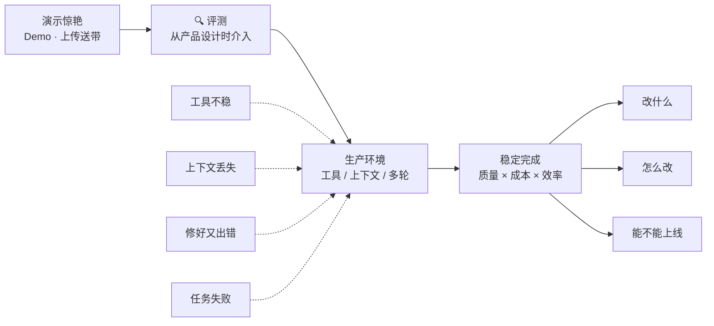

**图 2｜开场封面「演示惊艳 → 评测 → 生产环境 → 稳定完成」重绘**

开场封面把问题画成一条生产流水线：左端是「演示惊艳」的输入，中间是拿着放大镜的「评测」，右端是「生产环境」的齿轮与「稳定完成」的产出；红色失败标注散落在链路上——**工具不稳、上下文丢失、修好又出错、任务失败**。没有放大镜，这些失败只会在用户那里暴露。

**【视频原述】** 画面依次切到两篇参考文章：Anthropic 那篇给出「怎么定义评测、怎么组织组件」，阿里技术那篇「又给出了具体的工程落地思路」。主讲人还在 00:51 提前亮出自己整理的《Agent Eval 指标地图》，并说明「大家可以按照时间轴看，想反复阅读的也可以找我要文字版」。

> **【补充】为什么「演示惊艳」≠「生产可用」**：Anthropic 称这种状态为 *reactive loop*（反应式循环）——只在生产里等问题冒出来，修一个故障又制造另一个；没有评测时无法区分「真实退化」与「随机噪声」，也无法在发布前把改动跑过上百个场景。评测的价值是**复利**的：成本在前期一次性可见，收益随 Agent 生命周期持续累积，包括免费获得 baseline 与回归测试（延迟、Token、单任务成本、错误率），以及成为产品与研究团队之间带宽最高的沟通渠道。

> **【补充】评测驱动开发（eval-driven development）**：先写评测定义「计划中的能力」，再迭代 Agent 直到表现良好。好处是新模型发布时，跑一遍套件就知道哪些「押注」兑现了。Anthropic 建议把定义评测任务当作检验「产品需求是否足够具体」的压力测试。

---

**本章语音逐字稿（ASR · 已校正，19 句）**

> `[00:31]` 成为决定产品改什么怎么改
> `[00:33]` 能不能上线的关键依据
> `[00:34]` 今年1月
> `[00:35]` S-ROPE 发布了一篇 Agent 的评测的文章
> `[00:37]` 系统地讨论了 Agent 的评测应该怎么设计
> `[00:40]` 最近阿里的技术团队也发布了一篇
> `[00:42]` Agent 的评测体系设计与工程实践
> `[00:45]` 又给出了具体的工程落地思路
> `[00:47]` 那今天呢
> `[00:47]` 我们就把这两篇放在一起
> `[00:49]` 讲清楚 Agent 的评测到底应该怎么做
> `[00:51]` 视频的最后
> `[00:52]` 我也整理了一个评测的指标地图
> `[00:54]` 方便大家对照自己的产品使用
> `[00:56]` 内容比较多
> `[00:57]` 信息密度很大
> `[00:58]` 大家可以按照时间轴切换到感兴趣的章节
> `[01:01]` 想反复阅读的也可以找我要文字版
> `[01:05]` 传统大模型的调用

## 3. Agent 的错误发生在执行链路上

**【视频原述】**「传统的评测只围绕最终的回答展开——相关性怎么样、答案对不对。但 Agent 接到任务要先**理解需求**、再**调用工具读取结果**、有时还要**重试、调整计划**，最后才生成答案。这条链路上的任何一个地方错了，后面的工具调用再顺利，也是给错误的订单退款，退的金额也是错的。」

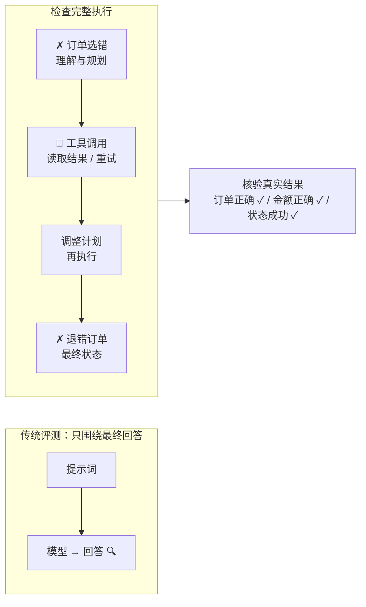

**图 3｜01:06「订单选错 → 工具调用 → 退错订单」执行链路重绘**

**【视频原述】**「所以评测要**覆盖一次完整的任务执行**：不只看它说了什么，还要看最后系统变成了什么状态。而这些步骤又是连在一起的——你改了提示词、为了让它记住更多信息，那其他的任务有没有受影响？靠感觉是看不出来的。评测的作用是**让问题尽量在用户之前暴露出来**。」

| 对比 | 只评最终回答（传统） | 覆盖完整执行（Agent 评测） |
|---|---|---|
| 观察对象 | `output`：模型生成的文本 | `outcome` + `transcript / trace`：环境终态 + 全过程记录 |
| 典型漏判 | 答案措辞漂亮，但订单选错、金额退错 | 逐节点校验：订单正确 / 金额正确 / 状态成功 |
| 改动影响 | 无法判断改提示词是否拖累别的任务 | 回归集持续跑，发现跨任务退化 |
| 失败归因 | 只知道「不对」，不知道哪里不对 | 定位到感知 / 规划 / 记忆 / 工具某一环节 |

> **【补充】output ≠ outcome**：一个订票 Agent 在 transcript 末尾说「您的机票已预订」，但 *outcome* 是「环境的 SQL 数据库里是否真有这条预订记录」。同一篇里还举了 Opus 4.5 在 𝜏2-bench 订票题中**发现政策漏洞**的例子：按静态评测它「失败」了，实际却给了用户更好的解法——评测设计要给创造性解法留余地。

---

**本章语音逐字稿（ASR · 已校正，50 句）**

> `[01:06]` 输入提示词模型给出回答
> `[01:08]` 以前很多的评测都是围绕着最终的回答展开
> `[01:11]` 答案准备准确
> `[01:12]` 有没有幻觉
> `[01:13]` 相关性怎么样
> `[01:13]` 语言质量怎么样
> `[01:15]` 但 Agent 不一样
> `[01:16]` Agent 的接到任务要先理解需求
> `[01:18]` 安排步骤
> `[01:18]` 再调用工具读取结果
> `[01:20]` 再决定下一步
> `[01:21]` 有的时候还要改文件
> `[01:22]` 更新订单
> `[01:24]` 情况不对再调整计划
> `[01:26]` 所以 Agent 的错误
> `[01:27]` 不是只发生在最后生成答案的那一刻
> `[01:29]` 而是发生在整条执行链路上的任何一个地方
> `[01:32]` 比如说退款
> `[01:33]` 订单找错了
> `[01:34]` 后面的工具调用再顺利
> `[01:36]` 也是给错误的订单退款
> `[01:37]` 金额传错了
> `[01:38]` 接口返回成功
> `[01:39]` 退的金额也是错的
> `[01:41]` 所以 Agent 的评测
> `[01:42]` 必须是要覆盖一次完整的任务执行
> `[01:44]` 他说了什么
> `[01:45]` 做了什么
> `[01:46]` 最后系统变成了什么状态
> `[01:47]` 都得有记录
> `[01:48]` 而这些步骤又是连在一起的
> `[01:50]` 你为了修改工具
> `[01:51]` 改了提示词
> `[01:52]` 有可能会影响任务的路由
> `[01:54]` 为了让他记住更多的信息
> `[01:55]` 又可能增加干扰
> `[01:57]` 眼前的几个任务变好了
> `[01:58]` 那其他的任务有没有受影响
> `[02:00]` 靠感觉是看不出来的
> `[02:01]` 评测要改变的
> `[02:02]` 就是这个被动的局面
> `[02:03]` 让问题尽量在用户之前暴露出来
> `[02:08]` 不少团队做评测
> `[02:09]` 上来就列准确率
> `[02:10]` 召回率
> `[02:11]` 幻觉率
> `[02:12]` 指标列了一大堆
> `[02:13]` 到底怎么才算是上线标准
> `[02:14]` 没人说得清
> `[02:15]` 我把这两篇文章的思路

## 4. 什么叫做得好：Outcome / Trace / Experience 三层

**【视频原述】**「上来就列准确率、召回率、幻觉率，回答不了『到底怎么才算是上线标准』。我把文章的思路整理成三个层次：**Outcome、Trace、Experience**。」

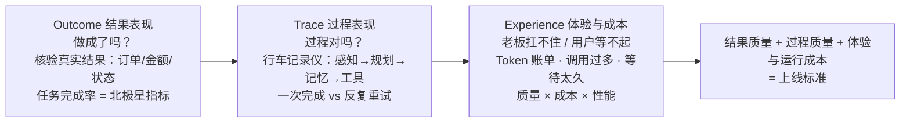

**图 4｜02:09「Outcome / Trace / Experience」三折页重绘**

### 4.1 Outcome：事情到底做成没有

**【视频原述】**「Anthropic 专门区分了 `output` 和 `outcome`。比如说一个 Agent 最后告诉你『退款成功』，真正要去系统里面看：订单对不对、金额对不对、状态是不是已经变成了成功。所以任务完成率是整个评测体系的**北极星指标**。」

视频 02:24 画面是一张「退款成功」单据被放大镜逐项核对：**订单正确 ✓ / 金额正确 ✓ / 状态成功 ✓**，旁注「核验真实结果」。

> **【补充】** 阿里对任务完成率的判定口径是「语义层面的完成度」：不要求字面匹配，但核心信息不能缺失。**幻觉率（忠实性）**只判断 Agent 有没有「忠实转述」它看到的检索片段与工具返回值，**不判断信息源本身对不对**；凭空捏造接口名、函数名、配置项，或给出与检索结果直接矛盾的核心信息，才判幻觉。

### 4.2 Trace：过程有没有问题

**【视频原述】**「Trace 可以理解成 Agent 的**行车记录仪**：它调用了什么工具、工具返回了什么、中间走了几步。两条链路最终都退款完成，但一条一次完成，另一条反复重试了好几次——只看结果，你看不出体验的差别，也看不出问题到底出在哪。」

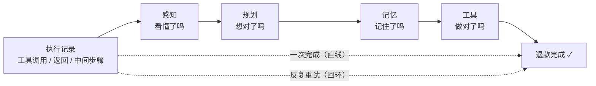

**图 5｜02:57「Trace 行车记录仪」与四模块链路重绘**

**【视频原述】**「阿里这篇实践文章在 Trace 层做了非常详细的拆解，按**感知、规划、记忆、工具**四块：感知解决『看懂了没』，规划解决『想对了没』（该走 Skills、知识库还是工具），记忆解决『记住了没』，工具解决『做对了没』（工具有没有选对、调用有没有成功）。」

**【视频原述】**「**评测体系要和你的 Agent 架构同构**。评测就要沿着这条链路去拆，这样一个指标下降的时候，你能知道是该改提示词、还是改工具描述，而不是只拿到一个总分。」

> **【补充】** 阿里把「同构」写成三条原则：**评测面向架构**（按四模块逐层拆解，每层质量独立可观测）、**指标面向行动**（每项指标是诊断报告而非成绩单）、**能力面向产品**（像监控告警一样可持续运行、可横向对比、可追溯演进）。比喻：端到端评测像把车开上测试跑道，只回答「能不能从 A 到 B」；模块级评测像把车架上升降台，看发动机、刹车、油路，提供「把车修好」的路径。

### 4.3 Experience：体验和成本

**【视频原述】**「任务完成了，但调用过多、让用户干等半分钟，或者一个简单问题烧掉了大量 Token，都不能叫好用。所以还要增加**成本和性能**两个维度：比如模型调用次数、工具调用次数、Token 消耗、首 Token 延迟、端到端延迟。」

视频 04:03 画面是「Token 账单（老板扛不住）」+「等待太久（用户等不起）」+「调用过多」，标题 **Experience 体验和成本**。视频总结为：**结果质量、过程质量、体验与运行成本**三方面放在一起，才能说清楚你到底想把 Agent 优化成什么样。

> **【补充】** 阿里把三维度写成「**质量 × 成本 × 性能**」：质量（正确、完整、忠实、无幻觉）是底线；成本（模型/工具调用次数、Token）；性能（TTFT、端到端延迟、模块级延迟）。「回答正确但耗时 30 秒」或「每次消耗 10 万 Token」都不可持续。

---

**本章语音逐字稿（ASR · 已校正，89 句）**

> `[02:17]` 整理成了三个层次
> `[02:18]` Outcome
> `[02:19]` Trace
> `[02:20]` Experience
> `[02:21]` 事情有没有做成
> `[02:22]` 过程有没有问题
> `[02:23]` 以及体验和成本能不能接受
> `[02:25]` 先说 Outcome
> `[02:26]` 事情能不能做成
> `[02:27]` Anthropic 专门区分了
> `[02:28]` Output 和 Outcome
> `[02:30]` 比如说一个 Agent 的最后告诉你
> `[02:31]` 退款已经成功了
> `[02:32]` 这个是 Output
> `[02:34]` 真正去系统里面看
> `[02:35]` 确实生成了一笔退款记录
> `[02:37]` 而且状态已经变成了成功
> `[02:38]` 这才是 Outcome
> `[02:39]` 所以对于 Agent 来说
> `[02:41]` 不能只看他最后说了什么
> `[02:42]` 还要看这个任务结束以后
> `[02:44]` 真实的世界或者系统
> `[02:45]` 状态到底发生了什么
> `[02:47]` 所以任务完成率
> `[02:48]` 作为整个端到端评测的北极星指标
> `[02:51]` 因为不管 Agent 的内部多复杂
> `[02:52]` 站在用户的角度
> `[02:53]` 第一个问题永远是
> `[02:54]` 我的事情到底有没有办成
> `[02:56]` 一个 Agent 的查对订单
> `[02:57]` 完成校验
> `[02:58]` 顺利退款
> `[02:59]` 另一个连续调错工具
> `[03:00]` 重试了好几次
> `[03:01]` 最后也成功了
> `[03:02]` 只看结果两条都是通过
> `[03:04]` 但是显然你还想知道
> `[03:06]` 第二个问题到底出在哪
> `[03:07]` 所以需要看第二层 Trace
> `[03:09]` Trace 可以理解成 Agent 的行车记录仪
> `[03:12]` 在一次任务里
> `[03:13]` Agent 调用了什么工具
> `[03:14]` 传了什么参数
> `[03:15]` 工具返回了什么
> `[03:16]` 每一步花了多久
> `[03:17]` 都要记录在 Trace 里面
> `[03:19]` 而阿里的这篇文章
> `[03:20]` 在 Trace 这一层
> `[03:21]` 做了非常详细的拆解
> `[03:23]` 他把这个过程拆成四个模块
> `[03:25]` 感知规划记忆和工具
> `[03:27]` 感知解决的是看懂了没
> `[03:29]` 用户的意图到底有没有理解正确
> `[03:31]` 用户要退款
> `[03:32]` 还是只想问退款的规则
> `[03:34]` 规划解决的是想对了没
> `[03:35]` 应该走 Scale 知识库
> `[03:37]` 还是工具
> `[03:38]` 知识路径有没有选对
> `[03:39]` 那记忆解决的就是记住了没
> `[03:41]` 多轮对话以后
> `[03:42]` 前面已经确认的信息还记不记得
> `[03:46]` 工具有没有选对、参数有没有传对有没有传对
> `[03:48]` 调用有没有成功
> `[03:49]` 这背后的底层原则就是评测体系
> `[03:51]` 应该尽量和你的 Agent 的架构同构
> `[03:53]` 你的 Agent 是怎么工作的
> `[03:55]` 你的评测就要沿着这条链路去拆
> `[03:57]` 这样一个指标下降的时候
> `[03:58]` 你才能知道到底是应该改提示词
> `[04:00]` 还是改工具描述还是改记忆
> `[04:02]` 最后看 Experience 体验和成本
> `[04:05]` 一个简单的查询
> `[04:06]` 你让用户干等半分钟
> `[04:07]` 任务完成率再好
> `[04:08]` 用户也不可能想用
> `[04:10]` 一个简单的问题
> `[04:11]` 来回调了几十次模型
> `[04:12]` 烧掉了大量的 Token
> `[04:16]` 增加成本和性能两个维度
> `[04:18]` 比如说模型的调用次数
> `[04:19]` 输入输出的 Token
> `[04:20]` 端到端的延时等等
> `[04:22]` 结果质量过程质量
> `[04:23]` 体验与运行成本
> `[04:25]` 这三个方面放在一起才能说清楚
> `[04:27]` 你到底想把 Agent 的优化成什么样
> `[04:30]` 这是后面整套评测的基础
> `[04:33]` 明确了什么叫做好

## 5. 评测框架：Anthropic 组件图

**【视频原述】**「接下来是评测体系本身由什么构成。把同一批任务按照业务或者能力组织起来，放在一个 suite 里；这就是 Eval 的 **Harness 评测框架**。harness 是出题以后的运行：同一道题每跑一次叫 **trial**，每一次都有自己的执行记录 **trace**，再由评分器进行打分。」

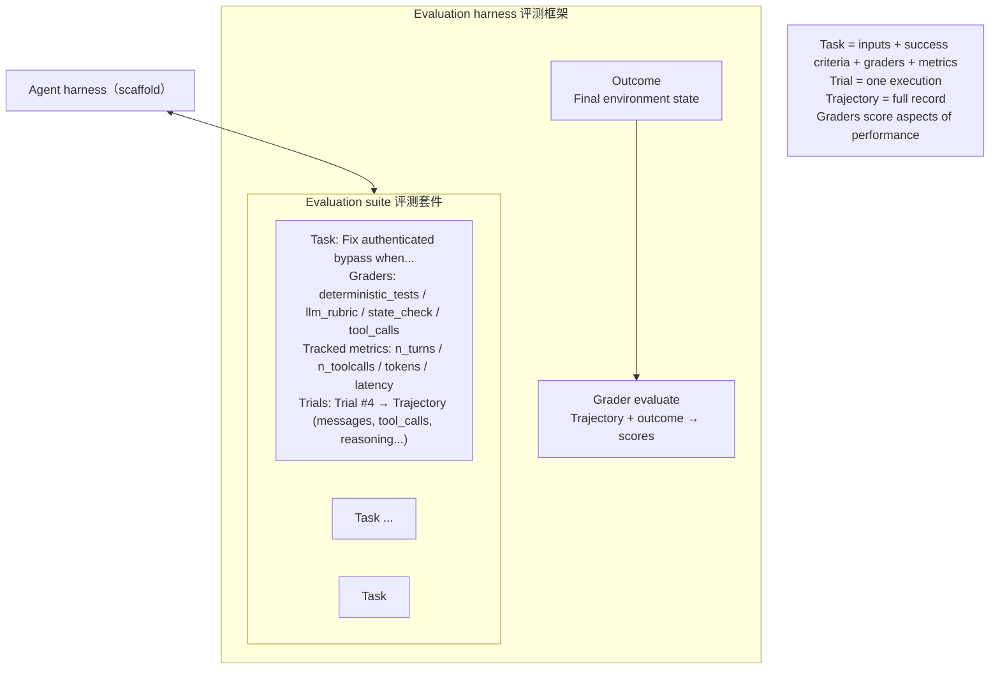

**图 6｜Anthropic《Components of Evaluations for Agents》组件架构图（按视频画面逐框重绘）**

### 5.1 八个必须分清的术语

| 英文 | 中文 | Anthropic 定义要点 | 视频说法 |
|---|---|---|---|
| `evaluation / eval` | 评测 | 给 AI 输入、对输出套评分逻辑衡量成功；聚焦开发期无需真实用户的 *automated evals* | 决定改什么、怎么改、能不能上线 |
| `task / problem / test case` | 任务 / 用例 | 单个测试，含定义好的输入与成功标准 | 一条完整用例 |
| `trial` | 一次尝试 | 对某 task 的每次执行；模型输出有波动，要跑多次 | 同一道题每跑一次叫 trial |
| `grader` | 评分器 | 对表现某一方面打分的逻辑；一个 task 可多个 grader，每个含多条 assertion / check | 评分器进行打分 |
| `transcript / trace / trajectory` | 轨迹 / 执行记录 | 一次 trial 的完整记录：输出、工具调用、推理、中间结果；API 里是结束时的完整 messages 数组 | Agent 的行车记录仪 |
| `outcome` | 环境终态 | trial 结束时环境的最终状态，不是 Agent 说了什么 | 最后系统变成了什么状态 |
| `evaluation harness` | 评测框架 | 提供指令与工具、并发跑任务、记录每一步、打分、汇总结果 | Eval 的 Harness |
| `agent harness / scaffold` | Agent 脚手架 | 处理输入、编排工具调用、返回结果；评 Agent = 评 harness + model | 开场「考验 harness 的设计」 |
| `evaluation suite` | 评测套件 | 衡量特定能力/行为的一组 task，共享宏观目标 | 把同批任务按业务组织起来 |

> **【补充】** 组件图里的示例 YAML 把上述概念落到一个「修复鉴权绕过漏洞」的 task：`deterministic_tests` / `llm_rubric` / `static_analysis` / `state_check` / `tool_calls` 五类 grader，加 `n_turns` / `n_toolcalls` / `n_total_tokens` 与 `time_to_first_token` 等 tracked metrics。原文提醒：这是为展示全部类型，实践中通常「单元测试判正确性 + 一个 LLM rubric 判代码质量」就够。

**三个容易混淆的关系**：suite 是 task 的集合；trial 是「跑一次」的动作、trajectory 是这一次留下的记录；`evaluation harness`（出题打分）与 `agent harness`（被测运行时）双向交互；最终状态与轨迹一起送进 grader，产出 `Trajectory + outcome → scores`。

> ⚠️ **关于自动章节摘要的「What / When / How」**：逐帧核对 04:33–5:21 画面后确认，该段始终是 Anthropic 文章截图，没有出现这三个词。它更像是对「Task = inputs + success criteria + graders + metrics」的机器转述，本教程不把它当作视频原述。

---

**本章语音逐字稿（ASR · 已校正，26 句）**

> `[04:35]` 接下来是评测体系本身有什么构成
> `[04:37]` Anthropic 给了三个层级的概念
> `[04:39]` 一条可以重复执行的测试任务叫做 Task
> `[04:42]` 它要写清楚输入初始条件和成功标准
> `[04:45]` 做到什么才算完成
> `[04:46]` 有哪些行为不能发生提前约定
> `[04:49]` 把同一批任务按照业务或者是能力组织起来
> `[04:52]` 就是评测集
> `[04:53]` 比如说多轮对话一组
> `[04:55]` 工具调用一组
> `[04:56]` 也可以把退款取消订单
> `[04:57]` 转人工放在客服业务的 Suite 下面
> `[05:00]` 然后你需要一套系统
> `[05:01]` 把任务发给 Agent
> `[05:02]` 准备工具和环境
> `[05:04]` 保存之前的记录调用评分器
> `[05:05]` 在汇总结果
> `[05:06]` 这就是 Eval Harness 评测框架
> `[05:09]` Task 像一道题
> `[05:10]` Suite 向一套试卷
> `[05:12]` Harness 是出题以后的运行记录评分都组织起来
> `[05:16]` 同一道题没跑一次叫 Trial
> `[05:17]` 也就是一次试跑
> `[05:18]` 每一次都有自己的执行记录 Trace
> `[05:21]` 一个任务可以有多个评分器进行打分
> `[05:25]` 你用一堆条件齐全、表达准确的问题去测 Agent

## 6. 任务收集：从哪来、怎么标

**【视频原述】**「别一上来就用表达准确的『标准题』去测 Agent——真实用户那里省略、指代、临时改主意全都来了，你都接不住。可以**从手工测试、真实的日志、用户反馈或者线上失败里面，找 20–50 条有代表性的任务先跑起来**。后面如果要识别更小的差异，再逐步扩充。」

> **【补充】** 这正是 Anthropic **Step 0「Start early」**：团队常因为「以为需要几百条任务」而迟迟不动手，其实早期每次改动效果量很大，小样本就够。原文原话是「最好一开始采用 80/20 法则」「评测越晚建越难建」。

### 6.1 四类来源

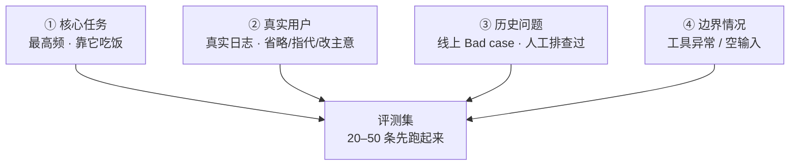

**图 7｜05:48「四类任务来源 → 评测集」重绘**

| 来源 | 视频原述 | 为什么必须有 |
|---|---|---|
| ① 核心任务 | 「最重要、最高频、产品靠它吃饭」：搜索 Agent 的检索/跨来源总结/复杂拆解，数据 Agent 的查数/分析归因/生成图表 | 定义价值下限，回归集主力 |
| ② 真实用户任务 | 「来自于真实的日志」；产品经理自己写的问题往往意图清晰 | 覆盖口语化与歧义，避免与线上分布脱节 |
| ③ 历史 Bad case | 「线上真正出过问题、人工排查过的问题」 | 「否则一个坑可能就会掉进去两次」 |
| ④ 边界 case | 「工具异常、空输入、超长文本……不能只等着线上遇见」 | 测鲁棒性与降级，属安全护栏 |

### 6.2 八类评测集

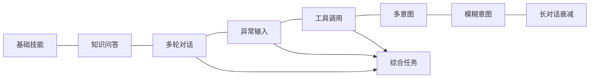

**图 8｜06:39「8 类评测集晾衣绳 + 综合任务」重绘**

| 评测集 | 视频里测什么 | 规模建议 | 主指标 |
|---|---|---|---|
| 基础技能评测集 | 最核心的基础能力、该不该命中某个 Skill | ≥ 50 条 | 任务完成率 |
| 知识问答评测集 | 该查的时候查了吗、找到正确材料没有 | ≥ 100 条 | 任务完成率 |
| 多轮对话评测集 | 连续多轮能否保持上下文、能否接得住 | ≥ 10 组（2–5 轮） | 多轮对话完成率 |
| 异常输入评测集 | 空输入、超长文本、异常请求会不会崩 | ≥ 20 条 | 异常输入处理率 |
| 工具调用评测集 | 工具参数错、调用失败后怎么办 | ≥ 20 条 | 工具调用准确率 |
| 多意图评测集 | 一句话 2–3 个需求能否全识别 | ≥ 20 条 | 多意图识别率 |
| 模糊意图评测集 | 会不会正确澄清 | ≥ 20 条 | 模糊意图澄清率 |
| 长对话衰减评测集 | memory 从第几轮开始丢 | ≥ 10 组（5 轮以上） | 记忆衰减曲线 |
| 综合任务（图中下挂） | 由多轮/异常/工具组合 | — | 按组合场景选主指标 |

> **【补充】** 阿里称其为「**基础覆盖 + 专项探测**」：基础技能与知识问答是基座，其余 6 类定位感知/规划/记忆/工具短板。另有「评测范围 → 数据集 → 指标」自动装配映射（15 种评测范围），以及基于语雀文档 + Prompt 模板生成用例、「LLM 生成 → 人工审核 → 入库」的半自动工作流。

### 6.3 用例规范

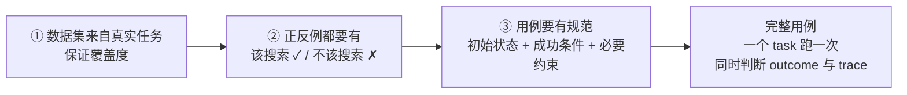

**图 9｜07:42「真实任务 + 正反例 + 完整用例」重绘**

**【视频原述】**「① 数据集要来自真实任务，保证测试覆盖度，不能全都是构造数据；② 既要有正例也要有反例——你只奖励 Agent 调用搜索工具，它就会什么都搜，所以**该调的时候要测，不该调的时候能不能控制住也要测**；③ 测试用例要有规范，还得写**初始状态、成功条件、必要约束**。」

> **【补充】** Anthropic Step 2 的判据更严格：一个好任务要能让「两位领域专家独立得出相同结论」；评分器要检查的一切都必须能从任务描述看清楚；前沿模型多次 trial 仍 `0% pass@100`，多半是**任务或评分器坏了**。建议每条任务配一份 *reference solution*。
>
> 阿里完整用例字段：`id` / `sceneCode` / `sceneName` / `userInput` / `expectedSkill` / `expectedRoute` / `expectedIntent` / `bizCode` / `datasetType` / `evalMode` / `mockDataId` / `referenceOutput`；知识问答另有 `expectedKnowledge`；多轮另有 `conversationChain` 与逐轮 `expectedContains`。

---

**本章语音逐字稿（ASR · 已校正，101 句）**

> `[05:28]` 它当然容易表现得很好
> `[05:30]` 但真实用户一开口
> `[05:31]` 省略指代临时改变主意全都来了
> `[05:34]` 接不住
> `[05:35]` 那早期不需要追求特别大的数据集
> `[05:37]` 可以从手工测试真实的日志
> `[05:39]` 用户反馈或者线上失败里面
> `[05:41]` 找20-50条有代表性的任务先跑起来
> `[05:43]` 那它们是核心的基线发现明显的变化
> `[05:46]` 后面如果要识别更小的差异再增加规模
> `[05:48]` 至少要覆盖这四个情况
> `[05:50]` 第一类是核心任务
> `[05:51]` 也就是这个 Agent 的最重要最高频
> `[05:53]` 最能代表产品价值的任务
> `[05:54]` 比如说一个搜索的 Agent
> `[05:56]` 那它的核心任务可能就是信息的检索
> `[05:58]` 跨来源的总结复杂问题的拆解
> `[06:00]` 一个数据 Agent 核心的任务就是查数
> `[06:02]` 分析归因是什么图表
> `[06:03]` 这些产品靠它吃饭的能力
> `[06:05]` 必须有对应的测试
> `[06:07]` 第二个是真实用户的任务
> `[06:08]` 这类数据最好直接来自于真实的日志
> `[06:10]` 真实的 query 只是用户的使用记录
> `[06:12]` 因为产品经理自己构造的问题
> `[06:14]` 往往太标准表达完整
> `[06:16]` 一图清晰
> `[06:17]` 但真实的用户不会这么说
> `[06:19]` 第三类是历史的 Bad Case
> `[06:20]` 这类数据其实特别值钱
> `[06:22]` 线上真正出过问题
> `[06:23]` 被用户投诉过人工排查过的问题
> `[06:26]` 修好以后都应该沉淀进评测集
> `[06:28]` 否则同一个坑可能就会掉进去两次
> `[06:30]` 第四类就是边界 Case
> `[06:31]` 你的信息不够
> `[06:32]` 多意图长对话工具异常
> `[06:34]` 知识库没有答案
> `[06:35]` 都要主动覆盖
> `[06:36]` 不能只等着线上遇见
> `[06:38]` 数据集多了
> `[06:39]` 还要能快速的挑出这次应该测哪些
> `[06:41]` 可以按照下面这几类打标
> `[06:43]` 组织专项的评测
> `[06:45]` 基础技能的评测
> `[06:46]` 测的就是 Agent 最核心的技术能力
> `[06:48]` 比如说一个任务该不该命中
> `[06:49]` 某个 skill 最终有没有完成
> `[06:51]` 知识问答评测集
> `[06:53]` 主要就是测 req 和知识库相关的能力
> `[06:55]` 该查的收查了吗
> `[06:56]` 检索内容对不对
> `[06:57]` 找到了证据的材料没有
> `[06:58]` 回答有没有乱编
> `[07:00]` 多轮对话的评测集测的就是
> `[07:01]` Agent 在连续多轮交互里面
> `[07:03]` 还能不能保持上下文
> `[07:04]` 能不能理解指代
> `[07:05]` 用户中途切换了话题之后
> `[07:07]` 还能不能接得住
> `[07:08]` 异常输入的评测集测的就是
> `[07:10]` 系统会不会被不正常的输入搞乱
> `[07:12]` 空输入超长的文本
> `[07:14]` 乱码特殊字符
> `[07:15]` 或者是一些异常的请求
> `[07:16]` Agent 会不会崩掉
> `[07:17]` 或者是胡乱回答
> `[07:18]` 根据调用的评测集专门测工具
> `[07:20]` 该不该调
> `[07:21]` 调哪个参数对不对
> `[07:22]` 失败后该怎么办都得测
> `[07:24]` 多意图的评测集
> `[07:25]` 用户一句话里同时有两三个需求
> `[07:28]` Agent 能不能完全识别出来
> `[07:30]` 而不是只处理其中一个
> `[07:31]` 模糊一图的评测集
> `[07:32]` 用户说的不清楚的时候
> `[07:33]` Agent 会不会正确的澄清
> `[07:35]` 而不是自己脑补
> `[07:36]` 长对话衰减的评测集
> `[07:38]` 看对话越来越长之后
> `[07:39]` Agent 的 Memory 到底从第几轮开始明显下降
> `[07:42]` 真正创建用例的时候
> `[07:43]` 有三个地方尤其容易出问题
> `[07:45]` 第一是数据集要来自真实任务
> `[07:47]` 人工构造的数据
> `[07:48]` 可以保证测试的覆盖度
> `[07:50]` 但是要保留真实使用的复杂程度
> `[07:52]` 全都是构造数据很容易测不出问题
> `[07:54]` 第二是机要有正力
> `[07:56]` 要有反力
> `[07:57]` 你只奖励 Agent 的调用搜索工具
> `[07:59]` 它可能学会的就是
> `[08:00]` 遇到什么问题都搜索
> `[08:01]` 所以该调的时候要测
> `[08:03]` 不该调的时候能不能控制住也要测
> `[08:06]` 第三是测试用例要有规范
> `[08:07]` 用例不能只有问题和参考答案
> `[08:09]` 还得写出初始状态
> `[08:10]` 成功条件必要约束
> `[08:12]` 每条用例要完整的标注了

## 7. 评分器：三类判据与四条原则

**【视频原述】**「评分器如果判错了，比没有评分器更糟——因为你会拿着错误的分数，继续把产品往错误的方向改。同一任务上有**代码评分、模型评分、人工评分**这三种。」

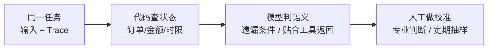

**图 10｜08:21「代码 / 模型 / 人工」三类评分器流水线重绘**

| 类型 | 视频定位 | Anthropic 方法 | 优势 | 局限 |
|---|---|---|---|---|
| **代码 Code-based** | 退款订单/金额/时限，用程序检查更便宜稳定 | 字符串匹配、二元测试、静态分析、终态验证、工具调用校验、轨迹统计 | 快、便宜、客观、可复现、易调试 | 对合法变体脆弱、缺乏细腻度 |
| **模型 Model-based** | 代码难判的「是否遗漏条件、是否贴合工具返回」 | rubric 打分、自然语言断言、成对比较、参考答案评测、多评委共识 | 灵活、可扩展、能捕捉语义 | 非确定性、更贵、需与人工校准 |
| **人工 Human** | 专业判断 + 定期抽一批 case 对齐 | SME 评审、众包判断、抽样复核、A/B、标注者一致性 | 金标准、贴近专家、校准 LLM grader | 贵、慢、专家难规模化 |

**【视频原述】**「**代码查得清的要用代码，专业判断和校准留给人工，三种方式各自负责合适的部分。**」若人工与模型评分出现系统性偏差，「那就应该先修改评分标准」。

> **【补充】** 每个 task 的计分可用 weighted / binary / hybrid。常见误区是执着于检查「是否按特定顺序调用工具」——太死板；**宁可评产出，也别死守路径**；多组件任务给部分分。

### 7.1 大模型评分的四条原则

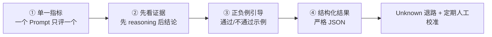

**图 11｜09:00「单一指标 / 先看证据 / 正反例 / 结构化结果」重绘**

1. **一个 prompt 只评一个指标**——别用模糊总分混淆问题。阿里原文：曾在一个 Prompt 里同时判断任务完成率和忠实性，两项准确率都下降。
2. **先推理后判断 / 先看证据**——先输出思维链，提高准确性且让失败可解释。
3. **负例引导**——给「通过」与「不通过」典型示例，校准 Judge。
4. **结构化输出**——严格 JSON，便于自动统计，不要让模型自由写评价。

> **【补充】** 阿里把依赖评测集判定的指标任务归纳为**六种 Judge Task 类型**并沉淀为内置 Prompt 模板；Anthropic 建议给 LLM 一条退路——信息不足返回 `Unknown`，把 rubric 按维度拆开、每维度独立 judge，系统稳定后人工只需偶尔抽检。

---

**本章语音逐字稿（ASR · 已校正，72 句）**

> `[08:14]` 评测链路所需要的所有信息
> `[08:16]` 这样一个 Task 跑一次
> `[08:18]` 就能同时判断
> `[08:18]` Outcome 和 Trace 里面的多个环节
> `[08:22]` 怎么判断它到底有没有作对
> `[08:24]` 靠的就是评分器
> `[08:25]` 评分器如果判错了
> `[08:26]` 比一次任务做错更麻烦
> `[08:28]` 因为你会拿着错误的分数
> `[08:29]` 继续把产品往错误的方向改
> `[08:31]` Anthropic 是把评分方式分成了三种
> `[08:34]` 代码评分
> `[08:35]` 模型评分和人工评分
> `[08:37]` 这三种
> `[08:37]` 先用代码评分
> `[08:39]` 工具参数对不对
> `[08:40]` 退款记录的订单和金额对不对
> `[08:42]` 状态是否成功
> `[08:43]` 有没有超过约定的时间
> `[08:44]` 用程序检查更便宜稳定
> `[08:46]` 而且还可以重复执行
> `[08:48]` 有些事情代码判断很难
> `[08:50]` 解释有没有回答到用户关心的问题点
> `[08:52]` 是否遗漏重要条件
> `[08:53]` 有没有偏离知识库和工具返回的信息
> `[08:56]` 那这些语义的问题
> `[08:57]` 都可以用模型来评分
> `[08:58]` 也就是 LLM as a judge
> `[09:01]` 但是大模型的评分
> `[09:02]` 不是简单的把所有内容
> `[09:03]` 扔给一个更强的模型
> `[09:04]` 让它从零到一百打个分
> `[09:06]` 有四个很重要的原则
> `[09:07]` 第一个是单一职责
> `[09:08]` 一个 prompt 只凭一个指标
> `[09:10]` 判断任务有没有完成
> `[09:12]` 就对照完成条件
> `[09:13]` 判断忠实度就检查
> `[09:14]` 有没有脱离证据乱编
> `[09:16]` 不要让一个模糊的总分
> `[09:17]` 把几个不同的问题混淆在一起
> `[09:19]` 复杂任务可以拆开判断
> `[09:21]` 第二是先推理后判断
> `[09:23]` 每个 prompt 都要求大模型
> `[09:24]` 先输出思维链的推理
> `[09:26]` 再给出结论
> `[09:27]` 这不仅提高了判断的准确性
> `[09:28]` 也让评测结果具备的可解释性
> `[09:31]` 第三是福利引导
> `[09:32]` 每个 prompt 都要包含
> `[09:33]` 典型的通过和不通过的示例
> `[09:35]` 最后一个是结构化输出
> `[09:37]` 不要让大模型自由发挥写一篇评价
> `[09:39]` 而是要让它按照严格的
> `[09:41]` 指定格式输出明确的结构化结果
> `[09:43]` 方便后面自动统计
> `[09:44]` 人工评分规则负责专业判断和校准
> `[09:47]` 人工特别适合两个场景
> `[09:48]` 一个是高度专业
> `[09:50]` 或者是高度主观的问题
> `[09:51]` 另外一个很重要的就是校准大模型
> `[09:54]` 比如说定期抽一批 case
> `[09:55]` 让领域专家和大模型同时判断
> `[09:57]` 看看差在哪
> `[09:58]` 如果模型经常和专家的结论相反
> `[10:00]` 那就应该先修改评分标准
> `[10:02]` 而不是拿错误的评分去优化 Agent
> `[10:04]` 代码能查清的早用代码
> `[10:05]` 语义判断交给模型
> `[10:07]` 专业判断和校准留给人工
> `[10:09]` 三种方式各自负责合适的部分
> `[10:11]` 评分才有依据

## 8. 结果判断：主指标 + 护栏 + 跳过

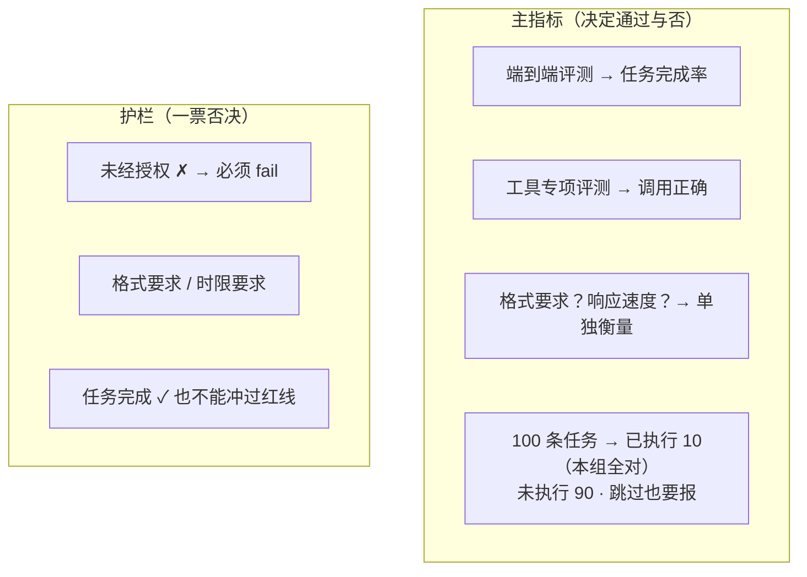

**图 12｜10:15 主指标 + 10:36 未经授权 + 10:48 跳过也要报**

### 8.1 按目的选主指标

**【视频原述】**「给不同类型的评测设**主指标**，每一次评测先回答：哪个指标决定整个 case 是否通过？端到端评测重点看**任务完成率**，工具专项评测重点看**工具调用**。格式要求、响应速度作为质量维度单独衡量。」

| 评测范围 / 数据集 | 主指标 | 选择理由 |
|---|---|---|
| 端到端 / 核心模块评测 | 任务完成率 | 关注最终任务完成效果 |
| 感知模块评测 | 意图识别准确率 | 感知的核心职责是理解用户意图 |
| 规划模块评测 | 路由决策准确率 | 规划的核心职责是决定走哪条路 |
| 记忆模块评测 | 短期记忆保留率 | 记忆的核心职责是记住对话内容 |
| 工具模块评测 | 工具调用准确率 | 工具的核心职责是准确调用工具 |
| 多轮对话评测集 | 多轮对话完成率 | 需评估整组流程而非单轮 |
| 异常输入评测集 | 异常输入处理率 | 不存在「完成任务」，关键是合理应对 |
| 多意图 / 模糊意图 / 长对话衰减 | 多意图识别率 / 模糊意图澄清率 / 记忆衰减曲线 | 「识别不全」「追问>猜测>幻觉」「记忆保留」 |

> 原文规定：**评测模式的优先级高于评测数据集**。

### 8.2 护栏指标：高分不能抵消

**【视频原述】**「在实际的产品里，某些错误一旦发生，这条 case 都必须 fail：比如不可逆的风险操作、**未经授权**。任务完成、格式要求、时限要求都摆在那儿，但**高分不能抵消**红线。」画面是一辆「任务完成 ✓」小车被红色「未经授权 ✗」横杆拦下。

### 8.3 上游错了，下游要跳过

**【视频原述】**「100 条任务，只执行了 10 条、本组全对，剩下 90 条没执行——**跳过也要报**。不能让上游的错误把下游的评分拖垮。」

> **【补充】** 阿里 5.4 的精确做法：知识问答用例期望路由 `SKILL_MISS`（走 RAG），若 Agent 误路由到 Skill，RAG 根本没触发，此时「幻觉率 / 检索精确率 / 检索召回率」都会因缺检索原文被误判不通过。**解法**：在依赖 RAG 的 Judge Task 执行前检测路由误触发，命中则把下游 Judge 标 `error` 并跳过统计，**既不计入分子也不计入分母**；路由错误只体现在「路由决策准确率」一项，避免雪崩式污染。

---

**本章语音逐字稿（ASR · 已校正，39 句）**

> `[10:13]` 任务完成了
> `[10:14]` 工具调用也正确
> `[10:15]` 但是格式没有按照要求
> `[10:16]` 响应速度也很慢
> `[10:18]` 这算通过还是不通过
> `[10:19]` 阿里在这里用了一个
> `[10:20]` 我觉得非常实用的方法
> `[10:21]` 就是给不同类型的评测设置主 Agent
> `[10:24]` 端到端的评测
> `[10:25]` 重点看任务完成率
> `[10:26]` 工具专项评测
> `[10:27]` 重点看工具的选择和调用是否正确
> `[10:30]` 每一次评测
> `[10:31]` 先回答自己最关心的那个问题
> `[10:33]` 其他的指标不一定决定
> `[10:34]` 整个 case 是否通过
> `[10:35]` 而是作为整段信息存在
> `[10:37]` 在实际的产品里
> `[10:38]` 我觉得还可以增加一层护栏指标
> `[10:40]` 某些错误一旦发生
> `[10:41]` 不管其他指标多高
> `[10:42]` 这条 case 都必须不通过
> `[10:43]` 比如说安全
> `[10:44]` 隐私
> `[10:45]` 或者不可逆的风险操作
> `[10:46]` 还有一个细节
> `[10:47]` 上游的指标错了
> `[10:48]` 下游该怎么办
> `[10:49]` 比如说一个问题本来走 RAG
> `[10:50]` 但是 Agent 的路由错了
> `[10:52]` 直接走了 skill
> `[10:53]` 那这次的 RAG 根本没有执行
> `[10:55]` 如果直接给
> `[10:56]` 检索质量打零分
> `[10:57]` 肯定不合适
> `[10:58]` 像这种情况
> `[10:58]` 下游的评分直接跳过统计
> `[11:00]` 避免上游的错误
> `[11:01]` 把后面几个指标一起拖低

## 9. 评测的稳定性：pass@k / pass^k

**【视频原述】**「CHAPTER 07：算出来分靠谱吗？这是 Agent 测试和传统软件测试非常不同的地方——**概率指标**。同一个任务第一次跑可能成功、第二次失败、第三次又成功，你会认为它 100% 没问题吗？当然不是。重要的 case 要重复执行。」

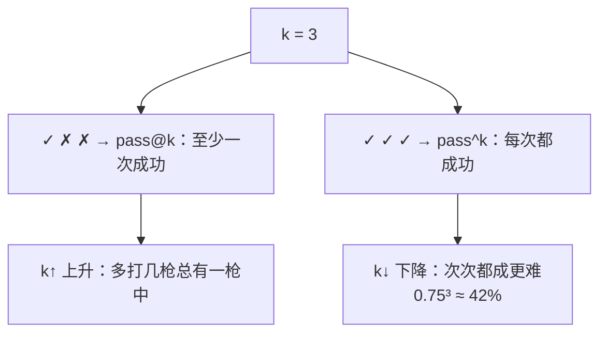

**图 13｜11:06「pass@k / pass^k，k=3」概率指标重绘**

| 指标 | 定义 | 随 k 增大 | 适用 |
|---|---|---|---|
| `pass@k` | k 次尝试中**至少一次**正确解的概率；`pass@1=50%` 表示首次就解决一半任务 | **上升** | 只要一个可行解就够的工具；衡量能力上限 |
| `pass^k` | **全部 k 次** trial 都成功的概率；单次 75%、k=3 → `0.75³ ≈ 42%` | **下降** | 面向用户的 Agent：用户每次来都期望办成 |

> `k=1` 时两者相同（都等于单次成功率）；`k=10` 时讲相反故事：pass@k 趋近 100%，pass^k 掉到 0%。选哪个取决于产品要求。

> **【补充】** 阿里的配套设计：`E2E_MOCK` 注入确定性工具返回值消除外部抖动、保证可复现；`E2E_REAL` 保留真实链路。多轮场景每组独立 `sessionId`、轮次间等约 2 秒持久化、成本逐轮累加、所有轮次拼接后统一评判。

---

**本章语音逐字稿（ASR · 已校正，29 句）**

> `[11:04]` 如果你算出来的评测分数是90分
> `[11:06]` 那是不是就说明没问题了呢
> `[11:08]` 这是 Agent 的评测和传统软件测试
> `[11:10]` 非常不同的地方
> `[11:11]` Agent 是一个概率系统
> `[11:12]` 同一个任务
> `[11:13]` 第一次跑可能成功
> `[11:14]` 第二次失败
> `[11:15]` 第三次又成功了
> `[11:16]` 如果你刚好测到那一次成功
> `[11:18]` 你会认为它100%没问题
> `[11:20]` 但对于真实的用户来说
> `[11:21]` 这显然不是一个稳定的产品
> `[11:22]` 所以对于复杂、多步的 Agent 的任务
> `[11:25]` 重要的 case 要重复执行
> `[11:27]` Anthropic 在这里用了两个指标来讨论这种波动
> `[11:30]` 一个指标可以简单理解成
> `[11:32]` 你给它 k 次机会至少要成功一次
> `[11:34]` 它更适合判断 Agent 的能力边界
> `[11:36]` 也就是它到底有没有能力把这件事做出来
> `[11:39]` 那一个指标则要求连续 case 都成功
> `[11:42]` 对于真正面向用户的 Agent
> `[11:43]` 这个指标更重要
> `[11:44]` 因为用户每次来都希望事情办成
> `[11:47]` 如果测的效果连续 case 都成功了
> `[11:49]` 这下是不是该上线了
> `[11:51]` 还不行
> `[11:52]` 你修好了一个东西
> `[11:53]` 很可能同时改坏另一个东西

## 10. 能力评测 → 回归评测

**【视频原述】**「连续 case 都成功了，还不行。你修好了一个东西、复杂任务进步了，这也不能直接叫整体变好——**以前会的东西现在还会不会**？」

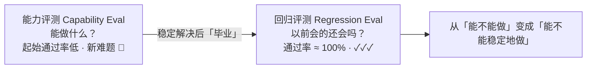

**图 14｜11:48「能力评测 → 回归评测」毕业机制重绘**

| | 能力评测 | 回归评测 |
|---|---|---|
| 回答的问题 | 「这个 Agent 能做什么？」 | 「它还会做以前会的事吗？」 |
| 起始通过率 | **低**，专挑当前做不到的题 | **接近 100%**，下降即异常 |
| 任务来源 | 新难题、能力边界、未解决的 bad case | 历史稳定通过的任务、已修复问题 |
| 毕业机制 | 持续稳定解决后，高通过率能力集毕业成回归套件，持续捕捉漂移 | 同左 |

> **【补充】Step 7 评测饱和（eval saturation）**：跑到 100% 的评测只追回归、不再给改进信号。SWE-bench Verified 一年内从约 40% 到 >80%；Qodo 曾因一次性编码评测饱和误判 Opus 4.5 没进步，新建 agentic 评测框架后才看清长任务收益。

---

**本章语音逐字稿（ASR · 已校正，17 句）**

> `[11:55]` 复杂任务进步了
> `[11:56]` 简单任务却退步了
> `[11:57]` 这也不能直接叫整体变好
> `[11:58]` 这就需要同时做能力评测和回归评测
> `[12:02]` 能力评测解决的是这个 Agent 还有什么不会
> `[12:04]` 回归评测解决的是以前它会的东西
> `[12:06]` 现在还会不会
> `[12:08]` 换模型、改提示词、加 Skills
> `[12:09]` 以前正常的任务还是需要继续正常
> `[12:13]` 当某一类能力评测的问题
> `[12:14]` 被 Agent 持续稳定的稳定解决之后
> `[12:16]` 它就可以毕业了
> `[12:17]` 进入到回归测试的数据集
> `[12:19]` 原来它是一道难题
> `[12:20]` 等解决之后它就变成了一条底线
> `[12:22]` 这样你的评测数据集其实是在不断演化的
> `[12:25]` 最后这张指标地图列出了

## 11. 指标地图：41 项指标全景

**【视频原述】**「最后这张指标地图列出了结果、过程、体验成本以及稳定性和回归这些方向。如果你能听到这儿，别觉得『我搞个 Agent 都没这么复杂』——这不是一份必须全部完成的清单，而是一张帮助你做出更好选择的地图。」

**【按画面重绘】** 视频 12:24 的《Agent Eval 指标地图》已按截图**逐字重绘为独立 HTML**：[指标地图.html](指标地图.html)。

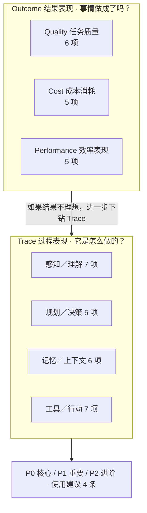

**图 15｜12:25《Agent Eval 指标地图》结构速览**

**图上的三段原文**：

- 顶部说明：「这是一份面向产品和研发团队的 Agent 评测指标地图。基于 Outcome 与 Trace 两个视角，并从 Quality、Cost、Performance 三个维度，梳理了关键指标，帮助你根据业务目标和 Agent 架构，选择最适合的评测体系。」右上角手写批注：「好的评测，让每一次迭代都更有方向。」
- 两栏过渡：「如果结果不理想，进一步下钻 Trace，定位问题出在哪里」。
- 右下引用：「这不是一份必须全部完成的清单，而是一张帮助你做出更好选择的地图。—— 让评测真正为产品创造价值」。

### 11.1 全部 41 项指标（逐条）

| 视角 | 分组 | 指标（中文） | 英文（截图原文） | 优先级 |
|---|---|---|---|---|
| Outcome · 结果表现 | Quality 任务质量 | 任务完成率 | `Task Completion Rate` | **P0** |
| Outcome · 结果表现 | Quality 任务质量 | 多轮任务完成率 | `Multi-turn Completion Rate` | **P1** |
| Outcome · 结果表现 | Quality 任务质量 | 指令遵循 | `Instruction Following` | **P0** |
| Outcome · 结果表现 | Quality 任务质量 | 忠实性／幻觉率 | `Faithfulness / Hallucination` | **P0** |
| Outcome · 结果表现 | Quality 任务质量 | 异常输入处理率 | `Robustness` | **P1** |
| Outcome · 结果表现 | Quality 任务质量 | 用户满意度 | `User Satisfaction` | **P2** |
| Outcome · 结果表现 | Cost 成本消耗 | 模型调用次数 | `Model Calls` | **P1** |
| Outcome · 结果表现 | Cost 成本消耗 | 工具调用次数 | `Tool Calls` | **P1** |
| Outcome · 结果表现 | Cost 成本消耗 | 输入 Token 消耗 | `Input Tokens` | **P1** |
| Outcome · 结果表现 | Cost 成本消耗 | 输出 Token 消耗 | `Output Tokens` | **P1** |
| Outcome · 结果表现 | Cost 成本消耗 | 总 Token 消耗 | `Total Tokens` | **P2** |
| Outcome · 结果表现 | Performance 效率表现 | 首 Token 延迟 | `TTFT` | **P0** |
| Outcome · 结果表现 | Performance 效率表现 | 端到端延迟 | `End-to-End Latency` | **P0** |
| Outcome · 结果表现 | Performance 效率表现 | 成功任务耗时 | `Success Latency` | **P1** |
| Outcome · 结果表现 | Performance 效率表现 | 失败任务耗时 | `Failure Latency` | **P1** |
| Outcome · 结果表现 | Performance 效率表现 | 模块级耗时 | `Module-level Latency` | **P1** |
| Trace · 过程表现 | 感知／理解 | 意图识别准确率 | `Intent Accuracy` | **P0** |
| Trace · 过程表现 | 感知／理解 | 意图识别精确率 | `Intent Precision` | **P1** |
| Trace · 过程表现 | 感知／理解 | 意图识别召回率 | `Intent Recall` | **P1** |
| Trace · 过程表现 | 感知／理解 | 多意图识别率 | `Multi-intent Recognition` | **P1** |
| Trace · 过程表现 | 感知／理解 | 模糊意图澄清率 | `Clarification Rate` | **P1** |
| Trace · 过程表现 | 感知／理解 | 降级触发准确率 | `Fallback Trigger` | **P1** |
| Trace · 过程表现 | 感知／理解 | 意图识别延迟 | `Intent Latency` | **P2** |
| Trace · 过程表现 | 规划／决策 | 路由决策准确率 | `Routing Accuracy` | **P0** |
| Trace · 过程表现 | 规划／决策 | 工具选择准确率 | `Tool Selection` | **P1** |
| Trace · 过程表现 | 规划／决策 | 知识检索决策准确率 | `RAG Decision` | **P1** |
| Trace · 过程表现 | 规划／决策 | 规划路径合理性 | `Planning Path Score` | **P1** |
| Trace · 过程表现 | 规划／决策 | 规划决策延迟 | `Planning Latency` | **P2** |
| Trace · 过程表现 | 记忆／上下文 | 短期记忆保留率 | `Short-term Retention` | **P1** |
| Trace · 过程表现 | 记忆／上下文 | 短期记忆注入延迟 | `Memory Injection Latency` | **P2** |
| Trace · 过程表现 | 记忆／上下文 | 检索精确度 | `Retrieval Precision` | **P1** |
| Trace · 过程表现 | 记忆／上下文 | 检索召回率 | `Retrieval Recall` | **P1** |
| Trace · 过程表现 | 记忆／上下文 | 记忆衰减曲线 | `Memory Decay Curve` | **P2** |
| Trace · 过程表现 | 记忆／上下文 | 检索延迟 | `Retrieval Latency` | **P2** |
| Trace · 过程表现 | 工具／行动 | MCP 加载成功率 | `MCP Loading` | **P1** |
| Trace · 过程表现 | 工具／行动 | Skill 加载成功率 | `Skill Loading` | **P1** |
| Trace · 过程表现 | 工具／行动 | 工具调用准确率 | `Tool Calling Accuracy` | **P0** |
| Trace · 过程表现 | 工具／行动 | 参数映射准确率 | `Parameter Accuracy` | **P0** |
| Trace · 过程表现 | 工具／行动 | 工具调用成功率 | `Tool Success Rate` | **P1** |
| Trace · 过程表现 | 工具／行动 | 工具调用延迟 | `Tool Call Latency` | **P1** |
| Trace · 过程表现 | 工具／行动 | 工具热更新生效延迟 | `Hot Update Latency` | **P2** |

> 共 **41** 项指标：Outcome 16 项（Quality 6 / Cost 5 / Performance 5），Trace 25 项（感知 7 / 规划 5 / 记忆 6 / 工具 7）。分组名、中文名、英文名与 P0/P1/P2 均与截图逐字一致。


### 11.2 使用建议与优先级

| # | 使用建议（逐字） |
|---|---|
| 1 | 不需要全部测。根据你的 Agent 架构、核心任务和产品阶段，选择最值得关注的指标。 |
| 2 | 先做最重要的。通常建议从 Outcome 的核心质量指标开始，再补充关键的 Trace 指标。 |
| 3 | 指标要能指导优化。当指标发生变化时，你能知道意味着什么，以及下一步应该优化哪里。 |
| 4 | 随着 Agent 走向生产环境，再逐步补充更多的指标（如成本、性能、模块级延迟等）。 |

| 优先级 | 说明（逐字） | 本教程建议 |
|---|---|---|
| **P0** | 所有 Agent 建议关注（核心指标） | 第一版落地：任务完成率、指令遵循、忠实性/幻觉率、TTFT、端到端延迟、意图识别准确率、路由决策准确率、工具调用准确率、参数映射准确率 |
| **P1** | 根据 Agent 架构选择（重要指标） | 有 RAG 补检索精确率/召回率；有 MCP/Skill 补加载成功率；多轮产品补多轮完成率与短期记忆保留率 |
| **P2** | 进入规模化阶段再补充（进阶指标） | 模块级延迟细分、记忆衰减曲线、热更新生效延迟、用户满意度等 |

> **【补充】** 地图与前文对应：**Quality 六项 ≈ 阿里 3.1 端到端六项「用户感知」指标**；**Trace 四模块 = 阿里 2.1 感知/规划/记忆/工具**；**Cost + Performance = 阿里 3.6 成本与性能指标**。视频没展开的「稳定性和回归」不是地图上一栏，而体现在 [第 9 章 pass^k](#9-评测的稳定性passk--passk) 与 [第 10 章回归集](#10-能力评测--回归评测) 的运行方式。截图里个别行左侧项目符号颜色与右侧 P 标记略有出入（「输出 Token 消耗」浅绿、「工具选择准确率」红、「用户满意度」橙），独立 HTML 页已如实保留，**判定以右侧 P0/P1/P2 为准**。

---

**本章语音逐字稿（ASR · 已校正，5 句）**

> `[12:26]` 结果过程体验成本
> `[12:28]` 以及稳定性和回归这些方向
> `[12:30]` 大家可以按照自己的业务和产品的阶段
> `[12:32]` 有针对性的选择
> `[12:33]` 如果你能听到这你肯定会想

## 12. 结语：从简单开始

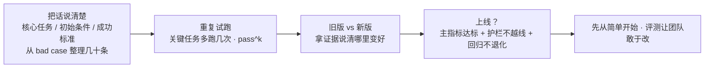

**图 16｜12:33 结语闭环重绘**

**【视频原述】**（12:33–13:05 逐句）「如果你能听到这儿，可能会觉得『我搞个 Agent 都没这么复杂』。**这不是必须照着执行的标准答案**。真正开始做 Evals 的时候，写清楚**初始条件和成功标准**，从 bad case 里面整理几十条，**关键任务多跑几次**就够了。**不是指标越多评测就越好**。评测应该让团队**敢于改**，至少能拿出证据说清楚哪里变好了、这个版本为什么值得发。」

**最小可行动清单**：

1. 从真实日志 / 历史 bad case 挑 **20–50 条**任务，写全「初始状态 + 成功标准 + 必要约束」。
2. 每条至少配一个**代码可判**的 outcome 断言；主观维度才用 LLM rubric，并定期人工校准。
3. 按目的选**一个主指标**定通过；安全红线**一票否决**；上游失败时下游 Judge 标 `error` 跳过。
4. 关键任务重复跑，看 `pass^3`；能力集与回归集**同时跑**。
5. 线上新 bad case 持续回流评测集，让门槛随版本变严。

> **【补充】** Anthropic 结论几乎一致：*Start early and don't wait for the perfect suite... Read the transcripts!* 阿里的未来方向把它推得更远：**变更即评测**（代码/模型/Prompt/知识库变更自动触发回归）、**趋势可追踪**（A/B 版本 diff）、**多模型 A/B**、**评测集自演化**。

---

**本章语音逐字稿（ASR · 已校正，20 句）**

> `[12:35]` 评测也太复杂了吧
> `[12:36]` 我搞个 Agent 都没这么复杂
> `[12:38]` 这不是一份所有团队都必须照着
> `[12:39]` 执行的标准答案
> `[12:40]` 而是一个思路框架
> `[12:42]` 真正开始做 evo 的时候
> `[12:43]` 反而建议从简单开始
> `[12:44]` 挑几个最核心的任务
> `[12:46]` 写清楚初始条件和成功标准
> `[12:47]` 从真实问题和历史的 bad case 里面整理几十条
> `[12:50]` 先把结果测起来
> `[12:51]` 关键任务多跑几次
> `[12:53]` 再抽查评分和执行记录
> `[12:54]` 不是指标越多评测就越好
> `[12:56]` 评测应该让团队敢于改
> `[12:58]` 也知道什么时候该停
> `[12:59]` 下一次准备上线
> `[13:00]` 至少能拿出证据说清楚
> `[13:02]` 哪里变好了哪里退步了
> `[13:04]` 这个版本为什么值得发布

## 13. 补充篇 A：专业名词速查（70+ 条）

> 以下**不属于视频原述**，用于补足视频一带而过的英文术语、框架名与指标口径。

### 13.1 评测对象与组件

| 术语 | 中文 / 释义 | 要点 |
|---|---|---|
| `Agent` | 智能体 | 多轮调用工具、修改环境状态、依据中间结果自适应；自治性也是「难评」的根源 |
| `agent harness / scaffold` | Agent 脚手架 | 处理输入、编排工具调用、返回结果；评 Agent = 评 harness + model。Claude Code 即一种 harness |
| `evaluation harness` | 评测框架 | 提供指令工具、并发执行、记录步骤、打分、汇总 |
| `evaluation suite` | 评测套件 | 共享宏观目标的一组 task，如客服套件测 refunds / cancellations / escalations |
| `task / problem / test case` | 任务 / 用例 | 带明确输入与成功标准的单个测试 |
| `trial` | 一次尝试 | 同一 task 的一次执行；输出波动需多次 |
| `transcript / trace / trajectory` | 轨迹 / 执行记录 | 一次 trial 完整记录；Anthropic API 是结束时的完整 messages 数组 |
| `outcome` / `output` | 环境终态 / 模型输出 | 「退款成功」只是 output，数据库里的记录才是 outcome |
| `grader` / `assertion / check` | 评分器 / 断言 | grader 给某方面打分，内部含多条 check |
| `rubric` | 评分细则 | 写给 LLM judge 的结构化标准，越具体越稳定 |
| `LLM-as-Judge / Judge Task` | 大模型裁判 / 评测任务 | 阿里把指标评测任务归纳为六类 Judge Task |
| `single-turn / multi-turn eval` | 单轮 / 多轮评测 | 早期 LLM 以单轮为主，Agent 时代多轮成常态 |
| `automated eval` | 自动化评测 | 开发期无需真实用户即可跑 |
| `capability / quality eval` | 能力评测 | 「能做什么」，起始通过率低 |
| `regression eval` | 回归评测 | 「以前会的还会吗」，通过率近 100% |
| `eval saturation` | 评测饱和 | 通过所有可解任务后不再提供改进信号 |
| `eval-driven development (EDD)` | 评测驱动开发 | 先写评测定义能力，再迭代 Agent 达标 |
| `Swiss Cheese Model` | 瑞士奶酪模型 | 单层都有洞，多层叠加才兜得住问题 |
| `dogfooding` | 内部自用 | 团队自己先用产品，早期发现问题 |

### 13.2 指标与统计

| 术语 | 中文 / 口径 | 注意点 |
|---|---|---|
| `Task Completion Rate` | 任务完成率 | 北极星指标，按语义完成度判定 |
| `Multi-turn Completion Rate` | 多轮任务完成率 | 对整组 2–5 轮整体评判 |
| `Instruction Following` | 指令遵循 | 格式约束：分模块输出、指定维度、表格化 |
| `Faithfulness / Hallucination` | 忠实性 / 幻觉率 | 只判「忠实转述所见材料」；捏造接口名/配置项即幻觉 |
| `Robustness` | 异常输入处理率 | 空输入、超长、乱码、特殊字符、Prompt 注入下的优雅降级 |
| `User Satisfaction` | 用户满意度 | 依赖线上反馈，校准评测盲区 |
| `Intent Accuracy / Precision / Recall` | 意图识别三件套 | 识别得对不对 / 该识别的都识别了吗 / 判为 Skill 的真能由 Skill 处理吗 |
| `Multi-intent Recognition` | 多意图识别率 | 一句话 2–3 个意图能否完整拆解 |
| `Clarification Rate` | 模糊意图澄清率 | 追问 > 猜测 > 幻觉 |
| `Fallback Trigger` | 降级触发准确率 | 超出所有 Skill 时是否正确兜底到知识库 |
| `Routing Accuracy` | 路由决策准确率 | 在「调 Skill」与「检索知识库」间选对 |
| `RAG Decision` | 知识检索决策准确率 | 不该走 Skill 时是否正确触发检索 |
| `Planning Path Score` | 规划路径合理性 | 领域专家评估执行路径是否最优 |
| `Short-term Retention` | 短期记忆保留率 | 语义连贯即可，不要求逐字复述 |
| `Retrieval Precision / Recall` | 检索精确度 / 召回率 | 前者看返回 chunk 相关性，后者看应检索知识点覆盖多少 |
| `Memory Decay Curve` | 记忆衰减曲线 | 第 2/3/5 轮插入需引用历史的问题，统计各轮保留率 |
| `Tool Calling Accuracy` / `Parameter Accuracy` / `Tool Success Rate` | 工具调用准确率 / 参数映射准确率 / 成功率 | 调对工具 / 参数填对 / 成功返回有效结果 |
| `TTFT` | 首 Token 延迟 | Time To First Token，决定「等待焦虑感」 |
| `End-to-End Latency` / `Module-level Latency` | 端到端 / 模块级延迟 | 后者含意图识别、规划决策、记忆注入、检索、工具调用、热更新 |
| `pass@k` | k 次至少一次成功 | 随 k 上升；`pass@1` 常用于 coding agent |
| `pass^k` | k 次全部成功 | 随 k 下降；0.75³ ≈ 42% |
| `class-imbalanced eval` | 类别不平衡评测集 | 只测「该搜索」会把 Agent 训成什么都搜 |
| `inter-annotator agreement` | 标注者一致性 | 人工评分可靠性，也是校准 LLM judge 的参考 |
| `partial credit` | 部分分 | 识别问题并验证身份但没退款成功，应好于立刻失败 |

### 13.3 数据集、工程与框架

| 术语 | 中文 / 释义 | 要点 |
|---|---|---|
| `golden set / regression set / capability set` | 黄金集 / 回归集 / 挑战集 | 「好的下限」/ 防回退 / 能力边界 |
| `bad case` | 线上失败案例 | 最有价值的评测素材，应持续结构化回流 |
| `reference solution` | 参考解 | 已知能通过所有 grader 的输出，证明任务可解 |
| `reference-based evaluation` / `pairwise comparison` / `multi-judge consensus` | 参考答案评测 / 成对比较 / 多评委共识 | 模型 grader 的三类方法 |
| `fail-to-pass / pass-to-pass` | 失败转通过 / 保持通过 | SWE-bench 类二元测试 |
| `state_check` / `static analysis` | 终态检查 / 静态分析 | 直接查数据库；lint / type / security（ruff、mypy、bandit） |
| `EvalTrace` | 轻量轨迹结构 | 随链路流转，各节点写耗时、工具记录、检索结果、Token |
| `E2E_REAL / E2E_MOCK` | 真实模式 / Mock 模式 | 真实链路 vs 固定工具返回值 |
| `datasetType / evalMode / bizCode` | 数据集类型 / 评测模式 / 业务编码 | 用例标准字段，用于自动装配与分组统计 |
| `conversationChain` / `expectedContains` | 多轮对话链 / 逐轮期望关键词 | 各轮共享 sessionId |
| `expectedRoute: SKILL_HIT / SKILL_MISS` | 期望路由方向 | 误触发时下游指标要跳过 |
| `MCP` | Model Context Protocol | 自动发现注册远程工具；对应 MCP 加载成功率 |
| `Skill` | 技能 | 文件系统管理、按 Agent 隔离、支持热更新下发 |
| `RAG` | 检索增强生成 | 阿里架构中属「长期记忆」路径 |
| `SWE-bench Verified` / `Terminal-Bench` | 编码基准 | 真实 GitHub issue 跑测试 / 端到端技术任务 |
| `τ-Bench / τ2-Bench` | 多轮对话基准 | Sierra 出品，一模型扮用户，按数据库终态判分 |
| `BrowseComp` / `WebArena` / `OSWorld` | 网页检索 / 浏览器 / 操作系统基准 | 分别测开放网络寻针、GUI 导航、文件系统与应用配置 |
| `CORE-Bench` | 科研复现基准 | 评分过严导致 Opus 4.5 从 42% 修正到 95% |
| `Harbor` | 评测运行框架 | 容器化运行、跨云大规模 trial、标准化 task/grader |
| `Braintrust` | 评测 + 可观测平台 | `autoevals` 内置事实性/相关性 scorer |
| `LangSmith` / `Langfuse` | LangChain 生态 / 自托管开源 | tracing、离线在线评测、数据集管理 |
| `Arize / Phoenix / AX` | LLM 追踪与评测 | Phoenix 开源，AX 为规模化 SaaS |
| `BLEU / ROUGE` | 文本相似度指标 | 对 Agent「粒度太粗、无法检测幻觉、忽略中间过程」 |
| `SME review` | 领域专家评审 | 人工 grader 的金标准但昂贵 |

---

## 14. 补充篇 B：Anthropic 全景

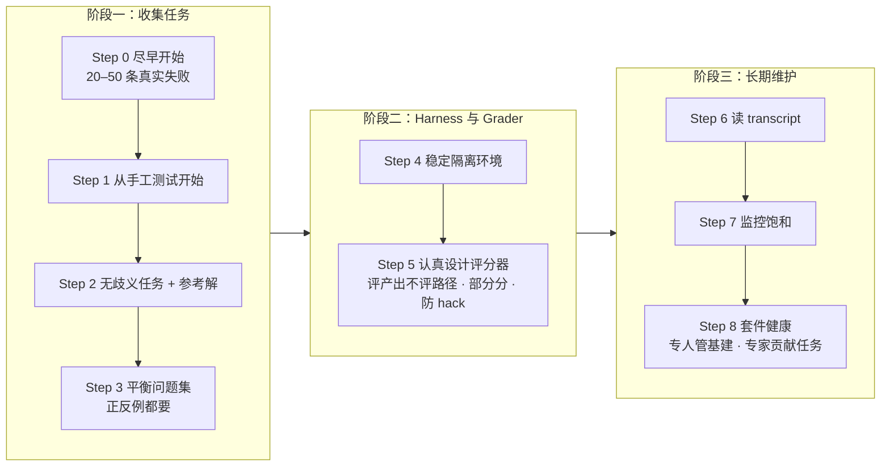

**图 17｜Anthropic 从 0 到 1 的 9 步路线图（Step 0–8）**

### 14.1 四类 Agent 与对应基准

| 类型 | 评测难点 | 推荐做法 | 代表基准 |
|---|---|---|---|
| **Coding agents** 编码 | 需稳定测试环境与完备测试 | 确定性 grader：跑不跑得起来、测试过不过；rubric 评工具调用与代码质量 | SWE-bench Verified、Terminal-Bench |
| **Conversational agents** 对话 | 交互质量本身也是评测对象；常需第二个 LLM 扮用户 | 可验证终态（工单 resolved）+ 轨迹约束（<10 轮）+ 语气 rubric | τ-Bench / τ2-Bench |
| **Research agents** 研究 | 专家对「全面」有分歧、ground truth 会变、输出长且开放 | groundedness + coverage + source quality 组合；频繁与专家校准 | BrowseComp |
| **Computer use agents** 电脑操作 | 需在真实/沙箱 GUI 环境跑并检查是否真达成 | URL / 页面状态 + 后端状态验证；DOM 快但费 Token，截图慢但省 Token | WebArena、OSWorld |

### 14.2 六类理解 Agent 表现的方法（Swiss Cheese Model）

| 方法 | 优势 | 代价 / 局限 |
|---|---|---|
| 自动化评测 | 迭代快、可复现、不影响用户、可每次 commit 跑、无需上线即可大规模测 | 前期投入大、需持续维护防漂移、与真实用法不符会产生虚假信心 |
| 生产监控 | 揭示真实用户行为、捕捉合成评测漏掉的问题 | 被动、信号噪声大、需埋点、缺少判分 ground truth |
| A/B 测试 | 度量真实结果、控制混杂、可扩展 | 慢、需足够流量、只能测已上线改动、不易解释「为什么」 |
| 用户反馈 | 发现预期外问题、带真实案例 | 稀疏自选择、偏向严重问题、用户很少解释原因 |
| 人工阅读轨迹 | 建立失败模式直觉、发现细微问题、校准「好」 | 耗时、不可扩展、多为定性信号 |
| 系统性人评 | 多人评分金标准、处理主观任务、改进模型 grader | 贵且慢、评分者分歧需仲裁、复杂领域要专家 |

> **分层使用**：自动化评测是上线前 / CI 第一道防线；生产监控捕捉上线后漂移；A/B 验证重大改动；反馈与轨迹阅读是日常补课；系统性人评留给校准 LLM grader 或需人类共识的主观输出。

### 14.3 五个可直接选用的评测框架

| 框架 | 定位 | 适合谁 |
|---|---|---|
| **Harbor** | 容器化运行 Agent、跨云大规模 trial、标准化 task/grader；Terminal-Bench 2.0 经其 registry 分发 | 要跑标准基准 + 自定义套件 |
| **Braintrust** | 离线评测 + 生产可观测 + 实验跟踪；`autoevals` 预置 scorer | 既要开发迭代又要生产监控 |
| **LangSmith** | tracing、离线/在线评测、数据集管理 | 已用 LangChain |
| **Langfuse** | 类似能力，自托管开源 | 有数据驻留 / 私有化要求 |
| **Arize（Phoenix / AX）** | LLM tracing、调试、离线/在线评测 | 已有可观测体系 |

> 原文态度务实：**框架只是加速器，决定效果的是跑进去的评测任务与 grader 质量**。快速选一个顺手的，把精力投在迭代高质量用例上。

### 14.4 两个反面案例

- **评分器过严会冤枉模型**：Opus 4.5 在 CORE-Bench 初始 42%，原因是把「96.12」硬匹配「96.124991…」、任务描述歧义、随机任务无法精确复现；修正后 **95%**。METR 也发现过「要求达到阈值、评分却要求超过阈值」的配置错误。
- **静态评测会误判创造性解法**：Opus 4.5 在 𝜏2-bench 订票题发现政策漏洞，按原评分「失败」，实际给了用户更好方案。

结论：**不看 transcript 就不该相信分数**；失败应该看起来是「公平的」。

---

## 15. 补充篇 C：阿里工程落地

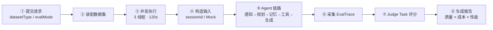

**图 18｜阿里评测执行引擎全链路**

### 15.1 三条原则与四个模块

| 原则 | 原文表述 |
|---|---|
| 评测面向架构 | 按感知、规划、记忆、工具四模块逐层拆解，每层质量独立可观测 |
| 指标面向行动 | 每项指标是「诊断报告」而非「成绩单」，下降时能指出改 Skills / 换 MCP / 优化检索 |
| 能力面向产品 | 不是上线前跑一次的脚本，要像监控告警一样可持续运行、可横向对比、可追溯 |

| 模块 | 职责 | 典型失败 |
|---|---|---|
| 感知 | 接收输入、判断是否可由 Skill 处理、意图识别、未命中降级到知识库 | 把「查 Trace」误识别为知识库问答 |
| 规划 | 决定调不调工具 / 检索 / 存记忆，实现 Skill 与 RAG 自动分流 | 该调 Skills 时选了 RAG |
| 记忆 | 短期：sessionId 滑动窗口最近 N 轮 + 用户画像；长期：RAG 注入 Prompt | 多轮丢失商品 ID |
| 工具 | MCP 自动发现注册远程工具 + 文件系统 Skill 管理（按 Agent 隔离、热更新） | 调错 MCP、参数填错 |

### 15.2 评测范围 → 数据集 → 指标自动装配

| 评测模式 | 覆盖数据集 | 覆盖埋点指标 |
|---|---|---|
| 端到端评测 | 基础技能、知识问答、多轮对话、异常输入 | 模型/工具调用次数、Token、TTFT、端到端延迟、模块级延迟 |
| 核心模块评测 | 基础技能、知识问答、多轮对话、工具调用、多意图、模糊意图、长对话衰减 | 模型/工具调用次数、Token、模块级延迟 |
| 感知模块评测 | 基础技能、知识问答、多意图、模糊意图 | 意图识别延迟 |
| 规划模块评测 | 基础技能、知识问答、工具调用 | 规划决策延迟 |
| 记忆模块评测 | 知识问答、多轮对话、长对话衰减 | 短期记忆注入延迟、长期记忆检索延迟 |
| 工具模块评测 | 工具调用 | 工具调用延迟、热更新生效延迟 |

平台共 **15 种评测范围**：指定数据集 8 种 + 端到端 1 种 + 分模块 4 种 + 核心模块 / 全量等。

### 15.3 执行引擎参数

| 环节 | 做法 |
|---|---|
| 并发 | 3 线程并行（效率与 LLM API 限流权衡） |
| 超时 / 重试 | 单条 120s 超时；执行异常最多重试 2 次、间隔 3 秒；**Judge 判不通过不重试** |
| Trace 采集 | 感知写命中 Skill / 意图 / 耗时；规划写决策耗时；记忆写注入耗时与轮数；工具写调用记录；RAG 写检索耗时、结果数量、原始文本块 |
| 多轮特殊处理 | 独立 sessionId；轮次间等约 2 秒持久化；成本逐轮累加；全轮输出拼接后统一评判，第一轮对第三轮失忆判整组失败 |
| 异步管理 | 提交返回 taskId，后台执行、轮询进度、支持取消 |
| 报告 | 质量 × 成本 × 性能；通过与否由主指标决定 |

### 15.4 看板与产品化

| 层次 | 能力 |
|---|---|
| 评测流程 | 范围选择器（8 数据集 + 评测模式）、一键提交、实时状态、历史记录（时间 / 通过率 / 通过失败总数）、JSON 导入跨环境对比 |
| 多维指标 | 总用例/通过/失败/通过率；三列仪表盘（质量雷达图 + 模块明细 / 成本柱状图 / 性能柱状图）；场景通过率进度条 |
| 用例诊断 | 明细表支持筛选、搜索、分页；展开看失败原因、命中技能、路由结果、Token 明细、原始输入与完整输出 |
| 产品化（解耦） | 评测数据配置（Agent + Graph 挂载）、评测指标配置（六类 Judge Task 内置模板）、Graph 场景配置、可观测性增强（拦截器无侵入采集） |

> **为什么必须产品化**：最初看板把「评哪些数据集、用哪些指标、按什么链路跑」硬编码在一个 Agent 上；接入第二个 Agent 约等于 fork 一份逻辑。解耦后评测才从「一次性脚本」变成可复用基础设施。

### 15.5 新旧方法对比与三条核心收获

| | 旧版：只评最终答案质量 | 新版：端到端 + 核心模块评测 |
|---|---|---|
| 方法 | LLM-as-Judge | Judge Task + Agent 应用埋点 |
| 指标 | 用户问题解决、任务相关性、逻辑一致性、信息准确性、内容可读性 | 端到端 4 维度 **11 项**；核心模块 4 维度 **24 项** |
| 评测集 | 人工构造的专项 / 通用场景 | 8 类结构化评测集 |
| 结果 | 平均综合分，看不到链路、成本、性能 | 质量 + 成本 + 性能细粒度，能定位缺陷并指路 |

**三条核心收获**：① 评测指标体系需与 Agent 架构同构；② LLM-as-Judge 的关键是结构化 Judge Task 设计，不是「让 LLM 打分」；③ 评测平台是把评测从一次性脚本转成持续化能力的前提。

**四个未来方向**：变更即评测、趋势可追踪、多模型 A/B 测试、评测集自演化。

---

## 16. 补充篇 D：可运行的最小实现

### 16.1 pass@k 与 pass^k（复现原文 42%）

```python
import random

def pass_at_k(p, k):        # k 次里至少一次成功
    return 1 - (1 - p) ** k

def pass_power_k(p, k):     # k 次全部成功
    return p ** k

p, k = 0.75, 3
print("pass@3 =", round(pass_at_k(p, k), 6))       # 0.984375
print("pass^3 =", round(pass_power_k(p, k), 6))    # 0.421875 ≈ 42%

N = 100_000
at_least_one = sum(any(random.random() < p for _ in range(k)) for _ in range(N)) / N
all_success = sum(all(random.random() < p for _ in range(k)) for _ in range(N)) / N
print("sim pass@3 =", round(at_least_one, 4), " sim pass^3 =", round(all_success, 4))

for k in (1, 3, 10):
    print(f"k={k:2d}  pass@k={pass_at_k(p,k):.4f}  pass^k={pass_power_k(p,k):.4f}")
```

运行结果：`pass^1 = pass@1 = 0.75`，`pass@3 ≈ 0.984` 而 `pass^3 ≈ 0.422`；`k=10` 时 `pass@10 ≈ 0.9999`、`pass^10 ≈ 0.056`。这就是「重要 case 要重复执行」的数学原因。

### 16.2 主指标 + 护栏 + 上游跳过（复现 100 / 10 / 90）

```python
MAIN_METRIC = {
    "END_TO_END": "task_completion",
    "PERCEPTION": "intent_accuracy",
    "PLANNING":   "routing_accuracy",
    "MEMORY":     "short_term_retention",
    "TOOL":       "tool_calling_accuracy",
}

def judge_case(case, mode):
    """返回 (verdict, reason)。主指标定通过，护栏一票否决，上游错误跳过下游。"""
    if case.get("route_expected") == "SKILL_MISS" and case.get("route_actual") == "SKILL_HIT":
        return "ERROR", "route_mismatch: downstream RAG judges skipped"
    if case.get("unauthorized_action"):
        return "FAIL", "guardrail: unauthorized action (高分不能抵消)"
    key = MAIN_METRIC[mode]
    return ("PASS" if case["scores"].get(key, 0) == 1 else "FAIL"), f"main={key}"

cases = []
for i in range(100):
    cases.append({
        "id": f"KQA-{i:03d}",
        "route_expected": "SKILL_MISS",
        "route_actual": "SKILL_MISS" if i < 10 else "SKILL_HIT",
        "unauthorized_action": False,
        "scores": {"task_completion": 1, "instruction_following": 0, "faithfulness": 1},
    })
verdicts = [judge_case(c, "END_TO_END") for c in cases]
passed  = sum(v == "PASS" for v, _ in verdicts)
failed  = sum(v == "FAIL" for v, _ in verdicts)
skipped = sum(v == "ERROR" for v, _ in verdicts)
denominator = passed + failed          # error 既不进分子也不进分母
print(f"总数 100 ｜ 已执行 {passed+failed} ｜ 未执行(error) {skipped}")
print("通过率 =", passed, "/", denominator, "=", passed / denominator)
print("护栏示例：", judge_case({"unauthorized_action": True,
      "scores": {"task_completion": 1}}, "END_TO_END"))
```

输出：`总数 100 ｜ 已执行 10 ｜ 未执行(error) 90 ｜ 通过率 = 10/10 = 1.0`，同时明确报出 90 条未执行；另演示「任务完成率满分但越权」仍判 FAIL。若把 error 当失败计入分母，通过率会被误报成 10%。

### 16.3 符合四原则的 Judge Prompt 模板

```text
你只评测一个指标：任务完成率（Task Completion Rate）。不要评价格式、语气或忠实性。

【判据】用户的核心诉求是否被完成？不要求字面匹配，但核心信息不能缺失。
- 通过：正确输出了不可售原因的诊断分析
- 不通过：只回答了商品基础信息，未分析不可售原因

【先推理后判断】先在 reasoning 里逐条列出证据，再给结论。
【信息不足】若缺少必要证据，verdict 填 "Unknown"，不要猜测。
【严格 JSON】只输出如下结构，不要输出任何多余文字：
{
  "reasoning": "<逐条证据，字符串>",
  "verdict": "pass | fail | Unknown",
  "evidence": ["<引用自工具返回或检索片段的原文>"]
}

【用户输入】{user_input}
【Agent 输出】{agent_output}
【工具返回 / 检索片段】{trace_evidence}
```

### 16.4 一条完整任务（Anthropic YAML 精简版）

```yaml
task:
  id: "fix-auth-bypass_1"
  desc: "Fix authentication bypass when password field is empty"
  graders:
    - type: deterministic_tests
      required: [test_empty_pw_rejected.py, test_null_pw_rejected.py]
    - type: llm_rubric
      rubric: prompts/code_quality.md
    - type: static_analysis
      commands: [ruff, mypy, bandit]
    - type: state_check
      expect: {security_logs: {event_type: "auth_blocked"}}
    - type: tool_calls
      required: [{tool: read_file}, {tool: edit_file}, {tool: run_tests}]
  tracked_metrics:
    - type: transcript
      metrics: [n_turns, n_toolcalls, n_total_tokens]
    - type: latency
      metrics: [time_to_first_token, output_tokens_per_sec, time_to_last_token]
  reference_solution: "known-good patch that passes every grader"
```

### 16.5 一条阿里风格评测用例

```json
{
  "id": "BF-TRACE-001",
  "sceneCode": "i18n-ic-trace-analyzer",
  "sceneName": "Trace排查",
  "userInput": "traceId：2116440e17706430209582423d0733",
  "expectedSkill": "i18n-ic-trace-analyzer",
  "expectedRoute": "SKILL_HIT",
  "expectedIntent": "i18n-ic-trace-analyzer",
  "bizCode": "IC_PRODUCT",
  "datasetType": "BASIC_FUNCTION",
  "evalMode": "E2E_MOCK",
  "mockDataId": "MOCK-TRACE-001",
  "referenceOutput": "Agent应调用trace分析工具…"
}
```

字段含义：`expectedSkill` → 意图准确率，`expectedRoute` → 路由决策准确率，`expectedIntent` → 意图召回率/精确率，`datasetType` → Judge 路由依据，`evalMode` ∈ `E2E_MOCK` / `E2E_REAL`。

### 16.6 最小评测 Harness（并发 + 隔离 + 汇总）

```python
from concurrent.futures import ThreadPoolExecutor

def run_trial(task, agent, env_factory):
    env = env_factory()              # 每个 trial 从干净环境开始（Step 4）
    trace, outcome = agent(task["input"], env)
    scores = {g["name"]: g["fn"](trace, outcome) for g in task["graders"]}
    return {"task": task["id"], "trace": trace, "outcome": outcome, "scores": scores}

def run_suite(suite, agent, env_factory, trials=3, workers=3):
    jobs = [(t, k) for t in suite for k in range(trials)]
    with ThreadPoolExecutor(max_workers=workers) as pool:
        results = list(pool.map(lambda j: run_trial(j[0], agent, env_factory), jobs))
    by_task = {}
    for r in results:
        by_task.setdefault(r["task"], []).append(r)
    def ok(r): return all(v == 1 for v in r["scores"].values())
    per_task = {tid: all(ok(r) for r in rs) for tid, rs in by_task.items()}
    return {"pass_pow_k": sum(per_task.values()) / len(per_task),
            "pass_at_k": sum(any(ok(r) for r in rs) for rs in by_task.values()) / len(by_task),
            "per_task": per_task}
```

> ⚠️ 真实环境里 `agent` 与 `env_factory` 必须和线上尽量一致；共享状态（残留文件、缓存、git history、CPU 内存）会让多次 trial 不独立。Anthropic 举过真实例子：Claude 通过翻看前几次 trial 留下的 git history 获得不公平优势。

---

## 17. 补充篇 E：误区与失败归因

| # | 误区 | 为什么错 | 正确做法 |
|---|---|---|---|
| 1 | 上线后再补评测 | 越晚越难逆向还原成功标准 | Step 0 尽早，20–50 条真实失败任务 |
| 2 | 只评最终答案 | 答案对也可能是「蒙对」或走错订单退错款 | outcome + transcript 一起评 |
| 3 | 指标越多越好 | 维护成本高、信号稀释 | 按架构与阶段挑 P0 |
| 4 | 所有 Judge 结果 AND | 内容正确却因格式被整体否掉 | 只用一个主指标定通过 |
| 5 | 加权总分覆盖安全红线 | 高分不能抵消越权 / 不可逆操作 | 护栏一票否决、单独统计 |
| 6 | 上游失败给下游打 0 分 | 路由错导致 RAG 未执行，检索质量背锅 | 标 `error` 跳过，不进分子分母 |
| 7 | 一个 Prompt 评多个指标 | 多任务混合增加理解负担 | 单一职责 |
| 8 | 让 LLM 自由写评语 | 不可解析、不可统计 | 严格 JSON + reasoning + Unknown |
| 9 | 评测集只有正例 | 会把 Agent 训成什么都搜 | 正反例平衡 |
| 10 | 只测「标准题」 | 真实用户充满省略、指代、改主意 | 任务来自真实日志 / 工单 |
| 11 | 一次成功就宣布 100% | Agent 是概率系统 | 重复执行看 pass^k |
| 12 | 能力集跑到 100% 就不管 | 评测饱和，不再给改进信号 | 毕业成回归集，另开更难题 |
| 13 | 死守固定工具调用顺序 | 会惩罚 Agent 找到的合法新路径 | 评产出而非路径，给部分分 |
| 14 | 不读 transcript 就信分数 | 评分 bug / 任务歧义 / harness 限制都会制造低分 | 定期人工读轨迹 |
| 15 | trial 之间共享环境 | 缓存 / git history 造成相关性失败或不公平优势 | 每次从干净环境隔离启动 |
| 16 | 评测脚本一次性交付 | 每接一个新 Agent 就 fork 一份逻辑 | 配置化、平台化 |

### 17.1 按模块归因速查

| 现象 | 优先看的指标 | 对应动作 |
|---|---|---|
| 答案跑偏、答非所问 | 意图识别准确率/召回率、路由决策准确率 | 感知/规划 → 改提示词、补 Skill 描述 |
| 该查没查、不该查乱查 | 知识检索决策准确率、降级触发准确率 | 规划 → 调整路由规则与正反例 |
| 多轮忘了前面说过的话 | 短期记忆保留率、记忆衰减曲线 | 记忆 → 滑动窗口、会话持久化、画像注入 |
| 检索材料不相关 | 检索精确度 / 召回率 | RAG → 切分、召回策略、知识点标注 |
| 工具报错或参数错 | 工具调用准确率、参数映射准确率、成功率 | 工具 → 改描述 / 参数 schema / 重试 |
| 工具「加载不了」 | MCP / Skill 加载成功率、热更新生效延迟 | 工具 → 注册发现、Server 配置 |
| 答案对但等太久 | TTFT、端到端延迟、模块级耗时、调用次数 | 全局 → 找最慢节点、减冗余调用 |
| 编造接口名 / 配置项 | 忠实性 / 幻觉率 | 生成 → 补负例、groundedness、rubric |
| 分数忽高忽低 | pass^k、环境隔离、Mock 覆盖率 | 先查评测系统，再怪模型 |

---

## 18. 附录

### 18.1 官方章节时间轴（逐字）

| 时间 | 章节名 | 平台自动摘要（逐字） |
|---|---|---|
| 00:00 | 引言 | （无摘要） |
| 01:06 | Agent的错误发生位置 | Agent错误发生在执行链路上，评测需覆盖完整任务执行。 |
| 02:16 | 评测的三个层次 | 评测分为outcome、trace、experience三个层次，分别关注任务完成、过程和体验成本。 |
| 04:35 | 评测框架 | 评测框架包括What、When、How，明确输入、初始条件和成功标准，组织任务和评分器。 |
| 05:26 | 任务收集 | 任务收集包括核心任务、真实用户任务、历史bad case和边界case，覆盖四类情况。 |
| 08:12 | 评分器 | 评分器包括代码评分、模型评分和人工评分，各有职责，确保评分准确。 |
| 10:13 | 评测结果的判断 | 评测结果判断需关注主指标和护栏指标，避免上游错误影响下游评分。 |
| 11:04 | 评测的稳定性 | 评测稳定性需关注波动指标，确保任务连续成功。 |
| 11:55 | 能力评测和回归评测 | 能力评测和回归评测确保任务持续进步，避免简单任务退步。 |
| 12:25 | 指标地图 | 指标地图涵盖结果、过程、体验成本、稳定性和回归等方向。 |
| 12:34 | 结语 | 评测应从简单开始，关注核心任务，逐步完善，为产品改进提供证据。 |

全片摘要（逐字）：「如何通过评测驱动Agent产品迭代，包括评测的重要性、三个层次（outcome、trace、experience）、评测框架、任务收集、评分器、结果判断、稳定性和回归评测。强调评测应从简单开始，关注核心任务，逐步完善，为产品改进提供证据。」

### 18.2 配图速查（18 张）

| # | 图名 | 时间点 | 来源 |
|---|---|---|---|
| 1 | 全片 12 段章节结构地图 | 全片 | 官方章节数据 |
| 2 | 演示惊艳 → 评测 → 生产环境 → 稳定完成 | 00:00 | 视频手绘封面 |
| 3 | 订单选错 → 工具调用 → 退错订单 / 检查完整执行 | 01:06 | 视频手绘 |
| 4 | Outcome / Trace / Experience 三折页 | 02:09 | 视频手绘 |
| 5 | Trace 行车记录仪（一次完成 vs 反复重试） | 02:57 | 视频手绘 |
| 6 | Components of Evaluations for Agents 组件图 | 04:33–05:21 | Anthropic 文章截图 |
| 7 | 四类任务来源 → 评测集 | 05:48 | 视频手绘 |
| 8 | 8 类评测集晾衣绳 + 综合任务 | 06:39 | 视频手绘 + 阿里原文 |
| 9 | 真实任务 / 正反例 / 完整用例三要素 | 07:42 | 视频手绘 |
| 10 | 代码 / 模型 / 人工 三类评分器流水线 | 08:21 | 视频手绘 |
| 11 | Judge 四原则 | 09:00 | 视频手绘 + 阿里原文 |
| 12 | 主指标 / 护栏 / 跳过也要报 | 10:15–10:57 | 视频手绘 + 阿里原文 |
| 13 | pass@k / pass^k（k=3） | 11:06 | 视频手绘 + Anthropic 公式 |
| 14 | 能力评测 → 回归评测 | 11:48 | 视频手绘 |
| 15 | Agent Eval 指标地图结构速览 | 12:25 | 用户截图 / 视频画面 |
| 16 | 结语闭环：重复试跑 → 旧版 vs 新版 → 上线？ | 12:33 | 视频手绘 |
| 17 | Anthropic Step 0–8 路线图 | — | 【补充】Anthropic 第 5 章 |
| 18 | 阿里评测执行引擎全链路 | — | 【补充】阿里第 6 章 |

另有独立交付 [指标地图.html](指标地图.html)：按截图逐字重绘的完整 HTML 页面，含 41 项指标、4 条使用建议、优先级说明与引用语。

### 18.3 校正表（OCR 与自动摘要）

| 来源写成了 | 正确写法 | 依据 |
|---|---|---|
| 评测驱动的 Agent 产品**选代** | 评测驱动的 Agent 产品**迭代** | OCR 形近字；封面放大目视 |
| 同一道题每跑一次叫 **trails** | **trials**（trial 的复数） | Anthropic 原文定义 |
| **Jutcome / xperience / Exoerience** | **Outcome / Experience** | 画面标题与文章原文 |
| 做起来**贵不责 / 费不责** | 做起来**贵不贵？** | 用户截图放大逐字 |
| 短期记忆**注八**延迟 / Memory **infection Latenoy** | 短期记忆**注入**延迟 / **Memory Injection Latency** | 截图高分辨率裁剪 |
| 工具**结果生效**延迟 / (PostUpdate Latency) | 工具**热更新生效**延迟 / **(Hot Update Latency)** | 截图裁剪 + 阿里原文「热更新生效延迟」 |
| 意**固**识别准确率 / 意图识别**召回串** | 意**图**识别准确率 / 意图识别**召回率** | 截图 + 阿里原文 |
| 评测框架包括 **What、When、How** | 该段画面是 Anthropic 组件图，**无此三词** | 逐帧核对 04:33–05:21 |
| 指标地图涵盖「稳定性和回归」**等方向** | 地图本身只有 Outcome 三维度与 Trace 四模块两栏；稳定性与回归体现在运行方式 | 用户截图 + 视频画面 |
| 摘要「评测分为 outcome、trace、experience 三个层次」 | 画面英文为 **Outcome、Trace、Experience**，与阿里「质量 × 成本 × 性能」不是同一套划分 | 02:09 画面 + 两篇文章交叉核对 |

### 18.4 还原方法与资料来源

1. **视频**：[抖音分享短链](https://v.douyin.com/R7KFNxMvveA/) → [网页版](https://www.douyin.com/video/7683392618483895899)；标题《Agent 想越改越好，靠的是评测》，作者 @AI产品千媚，2026-09-09，13:05.6，1918×1080 / 30fps / H.264。
2. **逐帧**：1080P 原片 52.4 MB，每 3 秒抽帧 262 张；macOS Vision `VNRecognizeTextRequest`（zh-Hans + en-US，accurate，关闭语言纠正）得到 3,415 行带坐标文本；按 y 坐标分离画面文字与烧录字幕，去重后 395 行画面文本 + 242 行字幕时间线；12 个章节关键帧与指标地图逐区域放大目视校对。
3. **参考文章一**：Anthropic, [Demystifying evals for AI agents](https://www.anthropic.com/research/demystifying-evals-for-ai-agents)（Engineering，2026-01-09；作者 Mikaela Grace、Jeremy Hadfield、Rodrigo Olivares、Jiri De Jonghe）。术语定义、组件图、grader 表、pass@k / pass^k、Step 0–8、四类 Agent、六类方法、五个框架均出自此文。
4. **参考文章二**：阿里技术 / AliExpress 技术，[AI Agent 应用精细化评测：评测体系设计与工程实践](https://mp.weixin.qq.com/s/5Tvv8g20CybjbT0a7iUfHw)（2026-09-02，作者 砚东）。四模块架构、8 类评测集、指标定义与规模、Judge 四原则、主指标表、跳过机制、执行引擎与平台化均出自此文。
5. **用户截图**：《Agent Eval 指标地图》截图（另取得同图高分辨率版本用于逐字校对）。

> **未做的部分（如实说明）**：本地 ASR 依赖安装耗时过长，本轮未做语音逐字转写；口播内容依据烧录字幕 OCR 时间线 + 官方章节要点 + 两篇原文归纳。所有标注【视频原述】的句子均能在画面或字幕中找到对应，未凭空补写台词。

---

### 18.5 全片语音逐字稿（ASR · 483 段 · 按视频/章节分组）

由离线语音识别还原的完整口播，逐段保留时间码。视频作者制作的烧录字幕为精简重排版，两者不完全逐字对应属正常现象。

**引言（逐字 · 35 句）**

> `[00:00]` 很多 Agent 的看起来很惊艳
> `[00:02]` 但是上线之后问题才开始暴露
> `[00:04]` 任务失败
> `[00:05]` 工具调用不稳定
> `[00:06]` 上下文丢失
> `[00:07]` 刚修好了一个 bad case
> `[00:09]` 又引入了一个新的问题
> `[00:10]` Agent 之间真正拉开差距的
> `[00:12]` 要看谁能在生产环境里持续稳定的完成任务
> `[00:16]` 这既考验 Harness 的设计
> `[00:17]` 也考验团队能不能判断
> `[00:19]` 每次修改到底有没有让产品变好
> `[00:21]` 而这里经常被忽视的一环就是评测
> `[00:24]` 评测却为 Agent 的迭代就很容易变成
> `[00:26]` 凭感觉改哪儿、漏了什么
> `[00:28]` 所以评测必须从产品设计时就介入
> `[00:31]` 成为决定产品改什么怎么改
> `[00:33]` 能不能上线的关键依据
> `[00:34]` 今年1月
> `[00:35]` S-ROPE 发布了一篇 Agent 的评测的文章
> `[00:37]` 系统地讨论了 Agent 的评测应该怎么设计
> `[00:40]` 最近阿里的技术团队也发布了一篇
> `[00:42]` Agent 的评测体系设计与工程实践
> `[00:45]` 又给出了具体的工程落地思路
> `[00:47]` 那今天呢
> `[00:47]` 我们就把这两篇放在一起
> `[00:49]` 讲清楚 Agent 的评测到底应该怎么做
> `[00:51]` 视频的最后
> `[00:52]` 我也整理了一个评测的指标地图
> `[00:54]` 方便大家对照自己的产品使用
> `[00:56]` 内容比较多
> `[00:57]` 信息密度很大
> `[00:58]` 大家可以按照时间轴切换到感兴趣的章节
> `[01:01]` 想反复阅读的也可以找我要文字版
> `[01:05]` 传统大模型的调用

**Agent 的错误发生位置（逐字 · 50 句）**

> `[01:06]` 输入提示词模型给出回答
> `[01:08]` 以前很多的评测都是围绕着最终的回答展开
> `[01:11]` 答案准备准确
> `[01:12]` 有没有幻觉
> `[01:13]` 相关性怎么样
> `[01:13]` 语言质量怎么样
> `[01:15]` 但 Agent 不一样
> `[01:16]` Agent 的接到任务要先理解需求
> `[01:18]` 安排步骤
> `[01:18]` 再调用工具读取结果
> `[01:20]` 再决定下一步
> `[01:21]` 有的时候还要改文件
> `[01:22]` 更新订单
> `[01:24]` 情况不对再调整计划
> `[01:26]` 所以 Agent 的错误
> `[01:27]` 不是只发生在最后生成答案的那一刻
> `[01:29]` 而是发生在整条执行链路上的任何一个地方
> `[01:32]` 比如说退款
> `[01:33]` 订单找错了
> `[01:34]` 后面的工具调用再顺利
> `[01:36]` 也是给错误的订单退款
> `[01:37]` 金额传错了
> `[01:38]` 接口返回成功
> `[01:39]` 退的金额也是错的
> `[01:41]` 所以 Agent 的评测
> `[01:42]` 必须是要覆盖一次完整的任务执行
> `[01:44]` 他说了什么
> `[01:45]` 做了什么
> `[01:46]` 最后系统变成了什么状态
> `[01:47]` 都得有记录
> `[01:48]` 而这些步骤又是连在一起的
> `[01:50]` 你为了修改工具
> `[01:51]` 改了提示词
> `[01:52]` 有可能会影响任务的路由
> `[01:54]` 为了让他记住更多的信息
> `[01:55]` 又可能增加干扰
> `[01:57]` 眼前的几个任务变好了
> `[01:58]` 那其他的任务有没有受影响
> `[02:00]` 靠感觉是看不出来的
> `[02:01]` 评测要改变的
> `[02:02]` 就是这个被动的局面
> `[02:03]` 让问题尽量在用户之前暴露出来
> `[02:08]` 不少团队做评测
> `[02:09]` 上来就列准确率
> `[02:10]` 召回率
> `[02:11]` 幻觉率
> `[02:12]` 指标列了一大堆
> `[02:13]` 到底怎么才算是上线标准
> `[02:14]` 没人说得清
> `[02:15]` 我把这两篇文章的思路

**评测的三个层次（逐字 · 89 句）**

> `[02:17]` 整理成了三个层次
> `[02:18]` Outcome
> `[02:19]` Trace
> `[02:20]` Experience
> `[02:21]` 事情有没有做成
> `[02:22]` 过程有没有问题
> `[02:23]` 以及体验和成本能不能接受
> `[02:25]` 先说 Outcome
> `[02:26]` 事情能不能做成
> `[02:27]` Anthropic 专门区分了
> `[02:28]` Output 和 Outcome
> `[02:30]` 比如说一个 Agent 的最后告诉你
> `[02:31]` 退款已经成功了
> `[02:32]` 这个是 Output
> `[02:34]` 真正去系统里面看
> `[02:35]` 确实生成了一笔退款记录
> `[02:37]` 而且状态已经变成了成功
> `[02:38]` 这才是 Outcome
> `[02:39]` 所以对于 Agent 来说
> `[02:41]` 不能只看他最后说了什么
> `[02:42]` 还要看这个任务结束以后
> `[02:44]` 真实的世界或者系统
> `[02:45]` 状态到底发生了什么
> `[02:47]` 所以任务完成率
> `[02:48]` 作为整个端到端评测的北极星指标
> `[02:51]` 因为不管 Agent 的内部多复杂
> `[02:52]` 站在用户的角度
> `[02:53]` 第一个问题永远是
> `[02:54]` 我的事情到底有没有办成
> `[02:56]` 一个 Agent 的查对订单
> `[02:57]` 完成校验
> `[02:58]` 顺利退款
> `[02:59]` 另一个连续调错工具
> `[03:00]` 重试了好几次
> `[03:01]` 最后也成功了
> `[03:02]` 只看结果两条都是通过
> `[03:04]` 但是显然你还想知道
> `[03:06]` 第二个问题到底出在哪
> `[03:07]` 所以需要看第二层 Trace
> `[03:09]` Trace 可以理解成 Agent 的行车记录仪
> `[03:12]` 在一次任务里
> `[03:13]` Agent 调用了什么工具
> `[03:14]` 传了什么参数
> `[03:15]` 工具返回了什么
> `[03:16]` 每一步花了多久
> `[03:17]` 都要记录在 Trace 里面
> `[03:19]` 而阿里的这篇文章
> `[03:20]` 在 Trace 这一层
> `[03:21]` 做了非常详细的拆解
> `[03:23]` 他把这个过程拆成四个模块
> `[03:25]` 感知规划记忆和工具
> `[03:27]` 感知解决的是看懂了没
> `[03:29]` 用户的意图到底有没有理解正确
> `[03:31]` 用户要退款
> `[03:32]` 还是只想问退款的规则
> `[03:34]` 规划解决的是想对了没
> `[03:35]` 应该走 Scale 知识库
> `[03:37]` 还是工具
> `[03:38]` 知识路径有没有选对
> `[03:39]` 那记忆解决的就是记住了没
> `[03:41]` 多轮对话以后
> `[03:42]` 前面已经确认的信息还记不记得
> `[03:46]` 工具有没有选对、参数有没有传对有没有传对
> `[03:48]` 调用有没有成功
> `[03:49]` 这背后的底层原则就是评测体系
> `[03:51]` 应该尽量和你的 Agent 的架构同构
> `[03:53]` 你的 Agent 是怎么工作的
> `[03:55]` 你的评测就要沿着这条链路去拆
> `[03:57]` 这样一个指标下降的时候
> `[03:58]` 你才能知道到底是应该改提示词
> `[04:00]` 还是改工具描述还是改记忆
> `[04:02]` 最后看 Experience 体验和成本
> `[04:05]` 一个简单的查询
> `[04:06]` 你让用户干等半分钟
> `[04:07]` 任务完成率再好
> `[04:08]` 用户也不可能想用
> `[04:10]` 一个简单的问题
> `[04:11]` 来回调了几十次模型
> `[04:12]` 烧掉了大量的 Token
> `[04:16]` 增加成本和性能两个维度
> `[04:18]` 比如说模型的调用次数
> `[04:19]` 输入输出的 Token
> `[04:20]` 端到端的延时等等
> `[04:22]` 结果质量过程质量
> `[04:23]` 体验与运行成本
> `[04:25]` 这三个方面放在一起才能说清楚
> `[04:27]` 你到底想把 Agent 的优化成什么样
> `[04:30]` 这是后面整套评测的基础
> `[04:33]` 明确了什么叫做好

**评测框架（逐字 · 26 句）**

> `[04:35]` 接下来是评测体系本身有什么构成
> `[04:37]` Anthropic 给了三个层级的概念
> `[04:39]` 一条可以重复执行的测试任务叫做 Task
> `[04:42]` 它要写清楚输入初始条件和成功标准
> `[04:45]` 做到什么才算完成
> `[04:46]` 有哪些行为不能发生提前约定
> `[04:49]` 把同一批任务按照业务或者是能力组织起来
> `[04:52]` 就是评测集
> `[04:53]` 比如说多轮对话一组
> `[04:55]` 工具调用一组
> `[04:56]` 也可以把退款取消订单
> `[04:57]` 转人工放在客服业务的 Suite 下面
> `[05:00]` 然后你需要一套系统
> `[05:01]` 把任务发给 Agent
> `[05:02]` 准备工具和环境
> `[05:04]` 保存之前的记录调用评分器
> `[05:05]` 在汇总结果
> `[05:06]` 这就是 Eval Harness 评测框架
> `[05:09]` Task 像一道题
> `[05:10]` Suite 向一套试卷
> `[05:12]` Harness 是出题以后的运行记录评分都组织起来
> `[05:16]` 同一道题没跑一次叫 Trial
> `[05:17]` 也就是一次试跑
> `[05:18]` 每一次都有自己的执行记录 Trace
> `[05:21]` 一个任务可以有多个评分器进行打分
> `[05:25]` 你用一堆条件齐全、表达准确的问题去测 Agent

**任务收集（逐字 · 101 句）**

> `[05:28]` 它当然容易表现得很好
> `[05:30]` 但真实用户一开口
> `[05:31]` 省略指代临时改变主意全都来了
> `[05:34]` 接不住
> `[05:35]` 那早期不需要追求特别大的数据集
> `[05:37]` 可以从手工测试真实的日志
> `[05:39]` 用户反馈或者线上失败里面
> `[05:41]` 找20-50条有代表性的任务先跑起来
> `[05:43]` 那它们是核心的基线发现明显的变化
> `[05:46]` 后面如果要识别更小的差异再增加规模
> `[05:48]` 至少要覆盖这四个情况
> `[05:50]` 第一类是核心任务
> `[05:51]` 也就是这个 Agent 的最重要最高频
> `[05:53]` 最能代表产品价值的任务
> `[05:54]` 比如说一个搜索的 Agent
> `[05:56]` 那它的核心任务可能就是信息的检索
> `[05:58]` 跨来源的总结复杂问题的拆解
> `[06:00]` 一个数据 Agent 核心的任务就是查数
> `[06:02]` 分析归因是什么图表
> `[06:03]` 这些产品靠它吃饭的能力
> `[06:05]` 必须有对应的测试
> `[06:07]` 第二个是真实用户的任务
> `[06:08]` 这类数据最好直接来自于真实的日志
> `[06:10]` 真实的 query 只是用户的使用记录
> `[06:12]` 因为产品经理自己构造的问题
> `[06:14]` 往往太标准表达完整
> `[06:16]` 一图清晰
> `[06:17]` 但真实的用户不会这么说
> `[06:19]` 第三类是历史的 Bad Case
> `[06:20]` 这类数据其实特别值钱
> `[06:22]` 线上真正出过问题
> `[06:23]` 被用户投诉过人工排查过的问题
> `[06:26]` 修好以后都应该沉淀进评测集
> `[06:28]` 否则同一个坑可能就会掉进去两次
> `[06:30]` 第四类就是边界 Case
> `[06:31]` 你的信息不够
> `[06:32]` 多意图长对话工具异常
> `[06:34]` 知识库没有答案
> `[06:35]` 都要主动覆盖
> `[06:36]` 不能只等着线上遇见
> `[06:38]` 数据集多了
> `[06:39]` 还要能快速的挑出这次应该测哪些
> `[06:41]` 可以按照下面这几类打标
> `[06:43]` 组织专项的评测
> `[06:45]` 基础技能的评测
> `[06:46]` 测的就是 Agent 最核心的技术能力
> `[06:48]` 比如说一个任务该不该命中
> `[06:49]` 某个 skill 最终有没有完成
> `[06:51]` 知识问答评测集
> `[06:53]` 主要就是测 req 和知识库相关的能力
> `[06:55]` 该查的收查了吗
> `[06:56]` 检索内容对不对
> `[06:57]` 找到了证据的材料没有
> `[06:58]` 回答有没有乱编
> `[07:00]` 多轮对话的评测集测的就是
> `[07:01]` Agent 在连续多轮交互里面
> `[07:03]` 还能不能保持上下文
> `[07:04]` 能不能理解指代
> `[07:05]` 用户中途切换了话题之后
> `[07:07]` 还能不能接得住
> `[07:08]` 异常输入的评测集测的就是
> `[07:10]` 系统会不会被不正常的输入搞乱
> `[07:12]` 空输入超长的文本
> `[07:14]` 乱码特殊字符
> `[07:15]` 或者是一些异常的请求
> `[07:16]` Agent 会不会崩掉
> `[07:17]` 或者是胡乱回答
> `[07:18]` 根据调用的评测集专门测工具
> `[07:20]` 该不该调
> `[07:21]` 调哪个参数对不对
> `[07:22]` 失败后该怎么办都得测
> `[07:24]` 多意图的评测集
> `[07:25]` 用户一句话里同时有两三个需求
> `[07:28]` Agent 能不能完全识别出来
> `[07:30]` 而不是只处理其中一个
> `[07:31]` 模糊一图的评测集
> `[07:32]` 用户说的不清楚的时候
> `[07:33]` Agent 会不会正确的澄清
> `[07:35]` 而不是自己脑补
> `[07:36]` 长对话衰减的评测集
> `[07:38]` 看对话越来越长之后
> `[07:39]` Agent 的 Memory 到底从第几轮开始明显下降
> `[07:42]` 真正创建用例的时候
> `[07:43]` 有三个地方尤其容易出问题
> `[07:45]` 第一是数据集要来自真实任务
> `[07:47]` 人工构造的数据
> `[07:48]` 可以保证测试的覆盖度
> `[07:50]` 但是要保留真实使用的复杂程度
> `[07:52]` 全都是构造数据很容易测不出问题
> `[07:54]` 第二是机要有正力
> `[07:56]` 要有反力
> `[07:57]` 你只奖励 Agent 的调用搜索工具
> `[07:59]` 它可能学会的就是
> `[08:00]` 遇到什么问题都搜索
> `[08:01]` 所以该调的时候要测
> `[08:03]` 不该调的时候能不能控制住也要测
> `[08:06]` 第三是测试用例要有规范
> `[08:07]` 用例不能只有问题和参考答案
> `[08:09]` 还得写出初始状态
> `[08:10]` 成功条件必要约束
> `[08:12]` 每条用例要完整的标注了

**评分器（逐字 · 72 句）**

> `[08:14]` 评测链路所需要的所有信息
> `[08:16]` 这样一个 Task 跑一次
> `[08:18]` 就能同时判断
> `[08:18]` Outcome 和 Trace 里面的多个环节
> `[08:22]` 怎么判断它到底有没有作对
> `[08:24]` 靠的就是评分器
> `[08:25]` 评分器如果判错了
> `[08:26]` 比一次任务做错更麻烦
> `[08:28]` 因为你会拿着错误的分数
> `[08:29]` 继续把产品往错误的方向改
> `[08:31]` Anthropic 是把评分方式分成了三种
> `[08:34]` 代码评分
> `[08:35]` 模型评分和人工评分
> `[08:37]` 这三种
> `[08:37]` 先用代码评分
> `[08:39]` 工具参数对不对
> `[08:40]` 退款记录的订单和金额对不对
> `[08:42]` 状态是否成功
> `[08:43]` 有没有超过约定的时间
> `[08:44]` 用程序检查更便宜稳定
> `[08:46]` 而且还可以重复执行
> `[08:48]` 有些事情代码判断很难
> `[08:50]` 解释有没有回答到用户关心的问题点
> `[08:52]` 是否遗漏重要条件
> `[08:53]` 有没有偏离知识库和工具返回的信息
> `[08:56]` 那这些语义的问题
> `[08:57]` 都可以用模型来评分
> `[08:58]` 也就是 LLM as a judge
> `[09:01]` 但是大模型的评分
> `[09:02]` 不是简单的把所有内容
> `[09:03]` 扔给一个更强的模型
> `[09:04]` 让它从零到一百打个分
> `[09:06]` 有四个很重要的原则
> `[09:07]` 第一个是单一职责
> `[09:08]` 一个 prompt 只凭一个指标
> `[09:10]` 判断任务有没有完成
> `[09:12]` 就对照完成条件
> `[09:13]` 判断忠实度就检查
> `[09:14]` 有没有脱离证据乱编
> `[09:16]` 不要让一个模糊的总分
> `[09:17]` 把几个不同的问题混淆在一起
> `[09:19]` 复杂任务可以拆开判断
> `[09:21]` 第二是先推理后判断
> `[09:23]` 每个 prompt 都要求大模型
> `[09:24]` 先输出思维链的推理
> `[09:26]` 再给出结论
> `[09:27]` 这不仅提高了判断的准确性
> `[09:28]` 也让评测结果具备的可解释性
> `[09:31]` 第三是福利引导
> `[09:32]` 每个 prompt 都要包含
> `[09:33]` 典型的通过和不通过的示例
> `[09:35]` 最后一个是结构化输出
> `[09:37]` 不要让大模型自由发挥写一篇评价
> `[09:39]` 而是要让它按照严格的
> `[09:41]` 指定格式输出明确的结构化结果
> `[09:43]` 方便后面自动统计
> `[09:44]` 人工评分规则负责专业判断和校准
> `[09:47]` 人工特别适合两个场景
> `[09:48]` 一个是高度专业
> `[09:50]` 或者是高度主观的问题
> `[09:51]` 另外一个很重要的就是校准大模型
> `[09:54]` 比如说定期抽一批 case
> `[09:55]` 让领域专家和大模型同时判断
> `[09:57]` 看看差在哪
> `[09:58]` 如果模型经常和专家的结论相反
> `[10:00]` 那就应该先修改评分标准
> `[10:02]` 而不是拿错误的评分去优化 Agent
> `[10:04]` 代码能查清的早用代码
> `[10:05]` 语义判断交给模型
> `[10:07]` 专业判断和校准留给人工
> `[10:09]` 三种方式各自负责合适的部分
> `[10:11]` 评分才有依据

**评测结果的判断（逐字 · 39 句）**

> `[10:13]` 任务完成了
> `[10:14]` 工具调用也正确
> `[10:15]` 但是格式没有按照要求
> `[10:16]` 响应速度也很慢
> `[10:18]` 这算通过还是不通过
> `[10:19]` 阿里在这里用了一个
> `[10:20]` 我觉得非常实用的方法
> `[10:21]` 就是给不同类型的评测设置主 Agent
> `[10:24]` 端到端的评测
> `[10:25]` 重点看任务完成率
> `[10:26]` 工具专项评测
> `[10:27]` 重点看工具的选择和调用是否正确
> `[10:30]` 每一次评测
> `[10:31]` 先回答自己最关心的那个问题
> `[10:33]` 其他的指标不一定决定
> `[10:34]` 整个 case 是否通过
> `[10:35]` 而是作为整段信息存在
> `[10:37]` 在实际的产品里
> `[10:38]` 我觉得还可以增加一层护栏指标
> `[10:40]` 某些错误一旦发生
> `[10:41]` 不管其他指标多高
> `[10:42]` 这条 case 都必须不通过
> `[10:43]` 比如说安全
> `[10:44]` 隐私
> `[10:45]` 或者不可逆的风险操作
> `[10:46]` 还有一个细节
> `[10:47]` 上游的指标错了
> `[10:48]` 下游该怎么办
> `[10:49]` 比如说一个问题本来走 RAG
> `[10:50]` 但是 Agent 的路由错了
> `[10:52]` 直接走了 skill
> `[10:53]` 那这次的 RAG 根本没有执行
> `[10:55]` 如果直接给
> `[10:56]` 检索质量打零分
> `[10:57]` 肯定不合适
> `[10:58]` 像这种情况
> `[10:58]` 下游的评分直接跳过统计
> `[11:00]` 避免上游的错误
> `[11:01]` 把后面几个指标一起拖低

**评测的稳定性（逐字 · 29 句）**

> `[11:04]` 如果你算出来的评测分数是90分
> `[11:06]` 那是不是就说明没问题了呢
> `[11:08]` 这是 Agent 的评测和传统软件测试
> `[11:10]` 非常不同的地方
> `[11:11]` Agent 是一个概率系统
> `[11:12]` 同一个任务
> `[11:13]` 第一次跑可能成功
> `[11:14]` 第二次失败
> `[11:15]` 第三次又成功了
> `[11:16]` 如果你刚好测到那一次成功
> `[11:18]` 你会认为它100%没问题
> `[11:20]` 但对于真实的用户来说
> `[11:21]` 这显然不是一个稳定的产品
> `[11:22]` 所以对于复杂、多步的 Agent 的任务
> `[11:25]` 重要的 case 要重复执行
> `[11:27]` Anthropic 在这里用了两个指标来讨论这种波动
> `[11:30]` 一个指标可以简单理解成
> `[11:32]` 你给它 k 次机会至少要成功一次
> `[11:34]` 它更适合判断 Agent 的能力边界
> `[11:36]` 也就是它到底有没有能力把这件事做出来
> `[11:39]` 那一个指标则要求连续 case 都成功
> `[11:42]` 对于真正面向用户的 Agent
> `[11:43]` 这个指标更重要
> `[11:44]` 因为用户每次来都希望事情办成
> `[11:47]` 如果测的效果连续 case 都成功了
> `[11:49]` 这下是不是该上线了
> `[11:51]` 还不行
> `[11:52]` 你修好了一个东西
> `[11:53]` 很可能同时改坏另一个东西

**能力评测和回归评测（逐字 · 17 句）**

> `[11:55]` 复杂任务进步了
> `[11:56]` 简单任务却退步了
> `[11:57]` 这也不能直接叫整体变好
> `[11:58]` 这就需要同时做能力评测和回归评测
> `[12:02]` 能力评测解决的是这个 Agent 还有什么不会
> `[12:04]` 回归评测解决的是以前它会的东西
> `[12:06]` 现在还会不会
> `[12:08]` 换模型、改提示词、加 Skills
> `[12:09]` 以前正常的任务还是需要继续正常
> `[12:13]` 当某一类能力评测的问题
> `[12:14]` 被 Agent 持续稳定的稳定解决之后
> `[12:16]` 它就可以毕业了
> `[12:17]` 进入到回归测试的数据集
> `[12:19]` 原来它是一道难题
> `[12:20]` 等解决之后它就变成了一条底线
> `[12:22]` 这样你的评测数据集其实是在不断演化的
> `[12:25]` 最后这张指标地图列出了

**指标地图（逐字 · 5 句）**

> `[12:26]` 结果过程体验成本
> `[12:28]` 以及稳定性和回归这些方向
> `[12:30]` 大家可以按照自己的业务和产品的阶段
> `[12:32]` 有针对性的选择
> `[12:33]` 如果你能听到这你肯定会想

**结语（逐字 · 20 句）**

> `[12:35]` 评测也太复杂了吧
> `[12:36]` 我搞个 Agent 都没这么复杂
> `[12:38]` 这不是一份所有团队都必须照着
> `[12:39]` 执行的标准答案
> `[12:40]` 而是一个思路框架
> `[12:42]` 真正开始做 evo 的时候
> `[12:43]` 反而建议从简单开始
> `[12:44]` 挑几个最核心的任务
> `[12:46]` 写清楚初始条件和成功标准
> `[12:47]` 从真实问题和历史的 bad case 里面整理几十条
> `[12:50]` 先把结果测起来
> `[12:51]` 关键任务多跑几次
> `[12:53]` 再抽查评分和执行记录
> `[12:54]` 不是指标越多评测就越好
> `[12:56]` 评测应该让团队敢于改
> `[12:58]` 也知道什么时候该停
> `[12:59]` 下一次准备上线
> `[13:00]` 至少能拿出证据说清楚
> `[13:02]` 哪里变好了哪里退步了
> `[13:04]` 这个版本为什么值得发布

### 18.6 语音识别与三重校验方法

| 项目 | 说明 |
|---|---|
| 音轨 | `ffmpeg` 从原片提取 16 kHz 单声道 WAV |
| 识别模型 | `faster-whisper 1.2.1` + `small`，CPU int8，`beam_size=5`，离线运行 |
| 原始输出 | 483 段带起止时间码的转写 |
| 繁简归一 | `OpenCC t2s` |
| 第一重：ASR | 完整口播，覆盖字幕省略的过渡句 |
| 第二重：烧录字幕 | 逐帧 OCR 还原作者精简字幕，作为文字校对基准 |
| 第三重：官方术语 | 本教程术语表与官方文档，强制校正专有名词拼写 |
| 校正量 | 51 处 / 7 类，逐条见下方清单 |
| **边界** | **未做人工逐句听校**：ASR 与 OCR 都不能保证 100% 零偏差；专名与明显误识别已全部校正并附依据，可结合字幕对照复核。 |

### 18.7 ASR 校正清单（7 类 / 51 处）

按「校正为 + 依据」聚合，全部校正项附依据，可逐条复核。

| 校正为 | 依据 | 出现次数 |
|---|---|---|
| Agent | 通用技术词规范 | 43 |
| Suite | 官方术语表：suit → Suite | 2 |
| RAG | 官方缩写 RAG | 2 |
| 上下文 | 上下文丢失 | 1 |
| 校验 | 通用 ASR 误识别 | 1 |
| Anthropic | 官方术语表：Astropic → Anthropic | 1 |
| LLM | 通用技术词规范 | 1 |

---


### 18.8 完整连读脚本（ASR 整理稿 · 230 句 / 49 段）

以下由本章附录的 ASR 逐字稿合并而成：**已按术语表与上下文校正 ASR 音译错字，并补充标点符号与分段**。标点依据语音停顿与语义停顿，分段依据视频官方章节（或各支视频）边界，每组内每五句一段。

**引言**

很多 Agent 的看起来很惊艳。但是上线之后问题才开始暴露，任务失败，工具调用不稳定。上下文丢失，刚修好了一个 bad case。又引入了一个新的问题，Agent 之间真正拉开差距的，要看谁能在生产环境里持续稳定的完成任务。这既考验 Harness 的设计，也考验团队能不能判断。

每次修改到底有没有让产品变好，而这里经常被忽视的一环就是评测。评测却为 Agent 的迭代就很容易变成，凭感觉改哪儿、漏了什么。所以评测必须从产品设计时就介入，成为决定产品改什么怎么改。能不能上线的关键依据，今年1月，Anthropic 发布了一篇 Agent 的评测的文章。系统地讨论了 Agent 的评测应该怎么设计，最近阿里的技术团队也发布了一篇。

Agent 的评测体系设计与工程实践，又给出了具体的工程落地思路。那今天呢，我们就把这两篇放在一起。讲清楚 Agent 的评测到底应该怎么做，视频的最后，我也整理了一个评测的指标地图。方便大家对照自己的产品使用，内容比较多，信息密度很大。大家可以按照时间轴切换到感兴趣的章节，想反复阅读的也可以找我要文字版。传统大模型的调用。

**Agent 的错误发生位置**

输入提示词模型给出回答，以前很多的评测都是围绕着最终的回答展开。答案准备准确，有没有幻觉，相关性怎么样。语言质量怎么样，但 Agent 不一样。Agent 的接到任务要先理解需求，安排步骤，再调用工具读取结果。再决定下一步，有的时候还要改文件。

更新订单，情况不对再调整计划。所以 Agent 的错误，不是只发生在最后生成答案的那一刻。而是发生在整条执行链路上的任何一个地方。比如说退款，订单找错了，后面的工具调用再顺利。也是给错误的订单退款，金额传错了，接口返回成功。

退的金额也是错的，所以 Agent 的评测。必须是要覆盖一次完整的任务执行，他说了什么，做了什么。最后系统变成了什么状态，都得有记录，而这些步骤又是连在一起的。你为了修改工具，改了提示词，有可能会影响任务的路由。为了让他记住更多的信息，又可能增加干扰，眼前的几个任务变好了。

那其他的任务有没有受影响，靠感觉是看不出来的，评测要改变的。就是这个被动的局面，让问题尽量在用户之前暴露出来。不少团队做评测，上来就列准确率，召回率。幻觉率，指标列了一大堆，到底怎么才算是上线标准。没人说得清，我把这两篇文章的思路。

**评测的三个层次**

整理成了三个层次、Outcome、Trace。Experience，事情有没有做成，过程有没有问题。以及体验和成本能不能接受，先说 Outcome。事情能不能做成，Anthropic 专门区分了。Output 和 Outcome。

比如说一个 Agent 的最后告诉你，退款已经成功了，这个是 Output。真正去系统里面看，确实生成了一笔退款记录。而且状态已经变成了成功，这才是 Outcome。所以对于 Agent 来说，不能只看他最后说了什么。还要看这个任务结束以后，真实的世界或者系统。

状态到底发生了什么。所以任务完成率，作为整个端到端评测的北极星指标。因为不管 Agent 的内部多复杂，站在用户的角度，第一个问题永远是。我的事情到底有没有办成，一个 Agent 的查对订单。完成校验，顺利退款，另一个连续调错工具。

重试了好几次，最后也成功了，只看结果两条都是通过。但是显然你还想知道。第二个问题到底出在哪。所以需要看第二层 Trace，Trace 可以理解成 Agent 的行车记录仪。在一次任务里，Agent 调用了什么工具。

传了什么参数、工具返回了什么、每一步花了多久。都要记录在 Trace 里面，而阿里的这篇文章。在 Trace 这一层，做了非常详细的拆解。他把这个过程拆成四个模块，感知规划记忆和工具。感知解决的是看懂了没，用户的意图到底有没有理解正确。

用户要退款，还是只想问退款的规则，规划解决的是想对了没。应该走 Scale 知识库，还是工具，知识路径有没有选对。那记忆解决的就是记住了没，多轮对话以后，前面已经确认的信息还记不记得。工具有没有选对、参数有没有传对有没有传对，调用有没有成功，这背后的底层原则就是评测体系。应该尽量和你的 Agent 的架构同构，你的 Agent 是怎么工作的，你的评测就要沿着这条链路去拆。

这样一个指标下降的时候，你才能知道到底是应该改提示词。还是改工具描述还是改记忆。最后看 Experience 体验和成本，一个简单的查询，你让用户干等半分钟。任务完成率再好，用户也不可能想用。一个简单的问题，来回调了几十次模型。

烧掉了大量的 Token。增加成本和性能两个维度。比如说模型的调用次数，输入输出的 Token。端到端的延时等等，结果质量过程质量。体验与运行成本，这三个方面放在一起才能说清楚。

你到底想把 Agent 的优化成什么样，这是后面整套评测的基础。明确了什么叫做好。

**评测框架**

接下来是评测体系本身有什么构成，Anthropic 给了三个层级的概念。一条可以重复执行的测试任务叫做 Task，它要写清楚输入初始条件和成功标准。做到什么才算完成，有哪些行为不能发生提前约定。把同一批任务按照业务或者是能力组织起来，就是评测集，比如说多轮对话一组。工具调用一组，也可以把退款取消订单。

转人工放在客服业务的 Suite 下面。然后你需要一套系统，把任务发给 Agent。准备工具和环境，保存之前的记录调用评分器。在汇总结果，这就是 Eval Harness 评测框架。Task 像一道题，Suite 像一套试卷。

Harness 是出题以后的运行记录评分都组织起来，同一道题没跑一次叫 Trial。也就是一次试跑，每一次都有自己的执行记录 Trace。一个任务可以有多个评分器进行打分。你用一堆条件齐全、表达准确的问题去测 Agent。

**任务收集**

它当然容易表现得很好。但真实用户一开口，省略指代临时改变主意全都来了。接不住，那早期不需要追求特别大的数据集。可以从手工测试真实的日志，用户反馈或者线上失败里面。找20-50条有代表性的任务先跑起来。

那它们是核心的基线发现明显的变化，后面如果要识别更小的差异再增加规模。至少要覆盖这四个情况。第一类是核心任务，也就是这个 Agent 的最重要最高频。最能代表产品价值的任务。比如说一个搜索的 Agent。

那它的核心任务可能就是信息的检索，跨来源的总结复杂问题的拆解。一个数据 Agent 核心的任务就是查数、分析归因、画什么图表？这些产品靠它吃饭的能力，必须有对应的测试。第二个是真实用户的任务，这类数据最好直接来自于真实的日志。真实的 query 只是用户的使用记录。

因为产品经理自己构造的问题，往往太标准表达完整。一图清晰，但真实的用户不会这么说。第三类是历史的 Bad Case，这类数据其实特别值钱。线上真正出过问题，被用户投诉过人工排查过的问题。修好以后都应该沉淀进评测集，否则同一个坑可能就会掉进去两次。

第四类就是边界 Case，你的信息不够，多意图长对话工具异常。知识库没有答案，都要主动覆盖，不能只等着线上遇见。数据集多了，还要能快速的挑出这次应该测哪些。可以按照下面这几类打标，组织专项的评测，基础技能的评测。测的就是 Agent 最核心的技术能力。

比如说一个任务该不该命中，某个 skill 最终有没有完成。知识问答评测集，主要就是测 req 和知识库相关的能力。该查的收查了吗，检索内容对不对，找到了证据的材料没有。回答有没有乱编，多轮对话的评测集测的就是，Agent 在连续多轮交互里面。还能不能保持上下文，能不能理解指代，用户中途切换了话题之后。

还能不能接得住，异常输入的评测集测的就是，系统会不会被不正常的输入搞乱。空输入超长的文本，乱码特殊字符，或者是一些异常的请求。Agent 会不会崩掉，或者是胡乱回答，根据调用的评测集专门测工具。该不该调，调哪个参数对不对，失败后该怎么办都得测？多意图的评测集，用户一句话里同时有两三个需求。

Agent 能不能完全识别出来，而不是只处理其中一个。模糊一图的评测集，用户说的不清楚的时候，Agent 会不会正确的澄清。而不是自己脑补，长对话衰减的评测集。看对话越来越长之后，Agent 的 Memory 到底从第几轮开始明显下降。真正创建用例的时候，有三个地方尤其容易出问题。

第一是数据集要来自真实任务，人工构造的数据，可以保证测试的覆盖度。但是要保留真实使用的复杂程度，全都是构造数据很容易测不出问题。第二是既要有正例，也要有反例，你只奖励 Agent 的调用搜索工具。它可能学会的就是，遇到什么问题都搜索。所以该调的时候要测，不该调的时候能不能控制住也要测。

第三是测试用例要有规范，用例不能只有问题和参考答案。还得写出初始状态，成功条件必要约束。每条用例要完整的标注了。

**评分器**

评测链路所需要的所有信息，这样一个 Task 跑一次。就能同时判断，Outcome 和 Trace 里面的多个环节。怎么判断它到底有没有作对，靠的就是评分器，评分器如果判错了。比一次任务做错更麻烦。因为你会拿着错误的分数，继续把产品往错误的方向改。

Anthropic 是把评分方式分成了三种：代码评分，模型评分和人工评分。这三种：先用代码评分，工具参数对不对。退款记录的订单和金额对不对，状态是否成功，有没有超过约定的时间。用程序检查更便宜稳定。而且还可以重复执行，有些事情代码判断很难。

解释有没有回答到用户关心的问题点，是否遗漏重要条件？有没有偏离知识库和工具返回的信息。那这些语义的问题，都可以用模型来评分。也就是 LLM as a judge。但是大模型的评分，不是简单的把所有内容。

扔给一个更强的模型，让它从零到一百打个分。有四个很重要的原则，第一个是单一职责。一个 prompt 只凭一个指标，判断任务有没有完成。就对照完成条件，判断忠实度就检查。有没有脱离证据乱编，不要让一个模糊的总分。

把几个不同的问题混淆在一起，复杂任务可以拆开判断。第二是先推理后判断，每个 prompt 都要求大模型。先输出思维链的推理，再给出结论：这不仅提高了判断的准确性。也让评测结果具备的可解释性。第三是福利引导，每个 prompt 都要包含。

典型的通过和不通过的示例。最后一个是结构化输出，不要让大模型自由发挥写一篇评价。而是要让它按照严格的，指定格式输出明确的结构化结果。方便后面自动统计，人工评分规则负责专业判断和校准。人工特别适合两个场景，一个是高度专业，或者是高度主观的问题。

另外一个很重要的就是校准大模型。比如说定期抽一批 case，让领域专家和大模型同时判断。看看差在哪，如果模型经常和专家的结论相反。那就应该先修改评分标准，而不是拿错误的评分去优化 Agent。代码能查清的早用代码，语义判断交给模型。

专业判断和校准留给人工，三种方式各自负责合适的部分。评分才有依据。

**评测结果的判断**

任务完成了，工具调用也正确，但是格式没有按照要求。响应速度也很慢，这算通过还是不通过。阿里在这里用了一个，我觉得非常实用的方法。就是给不同类型的评测设置主 Agent，端到端的评测，重点看任务完成率。工具专项评测，重点看工具的选择和调用是否正确？

每一次评测，先回答自己最关心的那个问题。其他的指标不一定决定，整个 case 是否通过？而是作为整段信息存在，在实际的产品里，我觉得还可以增加一层护栏指标。某些错误一旦发生，不管其他指标多高。这条 case 都必须不通过。

比如说安全，隐私，或者不可逆的风险操作。还有一个细节，上游的指标错了，下游该怎么办？比如说一个问题本来走 RAG。但是 Agent 的路由错了，直接走了 skill。那这次的 RAG 根本没有执行。

如果直接给，检索质量打零分，肯定不合适。像这种情况，下游的评分直接跳过统计。避免上游的错误，把后面几个指标一起拖低。

**评测的稳定性**

如果你算出来的评测分数是90分。那是不是就说明没问题了呢，这是 Agent 的评测和传统软件测试。非常不同的地方，Agent 是一个概率系统。同一个任务，第一次跑可能成功。第二次失败，第三次又成功了，如果你刚好测到那一次成功。

你会认为它100%没问题。但对于真实的用户来说，这显然不是一个稳定的产品。所以对于复杂、多步的 Agent 的任务，重要的 case 要重复执行。Anthropic 在这里用了两个指标来讨论这种波动，一个指标可以简单理解成。你给它 k 次机会至少要成功一次，它更适合判断 Agent 的能力边界。

也就是它到底有没有能力把这件事做出来。那一个指标则要求连续 case 都成功。对于真正面向用户的 Agent，这个指标更重要，因为用户每次来都希望事情办成。如果测的效果连续 case 都成功了，这下是不是该上线了。还不行，你修好了一个东西。很可能同时改坏另一个东西。

**能力评测和回归评测**

复杂任务进步了，简单任务却退步了。这也不能直接叫整体变好，这就需要同时做能力评测和回归评测。能力评测解决的是这个 Agent 还有什么不会，回归评测解决的是以前它会的东西。现在还会不会，换模型、改提示词、加 Skills。以前正常的任务还是需要继续正常，当某一类能力评测的问题。

被 Agent 持续稳定的稳定解决之后，它就可以毕业了，进入到回归测试的数据集。原来它是一道难题，等解决之后它就变成了一条底线。这样你的评测数据集其实是在不断演化的，最后这张指标地图列出了。

**指标地图**

结果过程体验成本，以及稳定性和回归这些方向，大家可以按照自己的业务和产品的阶段。有针对性的选择，如果你能听到这你肯定会想。

**结语**

评测也太复杂了吧，我搞个 Agent 都没这么复杂。这不是一份所有团队都必须照着，执行的标准答案，而是一个思路框架。真正开始做 evo 的时候，反而建议从简单开始。挑几个最核心的任务，写清楚初始条件和成功标准。从真实问题和历史的 bad case 里面整理几十条，先把结果测起来，关键任务多跑几次。

再抽查评分和执行记录，不是指标越多评测就越好。评测应该让团队敢于改，也知道什么时候该停。下一次准备上线，至少能拿出证据说清楚。哪里变好了哪里退步了，这个版本为什么值得发布？

---

## 19. 附：评测系统交互原型

参考文章中有 12 张评测系统界面截图，本教程据此还原了一份**纯静态、可直接操作**的系统使用原型：[评测系统原型.html](评测系统原型.html)（图文阅读版 [index.html](index.html) 的第 19 章已内嵌预览）。

- **6 个视图**：评测看板 / 评测任务 / 评测结果 / 评测配置 / 数据集与指标 / 执行引擎。
- **静态演示数据**：8 条评测记录、15 个评测范围、29 条用例、8 类数据集、20 项指标，全部内嵌，无后端、无外链。
- **可操作**：切换评测记录与提交范围、模拟评测任务提交与轮询、用例筛选 / 搜索 / 分页 / 展开下钻、按模块过滤指标、导出 JSON；顶部两行菜单滚动吸顶，图表与内容随视口自适应。
- **演示数据边界**：Task ID、通过率、用例与失败原因均为按文章截图与正文构造的示例，非文章真实后台数据。

配套还原图见 [指标地图.html](指标地图.html)。

---

*本教程为学习整理产物；视频与文章版权归各自作者所有。*
