# Agent 评测方法论 · 从 Test 到 Evaluation

> **两支视频综合 · 逐帧还原 + 系统化补全**
>
> 原视频：① [AI产品经理：Agent要怎么评测？](https://v.douyin.com/traQcUR8ESs/) ｜ ② [从 Test 到 Evaluation](https://v.douyin.com/TNwXekWUnuE/)（分享文案无正式标题，按内容拟题）
>
> 配套文件：[index.html（图文阅读版，20 张 SVG）](index.html)
>
> 姊妹篇：[RAG 评测完全教程（在线阅读）](../rag-evaluation-tutorial/RAG评测完全教程.html) ｜ [Agent 评测体系完全教程（在线阅读）](../agent-evaluation-tutorial/Agent评测体系完全教程.html) ｜ [评测驱动 Agent 迭代（在线阅读）](../agent-eval-driven-tutorial/Agent评测驱动迭代完全教程.html) ｜ [Agent 开发架构选型（在线阅读）](../agent-architecture-tutorial/Agent开发架构选型完全教程.html) ｜ [Agent 评测指标系统（在线阅读）](../agent-metrics-tutorial/Agent评测指标系统完全教程.html)

---

## 目录

- [0. 两支视频速览与保真约定](#0-两支视频速览与保真约定)
- [1. 全片结构地图](#1-全片结构地图)
- [2. 为什么 AI 圈不叫 Test，而叫 Evaluation](#2-为什么-ai-圈不叫-test而叫-evaluation)
- [3. Test vs Evaluation：两条链路与四组概念](#3-test-vs-evaluation两条链路与四组概念)
- [4. Evaluation 的关键要素：Rubric 定义「什么叫好」](#4-evaluation-的关键要素rubric-定义什么叫好)
- [5. 最小可行评估 MVE：三件套 + 一个循环](#5-最小可行评估-mve三件套--一个循环)
- [6. Agent 评测要回答三个问题：三层价值框架](#6-agent-评测要回答三个问题三层价值框架)
- [7. 第一层 技术层：任务完成度，别把「成功」定义松了](#7-第一层-技术层任务完成度别把成功定义松了)
- [8. 第一层：任务执行质量的三件事](#8-第一层任务执行质量的三件事)
- [9. 工具调用的隐蔽失败与异常处理三档](#9-工具调用的隐蔽失败与异常处理三档)
- [10. 性能与成本：同样结果的代价](#10-性能与成本同样结果的代价)
- [11. 第二层 用户体验层：三个行为指标](#11-第二层-用户体验层三个行为指标)
- [12. 第三层 业务价值层：本质是在看 ROI](#12-第三层-业务价值层本质是在看-roi)
- [13. 两阶段：离线评测 × 上线后数据分析](#13-两阶段离线评测--上线后数据分析)
- [14. 离线评测底盘：Golden Dataset 三步](#14-离线评测底盘golden-dataset-三步)
- [15. 三种评测方法必须组合用](#15-三种评测方法必须组合用)
- [16. LLM Judge 的两个致命坑与人工校准](#16-llm-judge-的两个致命坑与人工校准)
- [17. 评测粒度：从组件到全链路三层](#17-评测粒度从组件到全链路三层)
- [18. 上线后数据分析：Trajectory 与反向闭环](#18-上线后数据分析trajectory-与反向闭环)
- [19. 一句话总结与本站体系对齐](#19-一句话总结与本站体系对齐)
- [20. 补充篇 A：专业名词速查（54 条）](#20-补充篇-a专业名词速查54-条)
- [21. 补充篇 B：可运行代码](#21-补充篇-b可运行代码)
- [22. 补充篇 C：常见误区](#22-补充篇-c常见误区)
- [23. 附录](#23-附录)

---

## 一页速览：两支视频的 7 个结论

| # | 结论 | 位置 |
|---|---|---|
| 1 | **不是换说法，是对象变了**：确定性用 Test，概率性用 Evaluation | [第 2 章](#2-为什么-ai-圈不叫-test而叫-evaluation) |
| 2 | **四组概念对应**：Specification→Rubric、Test Case→Scenario Dataset、Rule→Judge、Pass/Fail→Quality Score | [第 3 章](#3-test-vs-evaluation两条链路与四组概念) |
| 3 | **关键是 Rubric**：先定义「什么叫好」 | [第 4 章](#4-evaluation-的关键要素rubric-定义什么叫好) |
| 4 | **MVE 三件套**：Dataset + Rubric + Run | [第 5 章](#5-最小可行评估-mve三件套--一个循环) |
| 5 | **三层价值**：Technical / UX / Business | [第 6 章](#6-agent-评测要回答三个问题三层价值框架) |
| 6 | **离线底盘**：Golden Dataset + 三种判据 + 三层粒度 | [第 14 章](#14-离线评测底盘golden-dataset-三步) |
| 7 | **闭环**：Trajectory + 失败 Case 回流 | [第 18 章](#18-上线后数据分析trajectory-与反向闭环) |

---

## 0. 两支视频速览与保真约定

**【视频原述】** 本教程综合抖音 @煮caicai 的两支连续内容：①《AI产品经理：Agent 要怎么评测？》（从「Agent 到底该怎么评测」讲到实际落地方法）；② 分享文案无正式标题，画面主题为「为什么 AI 圈不叫 Test 而叫 Evaluation / Test vs Evaluation / 如何构建最小可行评估 MVE」，本教程按内容拟题《从 Test 到 Evaluation》。

| # | 视频 / ID | 发布 | 时长 | 画面 | 官方章节 |
|---|---|---|---|---|---|
| ① | Agent 要怎么评测？ `7654534319003895395` | 2026-06-23 | 5:27 | 1080×1440 竖屏，Notion 文档 + 代码块手绘图 | 引言 / 评测维度 / 离线评测 / 上线后数据分析 / 结语（5 段） |
| ② | 从 Test 到 Evaluation `7658646606980350946` | 2026-07-04 | 3:53 | 1080×1080 方形，Excalidraw 白板 + 搜索结果截图 | 引言 / 从test到evalua… / evaluation的关… / 构建最小可行评估（4 段） |

合计 **9 分 21 秒**、**9 段官方章节**。两支均为白底文档/白板录屏 + 底部黑底白字烧录字幕；第一支画面为 Notion 长文档（左侧目录 + 正文 + 代码块手绘图），第二支为 Excalidraw 手绘字 + 网页搜索结果截图。

> **三种标记**：**【视频原述】**画面文字或烧录字幕确实出现过的表述；**【按画面重绘】**把手绘图/表格按原结构画成矢量图；**【补充】**由本站既有教程与公开工程资料补齐，不属于视频原述。

> **保真边界**。① 第二支分享文案只有话题标签，无正式标题，本教程按画面主题拟题并在附录说明；② 官方自动章节名被截断（「从test到evalua…」），正文以 `detail` 字段与画面为准；③ 口播按烧录字幕 OCR 时间线 + 画面文字归纳，两支字幕识别噪声较多，**以画面文档文字为主要依据**；④ 官方章节摘要里「ever driven development」为 ASR 误写，按画面 `eval driven development` 校正。

**还原方法**：解析 2 个分享短链 → 抓 `aweme/detail` 取 2 个视频 ID、9 段官方章节（含 `chapter_abstract` 与逐段 `detail`）与最高清晰度地址 → 下载 1080 档原片 11.6 MB → 每 3 秒抽帧 **187 张** → macOS Vision `VNRecognizeTextRequest` 得到 **6,361 行**带坐标文本 → 按两支不同的版式分别设阈值分离画面文字（81 条幻灯片）与烧录字幕（166 条时间线）→ 三层框架图、Test/Evaluation 对照表、MVE 图、Golden Dataset 表等关键帧放大逐字校对 → 与本站既有五篇教程及 Anthropic 公开文章交叉核对。

---

## 1. 全片结构地图

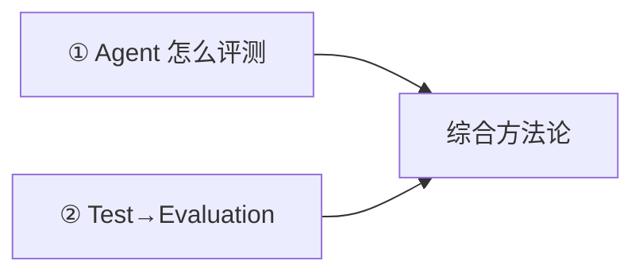

**图 1｜两支视频与综合主线（按官方章节重绘）**

两支视频一个回答「测什么、怎么测、怎么闭环」，一个回答「为什么不能再叫 Test、最小可行评估怎么搭」。合起来是一条从**认识论**（质量而非正确性）到**工程落地**（数据集 / 判据 / 粒度 / 回流）的完整方法论。

| 模块 | 回答的问题 | 主要来源 | 本教程 |
|---|---|---|---|
| 为什么不是 Test | 概率性输出为什么要衡量质量 | 视频 ② | 第 2–4 章 |
| 什么叫好 | Rubric 与最小可行评估 | 视频 ② | 第 5–6 章 |
| 测什么 | 三层价值框架与逐层指标 | 视频 ① | 第 7–13 章 |
| 怎么测 | Golden Dataset / 三种判据 / 三层粒度 | 视频 ① | 第 14–17 章 |
| 怎么闭环 | Trajectory / 上线指标 / Case 回流 | 视频 ① | 第 18–19 章 |

> 全片可压成一句话：**先定义「什么叫好」，再用固定数据集与组合判据把「好不好」变成可比较的分数，最后让线上失败 Case 回流，驱动每一轮改动。**

---

## 2. 为什么 AI 圈不叫 Test，而叫 Evaluation

**【视频原述】** 视频 ② 开场追问：做互联网产品时我们说单元测试、接口测试、回归测试、QA，为什么到 AI 产品大家都开始聊 evaluation、LLM Evals、Agent Evals？画面还贴出 Anthropic《Demystifying evals for AI agents》、LangChain、Braintrust、DeepEval、Langfuse 的搜索结果。


**图 2｜从 Test 到 Evaluation 的根本原因重绘**

> **答案不是换了个说法，而是面对的产品对象变了**：传统软件是确定性逻辑，AI 产品是概率性推理。Test 验证「功能是不是正确」——支付成功没有、数据库更新没有，都有明确标准；Evaluation 要回答「他真的理解用户意图了吗、有没有被骗退款、用户到底满不满意」，这些问题没有唯一答案，只有好和不好。

**【视频原述】** 口播里的例子很直接：用户说「我想退款」，Test 只能告诉你退款流程走没走通；产品经理真正关心的是意图理解、风险、满意度。于是 AI 产品从**正确性的测试**走向**质量的评估**。

---

## 3. Test vs Evaluation：两条链路与四组概念

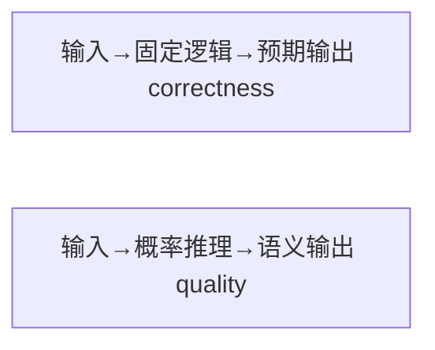

**图 3｜两条评测链路对照重绘**

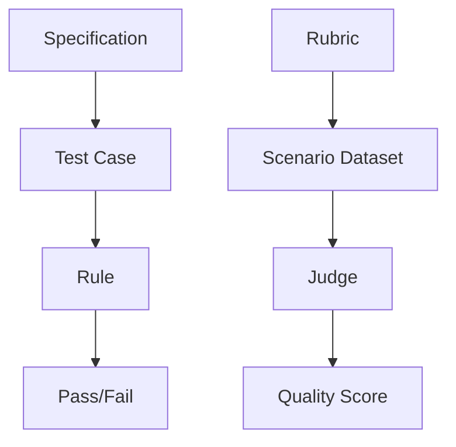

**图 4｜四组概念对照表重绘**

**【视频原述】** 画面手绘的对照表是两列纵向链条：左列 **Specification → Test Case → Rule → Pass / Fail**，右列 **Rubric → Scenario Dataset → Judge → Quality Score**。

| Test | Evaluation | 含义变化 |
|---|---|---|
| Specification（规格） | Rubric（评分标准） | 从「写清楚功能」到「写清楚什么叫好」 |
| Test Case（用例） | Scenario Dataset（场景集） | 从单点用例到覆盖真实场景分布 |
| Rule（规则） | Judge（裁判） | 从确定性判定到带评分锚点的判断 |
| Pass / Fail（通过/失败） | Quality Score（质量分） | 从布尔结果到可比较的连续分数 |

**【视频原述】** 另一张手绘写得更简洁：**输入 → 固定逻辑 → 预期输出 = correctness**；**输入 → 概率推理 → 语义输出 = quality**。「Test 只能验证有没有做对，Evaluation 开始衡量有没有做好」——这是完全不同的两个问题。

---

## 4. Evaluation 的关键要素：Rubric 定义「什么叫好」

**【视频原述】** 视频 ② 的第二个官方章节（摘要逐字）：「evaluation 的关键要素是 rubric，用于定义什么是好的回答，衡量质量而非正确性」。


**图 5｜Rubric 的作用重绘**

**【视频原述】** 画面举例：用户说「今天工作好累」，有没有先共情、有没有否定用户情绪——这些**不是明确的 yes or no，而是质量的好坏**。所以不能写「回答要好」，要拆成专业度、幻觉率、共情等维度，并给每个维度定义 1–5 分标准，写清 5 分 / 3 分 / 1 分分别对应什么。

> **【补充】** 这与本站《Agent 评测指标系统》的 Rubric 三要素（维度 / 分级 / 描述）、以及 Anthropic 建议的「判据原子化、二元化、明确写出什么不算满足」是同一条原则。

> 视频 ② 结语音译：「产品经理要会定义 rubric —— 你都不能定义什么叫好，怎么让这个产品变得越来越好？」

---

## 5. 最小可行评估 MVE：三件套 + 一个循环

**【视频原述】** 第三个官方章节标题「构建最小可行评估」，画面写的是 `构建 mve（最小可执行评估）`，下面一行 `eval driven development`，再下面三个词 `dataset  rubric  run`。

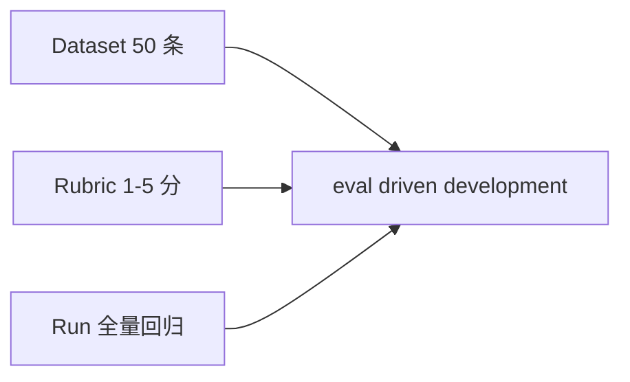

**图 6｜MVE 三件套与 eval driven development 重绘**

1. **Dataset**：去线上捞 **50 个真实用户对话**，包括那些最容易翻车的边界场景。这 50 个 case 就是产品的基本盘。
2. **Rubric**：不要只说「回答要好」，把「好」拆成专业度、幻觉率等维度，给每个维度定义 1–5 分标准。
3. **Run**：每次模型升级、每次 prompt 修改、每次 memory 更新，都把这套评估**全部跑一遍**，通过得分看变化，而不是做一次性的 vibe check。

**【视频原述】** 口播强调「你不需要写代码，但需要亲手去搭」。三者合起来就是 **eval driven development**：用评测驱动每一次改动，而不是改完再看感觉。

> **校正**：官方章节摘要把最后一句写成「ever driven development」，为 ASR 误写；画面与上下文均为 `eval driven development`，本教程按画面取词。

---

## 6. Agent 评测要回答三个问题：三层价值框架

**【视频原述】** 视频 ① 的正文是一份 Notion 长文档，开头给出「Agent 评测要回答三个问题，对应三个维度：**技术价值 → 用户价值 → 业务价值**」，并用代码块画了三层框架。

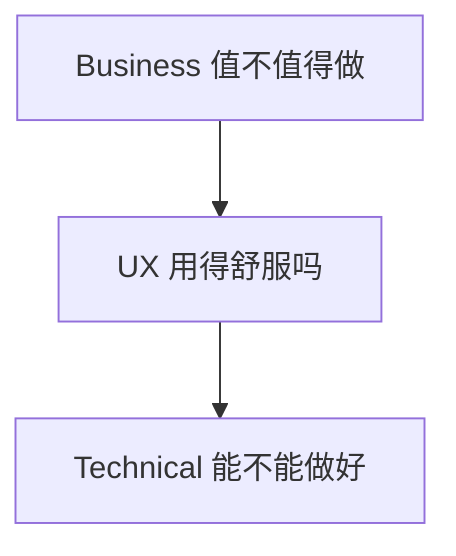

**图 7｜三层价值框架重绘**

| 层级 | 追问 | 画面原文 |
|---|---|---|
| Technical 技术层 | Agent 能不能做好？ | 底层是前提：技术层没做好，上面两层都没意义 |
| UX 用户体验层 | 用户用得舒服吗？ | 技术层解决「能不能做」，这一层解决「愿不愿意用」 |
| Business 业务层 | 这件事值不值得做？ | 但顶层才是目的：Business 不为正，整个 Agent 不值得存在 |

**【视频原述】** 框架图下方还有一句关键判断：**「底层是前提……但顶层才是目的」**。这决定了三层的顺序不能倒置：技术分再高，业务价值为负，产品依然不成立；但技术层垮了，上面两层也无从谈起。

---

## 7. 第一层 技术层：任务完成度，别把「成功」定义松了

**【视频原述】** 第一层标题逐字为「第一层：技术层（Technical）—— Agent 能不能做好？」，要回答两个问题：**任务完成了吗？完成得好不好？** 画面列出技术层评测框架：任务完成度（Success Rate）含最终成功率 SR、关键步骤准确率、负向约束遵循度。

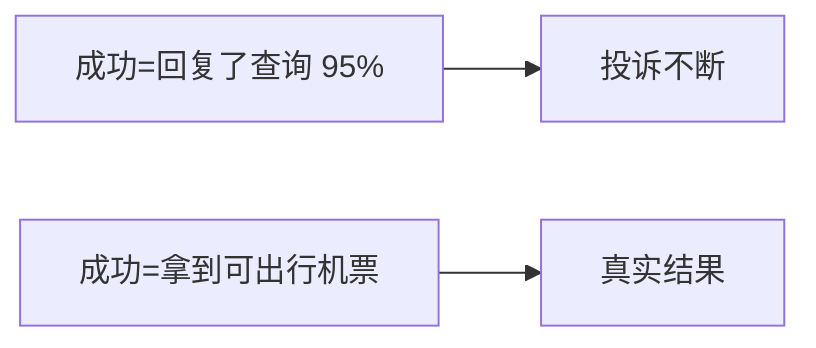

**图 8｜任务完成度与订票案例重绘**

**【视频原述】** 画面给了一个很有力的反例：某订票 Agent 团队把「成功」定义成「Agent 回复了用户的查询」，统计成功率 **95%**，但上线后用户投诉不断——问题出在成功定义太松。**真正的成功应该是「用户拿到了可出行的机票」，而不是「Agent 把话说完了」。**

> 另一句画面原文：「完成率 100% 但用了 30 步，和完成率 100% 用了 3 步，是两个完全不同的 Agent。」——所以只看最终成功率不够，还要看执行质量。

---

## 8. 第一层：任务执行质量的三件事

**【视频原述】** 「任务完成不代表完成得优秀。执行质量要测三件事」：


**图 9｜执行质量三件事重绘**

| 维度 | 英文 | 画面要点 |
|---|---|---|
| 工具调用能力 | Tool / Function Calling | 执行过程最容易出问题的环节；工具选择准确、参数提取准确、异常处理 |
| 规划与推理能力 | Planning & Reasoning | 「工具调用是手脚，规划和推理是大脑」；路径有效性、自我纠错 |
| 性能与成本 | Efficiency & Cost | 同样的结果，用什么代价拿到的；耗时、Token、交互轮数 |

**【视频原述】** 画面结论：**任何一项失控，技术层就不及格**。而且判断工具选择准不准，「不能只看『用没用对的工具』，还要看『有没有在对的时机用』」——太早调用后面的工具是 Premature，太晚调用会丢失上下文。

---

## 9. 工具调用的隐蔽失败与异常处理三档


**图 10｜工具调用隐蔽失败与异常处理分档重绘**

### 9.1 参数提取准确性：最难发现的失败

**【视频原述】** 画面原文：「Agent 选了正确的工具，调用了正确的接口，但参数传错了——日期格式不对、用户 ID 多了一位、查询条件写反了。这一项的失败最难发现。」

### 9.2 异常处理能力：L1 / L2 / L3

**【视频原述】** 「工具调用一定会出错——网络超时、API 限流、参数错误、权限不足。关键不在于出不出错，在于出错之后 Agent 怎么办。」画面把异常处理分成三档：

| 档位 | 行为 | 评价 |
|---|---|---|
| L1（差） | 报错后直接告诉用户「系统出错了」，用户得自己重新说一遍需求 | 把成本转嫁给用户 |
| L2（中） | 报错后自己重试一次，第二次还失败才告诉用户 | 有基本容错但不会变通 |
| L3（好） | 分析错误原因、换一种方式重试：查询超时就换更精确的条件，权限不足就换用户能访问的接口 | 真正具备恢复能力 |

### 9.3 规划与推理：看 Trace 而不是只看结果

**【视频原述】** 路径有效性看「步骤是否简洁，有没有死循环或无意义的重复」；自我纠错要求「读错误信息、定位错误原因、有针对性地修改方案」。画面特别强调：这种能力的评测**需要看 Trace 里 Agent 纠错前后的逻辑链变化，不是只看结果对不对**。

> 画面还举了一个容易误判的例子：某 Agent 在「查询航班」后调用了「锁定座位」两次，看似多了一步，实则是为确认座位信息一致性——「这个不是失误，是设计」。不查 Trajectory 就会误判。

---

## 10. 性能与成本：同样结果的代价

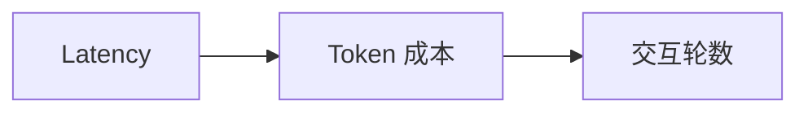

**图 11｜性能与成本三指标重绘**

| 指标 | 画面定义 | PM 动作 |
|---|---|---|
| 端到端耗时 Latency | 用户从发出请求到拿到最终结果的总时间 | 为不同任务设不同阈值；超阈值要主动告知「正在处理中」或分步骤返回，而不是让用户干等 |
| Token 消耗 / 成本 | 完成一次任务消耗的模型开销 | 与业务大盘联动，规模化后直接决定 ROI |
| 交互轮数 | 解决问题用了多少轮对话 | 轮数多耐心消耗快、轮数少跳步风险高；健康节奏是前几轮收敛需求、中间执行、最后确认 |

**【视频原述】** 画面举例提到单次成本可低到 0.05 美元这类量级，重点不是具体数字，而是**把代价纳入质量定义**：同样完成任务，30 步与 3 步、5 轮与 15 轮，不是同一个产品。

---

## 11. 第二层 用户体验层：三个行为指标

**【视频原述】** 「第二层：用户体验层（UX）—— 用户用得舒服吗？」这一层测的是**真实用户面对 Agent 时的行为反馈**，画面列三个指标。


**图 12｜UX 层三指标重绘**

| 指标 | 画面定义 | 信号 |
|---|---|---|
| 追问率 | 用户对回答不满意，继续追问 | 直接暴露「回答了但没回答到点上」；追问率高说明 Task 完成率虚高 |
| 点赞率 | 点赞或主动说「谢谢 / 搞定了」 | 最直接的正反馈；要与追问率、放弃率合起来看才能判断真实表现 |
| 放弃率 | 用户问了问题、Agent 回答后不再继续或直接离开 | Agent 质量下降的早期信号 |

> 这一层的核心判断：**Agent 是「能把事办成」，还是「办成的时候让人舒服」？**

---

## 12. 第三层 业务价值层：本质是在看 ROI

**【视频原述】** 「第三层：业务价值层（Business）—— 这件事值不值得做？」画面一句很重的话：**企业不会因为 LLM Judge = 95 分继续投资，只关心 Agent 是否创造收益。**

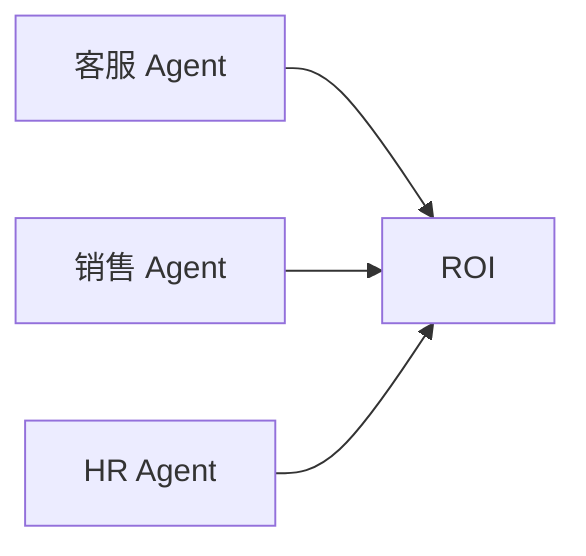

**图 13｜业务价值层与按类型指标重绘**

| Agent 类型 | 画面列出的业务指标 |
|---|---|
| 客服 Agent | 转人工率下降了多少 / 平均处理时长缩短了多少 / 客服人力成本下降了多少 |
| 销售 Agent | 成交率提升了多少 / 转化漏斗每一步的流失率有没有改善 |
| HR Agent | 招聘周期缩短了多少 / 简历筛选的人工时间减少了多少 |

**【视频原述】** 「这一层本质是在看 ROI」。业务指标必须由产品经理按产品类型定义，**不能照搬通用评测分数**，也不能由模型评分代替。

---

## 13. 两阶段：离线评测 × 上线后数据分析

**【视频原述】** 「Agent 怎么测？」下面分两段，画面明确写「两个阶段的关注点完全不同」：

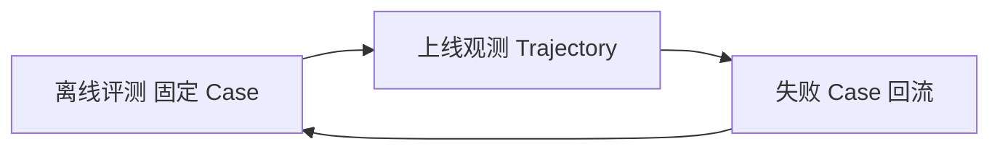

**图 14｜两阶段评测与反向闭环重绘**

| 阶段 | 用什么测 | 回答什么 | 主要内容 |
|---|---|---|---|
| 离线评测 | 一套固定的 Case 集 | 「这个 Agent 在我设定的场景里表现如何」 | Golden Dataset → 三种评测方法 → 三层评测粒度 |
| 上线后数据分析 | 真实用户 Trajectory | 「这个 Agent 在真实场景里到底能不能用」 | 用户行为指标 + 业务大盘指标 + 失败 Case 回流 |

> 离线评测的能力上限由数据集决定；上线观测决定数据集是否还有效。两者通过「反向闭环」连成一个系统。

---

## 14. 离线评测底盘：Golden Dataset 三步

**【视频原述】** 画面「1. 底盘：Golden Dataset（黄金评测集）」给出三步，并强调「这步最费工，但也最值钱」：

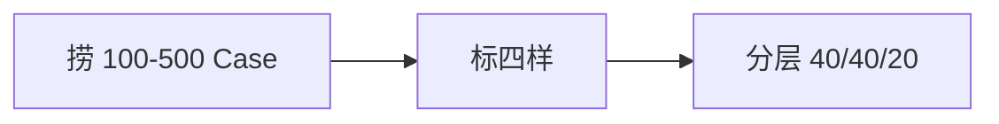

**图 15｜Golden Dataset 构建三步重绘**

1. **从真实场景里捞 100–500 个 Case**，不是拍脑袋想题目。
2. **每个 Case 标注四样东西**：输入、预期结果、评判标准、难度标签。其中「预期结果是关键中的关键」——「回答了用户的问题」不是结果，「用户拿到了可出行的票」才是结果；预期结果一含糊，评测标准就崩了。
3. **分层标注 Case**，让 Dataset 真实反映业务难度分布：**简单场景 40%**（信息完整、需求明确、单工具可完成）、**中等场景 40%**（信息部分缺失、需要多工具协作、有歧义）、**困难场景 20%**（多约束冲突、需要决策、容易踩负向约束）。

> 「Golden Dataset 的构建工作量，大约是整个 Agent 项目开发量的 **15%–25%**……Dataset 做扎实了，后面评测方法、评测粒度才有用；Dataset 做虚了，跑再多 LLM Judge 都是自欺欺人。」

---

## 15. 三种评测方法必须组合用

**【视频原述】** 「2. 评测方法：三种手段组合用」——有了 Dataset，还需要评判标准；三种方法各有适用场景，**不能只用一种**。

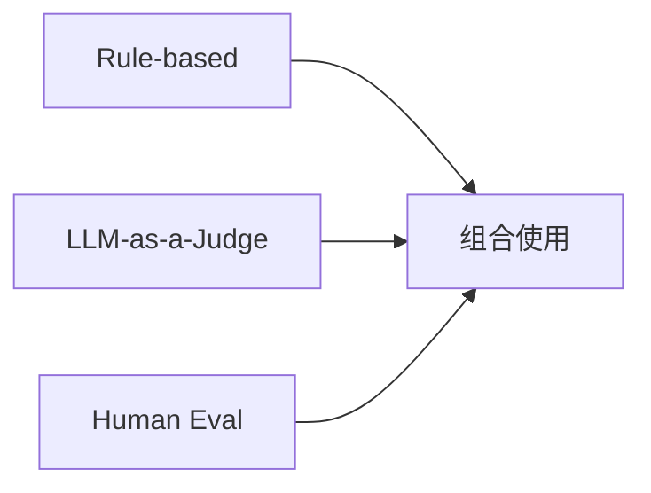

**图 16｜三种评测方法组合重绘**

| 方法 | 适用 | 判断维度 / 优点 | 局限 |
|---|---|---|---|
| ① Rule-based 规则评分 | 确定性任务 | 是否调用指定工具、参数是否正确、是否违反负向约束；稳定、可解释、不随模型版本波动 | 只能覆盖规则能描述的维度；开放式回答、创造性内容、推理质量评不了 |
| ② LLM-as-a-Judge 模型评分 | 开放式任务 | 用 Rubric 判断质量；维度要写清 5 分 / 3 分 / 1 分各对应什么 | 存在模型偏见与评分漂移（见第 16 章） |
| ③ Human Evaluation 人工评测 | 真实体验与审美 | 陪伴 Agent 的「被理解/被关心」、创作 Agent 的「有意思」，模型评不出来 | 成本高、周期长 |

**【视频原述】** 画面特别提醒：「每个维度都要给明确的评分锚点，不能只写『准确性高』——裁判模型看到『准确性高』和『准确性低』会给出很随意的分。」

### 15.1 人工评测的两种方式

| 方式 | 做法 | 取舍 |
|---|---|---|
| 盲评打分 | 把 Agent 回答混在人工回答里，评测人不知道哪个是 AI 写的，凭真实感受打分 | 最接近真实用户体验，但成本高、周期长 |
| 维度评分 | 评测人根据 Rubric 对每个维度打分 | 更结构化，但容易陷入「按 Rubric 打分」而不是「按真实感受打分」 |

---

## 16. LLM Judge 的两个致命坑与人工校准

**【视频原述】** 画面「LLM Judge 的两个致命坑」逐字还原：

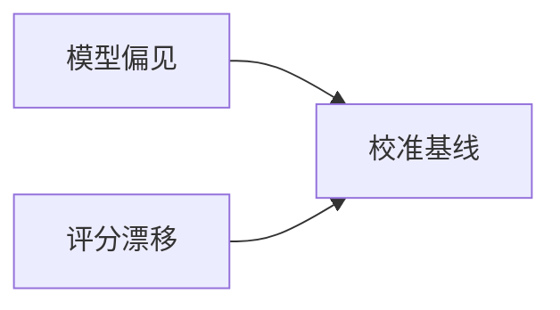

**图 17｜LLM Judge 两坑与人工校准重绘**

| 坑 | 表现 | 画面给的解法 |
|---|---|---|
| 模型偏见 | 同一回答不同家族模型给分不同；「再好的回答 GPT-5 也可能给低分」 | 用不同家族的模型当裁判，或同时用多个模型打分取均值 |
| 评分漂移 | 同一回答上周评 4 分、这周评 3 分；裁判模型版本变了、温度参数变了分数就漂 | 每轮评测固定裁判模型版本和参数；保留 **10%–20%** 人工复评样本，用人评结果做校准基线 |

> **【补充】** 本站《评测驱动 Agent 迭代》引用的 Anthropic 文章同样建议：让判据尽量简单客观、原子化二元化，并对 grader 建立告警与人工复核——与本节的「校准基线」是同一套工程做法。

---

## 17. 评测粒度：从组件到全链路三层

**【视频原述】** 「3. 评测粒度：从组件到全链路」——方法选定之后，还要决定**测一个组件，还是测完整链路**。

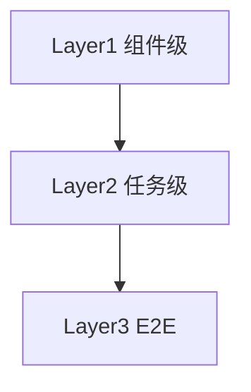

**图 18｜评测粒度三层重绘**

| 层级 | 测什么 | 典型指标 / 规模 | 回答的问题 |
|---|---|---|---|
| Layer 1 组件级 | 单独测每个模块，定位问题：Prompt、检索、工具 | 约束违反率 / 指令偏离率；Top-K 命中率 / 上下文相关性；工具调用成功率 / 参数准确率 | 哪个模块坏了 |
| Layer 2 任务级 | 单个任务的成功率（退货、修 Bug、跟进客户） | 每个任务跑 **50–100 个 Case** | 这个 Agent 的某个任务做得好不好 |
| Layer 3 端到端 E2E | 模拟真实用户，从输入到任务完成跑完整链路 | 最接近真实环境 | 在真实用户路径上表现如何 |

---

## 18. 上线后数据分析：Trajectory 与反向闭环

### 18.1 反向闭环：线上 Case 回流 Dataset

**【视频原述】** 「4. 反向闭环：线上 case 回流到 Dataset」——「离线评测集如果只建一次，不补充、不更新，半年后就是废纸。」画面给出的流程是：**追问率高的对话 → 抽取为新 Case；放弃率高的对话 → 抽取为新 Case；线上发现的失败 Case 定期回流到 Golden Dataset 里。**

### 18.2 上线后数据分析：记录完整 Trajectory

**【视频原述】** 「核心方法：记录每一轮对话的完整 Trajectory（执行轨迹）」：`用户问题 → Skill 选择 → Tool 调用 → Agent 回答 → 用户行为`。有了 Trajectory 之后盯两类指标：

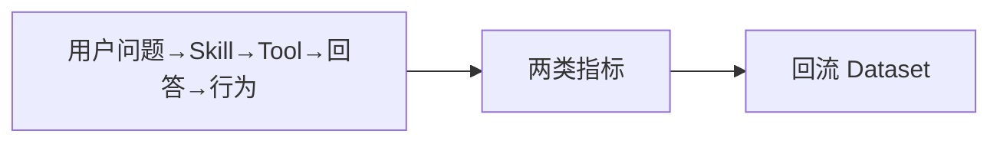

**图 19｜Trajectory、两类指标与回流闭环重绘**

| 指标组 | 含义 | 画面指标 |
|---|---|---|
| 用户行为指标 | Agent 本身好不好用 | 追问率（回答了但没回答到点上）、放弃率（质量下降早期信号）、点赞率 |
| 业务大盘指标 | 产品值不值得做 | 转人工率、平均处理时长、人力成本、成交率、转化漏斗 |

> 画面强调「两组指标必须一起看」：只看用户行为会漏掉商业结果，只看业务大盘则无法定位 Agent 质量问题。

---

## 19. 一句话总结与本站体系对齐


**图 20｜【补充】完整评测体系全景**

> 两支视频的结语可以合成一句：**先明确评测目标、定义好 Agent 的标准，技术层 / 体验层 / 业务层三层都不能少；再用固定数据集 + 组合判据 + 三层粒度把它测出来，最后让线上失败 Case 回流，评测才算驱动了迭代。**

| 本教程 | 本站既有教程 | 对应关系 |
|---|---|---|
| Test → Evaluation | [RAG 评测完全教程（在线阅读）](../rag-evaluation-tutorial/RAG评测完全教程.html) | 从确定性检索指标走向概率性生成质量 |
| 三层价值框架 | [Agent 评测体系完全教程（在线阅读）](../agent-evaluation-tutorial/Agent评测体系完全教程.html) | 端到端 / 轨迹 / 表现三层分类的另一种切法 |
| Golden Dataset + 反向闭环 | [评测驱动 Agent 迭代（在线阅读）](../agent-eval-driven-tutorial/Agent评测驱动迭代完全教程.html) | 能力评测毕业成回归集、线上 bad case 回填 |
| Rubric 1–5 分 / 评分锚点 | [Agent 评测指标系统（在线阅读）](../agent-metrics-tutorial/Agent评测指标系统完全教程.html) | Rubric 三要素、3 分是日常尺度、Judge 四原则 |
| 三类业务指标 / ROI | [指标地图](../agent-eval-driven-tutorial/指标地图.html) | Outcome 三维度里的 Cost 与业务结果 |
| eval driven development | [Agent 开发架构选型（在线阅读）](../agent-architecture-tutorial/Agent开发架构选型完全教程.html) | 改 Harness 之后必须靠回归评测证明没退步 |

> **【补充】** 两支视频没有展开 pass@k / pass^k、并发隔离、执行引擎参数等工程细节，需要时见第三篇与阿里工程实践章节。

---

## 20. 补充篇 A：专业名词速查（54 条）

**【补充】** 按「认识论 → 三层价值 → 数据集与判据 → 工程闭环」分组。

| 术语 | 英文 / 别名 | 释义 |
|---|---|---|
| Evaluation | Eval / 评估 | 对概率性系统衡量输出质量，而非验证正确性 |
| Test | 测试 | 对确定性逻辑验证功能是否符合预期 |
| Correctness | 正确性 | 有唯一正确答案的判定口径 |
| Quality | 质量 | 好与不好的程度判断，需要评分标准 |
| Specification | 规格 | Test 里写清楚功能应该怎样 |
| Test Case | 测试用例 | 固定输入与预期输出的单点用例 |
| Rule | 规则 | 确定性判定逻辑 |
| Pass / Fail | 通过 / 失败 | 布尔型测试结果 |
| Rubric | 评分标准 / 量规 | 定义「什么叫好」的维度 + 分级 + 描述 |
| Scenario Dataset | 场景数据集 | 覆盖真实场景分布的评测样本集 |
| Judge | 裁判 / 评分器 | 按 Rubric 给质量打分的判据 |
| Quality Score | 质量分 | 可跨版本比较的连续分数 |
| MVE | Minimum Viable Evaluation | 最小可执行评估：dataset + rubric + run |
| Eval Driven Development | EDD | 用评测驱动每一次模型 / prompt / memory 改动 |
| Golden Dataset | 黄金评测集 | 经标注、分层、可复用的高质量 Case 集 |
| Trajectory | Trace / 执行轨迹 | 用户问题 → Skill → Tool → 回答 → 行为的完整链路 |
| Technical 技术层 | — | Agent 能不能做好；任务完成度与执行质量 |
| UX 用户体验层 | — | 用户用得舒服吗；行为反馈指标 |
| Business 业务层 | — | 这件事值不值得做；ROI |
| Success Rate | SR / 任务完成度 | 任务最终是否达成预期结果 |
| 关键步骤准确率 | — | 成功路径上关键节点的正确比例 |
| 负向约束遵循度 | — | 不该做的事有没有做（如高额退款必须转人工） |
| Execution Quality | 执行质量 | 完成得优不优秀：工具调用 / 规划推理 / 性能成本 |
| Tool / Function Calling | 工具调用 | 选择工具、填参数、处理返回 |
| Premature | 过早调用 | 在时机未到时调用了后续工具 |
| 参数提取准确性 | Parameter Accuracy | 传给 API 的格式、数值、条件是否正确 |
| 异常处理能力 | Error Handling | 工具报错后的恢复行为，画面分 L1/L2/L3 |
| Planning & Reasoning | 规划与推理 | 路径有效性与自我纠错 |
| 路径有效性 | Path Validity | 步骤是否简洁、有无死循环或无意义重复 |
| Self-Correction | 自我纠错 | 读错误信息 → 定位原因 → 针对性改方案 |
| Efficiency & Cost | 性能与成本 | 耗时、Token、交互轮数 |
| Latency | 端到端耗时 | 请求到最终结果的总时间 |
| 交互轮数 | Conversation Turns | 解决问题用了多少轮对话 |
| 追问率 | Follow-up Rate | 用户不满意继续追问；完成率虚高的信号 |
| 点赞率 | Like Rate | 点赞或主动致谢的正反馈 |
| 放弃率 | Abandon Rate | 回答后用户不再继续 / 离开 |
| ROI | 投资回报 | 业务价值层的本质判断 |
| 转人工率 | Human Handoff Rate | 客服 Agent 的核心业务指标 |
| Rule-based Evaluation | 规则评分 | 稳定、可解释、不随模型版本波动 |
| LLM-as-a-Judge | 模型评分 | 用模型按 Rubric 判断开放式输出质量 |
| 评分锚点 | Scoring Anchor | 写清 5 分 / 3 分 / 1 分分别对应什么 |
| 模型偏见 | Model Bias | 不同裁判模型对同一回答给分不同 |
| 评分漂移 | Score Drift | 同一样本跨时间 / 跨版本得分变化 |
| 人工复评基线 | Calibration Set | 保留 10%–20% 人评样本做校准 |
| Human Evaluation | 人工评测 | 真实体验与审美判断的最终判据 |
| 盲评打分 | Blind Review | 混入人工回答，评测人不知来源 |
| 维度评分 | Rubric Scoring | 按 Rubric 逐维度打分 |
| 组件级测试 | Layer 1 | 单模块定位问题 |
| 任务级测试 | Layer 2 | 单任务跑 50–100 个 Case |
| 端到端测试 | Layer 3 / E2E | 模拟真实用户跑完整链路 |
| 反向闭环 | Feedback Loop | 线上失败 Case 回流 Golden Dataset |
| Difficulty Stratification | 难度分层 | 简单 40% / 中等 40% / 困难 20% |
| 负向约束 | Negative Constraint | 明确禁止的行为，规则评分的重点 |
| Vibe Check | 主观抽查 | 随手看几个样例，无法跨版本比较 |

---

## 21. 补充篇 B：可运行代码

**【补充】** 四段纯 Python 标准库实现，把画面里的方法变成可执行逻辑。

### 21.1 Test 与 Evaluation 判定器

```python
# test_or_eval.py —— python3 test_or_eval.py
def classify(task):
    """按输出是否确定、是否有唯一正确答案，判断该用 Test 还是 Evaluation。"""
    deterministic = task.get("deterministic", False)
    unique_answer = task.get("unique_answer", False)
    semantic_output = task.get("semantic_output", False)
    if deterministic and unique_answer and not semantic_output:
        return "TEST", "Specification → Test Case → Rule → Pass/Fail"
    return "EVALUATION", "Rubric → Scenario Dataset → Judge → Quality Score"

CASES = [
    ("支付接口是否写入订单表", dict(deterministic=True, unique_answer=True)),
    ("订票 Agent 是否理解用户意图", dict(deterministic=False, semantic_output=True)),
    ("退款回复有没有先共情", dict(deterministic=False, semantic_output=True)),
    ("超过 1000 元退款是否转人工", dict(deterministic=True, unique_answer=True)),
]
if __name__ == "__main__":
    for name, t in CASES:
        kind, chain = classify(t)
        print(f"{name:<24} {kind:<11} {chain}")
```

### 21.2 三层价值指标计算器（含「成功定义」对比）

```python
# three_layers.py —— python3 three_layers.py
def success_rate(traces, success_def):
    """success_def 决定什么算成功：说完了 vs 真办成了。"""
    ok = sum(1 for t in traces if success_def(t))
    return ok / max(1, len(traces))

def ux_scores(traces):
    n = len(traces)
    return {
        "追问率": sum(1 for t in traces if t["followup"]) / n,
        "点赞率": sum(1 for t in traces if t["liked"]) / n,
        "放弃率": sum(1 for t in traces if t["abandoned"]) / n,
    }

def business(traces, baseline_handoff=0.40):
    handoff = sum(1 for t in traces if t["handoff"]) / len(traces)
    return {"转人工率": round(handoff, 3), "较基线下降": round(baseline_handoff - handoff, 3)}

if __name__ == "__main__":
    traces = [
        dict(replied=True, ticket_issued=(i % 3 != 0), followup=(i % 3 == 0),
             liked=(i % 5 == 0), abandoned=(i % 7 == 0), handoff=(i % 6 == 0),
             steps=3 + i % 28)
        for i in range(60)
    ]
    loose = success_rate(traces, lambda t: t["replied"])
    strict = success_rate(traces, lambda t: t["ticket_issued"])
    print("松定义（回复了查询）成功率:", round(loose, 3))
    print("严定义（拿到可出行票）成功率:", round(strict, 3))
    print("虚高:", round(loose - strict, 3))
    print("UX:", {k: round(v, 3) for k, v in ux_scores(traces).items()})
    print("Business:", business(traces))
```

### 21.3 Golden Dataset 分层与标注校验器

```python
# dataset_check.py —— python3 dataset_check.py
FIELDS = ("input", "expected_result", "criteria", "difficulty")
TARGET = {"简单": 0.40, "中等": 0.40, "困难": 0.20}

def audit(cases):
    missing = [c["id"] for c in cases if any(not c.get(f) for f in FIELDS)]
    vague = [c["id"] for c in cases if "回答" in str(c.get("expected_result", ""))]
    dist = {}
    for c in cases:
        d = c.get("difficulty")
        dist[d] = dist.get(d, 0) + 1
    n = max(1, len(cases))
    drift = {k: round(dist.get(k, 0)/n - TARGET[k], 3) for k in TARGET}
    return missing, vague, drift, dist

if __name__ == "__main__":
    import random
    random.seed(3)
    cases = []
    for i in range(100):
        d = "简单" if i < 40 else "中等" if i < 80 else "困难"
        cases.append(dict(id=f"c{i:03d}", input="订票/退款请求",
                         expected_result="用户拿到可出行的票" if i != 7 else "回答了用户的问题",
                         criteria="出票成功+舱位正确+价格<预算" if i != 9 else None,
                         difficulty=d))
    missing, vague, drift, dist = audit(cases)
    print("规模:", len(cases), "分布:", dist)
    print("分层偏差:", drift)
    print("缺字段:", missing, "| 预期结果含糊:", vague)
```

### 21.4 eval driven development 回归门（含评分漂移检测）

```python
# eval_gate.py —— python3 eval_gate.py
def gate(baseline, current, guardrails, drift_tolerance=0.15):
    """主指标不退步 + 护栏不破 + 校准集无漂移，才允许上线。"""
    reasons = []
    for k, v in baseline.items():
        if current.get(k, 0) < v - 1e-9:
            reasons.append(f"主指标退步 {k}: {v} → {current.get(k)}")
    for k, (op, limit) in guardrails.items():
        v = current.get(k, 0)
        if (op == "<" and not v < limit) or (op == ">" and not v > limit):
            reasons.append(f"护栏未过 {k}: {v} {op} {limit}")
    cal = current.get("calibration_drift", 0)
    if cal > drift_tolerance:
        reasons.append(f"裁判评分漂移 {cal:.2f} > {drift_tolerance}")
    return ("GO" if not reasons else "HOLD"), reasons

if __name__ == "__main__":
    base = {"任务完成度": 0.86, "关键步骤准确率": 0.91}
    guard = {"负向约束违反率": ("<", 0.02), "端到端耗时_p95": ("<", 8.0)}
    ok = dict(base, 负向约束违反率=0.01, 端到端耗时_p95=6.2, calibration_drift=0.05)
    bad = dict(base, 任务完成度=0.83, 负向约束违反率=0.04,
               端到端耗时_p95=9.1, calibration_drift=0.22)
    for label, cur in (("正常版本", ok), ("退步版本", bad)):
        verdict, reasons = gate(base, cur, guard)
        print(label, verdict)
        for r in reasons: print("   -", r)
```

---

## 22. 补充篇 C：常见误区

| # | 误区 | 为什么错 | 正确做法 |
|---|---|---|---|
| 1 | 把 AI 产品当传统软件做 Test | 输出是概率性、语义性的，没有唯一正确答案 | 用 Evaluation：Rubric + 场景集 + Judge + 质量分 |
| 2 | 只写「回答要好」当评分标准 | 裁判模型看到「准确性高/低」会随意给分 | 拆维度并写清 5 分 / 3 分 / 1 分锚点 |
| 3 | 把「成功」定义成「回复了用户」 | 订票案例：95% 成功率但投诉不断 | 定义到业务结果：「用户拿到了可出行的票」 |
| 4 | 只看最终成功率 | 30 步完成与 3 步完成是两个 Agent | 同时测执行质量、耗时、Token、轮数 |
| 5 | Dataset 全是简单题或全是难题 | 分数无法反映真实业务难度分布 | 按 40% / 40% / 20% 分层，与线上分布对齐 |
| 6 | Dataset 只建一次不更新 | 「半年后就是废纸」 | 建立线上失败 Case 反向回流机制 |
| 7 | 只用 LLM Judge 一种判据 | 规则能稳判的维度被模型化，开放式维度又缺锚点 | 规则 / 模型 / 人工三者组合 |
| 8 | 不固定裁判模型版本与参数 | 评分漂移让跨版本比较失去意义 | 固定版本参数 + 10%–20% 人工复评基线 |
| 9 | 只测组件或只测 E2E | 只测组件看不到真实路径，只测 E2E 难定位 | 组件级 → 任务级 → E2E 三层粒度 |
| 10 | 用 LLM Judge 分数向老板汇报价值 | 企业不会因为 95 分继续投资 | 业务层看 ROI：转人工率、成本、成交率 |
| 11 | 靠 vibe check 判断改动好坏 | 随手看几个样例无法跨版本比较 | 每次改动把 MVE 全量跑一遍 |
| 12 | 把重复的工具调用都当失误 | 可能是为确认信息一致性的设计 | 查 Trajectory 里的纠错前后逻辑链 |

---

## 23. 附录

### 23.1 官方章节时间轴（逐字，含 detail 摘要）

| 视频 | 时间 | 章节名 | 官方 detail 摘要 |
|---|---|---|---|
| ① | 00:00 / 00:50 / 03:12 / 04:54 / 05:16 | 引言 / 评测维度 / 离线评测 / 上线后数据分析 / 结语 | 三层价值；离线评测集与三种方法；上线收集真实 Trajectory 形成双向回流；明确评测目标与「好 Agent」标准 |
| ② | 00:00 / 00:16 / 01:57 / 02:54 | 引言 / 从test到evalua… / evaluation的关… / 构建最小可行评估 | 概率性行为需衡量质量而非正确性；rubric 定义什么是好的回答；黄金数据集 + rubrics + eval driven development |

### 23.2 配图速查（20 张）

| # | 图名 | 来源 |
|---|---|---|
| 1–2 | 两支视频结构地图 / 从 Test 到 Evaluation | 官方章节 + 视频 ② 画面 |
| 3–6 | 两条链路 / 四组概念对照 / Rubric / MVE 三件套 | 视频 ② 白板逐字重绘 |
| 7–13 | 三层价值框架 + 技术层 / UX / Business 逐层指标 | 视频 ① Notion 文档与手绘图 |
| 14–18 | 两阶段评测 / Golden Dataset / 三种判据 / Judge 两坑 / 三层粒度 | 视频 ① 文档 |
| 19 | Trajectory 与反向闭环 | 视频 ① 文档 |
| 20 | 【补充】完整评测体系全景 | 公开工程资料，非视频画面 |

### 23.3 校正表（OCR 与自动摘要）

| 来源写成了 | 正确写法 | 依据 |
|---|---|---|
| `ever driven development` | `eval driven development` | 视频 ② 画面 f_0059 逐字 + 章节上下文 |
| `Q4` | `QA` | 视频 ②「单元测试、回归测试、QA」；f_0011 帧清晰 |
| `构建mve（最小可执行评估）` | 保留画面用词；正文说明即 Minimum Viable Evaluation | 画面原文与官方章节「最小可行评估」并存，不擅自统一 |
| `Demystifying evals for Al agents` / `evalvation` / `evar` | `Demystifying evals for AI agents` / `evaluation` / `eval` | Anthropic 官方文章名 + 画面搜索结果 |
| `ROl` / `Task完成率` 等大小写混排 | `ROI` / `Task 完成率` | 文档字体与 OCR 形近字 |
| `1. 底盘：Golden...` / `2. 评测方法：三…` | 「底盘：Golden Dataset」「评测方法：三种手段组合用」 | Notion 左侧目录被截断，按正文补全 |
| 口播「第一层是救术」「用户情猪」等 | 「第一层是技术」「用户情绪」 | 字幕 OCR 音近误字，按画面文档校正 |
| 官方章节名「从test到evalua…」「evaluation的关…」 | 按 detail 字段补全为「从 Test 到 Evaluation」「evaluation 的关键要素」 | 接口章节名截断，按 detail 与画面还原 |

### 23.4 还原方法与资料

1. **视频**：① [Agent 要怎么评测？](https://v.douyin.com/traQcUR8ESs/)（ID `7654534319003895395`，2026-06-23，5:27）；② [从 Test 到 Evaluation](https://v.douyin.com/TNwXekWUnuE/)（ID `7658646606980350946`，2026-07-04，3:53）。作者均为 @煮caicai。
2. **逐帧**：1080 档原片 11.6 MB（1080×1440 / 1080×1080）；每 3 秒抽帧 187 张；Vision OCR 6,361 行带坐标文本；按两支不同版式分别设阈值分离出 81 条画面幻灯片与 166 条字幕时间线；三层框架图、Test/Evaluation 对照表、MVE 图、Golden Dataset 表等关键帧放大逐字校对。
3. **公开资料核对**：Anthropic, [Demystifying evals for AI agents](https://www.anthropic.com/research/demystifying-evals-for-ai-agents)（视频 ② 画面引用的搜索结果，亦为本系列第三篇主要参考）；画面出现的 LangChain、Braintrust、DeepEval、Langfuse 均为评测框架/平台，本教程只按画面列出，不展开未核实的产品能力。
4. **本系列互链**：[RAG 评测完全教程（在线阅读）](../rag-evaluation-tutorial/RAG评测完全教程.html) ｜ [Agent 评测体系完全教程（在线阅读）](../agent-evaluation-tutorial/Agent评测体系完全教程.html) ｜ [评测驱动 Agent 迭代（在线阅读）](../agent-eval-driven-tutorial/Agent评测驱动迭代完全教程.html) ｜ [Agent 开发架构选型（在线阅读）](../agent-architecture-tutorial/Agent开发架构选型完全教程.html) ｜ [Agent 评测指标系统（在线阅读）](../agent-metrics-tutorial/Agent评测指标系统完全教程.html)。

> **未做的部分（如实说明）**：本轮未做语音逐字转写（ASR）；第一支字幕 OCR 噪声较大，该支内容以 Notion 画面文档文字为主要依据，口播仅作语义佐证；第二支分享文案无正式标题，教程标题为按内容拟题；画面中搜索结果截图里的英文摘要因分辨率有限只做结构还原，未逐字转录。

---

*本教程为学习整理产物；视频与文章版权归各自作者所有。*