# 从 0 到 1 搭建 Agent 评测系统 · 完全教程

> **三支视频综合 · 逐帧还原 + 系统化补全**
>
> 原视频：① [从0到1搭建一套Agent评估系统？](https://v.douyin.com/jQ3PCzp5d6Y/)（煮caicai） ｜ ② [6分钟：如何建立Agent评测第一层框架](https://v.douyin.com/yQCqzZPemOM/) ｜ ③ [7分钟干货:0-1搭建Agent评测2](https://v.douyin.com/Vq7UwPruXt0/)（观远数据 / 向量思维）
>
> 配套文件：[index.html（图文阅读版，19 张 SVG）](index.html)
>
> 姊妹篇：[RAG 评测（在线阅读）](../rag-evaluation-tutorial/RAG评测完全教程.html) ｜ [Agent 评测体系（在线阅读）](../agent-evaluation-tutorial/Agent评测体系完全教程.html) ｜ [评测驱动迭代（在线阅读）](../agent-eval-driven-tutorial/Agent评测驱动迭代完全教程.html) ｜ [开发架构选型（在线阅读）](../agent-architecture-tutorial/Agent开发架构选型完全教程.html) ｜ [评测指标系统（在线阅读）](../agent-metrics-tutorial/Agent评测指标系统完全教程.html) ｜ [评测方法论（在线阅读）](../agent-eval-method-tutorial/Agent评测方法论完全教程.html) ｜ [消除 LLM Judge 偏见（在线阅读）](../agent-judge-bias-tutorial/Agent评测偏见消除完全教程.html)

---

## 目录

- [0. 三支视频速览与保真约定](#0-三支视频速览与保真约定)
- [1. 全片结构地图](#1-全片结构地图)
- [2. 为什么 evaluation 要贯穿整个生命周期](#2-为什么-evaluation-要贯穿整个生命周期)
- [3. 一套完整 Evaluation System 的架构全景](#3-一套完整-evaluation-system-的架构全景)
- [4. 架构分三段：数据侧 / 执行观测侧 / 决策侧](#4-架构分三段数据侧--执行观测侧--决策侧)
- [5. 产品经理如何从 0 到 1 搭：五步落地法](#5-产品经理如何从-0-到-1-搭五步落地法)
- [6. 核心逻辑：构建「评估数据飞轮」](#6-核心逻辑构建评估数据飞轮)
- [7. 踩坑实录：四条经验](#7-踩坑实录四条经验)
- [8. 两层框架：任务集 × 运行评分](#8-两层框架任务集--运行评分)
- [9. 第一层三步：真实任务 → 稳定判断 → 正反平衡](#9-第一层三步真实任务--稳定判断--正反平衡)
- [10. 第一步：建立第一批真实任务](#10-第一步建立第一批真实任务)
- [11. 第二步：把 Task 写到可以稳定判断](#11-第二步把-task-写到可以稳定判断)
- [12. 两个检查方法：把「写清楚了」变成可验证](#12-两个检查方法把写清楚了变成可验证)
- [13. 第三步：同时设计正向和反向任务](#13-第三步同时设计正向和反向任务)
- [14. 三步收束：第一层的三个产物](#14-三步收束第一层的三个产物)
- [15. 第二层五步：让评分可解释、可复查](#15-第二层五步让评分可解释可复查)
- [16. 第一步：让每次 Trial 从可比环境开始](#16-第一步让每次-trial-从可比环境开始)
- [17. 第二步：同时保留 Outcome 与 Transcript](#17-第二步同时保留-outcome-与-transcript)
- [18. 第三步：三类 Grader 分工](#18-第三步三类-grader-分工)
- [19. 第四、五步：硬条件评分与 Grader 自测](#19-第四五步硬条件评分与-grader-自测)
- [20. 综合闭环与本站体系对齐](#20-综合闭环与本站体系对齐)
- [21. 补充篇 A：专业名词速查（51 条）](#21-补充篇-a专业名词速查51-条)
- [22. 补充篇 B：可运行代码](#22-补充篇-b可运行代码)
- [23. 补充篇 C：常见误区](#23-补充篇-c常见误区)
- [24. 附录](#24-附录)

---

## 一页速览：三支视频的 7 个结论

| # | 结论 | 位置 |
|---|---|---|
| 1 | **Evaluation 贯穿整个开发生命周期** | [第 2 章](#2-为什么-evaluation-要贯穿整个生命周期) |
| 2 | **完整系统分三段且必须连成环** | [第 3–4 章](#3-一套完整-evaluation-system-的架构全景) |
| 3 | **五步落地法** | [第 5 章](#5-产品经理如何从-0-到-1-搭五步落地法) |
| 4 | **核心是评估数据飞轮 + 四条踩坑** | [第 6–7 章](#6-核心逻辑构建评估数据飞轮) |
| 5 | **第一层任务集三步** | [第 9 章](#9-第一层三步真实任务--稳定判断--正反平衡) |
| 6 | **第二层运行评分五步** | [第 15 章](#15-第二层五步让评分可解释可复查) |
| 7 | **链路闭环与错误归因回流** | [第 20 章](#20-综合闭环与本站体系对齐) |

---

## 0. 三支视频速览与保真约定

**【视频原述】** 本教程综合三支视频：**煮caicai《如何从 0 到 1 搭建一套 Agent 评估系统？》（整体架构与数据飞轮）＋ 观远数据／向量思维《6 分钟：如何建立 Agent 评测第一层框架》（任务集）＋《7 分钟干货：0-1 搭建 Agent 评测 2》（运行与评分）。三支合起来，正好覆盖「整体架构 → 第一层测什么 → 第二层怎么测怎么判」。

| # | 视频 / ID | 作者 / 发布 | 时长 / 画面 | 画面结构 |
|---|---|---|---|---|
| ① | 从0到1搭建一套Evaluation System `7664976613234711523` | 煮caicai ／ 2026-07-21 | 5:34 ／ 1080×1086 方形 | Excalidraw 英文手绘架构图；封面四问 + 五步法 + 飞轮 + 踩坑四条 |
| ② | 6分钟：如何建立Agent评测第一层框架 `7680547627524354219` | 向量思维（观远数据）／ 2026-09-01 | 5:47 ／ 1920×1080 横屏 | VOL.052；顶部固定章节导航 + 手绘插画 + 底部黑条字幕 |
| ③ | 7分钟干货:0-1搭建Agent评测2 `7680918644558148009` | 向量思维（观远数据）／ 2026-09-02 | 7:12 ／ 1920×1080 横屏 | VOL.053；同系列第二期，六段导航 + 五步运行评分 |

合计约 **18:34**。②③ 为同一系列前两期（VOL.052 / VOL.053），结尾预告第三期「分数波动解释、Capability Eval 与 Regression Eval 区分」，本教程只按前两期内容还原，第三期未展开。

> **三种标记**：**【视频原述】**画面文字或烧录字幕确实出现过的表述；**【按画面重绘】**把手绘架构图 / 列表按原结构画成矢量图；**【补充】**由本站既有七篇教程与公开官方文档补齐，不属于视频原述。

> **保真边界**。① 三支视频**均无官方自动章节**（`chapter_list` 为空、无 `chapter_abstract`），②③ 的章节结构取自画面顶部固定导航条与口播，正文一律以画面与字幕为准。② ① 为英文手绘 + 浮动黑底字幕，字幕条会盖住画面节点，本教程按「跨帧稳定文字＝画面、频繁变化的中文短句＝字幕」分离，并对封面、架构图、飞轮、踩坑、权威来源、导航条逐帧放大校对。③ 字幕 OCR 噪声较多（如「价值」实为「Judge」、「Matrix」实为 Metrics、「价」「架」混用），已按画面与上下文校正；数值 20–50 条、1000 条、1300 次收藏等按画面原文保留。④ 本轮未做 ASR。

**还原方法**：解析 3 个分享短链 → 抓 `aweme/detail` 取 3 个视频 ID、时长、作者与最高清晰度地址 → 下载 1080×1086 与 1920×1080 原片共 35.2 MB（带 `Referer` + 浏览器 UA，避开 403）→ 每 3 秒抽帧 **372 张** → macOS Vision `VNRecognizeTextRequest` 得到 **5,504 行**带坐标文本 → 按三支不同版式分别设阈值，分离出 184 条画面幻灯片、353 条字幕时间线与顶部章节导航 → 关键帧放大逐字校对 → 与本站既有七篇及 Anthropic / OpenAI 公开文档交叉核对。

---

## 1. 全片结构地图


**图 1｜三支视频与综合主线（按画面目录重绘）**

**【视频原述】** 视频 ① 封面给出四问：「一套完整的 Evaluation System 长什么样？／ 产品经理如何从 0 到 1 搭一套 Evaluation 系统？／ 核心逻辑——构建『评估数据飞轮』／ 踩坑实录」。视频 ② 的导航条为「框架与方法 / 真实任务集 / 写清 Task / 正反平衡 / 三步收束」，③ 为「问题与方法 / 隔离运行环境 / Outcome 与轨迹 / 三类 Grader / 硬条件与评分 / 校准与收束」。

| 模块 | 回答什么 | 来源 | 本教程 |
|---|---|---|---|
| 整体架构 | 系统长什么样、怎么落地 | 视频 ① | 第 2–7 章 |
| 第一层：任务集 | 测什么 | 视频 ② | 第 8–14 章 |
| 第二层：运行评分 | 怎么运行、怎么判分 | 视频 ③ | 第 15–19 章 |
| 综合闭环 | 怎么串成一条链 | 三支综合 | 第 20 章 |

> 一句话：**架构定方向，任务集定「测什么」，运行评分定「怎么测、怎么判」，三个产物都必须能解释、能复查、能回流。**

---

**本章语音逐字稿（ASR · 已校正，17 句）**

> `[视频① 00:00]` Hello 大家，今天我们继续 Agent 评估相关的内容
> `[视频① 00:04]` 今天这篇是这个系列的最后一篇了
> `[视频① 00:07]` 我们讨论一下如何从 0 到 1搭建一套 evaluation system
> `[视频① 00:11]` 当然在搭建之前，我们要分析一下为什么它这么重要
> `[视频① 00:14]` 我们知道大厂都在疯狂地卷 evaluation 是为什么
> `[视频① 00:17]` 一个完整的 evaluation system 到底长什么样子
> `[视频① 00:21]` 以及我们去实践到底怎么去落地
> `[视频① 00:23]` 但是我们构建 evaluation 的核心逻辑
> `[视频① 00:26]` 还是要去做一个评估的数据飞轮
> `[视频① 00:29]` 以及分享几点踩坑的实录吧
> `[视频① 00:31]` 大厂为什么在卷
> `[视频① 00:32]` 我们可以看Anthropic在他这篇文章里面反复地强调
> `[视频① 00:36]` evaluation 应该是贯穿 Agent 的整个开发周期的
> `[视频① 00:40]` 它不是发布前的一次测试
> `[视频① 00:42]` 而且它建议从少量的高质量的数据开始
> `[视频① 00:45]` 随着产品演进不断扩充
> `[视频① 00:47]` 并将 evaluation 接入持续的迭代过程

## 2. 为什么 evaluation 要贯穿整个生命周期

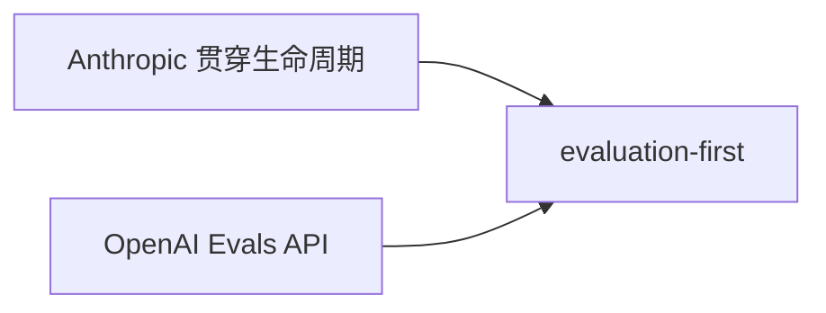

**图 2｜大厂观点与 evaluation-first 重绘**

**【视频原述】** 视频 ① 开场讨论「大厂都在疯狂卷 evaluation 是为什么」，并引用两家公开资料：

- **Anthropic《Demystifying evals for AI agents》**：反复强调 evaluation 应贯穿 Agent 的整个开发生命周期，而不是发布前的一次测试；建议从**少量高质量数据集**开始，随产品演进不断扩充，并把 evaluation 接入持续迭代流程。
- **OpenAI**：从早期做法到现在的 Evals API，都在推动 **evaluation-first** 的开发方式——有评分器、指标、版本对比，而不是零散脚本。

> 共同认知：**Evaluation 要贯穿 Agent 的生命周期**。它与本站《评测驱动 Agent 迭代》「从一次测试变成持续驱动 action 的工程体系」、《Agent 评测方法论》「eval driven development」是同一条结论。

---

**本章语音逐字稿（ASR · 已校正，20 句）**

> `[视频① 00:50]` 这是 Anthropic 的经验
> `[视频① 00:51]` 那 OpenAI 怎么说呢
> `[视频① 00:52]` 无论是从早期的 OpenAI 的 Evals 到现在的 Evals API
> `[视频① 00:57]` 都在推动 evaluation first 的开发方式
> `[视频① 00:59]` 它把数据集评分器指标和版本对比
> `[视频① 01:02]` 纳入了统一的流程
> `[视频① 01:04]` 而不是一个零散的脚本
> `[视频① 01:05]` 他们其实都在强调一个相同的认知
> `[视频① 01:07]` 那就是 evaluation 要贯穿 Agent 的生命周期
> `[视频① 01:11]` 那一整套的 evaluation system 长什么样子呢
> `[视频① 01:14]` 从全局来看
> `[视频① 01:15]` 从用户的真实请求
> `[视频① 01:18]` 到我们去用 trace 收集所有线上的日志
> `[视频① 01:22]` 以及 bad case
> `[视频① 01:23]` 然后进入的是一个数据集的管理
> `[视频① 01:25]` 这个数据集之前也介绍过
> `[视频① 01:26]` 黄金数据集从有合成的有人工的
> `[视频① 01:29]` 有我们真实的线上的 case
> `[视频① 01:32]` 然后进入 Agent 运行时
> `[视频① 01:35]` 包括 memory、tool、workflow 等等

## 3. 一套完整 Evaluation System 的架构全景

**【按画面重绘】** 视频 ① 用一张纵向手绘英文流程图给出全貌，它不是并列的模块清单，而是一条**闭合回路**。按画面自上而下：顶部是 Metrics 容器（Quality / Cost / Latency / Safety / Business KPI），其下依次 Dashboard、Release Decision、Error Analysis；左侧 User Real Request 进入 Trace Collection（Online Logs / Bad Cases），与 Dataset Evolution 一起汇入 Dataset Manager（Synthetic + Human + Real），再经 Agent Runtime（LLM + Memory + Tool + Workflow）、Trajectory Store（Prompt / Tool / Reasoning / Output）到达底部 Evaluation Engine 容器（Rule Judge / LLM Judge / Human Judge）。最关键的是画面右侧那条长回流线：Evaluation Engine 的评分结果一路向上汇总为 Metrics，再驱动发布决策与失败归因，回流数据集后重新评测。下面按画面纵向顺序逐节点重绘，节点文字保留英文原名。

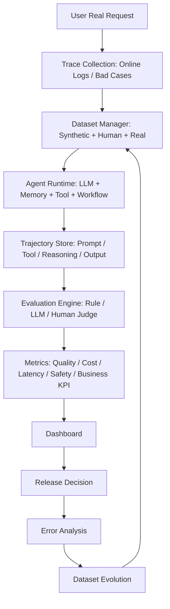

**图 3｜完整 Evaluation System 纵向闭环架构（按画面重绘）**

| 节点（画面原文） | 作用 |
|---|---|
| User Real Request | 真实用户请求，闭环起点 |
| Error Analysis | 对失败做归因，把 Bad Case 送回数据集 |
| Trace Collection: Online Logs / Bad Cases | 收集线上日志与失败案例 |
| Dataset Evolution | 数据集持续演进 |
| Dataset Manager: Synthetic + Human + Real | 合成 / 人工 / 真实三类样本统一管理 |
| Agent Runtime: LLM + Memory + Tool + Workflow | 被评测的 Agent 运行体 |
| Trajectory Store: Prompt / Tool / Reasoning / Output | 保存一次执行的完整轨迹 |
| Evaluation Engine: Rule Judge / LLM Judge / Human Judge | 三类判据组合评分 |
| Metrics: Quality / Cost / Latency / Safety / Business KPI | 评分汇总出的五类指标，驱动看板与发布决策 |
| Dashboard | 看板：管理指标趋势 |
| Release Decision | 这次更新到底要不要发布 |

> 闭环含义：Metrics 不是流程终点，而是**评分结果的汇总视图**——Evaluation Engine 的判分先汇总为五类指标，再驱动 Dashboard 与 Release Decision；发布后的失败经 Error Analysis → Dataset Evolution 回流到 Dataset Manager 重新评测，这才形成闭环。这正是本教程第 6 章「评估数据飞轮」的核心。版式说明：画面里 Metrics 与 Evaluation Engine 两个容器内的子项为纵向排列，此处改为横排以压缩高度，节点与子项文字逐字保留。

---

**本章语音逐字稿（ASR · 已校正，22 句）**

> `[视频① 01:37]` 我们将 Agent 运行时的所有记录
> `[视频① 01:40]` prompt、tool、reasoning、output
> `[视频① 01:42]` 消息、JSON 全部都保存
> `[视频① 01:44]` 进入我们的评估引擎
> `[视频① 01:46]` 评估你选择了什么 Judge
> `[视频① 01:48]` Judge 有三种方式
> `[视频① 01:49]` 有 Rule Judge，就是我们说的程序 Judge
> `[视频① 01:52]` 有大模型 Judge，也有人工审核
> `[视频① 01:56]` 那我们带着我们的指标
> `[视频① 01:57]` 那我们上一篇也介绍了我们的 Metrics
> `[视频① 02:00]` Metrics 可能分成质量层的
> `[视频① 02:02]` Cost latency 的 safety 的
> `[视频① 02:03]` 以及我们最重要的业务的 KPI 对吧
> `[视频① 02:06]` 而且这些指标我们会用 dashboard 去管理
> `[视频① 02:08]` 因为这样会便于我们产品经理去做业务的权衡
> `[视频① 02:12]` 然后进入决策
> `[视频① 02:14]` 就是这个更新
> `[视频① 02:15]` 这一次的更新到底要不要去发布
> `[视频① 02:17]` 然后发布完之后
> `[视频① 02:18]` 我们会做一些错误的分析
> `[视频① 02:20]` 错误的分析又将这些 bad case
> `[视频① 02:23]` 作为我们回归的案例

## 4. 架构分三段：数据侧 / 执行观测侧 / 决策侧

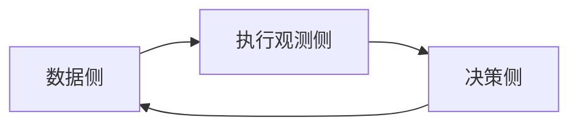

**图 4｜架构三段职责重绘**

**【补充】** 把图 3 的节点按职责归为三段，便于分工落地：数据侧负责「拿什么测」，执行观测侧负责「跑起来并留痕」，决策侧负责「看结果并决定」。

> 关键不是把每一段都做得多复杂，而是**三段必须连成环**：决策产生的失败 Case 要能回到数据侧，否则系统跑一次就僵死。

**【视频原述】** 口播反复强调：「Evaluation 永远不是为了跑分」「不同 Agent 的 evaluation 完全不同」——架构是通用骨架，业务目标（满意率、任务完成率等）决定每一段的具体形态。

---

**本章语音逐字稿（ASR · 已校正，23 句）**

> `[视频① 02:25]` 又放进了我们的 Dataset 里面
> `[视频① 02:27]` 将 Dataset 进行演进
> `[视频① 02:28]` 这就是整个的我们的 evaluation 的一个系统
> `[视频① 02:31]` 包含的组件其实我们前面
> `[视频① 02:33]` 也都各自都已经介绍过了
> `[视频① 02:35]` 包括 Dataset 对吧
> `[视频① 02:37]` 包括你的 Judge LLM Judge
> `[视频① 02:39]` 包括我们的 Metrics
> `[视频① 02:41]` 这就是一个完整的 evaluation system
> `[视频① 02:43]` 那我们产品经理如何从零到一去搭建这一套系统呢
> `[视频① 02:47]` 我们分成五大块
> `[视频① 02:49]` 现在要定业务目标
> `[视频① 02:50]` 我们也说过无论是 Metrics 还是 data set
> `[视频① 02:53]` 还是 Rubric
> `[视频① 02:54]` 其实你都是紧密的和业务目标相关的
> `[视频① 02:57]` 就 evaluation 永远不是为了跑分
> `[视频① 02:59]` 而是为了业务
> `[视频① 03:00]` 不同 Agent evaluation 完全不同
> `[视频① 03:02]` 客服 Agent 最重要的是解决率满意率
> `[视频① 03:05]` coding Agent 最重要的是单元测试通过率等等
> `[视频① 03:08]` 所以第一步永远不是写 prompt
> `[视频① 03:10]` 而是回答一句话
> `[视频① 03:11]` 这个 Agent 最重要的一件事情是什么

## 5. 产品经理如何从 0 到 1 搭：五步落地法

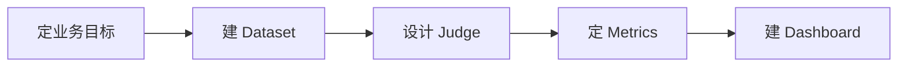

**图 5｜五步落地法重绘**

**【视频原述】** 画面 f_0056 逐字给出五步：

1. **① 定业务目标**：第一步永远不是写 prompt，而是回答「这个 Agent 到底要达成什么业务结果」。
2. **② 建 Dataset**：来源包括上线后真实的 Bad Case；数据集跟产品一起增长。
3. **③ 设计 Judge**：Rule / LLM / Human 组合，其中 LLM Judge 与 Rubric 最复杂。
4. **④ 定 Metrics**：质量、成本、时延、安全、业务 KPI 多个维度。
5. **⑤ 建 Dashboard**：不是输出一个静态数据，而是包含各指标**变化趋势**的看板；关心的是版本之间的比较，不是一次实验的分数。

> 结语定位：「它不是可选的测试工具，它是 AI 时代产品经理的**研发仪表盘**。」

---

**本章语音逐字稿（ASR · 已校正，22 句）**

> `[视频① 03:13]` 第二步我们就是要建立 data set 了
> `[视频① 03:16]` 这个其实我们也已经介绍过
> `[视频① 03:18]` data set 的来源
> `[视频① 03:19]` 从冷启动阶段的合成
> `[视频① 03:21]` 对吧上线之后真实的 Case
> `[视频① 03:22]` 然后持续演化
> `[视频① 03:23]` 把线上的 trace 收集进来
> `[视频① 03:25]` 它跟产品是一起增长的
> `[视频① 03:27]` 第三步就是我们要选择一个 Judge
> `[视频① 03:29]` 能用 Rule Judge 就用 Rule Judge
> `[视频① 03:31]` 如果不行我们就用 LLM Judge
> `[视频① 03:33]` LLM Judge 算是比较复杂的一种 Judge
> `[视频① 03:36]` 因为它牵涉到 Rubric 的制定对吧 Rubric
> `[视频① 03:38]` 我们也知道这个是非常复杂的一件事情
> `[视频① 03:40]` 最后肯定要人工去做校准
> `[视频① 03:43]` 然后就是我们要设计 Metrics
> `[视频① 03:45]` 这个前面也介绍过了
> `[视频① 03:46]` 就是围绕着业务目标
> `[视频① 03:47]` 去拆解它的 outcome behavior safety efficiency
> `[视频① 03:51]` 最后我们一定
> `[视频① 03:52]` 这个 evaluation 系统一定要有个 dashboard 的
> `[视频① 03:56]` 我觉得这个是非常值得再详细的介绍一遍的

## 6. 核心逻辑：构建「评估数据飞轮」

**【视频原述】** 画面 f_0088 的标题是「构建『评估数据飞轮』」，七个节点按画面从上到下的顺序列在下表。

| 顺序 | 节点（画面原文） | 含义 |
|---|---|---|
| 0 | Online User | 真实用户产生请求与失败 |
| 1 | Bad Case Analysis | 失败归因 |
| 2 | Dataset Construction | 把失败构造成评测样本 |
| 3 | Evaluation Engine | 用引擎跑评测 |
| 4 | Metrics Dashboard | 指标与趋势可见 |
| 5 | Prompt / Tools / Models | 据结果改提示词、工具或模型 |
| 6 | Redeploy System | 重新发布，回到线上 |

**【补充】** 这七个节点描述的是**同一条闭环**，只是镜头对准「据指标改动 → 重新发布 → 再回到线上」这一段：Online User 与 Bad Case Analysis 对应图 3 的 User Real Request / Trace Collection / Error Analysis，Dataset Construction 对应 Dataset Evolution → Dataset Manager，Evaluation Engine 与 Metrics Dashboard 对应图 3 的 Evaluation Engine → Metrics → Dashboard，Prompt / Tools / Models 与 Redeploy System 是发布后回到线上的改动动作。因此本章不再单独配图，读者可沿图 3 的完整闭环（含 Agent Runtime、Trajectory Store）对照。

**【视频原述】** 口播点题：「不是为了拿一个分，而是为了构建数据飞轮」；黄金数据集会越来越多、失败率越来越低，翻车过的题都要加入**回归数据集**。

---

**本章语音逐字稿（ASR · 已校正，29 句）**

> `[视频① 03:59]` 因为很多团队做到这里可能就停了
> `[视频① 04:01]` evaluation
> `[视频① 04:02]` 但是 evaluation 不应该输出一个静态的数据
> `[视频① 04:04]` 一个 Excel
> `[视频① 04:06]` 应该是一个趋势图
> `[视频① 04:07]` 所以一定是一个看板
> `[视频① 04:08]` 看板里包含了各种指标的一个变化趋势
> `[视频① 04:11]` 对吧
> `[视频① 04:12]` 因为我们真正关心的肯定是
> `[视频① 04:14]` 版本之间到底变好了还是变坏了
> `[视频① 04:16]` 而不是一次实验
> `[视频① 04:17]` 它是一个连续的体验
> `[视频① 04:18]` 所以这个也是很重要的
> `[视频① 04:19]` 我们做这个评估系统
> `[视频① 04:21]` 不是为了拿一个分
> `[视频① 04:22]` 而是为了构建数据飞轮
> `[视频① 04:25]` 所以非常重要的一点
> `[视频① 04:26]` 就是我们要收集线上用户的 bad case
> `[视频① 04:29]` 进行详细的分析
> `[视频① 04:31]` 将这个 bad case
> `[视频① 04:32]` 首先要加到我们的回归数据集中
> `[视频① 04:34]` 然后用 Agent 去进行评估
> `[视频① 04:36]` 然后去优化
> `[视频① 04:37]` 然后重新发布
> `[视频① 04:38]` 我们要确保这个回归数据
> `[视频① 04:39]` 肯定是伴随着线上 Agent 的成长
> `[视频① 04:42]` 这个 Dataset 应该是越来越大的
> `[视频① 04:44]` 而且 Agent 的翻车的概率可能是越来越低的
> `[视频① 04:46]` 因为我们每一个 bad case

## 7. 踩坑实录：四条经验

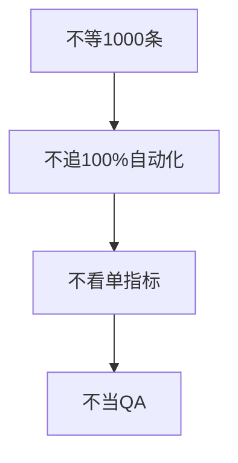

**图 6｜四条踩坑经验重绘**

| # | 画面原文 | 口播补充 |
|---|---|---|
| 1 | 不要等 1000 条数据再开始 | 少量高质量样本就能跑通评测小闭环 |
| 2 | 不要追求 100% 的自动化 | 开始肯定手动，随系统成长再逐步自动化 |
| 3 | 不要只看单个指标 | 多维度指标，避免单指标优化 |
| 4 | 不要把 Evaluation 当 QA | 它要不断演进，是研发仪表盘 |

> 这四条与本站《Agent 评测指标系统》《评测驱动 Agent 迭代》里的「20–50 条起步、主指标 + 护栏、能力集毕业成回归集」逐条呼应。

---

**本章语音逐字稿（ASR · 已校正，24 句）**

> `[视频① 04:48]` 都要加入我们的回归数据集中
> `[视频① 04:49]` 也就是我们的黄金测试集中
> `[视频① 04:51]` 这就构建起了一个评估的数据飞轮
> `[视频① 04:53]` 那再介绍一些踩坑的记录
> `[视频① 04:55]` 就是我觉得第一点就是
> `[视频① 04:59]` 不要等一千条
> `[视频① 05:00]` 我们之前也介绍过
> `[视频① 05:01]` 就二十到五十条数据
> `[视频① 05:03]` 就可以完全去跑一个评测的小闭环了
> `[视频① 05:05]` 不要追求100%的自动化
> `[视频① 05:06]` 一开始上来肯定是手动的
> `[视频① 05:08]` 然后最后随着 Agent 的成长
> `[视频① 05:11]` 慢慢的成长
> `[视频① 05:11]` 我们才会把它加到 CI/CD
> `[视频① 05:13]` 持续集成的系统自动化
> `[视频① 05:15]` 再去追求自动化
> `[视频① 05:16]` 然后一定不要只看单个指标
> `[视频① 05:18]` 这个前面其实在 Metrics 里面也介绍了
> `[视频① 05:20]` 一个 Agent 的好坏肯定是多个维度的指标的
> `[视频① 05:23]` 然后不要把 Evaluation 当成 QA
> `[视频① 05:26]` Evaluation 本身也是要不断演进的
> `[视频① 05:28]` 总之吧
> `[视频① 05:29]` Agent 的 Evaluation 系统不是一个可选的测试工具
> `[视频① 05:32]` 它是 AI 时代产品经理的研发仪表盘

## 8. 两层框架：任务集 × 运行评分


**图 7｜两层框架分工重绘**

**【视频原述】** 视频 ② 开场说明：上一期「从 0 到 1 搭建 Agent 评测」框架已有超过 **1300 次收藏**，被问最多的是「框架看懂了，每一步具体怎么做」，于是用三期拆解；第一期先搭**评测体系的第一层：任务集**，第二期搭**运行与评分**。

**【视频原述】** 两套方法都基于 Anthropic 官方评测文档，③ 还参考 OpenAI Evals API 与 Graders 文档。画面 f_0011 列出三份权威来源：

| # | 机构 | 文档 | 状态 |
|---|---|---|---|
| 1 | Anthropic | Demystifying evals for AI agents | 2026-01-09 |
| 2 | Anthropic | Define success criteria and build evaluations | 持续更新 |
| 3 | OpenAI | Evals API Reference | 持续更新 |

---

**本章语音逐字稿（ASR · 已校正，23 句）**

> `[视频② 00:00]` 如何建立第一批 AI Agent 的评测任务
> `[视频② 00:02]` 上一期我们讲了
> `[视频② 00:03]` 如何从0-1搭建 AI Agent 的评测
> `[视频② 00:06]` 那套框架已经有超过1300次的收藏
> `[视频② 00:09]` 私信里被问的最多的问题就是
> `[视频② 00:11]` 框架看懂了
> `[视频② 00:12]` 但是真正落到项目里面
> `[视频② 00:13]` 每一步具体应该怎么做呢
> `[视频② 00:15]` 所以接下来我打算用三期的内容
> `[视频② 00:17]` 把整套搭建过程逐步拆开
> `[视频② 00:19]` 第一期我们先搭评测体系的第一层任务集
> `[视频② 00:23]` 从真实问题中提取任务
> `[视频② 00:25]` 把任务写到可以稳定判断
> `[视频② 00:27]` 再补齐应该发生和不应该发生的对照测试
> `[视频② 00:30]` 这套方法
> `[视频② 00:31]` 基于 Anthropic 在2026年1月发布的 AI Agent 的评测方法
> `[视频② 00:35]` 同时对照了截止2026年8月
> `[视频② 00:37]` Anthropic 和 OpenAI 仍在更新的官方评测文档
> `[视频② 00:41]` 第一步先建立一批真实的任务
> `[视频② 00:44]` 刚开始做 Eval
> `[视频② 00:45]` 不需要先准备几百条的任务
> `[视频② 00:47]` Anthropic 给出的建议是
> `[视频② 00:49]` 早期从20-50条真实任务开始

## 9. 第一层三步：真实任务 → 稳定判断 → 正反平衡


**图 8｜第一层导航五段与三步重绘**

**【视频原述】** 视频 ② 顶部导航条共五段，逐字为「**框架与方法 / 真实任务集 / 写清 Task / 正反平衡 / 三步收束**」；其中中间三段是本片主体，收束为：

1. **建立第一批真实任务**：从真实任务与真实失败出发，20–50 条即可建第一条评测基线。
2. **把 Task 写到可以稳定判断**：每条任务有明确输入与成功标准，约束前置。
3. **同时设计正向和反向任务**：不只检查「该做时能不能做」，也检查「不该做时能不能克制」。

> 「第一批 Agent Eval，不是收集一批 Prompt 再给输出打分」——这句话是两层框架的分水岭。

---

**本章语音逐字稿（ASR · 已校正，20 句）**

> `[视频② 00:52]` 就足够建立第一条评测基线
> `[视频② 00:54]` 第一批种子任务
> `[视频② 00:55]` 应该优先来自真实任务和真实失败
> `[视频② 00:58]` 模型更适合在真实种子的基础上扩充变体
> `[视频② 01:02]` 而不是代替真实任务来源
> `[视频② 01:04]` 更可靠的做法是先从团队已经拥有的材料中提取
> `[视频② 01:08]` 开发过程中原本需要人工检查的任务
> `[视频② 01:11]` 用户最常执行的典型任务
> `[视频② 01:13]` 已经发生过的 bug
> `[视频② 01:14]` 以及用户反馈和支持工单里的真实失败
> `[视频② 01:17]` 比如用户问 Agent
> `[视频② 01:19]` 今天上海天气怎么样
> `[视频② 01:21]` Agent 没有调用搜索工具
> `[视频② 01:22]` 而是直接根据模型已有的知识生成了一个答案
> `[视频② 01:26]` 如果这来自一条真实用户反馈
> `[视频② 01:28]` 它就可以被转化成一个 bad case
> `[视频② 01:30]` 用户需要实时信息
> `[视频② 01:32]` 但是 Agent 没有搜索
> `[视频② 01:33]` 我们可以把它先放到初始任务清单
> `[视频② 01:36]` Anthropic 当前的评测文档也强调

## 10. 第一步：建立第一批真实任务


**图 9｜第一批真实任务重绘**

**【视频原述】** 口播：「不需要先准备几百条任务，早期从 **20 到 50 条真实任务**开始，就足够建立第一条评测基线」。

**【视频原述】** **第一批种子任务优先来自真实任务和真实失败**：团队已有材料里「开发过程中原本需要人工检查的任务」「已经发生过 Bug」「用户反馈和支持工单里的真实失败」。模型更适合在真实种子基础上扩充表达变体，而不是凭空造题；按任务对用户结果影响程度排序，选出前 20–50 条。

**【视频原述】** **示例 Badcase**：「今天上海天气怎么样？」Agent 没有调用搜索工具，而是直接根据模型已有知识生成答案 → 转化为一条「用户需要实时信息，但 Agent 没有搜索」的任务，先放进初始任务清单。

> 产物是一份来自真实使用场景的初始任务清单 + 可重复比较的评测基线；它不需要一次覆盖所有问题。新增任务仍需人工检查，不能直接进入评测集。

---

**本章语音逐字稿（ASR · 已校正，22 句）**

> `[视频② 01:39]` 评测任务应该尽量贴近真实使用分布
> `[视频② 01:42]` 同时覆盖必要的边界情况
> `[视频② 01:44]` 收集以后
> `[视频② 01:45]` 按照任务对用户结果的影响程度进行排序
> `[视频② 01:49]` 从中选出第一批20-50条
> `[视频② 01:51]` 这一步的产物是一份来自
> `[视频② 01:53]` 真实使用场景的初始任务清单
> `[视频② 01:56]` 它不需要一次覆盖所有的问题
> `[视频② 01:58]` 阶段的目标是先建立一条可以运行
> `[视频② 02:01]` 可以重复比较的评测基线
> `[视频② 02:03]` 等真实种子任务确定以后
> `[视频② 02:05]` 可以再用模型扩充表达变体和边界案例
> `[视频② 02:09]` 但是新增任务仍然需要人工检查
> `[视频② 02:11]` 不能直接进入到评测集
> `[视频② 02:13]` 第二步
> `[视频② 02:14]` 把 task 写到可以稳定判断
> `[视频② 02:16]` 收集到真实案例
> `[视频② 02:17]` 不代表它已经是一条合格的 Eval Task
> `[视频② 02:20]` 比如说刚刚这条天气任务
> `[视频② 02:22]` 如果我们只写回答用户今天的天气
> `[视频② 02:25]` 仍然无法稳定的评测
> `[视频② 02:27]` Anthropic 对 task 的基本定义是

## 11. 第二步：把 Task 写到可以稳定判断

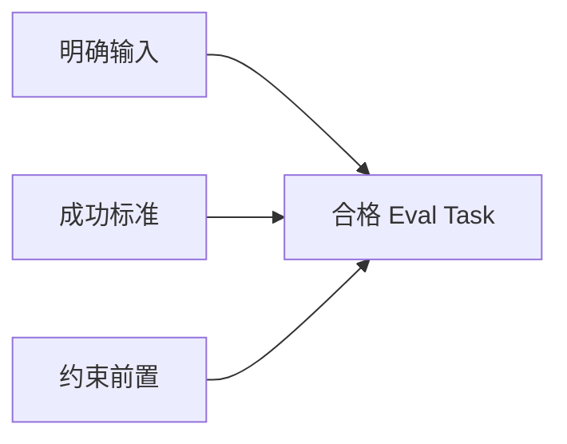

**图 10｜Eval Task 三要素重绘**

**【视频原述】** 「有一条真实任务，不代表它已经是一条合格 Eval Task」。Anthropic 对 Task 的基本定义是：**一项具有明确输入和成功标准的独立测试**。

**【视频原述】** 以天气任务为例，需要写清：

- **输入**：用户询问今天上海的天气。
- **成功标准**：Agent 调用搜索工具，并依据工具返回的当前信息回答；不能用模型记忆中的天气信息。
- **约束前置**：要求必须提前出现在任务说明里，不能在 Task 里只要求「回答今天天气」，却在评分时额外检查任务说明从未要求过的固定格式。

> Anthropic 文档还强调：评测任务应尽量贴近真实使用分布、同时覆盖必要边界情况。

---

**本章语音逐字稿（ASR · 已校正，24 句）**

> `[视频② 02:29]` 一项具有明确输入和成功标准的独立测试
> `[视频② 02:33]` 因此我们需要继续写清楚
> `[视频② 02:35]` 输入是用户询问今天上海的天气
> `[视频② 02:37]` Agent 可以调用天气查询工具
> `[视频② 02:40]` 成功的标准是 Agent 调用工具
> `[视频② 02:42]` 并依据工具返回的当前信息回答
> `[视频② 02:45]` 不能把模型记忆中的天气信息
> `[视频② 02:47]` 当成实时结果
> `[视频② 02:48]` 到这里这条 task
> `[视频② 02:50]` 才同时拥有了明确输入和成功标准
> `[视频② 02:53]` 更重要的是
> `[视频② 02:53]` Grader 准备检查的内容
> `[视频② 02:55]` 必须提前出现在任务说明里
> `[视频② 02:57]` 不能在 task 里只要求回答今天的天气
> `[视频② 03:00]` 却在评分的时候
> `[视频② 03:02]` 额外的去检查任务说明里
> `[视频② 03:03]` 从未要求的固定格式
> `[视频② 03:05]` 信息字段或执行条件
> `[视频② 03:07]` 写完以后用两个方法来检查
> `[视频② 03:09]` 第一个用专家一致性反查 task
> `[视频② 03:12]` 让两名了解业务的人
> `[视频② 03:13]` 独立去阅读这条 task
> `[视频② 03:15]` 如果两个人对什么算通过
> `[视频② 03:17]` 什么算失败仍然意见不同

## 12. 两个检查方法：把「写清楚了」变成可验证

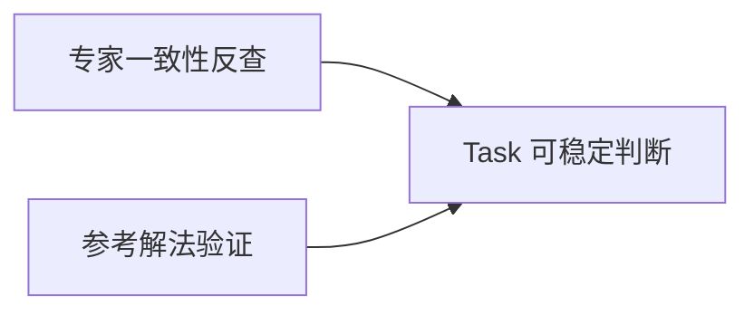

**图 11｜两个检查方法重绘**

| 方法 | 做法 | 判定 |
|---|---|---|
| 专家一致性反查 | 让两名了解业务的人独立阅读这条 Task | 若两人对「什么算通过」判断不一致，说明 Task 不够明确 |
| 参考解法验证 | 为 Task 准备一份已知能通过所有 Grader 的参考结果 | 证明任务确实可完成、任务说明与 Grader 可执行；不是要求 Agent 复刻唯一路径 |

**【视频原述】** 口播补充一个诊断规则：**如果前沿模型尝试很多次仍一次都无法通过，先怀疑 Task 和 Grader 是否有问题，而不是马上认定模型没有能力**。

> 落地形态：为每条测试数据定义**结构化字段**，再让 Grader 调用这些字段执行测试标准（③ 会进一步用到）。

---

**本章语音逐字稿（ASR · 已校正，24 句）**

> `[视频② 03:19]` 说明 task 还不够明确
> `[视频② 03:21]` 第二个用参考解法验证 task 和 Grader
> `[视频② 03:24]` 为 task 准备一份
> `[视频② 03:26]` 已知能够通过所有 Grader 的参考结果
> `[视频② 03:28]` 参考解法不是为了要求
> `[视频② 03:30]` Agent 复刻唯一的执行路径
> `[视频② 03:32]` 它只证明两件事
> `[视频② 03:34]` 第一这项任务确实是可以完成
> `[视频② 03:36]` 二当前的任务说明和 Grader
> `[视频② 03:38]` 能够正常工作
> `[视频② 03:40]` Anthropic 还给出一个很实用的
> `[视频② 03:42]` 反查信号
> `[视频② 03:42]` 如果前沿模型尝试
> `[视频② 03:44]` 很多次仍然一次都无法通过
> `[视频② 03:47]` 那么我们应该先检查 task 和 Grader
> `[视频② 03:49]` 是否有问题
> `[视频② 03:50]` 而不是马上认定模型没有能力
> `[视频② 03:52]` 在 OpenAI Evals API 里面
> `[视频② 03:54]` 这一步会进一步落实为
> `[视频② 03:56]` 为每条测试数据定义结构化变量
> `[视频② 03:59]` 再让 Grader 调用这些变量执行测试标准
> `[视频② 04:02]` 第三步，同时设计正向和反向任务
> `[视频② 04:05]` 很多评测集只验证 Agent
> `[视频② 04:06]` 该做一件事时能不能完成

## 13. 第三步：同时设计正向和反向任务

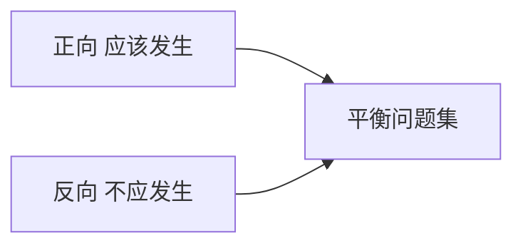

**图 12｜正反平衡重绘**

**【视频原述】** 正向任务只验证「Agent 该做一件事时能不能完成」；但 Agent 不仅要在条件成立时触发行为，也要在条件不成立时保持克制。若评测集里全是正向任务，「最后可能优化出一个遇到任何问题都先搜」的 Agent。

| 类型 | 示例 | 检查什么 |
|---|---|---|
| 正向 | 今天上海天气怎么样？（应调用实时搜索） | 行为不足 |
| 反向 | 水在标准大气压下的沸点是多少？（不需要实时搜索） | 行为过度 |

> 这种设计叫**平衡问题集**：不要求正反数量完全相等，关键是「不能只评测行为的一侧」，且整体分布尽量接近真实使用；还要加入最容易混淆的边界任务。

---

**本章语音逐字稿（ASR · 已校正，20 句）**

> `[视频② 04:09]` 但是 Agent 不仅要在条件成立时触发行为
> `[视频② 04:12]` 也要在条件不成立的时候保持克制
> `[视频② 04:15]` 刚才的天气任务只验证了 Agent
> `[视频② 04:17]` 在该搜索的时候能不能搜索
> `[视频② 04:19]` 如果评测集里面全是这种任务
> `[视频② 04:21]` 最后可能优化出一个遇到任何问题
> `[视频② 04:23]` 都要先搜索的 Agent
> `[视频② 04:25]` 所以还要补一条反向任务
> `[视频② 04:27]` 水在标准大气压下的沸点是多少
> `[视频② 04:29]` 这是一条稳定事实
> `[视频② 04:31]` Agent 不需要调用实时搜索工具
> `[视频② 04:33]` Anthropic 在建立搜索能力评测时
> `[视频② 04:37]` 也采用了这种同时覆盖两个方向的方法
> `[视频② 04:40]` 这样检查的才不只是 Agent 的
> `[视频② 04:42]` 会不会调用搜索工具
> `[视频② 04:43]` 还包括它能不能判断什么时候不需要调用
> `[视频② 04:46]` 这种设计通常被称为平衡问题集
> `[视频② 04:49]` 这里的平衡不一定要求正反任务数量完全相等
> `[视频② 04:53]` 关键是不能只评测行为的一侧
> `[视频② 04:55]` 并且整体分布要尽量接近真实使用情况

## 14. 三步收束：第一层的三个产物


**图 13｜第一层产物重绘**

| 产物 | 内容 | 验收 |
|---|---|---|
| 初始任务清单 | 真实场景、20–50 条、按影响排序 | 可重复比较的基线 |
| 结构化 Task | 输入 / 成功标准 / 约束前置 | 专家一致 + 参考解法通过 |
| 平衡问题集 | 正向 + 反向 + 边界 | 覆盖行为两侧、贴近真实分布 |

> 做到这三步，才真正拥有了一批可以评测 Agent 的任务；下一期搭「运行与评分」。

---

**本章语音逐字稿（ASR · 已校正，25 句）**

> `[视频② 04:58]` 设计的时候可以先确定
> `[视频② 05:00]` 这组任务要检查的目标行为
> `[视频② 05:02]` 然后同时加入行为应该发生的任务
> `[视频② 05:05]` 行为不应该发生的任务
> `[视频② 05:06]` 以及最容易混淆的边界任务
> `[视频② 05:08]` 这里还要补充一个边界
> `[视频② 05:10]` 这组 Eval 检查的目标
> `[视频② 05:11]` 本来就是 Agent 的搜索决策
> `[视频② 05:14]` 所以是否调用搜索工具
> `[视频② 05:15]` 可以成为成功的标准
> `[视频② 05:17]` 如果说评测目标
> `[视频② 05:18]` 只是最终答案是否正确
> `[视频② 05:20]` 就不应该强行规定 Agent
> `[视频② 05:22]` 必须采用同一条执行路径
> `[视频② 05:24]` 所以第一批 Agent 的 Eval
> `[视频② 05:25]` 不是收集一批 Prompt
> `[视频② 05:27]` 再给输出打分
> `[视频② 05:28]` 真正要完成的是三件事
> `[视频② 05:30]` 从真实失败和真实任务中建立测试集
> `[视频② 05:33]` 把每条 Task 写到输入和成功标准足够明确
> `[视频② 05:36]` 再用平衡问题集
> `[视频② 05:38]` 同时检查行为不足和行为过度
> `[视频② 05:40]` 做到这三步以后
> `[视频② 05:41]` 你才真正拥有了一批可以评测 Agent 的任务
> `[视频② 05:44]` 下一期我们继续搭建运行和评分部分

## 15. 第二层五步：让评分可解释、可复查

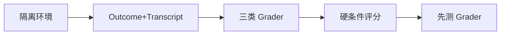

**图 14｜第二层导航六段与五步重绘**

**【视频原述】** 视频 ③ 开场追问：「同一个 Agent 跑同一批评测任务，分数波动到底是 Agent 能力变了，还是运行环境和评分方法？」第二期解决「怎么运行、怎么判分」，对应 Anthropic《Demystifying evals for AI agents》与 OpenAI Evals API / Graders 文档。

**【视频原述】** 视频 ③ 顶部导航条共六段，逐字为「**隔离运行环境 / 问题与方法 / Outcome 与轨迹 / 三类 Grader / 硬条件与评分 / 校准与收束**」；本片主体归纳为下面五步，步骤名较导航略有简化，含义一一对应。

| # | 步骤 | 解决什么 |
|---|---|---|
| 1 | 隔离运行环境 | 让每次 Trial 从可比条件开始 |
| 2 | Outcome 与 Transcript | 同时保留终态与轨迹 |
| 3 | 三类 Grader | 确定性交给代码、语义交给模型、边界交给人 |
| 4 | 硬条件与评分 | 别让一个总分掩盖关键失败 |
| 5 | 先测 Grader 再测 Agent | 判据本身也要验证 |

---

**本章语音逐字稿（ASR · 已校正，36 句）**

> `[视频③ 00:00]` 如何搭建 Agent 评测的运行与评分系统
> `[视频③ 00:03]` 同一个 Agent 跑同一批评测任务
> `[视频③ 00:05]` 分数为什么会忽高忽低
> `[视频③ 00:07]` 到底是 Agent 能力发生了变化
> `[视频③ 00:09]` 还是运行环境和评分方法
> `[视频③ 00:11]` 正在制造额外的噪声
> `[视频③ 00:13]` 这是从0到1搭建 Agent 评测系列的第二期
> `[视频③ 00:17]` 上一期我们建立了第一批评测任务
> `[视频③ 00:19]` 解决了测什么
> `[视频③ 00:20]` 那这一期我们要继续搭建运行和评分系统
> `[视频③ 00:23]` 解决怎么运行怎么判分
> `[视频③ 00:25]` 才能让结果更可信
> `[视频③ 00:28]` 我们会从隔离环境
> `[视频③ 00:29]` Outcome 和 transcript
> `[视频③ 00:30]` 以及三类 Grader 入手
> `[视频③ 00:32]` 搭出一套可以重复运行
> `[视频③ 00:34]` 可以解释也可以复查的评分系统
> `[视频③ 00:36]` 这套方法对应
> `[视频③ 00:37]` Anthropic《Demystifying evals for AI agents》
> `[视频③ 00:40]` 从0到1路线里的第四步和第五步
> `[视频③ 00:43]` 同时参考了 OpenAI 当前的
> `[视频③ 00:45]` Evals API 和 Graders 文档
> `[视频③ 00:47]` 第一步
> `[视频③ 00:48]` 让每一次的 Trial 从可比的环境开始
> `[视频③ 00:51]` 上一期我们把今天上海天气怎么样
> `[视频③ 00:53]` 写成了一条评测的任务
> `[视频③ 00:54]` 现在准备让 Agent 运行它
> `[视频③ 00:57]` 如果每次的评测
> `[视频③ 00:58]` 都直接调用真实的天气接口
> `[视频③ 01:00]` 第一次返回晴天
> `[视频③ 01:01]` 第二次返回阵雨
> `[视频③ 01:02]` 第三次又遇到接口超时
> `[视频③ 01:04]` 那么三次 trial 面对的
> `[视频③ 01:06]` 已经不是同一项条件
> `[视频③ 01:07]` 分数的变化可能来自 Agent
> `[视频③ 01:09]` 也可能来自外部数据和工具故障

## 16. 第一步：让每次 Trial 从可比环境开始


**图 15｜隔离运行环境重绘**

**【视频原述】** 口播反例：如果每次评测都直接调用真实天气接口——第一次返回晴天、第二次阵雨、第三次接口超时——**三次 Trial 面对的已经不是同一项条件**，分数变化可能来自外部数据与工具故障，而不是 Agent 能力。

- 为天气工具准备一份**固定测试快照**，让每次调用都返回同一份已知数据。
- 每次 Trial 开始前**重置对话、任务状态和工具环境**，避免上一次的文件或数据影响下一次。
- 固定本次评测使用的**模型版本、Agent 配置、工具定义和任务数据版本**并留下记录。
- 工具超时、环境启动失败等**基础设施错误单独记录**，标记「无效运行」并重试，不能直接算成 Agent 任务失败。

> 隔离环境**不会消除模型本身的非确定性**，它的作用是排除与 Agent 能力无关的干扰，让不同 Trial 尽可能在可比条件下运行。

---

**本章语音逐字稿（ASR · 已校正，40 句）**

> `[视频③ 01:12]` 这两类的原因混在一起
> `[视频③ 01:13]` 测评的结果就无法解释
> `[视频③ 01:15]` 所以在 Eval 里可以为天气工具
> `[视频③ 01:17]` 准备一份固定的测试快照
> `[视频③ 01:19]` 每次输入相同的城市和日期
> `[视频③ 01:22]` 工具都返回同一份已知数据
> `[视频③ 01:24]` 每次 Trial开始前
> `[视频③ 01:25]` 还要重置对话
> `[视频③ 01:27]` 任务状态和工具环境
> `[视频③ 01:29]` 避免上一次运行留下的消息
> `[视频③ 01:31]` 文件或者是数据
> `[视频③ 01:32]` 影响到下一次的结果
> `[视频③ 01:33]` 同时固定这次评测使用的模型版本
> `[视频③ 01:36]` Agent 的配置
> `[视频③ 01:37]` 工具定义和任务数据版本
> `[视频③ 01:39]` 工具超时时
> `[视频③ 01:40]` 环境启动失败等基础设施
> `[视频③ 01:42]` 错误也要单独记录
> `[视频③ 01:44]` 这类的 trial 应该标记为
> `[视频③ 01:46]` 无效运行并重试
> `[视频③ 01:47]` 不能直接算成 Agent 的任务失败
> `[视频③ 01:49]` 如果这些条件没有留下记录
> `[视频③ 01:51]` 分数变了以后
> `[视频③ 01:52]` 你无法知道系统到底改过什么
> `[视频③ 01:55]` 隔离环境不会消除模型本身的非确定性
> `[视频③ 01:58]` 它的作用是排除与 Agent 的能力
> `[视频③ 02:00]` 无关的干扰
> `[视频③ 02:01]` 让不同的 trial
> `[视频③ 02:01]` 尽可能的在可比的条件下运行
> `[视频③ 02:04]` 这一步的产物是一个可以重置
> `[视频③ 02:07]` 记录版本并且区分 Agent 的失败
> `[视频③ 02:09]` 和环境失败的运行条件
> `[视频③ 02:11]` 第二步
> `[视频③ 02:11]` 同时保留 Outcome 和 Transcript
> `[视频③ 02:14]` 环境准备好以后
> `[视频③ 02:15]` Eval Harness 才能启动一次 trial
> `[视频③ 02:17]` 这次运行至少要留下两类记录
> `[视频③ 02:19]` 第一类 Outcome
> `[视频③ 02:20]` 它记录任务结束时真正产生的结果
> `[视频③ 02:23]` 天气查询是一项只读任务

## 17. 第二步：同时保留 Outcome 与 Transcript

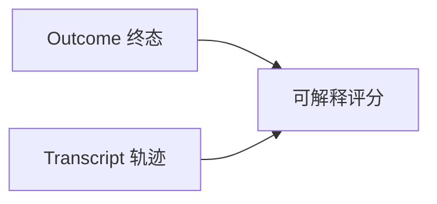

**图 16｜Outcome 与 Transcript 重绘**

| 记录 | 定义 | 用途 |
|---|---|---|
| Outcome | 任务结束时真正产生的结果（天气任务＝最后返回的天气信息；写文件/数据库任务还要检查外部状态） | 判断任务最后是否完成 |
| Transcript（Trace / Trajectory） | 模型输出、工具调用、工具返回、中间消息、状态变化，可附轮数 | 解释为什么成功、失败发生在哪一步；用于诊断、效率、安全与 Task 明确要求的关键行为 |

**【视频原述】** **关键判断**：如果这条 Task 评测的是「实时搜索决策」，Agent 结果只是碰巧正确也不能通过；如果 Task 只测最终结果是否正确，就不应因 Agent 没走某条预设路径而扣分——**取决于 Task 一开始定义的成功标准**。

> 这正是本站《Agent 评测体系》「Outcome / Trace 分层」与《评测驱动迭代》「主指标 + 护栏 + 跳过」的运行层实现。

---

**本章语音逐字稿（ASR · 已校正，31 句）**

> `[视频③ 02:25]` 它的 Outcome 是 Agent 最后返回的天气信息
> `[视频③ 02:28]` 这份结果是否与工具数据一致
> `[视频③ 02:30]` 后面再交给 Grader 判断
> `[视频③ 02:32]` 如果 Agent 会写入文件数据库或者其他系统
> `[视频③ 02:35]` Outcome 还要检查任务结束后的外部状态
> `[视频③ 02:38]` 第二类是 transcript
> `[视频③ 02:40]` 也叫 trace 或者是 Trajectory
> `[视频③ 02:42]` 它保留 Agent 在这次 trial 中的完整可观测的轨迹
> `[视频③ 02:46]` 包括模型输出
> `[视频③ 02:47]` 工具调用
> `[视频③ 02:48]` 工具返回
> `[视频③ 02:49]` 中间消息和状态变化
> `[视频③ 02:50]` 如果系统可以记录还可以附带轮数
> `[视频③ 02:53]` token 延迟和错误类型
> `[视频③ 02:55]` Outcome 用来判断任务最后是否完成
> `[视频③ 02:58]` transcript 用来解释它为什么成功
> `[视频③ 03:00]` 或者是失败发生在哪一步
> `[视频③ 03:02]` 比如 Agent 最后给出了正确天气
> `[视频③ 03:04]` 但是 transcript 显示它没有调用工具
> `[视频③ 03:07]` 如果这条 task 评测的
> `[视频③ 03:08]` 是实时的搜索决策
> `[视频③ 03:10]` 那么这次的 trial 就不能通过
> `[视频③ 03:12]` 因为它的结果只是碰巧正确
> `[视频③ 03:14]` 没有使用 task 要求的实时信息
> `[视频③ 03:16]` 但如果 task 只评测最终结果是否正确
> `[视频③ 03:19]` 就不应该因为 Agent 没有走某条预设的路径而扣分
> `[视频③ 03:23]` 所以是否检查 transcript 取决于 task 一开始定义的成功标准
> `[视频③ 03:27]` Outcome 优先验证完成结果
> `[视频③ 03:29]` transcript 主要负责诊断效率安全
> `[视频③ 03:32]` 以及 task 已经明确要求的关键行为
> `[视频③ 03:35]` 第三步让三类 Grader 分工

## 18. 第三步：三类 Grader 分工

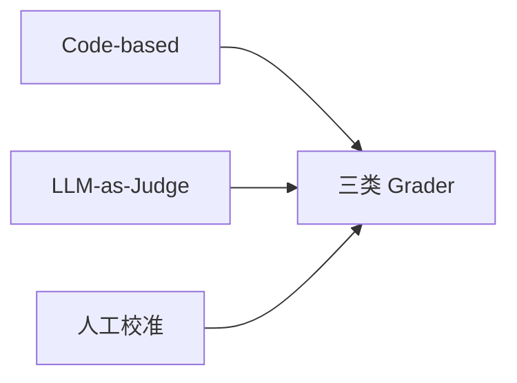

**图 17｜三类 Grader 重绘**

| Grader | 适用 | 要点 |
|---|---|---|
| Code-based | 成功条件可被程序精确验证 | 检查是否调用天气工具、参数是否正确、回答是否与工具返回一致；稳定可重复，但不适合开放性表达质量。工具形态：字符串检查 / Python Grader / Multi Grader，结构化变量传入 |
| LLM-as-Judge | 开放性表达质量、证据一致性 | Rubric 不能只写「评价回答质量」，要把正确性、证据一致性、表达质量分开逐维给可判断标准；允许返回 Unknown 避免强猜 |
| 人工评分 | 校准，不需覆盖每次 Trial | 准备专家已确认样本，定期检查 LLM Grader；若模型与人工持续分歧，先修 Rubric、证据输入或分类边界，不要直接扩大自动评分规模 |

> **能够确定性验证的条件先交给代码，需要理解语义和质量的部分再交给模型，最后用少量人工样本持续校准模型评分。**

---

**本章语音逐字稿（ASR · 已校正，32 句）**

> `[视频③ 03:37]` 有了 Outcome 和 transcript 下一步才是判分
> `[视频③ 03:40]` 第一类是 code_grader
> `[视频③ 03:41]` 只要成功条件可以被程序精确的验证
> `[视频③ 03:44]` 就应该优先使用它
> `[视频③ 03:45]` 天气任务可以检查三件事
> `[视频③ 03:47]` Agent 是否调用了天气工具
> `[视频③ 03:49]` 城市和日期参数是否正确
> `[视频③ 03:52]` 最终回答里的温度和天气状态
> `[视频③ 03:54]` 是否与工具返回的一致
> `[视频③ 03:55]` 这一类的检查比较快便宜
> `[视频③ 03:57]` 而且可以重复
> `[视频③ 03:58]` 但是不适合评价开放性的表达质量
> `[视频③ 04:01]` 第二类是 model-based Grader
> `[视频③ 04:03]` 也就是我们常说的 LLM-as-Judge
> `[视频③ 04:06]` 它可以评价回答是否清楚
> `[视频③ 04:08]` 是否正确使用了工具证据
> `[视频③ 04:10]` 以及有没有添加工具结果无法支持的结论
> `[视频③ 04:13]` 它的 Rubric 不能只写评价回答质量
> `[视频③ 04:16]` 应该把正确性证据一致性和表达质量分开
> `[视频③ 04:21]` 每一个维度分别给出可判断的标准
> `[视频③ 04:23]` 当证据不足的时候
> `[视频③ 04:24]` 还应该允许 Grader 返回 Unknown
> `[视频③ 04:26]` 避免它强猜一个分数
> `[视频③ 04:28]` 第三类是 Human Grader 的
> `[视频③ 04:30]` 人工评分其实不需要覆盖每一次的 trial
> `[视频③ 04:32]` 它最重要的作用是准备一批专家已经确认的样本
> `[视频③ 04:36]` 定期的去检查 LLM Grader 的判断
> `[视频③ 04:38]` 是否仍然和专家一致
> `[视频③ 04:40]` 如果模型判断和人工判断持续分歧
> `[视频③ 04:43]` 应该先修正 Rubric
> `[视频③ 04:45]` 证据输入或者是分类的边界
> `[视频③ 04:47]` 不要直接去扩大自动评分的规模

## 19. 第四、五步：硬条件评分与 Grader 自测

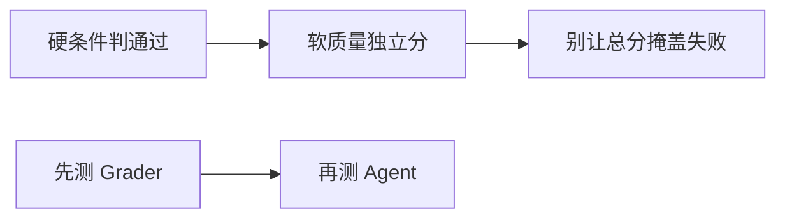

**图 18｜硬条件评分与 Grader 自测重绘**

### 19.1 别让一个总分掩盖关键失败

**【视频原述】** 天气任务可拆成四个维度：是否调用工具、调用参数是否正确、回答与工具结果是否一致、表达是否清晰。**前三项决定任务是否真正成功，表达质量只作为独立分数**区分完成后的质量差异；若全部算进一个平均分，失败 Trial 仍可拿到看似不错的总分。

**【视频原述】** 正确组合：**硬条件判断任务是否通过 → 再在通过的 Trial 中比较软性质量**；任务也可设部分得分，但每一部分都要对应一个明确条件。

### 19.2 先测 Grader，再用 Grader 测 Agent

**【视频原述】** 「Grader 本身也是一个需要验证的系统」：准备**一组应该通过、一组应该失败、几条容易分歧的边界样本**；先看 Code-based Grader 能否放过正确结果并拦住已知错误，再校准 LLM Grader 的准确性与分类边界。每次修改 Rubric、评分模型或分数组合方式后都要重跑。

> 第二层收束：一条 Task 进入可重置环境 → Harness 保留 Outcome 与 Transcript → 确定性 Grader 查硬条件 → 模型 Grader 评语义质量 → 少量人工样本持续校准 → 评分可解释、可复查。

---

**本章语音逐字稿（ASR · 已校正，38 句）**

> `[视频③ 04:49]` 所以三类 Grader 的顺序其实很明确
> `[视频③ 04:52]` 能够确定性验证的条件先交给代码
> `[视频③ 04:55]` 需要理解语义和质量的部分再交给模型
> `[视频③ 04:58]` 最后用少量的人工样本
> `[视频③ 04:59]` 持续的校准模型的评分
> `[视频③ 05:01]` OpenAI 当前的 Evals API
> `[视频③ 05:03]` 提供了字符串检查
> `[视频③ 05:04]` 文本相似度
> `[视频③ 05:05]` 模型评分
> `[视频③ 05:06]` Python Grader 和 MultiGrader 等方式
> `[视频③ 05:09]` 评测数据和模型输出
> `[视频③ 05:11]` 可以通过结构化变量传入不同的 Grader
> `[视频③ 05:14]` 第四步
> `[视频③ 05:14]` 别让一个总分掩盖关键失败
> `[视频③ 05:17]` 三类 Grader 完成各自的判断以后
> `[视频③ 05:19]` 还需要决定这些分数如何组合
> `[视频③ 05:21]` 天气任务可以拆成四个维度
> `[视频③ 05:23]` 是否调用工具
> `[视频③ 05:24]` 调用参数是否正确
> `[视频③ 05:26]` 回答是否忠于工具数据
> `[视频③ 05:28]` 表达是否清晰
> `[视频③ 05:29]` 前三项决定任务是否真正成功
> `[视频③ 05:31]` 他们应该是必须通过的硬条件
> `[视频③ 05:33]` 表达质量可以作为独立的分数
> `[视频③ 05:35]` 用来区分
> `[视频③ 05:36]` 完成任务以后的质量差异
> `[视频③ 05:38]` 但是如果把他们全部算进一个平均分
> `[视频③ 05:40]` 一次没有搜索
> `[视频③ 05:41]` 但是表达很好的回答
> `[视频③ 05:43]` 仍然可以拿到看似不错的总分
> `[视频③ 05:45]` 这个分数无法反映任务是成功的
> `[视频③ 05:47]` 更稳妥的做法
> `[视频③ 05:48]` 是先用硬条件判断任务是否通过
> `[视频③ 05:51]` 再在通过的 Trial 中比较软性质量
> `[视频③ 05:53]` 开放性的质量
> `[视频③ 05:55]` 任务也可以设置部分的得分
> `[视频③ 05:57]` 但是每一部分都要对应一个
> `[视频③ 05:58]` 独立的可以解释的成功维度

## 20. 综合闭环与本站体系对齐

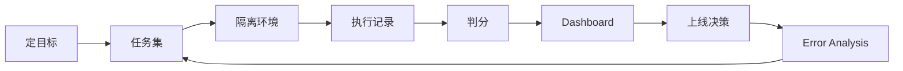

**图 19｜【补充】0→1 完整链路全景**

> 三支视频拼成一条链：**定业务目标 → 真实任务集（正反平衡）→ 隔离环境 → 执行记录（Outcome+Transcript）→ 三类 Grader 判分 → Dashboard 看趋势 → 上线决策 → Error Analysis 回流 → 数据集再演进。**

| 本教程 | 本站既有内容 | 对应关系 |
|---|---|---|
| 完整架构与数据飞轮 | [评测驱动 Agent 迭代（在线阅读）](../agent-eval-driven-tutorial/Agent评测驱动迭代完全教程.html) | 能力评测毕业成回归集、线上 Bad Case 回填 |
| 20–50 条真实任务 / 正反平衡 | [Agent 评测指标系统（在线阅读）](../agent-metrics-tutorial/Agent评测指标系统完全教程.html) | 100–500 Case、40/40/20 分层、正反例 |
| 写清 Task 与成功标准 | [Agent 评测方法论（在线阅读）](../agent-eval-method-tutorial/Agent评测方法论完全教程.html) | Anthropic Task 定义、完整用例、结构化结果 |
| 三类 Grader / 硬条件 | [消除 LLM Judge 偏见（在线阅读）](../agent-judge-bias-tutorial/Agent评测偏见消除完全教程.html) | Rule vs LLM Judge、量化 Rubric、人评校准 |
| 隔离环境 / 无效运行 | [Agent 评测体系（在线阅读）](../agent-evaluation-tutorial/Agent评测体系完全教程.html) | Trial 可复现、跳过机制 |
| Metrics / Dashboard / 上线决策 | [Agent 评测指标系统（在线阅读）](../agent-metrics-tutorial/Agent评测指标系统完全教程.html) | 三张表、看板而非总分、91→96% 决策案例 |

> **【补充】** 视频 ③ 结尾预告第三期：分数波动如何解释、Capability Eval 与 Regression Eval 如何区分——这两点在本站第三篇（pass@k / pass^k、能力→回归毕业）已有展开，本教程不代第三期补写。

---

**本章语音逐字稿（ASR · 已校正，36 句）**

> `[视频③ 06:00]` 第五步
> `[视频③ 06:01]` 先测 Grader 再用 Grader 测 Agent
> `[视频③ 06:03]` Grader 本身也是一个需要验证的系统
> `[视频③ 06:05]` 如果 Grader 会把正确的回答判错
> `[视频③ 06:08]` 后面越跑越多
> `[视频③ 06:09]` 积累的只会是更多的错误分数
> `[视频③ 06:11]` 第一期已经为 Task 准备了参考解法
> `[视频③ 06:13]` 现在可以再准备几组已知的样本
> `[视频③ 06:16]` 一组应该通过
> `[视频③ 06:17]` 一组应该失败
> `[视频③ 06:18]` 再加上几条比较容易出现分歧的边界样本
> `[视频③ 06:21]` 先看 Code-based Grader 能不能放过正确结果
> `[视频③ 06:24]` 并且拦住已知的错误
> `[视频③ 06:25]` 再用人工标注结果
> `[视频③ 06:27]` 校准 llm_grader 的准确性和分类边界
> `[视频③ 06:31]` 每次修改 Rubric 评分模型
> `[视频③ 06:33]` 或者是分数组合方式以后
> `[视频③ 06:35]` 这批的样本都应该重新跑一遍
> `[视频③ 06:37]` 这一步完成以后
> `[视频③ 06:38]` 你才能知道分数变化
> `[视频③ 06:39]` 确实是来自 Agent 的表现
> `[视频③ 06:41]` 而不是 Grader 自己改变了判断
> `[视频③ 06:43]` 到这里第二层就搭完了
> `[视频③ 06:45]` 一条 Task 进入可重置的测试环境
> `[视频③ 06:48]` Agent 完成一次 Trial
> `[视频③ 06:49]` Harness 保留 Outcome 和 Transcript
> `[视频③ 06:51]` 确定性 Grader 先检查硬条件
> `[视频③ 06:53]` 模型 Grader 再评价语义质量
> `[视频③ 06:55]` 最后用少量的人工样本持续去校准
> `[视频③ 06:58]` 这样得到的评分才能被解释和复查
> `[视频③ 07:00]` 也有资格进入下一步
> `[视频③ 07:02]` 第三期我们继续解决三个问题
> `[视频③ 07:04]` 同一项任务必须跑多少次
> `[视频③ 07:06]` 分数波动应该如何解释
> `[视频③ 07:07]` 以及 Capability Eval 和 Regression Eval
> `[视频③ 07:10]` 应该如何区分

## 21. 补充篇 A：专业名词速查（51 条）

**【补充】** 按「架构 → 任务集 → 运行环境 → 评分 → 决策」分组。

| 术语 | 英文 / 别名 | 释义 |
|---|---|---|
| Evaluation System | 评测系统 | 贯穿 Agent 生命周期的工程体系，不是发布前一次测试 |
| Evaluation-first | 评测优先 | 先定义怎么评，再开发 Agent |
| User Real Request | 真实用户请求 | 架构闭环的起点 |
| Trace Collection | 轨迹采集 | 收集线上 Online Logs 与 Bad Cases |
| Bad Case | 失败案例 | 线上翻车样本，飞轮的燃料 |
| Dataset Evolution | 数据集演进 | 评测集随产品一起增长 |
| Dataset Manager | 数据集管理 | 统一 Synthetic + Human + Real 三类样本 |
| Synthetic / Human / Real | 合成 / 人工 / 真实 | 三类评测样本来源 |
| Agent Runtime | Agent 运行体 | LLM + Memory + Tool + Workflow |
| Trajectory Store | 轨迹存储 | 保存 Prompt / Tool / Reasoning / Output |
| Evaluation Engine | 评测引擎 | 调度三类 Judge 执行评分 |
| Rule Judge | 规则判据 | 确定性、可重复的程序判定 |
| LLM Judge | 模型判据 | 按 Rubric 判断语义质量 |
| Human Judge | 人工判据 | 专家确认样本与校准 |
| Metrics | 指标 | Quality / Cost / Latency / Safety / Business KPI |
| Business KPI | 业务指标 | 满意率、任务完成率等业务结果 |
| Dashboard | 看板 | 看指标变化趋势，而非一次实验的分数 |
| Release Decision | 上线决策 | 这次更新要不要发布 |
| Error Analysis | 错误归因 | 把失败送回数据集 |
| Continuous Improvement Loop | 持续改进闭环 | 评估数据飞轮的外圈 |
| Data Flywheel | 评估数据飞轮 | Online User → Bad Case → Dataset → Engine → Dashboard → 改动 → Redeploy |
| Redeploy System | 重新发布 | 把改进推回线上 |
| Regression Dataset | 回归数据集 | 翻车过的题都要加入 |
| Eval Task | 评测任务 | Anthropic 定义：具有明确输入和成功标准的独立测试 |
| Task | 任务卡 | 一条可独立评测的测试 |
| Success Criteria | 成功标准 | 判定通过的可验证条件 |
| Input | 输入 | 用户请求 + 初始条件 |
| 约束前置 | Constraints Upfront | 要求必须提前写进任务说明，不能评分时临时追加 |
| 专家一致性 | Expert Agreement | 两名业务人员独立读 Task 判断一致 |
| 参考解法 | Reference Solution | 已知能通过所有 Grader 的参考结果 |
| Grader | 评分器 / 判据 | 对 Trial 给分或判通过 |
| 平衡问题集 | Balanced Problem Set | 正向 + 反向 + 边界 |
| 正向任务 | Positive Task | 行为应该发生 |
| 反向任务 | Negative Task | 行为不应发生 |
| 边界任务 | Boundary Case | 最容易混淆的样本 |
| 行为不足 / 行为过度 | Under / Over-trigger | 只测一侧都会把 Agent 带偏 |
| Trial | 一次试跑 | 一条 Task 的一次执行 |
| 隔离运行环境 | Isolated Environment | 可重置、记录版本、区分失败类型 |
| 测试快照 | Test Snapshot | 工具返回固定已知数据 |
| 无效运行 | Invalid Trial | 基础设施错误导致的 Trial，标记后重试 |
| Outcome | 终态结果 | 任务结束时真正产生的结果 |
| Transcript | Trace / Trajectory | 完整可观测轨迹 |
| Code-based Grader | 代码评分器 | 字符串检查 / Python Grader / Multi Grader |
| LLM-as-Judge | 模型评分 | Rubric 分维、允许 Unknown |
| Unknown | 无法判定 | Grader 不强猜分数 |
| 硬条件 | Hard Gate | 决定任务是否通过 |
| 软质量 | Soft Quality | 通过之后比较的表达质量 |
| 部分得分 | Partial Credit | 每部分对应明确条件 |
| Meta-eval | 先测 Grader | 判据本身也要验证 |
| Capability Eval | 能力评测 | 还能不能解决难题（第三期预告） |
| Regression Eval | 回归评测 | 旧能力有没有退步（第三期预告） |

---

## 22. 补充篇 B：可运行代码

**【补充】** 四段纯 Python 标准库实现，把三支视频的关键环节变成可执行逻辑。

### 22.1 Eval Task 结构校验与专家一致性

```python
# eval_task.py —— python3 eval_task.py
REQUIRED = ("input", "success_criteria", "constraints")
NOT_ALLOWED_IN_CRITERIA = ("格式", "语气")   # 约束必须前置，不能评分时临时追加

def validate(task):
    errs = [k for k in REQUIRED if not task.get(k)]
    # 约束前置检查：成功标准里出现只能属于任务说明的格式/语气要求 → 违规
    for w in NOT_ALLOWED_IN_CRITERIA:
        if w in task.get("success_criteria", ""):
            errs.append(f"约束未前置: {w}")
    return errs

def expert_agreement(task, reader_a, reader_b):
    """两名业务人员独立判断是否通过；不一致说明 Task 不够明确。"""
    return reader_a(task) == reader_b(task)

if __name__ == "__main__":
    good = dict(input="用户询问今天上海的天气",
                success_criteria="调用搜索工具并依据工具返回回答，不能用模型记忆",
                constraints="必须调用实时搜索")
    bad = dict(input="回答今天天气", success_criteria="按固定格式输出", constraints="")
    for name, t in (("合格 Task", good), ("不合格 Task", bad)):
        print(name, "校验:", validate(t) or "PASS")
    print("专家一致性:", expert_agreement(good, lambda t: True, lambda t: True))
```

### 22.2 平衡问题集检查器

```python
# balanced_suite.py —— python3 balanced_suite.py
def audit(tasks):
    pos = [t for t in tasks if t["expected"] == "call"]
    neg = [t for t in tasks if t["expected"] == "skip"]
    bd = [t for t in tasks if t["expected"] == "boundary"]
    flags = []
    if not pos: flags.append("缺正向任务：查不出行为不足")
    if not neg: flags.append("缺反向任务：会优化出「遇事就搜」")
    if not bd: flags.append("缺边界任务")
    return dict(正向=len(pos), 反向=len(neg), 边界=len(bd), 提示=flags or ["OK 平衡"])

if __name__ == "__main__":
    suite = [
        dict(q="今天上海天气?", expected="call"),
        dict(q="水的沸点?", expected="skip"),
        dict(q="昨天上海天气?", expected="boundary"),
    ]
    print("完整集:", audit(suite))
    print("缺反向:", audit([suite[0]]))
    print("只正向:", audit([suite[0], suite[0]]))
```

### 22.3 隔离 Harness 与无效运行

```python
# isolated_harness.py —— python3 isolated_harness.py
SNAPSHOT = {"weather": "晴 26C"}   # 固定测试快照
VERSIONS = dict(model="v3", prompt="p7", tools="t2", data="d1")
state = {}

def reset():
    state.clear()
    state.update(VERSIONS)
    return dict(state)

def trial(tool_ok=True):
    env = reset()
    if not tool_ok:
        return dict(env=env, status="INVALID_RETRY", reason="tool_timeout")
    outcome = SNAPSHOT["weather"]
    transcript = ["model:call weather", f"tool:{outcome}", "model:answer"]
    return dict(env=env, status="OK", outcome=outcome, transcript=transcript)

if __name__ == "__main__":
    a = trial(True)
    b = trial(False)
    print("正常 Trial:", a["status"], a["outcome"], a["transcript"])
    print("异常 Trial:", b["status"], b["reason"], "（不计入 Agent 失败）")
    print("环境一致:", a["env"] == b["env"])
```

### 22.4 三类 Grader + 硬条件/软质量 + Grader 自测

```python
# grader_pipeline.py —— python3 grader_pipeline.py
def code_grader(trial):
    hard = [("called_tool", "weather" in " ".join(trial["transcript"])),
            ("args_ok", True), ("matches_snapshot", trial["outcome"] == "晴 26C")]
    return all(v for _, v in hard), hard

def llm_grader(trial):
    return {"表达质量": 4, "证据一致性": 5, "Unknown": False}

def score(trial):
    passed, hard = code_grader(trial)
    if not passed:
        return dict(pass_=False, hard=hard, soft=None)
    return dict(pass_=True, hard=hard, soft=llm_grader(trial))

def meta_eval(samples, grader=code_grader):
    """先测 Grader：应通过组必须放过，应失败组必须拦住。"""
    ok = sum(1 for s, want in samples if (grader(s)[0] == want))
    return ok, len(samples)

if __name__ == "__main__":
    good = dict(outcome="晴 26C", transcript=["model:call weather", "tool:晴 26C"])
    bad = dict(outcome="晴 26C", transcript=["model:answer"])
    print("通过 Trial:", score(good))
    print("失败 Trial:", score(bad))
    print("Grader 自测:", meta_eval([(good, True), (bad, False)]))
```

---

## 23. 补充篇 C：常见误区

| # | 误区 | 为什么错 | 正确做法 |
|---|---|---|---|
| 1 | 把 evaluation 当发布前的一次测试 | Anthropic 强调应贯穿整个开发生命周期 | 从少量高质量数据起步，接入持续迭代 |
| 2 | 等攒够 1000 条数据再开始 | 少量样本就能跑通小闭环 | 20–50 条真实任务先建基线 |
| 3 | 一上来就追求 100% 自动化 | 流程没跑顺时自动化只会放大错误 | 先手动、再逐步自动化 |
| 4 | 只看一个总分 | 总分会掩盖关键失败 | 硬条件判通过 + 软质量独立分 |
| 5 | 凭空用模型生成全部题目 | 脱离真实使用分布 | 真实任务与真实失败作种子，模型只扩变体 |
| 6 | 把真实任务直接当 Eval Task | 缺明确输入与成功标准，无法稳定判定 | 写清三要素 + 专家一致性 + 参考解法 |
| 7 | 评分时临时追加格式 / 语气要求 | 任务说明里从未要求，判分不公平 | 约束前置 |
| 8 | 评测集只有正向任务 | 会优化出「遇任何问题都先搜」 | 补反向任务与边界任务 |
| 9 | 每次 Trial 直接调真实外部接口 | 返回漂移会伪装成能力变化 | 固定快照 + 重置状态 + 版本记录 |
| 10 | 把工具超时算成 Agent 失败 | 基础设施错误与能力无关 | 标记无效运行并重试 |
| 11 | 只看 Outcome 不存 Transcript | 无法解释为什么成功或失败 | 两类记录同时保留 |
| 12 | Rubric 只写「评价回答质量」 | 判据含糊、分数随意 | 正确性 / 证据一致性 / 表达质量分维 |
| 13 | 模型与人工持续分歧时扩大自动评分规模 | 错误判据会量产错误分数 | 先修 Rubric / 证据输入 / 分类边界 |
| 14 | 没验证 Grader 就大规模评测 | Grader 判错会污染整个数据集 | 先用应通过 / 应失败 / 边界样本自测 |
| 15 | 评测体系建完就不管了 | 业务与模型都在变 | 飞轮持续回流 Bad Case |

---

## 24. 附录

### 24.1 画面章节结构（三支均无官方自动章节）

| 视频 | 画面给出的结构 | 依据 |
|---|---|---|
| ① | 一套完整的 Evaluation System 长什么样？／ 产品经理如何从 0 到 1 搭一套 Evaluation 系统？／ 核心逻辑——构建「评估数据飞轮」／ 踩坑实录 | 封面 f_0001 逐字 |
| ② | 框架与方法 / 真实任务集 / 写清 Task / 正反平衡 / 三步收束（VOL.052） | 顶部固定导航条 |
| ③ | 问题与方法 / 隔离运行环境 / Outcome 与轨迹 / 三类 Grader / 硬条件与评分 / 校准与收束（VOL.053） | 顶部固定导航条 |

### 24.2 配图速查（19 张）

| # | 图名 | 来源 |
|---|---|---|
| 1–2 | 三支视频结构地图 / evaluation-first 大厂观点 | 视频 ① 封面与口播 |
| 3–6 | 架构全景 / 三段职责 / 五步落地 / 踩坑四条 | 视频 ① 手绘图逐节点重绘 |
| 7–13 | 两层框架 / 第一层三步 / 真实任务 / Task 三要素 / 双检查 / 正反平衡 / 三产物 | 视频 ② 导航条与插画 |
| 14–18 | 第二层五步 / 隔离环境 / Outcome+Transcript / 三类 Grader / 硬条件与自测 | 视频 ③ 导航条与插画 |
| 19 | 【补充】0→1 完整链路全景 | 三支综合，非视频画面 |

### 24.3 校正表（OCR 与口播）

| 来源写成了 | 正确写法 | 依据 |
|---|---|---|
| `Antihropici` / `AT agents` | `Anthropic` / `AI agents` | 视频 ① 画面 f_0012 放大 + 官方文档名 |
| `Trace Coleetioni` / `Loys/ Bed Cases` | `Trace Collection` / `Logs / Bad Cases` | 视频 ① 架构图节点，多帧交叉核对 |
| `Dataset Manageri` / `Agent Runt` | `Dataset Manager` / `Agent Runtime` | 手绘字体与放大裁切导致截字 |
| `Rule Judge / LLx Sudye / wwmn sudge` | `Rule Judge / LLM Judge / Human Judge` | 视频 ① 架构图 + 口播「三种判据」 |
| `踩坑买录` | `踩坑实录` | 画面 f_0099 放大逐字 |
| 口播「价值」「架」「Matrix」 | `Judge` / `Grader` / `Metrics` | 字幕 OCR 对英文术语的音译与形近误写 |
| `VOL.052` 导航「三步收東」「框架与万法」 | `三步收束` / `框架与方法` | 视频 ② 导航条多帧清晰帧对照 |
| `VOL.053` 导航「隔禺运行环境」「便条件与评分」 | `隔离运行环境` / `硬条件与评分` | 视频 ③ 导航条多帧清晰帧对照 |
| `Evals APL` / `13.4S` 等 | `Evals API` / 画面计时水印 | 文档名逐字；`xx.xS` 为画面固定计时器，非内容 |
| `不要等1000条数据再开始` | 保留画面原文 | 为口播经验值，非错字；本教程标注为经验建议 |

### 24.4 还原方法与资料

1. **视频**：① [从0到1搭建一套Agent评估系统？](https://v.douyin.com/jQ3PCzp5d6Y/)（ID `7664976613234711523`，煮caicai，2026-07-21，5:34）；② [6分钟：如何建立Agent评测第一层框架](https://v.douyin.com/yQCqzZPemOM/)（ID `7680547627524354219`，向量思维／观远数据，2026-09-01，5:47）；③ [7分钟干货:0-1搭建Agent评测2](https://v.douyin.com/Vq7UwPruXt0/)（ID `7680918644558148009`，2026-09-02，7:12）。
2. **逐帧**：3 支最高档原片 35.2 MB（1080×1086 方形 1 支 + 1920×1080 横屏 2 支）；372 帧；Vision OCR 5,504 行；按三支不同版式分别设阈值（① 浮动黑底字幕按「中文短句 + 跨帧变化」判别，②③ 画面 0.07–0.82 / 字幕 0.82–0.95），得到 184 条画面幻灯片、353 条字幕时间线与顶部导航条；封面、架构图、飞轮、踩坑、权威来源、导航条逐帧放大逐字校对。
3. **公开资料核对**：Anthropic, [Demystifying evals for AI agents](https://www.anthropic.com/research/demystifying-evals-for-ai-agents)（2026-01-09）、Anthropic《Define success criteria and build evaluations》（持续更新）、OpenAI《Evals API Reference》（持续更新）——三份均为视频 ②③ 画面列出的权威来源，亦为本系列第三篇的主要参考。
4. **本系列互链**：[RAG 评测（在线阅读）](../rag-evaluation-tutorial/RAG评测完全教程.html) ｜ [Agent 评测体系（在线阅读）](../agent-evaluation-tutorial/Agent评测体系完全教程.html) ｜ [评测驱动迭代（在线阅读）](../agent-eval-driven-tutorial/Agent评测驱动迭代完全教程.html) ｜ [开发架构选型（在线阅读）](../agent-architecture-tutorial/Agent开发架构选型完全教程.html) ｜ [评测指标系统（在线阅读）](../agent-metrics-tutorial/Agent评测指标系统完全教程.html) ｜ [评测方法论（在线阅读）](../agent-eval-method-tutorial/Agent评测方法论完全教程.html) ｜ [消除 LLM Judge 偏见（在线阅读）](../agent-judge-bias-tutorial/Agent评测偏见消除完全教程.html)。

> **未做的部分（如实说明）**：本轮未做语音逐字转写（ASR），口播依据烧录字幕 OCR 时间线 + 画面文字归纳；三支均无官方自动章节，章节结构取自画面导航条；视频 ③ 结尾预告的第三期（分数波动解释、Capability vs Regression Eval）未展开，只在本站既有篇目中给出对应链接。

---

*本教程为学习整理产物；视频与文章版权归各自作者所有。*

### 24.5 全片语音逐字稿（ASR · 528 段 · 按视频/章节分组）

由离线语音识别还原的完整口播，逐段保留时间码。视频作者制作的烧录字幕为精简重排版，两者不完全逐字对应属正常现象。

**视频①（逐字 · 157 句）**

> `[视频① 00:00]` Hello 大家，今天我们继续 Agent 评估相关的内容
> `[视频① 00:04]` 今天这篇是这个系列的最后一篇了
> `[视频① 00:07]` 我们讨论一下如何从 0 到 1搭建一套 evaluation system
> `[视频① 00:11]` 当然在搭建之前，我们要分析一下为什么它这么重要
> `[视频① 00:14]` 我们知道大厂都在疯狂地卷 evaluation 是为什么
> `[视频① 00:17]` 一个完整的 evaluation system 到底长什么样子
> `[视频① 00:21]` 以及我们去实践到底怎么去落地
> `[视频① 00:23]` 但是我们构建 evaluation 的核心逻辑
> `[视频① 00:26]` 还是要去做一个评估的数据飞轮
> `[视频① 00:29]` 以及分享几点踩坑的实录吧
> `[视频① 00:31]` 大厂为什么在卷
> `[视频① 00:32]` 我们可以看Anthropic在他这篇文章里面反复地强调
> `[视频① 00:36]` evaluation 应该是贯穿 Agent 的整个开发周期的
> `[视频① 00:40]` 它不是发布前的一次测试
> `[视频① 00:42]` 而且它建议从少量的高质量的数据开始
> `[视频① 00:45]` 随着产品演进不断扩充
> `[视频① 00:47]` 并将 evaluation 接入持续的迭代过程
> `[视频① 00:50]` 这是 Anthropic 的经验
> `[视频① 00:51]` 那 OpenAI 怎么说呢
> `[视频① 00:52]` 无论是从早期的 OpenAI 的 Evals 到现在的 Evals API
> `[视频① 00:57]` 都在推动 evaluation first 的开发方式
> `[视频① 00:59]` 它把数据集评分器指标和版本对比
> `[视频① 01:02]` 纳入了统一的流程
> `[视频① 01:04]` 而不是一个零散的脚本
> `[视频① 01:05]` 他们其实都在强调一个相同的认知
> `[视频① 01:07]` 那就是 evaluation 要贯穿 Agent 的生命周期
> `[视频① 01:11]` 那一整套的 evaluation system 长什么样子呢
> `[视频① 01:14]` 从全局来看
> `[视频① 01:15]` 从用户的真实请求
> `[视频① 01:18]` 到我们去用 trace 收集所有线上的日志
> `[视频① 01:22]` 以及 bad case
> `[视频① 01:23]` 然后进入的是一个数据集的管理
> `[视频① 01:25]` 这个数据集之前也介绍过
> `[视频① 01:26]` 黄金数据集从有合成的有人工的
> `[视频① 01:29]` 有我们真实的线上的 case
> `[视频① 01:32]` 然后进入 Agent 运行时
> `[视频① 01:35]` 包括 memory、tool、workflow 等等
> `[视频① 01:37]` 我们将 Agent 运行时的所有记录
> `[视频① 01:40]` prompt、tool、reasoning、output
> `[视频① 01:42]` 消息、JSON 全部都保存
> `[视频① 01:44]` 进入我们的评估引擎
> `[视频① 01:46]` 评估你选择了什么 Judge
> `[视频① 01:48]` Judge 有三种方式
> `[视频① 01:49]` 有 Rule Judge，就是我们说的程序 Judge
> `[视频① 01:52]` 有大模型 Judge，也有人工审核
> `[视频① 01:56]` 那我们带着我们的指标
> `[视频① 01:57]` 那我们上一篇也介绍了我们的 Metrics
> `[视频① 02:00]` Metrics 可能分成质量层的
> `[视频① 02:02]` Cost latency 的 safety 的
> `[视频① 02:03]` 以及我们最重要的业务的 KPI 对吧
> `[视频① 02:06]` 而且这些指标我们会用 dashboard 去管理
> `[视频① 02:08]` 因为这样会便于我们产品经理去做业务的权衡
> `[视频① 02:12]` 然后进入决策
> `[视频① 02:14]` 就是这个更新
> `[视频① 02:15]` 这一次的更新到底要不要去发布
> `[视频① 02:17]` 然后发布完之后
> `[视频① 02:18]` 我们会做一些错误的分析
> `[视频① 02:20]` 错误的分析又将这些 bad case
> `[视频① 02:23]` 作为我们回归的案例
> `[视频① 02:25]` 又放进了我们的 Dataset 里面
> `[视频① 02:27]` 将 Dataset 进行演进
> `[视频① 02:28]` 这就是整个的我们的 evaluation 的一个系统
> `[视频① 02:31]` 包含的组件其实我们前面
> `[视频① 02:33]` 也都各自都已经介绍过了
> `[视频① 02:35]` 包括 Dataset 对吧
> `[视频① 02:37]` 包括你的 Judge LLM Judge
> `[视频① 02:39]` 包括我们的 Metrics
> `[视频① 02:41]` 这就是一个完整的 evaluation system
> `[视频① 02:43]` 那我们产品经理如何从零到一去搭建这一套系统呢
> `[视频① 02:47]` 我们分成五大块
> `[视频① 02:49]` 现在要定业务目标
> `[视频① 02:50]` 我们也说过无论是 Metrics 还是 data set
> `[视频① 02:53]` 还是 Rubric
> `[视频① 02:54]` 其实你都是紧密的和业务目标相关的
> `[视频① 02:57]` 就 evaluation 永远不是为了跑分
> `[视频① 02:59]` 而是为了业务
> `[视频① 03:00]` 不同 Agent evaluation 完全不同
> `[视频① 03:02]` 客服 Agent 最重要的是解决率满意率
> `[视频① 03:05]` coding Agent 最重要的是单元测试通过率等等
> `[视频① 03:08]` 所以第一步永远不是写 prompt
> `[视频① 03:10]` 而是回答一句话
> `[视频① 03:11]` 这个 Agent 最重要的一件事情是什么
> `[视频① 03:13]` 第二步我们就是要建立 data set 了
> `[视频① 03:16]` 这个其实我们也已经介绍过
> `[视频① 03:18]` data set 的来源
> `[视频① 03:19]` 从冷启动阶段的合成
> `[视频① 03:21]` 对吧上线之后真实的 Case
> `[视频① 03:22]` 然后持续演化
> `[视频① 03:23]` 把线上的 trace 收集进来
> `[视频① 03:25]` 它跟产品是一起增长的
> `[视频① 03:27]` 第三步就是我们要选择一个 Judge
> `[视频① 03:29]` 能用 Rule Judge 就用 Rule Judge
> `[视频① 03:31]` 如果不行我们就用 LLM Judge
> `[视频① 03:33]` LLM Judge 算是比较复杂的一种 Judge
> `[视频① 03:36]` 因为它牵涉到 Rubric 的制定对吧 Rubric
> `[视频① 03:38]` 我们也知道这个是非常复杂的一件事情
> `[视频① 03:40]` 最后肯定要人工去做校准
> `[视频① 03:43]` 然后就是我们要设计 Metrics
> `[视频① 03:45]` 这个前面也介绍过了
> `[视频① 03:46]` 就是围绕着业务目标
> `[视频① 03:47]` 去拆解它的 outcome behavior safety efficiency
> `[视频① 03:51]` 最后我们一定
> `[视频① 03:52]` 这个 evaluation 系统一定要有个 dashboard 的
> `[视频① 03:56]` 我觉得这个是非常值得再详细的介绍一遍的
> `[视频① 03:59]` 因为很多团队做到这里可能就停了
> `[视频① 04:01]` evaluation
> `[视频① 04:02]` 但是 evaluation 不应该输出一个静态的数据
> `[视频① 04:04]` 一个 Excel
> `[视频① 04:06]` 应该是一个趋势图
> `[视频① 04:07]` 所以一定是一个看板
> `[视频① 04:08]` 看板里包含了各种指标的一个变化趋势
> `[视频① 04:11]` 对吧
> `[视频① 04:12]` 因为我们真正关心的肯定是
> `[视频① 04:14]` 版本之间到底变好了还是变坏了
> `[视频① 04:16]` 而不是一次实验
> `[视频① 04:17]` 它是一个连续的体验
> `[视频① 04:18]` 所以这个也是很重要的
> `[视频① 04:19]` 我们做这个评估系统
> `[视频① 04:21]` 不是为了拿一个分
> `[视频① 04:22]` 而是为了构建数据飞轮
> `[视频① 04:25]` 所以非常重要的一点
> `[视频① 04:26]` 就是我们要收集线上用户的 bad case
> `[视频① 04:29]` 进行详细的分析
> `[视频① 04:31]` 将这个 bad case
> `[视频① 04:32]` 首先要加到我们的回归数据集中
> `[视频① 04:34]` 然后用 Agent 去进行评估
> `[视频① 04:36]` 然后去优化
> `[视频① 04:37]` 然后重新发布
> `[视频① 04:38]` 我们要确保这个回归数据
> `[视频① 04:39]` 肯定是伴随着线上 Agent 的成长
> `[视频① 04:42]` 这个 Dataset 应该是越来越大的
> `[视频① 04:44]` 而且 Agent 的翻车的概率可能是越来越低的
> `[视频① 04:46]` 因为我们每一个 bad case
> `[视频① 04:48]` 都要加入我们的回归数据集中
> `[视频① 04:49]` 也就是我们的黄金测试集中
> `[视频① 04:51]` 这就构建起了一个评估的数据飞轮
> `[视频① 04:53]` 那再介绍一些踩坑的记录
> `[视频① 04:55]` 就是我觉得第一点就是
> `[视频① 04:59]` 不要等一千条
> `[视频① 05:00]` 我们之前也介绍过
> `[视频① 05:01]` 就二十到五十条数据
> `[视频① 05:03]` 就可以完全去跑一个评测的小闭环了
> `[视频① 05:05]` 不要追求100%的自动化
> `[视频① 05:06]` 一开始上来肯定是手动的
> `[视频① 05:08]` 然后最后随着 Agent 的成长
> `[视频① 05:11]` 慢慢的成长
> `[视频① 05:11]` 我们才会把它加到 CI/CD
> `[视频① 05:13]` 持续集成的系统自动化
> `[视频① 05:15]` 再去追求自动化
> `[视频① 05:16]` 然后一定不要只看单个指标
> `[视频① 05:18]` 这个前面其实在 Metrics 里面也介绍了
> `[视频① 05:20]` 一个 Agent 的好坏肯定是多个维度的指标的
> `[视频① 05:23]` 然后不要把 Evaluation 当成 QA
> `[视频① 05:26]` Evaluation 本身也是要不断演进的
> `[视频① 05:28]` 总之吧
> `[视频① 05:29]` Agent 的 Evaluation 系统不是一个可选的测试工具
> `[视频① 05:32]` 它是 AI 时代产品经理的研发仪表盘

**视频②（逐字 · 158 句）**

> `[视频② 00:00]` 如何建立第一批 AI Agent 的评测任务
> `[视频② 00:02]` 上一期我们讲了
> `[视频② 00:03]` 如何从0-1搭建 AI Agent 的评测
> `[视频② 00:06]` 那套框架已经有超过1300次的收藏
> `[视频② 00:09]` 私信里被问的最多的问题就是
> `[视频② 00:11]` 框架看懂了
> `[视频② 00:12]` 但是真正落到项目里面
> `[视频② 00:13]` 每一步具体应该怎么做呢
> `[视频② 00:15]` 所以接下来我打算用三期的内容
> `[视频② 00:17]` 把整套搭建过程逐步拆开
> `[视频② 00:19]` 第一期我们先搭评测体系的第一层任务集
> `[视频② 00:23]` 从真实问题中提取任务
> `[视频② 00:25]` 把任务写到可以稳定判断
> `[视频② 00:27]` 再补齐应该发生和不应该发生的对照测试
> `[视频② 00:30]` 这套方法
> `[视频② 00:31]` 基于 Anthropic 在2026年1月发布的 AI Agent 的评测方法
> `[视频② 00:35]` 同时对照了截止2026年8月
> `[视频② 00:37]` Anthropic 和 OpenAI 仍在更新的官方评测文档
> `[视频② 00:41]` 第一步先建立一批真实的任务
> `[视频② 00:44]` 刚开始做 Eval
> `[视频② 00:45]` 不需要先准备几百条的任务
> `[视频② 00:47]` Anthropic 给出的建议是
> `[视频② 00:49]` 早期从20-50条真实任务开始
> `[视频② 00:52]` 就足够建立第一条评测基线
> `[视频② 00:54]` 第一批种子任务
> `[视频② 00:55]` 应该优先来自真实任务和真实失败
> `[视频② 00:58]` 模型更适合在真实种子的基础上扩充变体
> `[视频② 01:02]` 而不是代替真实任务来源
> `[视频② 01:04]` 更可靠的做法是先从团队已经拥有的材料中提取
> `[视频② 01:08]` 开发过程中原本需要人工检查的任务
> `[视频② 01:11]` 用户最常执行的典型任务
> `[视频② 01:13]` 已经发生过的 bug
> `[视频② 01:14]` 以及用户反馈和支持工单里的真实失败
> `[视频② 01:17]` 比如用户问 Agent
> `[视频② 01:19]` 今天上海天气怎么样
> `[视频② 01:21]` Agent 没有调用搜索工具
> `[视频② 01:22]` 而是直接根据模型已有的知识生成了一个答案
> `[视频② 01:26]` 如果这来自一条真实用户反馈
> `[视频② 01:28]` 它就可以被转化成一个 bad case
> `[视频② 01:30]` 用户需要实时信息
> `[视频② 01:32]` 但是 Agent 没有搜索
> `[视频② 01:33]` 我们可以把它先放到初始任务清单
> `[视频② 01:36]` Anthropic 当前的评测文档也强调
> `[视频② 01:39]` 评测任务应该尽量贴近真实使用分布
> `[视频② 01:42]` 同时覆盖必要的边界情况
> `[视频② 01:44]` 收集以后
> `[视频② 01:45]` 按照任务对用户结果的影响程度进行排序
> `[视频② 01:49]` 从中选出第一批20-50条
> `[视频② 01:51]` 这一步的产物是一份来自
> `[视频② 01:53]` 真实使用场景的初始任务清单
> `[视频② 01:56]` 它不需要一次覆盖所有的问题
> `[视频② 01:58]` 阶段的目标是先建立一条可以运行
> `[视频② 02:01]` 可以重复比较的评测基线
> `[视频② 02:03]` 等真实种子任务确定以后
> `[视频② 02:05]` 可以再用模型扩充表达变体和边界案例
> `[视频② 02:09]` 但是新增任务仍然需要人工检查
> `[视频② 02:11]` 不能直接进入到评测集
> `[视频② 02:13]` 第二步
> `[视频② 02:14]` 把 task 写到可以稳定判断
> `[视频② 02:16]` 收集到真实案例
> `[视频② 02:17]` 不代表它已经是一条合格的 Eval Task
> `[视频② 02:20]` 比如说刚刚这条天气任务
> `[视频② 02:22]` 如果我们只写回答用户今天的天气
> `[视频② 02:25]` 仍然无法稳定的评测
> `[视频② 02:27]` Anthropic 对 task 的基本定义是
> `[视频② 02:29]` 一项具有明确输入和成功标准的独立测试
> `[视频② 02:33]` 因此我们需要继续写清楚
> `[视频② 02:35]` 输入是用户询问今天上海的天气
> `[视频② 02:37]` Agent 可以调用天气查询工具
> `[视频② 02:40]` 成功的标准是 Agent 调用工具
> `[视频② 02:42]` 并依据工具返回的当前信息回答
> `[视频② 02:45]` 不能把模型记忆中的天气信息
> `[视频② 02:47]` 当成实时结果
> `[视频② 02:48]` 到这里这条 task
> `[视频② 02:50]` 才同时拥有了明确输入和成功标准
> `[视频② 02:53]` 更重要的是
> `[视频② 02:53]` Grader 准备检查的内容
> `[视频② 02:55]` 必须提前出现在任务说明里
> `[视频② 02:57]` 不能在 task 里只要求回答今天的天气
> `[视频② 03:00]` 却在评分的时候
> `[视频② 03:02]` 额外的去检查任务说明里
> `[视频② 03:03]` 从未要求的固定格式
> `[视频② 03:05]` 信息字段或执行条件
> `[视频② 03:07]` 写完以后用两个方法来检查
> `[视频② 03:09]` 第一个用专家一致性反查 task
> `[视频② 03:12]` 让两名了解业务的人
> `[视频② 03:13]` 独立去阅读这条 task
> `[视频② 03:15]` 如果两个人对什么算通过
> `[视频② 03:17]` 什么算失败仍然意见不同
> `[视频② 03:19]` 说明 task 还不够明确
> `[视频② 03:21]` 第二个用参考解法验证 task 和 Grader
> `[视频② 03:24]` 为 task 准备一份
> `[视频② 03:26]` 已知能够通过所有 Grader 的参考结果
> `[视频② 03:28]` 参考解法不是为了要求
> `[视频② 03:30]` Agent 复刻唯一的执行路径
> `[视频② 03:32]` 它只证明两件事
> `[视频② 03:34]` 第一这项任务确实是可以完成
> `[视频② 03:36]` 二当前的任务说明和 Grader
> `[视频② 03:38]` 能够正常工作
> `[视频② 03:40]` Anthropic 还给出一个很实用的
> `[视频② 03:42]` 反查信号
> `[视频② 03:42]` 如果前沿模型尝试
> `[视频② 03:44]` 很多次仍然一次都无法通过
> `[视频② 03:47]` 那么我们应该先检查 task 和 Grader
> `[视频② 03:49]` 是否有问题
> `[视频② 03:50]` 而不是马上认定模型没有能力
> `[视频② 03:52]` 在 OpenAI Evals API 里面
> `[视频② 03:54]` 这一步会进一步落实为
> `[视频② 03:56]` 为每条测试数据定义结构化变量
> `[视频② 03:59]` 再让 Grader 调用这些变量执行测试标准
> `[视频② 04:02]` 第三步，同时设计正向和反向任务
> `[视频② 04:05]` 很多评测集只验证 Agent
> `[视频② 04:06]` 该做一件事时能不能完成
> `[视频② 04:09]` 但是 Agent 不仅要在条件成立时触发行为
> `[视频② 04:12]` 也要在条件不成立的时候保持克制
> `[视频② 04:15]` 刚才的天气任务只验证了 Agent
> `[视频② 04:17]` 在该搜索的时候能不能搜索
> `[视频② 04:19]` 如果评测集里面全是这种任务
> `[视频② 04:21]` 最后可能优化出一个遇到任何问题
> `[视频② 04:23]` 都要先搜索的 Agent
> `[视频② 04:25]` 所以还要补一条反向任务
> `[视频② 04:27]` 水在标准大气压下的沸点是多少
> `[视频② 04:29]` 这是一条稳定事实
> `[视频② 04:31]` Agent 不需要调用实时搜索工具
> `[视频② 04:33]` Anthropic 在建立搜索能力评测时
> `[视频② 04:37]` 也采用了这种同时覆盖两个方向的方法
> `[视频② 04:40]` 这样检查的才不只是 Agent 的
> `[视频② 04:42]` 会不会调用搜索工具
> `[视频② 04:43]` 还包括它能不能判断什么时候不需要调用
> `[视频② 04:46]` 这种设计通常被称为平衡问题集
> `[视频② 04:49]` 这里的平衡不一定要求正反任务数量完全相等
> `[视频② 04:53]` 关键是不能只评测行为的一侧
> `[视频② 04:55]` 并且整体分布要尽量接近真实使用情况
> `[视频② 04:58]` 设计的时候可以先确定
> `[视频② 05:00]` 这组任务要检查的目标行为
> `[视频② 05:02]` 然后同时加入行为应该发生的任务
> `[视频② 05:05]` 行为不应该发生的任务
> `[视频② 05:06]` 以及最容易混淆的边界任务
> `[视频② 05:08]` 这里还要补充一个边界
> `[视频② 05:10]` 这组 Eval 检查的目标
> `[视频② 05:11]` 本来就是 Agent 的搜索决策
> `[视频② 05:14]` 所以是否调用搜索工具
> `[视频② 05:15]` 可以成为成功的标准
> `[视频② 05:17]` 如果说评测目标
> `[视频② 05:18]` 只是最终答案是否正确
> `[视频② 05:20]` 就不应该强行规定 Agent
> `[视频② 05:22]` 必须采用同一条执行路径
> `[视频② 05:24]` 所以第一批 Agent 的 Eval
> `[视频② 05:25]` 不是收集一批 Prompt
> `[视频② 05:27]` 再给输出打分
> `[视频② 05:28]` 真正要完成的是三件事
> `[视频② 05:30]` 从真实失败和真实任务中建立测试集
> `[视频② 05:33]` 把每条 Task 写到输入和成功标准足够明确
> `[视频② 05:36]` 再用平衡问题集
> `[视频② 05:38]` 同时检查行为不足和行为过度
> `[视频② 05:40]` 做到这三步以后
> `[视频② 05:41]` 你才真正拥有了一批可以评测 Agent 的任务
> `[视频② 05:44]` 下一期我们继续搭建运行和评分部分

**视频③（逐字 · 213 句）**

> `[视频③ 00:00]` 如何搭建 Agent 评测的运行与评分系统
> `[视频③ 00:03]` 同一个 Agent 跑同一批评测任务
> `[视频③ 00:05]` 分数为什么会忽高忽低
> `[视频③ 00:07]` 到底是 Agent 能力发生了变化
> `[视频③ 00:09]` 还是运行环境和评分方法
> `[视频③ 00:11]` 正在制造额外的噪声
> `[视频③ 00:13]` 这是从0到1搭建 Agent 评测系列的第二期
> `[视频③ 00:17]` 上一期我们建立了第一批评测任务
> `[视频③ 00:19]` 解决了测什么
> `[视频③ 00:20]` 那这一期我们要继续搭建运行和评分系统
> `[视频③ 00:23]` 解决怎么运行怎么判分
> `[视频③ 00:25]` 才能让结果更可信
> `[视频③ 00:28]` 我们会从隔离环境
> `[视频③ 00:29]` Outcome 和 transcript
> `[视频③ 00:30]` 以及三类 Grader 入手
> `[视频③ 00:32]` 搭出一套可以重复运行
> `[视频③ 00:34]` 可以解释也可以复查的评分系统
> `[视频③ 00:36]` 这套方法对应
> `[视频③ 00:37]` Anthropic《Demystifying evals for AI agents》
> `[视频③ 00:40]` 从0到1路线里的第四步和第五步
> `[视频③ 00:43]` 同时参考了 OpenAI 当前的
> `[视频③ 00:45]` Evals API 和 Graders 文档
> `[视频③ 00:47]` 第一步
> `[视频③ 00:48]` 让每一次的 Trial 从可比的环境开始
> `[视频③ 00:51]` 上一期我们把今天上海天气怎么样
> `[视频③ 00:53]` 写成了一条评测的任务
> `[视频③ 00:54]` 现在准备让 Agent 运行它
> `[视频③ 00:57]` 如果每次的评测
> `[视频③ 00:58]` 都直接调用真实的天气接口
> `[视频③ 01:00]` 第一次返回晴天
> `[视频③ 01:01]` 第二次返回阵雨
> `[视频③ 01:02]` 第三次又遇到接口超时
> `[视频③ 01:04]` 那么三次 trial 面对的
> `[视频③ 01:06]` 已经不是同一项条件
> `[视频③ 01:07]` 分数的变化可能来自 Agent
> `[视频③ 01:09]` 也可能来自外部数据和工具故障
> `[视频③ 01:12]` 这两类的原因混在一起
> `[视频③ 01:13]` 测评的结果就无法解释
> `[视频③ 01:15]` 所以在 Eval 里可以为天气工具
> `[视频③ 01:17]` 准备一份固定的测试快照
> `[视频③ 01:19]` 每次输入相同的城市和日期
> `[视频③ 01:22]` 工具都返回同一份已知数据
> `[视频③ 01:24]` 每次 Trial开始前
> `[视频③ 01:25]` 还要重置对话
> `[视频③ 01:27]` 任务状态和工具环境
> `[视频③ 01:29]` 避免上一次运行留下的消息
> `[视频③ 01:31]` 文件或者是数据
> `[视频③ 01:32]` 影响到下一次的结果
> `[视频③ 01:33]` 同时固定这次评测使用的模型版本
> `[视频③ 01:36]` Agent 的配置
> `[视频③ 01:37]` 工具定义和任务数据版本
> `[视频③ 01:39]` 工具超时时
> `[视频③ 01:40]` 环境启动失败等基础设施
> `[视频③ 01:42]` 错误也要单独记录
> `[视频③ 01:44]` 这类的 trial 应该标记为
> `[视频③ 01:46]` 无效运行并重试
> `[视频③ 01:47]` 不能直接算成 Agent 的任务失败
> `[视频③ 01:49]` 如果这些条件没有留下记录
> `[视频③ 01:51]` 分数变了以后
> `[视频③ 01:52]` 你无法知道系统到底改过什么
> `[视频③ 01:55]` 隔离环境不会消除模型本身的非确定性
> `[视频③ 01:58]` 它的作用是排除与 Agent 的能力
> `[视频③ 02:00]` 无关的干扰
> `[视频③ 02:01]` 让不同的 trial
> `[视频③ 02:01]` 尽可能的在可比的条件下运行
> `[视频③ 02:04]` 这一步的产物是一个可以重置
> `[视频③ 02:07]` 记录版本并且区分 Agent 的失败
> `[视频③ 02:09]` 和环境失败的运行条件
> `[视频③ 02:11]` 第二步
> `[视频③ 02:11]` 同时保留 Outcome 和 Transcript
> `[视频③ 02:14]` 环境准备好以后
> `[视频③ 02:15]` Eval Harness 才能启动一次 trial
> `[视频③ 02:17]` 这次运行至少要留下两类记录
> `[视频③ 02:19]` 第一类 Outcome
> `[视频③ 02:20]` 它记录任务结束时真正产生的结果
> `[视频③ 02:23]` 天气查询是一项只读任务
> `[视频③ 02:25]` 它的 Outcome 是 Agent 最后返回的天气信息
> `[视频③ 02:28]` 这份结果是否与工具数据一致
> `[视频③ 02:30]` 后面再交给 Grader 判断
> `[视频③ 02:32]` 如果 Agent 会写入文件数据库或者其他系统
> `[视频③ 02:35]` Outcome 还要检查任务结束后的外部状态
> `[视频③ 02:38]` 第二类是 transcript
> `[视频③ 02:40]` 也叫 trace 或者是 Trajectory
> `[视频③ 02:42]` 它保留 Agent 在这次 trial 中的完整可观测的轨迹
> `[视频③ 02:46]` 包括模型输出
> `[视频③ 02:47]` 工具调用
> `[视频③ 02:48]` 工具返回
> `[视频③ 02:49]` 中间消息和状态变化
> `[视频③ 02:50]` 如果系统可以记录还可以附带轮数
> `[视频③ 02:53]` token 延迟和错误类型
> `[视频③ 02:55]` Outcome 用来判断任务最后是否完成
> `[视频③ 02:58]` transcript 用来解释它为什么成功
> `[视频③ 03:00]` 或者是失败发生在哪一步
> `[视频③ 03:02]` 比如 Agent 最后给出了正确天气
> `[视频③ 03:04]` 但是 transcript 显示它没有调用工具
> `[视频③ 03:07]` 如果这条 task 评测的
> `[视频③ 03:08]` 是实时的搜索决策
> `[视频③ 03:10]` 那么这次的 trial 就不能通过
> `[视频③ 03:12]` 因为它的结果只是碰巧正确
> `[视频③ 03:14]` 没有使用 task 要求的实时信息
> `[视频③ 03:16]` 但如果 task 只评测最终结果是否正确
> `[视频③ 03:19]` 就不应该因为 Agent 没有走某条预设的路径而扣分
> `[视频③ 03:23]` 所以是否检查 transcript 取决于 task 一开始定义的成功标准
> `[视频③ 03:27]` Outcome 优先验证完成结果
> `[视频③ 03:29]` transcript 主要负责诊断效率安全
> `[视频③ 03:32]` 以及 task 已经明确要求的关键行为
> `[视频③ 03:35]` 第三步让三类 Grader 分工
> `[视频③ 03:37]` 有了 Outcome 和 transcript 下一步才是判分
> `[视频③ 03:40]` 第一类是 code_grader
> `[视频③ 03:41]` 只要成功条件可以被程序精确的验证
> `[视频③ 03:44]` 就应该优先使用它
> `[视频③ 03:45]` 天气任务可以检查三件事
> `[视频③ 03:47]` Agent 是否调用了天气工具
> `[视频③ 03:49]` 城市和日期参数是否正确
> `[视频③ 03:52]` 最终回答里的温度和天气状态
> `[视频③ 03:54]` 是否与工具返回的一致
> `[视频③ 03:55]` 这一类的检查比较快便宜
> `[视频③ 03:57]` 而且可以重复
> `[视频③ 03:58]` 但是不适合评价开放性的表达质量
> `[视频③ 04:01]` 第二类是 model-based Grader
> `[视频③ 04:03]` 也就是我们常说的 LLM-as-Judge
> `[视频③ 04:06]` 它可以评价回答是否清楚
> `[视频③ 04:08]` 是否正确使用了工具证据
> `[视频③ 04:10]` 以及有没有添加工具结果无法支持的结论
> `[视频③ 04:13]` 它的 Rubric 不能只写评价回答质量
> `[视频③ 04:16]` 应该把正确性证据一致性和表达质量分开
> `[视频③ 04:21]` 每一个维度分别给出可判断的标准
> `[视频③ 04:23]` 当证据不足的时候
> `[视频③ 04:24]` 还应该允许 Grader 返回 Unknown
> `[视频③ 04:26]` 避免它强猜一个分数
> `[视频③ 04:28]` 第三类是 Human Grader 的
> `[视频③ 04:30]` 人工评分其实不需要覆盖每一次的 trial
> `[视频③ 04:32]` 它最重要的作用是准备一批专家已经确认的样本
> `[视频③ 04:36]` 定期的去检查 LLM Grader 的判断
> `[视频③ 04:38]` 是否仍然和专家一致
> `[视频③ 04:40]` 如果模型判断和人工判断持续分歧
> `[视频③ 04:43]` 应该先修正 Rubric
> `[视频③ 04:45]` 证据输入或者是分类的边界
> `[视频③ 04:47]` 不要直接去扩大自动评分的规模
> `[视频③ 04:49]` 所以三类 Grader 的顺序其实很明确
> `[视频③ 04:52]` 能够确定性验证的条件先交给代码
> `[视频③ 04:55]` 需要理解语义和质量的部分再交给模型
> `[视频③ 04:58]` 最后用少量的人工样本
> `[视频③ 04:59]` 持续的校准模型的评分
> `[视频③ 05:01]` OpenAI 当前的 Evals API
> `[视频③ 05:03]` 提供了字符串检查
> `[视频③ 05:04]` 文本相似度
> `[视频③ 05:05]` 模型评分
> `[视频③ 05:06]` Python Grader 和 MultiGrader 等方式
> `[视频③ 05:09]` 评测数据和模型输出
> `[视频③ 05:11]` 可以通过结构化变量传入不同的 Grader
> `[视频③ 05:14]` 第四步
> `[视频③ 05:14]` 别让一个总分掩盖关键失败
> `[视频③ 05:17]` 三类 Grader 完成各自的判断以后
> `[视频③ 05:19]` 还需要决定这些分数如何组合
> `[视频③ 05:21]` 天气任务可以拆成四个维度
> `[视频③ 05:23]` 是否调用工具
> `[视频③ 05:24]` 调用参数是否正确
> `[视频③ 05:26]` 回答是否忠于工具数据
> `[视频③ 05:28]` 表达是否清晰
> `[视频③ 05:29]` 前三项决定任务是否真正成功
> `[视频③ 05:31]` 他们应该是必须通过的硬条件
> `[视频③ 05:33]` 表达质量可以作为独立的分数
> `[视频③ 05:35]` 用来区分
> `[视频③ 05:36]` 完成任务以后的质量差异
> `[视频③ 05:38]` 但是如果把他们全部算进一个平均分
> `[视频③ 05:40]` 一次没有搜索
> `[视频③ 05:41]` 但是表达很好的回答
> `[视频③ 05:43]` 仍然可以拿到看似不错的总分
> `[视频③ 05:45]` 这个分数无法反映任务是成功的
> `[视频③ 05:47]` 更稳妥的做法
> `[视频③ 05:48]` 是先用硬条件判断任务是否通过
> `[视频③ 05:51]` 再在通过的 Trial 中比较软性质量
> `[视频③ 05:53]` 开放性的质量
> `[视频③ 05:55]` 任务也可以设置部分的得分
> `[视频③ 05:57]` 但是每一部分都要对应一个
> `[视频③ 05:58]` 独立的可以解释的成功维度
> `[视频③ 06:00]` 第五步
> `[视频③ 06:01]` 先测 Grader 再用 Grader 测 Agent
> `[视频③ 06:03]` Grader 本身也是一个需要验证的系统
> `[视频③ 06:05]` 如果 Grader 会把正确的回答判错
> `[视频③ 06:08]` 后面越跑越多
> `[视频③ 06:09]` 积累的只会是更多的错误分数
> `[视频③ 06:11]` 第一期已经为 Task 准备了参考解法
> `[视频③ 06:13]` 现在可以再准备几组已知的样本
> `[视频③ 06:16]` 一组应该通过
> `[视频③ 06:17]` 一组应该失败
> `[视频③ 06:18]` 再加上几条比较容易出现分歧的边界样本
> `[视频③ 06:21]` 先看 Code-based Grader 能不能放过正确结果
> `[视频③ 06:24]` 并且拦住已知的错误
> `[视频③ 06:25]` 再用人工标注结果
> `[视频③ 06:27]` 校准 llm_grader 的准确性和分类边界
> `[视频③ 06:31]` 每次修改 Rubric 评分模型
> `[视频③ 06:33]` 或者是分数组合方式以后
> `[视频③ 06:35]` 这批的样本都应该重新跑一遍
> `[视频③ 06:37]` 这一步完成以后
> `[视频③ 06:38]` 你才能知道分数变化
> `[视频③ 06:39]` 确实是来自 Agent 的表现
> `[视频③ 06:41]` 而不是 Grader 自己改变了判断
> `[视频③ 06:43]` 到这里第二层就搭完了
> `[视频③ 06:45]` 一条 Task 进入可重置的测试环境
> `[视频③ 06:48]` Agent 完成一次 Trial
> `[视频③ 06:49]` Harness 保留 Outcome 和 Transcript
> `[视频③ 06:51]` 确定性 Grader 先检查硬条件
> `[视频③ 06:53]` 模型 Grader 再评价语义质量
> `[视频③ 06:55]` 最后用少量的人工样本持续去校准
> `[视频③ 06:58]` 这样得到的评分才能被解释和复查
> `[视频③ 07:00]` 也有资格进入下一步
> `[视频③ 07:02]` 第三期我们继续解决三个问题
> `[视频③ 07:04]` 同一项任务必须跑多少次
> `[视频③ 07:06]` 分数波动应该如何解释
> `[视频③ 07:07]` 以及 Capability Eval 和 Regression Eval
> `[视频③ 07:10]` 应该如何区分

### 24.6 语音识别与三重校验方法

| 项目 | 说明 |
|---|---|
| 音轨 | `ffmpeg` 从原片提取 16 kHz 单声道 WAV |
| 识别模型 | `faster-whisper 1.2.1` + `small`，CPU int8，`beam_size=5`，离线运行 |
| 原始输出 | 528 段带起止时间码的转写 |
| 繁简归一 | `OpenCC t2s` |
| 第一重：ASR | 完整口播，覆盖字幕省略的过渡句 |
| 第二重：烧录字幕 | 逐帧 OCR 还原作者精简字幕，作为文字校对基准 |
| 第三重：官方术语 | 本教程术语表与官方文档，强制校正专有名词拼写 |
| 校正量 | 110 处 / 25 类，逐条见下方清单 |
| **边界** | **未做人工逐句听校**：ASR 与 OCR 都不能保证 100% 零偏差；专名与明显误识别已全部校正并附依据，可结合字幕对照复核。 |

### 24.7 ASR 校正清单（25 类 / 110 处）

按「校正为 + 依据」聚合，全部校正项附依据，可结合下方字幕对照复核。

| 校正为 | 依据 | 出现次数 |
|---|---|---|
| Agent | 通用技术词规范 | 39 |
| Grader | 三类 Grader | 13 |
| Agent | Agent | 10 |
| Grader | 通用技术词规范 | 8 |
| Rubric | 通用技术词规范 | 7 |
| Outcome | Outcome 终态 | 6 |
| API | 通用技术词规范 | 3 |
| bad case | 失败案例 | 3 |
| Anthropic | Anthropic 官方文档 | 3 |
| AI Agent | AI Agent 评测 | 2 |
| Eval | 通用技术词规范 | 2 |
| 从 0 到 1 | 搭建路径 | 1 |
| Prompt | 官方术语表：promp → Prompt | 1 |
| Cost | 官方术语表：coast → Cost | 1 |
| Badcase | 官方术语表：bandcase → Badcase | 1 |
| Case | 官方术语表：bycase → Case | 1 |
| reader_a | 官方术语表：reader → reader_a | 1 |
| 忽高忽低 | 分数波动 | 1 |
| Agent | 官方术语表：AIAgent → Agent | 1 |
| Transcript | Transcript 轨迹 | 1 |
| Trajectory | 官方术语表：projectory → Trajectory | 1 |
| code_grader | 官方术语表：codebasegrader → code_grader | 1 |
| 结构化变量 | 变量传入 | 1 |
| llm_grader | 官方术语表：LMMGrader → llm_grader | 1 |
| Harness | 官方术语表：EvoHarness → Harness | 1 |


### 24.8 完整连读脚本（ASR 整理稿 · 265 句 / 54 段）

以下由本章附录的 ASR 逐字稿合并而成：**已按术语表与上下文校正 ASR 音译错字，并补充标点符号与分段**。标点依据语音停顿与语义停顿，分段依据视频官方章节（或各支视频）边界，每组内每五句一段。

**视频①**

Hello 大家，今天我们继续 Agent 评估相关的内容，今天这篇是这个系列的最后一篇了。我们讨论一下如何从 0 到 1搭建一套 evaluation system，当然在搭建之前，我们要分析一下为什么它这么重要？我们知道大厂都在疯狂地卷 evaluation 是为什么，一个完整的 evaluation system 到底长什么样子。以及我们去实践到底怎么去落地，但是我们构建 evaluation 的核心逻辑。

还是要去做一个评估的数据飞轮，以及分享几点踩坑的实录吧。大厂为什么在卷，我们可以看Anthropic在他这篇文章里面反复地强调。evaluation 应该是贯穿 Agent 的整个开发周期的，它不是发布前的一次测试。而且它建议从少量的高质量的数据开始，随着产品演进不断扩充。并将 evaluation 接入持续的迭代过程，这是 Anthropic 的经验。

那 OpenAI 怎么说呢，无论是从早期的 OpenAI 的 Evals 到现在的 Evals API。都在推动 evaluation first 的开发方式，它把数据集评分器指标和版本对比，纳入了统一的流程。而不是一个零散的脚本，他们其实都在强调一个相同的认知。那就是 evaluation 要贯穿 Agent 的生命周期。

那一整套的 evaluation system 长什么样子呢，从全局来看，从用户的真实请求。到我们去用 trace 收集所有线上的日志，以及 bad case。然后进入的是一个数据集的管理，这个数据集之前也介绍过。黄金数据集里有合成的、有人工的、有真实线上的 case。然后进入 Agent 运行时，包括 memory、tool、workflow 等等，我们将 Agent 运行时的所有记录：

prompt、tool、reasoning、output、消息、JSON 全部都保存。进入我们的评估引擎，评估你选择了什么 Judge。Judge 有三种方式，有 Rule Judge，就是我们说的程序 Judge。有大模型 Judge，也有人工审核。那我们带着我们的指标。

那我们上一篇也介绍了我们的 Metrics，Metrics 可能分成质量层的，Cost / Latency 的 safety 的。以及我们最重要的业务的 KPI 对吧。而且这些指标我们会用 dashboard 去管理。因为这样会便于我们产品经理去做业务的权衡。然后进入决策，就是这个更新，这一次的更新到底要不要去发布。

然后发布完之后，我们会做一些错误的分析。错误的分析又将这些 bad case，作为我们回归的案例。又放进了我们的 Dataset 里面，将 Dataset 进行演进。这就是整个的我们的 evaluation 的一个系统，包含的组件其实我们前面。也都各自都已经介绍过了，包括 Dataset 对吧。

包括你的 Judge LLM Judge，包括我们的 Metrics。这就是一个完整的 evaluation system。那我们产品经理如何从零到一去搭建这一套系统呢，我们分成五大块，首先要定业务目标。我们也说过无论是 Metrics 还是 Dataset，还是 Rubric，其实你都是紧密和业务目标相关的，就 evaluation 永远不是为了跑分。

而是为了业务，不同 Agent evaluation 完全不同，客服 Agent 最重要的是解决率满意率。coding Agent 最重要的是单元测试通过率等等，所以第一步永远不是写 prompt。而是回答一句话，这个 Agent 最重要的一件事情是什么？第二步我们就是要建立 data set 了，这个其实我们也已经介绍过。data set 的来源，从冷启动阶段的合成。

对吧上线之后真实的 bad case。然后持续演化，把线上的 trace 收集进来。它跟产品是一起增长的，第三步就是我们要选择一个 Judge。能用 Rule Judge 就用 Rule Judge。如果不行我们就用 LLM Judge，LLM Judge 算是比较复杂的一种 Judge。

因为它牵涉到 Rubric 的制定对吧 Rubric，我们也知道这个是非常复杂的一件事情。最后肯定要人工去做校准。然后就是我们要设计 Metrics，这个前面也介绍过了。就是围绕着业务目标，去拆解它的 outcome behavior safety efficiency。最后我们一定，这个 evaluation 系统一定要有个 dashboard 的，我觉得这个是非常值得再详细的介绍一遍的。

因为很多团队做到这里可能就停了，evaluation。但是 evaluation 不应该输出一个静态的数据，一个 Excel。应该是一个趋势图。所以一定是一个看板，看板里包含了各种指标的一个变化趋势。对吧，因为我们真正关心的肯定是，版本之间到底变好了还是变坏了。

而不是一次实验，它是一个连续的体验。所以这个也是很重要的，我们做这个评估系统。不是为了拿一个分，而是为了构建数据飞轮。所以非常重要的一点，就是我们要收集线上用户的 bad case。进行详细的分析，将这个 bad case。

首先要加到我们的回归数据集中。然后用 Agent 去进行评估。然后去优化，然后重新发布，我们要确保这个回归数据。肯定是伴随着线上 Agent 的成长，这个 Dataset 应该是越来越大的，而且 Agent 的翻车的概率可能是越来越低的。因为我们每一个 bad case，都要加入我们的回归数据集中。

也就是我们的黄金测试集中，这就构建起了一个评估的数据飞轮。那再介绍一些踩坑的记录，就是我觉得第一点就是，不要等一千条。我们之前也介绍过，就二十到五十条数据。就可以完全去跑一个评测的小闭环了，不要追求100%的自动化。一开始上来肯定是手动的，然后最后随着 Agent 的成长。

慢慢的成长，我们才会把它加到 CI/CD 持续集成的系统自动化，再去追求自动化，然后一定不要只看单个指标。这个前面其实在 Metrics 里面也介绍了，一个 Agent 的好坏肯定是多个维度的指标的，然后不要把 Evaluation 当成 QA。Evaluation 本身也是要不断演进的，总之吧，Agent 的 Evaluation 系统不是一个可选的测试工具。它是 AI 时代产品经理的研发仪表盘。

**视频②**

如何建立第一批 AI Agent 的评测任务，上一期我们讲了，如何从0-1搭建 AI Agent 的评测。那套框架已经有超过1300次的收藏，私信里被问的最多的问题就是，框架看懂了。但是真正落到项目里面，每一步具体应该怎么做呢？所以接下来我打算用三期的内容，把整套搭建过程逐步拆开。第一期我们先搭评测体系的第一层任务集，从真实问题中提取任务。

把任务写到可以稳定判断，再补齐应该发生和不应该发生的对照测试。这套方法，基于 Anthropic 在2026年1月发布的 AI Agent 的评测方法。同时对照了截止2026年8月，Anthropic 和 OpenAI 仍在更新的官方评测文档，第一步先建立一批真实的任务。刚开始做 Eval，不需要先准备几百条的任务。Anthropic 给出的建议是，早期从20-50条真实任务开始。

就足够建立第一条评测基线。第一批种子任务，应该优先来自真实任务和真实失败。模型更适合在真实种子的基础上扩充变体，而不是代替真实任务来源。更可靠的做法是先从团队已经拥有的材料中提取，开发过程中原本需要人工检查的任务。用户最常执行的典型任务，已经发生过的 bug。

以及用户反馈和支持工单里的真实失败。比如用户问 Agent，今天上海天气怎么样。Agent 没有调用搜索工具，而是直接根据模型已有的知识生成了一个答案。如果这来自一条真实用户反馈，它就可以被转化成一个 bad case。用户需要实时信息。

但是 Agent 没有搜索，我们可以把它先放到初始任务清单。Anthropic 当前的评测文档也强调，评测任务应该尽量贴近真实使用分布。同时覆盖必要的边界情况，收集以后，按照任务对用户结果的影响程度进行排序。从中选出第一批20-50条，这一步的产物是一份来自真实使用场景的初始任务清单，它不需要一次覆盖所有的问题。

阶段的目标是先建立一条可以运行，可以重复比较的评测基线。等真实种子任务确定以后，可以再用模型扩充表达变体和边界案例。但是新增任务仍然需要人工检查，不能直接进入到评测集。第二步，把 task 写到可以稳定判断。收集到真实案例，不代表它已经是一条合格的 Eval Task。

比如说刚刚这条天气任务。如果我们只写回答用户今天的天气，仍然无法稳定的评测。Anthropic 对 task 的基本定义是，一项具有明确输入和成功标准的独立测试。因此我们需要继续写清楚，输入是用户询问今天上海的天气。Agent 可以调用天气查询工具，成功的标准是 Agent 调用工具。

并依据工具返回的当前信息回答，不能把模型记忆中的天气信息。当成实时结果，到这里这条 task。才同时拥有了明确输入和成功标准，更重要的是，Grader 准备检查的内容。必须提前出现在任务说明里，不能在 task 里只要求回答今天的天气。却在评分的时候，额外的去检查任务说明里。

从未要求的固定格式，信息字段或执行条件。写完以后用两个方法来检查。第一个用专家一致性反查 task，让两名了解业务的人。独立去阅读这条 task。如果两个人对什么算通过，什么算失败仍然意见不同，说明 task 还不够明确。

第二个用参考解法验证 task 和 Grader，为 task 准备一份。已知能够通过所有 Grader 的参考结果，参考解法不是为了要求。Agent 复刻唯一的执行路径，它只证明两件事，第一这项任务确实是可以完成。二当前的任务说明和 Grader，能够正常工作，Anthropic 还给出一个很实用的。反查信号，如果前沿模型尝试。

很多次仍然一次都无法通过。那么我们应该先检查 task 和 Grader，是否有问题，而不是马上认定模型没有能力。在 OpenAI Evals API 里面，这一步会进一步落实为，为每条测试数据定义结构化变量。再让 Grader 调用这些变量执行测试标准，第三步，同时设计正向和反向任务。很多评测集只验证 Agent，该做一件事时能不能完成。

但是 Agent 不仅要在条件成立时触发行为，也要在条件不成立的时候保持克制。刚才的天气任务只验证了 Agent，在该搜索的时候能不能搜索。如果评测集里面全是这种任务。最后可能优化出一个遇到任何问题，都要先搜索的 Agent。所以还要补一条反向任务，水在标准大气压下的沸点是多少？

这是一条稳定事实，Agent 不需要调用实时搜索工具。Anthropic 在建立搜索能力评测时，也采用了这种同时覆盖两个方向的方法。这样检查的才不只是 Agent 会不会调用搜索工具。还包括它能不能判断什么时候不需要调用，这种设计通常被称为平衡问题集。这里的平衡不一定要求正反任务数量完全相等，关键是不能只评测行为的一侧。

并且整体分布要尽量接近真实使用情况，设计的时候可以先确定。这组任务要检查的目标行为，然后同时加入行为应该发生的任务。行为不应该发生的任务，以及最容易混淆的边界任务。这里还要补充一个边界，这组 Eval 检查的目标。本来就是 Agent 的搜索决策。

所以是否调用搜索工具，可以成为成功的标准。如果说评测目标，只是最终答案是否正确？就不应该强行规定 Agent，必须采用同一条执行路径。所以第一批 Agent 的 Eval，不是收集一批 Prompt。再给输出打分，真正要完成的是三件事。

从真实失败和真实任务中建立测试集，把每条 Task 写到输入和成功标准足够明确。再用平衡问题集，同时检查行为不足和行为过度。做到这三步以后，你才真正拥有了一批可以评测 Agent 的任务。下一期我们继续搭建运行和评分部分。

**视频③**

如何搭建 Agent 评测的运行与评分系统，同一个 Agent 跑同一批评测任务。分数为什么会忽高忽低，到底是 Agent 能力发生了变化。还是运行环境和评分方法，正在制造额外的噪声。这是从0到1搭建 AI Agent 评测系列的第二期，上一期我们建立了第一批评测任务。解决了测什么，那这一期我们要继续搭建运行和评分系统。

解决怎么运行怎么判分，才能让结果更可信。我们会从隔离环境，Outcome 和 transcript。以及三类 Grader 入手，搭出一套可以重复运行。可以解释也可以复查的评分系统，这套方法对应，Anthropic《Demystifying evals for AI agents》。从0到1路线里的第四步和第五步。

同时参考了 OpenAI 当前的，Evals API 和 Graders 文档。第一步，让每一次的 Trial 从可比的环境开始。上一期我们把今天上海天气怎么样，写成了一条评测的任务。现在准备让 Agent 运行它。如果每次的评测，都直接调用真实的天气接口。

第一次返回晴天，第二次返回阵雨，第三次又遇到接口超时。那么三次 trial 面对的，已经不是同一项条件。分数的变化可能来自 Agent，也可能来自外部数据和工具故障。这两类的原因混在一起，测评的结果就无法解释。所以在 Eval 里可以为天气工具，准备一份固定的测试快照。

每次输入相同的城市和日期，工具都返回同一份已知数据。每次 Trial开始前，还要重置对话，任务状态和工具环境。避免上一次运行留下的消息，文件或者是数据，影响到下一次的结果。同时固定这次评测使用的模型版本，Agent 的配置。工具定义和任务数据版本，工具超时时，环境启动失败等基础设施。

错误也要单独记录，这类的 trial 应该标记为，无效运行并重试。不能直接算成 Agent 的任务失败。如果这些条件没有留下记录，分数变了以后，你无法知道系统到底改过什么。隔离环境不会消除模型本身的非确定性，它的作用是排除与 Agent 的能力。无关的干扰，让不同的 trial。

尽可能的在可比的条件下运行，这一步的产物是一个可以重置。记录版本并且区分 Agent 的失败，和环境失败的运行条件。第二步，同时保留 Outcome 和 Transcript。环境准备好以后，Eval Harness 才能启动一次 trial。这次运行至少要留下两类记录。

第一类 Outcome，它记录任务结束时真正产生的结果。天气查询是一项只读任务，它的 Outcome 是 Agent 最后返回的天气信息。这份结果是否与工具数据一致，后面再交给 Grader 判断。如果 Agent 会写入文件数据库或者其他系统，Outcome 还要检查任务结束后的外部状态。第二类是 transcript，也叫 trace 或者是 Trajectory。

它保留 Agent 在这次 trial 中的完整可观测的轨迹，包括模型输出，工具调用。工具返回，中间消息和状态变化。如果系统可以记录还可以附带轮数，token 延迟和错误类型。Outcome 用来判断任务最后是否完成，transcript 用来解释它为什么成功？或者是失败发生在哪一步。

比如 Agent 最后给出了正确天气。但是 transcript 显示它没有调用工具。如果这条 task 评测的，是实时的搜索决策。那么这次的 trial 就不能通过。因为它的结果只是碰巧正确，没有使用 task 要求的实时信息。

但如果 task 只评测最终结果是否正确，就不应该因为 Agent 没有走某条预设的路径而扣分。所以是否检查 transcript 取决于 task 一开始定义的成功标准，Outcome 优先验证完成结果。transcript 主要负责诊断效率安全，以及 task 已经明确要求的关键行为，第三步让三类 Grader 分工。有了 Outcome 和 transcript 下一步才是判分。

第一类是 Code-based Grader，只要成功条件可以被程序精确的验证。就应该优先使用它，天气任务可以检查三件事。Agent 是否调用了天气工具，城市和日期参数是否正确？最终回答里的温度和天气状态，是否与工具返回的一致？这一类的检查比较快便宜。

而且可以重复，但是不适合评价开放性的表达质量。第二类是 model-based Grader，也就是我们常说的 LLM-as-Judge。它可以评价回答是否清楚，是否正确使用了工具证据？以及有没有添加工具结果无法支持的结论：它的 Rubric 不能只写评价回答质量。应该把正确性证据一致性和表达质量分开，每一个维度分别给出可判断的标准。

当证据不足的时候，还应该允许 Grader 返回 Unknown。避免它强猜一个分数。第三类是 Human Grader 的，人工评分其实不需要覆盖每一次的 trial。它最重要的作用是准备一批专家已经确认的样本，定期的去检查 LLM Grader 的判断。是否仍然和专家一致？

如果模型判断和人工判断持续分歧，应该先修正 Rubric。证据输入或者是分类的边界，不要直接去扩大自动评分的规模。所以三类 Grader 的顺序其实很明确，能够确定性验证的条件先交给代码。需要理解语义和质量的部分再交给模型。最后用少量的人工样本，持续的校准模型的评分。

OpenAI 当前的 Evals API，提供了字符串检查。文本相似度，模型评分，Python Grader 和 MultiGrader 等方式。评测数据和模型输出，可以通过结构化变量传入不同的 Grader。第四步，别让一个总分掩盖关键失败。三类 Grader 完成各自的判断以后，还需要决定这些分数如何组合。

天气任务可以拆成四个维度，是否调用工具？调用参数是否正确，回答是否忠于工具数据？表达是否清晰，前三项决定任务是否真正成功？他们应该是必须通过的硬条件，表达质量可以作为独立的分数。用来区分，完成任务以后的质量差异。

但是如果把他们全部算进一个平均分，一次没有搜索，但是表达很好的回答。仍然可以拿到看似不错的总分，这个分数无法反映任务是成功的，更稳妥的做法。是先用硬条件判断任务是否通过，再在通过的 Trial 中比较软性质量。开放性的质量，任务也可以设置部分的得分。但是每一部分都要对应一个，独立的可以解释的成功维度。

第五步，先测 Grader 再用 Grader 测 Agent。Grader 本身也是一个需要验证的系统。如果 Grader 会把正确的回答判错，后面越跑越多，积累的只会是更多的错误分数。第一期已经为 Task 准备了参考解法，现在可以再准备几组已知的样本。一组应该通过，一组应该失败，再加上几条比较容易出现分歧的边界样本。

先看 Code-based Grader 能不能放过正确结果。并且拦住已知的错误，再用人工标注结果。校准 LLM Grader 的准确性和分类边界，每次修改 Rubric 评分模型。或者是分数组合方式以后，这批的样本都应该重新跑一遍。这一步完成以后，你才能知道分数变化。

确实是来自 Agent 的表现，而不是 Grader 自己改变了判断。到这里第二层就搭完了，一条 Task 进入可重置的测试环境。Agent 完成一次 Trial，Eval Harness 保留 Outcome 和 Transcript。确定性 Grader 先检查硬条件，模型 Grader 再评价语义质量。最后用少量的人工样本持续去校准，这样得到的评分才能被解释和复查。

也有资格进入下一步。第三期我们继续解决三个问题，同一项任务必须跑多少次？分数波动应该如何解释，以及 Capability Eval 和 Regression Eval。应该如何区分。

---

