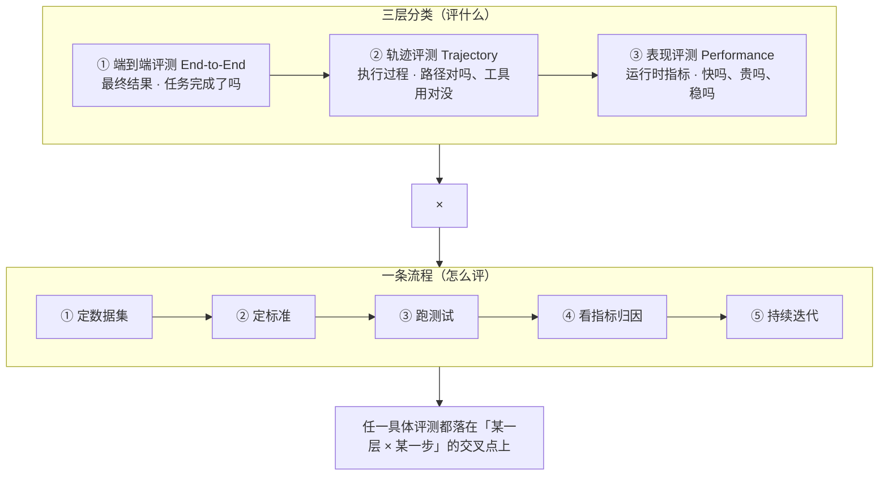
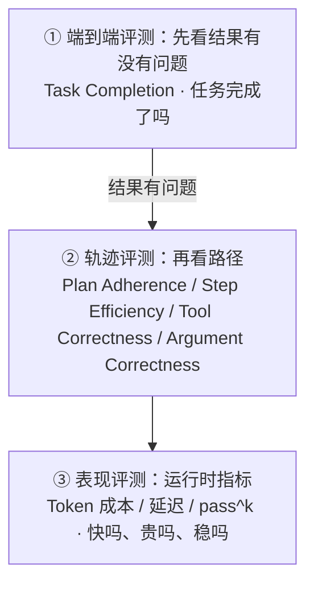
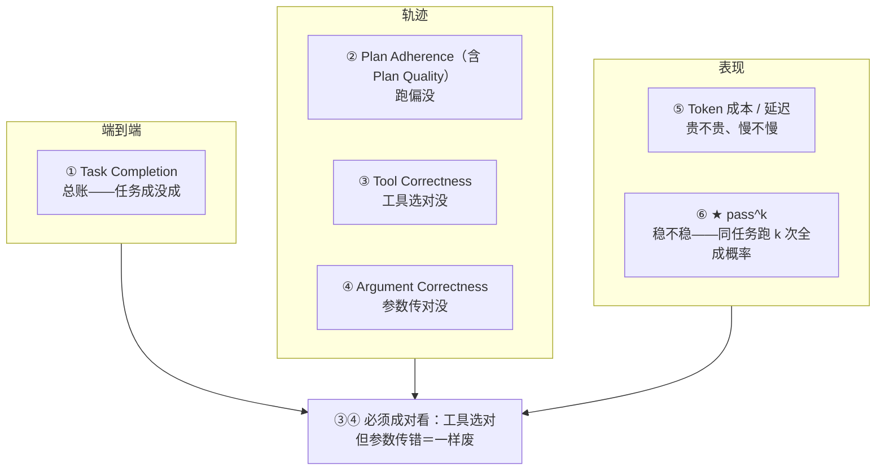
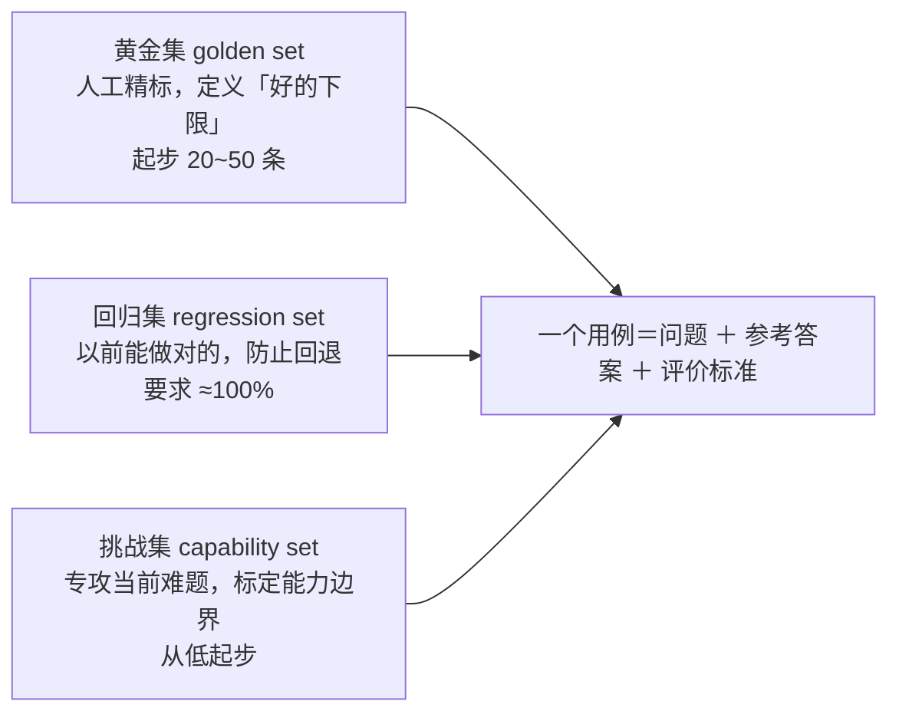
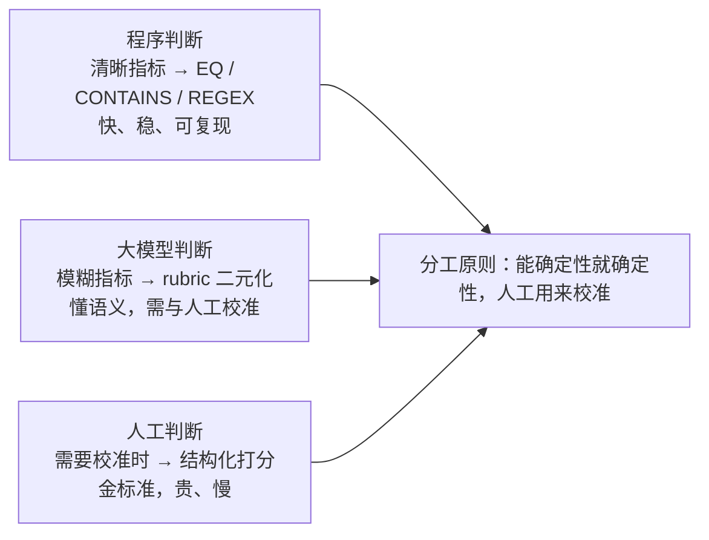
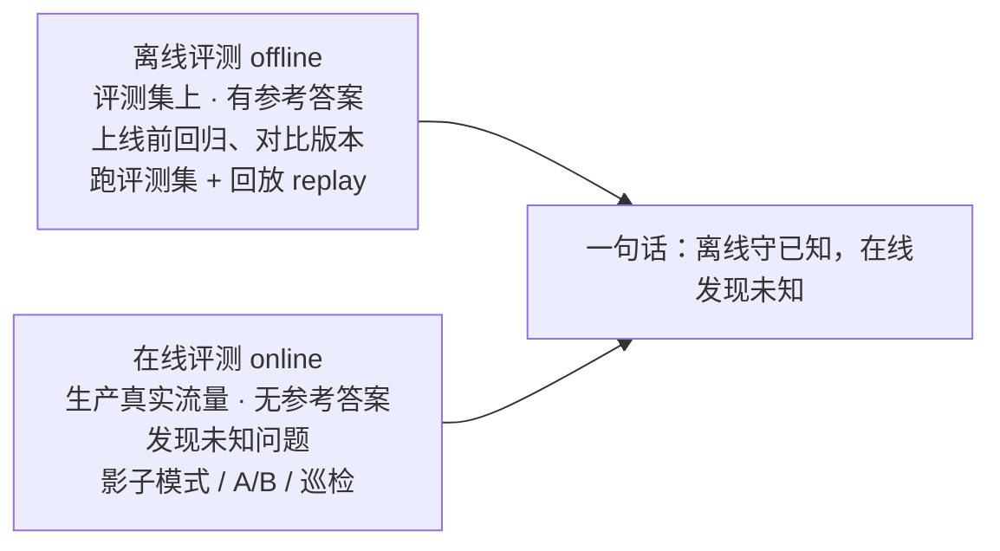
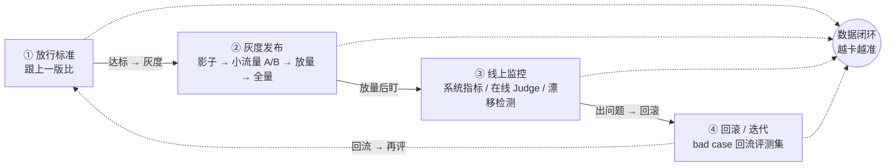

# Agent 评测体系 · 完全教程

> 基于抖音 @Harbor404《5min 带你搞懂 Agent 评测体系》（Agent 系列第 21 集，2026-10-15 发布，实际时长 5:42）逐帧还原，并补齐视频未展开的术语、原理、代码与工程实践。
>
> 配套图文版：[`index.html`](./index.html)（8 张结构重绘 SVG、一页速览，全文无视频截图）。姊妹篇：[RAG 评测完全教程](../rag-evaluation-tutorial/RAG评测完全教程.md)。
>
> **原视频**：[抖音分享链接](https://v.douyin.com/30rDH60axoo/) ｜ [网页版](https://www.douyin.com/video/7696585286075125011) ｜ 视频 ID `7696585286075125011` ｜ @Harbor404《5min 带你搞懂 Agent 评测体系》（2026-10-15 发布）。

## 保真约定

| 标记 | 含义 |
| --- | --- |
| **【视频原述】/【结构重绘】** | 严格按视频画面还原：术语原文、表格每一行、指标名、数值与举例。经「下载 1080P 原视频 → 每 5 秒抽帧 68 张 → 全帧中文 OCR → 关键页放大逐字目视校对」核对。 |
| **【补充】** | 视频未讲或未展开的官方定义、术语、代码、框架与工程实践，单独标注。 |

口播按平台官方章节要点与烧录字幕归纳，**不做逐字转写**；知识性结论以画面文档为准。

> **关于本期「配图」**：与上一集不同，本期视频画面是一份纯文本文档（浅灰框 ＋ 表格 ＋ 项目符号），**没有独立的彩色架构图**。因此两版中的 8 张配图是**按视频文档结构绘制的示意图**（每张图注标明依据），不是视频原图临摹；视频中出现过的**全部表格均已逐行还原**到两版。

---

## 0. 视频速览

【视频原述】左侧大纲全文：

```
Agent 评测体系
一、体系架构
二、详解
    2.1 三层分类（评什么）
        2.1.1 端到端评测
        2.1.2 轨迹评测
        2.1.3 表现评测
    2.2 生产里看哪几个指标（重点）
    2.3 一条流程（怎么评）
        ① 定数据集  ② 定标准  ③ 跑测试  ④ 看指标归因  ⑤ 持续迭代
三、上线与迭代
```

| 时间 | 章节 | 平台章节要点（原文） |
| --- | --- | --- |
| 00:00 | 引言 | — |
| 00:24 | 评测体系架构 | agent 评测体系包括端到端评测、轨迹评测、表现评测，评测流程与 RAG 相似。 |
| 01:48 | 数据集 | 数据集分为黄金数据集、回归数据集、挑战数据集，每个数据集包含问题和答案。 |
| 02:28 | 评判标准 | 评判标准分为清晰指标和模糊指标，模糊指标需通过评分细则二元化，还需人工判断。 |
| 03:30 | 测试 | 测试分为离线评测和在线评测，离线评测依赖已有数据，在线评测使用生产真实流量。 |
| 04:11 | 上线与迭代 | 上线后需判断指标是否准确，逐渐灰度上线，关注线上系统指标，形成数据飞轮。 |
| 04:48 | 总结 | agent 评测体系包括三类评测、数据集、评判标准、测试、上线与迭代。 |

### 一页速览：整期视频的 5 个结论

1. **一条公式**：Agent 评测 = 三层分类（评什么）× 一条流程（怎么评），两者正交。
2. **三层是诊断栈不是三张卷子**：端到端 → 轨迹 → 表现，逐层下钻定位问题。
3. **生产只盯 6 个指标**：Task Completion / Plan Adherence / Tool Correctness / Argument Correctness / Token 成本·延迟 / pass^k。
4. **三集数据 × 三种判据**：黄金集 / 回归集 / 挑战集；程序判断 / 大模型 rubric / 人工校准。
5. **离线守已知、在线发现未知**；线上 bad case 回流评测集，门槛越卡越准。

---

## 1. 体系架构：三层分类 × 一条流程

【视频原述】文档「一、体系架构」浅灰框原文：

```
Agent 评测 = 三层分类（评什么）× 一条流程（怎么评）
三层分类：① 端到端 → ② 轨迹 → ③ 表现
一条流程：① 定数据集 → ② 定标准 → ③ 跑测试 → ④ 看指标归因 → ⑤ 持续迭代
```

**配图还原（对应 HTML 版图 1）：**



**和 RAG 评测的关系**：RAG 评测评的是「一问一答」，Agent 评测评的是「一条多步执行的轨迹」。所以 Agent 评测要回答三个问题——**做成了没、怎么做的、代价多大**，对应三层分类；而不管评哪一层，流程都是同一条五步。

**正交关系**：三层分类和流程是正交的——任何一次具体评测，都落在「某一层 × 某一步」的交叉点上。

> 与上一集最本质的区别：RAG 评测按**组件**（检索 / 生成）拆，Agent 评测按**结果 / 路径 / 代价**拆，并且必须围绕完整 `trace`（执行轨迹）而非单次输入输出。

---

## 2. 详解

### 2.1 三层分类（评什么）

| 层 | 官方术语 | 评什么 | 核心问题 |
| --- | --- | --- | --- |
| ① | **端到端评测**（End-to-End） | 最终结果 | 任务完成了吗 |
| ② | **轨迹评测**（Trajectory） | 执行过程 | 路径对吗、工具用对没 |
| ③ | **表现评测**（Performance） | 运行时指标 | 快吗、贵吗、稳吗 |

【视频原述】「三层不是并列的三张卷子，而是一个**诊断栈**：先看结果有没有问题 → 结果有问题再看路径 → 路径有问题再定位到具体组件。」

**配图还原（对应 HTML 版图 2）：**



#### 2.1.1 端到端评测

- **是什么**：把整个 Agent 当黑盒，只看输入 → 最终输出。
- **核心指标**：`Task Completion`（任务完成率）、答案正确性／可用性。
- **特点**：全自动、成本低；只回答「成没成」，不回答「为什么」。
- **局限**：完成率从 68% 掉到 55%，它能拉响警报，但说不清哪一步坏了。
- **典型做法**：给 Agent 一个任务，跑完看终态对不对（如 `τ-bench` 比对会话结束时的数据库状态与目标状态）。

#### 2.1.2 轨迹评测

- **是什么**：评 Agent 的完整决策与行动序列——中间每一步。
- **为什么需要**：端到端只知道「没做成」，轨迹才能回答「哪一步搞砸了」。
- **评三个方面**（视频表格逐行还原）：

| 维度 | 指标 | 含义 |
| --- | --- | --- |
| 规划 | `Plan Quality / Plan Adherence` | 计划合理吗 / 按计划走了吗 |
| 步骤 | `Step Efficiency` | 有没有绕路、无效步骤 |
| 工具调用 | `Tool Correctness` | 工具选对没 |
| （同上） | `Argument Correctness` | 参数传对没 |

#### 2.1.3 表现评测

【视频原述】该层在三层分类表中给出「Performance / 运行时指标 / 快吗、贵吗、稳吗」；视频画面**未滚动到 2.1.3 的独立展开段落**，其具体内容由 2.2 的「Token 成本／延迟」「★ pass^k」以及 2.3 ④ 的「表现看延迟／成本／稳定」体现。

【补充】表现评测常见维度：P50/P95/P99 延迟、单任务 Token 与费用、工具调用次数与重试率、成功率与稳定性（pass^k）、并发下的错误率与超时率、安全事件数。它不判断答案对不对，只判断系统跑得**快不快、贵不贵、稳不稳**。

### 2.2 生产里看哪几个指标（重点）

【视频原述】「DeepEval 有 50+ 指标，但生产不是全看。实际盯就 6 个：」

**配图还原（对应 HTML 版图 3）：**



| # | 指标 | 层 | 看什么 |
| --- | --- | --- | --- |
| ① | `Task Completion` | 端到端 | 总账——任务成没成 |
| ② | `Plan Adherence`（含 Plan Quality） | 轨迹 | 跑偏没——按计划走了吗 |
| ③ | `Tool Correctness` | 轨迹 | 工具选对没 |
| ④ | `Argument Correctness` | 轨迹 | 参数传对没 |
| ⑤ | `Token 成本 / 延迟` | 表现 | 贵不贵、慢不慢 |
| ⑥ | `★ pass^k` | 表现 | 稳不稳——同任务跑 k 次全成的概率 |

> **③④ 必须成对看**：工具选对但参数传错 = 一样废。

**场景加看（默认不开）**：

| 触发条件 | 加看 |
| --- | --- |
| 带 RAG | `Faithfulness`、`Answer Relevancy` |
| 涉用户隐私 | `PII Leakage` |
| 有危险操作（转账 / 删库） | `Tool Permission`、`Misuse` |
| 对 C 端 | `Toxicity`、`Bias` |

**⚠️ 核心原则：指标是渐进的，别一上来全开。**

- **顺序**：先只上 `Task Completion`（看总账）→ 有问题再加轨迹指标（定位哪步坏）→ 再按业务挂场景指标。
- **依据**：先做 `error analysis`，再决定写哪些指标（美团 / Anthropic 共识）。
- **反例**：50 个指标全开 → 成本爆炸、噪音淹没信号、没人看。

### 2.3 一条流程（怎么评）

【视频原述】「不管评哪一层，流程都是同一条：① 定数据集 → ② 定标准 → ③ 跑测试 → ④ 看指标归因 → ⑤ 持续迭代」

**配图还原（对应 HTML 版图 4）：**


#### ① 定数据集

**一个用例 = 三元组：问题 ＋ 参考答案 ＋ 评价标准。** 按用途分三类：

**配图还原（对应 HTML 版图 5）：**



| 类型 | 英文 | 作用 | 通过率 |
| --- | --- | --- | --- |
| 黄金集 | `golden set` | 人工精标，定义「好的下限」 | 起步 20~50 条 |
| 回归集 | `regression set` | 以前能做对的，防止回退 | 要求 ≈100% |
| 挑战集 | `capability set` | 专攻当前难题，标定能力边界 | 从低起步 |

#### ② 定标准

【视频原述】「标准按『判得清不清』分三类，对应三种判据」：

**配图还原（对应 HTML 版图 6）：**



| 判据 | 适用 | 怎么判 | 特点 |
| --- | --- | --- | --- |
| **程序判断** | 清晰的指标（工具名、参数、格式、终态状态） | 代码确定性断言（`EQ / CONTAINS / REGEX`） | 快、稳、可复现 |
| **大模型判断** | 模糊的指标（答案质量、规划合理性、沟通质量） | `rubric`（评分细则，尽量二元化：是 / 否 / 未知） | 懂语义，但需与人工校准 |
| **人工判断** | 需要校准时 | 人评结构化打分 | 金标准，贵、慢 |

**分工原则**：能确定性就确定性——清晰的就用程序，模糊的才上 rubric，人工用来校准。

**① 程序判断（清晰指标）**

- 判什么：工具名／参数／格式／环境终态。
- 例：`ToolCorrectness` → 实际工具序列 == 期望序列（== 1.0 通过）。

**② 大模型判断（模糊指标 → rubric）**

- 判什么：无唯一正确答案的质量维度。
- 关键：**rubric 二元化**——把模糊概念拆成一组「是／否／未知」的具体检查项。
- 例：`AnswerCorrectness` → rubric（0-2 错 / 3-6 大体对 / 7-9 漏细节 / 10 全对）→ 阈值 ≥ 7。
- 前提：**人机一致率达标**（机器评测与人工评测一致），否则只能算「机器标注」，不算自动化评测。

**③ 人工判断**

- 用途：校准前面两者，尤其校准大模型 rubric。
- 原则：1 个「独裁者」好过 10 个「民主者」——统一口径，由一个人拍板。

#### ③ 跑测试

按「在哪跑、有没有参考答案」分两种：

**配图还原（对应 HTML 版图 7）：**



| 场景 | 在哪跑 | 有参考答案吗 | 用途 |
| --- | --- | --- | --- |
| 离线评测（offline） | 评测集上 | 有（`reference-based`） | 上线前回归、对比版本 |
| 在线评测（online） | 生产真实流量 | 无（`reference-free`） | 发现未知问题 |

- **离线的实现**：跑评测集（含回放 `replay`——用历史 trace 重放验证新版本）。
- **在线的实现**：影子模式（上线前用真实流量兜底）、A/B（上线后确认业务价值）、巡检（日常盯基本盘）。

> **一句话：离线守已知，在线发现未知。**

#### ④ 看指标归因

- **看指标**：端到端看 `Task Completion`，轨迹看 `Tool Correctness / Plan Adherence`，表现看延迟／成本／稳定／安全。
- **归因**：把失败的 trace 归类成 `failure taxonomy`，定位「哪一层的哪一步坏了」。
- **原则**：先做 `error analysis`，再决定写哪些指标。

> 画面差异：视频前段该句写作「表现看延迟／成本／稳定」，后段画面补为「稳定/安全」；本教程取更完整的后段写法。

> **关键认知**：离线只是门控，线上 A/B 看业务指标才是黄金标准。

#### ⑤ 持续迭代

把线上失败的 case 回灌进评测集，形成闭环——**评测集越滚越大，门槛越卡越准**。

---

## 3. 上线与迭代

【视频原述】「流程跑通后，评测要接进研发流程才有约束力。」

**配图还原（对应 HTML 版图 8）：**



**放行标准（跟上一版比）**

1. 优化项 ≥ 上一版，且统计显著。
2. 其余指标下降需在容差内（如 ±2%）。
3. 红线指标（延迟、安全）不超预算 → 一票否决。

**灰度发布**：影子流量 → 小流量 A/B → 放量 → 全量。

**线上监控**：系统指标（延迟 / 成本）、质量指标（在线 Judge）、漂移检测（query 分布）。

**回滚 / 迭代**：把线上 bad case 回流评测集，形成闭环。

【补充 · 工程落地】影子流量指复制真实请求打给新版本但「只记不答」；A/B 需保证同一用户稳定分桶；在线 Judge 通常只抽 5%–10% 流量异步执行；红线要自动化，触发即回滚；bad case 回流需人工去标识化与打标后再并入回归集。

---

## 4. 补充篇

> 本章全部为【补充】内容。

### 4.1 专业名词速查

| 名词 | 含义 |
| --- | --- |
| **Agent** | 能自主规划、调用工具、多步执行以完成目标的 LLM 系统；评测对象是完整执行过程。 |
| **Trace / Span** | 一次完整执行轨迹 / 轨迹中的单个组件调用；轨迹评测必须基于 trace。 |
| **端到端评测 End-to-End** | 把 Agent 当黑盒，只看输入 → 最终输出。 |
| **轨迹评测 Trajectory** | 评完整决策与行动序列，回答「哪一步搞砸了」。 |
| **表现评测 Performance** | 运行时指标：延迟、成本、稳定性、错误率。 |
| **Task Completion** | 任务完成率／完成度；端到端的总账指标。 |
| **Plan Quality** | 生成的计划是否逻辑合理、完整、高效。 |
| **Plan Adherence** | 执行是否按计划走；「计划抛弃」是典型失败模式。 |
| **Step Efficiency** | 是否避免绕路与冗余步骤。 |
| **Tool Correctness** | 工具选对没；reference-based，比较实际与期望工具序列。 |
| **Argument Correctness** | 工具参数传对没；常为 referenceless，由 LLM judge 判断。 |
| **pass^k** | τ-bench 引入：同一任务独立跑 k 次**全部成功**的概率；与 `pass@k`（至少一次成功）相反。 |
| **τ-bench** | Sierra 2024 的 tool-agent-user 基准，以「会话结束后的数据库终态」与目标状态比对判分。 |
| **DeepEval** | Pytest 风格 LLM 评测框架，50+ 指标；轨迹指标需 tracing。 |
| **golden set** | 黄金集：人工精标，定义质量下限，起步 20~50 条。 |
| **regression set** | 回归集：历史上能做对的用例，防止回退，要求 ≈100%。 |
| **capability set** | 挑战集：专攻当前难题，标定能力边界，通过率从低起步。 |
| **用例三元组** | 问题 ＋ 参考答案 ＋ 评价标准。 |
| **rubric** | 评分细则；把模糊质量维度拆成可判定的检查项，尽量二元化。 |
| **二元化** | 把连续/主观打分改造成离散断言，降低 judge 随机性。 |
| **人机一致率** | 机器评测与人工评测的一致程度；未达标只能算「机器标注」。 |
| **reference-based / free** | 有 / 无参考答案；对应离线评测集与在线真实流量。 |
| **error analysis** | 先人工归类失败样本，再决定写哪些指标。 |
| **failure taxonomy** | 失败类型学：把失败 trace 归类，定位「哪一层的哪一步坏了」。 |
| **replay** | 回放：用历史 trace 重放验证新版本。 |
| **影子模式 shadow mode** | 用真实流量打新版本但不返回结果给用户。 |
| **A/B 测试** | 小流量对比新旧版本的业务价值；线上 A/B 是黄金标准。 |
| **巡检** | 日常抽样盯基本盘。 |
| **在线 Judge** | 生产流量上异步调用 LLM 打分，通常抽样。 |
| **漂移检测** | 监控 query 分布变化，防止离线评测集脱节。 |
| **PII Leakage** | 个人敏感信息泄露；涉隐私场景才加看。 |
| **Tool Permission / Misuse** | 工具权限与误用；危险操作场景才加看。 |
| **Toxicity / Bias** | 毒性与偏见；对 C 端才加看。 |
| **Faithfulness / Answer Relevancy** | 忠实度 / 答案相关性；带 RAG 时才挂。 |
| **LLM-as-a-Judge** | 用大模型按 rubric 当裁判，需人工校准。 |
| **G-Eval / DAG** | DeepEval 的自定义指标机制：自然语言准则 / 图结构确定性打分。 |
| **threshold** | 通过阈值；DeepEval 默认 0.5，视频 rubric 例用 ≥7（10 分制）。 |
| **统计显著** | 提升需排除随机波动，常配合 bootstrap 置信区间。 |
| **容差** | 非优化指标允许的小幅下降，视频给如 ±2%。 |
| **红线指标** | 延迟、安全等硬约束，超预算一票否决。 |
| **灰度发布** | 影子 → 小流量 A/B → 放量 → 全量。 |
| **数据闭环 / 飞轮** | bad case 回流 → 门槛更严 → 下一轮更准。 |
| **CI 质量门禁** | 每次改动跑固定评测集，未达阈值阻断合入。 |
| **P95 延迟 / Token 成本** | 95 分位耗时 / 单任务 Token 开销，表现层主指标。 |
| **环境终态** | 任务结束后数据库/文件系统状态；τ-bench 以此判分。 |
| **多轮 / 用户模拟器** | τ-bench 用 LLM 模拟用户多轮交互。 |
| **observability / tracing** | 可观测性与链路追踪；DeepEval 用 `@observe` / `evals_iterator`。 |
| **正交** | 三层分类与五步流程互不依赖：任何评测都是「某一层 × 某一步」。 |

### 4.2 框架与基准全景

| 工具 / 基准 | 定位 | 与本视频体系的关系 |
| --- | --- | --- |
| **DeepEval** | Pytest 风格 LLM 评测框架，50+ 指标、G-Eval / DAG、CI 友好 | 视频 2.2 六指标来源；6 个 agentic 指标分轨迹级与组件级 |
| **τ-bench / τ²-bench / τ³-bench** | Sierra 的 tool-agent-user 基准，数据库终态 + pass^k | 视频 2.1.1 典型做法与 2.2 的 pass^k 出处；版本不同分数不可比 |
| **AgentBench / WebArena / GAIA** | 通用 Agent 能力基准 | 偏「能力上限」，与生产可靠性/回归互补 |
| **BFCL** | 函数调用能力基准 | 对应 Tool / Argument Correctness 的专项评估 |
| **LangSmith / Arize Phoenix / TruLens** | Trace 可观测性 + 在线评估 | 轨迹评测与在线 Judge 的基础设施 |
| **OpenAI Evals / Confident AI** | 评测运行与报告平台 | 承载评测集、报告与版本对比 |
| **RAGAS / RAG 指标** | RAG 检索与生成质量指标 | 视频 2.2「带 RAG」场景才加看 |

> 口径提醒：DeepEval 官方把 Agent 指标分为**轨迹级**（Task Completion、Step Efficiency、Plan Adherence、Plan Quality，需 tracing）与**组件级**（Tool Correctness、Argument Correctness，挂具体 span）。视频把 Task Completion 归「端到端」、把 pass^k 与成本延迟归「表现」，是**生产视角**的再分层，二者不冲突。

### 4.3 与 RAG 评测的衔接（承接第 20 集）

| 维度 | RAG 评测（第 20 集） | Agent 评测（本集） |
| --- | --- | --- |
| 评测对象 | 一问一答：检索片段 + 生成答案 | 一条多步执行的轨迹 |
| 拆分方式 | 按组件：检索 / 生成 | 按问题：结果 / 路径 / 代价 |
| 代表指标 | Recall / NDCG / Faithfulness / AnswerCorrectness | Task Completion / Tool Correctness / pass^k |
| 数据形态 | 3 个 JSONL + 1 张四字段表 | 问题 + 参考答案 + 评价标准的三元组，分三类集合 |
| 评测流程 | 选框架 → baselines → 数据 → 跑 → 算指标 → 上线闭环 | 定数据集 → 定标准 → 跑测试 → 归因 → 持续迭代 |
| 组合方式 | Agent 内部含 RAG 时，在检索/生成 span 上挂 RAG 指标，在整条 trace 上挂 Agent 指标；分开采集、分开告警 | 同左 |

### 4.4 可运行实战代码

**① 三类评测集（三元组结构）**

```python
import json

cases = [
  {"id": "gold_001", "set": "golden",
   "question": "帮我查订单 12345 的物流并改送到新地址",
   "reference": "订单状态与改址结果（数据库终态）",
   "criteria": {"tool_sequence": ["OrderLookup", "UpdateAddress"],
                "final_state": {"address": "新地址"}}},
  {"id": "reg_001", "set": "regression",
   "question": "查询订单 12345 的物流", "reference": "已发货，3 月 12 日送达",
   "criteria": {"must_contain": ["已发货"]}},
  {"id": "cap_001", "set": "capability",
   "question": "同时取消订单并申请退款，且不得越权", "reference": "两操作均完成且符合策略",
   "criteria": {"policy": "no_refund_without_permission"}},
]
with open("agent_cases.jsonl", "w", encoding="utf-8") as f:
    for c in cases:
        f.write(json.dumps(c, ensure_ascii=False) + "\n")
```

**② 程序判断：Tool / Argument Correctness（③④ 必须成对看）**

```python
def tool_correctness(actual_tools, expected_tools):
    return 1.0 if actual_tools == expected_tools else 0.0

def tool_with_args(actual_calls, expected_calls):
    return 1.0 if actual_calls == expected_calls else 0.0

print(tool_correctness(["OrderLookup"], ["OrderLookup"]))            # 1.0
print(tool_with_args([("OrderLookup", {"id": 999})],
                     [("OrderLookup", {"id": 12345})]))              # 0.0
```

**③ DeepEval：轨迹指标需 tracing**

```python
from deepeval.dataset import EvaluationDataset, Golden
from deepeval.metrics import TaskCompletionMetric, ToolCorrectnessMetric
from deepeval.tracing import observe

@observe()
def trip_agent(user_input):
    # 真实 Agent：规划 → 工具调用 → 生成答案
    return "行程已生成"

dataset = EvaluationDataset(goldens=[Golden(input="Plan a two-day trip to Paris")])
for golden in dataset.evals_iterator(metrics=[TaskCompletionMetric(threshold=0.9)]):
    trip_agent(golden.input)
# 组件级指标挂到具体 span：@observe(metrics=[...]) + update_current_span(...)
```

**④ rubric 二元化（模糊指标拆成是/否/未知）**

```python
RUBRIC = [
  "答案是否覆盖了参考结论中的全部关键事实？",
  "是否包含参考结论中没有的、无法验证的新事实？",
  "工具调用失败时是否明确告知用户而不是假装成功？",
]
def judge_prompt(answer, context):
    return ("逐条回答下面的检查项，只能输出 是 / 否 / 未知，并各给一句依据：\n"
            + "\n".join(f"{i+1}. {q}" for i, q in enumerate(RUBRIC))
            + f"\n\n待评答案：{answer}\n可用上下文：{context}")
# 聚合成 10 分制：每条「是」得分，「未知」不计入，阈值 ≥7 才通过（视频示例）
```

**⑤ pass^k：可靠性而非通过率**

```python
def pass_hat_k(runs, k):
    """runs: {task_id: [bool, ...]}，每任务独立跑 k 次；返回全部 k 次都成功的比例"""
    ok = sum(1 for rs in runs.values() if len(rs) >= k and all(rs[:k]))
    return ok / len(runs)

runs = {"t1": [True, True, True], "t2": [True, False, True], "t3": [True, True, False]}
print("pass^1 =", pass_hat_k(runs, 1))   # 1.000
print("pass^3 =", pass_hat_k(runs, 3))   # 0.333  ← 视频强调的「稳不稳」
```

**⑥ CI 门禁（放行标准）**

```python
GATES = {"task_completion": 0.90, "tool_correctness": 0.95,
         "argument_correctness": 0.95, "p95_latency_s": 3.0}

def release_gate(current, previous, tolerance=0.02):
    for k, threshold in GATES.items():
        v = current[k]
        if k == "p95_latency_s":
            assert v <= threshold, f"红线 {k} 超预算: {v}"
        else:
            assert v >= threshold, f"{k} 未达门槛: {v}"
            assert v >= previous[k] * (1 - tolerance), f"{k} 下降超容差"
    return True  # 统计显著另做 bootstrap / 配对检验
```

### 4.5 常见误区与失败归因

| 误区 | 正确做法 |
| --- | --- |
| 一上来把 50+ 指标全开 | 先 Task Completion 看总账，再按 error analysis 渐进加指标 |
| 只看 Task Completion 就宣布没问题 | 完成率相同也可能是绕路/参数错/靠运气，需轨迹指标下钻 |
| ③④ 分开看或只看一个 | Tool / Argument Correctness 成对看 |
| 把 pass^k 当成 pass@k | pass^k 要 k 次全成，pass@k 只要一次成功，含义相反 |
| rubric 不做人机一致率校准 | 先用人工打分校准，达标后才算自动化评测 |
| 多人各自人工打分取平均 | 统一口径、由一人拍板 |
| 离线分数漂亮就全量上线 | 离线只是门控，线上 A/B 才是黄金标准 |
| 评测集一次建好不再维护 | 线上 bad case 回流，门槛越卡越准 |
| 忽略线上 query 漂移 | 做漂移检测，定期更新黄金集与挑战集 |
| 用平均延迟代替 P95 / P99 | 长尾失败才伤体验，表现层看分位数 |

**失败归因速查（failure taxonomy）**

| 症状 | 先看的层 | 定位指标 | 可能动作 |
| --- | --- | --- | --- |
| Task Completion 掉点 | 端到端 | Task Completion | 确认是结果问题，再下钻轨迹 |
| 结果错但工具都对 | 轨迹 | Plan Adherence / Plan Quality | 改规划 prompt、补计划自检 |
| 工具调用序列不对 | 轨迹 | Tool Correctness | 改工具描述/路由、补 few-shot |
| 工具对但结果不对 | 轨迹 | Argument Correctness | 约束参数抽取、schema 校验 |
| 步数异常多 | 轨迹 | Step Efficiency | 去冗余工具、加重试上限 |
| 延迟/成本上涨 | 表现 | Token 成本 / P95 延迟 | 缓存、换模型、并发超时控制 |
| 偶发失败、复现不了 | 表现 | pass^k | 降温度、固定种子、幂等与重试 |

---

## 5. 附录

### 5.1 全书配图清单（8 张按文档结构绘制的示意图）

本期视频画面为文档与表格，下列 8 张为教程依文档结构绘制的示意图（HTML 用 SVG、本文用 Mermaid）；视频中的表格已在正文逐行还原。

1. 体系架构：三层分类 × 一条流程
2. 三层分类与诊断链（三层表 + 视频诊断栈原文；定位到具体组件不属于表现评测层）
3. 生产 6 指标分层（端到端 1 / 轨迹 3 / 表现 2）
4. 一条流程五步
5. 三类数据集（黄金 / 回归 / 挑战）
6. 三种判据（程序 / 大模型 rubric / 人工）
7. 离线 vs 在线评测
8. 上线与迭代示意闭环（依该章四个文字环节绘制，视频该章为文字段落）

### 5.2 平台摘要措辞 → 画面原文 对照

本期自动摘要没有明显的语音识别错字，但用了概括性措辞；下表对齐到画面文档原文。

| 章节摘要写法 | 画面文档原文 |
| --- | --- |
| 黄金数据集 / 回归数据集 / 挑战数据集 | **黄金集 golden set / 回归集 regression set / 挑战集 capability set** |
| 准备数据集、定义评判标准、进行测试、计算指标并归因 | **① 定数据集 → ② 定标准 → ③ 跑测试 → ④ 看指标归因 → ⑤ 持续迭代** |
| 每个数据集包含问题和答案 | **一个用例 = 三元组：问题 ＋ 参考答案 ＋ 评价标准** |
| 计算指标并归因 | **看指标归因**，并归类成 failure taxonomy |
| 形成数据飞轮 | **评测集越滚越大，门槛越卡越准** |
| 评测流程与 RAG 相似 | 原文：RAG 评「一问一答」，Agent 评「一条多步执行的轨迹」；流程同为五步 |
| ④ 看指标归因：表现看延迟／成本／稳定 | 视频**前段**为「稳定」，**后段**补为「稳定/安全」；教程采用后段更完整写法并在正文标注 |

### 5.3 还原方法与资料来源

> **原视频**：[抖音分享链接](https://v.douyin.com/30rDH60axoo/) ｜ [网页版](https://www.douyin.com/video/7696585286075125011) ｜ 视频 ID `7696585286075125011` ｜ @Harbor404《5min 带你搞懂 Agent 评测体系》（2026-10-15 发布）。
**还原流程**：解析分享短链取得视频 ID `7696585286075125011` → 取得官方详情（标题、作者、时长 341.681 秒、7 段章节列表）→ 下载 1080P 视频（1662×1080，15.7 MB）→ 每 5 秒抽帧共 68 张 → 全帧中文 OCR（约 3,900 行）→ 关键页面放大逐字目视校对 → 与平台章节要点、烧录字幕交叉验证。所有术语、指标名、表格行、数值与举例均以**画面文档**为准。本期画面没有独立彩色配图，两版中的 8 张图均为按文档结构绘制的示意图。

**补充内容的核实资料**：

- [DeepEval 官方文档 · Metrics Introduction](https://deepeval.com/docs/metrics-introduction)：50+ 指标、6 个 agentic 指标、轨迹指标需 tracing、分数 0–1 与默认阈值 0.5。
- [Sierra · τ-bench 官方介绍](https://sierra.ai/blog/benchmarking-ai-agents)：数据库终态比对、用户模拟、pass^k（k 次独立运行全部成功）。
- τ²-bench / τ³-bench、AgentBench、LangSmith / TruLens / Arize Phoenix 等公开文档与 2026 年 Agent 评测横评资料。

> **口径提示**：视频把 Task Completion 归「端到端」、pass^k 与成本延迟归「表现」，是生产视角的分层；DeepEval 官方按「轨迹级 / 组件级」分类。4.2 节同时给出两种口径，避免混用。

---

*本教程为学习整理用途，视频内容版权归原作者 @Harbor404 所有；框架与指标的官方定义以各项目文档为准。*
