# LangChain / LangGraph / Deep Agents 框架选型 · 完全教程

> **单支视频逐帧还原 + 系统化补全**
>
> 原视频：[LangChain、Langgraph、DeepAgent开发框架怎么选？](https://v.douyin.com/dX1jn7y0BFA/)（@小k技术栈，2026-11-24，12:28）
>
> 配套文件：[index.html（图文阅读版，23 张 SVG）](index.html)
>
> 姊妹篇：[开发架构选型（在线阅读）](../agent-architecture-tutorial/Agent开发架构选型完全教程.html) ｜ [从 0 到 1 搭建评测系统（在线阅读）](../agent-eval-system-tutorial/Agent评测系统搭建完全教程.html) ｜ [Agent 评测方法论（在线阅读）](../agent-eval-method-tutorial/Agent评测方法论完全教程.html) ｜ [消除 LLM Judge 偏见（在线阅读）](../agent-judge-bias-tutorial/Agent评测偏见消除完全教程.html)

---

## 目录

- [0. 视频速览与保真约定](#0-视频速览与保真约定)
- [1. 全片结构地图](#1-全片结构地图)
- [2. 先说结论：三个抽象层次，不是三个竞品](#2-先说结论三个抽象层次不是三个竞品)
- [3. LangChain 的起点：一个企业智能客服](#3-langchain-的起点一个企业智能客服)
- [4. LangChain 的基础组件与 create_agent](#4-langchain-的基础组件与-create_agent)
- [5. 由模型按当前问题选择工具，以及适用场景](#5-由模型按当前问题选择工具以及适用场景)
- [6. 中间件扩展与 LangGraph 的引出](#6-中间件扩展与-langgraph-的引出)
- [7. LangGraph 的起点：企业售后处理系统](#7-langgraph-的起点企业售后处理系统)
- [8. 图三要素：State / Node / Edge](#8-图三要素state--node--edge)
- [9. 条件流转与精确控制](#9-条件流转与精确控制)
- [10. 暂停、恢复与生产级能力](#10-暂停恢复与生产级能力)
- [11. 适用场景与「代码 + 模型」分工](#11-适用场景与代码--模型分工)
- [12. Deep Agents：只给目标，由 Agent 自己规划](#12-deep-agents只给目标由-agent-自己规划)
- [13. 完整执行框架：建立在前两者之上](#13-完整执行框架建立在前两者之上)
- [14. 任务规划与子智能体协作](#14-任务规划与子智能体协作)
- [15. 文件系统与上下文管理](#15-文件系统与上下文管理)
- [16. 可扩展能力、适用场景与权限边界](#16-可扩展能力适用场景与权限边界)
- [17. 核心区别与三种能力比喻](#17-核心区别与三种能力比喻)
- [18. 三个选型问题与决策树](#18-三个选型问题与决策树)
- [19. 特别说明：不是所有业务都需要 Agent](#19-特别说明不是所有业务都需要-agent)
- [20. 三者能否一起用：可以，按项目需求组合](#20-三者能否一起用可以按项目需求组合)
- [21. 总结：让框架服务于业务](#21-总结让框架服务于业务)
- [22. 补充篇 A：专业名词速查（56 条）](#22-补充篇-a专业名词速查56-条)
- [23. 补充篇 B：官方文档对照](#23-补充篇-b官方文档对照)
- [24. 补充篇 C：可运行代码](#24-补充篇-c可运行代码)
- [25. 补充篇 D：常见误区](#25-补充篇-d常见误区)
- [26. 附录](#26-附录)

---

## 一页速览：整期视频的 7 个结论

| # | 结论 | 位置 |
|---|---|---|
| 1 | **三个抽象层次，不是三个竞品** | [第 2 章](#2-先说结论三个抽象层次不是三个竞品) |
| 2 | **LangChain**：基础组件、create_agent 与模型—工具循环 | [第 3 章](#3-langchain-的起点一个企业智能客服) |
| 3 | **LangGraph**：State / Node / Edge 与生产级恢复能力 | [第 7 章](#7-langgraph-的起点企业售后处理系统) |
| 4 | **Deep Agents**：规划、子智能体、文件系统与上下文管理 | [第 12 章](#12-deep-agents只给目标由-agent-自己规划) |
| 5 | **核心区别**：准备工具 / 设计流程 / 配备任务管理系统 | [第 17 章](#17-核心区别与三种能力比喻) |
| 6 | **三个选型问题**依次判断；固定流程不必做 Agent | [第 18 章](#18-三个选型问题与决策树) |
| 7 | **可以组合使用，从最简单方案开始** | [第 20 章](#20-三者能否一起用可以按项目需求组合) |

---

## 0. 视频速览与保真约定

**【补充】** 本教程逐帧还原 **@小k技术栈《LangChain、Langgraph、DeepAgent开发框架怎么选？》**（2026-11-24，12:28，1920×1080），并按本站既有标准补齐专业名词、官方文档对照、可运行代码、常见误区与校正表。

| # | 视频 / ID | 作者 / 发布 | 时长 / 画面 | 画面结构 |
|---|---|---|---|---|
| ① | LangChain、Langgraph、DeepAgent开发框架怎么选？ `7711684080711229049` | 小k技术栈 ／ 2026-11-24 | 12:28 ／ 1920×1080 横屏 | 白底手绘式幻灯片；顶部固定小节导航条 + 底部黑底烧录字幕；8 段官方章节 |

| # | 官方章节 | 时间码 | 对应本教程 |
|---|---|---|---|
| 1 | 引言 | 00:01 | 第 0–2 章 |
| 2 | LangChain | 00:50 | 第 3–6 章 |
| 3 | LangGraph | 02:41 | 第 7–11 章 |
| 4 | DeepAgent | 05:27 | 第 12–16 章 |
| 5 | 核心区别 | 08:49 | 第 17 章 |
| 6 | 框架选择 | 09:43 | 第 18–19 章 |
| 7 | 框架联用 | 11:05 | 第 20 章 |
| 8 | 总结 | 11:51 | 第 21 章 |

> **保真边界**。① 视频标题中的「Langgraph」「DeepAgent」为作者写法，官方拼写为 **LangGraph**、**Deep Agents**（包名 `deepagents`），正文一律用官方拼写，校正表保留原写法。② 画面顶部有 39 个固定小节导航条（如「LangGraph・图的三个要素」「选型•三个选型问题」），本教程按它切分细粒度结构；官方 `chapter_list` 另给 8 段大章节，两者都在第 1 章与附录列出。③ 字幕为黑底烧录中文，OCR 噪声（如「人工車排」「沙稍隔离」「Lang Chain」）已按画面与上下文校正。④ 标注【补充】的内容来自 LangChain 官方文档与本站第四篇，不属于视频原述。⑤ 本轮未做 ASR。

---

## 1. 全片结构地图

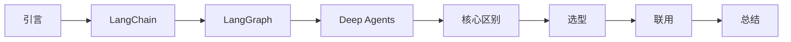

**图 1｜全片结构地图（按官方章节重绘）**

**【按画面重绘】** 视频用 8 段官方章节串起「先给结论 → 逐个框架讲定位与例子 → 横向对比 → 回答怎么选 → 说明可以组合 → 收束」。画面顶部的 39 个小节导航条比大章节更细，例如 LangChain 段下依次是「智能客服 / 基础组件 / 创建 Agent / 模型与工具循环 / 按问题选择工具 / 适用场景」。

| 阶段 | 画面小节导航（节选） | 本教程 |
|---|---|---|
| 开场 | Agent・框架怎么选 / Agent。三个抽象层次 | 第 2 章 |
| LangChain | 智能客服 / 基础组件 / 创建 Agent / 模型与工具循环 / 按问题选择工具 / 适用场景 | 第 3–6 章 |
| LangGraph | 流程复杂之后 / 售后处理流程 / 明确业务规则 / 图的三个要素 / State / Node / Edge / 精确控制执行 / 暂停与恢复 / 适用场景 / 代码与模型分工 | 第 7–11 章 |
| Deep Agents | 自主规划目标 / 执行与迭代 / 任务规划 / 子智能体协作 / 文件与中间产物 / 控制上下文规模 / 可扩展能力 / 适用场景 / 权限与执行环境 | 第 12–16 章 |
| 收束 | 核心区别 / 三种能力 / 三个选型问题 / 固定流程也有简单方案 / 三者可以组合使用 / 根据需求选择 / 让框架服务业务 | 第 17–21 章 |

---

## 2. 先说结论：三个抽象层次，不是三个竞品

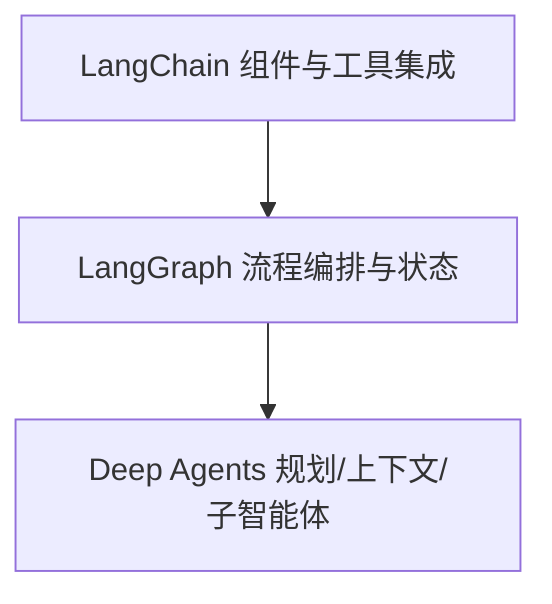

**图 2｜三个抽象层次重绘**

**【视频原述】** 口播：「LangChain 主要解决 Agent 基础组件和工具集成问题；LangGraph 主要解决 Agent 流程编排和状态管理问题；Deep Agents 则是在这些基础能力之上，进一步封装了任务规划、上下文管理、子智能体等能力，让 Agent 能够处理更加复杂、更加长期的任务」。

> **可以把它们理解为三个不同抽象层次的开发框架，而不是三个完全平行、彼此竞争的产品。**

**【补充】** 这与本站《Agent 开发架构选型 · 完全教程》里 Framework → Runtime → Harness 的三层抽象完全对应：LangChain 是框架层，LangGraph 是运行时层，Deep Agents 是 Harness 层。第四篇讲七个代表项目的横向对比，本篇只讲 LangChain 自家这三层怎么选、怎么联用。

---

## 3. LangChain 的起点：一个企业智能客服

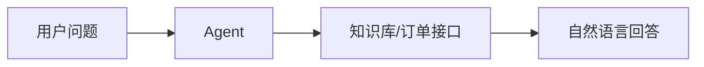

**图 3｜智能客服场景与手写痛点重绘**

**【视频原述】** 视频给的第一个例子是企业智能客服：系统需要查询企业知识库，或者调用订单接口，最后把查询结果整理成自然语言返回给用户。口播强调「这种场景其实就是一个比较典型 Agent 应用」。

**【视频原述】** 如果从头写，要自己解决四件事：怎么接入大模型、怎么定义工具、怎么让模型调用工具、模型和工具之间如何传递消息——「开发工作会比较繁琐」。

### 3.1 从零搭建的四项工作

1. **模型接入**：对接不同厂商的推理接口与参数。
2. **工具定义**：把知识库检索、订单查询等能力描述成模型可调用的函数。
3. **工具调用**：解析模型输出、发起调用、处理返回。
4. **消息传递**：维护模型与工具之间的多轮消息序列。

---

## 4. LangChain 的基础组件与 create_agent

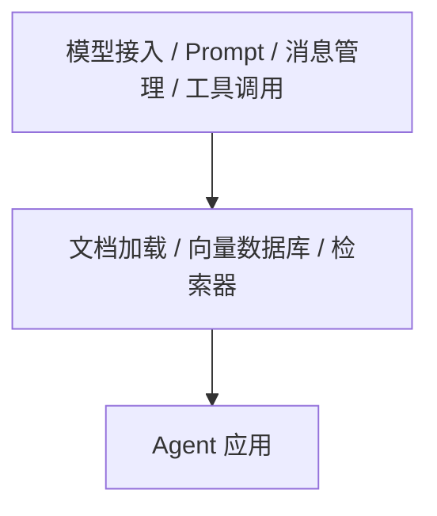

**图 4｜LangChain 基础组件重绘**

**【视频原述】** 画面列出 LangChain 提供的基础组件：模型接入、Prompt、消息管理、工具调用、文档加载、向量数据库、检索器；口播原话是「开发者可以直接使用这些组件，快速搭建一个 Agent 应用」。

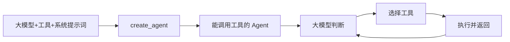

**图 5｜create_agent 与工具循环重绘**

### 4.1 create_agent：准备好三样东西

**【视频原述】** 「LangChain 提供了 `create_agent` 这样的高层接口。开发者只需要准备好大模型、工具和系统提示词，就可以创建一个能够调用工具的 Agent。」

### 4.2 模型—工具循环

**【视频原述】** 执行过程：大模型分析当前任务 → 判断是否需要调用工具 → 需要就选择合适工具执行并返回 → 大模型再根据工具结果继续处理。这个循环的调度由框架接管，开发者不必手写状态机。

> 官方文档补充：LangChain 1.0 的 `create_agent` 构建在 LangGraph 运行时之上，但「你不需要了解 LangGraph 就能用 LangChain」。这是「层层叠加」而非「必须同时使用」的直接证据。

---

## 5. 由模型按当前问题选择工具，以及适用场景

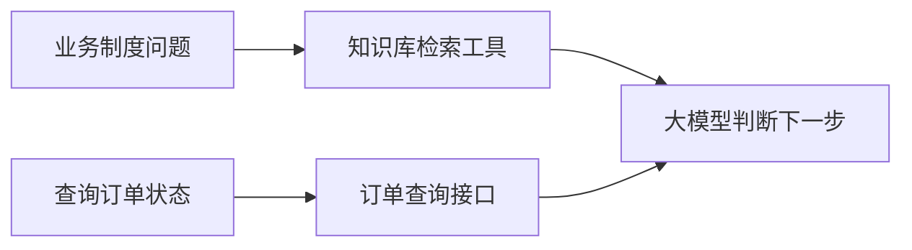

**图 6｜按问题选工具与适用场景重绘**

**【视频原述】** 画面给出两个并列例子：「用户询问企业某项业务制度 → 调用知识库检索工具」「用户想查询订单状态 → 调用订单查询接口」，并标注「由模型根据当前问题进行判断」。

**【视频原述】** 适用场景：企业知识库问答、RAG 应用、智能客服，以及需要调用数据库或第三方 API 的智能助手。口播总结：「这些应用通常不需要特别复杂的流程控制，主要依靠大模型判断下一步应该做什么」。

| 场景 | 典型动作 | 为什么 LangChain 够用 |
|---|---|---|
| 企业知识库助手 | 检索 → 生成回答 | 以问答与工具调用为主 |
| RAG 应用 | 文档加载 / 向量库 / 检索器 | 基础组件已内置 |
| 智能客服 | 按问题选知识库或订单接口 | 由模型判断下一步 |
| 简单数据查询助手 | 调用数据库 / 第三方 API | 无需复杂流程编排 |

---

## 6. 中间件扩展与 LangGraph 的引出

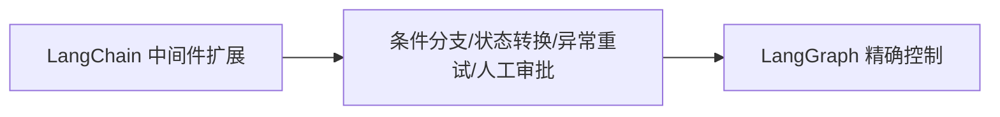

**图 7｜中间件扩展与 LangGraph 引出重绘**

**【视频原述】** 口播特意补了一句：「LangChain 并不只能开发简单应用，它也支持通过中间件等方式扩展 Agent 执行过程」。画面列出四类扩展：条件分支、状态转换、异常重试、人工审批。

> 但当「出现大量条件分支、状态转换、异常重试和人工审批」时，流程就不再适合全部交给模型判断——这正是 LangGraph 的主场。

**【补充】** 注意这是**抽象层次下移**，不是产品淘汰：从「让模型判断下一步」变成「让开发者定义下一步」。

---

## 7. LangGraph 的起点：企业售后处理系统

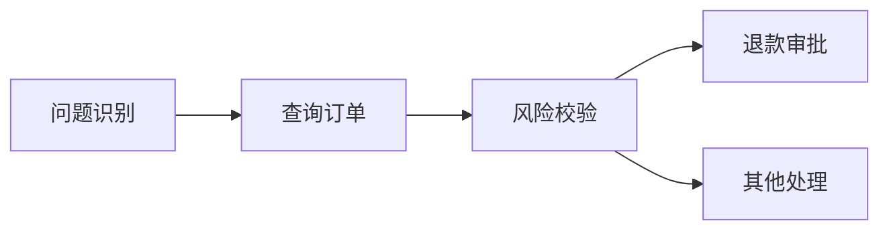

**图 8｜售后流程与业务规则重绘**

**【视频原述】** 第二个例子是企业售后处理系统：先识别问题类型，然后查询订单，接着进行风险校验；符合就进入退款审批，不符合就转入其他处理流程。

**【视频原述】** 口播强调：「不能完全交给大模型决定」「什么时候必须进行风险校验，什么时候需要等待人工审批」——这些是明确的业务规则，不是模型的自由裁量。

> 画面小节导航依次为「LangGraph•售后处理流程」「LangGraph•明确业务规则」「LangGraph•图的三个要素」「LangGraph • State 共享状态」「LangGraph・Node 执行任务」「LangGraph • Edge 条件流转」「LangGraph•精确控制执行」。

---

## 8. 图三要素：State / Node / Edge

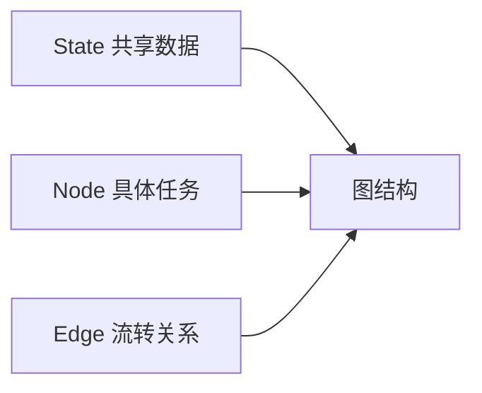

**图 9｜图三要素重绘**

**【视频原述】** 「LangGraph 使用图结构来组织整个执行流程」，三个概念：State（状态，保存工作流执行过程中需要共享的数据）、Node（节点，例如调用大模型识别问题类型、查询订单信息、执行风险校验）、Edge（定义节点之间的流转关系）。

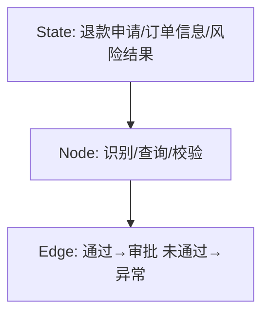

**图 10｜三要素落地重绘**

### 8.1 三要素落到售后例

| 要素 | 画面原文 | 售后系统里的具体值 |
|---|---|---|
| State | 共享数据 | 用户提交的退款申请、订单信息、风险校验结果 |
| Node | 具体任务 | 识别问题类型、查询订单信息、执行风险校验 |
| Edge | 流转关系 | 风险校验通过 → 退款审批；未通过 → 异常处理 |

**【视频原述】** 「一个节点执行一个具体任务」「根据条件决定下一步执行哪个节点」，于是整个售后流程被拆成多个节点，开发者能明确控制每个环节的执行顺序。

---

## 9. 条件流转与精确控制

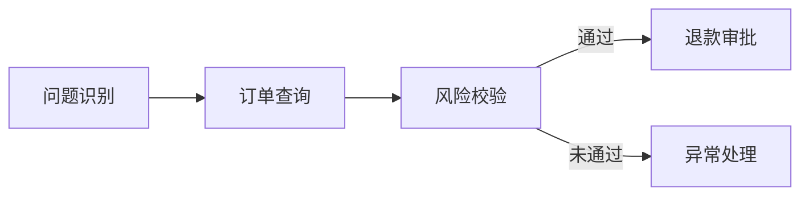

**图 11｜条件流转与精确控制重绘**

**【视频原述】** 画面用「风险校验 → 通过 / 未通过 → 退款审批 / 异常处理」演示条件边。核心价值口播原话：「它让开发者能够更加精确地控制 Agent 的执行过程」。

> LangGraph 的价值不在于「让 Agent 更聪明」，而在于「让流程更可控」——把确定性环节固定下来，把需要判断的环节留给模型。

---

## 10. 暂停、恢复与生产级能力

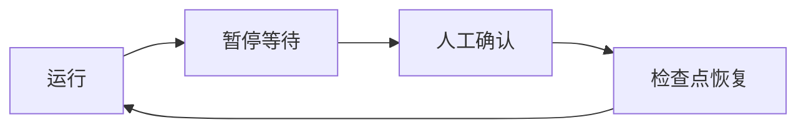

**图 12｜暂停与恢复重绘**

**【视频原述】** 「除此之外，LangGraph 还提供了持久化检查点、流式输出、执行中断和人工介入等能力」。例子：退款流程执行到人工审批环节，系统先暂停运行，等人工审批完成后，再从之前暂停的位置继续执行；任务异常时也可结合检查点保存的状态恢复执行。

| 能力 | 画面文字 | 解决什么 |
|---|---|---|
| 持久化检查点 | 检查点保存状态 → 恢复执行 | 长时间运行 / 故障恢复 |
| 流式输出 | 流式输出 | 过程可见、逐步返回 |
| 执行中断 | 暂停等待 | 在关键节点停下来 |
| 人工介入 | 人工确认 → 继续执行 | 审批与人工把关 |

---

## 11. 适用场景与「代码 + 模型」分工

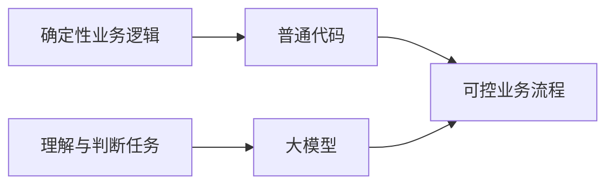

**图 13｜适用场景与分工重绘**

**【视频原述】** 适用场景：多步骤业务流程、复杂条件分支、循环重试、人工审批，以及需要保存状态并支持中断恢复的 Agent 系统；典型如订单处理、退款审批、企业工单系统。

**【视频原述】** 视频特意强调：「LangGraph 并不意味着所有步骤都必须交给大模型处理。相反，它非常适合把确定性的业务逻辑交给普通代码，把需要理解和判断的任务交给大模型」。

> 判断标准：这一步的结果是否**只能由语义理解得出**？不是，就写普通代码；是，才交给模型。

---

## 12. Deep Agents：只给目标，由 Agent 自己规划

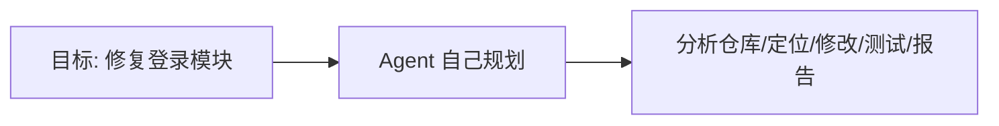

**图 14｜Deep Agents 定位与代码修复任务重绘**

**【视频原述】** 第三个例子：给 AI 一个任务「分析当前项目的代码仓库，找出登录模块存在的问题，修复相关代码，然后运行测试」——「注意，这个任务并没有规定具体应该执行哪些步骤」。

**【视频原述】** Agent 需要自己理解目标、分析代码仓库、找到相关文件、制定修复计划、修改代码、运行测试；「测试失败 → 分析错误 → 调整代码」，直到达到预期结果。整个过程涉及大量文件和工具调用，还需要保存中间发现的信息。

**【视频原述】** 「如果这些功能全部由开发者自己实现，工作量较大」，而 Deep Agents 就是为这类复杂任务提供更完整的执行框架。

---

## 13. 完整执行框架：建立在前两者之上

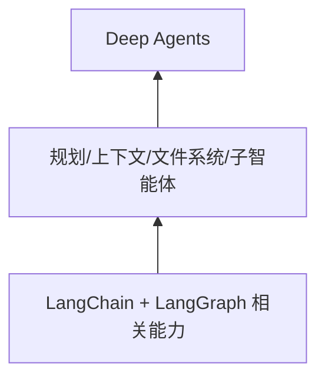

**图 15｜完整执行框架重绘**

**【视频原述】** 画面给出一张堆叠图：底层是「LangChain + LangGraph 相关能力」，上层是「规划 / 上下文 / 文件系统 / 子智能体」，顶部标注「自行实现：工作量较大」。口播：「它建立在 LangChain 和 LangGraph 的相关能力之上，进一步整合了任务规划、上下文管理、文件系统和子智能体等能力」。

| 层 | 内容 | 来源 |
|---|---|---|
| 底层 | 模型 / 工具组件 + 持久执行 / 状态管理 | LangChain + LangGraph |
| 上层 | 规划、上下文、文件系统、子智能体 | Deep Agents 封装 |
| 可选 | Skills、长期记忆、人工介入、沙箱与执行工具 | 按配置启用 |

---

## 14. 任务规划与子智能体协作

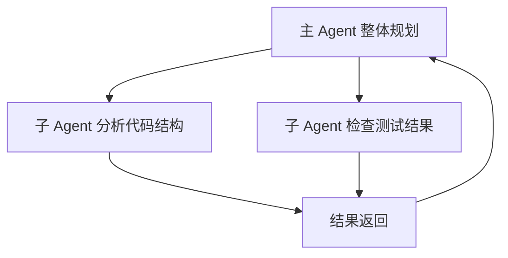

**图 16｜任务规划与子智能体重绘**

### 14.1 任务规划：大目标 → 可跟踪的具体步骤

**【视频原述】** 「Agent 可以把任务拆分成多个具体步骤，并跟踪每个步骤执行情况」。代码修复任务可拆成代码分析、问题定位、代码修改、测试验证、结果整理。

### 14.2 子智能体：把独立子任务交给专门 Agent

**【视频原述】** 主 Agent 负责整体任务规划；一个子 Agent 分析代码结构，另一个子 Agent 检查测试结果；完成后「子任务结果返回 → 主 Agent 汇总处理」。

> 官方文档补充：规划工具 `write_todos` 在新版为可选中间件（`TodoListMiddleware`）；子智能体通过内置 `task` 工具创建，默认隔离上下文并只返回一份最终结果。

---

## 15. 文件系统与上下文管理

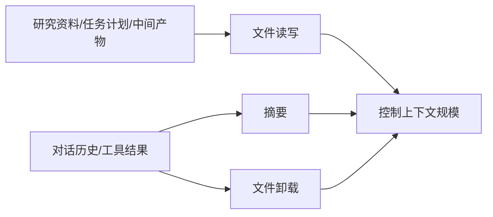

**图 17｜文件系统与上下文管理重绘**

**【视频原述】** 「在复杂任务中，Agent 可能需要读取大量文件，也可能需要把中间结果保存下来」。Deep Agents 提供文件系统能力，通过文件读写保存研究资料、任务计划和中间产物，「减少所有信息都堆积在对话上下文中的情况」。

**【视频原述】** 口播点出根因：「Agent 执行时间越长，调用工具越多，对话历史和工具返回结果就可能越来越多」，所以需要「通过摘要、文件卸载等方式控制上下文规模」。

| 机制 | 画面文字 | 作用 |
|---|---|---|
| 文件读写 | 研究资料 / 任务计划 / 中间产物 | 把大结果移出对话 |
| 摘要 | 摘要 | 压缩历史对话 |
| 文件卸载 | 文件卸载 | 卸载大工具结果 |
| Skills | 可复用知识与流程 | 按需加载领域知识 |
| 长期记忆 | 按配置使用 | 跨会话保留偏好 |

---

## 16. 可扩展能力、适用场景与权限边界

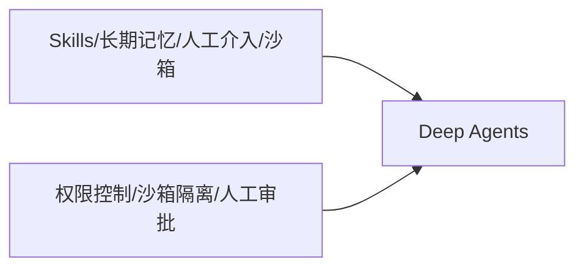

**图 18｜可扩展能力与权限边界重绘**

**【视频原述】** 可扩展能力：Skills（可复用知识与流程）、长期记忆（按配置使用）、人工介入、沙箱与执行工具（按配置运行）。适用场景：深度研究、自动化代码分析与修复、复杂资料整理、多个子智能体协作。

> 口播提醒：「越自主，越需要注意权限和执行环境」，尤其是文件修改、命令执行和数据库写入时，「一定要做好沙箱隔离、权限控制和人工审批，不能默认让 Agent 无限制地执行操作」。

**【补充】** 官方补充：`interrupt_on` 可在敏感工具调用前暂停等待人工批准；虚拟文件系统后端支持声明式读写权限，执行环境可配置沙箱。

---

## 17. 核心区别与三种能力比喻

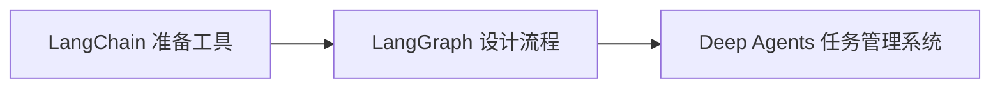

**图 19｜核心区别与能力比喻重绘**

| 框架 | 画面「核心区别」 | 画面「三种能力」比喻 |
|---|---|---|
| LangChain | 快速搭建工具型智能体 | 给 Agent 准备好各种工具 |
| LangGraph | 控制流程、状态与恢复 | 给 Agent 设计好工作流程 |
| Deep Agents | 自主执行复杂任务 | 给 Agent 配备一个任务管理系统 |

**【视频原述】** 口播把第三层展开为「让它能够自己拆解目标、安排任务、调用工具，必要时还可以安排其他 Agent 协助完成工作」；画面收束为「拆解目标・安排任务・调用工具・协作」。

---

## 18. 三个选型问题与决策树

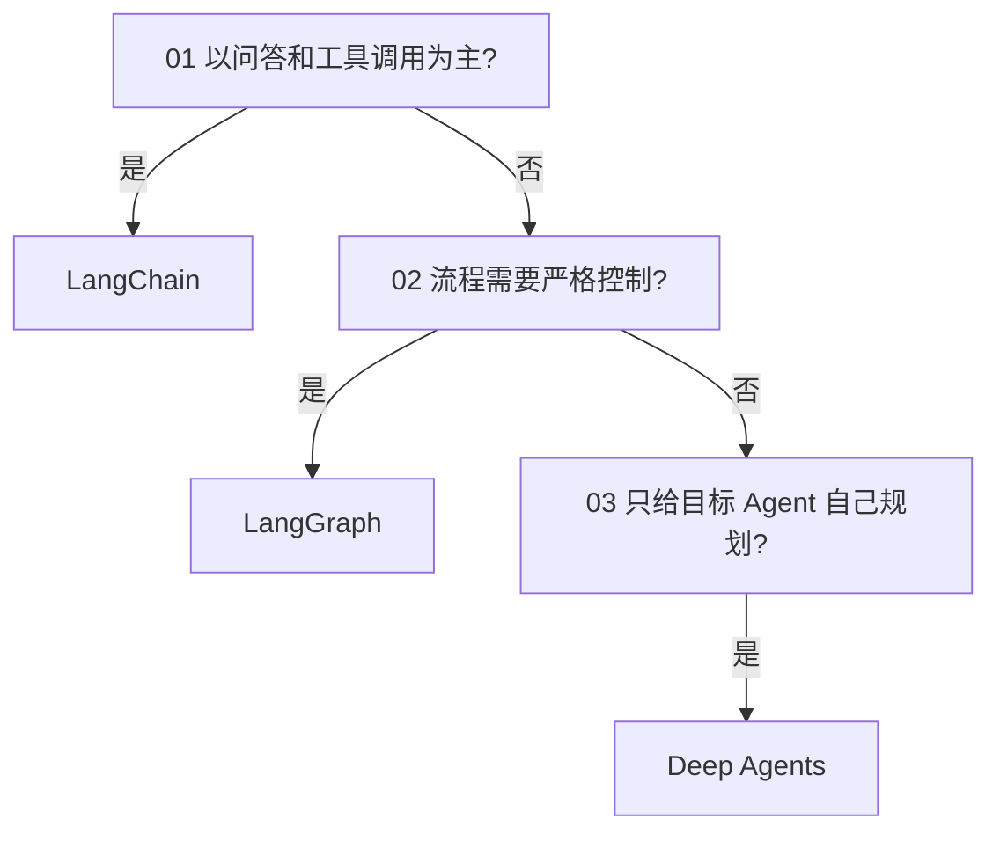

**图 20｜三个选型问题重绘**

**【视频原述】** 「实际开发的时候，这里可以根据三个问题来判断」，画面编号 01 / 02 / 03。

| # | 判断问题 | 画面动作链 | 结论 / 例子 |
|---|---|---|---|
| 01 | 业务是不是以问答和工具调用为主？ | 用户提问 → 知识库 / 接口 → 生成回答 | LangChain：知识库助手、智能客服、简单查询 |
| 02 | 业务流程是不是需要严格控制？ | 固定环节 + 条件分支 / 审批重试 / 状态恢复 | LangGraph：订单处理、退款审批、企业工单 |
| 03 | 用户是不是只给一个目标，由 Agent 自己规划？ | 拆解目标 → 管理上下文 → 调用工具 → 子 Agent | Deep Agents：技术研究与报告、仓库分析修复与测试 |

> 三个问题**按顺序**问：越靠后，交给 Agent 的自主权越大，需要的基础设施也越多。

---

## 19. 特别说明：不是所有业务都需要 Agent

```mermaid
flowchart LR
 A["业务流程完全固定"] --> B["无需模型自主判断"] --> C["普通 Python / 传统工作流"]
```

**图 21｜固定流程的简单方案重绘**

**【视频原述】** 「还有一种情况需要特别说明：业务流程完全固定、无需模型自主判断，那么直接使用普通 Python 代码或者传统工作流系统，可能反而更加简单」。画面结语：「并非所有业务都需要 Agent」。

> 这条常被忽略，但它是整支视频最实用的边界条件：先把「需不需要 Agent」问清楚，再问「用哪个框架」。

---

## 20. 三者能否一起用：可以，按项目需求组合

```mermaid
flowchart TB
 A["LangChain 模型与工具"] --> N["LangGraph 节点"]
 D["Deep Agents 规划与协作"] --> N
```

**图 22｜三者联用重绘**

**【视频原述】** 「答案是可以，而且它们之间本身就存在比较紧密的技术联系」：LangChain 提供模型、工具和 Agent 等基础组件；LangGraph 提供底层状态管理和流程编排；Deep Agents 在前两者之上封装任务规划、上下文管理和子智能体。

**【视频原述】** 具体组合方式：「我们可以在 LangGraph 的节点中调用 LangChain 提供的模型和工具，也可以使用 Deep Agents 提供的任务规划和子智能体能力，再根据实际业务需求进行定制」。画面还标注「LangGraph 可以独立使用」。

> 「这并不意味着开发一个项目就必须同时使用三个框架，应该根据项目需求决定」。

---

## 21. 总结：让框架服务于业务

```mermaid
flowchart LR
 A["知识库助手/工具型客服"] --> L["LangChain"]
 B["分支流程/人工审批"] --> G["LangGraph"]
 C["自主规划/长期任务协作"] --> D["Deep Agents"]
```

**图 23｜总结选型矩阵重绘**

**【视频原述】** 口播收束：简单知识库助手或能调用几个工具的智能客服 → LangChain；有明确业务流程、复杂条件分支和人工审批 → LangGraph；希望 Agent 自主规划、管理上下文、调用多个工具甚至安排子智能体协作完成长期任务 → Deep Agents。

> 「实际开发中，建议从满足当前需求最简单方案开始，不要一上来就引入过多框架和复杂架构。真正合适的技术选型，是让框架服务于业务。」

**【补充】** 与本站第四篇互读：第四篇用 Framework / Runtime / Harness 三层抽象横向对比七个代表项目，本篇沿同一条轴线纵向拆开 LangChain 自家三层，并给出可操作的三个判断问题。

---

## 22. 补充篇 A：专业名词速查（56 条）

**【补充】** 按「框架 → 编排 → Harness → 选型」分组，英文 / 别名按官方文档拼写。

| 术语 | 英文 / 别名 | 释义 |
|---|---|---|
| Agent 框架 | Agent Framework | 提供模型、工具与 Agent 循环的标准抽象 |
| Agent 运行时 | Agent Runtime | 提供持久执行、流式、人工介入与状态持久化 |
| Agent Harness | 运行载体 / 工具集 | 开箱即用的完整执行框架，内置工具与提示 |
| LangChain | langchain | 框架层：基础组件、集成与 create_agent |
| LangGraph | langgraph | 运行时层：图编排、状态与持久执行 |
| Deep Agents | deepagents | Harness 层：规划、文件系统、子智能体 |
| Deep Agents SDK | deepagents 包 | 自托管形态的 Deep Agents |
| Managed Deep Agents | 托管形态 | 无需自管基础设施的生产运行方式 |
| create_agent | LangChain 高层接口 | 由模型 + 工具 + 系统提示词创建 Agent |
| create_deep_agent | Deep Agents 入口 | 创建带内置能力的 deep agent |
| Agent Loop | 模型—工具循环 | 判断 → 选工具 → 执行 → 依据结果继续 |
| Tool Calling | 工具调用 | 模型选择并调用外部函数 |
| Middleware | 中间件 | 在 Agent 循环前后注入逻辑的扩展机制 |
| Prompt | 提示词 | 系统指令与上下文组织 |
| Message | 消息 | 模型与工具之间的多轮消息序列 |
| Document Loader | 文档加载 | 把外部资料载入应用 |
| Vector Store | 向量数据库 | 检索用的向量存储 |
| Retriever | 检索器 | 按查询返回相关文档 |
| RAG | 检索增强生成 | 检索资料后再生成回答 |
| State | 状态 | 工作流执行过程中共享的数据 |
| Node | 节点 | 一个节点执行一个具体任务 |
| Edge | 边 | 定义节点之间的流转关系 |
| Conditional Edge | 条件边 | 按条件决定下一个节点 |
| Graph | 图 | State + Node + Edge 构成的执行结构 |
| Checkpointer | 持久化检查点 | 保存状态以支持中断恢复 |
| Durable Execution | 持久执行 | 故障后从中断处恢复、长时间运行 |
| Streaming | 流式输出 | 逐步返回过程与结果 |
| Interrupt | 执行中断 | 在关键节点暂停 |
| Human-in-the-loop | HITL / 人工介入 | 检查或修改状态、等待人工批准 |
| Thread-level Persistence | 线程级持久化 | 同一会话内的状态保存 |
| Cross-thread Persistence | 跨线程持久化 | 跨会话的长期状态保存 |
| Subgraph | 子图 | LangGraph 里的模块化子流程 |
| Task Planning | 任务规划 | 把大目标拆成可跟踪的具体步骤 |
| write_todos | TodoListMiddleware | 结构化的待办清单工具 |
| Subagent | 子智能体 | 处理隔离子任务并向主 Agent 汇报 |
| task 工具 | 委派工具 | 主 Agent 创建子 Agent 的内置工具 |
| Isolated Context | 隔离上下文 | 子任务独立上下文、只回传结果 |
| Virtual Filesystem | 虚拟文件系统 | 可插拔后端的读写文件能力 |
| StateBackend | 状态后端 | 把文件保存在 Agent 状态里 |
| FilesystemBackend | 本地文件后端 | 把文件写到真实磁盘 |
| Context Offloading | 文件卸载 | 把大工具结果移出对话上下文 |
| Summarization | 摘要 / 压缩 | 压缩历史对话与中间结果 |
| Skills | 技能 | 按需加载的可复用知识与流程 |
| SKILL.md | 技能描述文件 | 技能的入口说明 |
| AGENTS.md | 长期记忆文件 | 启动时加载的持久偏好与约定 |
| Long-term Memory | 长期记忆 | 跨会话保留的指令与偏好 |
| Sandbox | 沙箱 | 隔离的命令与代码执行环境 |
| Filesystem Permissions | 文件系统权限 | 声明式控制可读写路径 |
| interrupt_on | 人工审批参数 | 在敏感工具调用前暂停 |
| LangSmith | 可观测平台 | 追踪、评测、监控与部署治理 |
| Agent Server | 自托管服务 | 自定义部署形态 |
| Framework / Runtime / Harness | 三层抽象 | 本站第四篇的横向对比坐标 |
| MCP | 模型上下文协议 | 工具与上下文的标准接入方式 |
| Vibe Coding | 氛围编程 | 视频话题标签，非技术术语 |
| StoreBackend | LangGraph Store 后端 | 把虚拟文件持久化到跨线程存储 |
| Prompt Caching | 提示缓存 | 静态提示段缓存，降低长任务推理成本 |

---

## 23. 补充篇 B：官方文档对照

**【补充】** 视频讲的是「怎么选」，LangChain 官方 `Runtimes, frameworks, and harnesses` 文档给的是同一套三分法的权威定义；以下为**补充**，不属于视频原述。

| 层 | 官方定义 | 价值 / 何时使用 | 同类选项 |
|---|---|---|---|
| Framework（LangChain） | 提供结构化内容块、Agent 循环、中间件等抽象 | 快速上手、标准化团队构建方式、无复杂编排的简单 Agent | Vercel AI SDK、CrewAI、OpenAI Agents SDK、Google ADK、LlamaIndex |
| Runtime（LangGraph） | 低层编排框架与运行时，支持持久执行、流式、HITL、持久化 | 需要细粒度控制、长时有状态 Agent、确定性 + Agentic 混合工作流 | Temporal、Inngest |
| Harness（Deep Agents SDK） | 有明确取向、内置工具与能力的完整框架 | 更自主的 Agent、复杂非确定性任务、长期多步骤工作 | Claude Agent SDK、Manus、编码 CLI |

### 23.1 官方功能对照（节选）

| 能力 | LangGraph | LangChain | Deep Agents |
|---|---|---|---|
| 短期记忆 | Short-term memory | Short-term memory | StateBackend |
| 长期记忆 | Long-term memory | Long-term memory | Long-term memory |
| Skills | — | Multi-agent skills | Skills |
| 子智能体 | Subgraphs | Multi-agent subagents | Subagents |
| 人工介入 | Interrupts | HITL middleware | interrupt_on |
| 流式 | Streaming | Agent Streaming | Streaming |

> 官方还明确：「LangChain 1.0 构建于 LangGraph 之上」「Deep Agents SDK 构建于 LangGraph 之上」「虽然三者能完成相似任务，但集成它们的层次不同」。这与视频「三个抽象层次、不是竞品」完全一致。

**【补充】** 参考：[Runtimes, frameworks, and harnesses](https://docs.langchain.com/oss/concepts/products) ｜ [Deep Agents overview](https://docs.langchain.com/oss/python/deepagents/overview) ｜ [LangChain OSS overview](https://www.langchain.com/oss-overview) ｜ 中文版 [框架、运行时与封装](https://docs.langchain.org.cn/oss/python/concepts/products)。

---

## 24. 补充篇 C：可运行代码

**【补充】** 以下四段均为纯 Python 标准库，可直接运行；用于把视频里的判断逻辑与图结构概念固化成可验证的骨架，不依赖任何框架。

### 24.1 三个选型问题的决策函数

```python
def pick_framework(qa_first, strict_flow, goal_only, need_model_judgement=True):
    """按视频的三个问题依次判断；完全固定且不依赖模型判断时不需要 Agent。"""
    if not need_model_judgement:
        return "普通 Python 代码 / 传统工作流系统"
    if goal_only:
        return "Deep Agents"
    if strict_flow:
        return "LangGraph"
    if qa_first:
        return "LangChain"
    return "普通 Python 代码 / 传统工作流系统"


cases = [
    ("企业知识库助手", True, False, False, True),
    ("退款审批系统", False, True, False, True),
    ("仓库分析与修复", False, False, True, True),
    ("每日固定报表", False, False, False, False),
]
for name, a, b, c, d in cases:
    print(f"{name}: {pick_framework(a, b, c, d)}")
```

### 24.2 用状态机模拟 State / Node / Edge

```python
from dataclasses import dataclass, field


@dataclass
class State:
    question: str = ""
    problem_type: str = ""
    order: dict = field(default_factory=dict)
    risk_ok: bool = False
    result: str = ""


def identify(s):
    s.problem_type = "refund"
    return s


def query_order(s):
    s.order = {"id": "A100", "amount": 199}
    return s


def risk_check(s):
    s.risk_ok = s.order["amount"] < 500
    return s


def edge(s):
    return "退款审批" if s.risk_ok else "异常处理"


nodes = {"问题识别": identify, "查询订单": query_order, "风险校验": risk_check}
s = State(question="我要退款")
for name, fn in nodes.items():
    s = fn(s)
    print(f"Node {name}: {s}")
print("Edge 下一节点:", edge(s))
```

### 24.3 任务规划清单与子智能体委派

```python
todos = [
    {"task": "分析仓库", "status": "pending"},
    {"task": "问题定位", "status": "pending"},
    {"task": "修改代码", "status": "pending"},
    {"task": "测试验证", "status": "pending"},
    {"task": "结果整理", "status": "pending"},
]


def run_task(i, worker):
    todos[i]["status"] = "in_progress"
    report = worker(todos[i]["task"])
    todos[i]["status"] = "completed"
    return report


reports = [
    run_task(0, lambda t: f"{t}: 找到 12 个相关文件"),
    run_task(3, lambda t: f"{t}: 3 通过 / 1 失败（子 Agent 返回）"),
]
print("主 Agent 汇总:", reports)
print("任务状态:", [(x["task"], x["status"]) for x in todos])
```

### 24.4 上下文规模控制（摘要与文件卸载）

```python
import json
from pathlib import Path


def offload(history, tool_results, threshold=120):
    """把大工具结果写到文件，只在上下文里保留摘要与路径。"""
    context, offloaded = [], []
    for item in history + tool_results:
        if len(item) > threshold:
            path = Path(f"artifact_{len(offloaded) + 1}.txt")
            path.write_text(item, encoding="utf-8")
            offloaded.append(str(path))
            context.append(f"[已卸载 → {path}] {item[:24]}...")
        else:
            context.append(item)
    return context, offloaded


history = ["用户：修复登录模块", "Agent：开始分析仓库"]
results = ["工具返回：" + ("登录流程日志 " * 20), "工具返回：OK"]
ctx, files = offload(history, results)
print("上下文:", json.dumps(ctx, ensure_ascii=False, indent=1))
print("卸载到文件:", files)
for f in files:
    Path(f).unlink()
```

> 官方 API 名称（需 `pip install langchain deepagents`，此处不作为可运行代码）：`from langchain.agents import create_agent`、`from deepagents import create_deep_agent`、`TodoListMiddleware`、`interrupt_on`、`StateBackend`。

---

## 25. 补充篇 D：常见误区

| # | 误区 | 为什么错 | 正确做法 |
|---|---|---|---|
| 1 | 把三者当成互相竞争的同类产品 | 它们是三个抽象层次，层层叠加 | 按需要的抽象层次选起点 |
| 2 | 认为用 Deep Agents 就必须同时装三个框架 | Deep Agents 已封装下层能力 | 按项目需求决定，LangGraph 也可独立使用 |
| 3 | 用 LangChain 硬写大量条件分支与人工审批 | 流程控制不是它的主场 | 流程复杂时下移到 LangGraph |
| 4 | 用 LangGraph 就每一步都调大模型 | 确定性逻辑用普通代码更可控 | 代码管确定性，模型管理解与判断 |
| 5 | 简单知识库问答直接上 Deep Agents | 引入了用不到的规划与子智能体 | 从满足当前需求的最简单方案开始 |
| 6 | 把固定报表流程做成 Agent | 完全固定、无需模型判断 | 普通 Python / 传统工作流系统 |
| 7 | 把人工审批交给模型自己决定 | 业务规则不能靠自由裁量 | 用条件边 + interrupt + 人工确认 |
| 8 | 长时间任务把全部中间结果留在对话里 | 对话历史与工具结果会撑爆上下文 | 摘要 + 文件卸载 + 子 Agent 隔离 |
| 9 | 子智能体共享全部主对话上下文 | 上下文被重型子任务污染 | 默认隔离上下文，只回传最终结果 |
| 10 | 给 Deep Agents 无限制的文件与命令权限 | 可能误改文件、执行命令、写库 | 权限控制 + 沙箱隔离 + 人工审批 |
| 11 | 以为 LangGraph 只是「流程图库」 | 还提供持久执行、流式、HITL、恢复 | 把它当运行时层来评估 |
| 12 | 把 LangChain 中间件当成流程编排替代品 | 扩展点不等于显式图结构 | 大量分支/状态时用图 |
| 13 | 用「哪个框架最新」做选型依据 | 新旧不代表替代关系 | 按三个业务问题判断 |
| 14 | 认为 LangGraph 节点里不能调 LangChain 工具 | 两者本就设计为可组合 | 在节点中复用模型与工具组件 |
| 15 | 忽略视频标题里的拼写差异直接照抄 | 官方是 LangGraph / Deep Agents | 校正后按官方名检索文档 |

---

## 26. 附录

### 26.1 官方章节与画面小节导航

| 来源 | 数量 | 说明 |
|---|---|---|
| 官方 chapter_list | 8 段 | 引言 / LangChain / LangGraph / DeepAgent / 核心区别 / 框架选择 / 框架联用 / 总结 |
| 画面顶部固定导航条 | 39 条 | 比大章节更细，本教程按它拆 3–21 章 |
| 画面幻灯片 | 161 条去重文字 | 逐帧 OCR 后按相似度去重 |
| 烧录字幕 | 216 条 | 底部黑底中文，按时间线整理 |

### 26.2 配图速查（23 张）

| # | 图名 | 来源 |
|---|---|---|
| 1–2 | 结构地图 / 三个抽象层次 | 官方章节与画面 f_0008 / f_0011 |
| 3–7 | 智能客服 / 基础组件 / create_agent / 选工具 / 中间件 | 画面 f_0019–f_0057 |
| 8–13 | 售后流程 / 图三要素 / 条件流转 / 暂停恢复 / 分工 | 画面 f_0059–f_0107 |
| 14–18 | 代码修复 / 执行框架 / 规划与子 Agent / 文件系统 / 权限边界 | 画面 f_0111–f_0177 |
| 19–23 | 核心区别 / 三个选型问题 / 固定流程 / 三者联用 / 总结 | 画面 f_0178–f_0249 |

### 26.3 校正表（OCR 与口播）

| 来源写成了 | 正确写法 | 依据 |
|---|---|---|
| `Lang Chain` / `Lang Chain` 混排 | `LangChain` | 画面 f_0002 清晰帧 + 官方包名 |
| `Lang Graph` / `LangGrapn` / `Langgraph` | `LangGraph` | 画面 f_0009 与官方文档 |
| `DeepAgent` / `Deep Agents` 混用 | `Deep Agents`（包名 `deepagents`） | 官方 Deep Agents SDK 文档 |
| `人工車排` | `人工审批` | 画面 f_0056 放大 + 字幕 02:42 |
| `酒过` / `晋通代码` | `通过` / `普通代码` | 画面 f_0082 / f_0106 与上下文 |
| `沙稍隔离` / `沙稲隔离` / `杈限` | `沙箱隔离` / `权限` | 画面 f_0174–f_0177 多帧对照 |
| `AP1` / `Eage` | `API` / `Edge` | 画面 f_0049 / f_0072 与口播 |
| 字幕「壳争」「沙稍」 | `竞争` / `沙箱` | 口播 00:45 / 08:39 语义校正 |
| `13.4S` 等计时水印 | 画面固定计时器，非内容 | 与本站第六篇同类水印一致 |

### 26.4 还原方法与资料

1. **视频**：[LangChain、Langgraph、DeepAgent开发框架怎么选？](https://v.douyin.com/dX1jn7y0BFA/)（ID `7711684080711229049`，@小k技术栈，2026-11-24，12:28）。
2. **逐帧**：最高档 1920×1080 原片 10 MB，3 秒抽帧 249 张，macOS Vision OCR 1,673 行；按 y=0.10 / 0.80 分离顶部固定导航、画面主体与底部烧录字幕，用序列相似度去重。
3. **校对**：三个抽象层次、基础组件、图三要素、售后流程、执行框架、三个选型问题、联用与总结等 10 张关键帧放大逐字复核。
4. **补充资料**：LangChain 官方 [Runtimes, frameworks, and harnesses](https://docs.langchain.com/oss/concepts/products)、[Deep Agents overview](https://docs.langchain.com/oss/python/deepagents/overview)、[LangChain OSS overview](https://www.langchain.com/oss-overview)；本站 [Agent 开发架构选型 · 完全教程](../agent-architecture-tutorial/index.html)。

---

*本教程为学习整理产物；视频与文章版权归各自作者所有。*