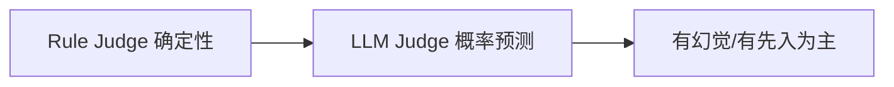
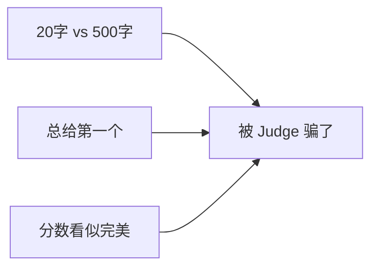
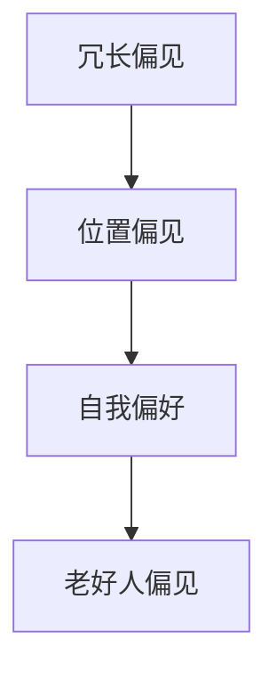
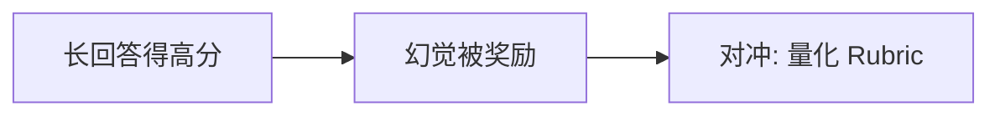
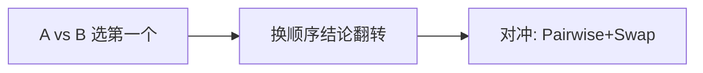
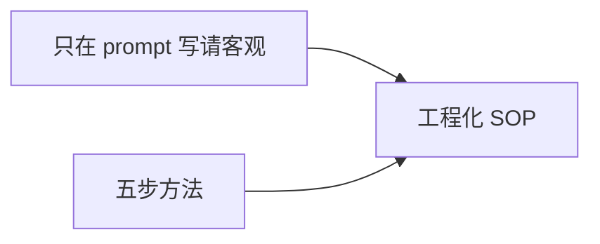
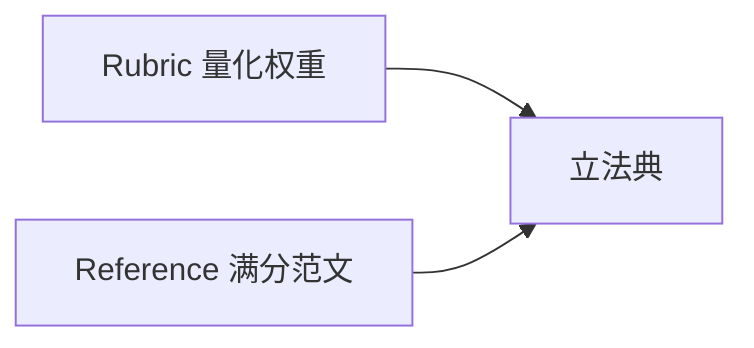
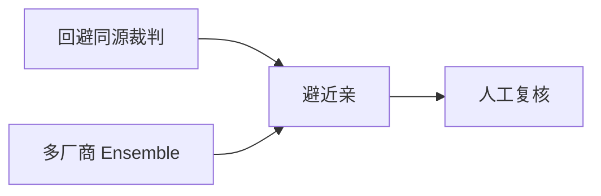
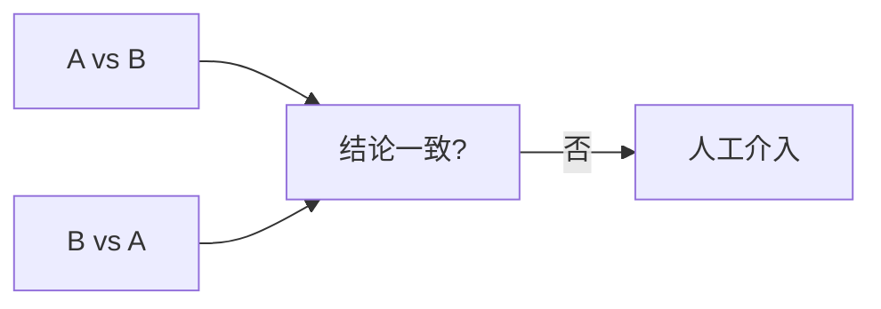
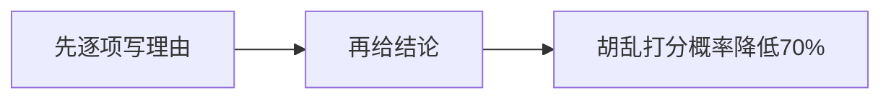

# 消除 LLM Judge 偏见 · 完全教程

> **视频逐帧还原 + 系统化补全**
>
> 原视频：抖音 @煮caicai《Agent evals：如何消除 llm judge 偏见》｜[分享链接](https://v.douyin.com/vo99RhZMVbI/) ｜ [网页版](https://www.douyin.com/video/7661630221644689576) ｜ 视频 ID `7661630221644689576` ｜ 发布 2026-07-12 ｜ 时长 5:11
>
> 配套文件：[index.html（图文阅读版，16 张 SVG）](index.html)
>
> 姊妹篇：[RAG 评测完全教程（在线阅读）](../rag-evaluation-tutorial/RAG评测完全教程.html) ｜ [Agent 评测体系完全教程（在线阅读）](../agent-evaluation-tutorial/Agent评测体系完全教程.html) ｜ [评测驱动 Agent 迭代（在线阅读）](../agent-eval-driven-tutorial/Agent评测驱动迭代完全教程.html) ｜ [Agent 开发架构选型（在线阅读）](../agent-architecture-tutorial/Agent开发架构选型完全教程.html) ｜ [Agent 评测指标系统（在线阅读）](../agent-metrics-tutorial/Agent评测指标系统完全教程.html) ｜ [Agent 评测方法论（在线阅读）](../agent-eval-method-tutorial/Agent评测方法论完全教程.html)

---

## 目录

- [0. 视频速览与保真约定](#0-视频速览与保真约定)
- [1. 全片结构地图](#1-全片结构地图)
- [2. 为什么 LLM Judge 会犯错](#2-为什么-llm-judge-会犯错)
- [3. 三个「被 Judge 骗了」的开场场景](#3-三个被-judge-骗了的开场场景)
- [4. 四类系统性偏见总览](#4-四类系统性偏见总览)
- [5. 偏见一：冗长偏见（Verbosity Bias）](#5-偏见一冗长偏见verbosity-bias)
- [6. 偏见二：位置偏见（Position Bias）](#6-偏见二位置偏见position-bias)
- [7. 偏见三：自我偏好偏见（Self-Preference Bias）](#7-偏见三自我偏好偏见self-preference-bias)
- [8. 偏见四：老好人偏见（Lenience Bias）](#8-偏见四老好人偏见lenience-bias)
- [9. 共同后果：分数还在，区分度没了](#9-共同后果分数还在区分度没了)
- [10. 消除偏见的总原则：工程化 SOP](#10-消除偏见的总原则工程化-sop)
- [11. 方法一 · 立法典：Rubric + Reference](#11-方法一--立法典rubric--reference)
- [12. 方法二 · 避近亲：Avoidance + Ensemble](#12-方法二--避近亲avoidance--ensemble)
- [13. 方法三 · 换玩法：Pairwise + Swap](#13-方法三--换玩法pairwise--swap)
- [14. 方法四 · 讲理由：CoT Scoring](#14-方法四--讲理由cot-scoring)
- [15. 方法五 · 做审计：Human Calibration](#15-方法五--做审计human-calibration)
- [16. 结语与本站体系对齐](#16-结语与本站体系对齐)
- [17. 补充篇 A：专业名词速查（42 条）](#17-补充篇-a专业名词速查42-条)
- [18. 补充篇 B：可运行代码](#18-补充篇-b可运行代码)
- [19. 补充篇 C：常见误区](#19-补充篇-c常见误区)
- [20. 附录](#20-附录)

---

## 一页速览：视频的 7 个结论

| # | 结论 | 位置 |
|---|---|---|
| 1 | **Judge 不是尺，是有性格的面试官**：LLM Judge ≠ Rule Judge | [第 2 章](#2-为什么-llm-judge-会犯错) |
| 2 | **四类系统性偏见**：冗长 / 位置 / 自我偏好 / 老好人 | [第 4 章](#4-四类系统性偏见总览) |
| 3 | **最隐蔽的后果是失去区分度** | [第 9 章](#9-共同后果分数还在区分度没了) |
| 4 | **靠工程化 SOP，不靠提示词祈愿** | [第 10 章](#10-消除偏见的总原则工程化-sop) |
| 5 | **立法典 + 避近亲 + 换玩法** | [第 11 章](#11-方法一--立法典rubric--reference) |
| 6 | **讲理由 + 做审计** | [第 14 章](#14-方法四--讲理由cot-scoring) |
| 7 | **完美的评估系统不存在，目标是受控的系统** | [第 16 章](#16-结语与本站体系对齐) |

---

## 0. 视频速览与保真约定

**【视频原述】** 本教程整理抖音 @煮caicai《Agent evals：如何消除 llm judge 偏见》。视频从「写好了 rubric，却发现新版本被 Judge 打了个莫名其妙的高分」切入，系统讲清 **LLM Judge 为什么会犯错、有哪四类偏见、以及用哪五步工程化方法对冲**。

| 项 | 内容 |
|---|---|
| 视频 / ID | Agent evals：如何消除llm judge偏见 `7661630221644689576` |
| 作者 / 发布 | @煮caicai ／ 2026-07-12 21:18:17 |
| 时长 / 画面 | 5:11.1（311.1 s）／ 1080×1086 方形、HEVC、约 4.9 MB |
| 官方章节 | 引言 00:00 ／ LM Judge的偏见 00:43 ／ 消除偏见的方法 02:19 ／ 结语 04:57（4 段） |
| 画面形式 | Excalidraw 白板手绘大字 + 顶部绘图工具栏 + 底部黑边白字烧录字幕；无画中画 |

> **三种标记**：**【视频原述】**画面手绘文字或烧录字幕确实出现过的表述；**【按画面重绘】**把手绘列表/关系按原结构画成矢量图；**【补充】**由本站既有教程与公开工程实践补齐，不属于视频原述。

> **保真边界**。① 官方章节摘要把方法一首条写成「立法点」、把「冗长偏见」写成「冗长骗件」，均为 ASR 误写，正文以放大帧为准（「立法典」「冗长偏见」），并在 [20.3 校正表](#203-校正表ocr-与自动摘要)说明。② 字幕 OCR 噪声较多（如「LM Gage」「概率顿测」「b金清原则」），口播按字幕时间线 + 画面文字归纳，未凭空补写台词。③ 视频中的 **70%、100 case、80%、40%、扣 2 分** 等均为口播给出的经验数值，不是通用基准，本教程统一标注为示例值。④ 本轮未做 ASR。

**还原方法**：解析分享短链 → 抓 `aweme/detail` 取视频 ID、4 段官方章节（含 `chapter_abstract` 与逐段 `detail`）与最高清晰度地址 → 下载 1080×1086 原片 4.9 MB（首次地址 403，补 `Referer` 后成功）→ 每 3 秒抽帧 **104 张** → macOS Vision `VNRecognizeTextRequest` 得到 **1,221 行**带坐标文本 → 按 y 坐标（画面 0.10–0.72、字幕 0.72–0.92）分离出 6 条画面幻灯片与 101 条字幕时间线 → 封面、四类偏见列表、五步方法列表三张关键帧放大逐字校对 → 与本站第六篇「LLM Judge 两个致命坑」及 Anthropic 公开文章交叉核对。

---

## 1. 全片结构地图


**图 1｜全片结构地图（按画面目录与官方章节重绘）**

画面封面给出三问：**为什么 LLM Judge 会犯错？／ LLM Judge 偏见有哪些？／ 如何修正 LLM Judge 偏见？** 官方章节也正好是「引言 → 偏见 → 消除方法 → 结语」四段，本教程按此展开并补齐工程细节。

| 模块 | 回答什么 | 本教程 |
|---|---|---|
| 引言 | 为什么分数不可信 | 第 2–3 章 |
| 四类偏见 | 错在哪里、怎么表现 | 第 4–9 章 |
| 五步方法 | 怎么用工程手段对冲 | 第 10–15 章 |
| 结语 | 能到达什么程度 | 第 16 章 |

> 一句话：**Judge 不是一把尺，而是一个有性格的面试官；完美的评估系统不存在，但可以构建一个「受控的系统」。**

---

**本章语音逐字稿（ASR · 已校正，6 句）**

> `[00:00]` Hello 大家今天我们继续 Agent 评测相关的讨论
> `[00:04]` 好假设你一个场景啊你高高兴兴的写好了 Rubric
> `[00:08]` 配好了 GPT 作为裁判你跑了一遍 evaluation
> `[00:12]` 发现新版本的 Agent 分数比旧版本高了一大截
> `[00:15]` 你刚准备在群里欢呼突然随手发了几个 bi-case
> `[00:19]` 冷汗都下来了

## 2. 为什么 LLM Judge 会犯错

**【视频原述】** 画面手绘只有三行，但信息量最大：`为什么LLM Judge会犯错？` / `LLM judge ≠ rule judge` / `也是一个agent`。



**图 2｜Rule Judge 与 LLM Judge 的差异重绘**

> **核心判断**：LLM Judge 本身也是一个大模型、也是一个 agent，它「进行概率预测」，依据训练数据给出判断——既然是预测，就必然**有幻觉、有先入为主**。所以建 evaluation 系统时，面对的不是确定性规则，而是「一个有性格、有偏见的面试官」。

**【补充】** 这与本站《Agent 评测方法论》里「Test 验证正确性、Evaluation 衡量质量」是同一条逻辑链： Rule Judge 属于确定性判定，LLM Judge 属于概率性质量判断，二者的失效模式完全不同。

---

**本章语音逐字稿（ASR · 已校正，7 句）**

> `[00:20]` 第一个场景一个回答只有20个字严谨一该解决了问题
> `[00:24]` 另一个回答啰里啰锁500个字全是废话
> `[00:27]` 结果 Judge 竟给了500个字的大高分
> `[00:30]` 第二个场景两个回答只量差不多
> `[00:33]` 但 Judge 总是得排在第一个的选项大高分
> `[00:36]` 你突然意识到我被 Judge 骗了
> `[00:38]` 他真的把我的产品带上一个看似完美实则地下的深渊

## 3. 三个「被 Judge 骗了」的开场场景



**图 3｜三个开场翻车场景重绘**

**【视频原述】** 视频引言用三个场景把抽象的「偏见」讲活：

1. **字数控**：同一个问题，A 回答只有 20 个字，B 啰里啰嗦 500 个字，结果 Judge 给 500 字的打了高分——哪怕里面夹着大量幻觉和废话。
2. **第一印象**：A vs B 两两比较时，Judge 总是给排在第一个的选项打高分。
3. **看似完美**：新版本分数一片飘红，刚准备在群里欢呼，却意识到「我被 Judge 骗了」，它正在把产品带向一个看似完美的错误方向。

> 这三个场景分别对应后面的冗长偏见、位置偏见，以及「分数漂亮但区分度丢失」的综合后果。

---

**本章语音逐字稿（ASR · 已校正，8 句）**

> `[00:42]` 为什么 Judge 会犯错
> `[00:45]` 那他的偏见都有哪些
> `[00:46]` 那最重要的是我们如何去修正这些偏见
> `[00:49]` 为什么 Judge 会犯错
> `[00:52]` 因为 Judge 本身也是一个大模型
> `[00:54]` 他本身也是一个 Agent
> `[00:55]` 他不是执行代码不是弱家计
> `[00:57]` 他是进行概率预测

## 4. 四类系统性偏见总览

**【视频原述】** 画面 f_0026 用一页列出四种偏见，每条都有中英文与一句红色注释。



**图 4｜四类偏见总览重绘**

| # | 中文 | 英文 | 画面注释 | 典型现象 |
|---|---|---|---|---|
| 1 | 冗长偏见 | Verbosity Bias | 看起来认真的人 | 长回答系统性得高分 |
| 2 | 位置偏见 | Position Bias | 第一印象决定结果 | A vs B 总选排前面的 |
| 3 | 自我偏好偏见 | Self-Preference Bias | 和自己一样的人 | 偏爱同家族模型的语气风格 |
| 4 | 老好人偏见 | Lenience Bias | 它不愿意当坏人 | 无惩罚机制就普遍给高分 |

> 关键点：这四类**不是偶发错误，而是可复现、可对冲的系统性偏差**。因此不能靠「换个提示词求它客观」，要靠工程化 SOP。

---

**本章语音逐字稿（ASR · 已校正，7 句）**

> `[00:59]` 他在预测根据我的训练数据
> `[01:02]` 一个好答案通常长什么样啊
> `[01:04]` 既然是预测他就一定会有偏好有幻觉有先入为主
> `[01:07]` 所以当我们建立 Evasion 系统时
> `[01:10]` 你面对的不是一个标准的客图池
> `[01:12]` 而是一个有性格偏见的面试官
> `[01:15]` 好那要消除偏见先要看清楚偏见对不对

## 5. 偏见一：冗长偏见（Verbosity Bias）



**图 5｜冗长偏见重绘**

**【视频原述】** 口播原意：「模型是个字数控，认为写得越多越好，哪怕里面夹杂了大量的幻觉和废话」。画面注释是「看起来认真的人」——长回答更容易显得认真、详实，于是被系统性高估。

**【补充】** **代价**不只是评错：Agent 会学着「越啰嗦越好」，Token、时延、用户阅读成本同步恶化；而简洁准确的回答反而被低估。这是典型的**指标诱导行为**，与本站《Agent 评测指标系统》里「你衡量什么就得到什么」一致。

> **对冲**：在 Rubric 里给简洁性设明确权重与扣分锚点，并提供满分范文作参照（见第 11 章）。

---

**本章语音逐字稿（ASR · 已校正，9 句）**

> `[01:18]` 作为产品经理你会发现
> `[01:20]` Judge 常犯的错误有以下四种
> `[01:23]` 第一种拥藏偏见
> `[01:24]` 好记一点来说就是他看起来认真的人
> `[01:27]` 他经常会被骗
> `[01:28]` 那模型是个字数不控
> `[01:29]` 他潜意识力认为写的越多态度越诚恳质量就越高
> `[01:33]` 哪怕里面夹杂了大量的幻觉和废话
> `[01:36]` 就是你给这种人了有苦劳的人

## 6. 偏见二：位置偏见（Position Bias）



**图 6｜位置偏见重绘**

**【视频原述】** 口播：「A vs B 的话，他更倾向于选出现在前面的那个，第一眼印象往往占了便宜」。画面注释「第一印象决定结果」。

**【补充】** **代价**是评测结果不可复现：同一对答案只要换个顺序，结论就可能翻转。这正是「直接打分」之外的另一类失效——**相对比较也有偏见**。

> **对冲**：Pairwise + Swap，正序反序各测一次；两次结论不一致说明 Judge 在瞎猜，直接转人工介入（见第 13 章）。

---

**本章语音逐字稿（ASR · 已校正，8 句）**

> `[01:39]` 那第二个就是位置偏见怎么说
> `[01:41]` 就是他相信第一印象
> `[01:44]` 就如果你让 Judge 做对比测试
> `[01:46]` A VS B 的话
> `[01:47]` 他更倾向于选出现在前面的那个
> `[01:50]` 就像人类批改试卷第一眼印象往往占了便宜
> `[01:54]` 就是位置偏见
> `[01:55]` 第三自我偏好偏见

## 7. 偏见三：自我偏好偏见（Self-Preference Bias）


**图 7｜自我偏好偏见重绘**

**【视频原述】** 口播举例：「他总是很喜欢 Claude，喜欢 Claude 的回答，对亲生骨肉的语气风格」有天然偏好。画面注释「和自己一样的人」。

**【补充】** **代价**：换裁判模型后分数系统性漂移，跨厂商、跨版本的比较失去意义；被测 Agent 若恰好与裁判不同源，会被不公平地低估。这也与本站《Agent 评测方法论》记录的「模型偏见」和「评分漂移」两坑对应。

> **对冲**：回避原则（不用同源模型当裁判）+ 多厂商陪审团取均值 + 分歧样本人工复核（见第 12 章）。

---

**本章语音逐字稿（ASR · 已校正，8 句）**

> `[01:57]` 就和自己一样的人他总是很喜欢
> `[01:59]` 就 GPT 喜欢 GPT 的回答 Claude 喜欢 Claude 的回答
> `[02:03]` 他们对亲身骨肉的语气风格有天然的亲近感
> `[02:06]` 第四老好人偏见
> `[02:08]` 就是他不愿意当坏人
> `[02:09]` 就如果你不给他明确的惩罚机制
> `[02:12]` Judge 倾向于给高分
> `[02:14]` 这就导致你的评估结果失去了区分度

## 8. 偏见四：老好人偏见（Lenience Bias）


**图 8｜老好人偏见重绘**

**【视频原述】** 口播：「如果你不给他明确的惩罚机制，Judge 倾向于给高分，这就导致你的评估结果失去了区分度」。画面注释「它不愿意当坏人」。

**【补充】** 这是四类里**最隐蔽**的一类：分数看起来都很好，没有明显错误，但所有版本都挤在 4–5 分，评测实际上已经失效。产品经理最容易在这一步被「一片飘红」误导。

> **对冲**：Rubric 写清扣分档位、给满分范文拉出量表两端、并用人评校准基线检查分数分布（见第 11、15 章）。

---

**本章语音逐字稿（ASR · 已校正，8 句）**

> `[02:16]` 全是优无法定位真正的 bug
> `[02:18]` 好如何消除大模型的偏见呢
> `[02:21]` 作为产品经理
> `[02:22]` 你不能指望裁判自觉对吧
> `[02:24]` 也不是在提示词里面要求模型你客观一点
> `[02:27]` 而是靠一套工程化的 SOP 取约束它
> `[02:31]` 第一种第一个就是立法典
> `[02:34]` 总结起来就是立法典

## 9. 共同后果：分数还在，区分度没了


**图 9｜偏见对分数分布的连锁影响重绘**

| 阶段 | 分数分布 | 还能选型吗 |
|---|---|---|
| 健康 | 好 5 / 中 3 / 差 1 分，分布拉开 | 能 |
| 冗长偏见后 | 长答案普遍 +1，短答案被低估 | 开始失真 |
| 老好人偏见后 | 全部挤在 4–5 分 | 基本不能 |
| 位置/自我偏好叠加 | 相对排序随顺序与裁判模型漂移 | 不能 |

> 「评测失去区分度，等于没有评测」——**主指标改善但护栏失守、回归集无退步**这套上线判断，前提就是分数本身可比；偏见不处理，整套判断都是空中楼阁。

---

**本章语音逐字稿（ASR · 已校正，9 句）**

> `[02:35]` 这是价值的灵魂啊
> `[02:37]` 就不仅仅是规则
> `[02:39]` 别只写请打分
> `[02:40]` 而是要在 Rubric 理明确权重
> `[02:42]` 比如简洁性占40% 超过三句话
> `[02:45]` 直接扣两分你看我这里面都是谅话了
> `[02:48]` 简洁性占40% 超过三句话直接扣两分
> `[02:52]` 第二就是你要给一个参考
> `[02:54]` 就给价借一个满分的范围

## 10. 消除偏见的总原则：工程化 SOP



**图 10｜消除偏见总原则重绘**

**【视频原述】** 口播说得很直接：「你不能指望裁判自觉，也不是在提示词里面要求模型，而是靠一套工程化的 SOP 去约束它」。

**【视频原述】** 画面 f_0047 把这套 SOP 列成五条，**每条都是「方法名 + 英文手段 + 中文注释」**：

| # | 画面原文 | 英文手段 | 中文注释 |
|---|---|---|---|
| 1 | 立法典 | Rubric + Reference | 法典 + 范文 |
| 2 | 避近亲 | Avoidance + Ensemble | 回避原则 + 陪审团 |
| 3 | 换玩法 | Pairwise + Swap | 两两对决 + 交换顺序 |
| 4 | 讲理由 | CoT Scoring | 证据在前，评分在后 |
| 5 | 做审计 | Human Calibration | 人机对齐测试 |

> 目标不是「消除所有偏见」——视频结语明确说完美的评估系统不存在；目标是**了解并对冲偏见，构建一个受控的系统**。

---

**本章语音逐字稿（ASR · 已校正，7 句）**

> `[02:55]` 告诉他对比这个范围谁更接近谁赢
> `[02:58]` 有了参照物啊价值就不容易被长篇大论带篇
> `[03:02]` 这就能克服他喜欢写的长的这种答案
> `[03:07]` 第二就是我们说了他比较喜欢自己的回答
> `[03:10]` 那我们怎么让他去逼近亲呢
> `[03:12]` 第一种方这个很容易想吗
> `[03:14]` 就是你 GPT

## 11. 方法一 · 立法典：Rubric + Reference



**图 11｜立法典：Rubric + Reference 重绘**

**【视频原述】** 「立法典」＝ **法典（Rubric）＋ 范文（Reference）**。口播强调「不仅仅是规则了，而是要在 rubric 里明确权重」：

- **量化权重**：画面口播示例「简洁性占 40%」。
- **可执行扣分**：「超过 3 句话直接扣 2 分」——把模糊的「要简洁」变成可判定条件。
- **每档锚点**：5 分 / 3 分 / 1 分分别对应什么，写清边界与反例。
- **满分范文**：给裁判一个参考答案作参照物，「有了参照物，裁判就不容易被长篇大论带偏」。

> **【补充】** 40%、3 句、2 分都是视频给出的示例数值，应按业务口径重新校准；本站《Agent 评测指标系统》的「Rubric 三要素（维度 / 分级 / 描述）」与「3 分是日常尺度」可直接配合使用。

---

**本章语音逐字稿（ASR · 已校正，6 句）**

> `[03:16]` 你用 GPT 开发的 Agent 就不要用 GPT 去打分
> `[03:18]` 对吧就换一个模型去打分
> `[03:20]` 第二种怎么说呢就是你用多个不同的厂商的模型去打分
> `[03:24]` 然后如果裁判意见不一呢你再自己去审核一下去重裁一下
> `[03:27]` 这就是毕竟亲原则去解决了模型倾向于选择自己的回答的这个问题
> `[03:33]` 这个偏见第三个是换玩法

## 12. 方法二 · 避近亲：Avoidance + Ensemble



**图 12｜避近亲重绘**

**【视频原述】** 口播：「你用 DeepSeek 开发的 Agent，就换一个模型去打分；用多个不同厂商的模型去打分，再自己去审核一下」。这就是**回避原则 + 陪审团**。

| 手段 | 做法 | 防住什么 |
|---|---|---|
| 回避原则 Avoidance | 被测 Agent 与裁判模型不用同一家族 | 自我偏好偏见 |
| 陪审团 Ensemble | 多厂商模型分别打分，取均值或多数投票 | 单一模型偏见、部分评分漂移 |
| 人工复核 | 分歧大的样本由人再审核 | 模型集体失准 |

> **【补充】** 本站《Agent 评测方法论》记录的解法与此一致：「用不同家族的模型当裁判，或同时用多个模型打分取均值」，并建议每轮固定裁判版本与参数、保留 10%–20% 人工复评样本做校准基线。

---

**本章语音逐字稿（ASR · 已校正，8 句）**

> `[03:35]` 这个就是放弃绝对打分改做选择题
> `[03:38]` 第一个就是你做这个 playwatch
> `[03:40]` 这个很出名了就来点对决
> `[03:42]` 其实我们在使用 chatbot
> `[03:44]` chatgbt 或者是 cloud 或者是 gmail 都会发现它会提供
> `[03:47]` a b 两个选择让你选对吧
> `[03:49]` 就是让价值在 a 和 b 之间选一个更好的模型和人一样
> `[03:53]` 它更擅长比大小而不擅长去直接打分

## 13. 方法三 · 换玩法：Pairwise + Swap



**图 13｜换玩法重绘**

**【视频原述】** 口播：「改做选择题……模型和人一样，不擅长直接打分」，所以先测 A vs B，再测 B vs A；**如果两次结论不一致，说明它在瞎猜，就人工介入**。

1. 把「给绝对分」改成「两两对决」，降低模型给校准分的难度。
2. 正序、反序各跑一次，检查结论是否一致。
3. 不一致即标记为不可判定，转人工复核，而不是硬取一个平均分。

> **【补充】** 这一招同时产出可复现的相对排序；工程实现见第 18 章的 `pairwise_swap.py`。

---

**本章语音逐字稿（ASR · 已校正，8 句）**

> `[03:56]` 第二就是交换位置就是你先测 a 与 b 的比对比
> `[04:00]` 然后再测 b 对比 a
> `[04:02]` 如果价值两次选的不一致说明它在瞎猜
> `[04:04]` 这个 case 直接标记为平局或人工介入了
> `[04:07]` 就是测出来就人工介入
> `[04:09]` 第四个就是讲理由
> `[04:10]` 就证据要放在前面评分在后面
> `[04:12]` 这怎么说呢就是 prompt 的理强制要求

## 14. 方法四 · 讲理由：CoT Scoring



**图 14｜讲理由重绘**

**【视频原述】** 画面注释「证据在前，评分在后」。口播给出的 prompt 结构：「**请先根据 rubric 逐项写出评分理由，最后再给出结论**」，并给出经验效果「胡乱打分的概率降低 **70%**」。

**【视频原述】** 这就像写判决书：先列依据、再给判决。先写理由会约束后续打分，也让评分过程可追溯、可复核。

> **【补充】** 与本站 Judge 四原则里的「先看证据、结构化结果」同源；70% 为口播经验值，落地应自建 A/B 基线验证，不要直接当通用指标写进汇报。

---

**本章语音逐字稿（ASR · 已校正，8 句）**

> `[04:15]` 仅先根据 Rubric 逐项写出评分理由
> `[04:18]` 最后再给出结论
> `[04:20]` 就当价你必须写出证据时
> `[04:22]` 它胡乱打分的概率会降低70%
> `[04:25]` 这就像写判决书
> `[04:26]` 必须先列法条再给判决
> `[04:29]` 所以说证据在前
> `[04:30]` 你就是你在 prompt 里面限制就完了

## 15. 方法五 · 做审计：Human Calibration


**图 15｜做审计与 meta evaluation 重绘**

**【视频原述】** 口播称这是「最后也是最关键的闭环，也就是 **meta evaluation**：Judge 本身靠谱吗？」做法：随机抽取 **100 个 case**，让人与 Judge 各打一次分，**人机一致性大于 80%** 才认为可用；对齐效率低就先重写 rubric。

| 步骤 | 动作 | 产物 |
|---|---|---|
| 抽样 | 随机抽 100 个 case，覆盖好 / 中 / 差各档 | 校准集 |
| 双评 | 裁判模型与人工分别按同一 Rubric 打分 | 两份分数 |
| 对齐 | 计算人机一致性，门槛示例 80% | 一致性报告 |
| 回修 | 低于门槛先重写 Rubric，再抽一轮 | Rubric 新版本记录 |

> **100 case 与 80% 是视频给出的示例阈值**，需按业务量、标注成本与风险等级校准；本站《Agent 评测方法论》给的是「保留 10%–20% 人工复评样本」，两者可拼成一套：小样本常态化校准 + 全量定期审计。

---

**本章语音逐字稿（ASR · 已校正，11 句）**

> `[04:32]` 最后做审计
> `[04:33]` 这是最后也是最关键的闭环
> `[04:35]` 也就是 meta evasion
> `[04:38]` 就你得问一句裁判靠谱吗
> `[04:40]` 这是 LM 架子本身靠谱吗
> `[04:42]` 那怎么做呢
> `[04:43]` 就随机抽取100个 case
> `[04:44]` 请业务大专家打分
> `[04:46]` 再让架子打分
> `[04:47]` 只要当人机一致性大于80%的时候
> `[04:50]` 你的评估系统才算真正上岗

## 16. 结语与本站体系对齐


**图 16｜【补充】偏见与对冲方法映射全景**

> 视频结语：「我们要接受一个现实——**完美的评估系统不存在**；但了解并设置了对偏见的对冲，我们就可以去构建一个**受控的系统**，这是产品经理的目标。」

| 本教程 | 本站既有内容 | 对应关系 |
|---|---|---|
| LLM Judge ≠ Rule Judge | [Agent 评测方法论（在线阅读）](../agent-eval-method-tutorial/Agent评测方法论完全教程.html) | Test vs Evaluation：确定性正确性 vs 概率性质量 |
| 四类偏见 | [Agent 评测指标系统（在线阅读）](../agent-metrics-tutorial/Agent评测指标系统完全教程.html) | Judge 四原则（单一指标 / 先看证据 / 正反例 / 结构化结果）的具体失效模式 |
| 立法典 Rubric+Reference | [Agent 评测指标系统（在线阅读）](../agent-metrics-tutorial/Agent评测指标系统完全教程.html) | Rubric 三要素、5–3–1 分档、3 分是日常尺度 |
| 避近亲 + 做审计 | [Agent 评测方法论（在线阅读）](../agent-eval-method-tutorial/Agent评测方法论完全教程.html) | LLM Judge 两坑（模型偏见 / 评分漂移）与 10%–20% 人评基线 |
| 换玩法 Pairwise+Swap | [评测驱动 Agent 迭代（在线阅读）](../agent-eval-driven-tutorial/Agent评测驱动迭代完全教程.html) | pass@k / pass^k 与重复试跑的稳定性思路 |
| 区分度 / 受控系统 | [指标地图](../agent-eval-driven-tutorial/指标地图.html) | 主指标 + 护栏、P0/P1/P2 的上线判断前提 |

> **【补充】** 本视频没有展开 pass@k、执行引擎并发隔离、Trace 归因等工程细节，需要时见第三篇与阿里工程实践章节。

---

**本章语音逐字稿（ASR · 已校正，10 句）**

> `[04:52]` 就如果对其效率低了
> `[04:53]` 别跑 evaluation 先重写你的 Rubric
> `[04:56]` 最后吧
> `[04:57]` 就我们要接受个现实
> `[04:58]` 就是完美的诈值是不存在的
> `[05:01]` 那我们如果已经了解了它的偏见
> `[05:04]` 且设置了对偏见的对冲
> `[05:06]` 对吧
> `[05:07]` 我们就可以去构建一个受控的系统
> `[05:09]` 这是我们产品经理的目标

## 17. 补充篇 A：专业名词速查（42 条）

**【补充】** 按「基础 → 四类偏见 → 五步方法 → 工程闭环」分组。

| 术语 | 英文 / 别名 | 释义 |
|---|---|---|
| LLM-as-a-Judge | 模型裁判 / LLM Judge | 用大模型按 Rubric 给输出打质量分 |
| Rule Judge | 规则判据 | 确定性 if/else 判定，可复现无偏好 |
| 概率预测 | Probabilistic Prediction | Judge 依据训练数据给出最可能判断，非确定性计算 |
| Agent | 智能体 | Judge 本身也是一个能推理的 agent |
| Rubric | 评分标准 / 法典 | 定义「什么叫好」的维度、分级与描述 |
| Reference | 满分范文 / 参照物 | 给裁判的标准答案样例，防止被长回答带偏 |
| 评分锚点 | Scoring Anchor | 写清 5/3/1 分各对应什么行为 |
| 区分度 | Discrimination | 好中差答案能否被分数拉开 |
| Verbosity Bias | 冗长偏见 | 长回答系统性得高分 |
| Position Bias | 位置偏见 | A vs B 中偏爱排在前面的选项 |
| Self-Preference Bias | 自我偏好偏见 | 偏爱同家族模型生成的语气风格 |
| Lenience Bias | 老好人偏见 / 宽大偏见 | 无惩罚机制时倾向普遍给高分 |
| 字数控 | — | 视频对冗长偏见的口语化说法 |
| 第一印象 | Primacy Effect | 位置偏见的心理机制 |
| 幻觉 | Hallucination | 长回答里夹带的无依据内容，会被冗长偏见一并奖励 |
| 指标诱导 | Reward Hacking | Agent 学会「越啰嗦越高分」这类迎合指标的行为 |
| 工程化 SOP | Evaluation SOP | 靠流程与产物约束裁判，而非靠提示词祈愿 |
| 立法典 | Rubric + Reference | 量化权重 + 扣分规则 + 满分范文 |
| 避近亲 | Avoidance Principle | 不用与被测 Agent 同源的模型当裁判 |
| 陪审团 | Ensemble / Multi-Judge | 多厂商模型分别打分取均值或多数投票 |
| 换玩法 | Pairwise Comparison | 从直接打分改成两两对决 |
| 交换顺序 | Swap / Order Reversal | 正序反序各测一次检验一致性 |
| 不可判定 | Inconsistent / Abstain | 正反序结论不一致时转人工，而非硬取均值 |
| 讲理由 | CoT Scoring | 先逐项写评分理由，最后给结论 |
| 证据在前 | Evidence-first | 理由必须引用 Rubric 与具体证据 |
| 判决书式输出 | Verdict Format | 先依据后结论的结构化评分输出 |
| 做审计 | Human Calibration | 人评与机评对齐测试 |
| Meta Evaluation | 对评测的评测 | 检验 Judge 本身是否靠谱 |
| 人机一致性 | Human-Model Agreement | 人工分与模型分的一致比例，示例门槛 80% |
| 校准集 | Calibration Set | 随机抽取用于人机对齐的 case 集合 |
| 评分漂移 | Score Drift | 裁判版本 / 参数变化导致同一答案跨时间得分变化 |
| 模型偏见 | Model Bias | 不同家族裁判对同一答案给分不同 |
| 相对排序 | Relative Ranking | Pairwise 产出的可比较顺序 |
| 绝对打分 | Absolute Scoring | 直接给 1–5 分，模型并不擅长 |
| 人工介入 | Human-in-the-loop | 模型结论不可靠时由人裁定 |
| 主指标 | Primary Metric | 上线判断依赖的核心指标 |
| 护栏指标 | Guardrail | 不能被高分抵消的红线 |
| 回归集 | Regression Set | 每次改动都要重过的历史失败题 |
| 受控系统 | Controlled System | 承认偏见存在、但已设置对冲的评估体系 |
| A/B 基线 | A/B Baseline | 验证「讲理由降低 70%」这类经验值的方法 |
| 裁判版本记录 | Judge Versioning | 固定并记录每轮裁判模型与参数 |
| 扣分档位 | Penalty Anchor | 如「超过 3 句话扣 2 分」的可执行扣分项 |

---

## 18. 补充篇 B：可运行代码

**【补充】** 四段纯 Python 标准库实现，把四类偏见的检测与五步 SOP 的关键环节变成可执行逻辑。

### 18.1 四类偏见信号检测器

```python
# bias_detector.py —— python3 bias_detector.py
def detect(records):
    """records: [{short, long, score_short, score_long, first, score_first,
                 score_second, judge_family, agent_family, score}]"""
    out = {}
    vb = sum(1 for r in records if r["score_long"] > r["score_short"]) / len(records)
    out["冗长偏见"] = round(vb, 3)
    pb = sum(1 for r in records if r["score_first"] > r["score_second"]) / len(records)
    out["位置偏见"] = round(pb, 3)
    same = [r for r in records if r["judge_family"] == r["agent_family"]]
    other = [r for r in records if r["judge_family"] != r["agent_family"]]
    avg = lambda xs: sum(r["score"] for r in xs) / max(1, len(xs))
    out["自我偏好"] = round(avg(same) - avg(other), 3)
    out["老好人偏见"] = round(sum(1 for r in records if r["score"] >= 4) / len(records), 3)
    flags = []
    if vb > .6: flags.append("长回答被系统性高估 → 立法典")
    if pb > .6: flags.append("首位优势明显 → Pairwise+Swap")
    if out["自我偏好"] > .3: flags.append("同源打分偏高 → 避近亲")
    if out["老好人偏见"] > .7: flags.append("高分区扎堆 → 扣分档位+人评校准")
    return out, flags

if __name__ == "__main__":
    recs = []
    for i in range(100):
        recs.append(dict(short=False, long=True,
                         score_short=3 + i % 2, score_long=5 if i % 3 else 3,
                         first=True, score_first=4, score_second=3,
                         judge_family="A" if i % 2 else "B",
                         agent_family="A", score=5 if i % 5 else 3))
    scores, flags = detect(recs)
    print("偏见信号:", scores)
    for f in flags: print("  !", f)
```

### 18.2 Pairwise + Swap 一致性检查

```python
# pairwise_swap.py —— python3 pairwise_swap.py
def compare(a, b, order, judge):
    """judge(x, y) 返回胜者标签；规则版模拟位置偏见与真实偏好。"""
    base = "A" if len(a) >= len(b) else "B"
    bias = order[0]          # 位置偏见：偏向先出现的
    return base if judge == "clean" else bias

def audit(pairs, judge="clean"):
    rows = []
    for a, b in pairs:
        r1 = compare(a, b, ("A", "B"), judge)
        r2 = compare(b, a, ("B", "A"), judge)
        # 反序时把标签映射回原始 A/B
        r2_mapped = "A" if r2 == "B" else "B"
        rows.append((a[:12], b[:12], r1, r2_mapped,
                     "OK" if r1 == r2_mapped else "人工介入"))
    return rows

if __name__ == "__main__":
    pairs = [("简洁准确的回答", "啰嗦但含幻觉的长回答"),
             ("分点列出的方案", "一大段没有依据的描述"),
             ("直接给结论", "绕圈子解释半天")]
    for judge in ("clean", "position_biased"):
        rows = audit(pairs, judge)
        n = sum(1 for r in rows if r[-1] == "人工介入")
        print(f"裁判={judge}: 不一致 {n}/{len(rows)}")
        for r in rows: print("   ", r)
```

### 18.3 量化 Rubric 评分器（法典 + 范文）

```python
# quant_rubric.py —— python3 quant_rubric.py
WEIGHTS = {"准确性": .40, "简洁性": .40, "依据": .20}   # 视频示例：简洁性占 40%
REF_LENGTH = 3                                          # 满分范文句数
PENALTY = 2                                             # 超过 3 句话直接扣 2 分

def sentences(answer):
    return [s for s in answer.replace("。", "。|").split("|") if s.strip()]

def score(answer, accuracy=5, evidence=5):
    n = len(sentences(answer))
    concise = 5 - (PENALTY if n > REF_LENGTH else 0)
    parts = {"准确性": accuracy, "简洁性": max(1, concise), "依据": evidence}
    total = sum(parts[k] * WEIGHTS[k] for k in WEIGHTS)
    return round(total, 2), parts, n

if __name__ == "__main__":
    short = "已为您退款，订单号 12345，预计 1 个工作日到账。"
    long = ("您好，非常感谢您的耐心等待。" * 4).replace("。", "。")
    for name, a in (("简洁回答", short), ("冗长回答", long)):
        s, parts, n = score(a)
        print(f"{name}: {n} 句 → 总分 {s} | 分项 {parts}")
```

### 18.4 Human Calibration 审计（100 case / 80% 门槛）

```python
# human_calibration.py —— python3 human_calibration.py
import random

def agreement(human, machine, tolerance=1):
    ok = sum(1 for h, m in zip(human, machine) if abs(h - m) <= tolerance)
    return ok / max(1, len(human))

def audit(n=100, threshold=.80, seed=7):
    rnd = random.Random(seed)
    human = [rnd.randint(1, 5) for _ in range(n)]
    machine = [min(5, h + (1 if rnd.random() < .12 else 0)) for h in human]
    a = agreement(human, machine)
    return a, ("GO 可继续使用当前 Rubric" if a >= threshold
               else "HOLD 先重写 Rubric 再抽一轮")

if __name__ == "__main__":
    for seed in (7, 3, 11):
        a, verdict = audit(seed=seed)
        print(f"seed={seed}: 人机一致性 {a:.2%} (门槛 80%) → {verdict}")
```

---

## 19. 补充篇 C：常见误区

| # | 误区 | 为什么错 | 正确做法 |
|---|---|---|---|
| 1 | 把 LLM Judge 当 Rule Judge 用 | 它是概率预测模型，有幻觉与先入为主 | 按「有偏见的面试官」设计对冲流程 |
| 2 | 在 prompt 里写「请客观、请公正」就算完 | 口播明确指出这不是解法 | 用工程化 SOP，每层留可检查产物 |
| 3 | Rubric 只写「准确性高」「回答简洁」 | 没有权重和扣分锚点，裁判随意给分 | 量化权重 + 可执行扣分 + 5/3/1 分档 + 满分范文 |
| 4 | 让被测 Agent 的同源模型当裁判 | 自我偏好偏见会系统性抬高分数 | 回避原则 + 多厂商陪审团 |
| 5 | A vs B 只测一次顺序 | 位置偏见会让结论随顺序翻转 | 正序反序各测一次，不一致转人工 |
| 6 | 正反序不一致时取平均分 | 说明 Judge 在瞎猜，平均只会掩盖问题 | 标记为不可判定，人工介入 |
| 7 | 先给分再补理由 | 结论已定，理由只是事后合理化 | 先逐项写理由与证据，最后给结论 |
| 8 | 把「降低 70%」「80% 一致性」当通用标准 | 这是视频给出的经验值，未给统计口径 | 按业务自建 A/B 基线并校准阈值 |
| 9 | 分数一片飘红就认为版本更好 | 可能是老好人偏见导致区分度丢失 | 检查分数分布 + 人评校准 + 回归集 |
| 10 | 校准做一次就再也不管 | 裁判模型版本、温度、Rubric 都会变 | 固定裁判版本，定期 meta evaluation |
| 11 | 追求「零偏见的完美评估系统」 | 视频结语明确说不存在 | 目标改为「了解并对冲偏见的受控系统」 |
| 12 | 只评 Judge，不评 Rubric | 一致性低常常是判据含糊而非裁判不行 | 对齐效率低时先重写 Rubric |

---

## 20. 附录

### 20.1 官方章节时间轴（逐字，含 detail）

| 时间 | 章节名 | 官方 detail |
|---|---|---|
| 00:00 | 引言 | （无摘要） |
| 00:43 | LM Judge的偏见 | LM Judge 犯错是因为它是一个概率预测模型，存在冗长偏见、位置偏见、自我偏好偏见和老好人偏见。 |
| 02:19 | 消除偏见的方法 | 消除偏见的方法包括立法典、给参考、换玩法、讲理由和做审计（画面为五条：立法典 / 避近亲 / 换玩法 / 讲理由 / 做审计）。 |
| 04:57 | 结语 | 完美的评估系统不存在，我们可以构建一个受控的系统。 |

### 20.2 配图速查（16 张）

| # | 图名 | 来源 |
|---|---|---|
| 1–3 | 全片结构 / Judge≠Rule / 三个开场场景 | 封面与引言画面 |
| 4–9 | 四类偏见总览 + 逐类展开 + 区分度后果 | 画面 f_0026 与口播 |
| 10–15 | 工程化 SOP 总原则 + 五步方法逐条 | 画面 f_0047 与口播 |
| 16 | 【补充】偏见 × 对冲方法映射全景 | 本站综合，非视频画面 |

### 20.3 校正表（OCR 与自动摘要）

| 来源写成了 | 正确写法 | 依据 |
|---|---|---|
| `立法点` | `立法典`（Rubric + Reference，法典 + 范文） | 官方章节摘要 ASR 误写；画面 f_0047 放大逐字 |
| `冗长骗件` | `冗长偏见`（Verbosity Bias） | 官方 chapter_abstract ASR 误写；画面 f_0026 放大逐字 |
| `LLM asa Judge` | `LLM as a Judge` | 封面 f_0001 放大逐字 |
| `概率顿测` / `偏见钓面试官` | `概率预测` / `有性格、有偏见的面试官` | 字幕 OCR 音近误字，按语义与画面校正 |
| `LM Gage` / `Im架子` / `LM价值` | `LLM Judge` | 字幕 OCR 对 Judge 的多种误识别 |
| `b金清原则` / `避重轻` | `回避原则` / `避近亲` | 字幕 OCR 音近误字，按画面 f_0047 校正 |
| `大冒险的偏见` | `大模型的偏见` | 字幕 OCR 音近误字，按上下文校正 |
| `亲生肯肉` | `亲生骨肉`（同家族模型） | 字幕 OCR 形近字，按语义校正 |
| `字数控` | 保留画面口播用词 | 为口语化表达，非错字 |
| 官方摘要「立法点、给参考、换玩法、讲理由、做审计」 | 画面为五条：立法典 / 避近亲 / 换玩法 / 讲理由 / 做审计 | 摘要把第一条拆成两步且漏列「避近亲」，正文以画面为准并标注差异 |

### 20.4 还原方法与资料

1. **视频**：[Agent evals：如何消除 llm judge 偏见](https://v.douyin.com/vo99RhZMVbI/)（ID `7661630221644689576`，@煮caicai，2026-07-12，5:11.1）。
2. **逐帧**：1080×1086 最高档原片 4.9 MB（HEVC；首次直链 403，补 `Referer: https://www.douyin.com/` 后成功）；每 3 秒抽帧 104 张；Vision OCR 1,221 行带坐标文本；按 y 阈值分离 6 条画面幻灯片与 101 条字幕时间线；封面、偏见列表、方法列表三张关键帧放大逐字校对。
3. **公开资料核对**：Anthropic, [Demystifying evals for AI agents](https://www.anthropic.com/research/demystifying-evals-for-ai-agents) 与 [Building strong safety evaluations](https://www.anthropic.com/research/building-strong-safety-evaluations)（判据原子化、二元化、明确写出反例、grader 需人工复核）；本站第六篇第 16 章「LLM Judge 两个致命坑」。
4. **本系列互链**：[RAG 评测（在线阅读）](../rag-evaluation-tutorial/RAG评测完全教程.html) ｜ [Agent 评测体系（在线阅读）](../agent-evaluation-tutorial/Agent评测体系完全教程.html) ｜ [评测驱动迭代（在线阅读）](../agent-eval-driven-tutorial/Agent评测驱动迭代完全教程.html) ｜ [开发架构选型（在线阅读）](../agent-architecture-tutorial/Agent开发架构选型完全教程.html) ｜ [评测指标系统（在线阅读）](../agent-metrics-tutorial/Agent评测指标系统完全教程.html) ｜ [评测方法论（在线阅读）](../agent-eval-method-tutorial/Agent评测方法论完全教程.html)。

> **未做的部分（如实说明）**：本轮未做语音逐字转写（ASR），口播依据烧录字幕 OCR 时间线 + 画面文字归纳；字幕识别噪声较大，涉及具体数值（70% / 100 case / 80% / 40% / 扣 2 分）均按字幕原文保留并标注为经验示例；画面手绘符号（如 `≠`）按语义还原。

---

*本教程为学习整理产物；视频与文章版权归各自作者所有。*

### 20.5 全片语音逐字稿（ASR · 128 段 · 按视频/章节分组）

由离线语音识别还原的完整口播，逐段保留时间码。视频作者制作的烧录字幕为精简重排版，两者不完全逐字对应属正常现象。

**引言（逐字 · 14 句）**

> `[00:00]` Hello 大家今天我们继续 Agent 评测相关的讨论
> `[00:04]` 好假设你一个场景啊你高高兴兴的写好了 Rubric
> `[00:08]` 配好了 GPT 作为裁判你跑了一遍 evaluation
> `[00:12]` 发现新版本的 Agent 分数比旧版本高了一大截
> `[00:15]` 你刚准备在群里欢呼突然随手发了几个 bi-case
> `[00:19]` 冷汗都下来了
> `[00:20]` 第一个场景一个回答只有20个字严谨一该解决了问题
> `[00:24]` 另一个回答啰里啰锁500个字全是废话
> `[00:27]` 结果 Judge 竟给了500个字的大高分
> `[00:30]` 第二个场景两个回答只量差不多
> `[00:33]` 但 Judge 总是得排在第一个的选项大高分
> `[00:36]` 你突然意识到我被 Judge 骗了
> `[00:38]` 他真的把我的产品带上一个看似完美实则地下的深渊
> `[00:42]` 为什么 Judge 会犯错

**LLM Judge 的偏见（逐字 · 41 句）**

> `[00:45]` 那他的偏见都有哪些
> `[00:46]` 那最重要的是我们如何去修正这些偏见
> `[00:49]` 为什么 Judge 会犯错
> `[00:52]` 因为 Judge 本身也是一个大模型
> `[00:54]` 他本身也是一个 Agent
> `[00:55]` 他不是执行代码不是弱家计
> `[00:57]` 他是进行概率预测
> `[00:59]` 他在预测根据我的训练数据
> `[01:02]` 一个好答案通常长什么样啊
> `[01:04]` 既然是预测他就一定会有偏好有幻觉有先入为主
> `[01:07]` 所以当我们建立 Evasion 系统时
> `[01:10]` 你面对的不是一个标准的客图池
> `[01:12]` 而是一个有性格偏见的面试官
> `[01:15]` 好那要消除偏见先要看清楚偏见对不对
> `[01:18]` 作为产品经理你会发现
> `[01:20]` Judge 常犯的错误有以下四种
> `[01:23]` 第一种拥藏偏见
> `[01:24]` 好记一点来说就是他看起来认真的人
> `[01:27]` 他经常会被骗
> `[01:28]` 那模型是个字数不控
> `[01:29]` 他潜意识力认为写的越多态度越诚恳质量就越高
> `[01:33]` 哪怕里面夹杂了大量的幻觉和废话
> `[01:36]` 就是你给这种人了有苦劳的人
> `[01:39]` 那第二个就是位置偏见怎么说
> `[01:41]` 就是他相信第一印象
> `[01:44]` 就如果你让 Judge 做对比测试
> `[01:46]` A VS B 的话
> `[01:47]` 他更倾向于选出现在前面的那个
> `[01:50]` 就像人类批改试卷第一眼印象往往占了便宜
> `[01:54]` 就是位置偏见
> `[01:55]` 第三自我偏好偏见
> `[01:57]` 就和自己一样的人他总是很喜欢
> `[01:59]` 就 GPT 喜欢 GPT 的回答 Claude 喜欢 Claude 的回答
> `[02:03]` 他们对亲身骨肉的语气风格有天然的亲近感
> `[02:06]` 第四老好人偏见
> `[02:08]` 就是他不愿意当坏人
> `[02:09]` 就如果你不给他明确的惩罚机制
> `[02:12]` Judge 倾向于给高分
> `[02:14]` 这就导致你的评估结果失去了区分度
> `[02:16]` 全是优无法定位真正的 bug
> `[02:18]` 好如何消除大模型的偏见呢

**消除偏见的方法（逐字 · 66 句）**

> `[02:21]` 作为产品经理
> `[02:22]` 你不能指望裁判自觉对吧
> `[02:24]` 也不是在提示词里面要求模型你客观一点
> `[02:27]` 而是靠一套工程化的 SOP 取约束它
> `[02:31]` 第一种第一个就是立法典
> `[02:34]` 总结起来就是立法典
> `[02:35]` 这是价值的灵魂啊
> `[02:37]` 就不仅仅是规则
> `[02:39]` 别只写请打分
> `[02:40]` 而是要在 Rubric 理明确权重
> `[02:42]` 比如简洁性占40% 超过三句话
> `[02:45]` 直接扣两分你看我这里面都是谅话了
> `[02:48]` 简洁性占40% 超过三句话直接扣两分
> `[02:52]` 第二就是你要给一个参考
> `[02:54]` 就给价借一个满分的范围
> `[02:55]` 告诉他对比这个范围谁更接近谁赢
> `[02:58]` 有了参照物啊价值就不容易被长篇大论带篇
> `[03:02]` 这就能克服他喜欢写的长的这种答案
> `[03:07]` 第二就是我们说了他比较喜欢自己的回答
> `[03:10]` 那我们怎么让他去逼近亲呢
> `[03:12]` 第一种方这个很容易想吗
> `[03:14]` 就是你 GPT
> `[03:16]` 你用 GPT 开发的 Agent 就不要用 GPT 去打分
> `[03:18]` 对吧就换一个模型去打分
> `[03:20]` 第二种怎么说呢就是你用多个不同的厂商的模型去打分
> `[03:24]` 然后如果裁判意见不一呢你再自己去审核一下去重裁一下
> `[03:27]` 这就是毕竟亲原则去解决了模型倾向于选择自己的回答的这个问题
> `[03:33]` 这个偏见第三个是换玩法
> `[03:35]` 这个就是放弃绝对打分改做选择题
> `[03:38]` 第一个就是你做这个 playwatch
> `[03:40]` 这个很出名了就来点对决
> `[03:42]` 其实我们在使用 chatbot
> `[03:44]` chatgbt 或者是 cloud 或者是 gmail 都会发现它会提供
> `[03:47]` a b 两个选择让你选对吧
> `[03:49]` 就是让价值在 a 和 b 之间选一个更好的模型和人一样
> `[03:53]` 它更擅长比大小而不擅长去直接打分
> `[03:56]` 第二就是交换位置就是你先测 a 与 b 的比对比
> `[04:00]` 然后再测 b 对比 a
> `[04:02]` 如果价值两次选的不一致说明它在瞎猜
> `[04:04]` 这个 case 直接标记为平局或人工介入了
> `[04:07]` 就是测出来就人工介入
> `[04:09]` 第四个就是讲理由
> `[04:10]` 就证据要放在前面评分在后面
> `[04:12]` 这怎么说呢就是 prompt 的理强制要求
> `[04:15]` 仅先根据 Rubric 逐项写出评分理由
> `[04:18]` 最后再给出结论
> `[04:20]` 就当价你必须写出证据时
> `[04:22]` 它胡乱打分的概率会降低70%
> `[04:25]` 这就像写判决书
> `[04:26]` 必须先列法条再给判决
> `[04:29]` 所以说证据在前
> `[04:30]` 你就是你在 prompt 里面限制就完了
> `[04:32]` 最后做审计
> `[04:33]` 这是最后也是最关键的闭环
> `[04:35]` 也就是 meta evasion
> `[04:38]` 就你得问一句裁判靠谱吗
> `[04:40]` 这是 LM 架子本身靠谱吗
> `[04:42]` 那怎么做呢
> `[04:43]` 就随机抽取100个 case
> `[04:44]` 请业务大专家打分
> `[04:46]` 再让架子打分
> `[04:47]` 只要当人机一致性大于80%的时候
> `[04:50]` 你的评估系统才算真正上岗
> `[04:52]` 就如果对其效率低了
> `[04:53]` 别跑 evaluation 先重写你的 Rubric
> `[04:56]` 最后吧

**结语（逐字 · 7 句）**

> `[04:57]` 就我们要接受个现实
> `[04:58]` 就是完美的诈值是不存在的
> `[05:01]` 那我们如果已经了解了它的偏见
> `[05:04]` 且设置了对偏见的对冲
> `[05:06]` 对吧
> `[05:07]` 我们就可以去构建一个受控的系统
> `[05:09]` 这是我们产品经理的目标

### 20.6 语音识别与三重校验方法

| 项目 | 说明 |
|---|---|
| 音轨 | `ffmpeg` 从原片提取 16 kHz 单声道 WAV |
| 识别模型 | `faster-whisper 1.2.1` + `small`，CPU int8，`beam_size=5`，离线运行 |
| 原始输出 | 128 段带起止时间码的转写 |
| 繁简归一 | `OpenCC t2s` |
| 第一重：ASR | 完整口播，覆盖字幕省略的过渡句 |
| 第二重：烧录字幕 | 逐帧 OCR 还原作者精简字幕，作为文字校对基准 |
| 第三重：官方术语 | 本教程术语表与官方文档，强制校正专有名词拼写 |
| 校正量 | 25 处 / 8 类，逐条见下方清单 |
| **边界** | **未做人工逐句听校**：ASR 与 OCR 都不能保证 100% 零偏差；专名与明显误识别已全部校正并附依据，可结合字幕对照复核。 |

### 20.7 ASR 校正清单（8 类 / 25 处）

按「校正为 + 依据」聚合，全部校正项附依据，可结合下方字幕对照复核。

| 校正为 | 依据 | 出现次数 |
|---|---|---|
| Judge | LLM Judge | 9 |
| Agent | 通用技术词规范 | 4 |
| Rubric | 官方术语 Rubric | 3 |
| GPT | GPT 模型 | 3 |
| Claude | Claude | 2 |
| prompt | prompt | 2 |
| 高了一大截 | 分数对比 | 1 |
| Rubric | 官方术语表：Rubrik → Rubric | 1 |


