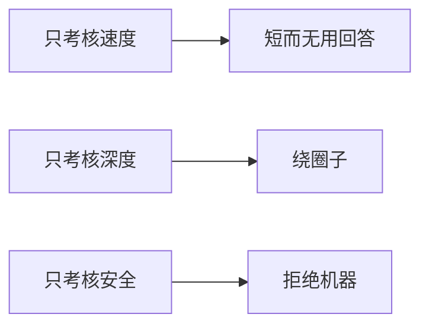
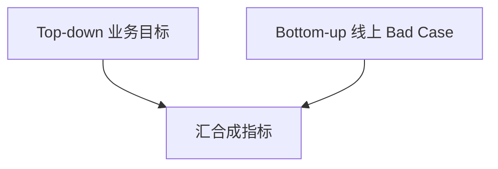
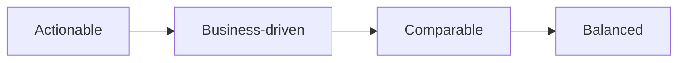
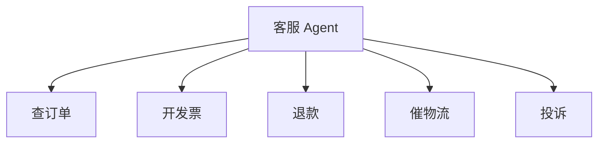
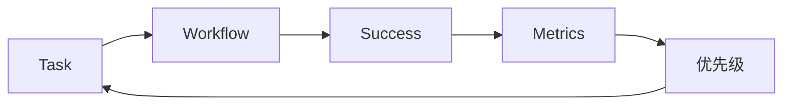
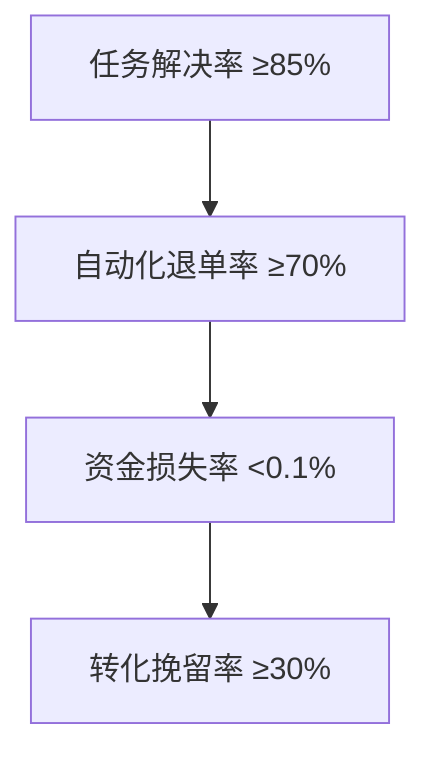
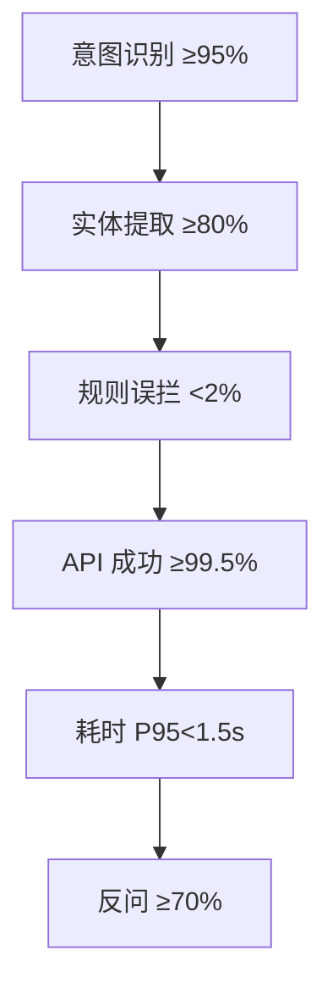
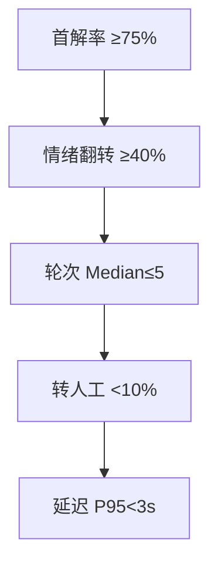
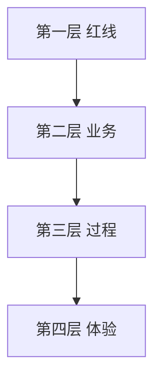
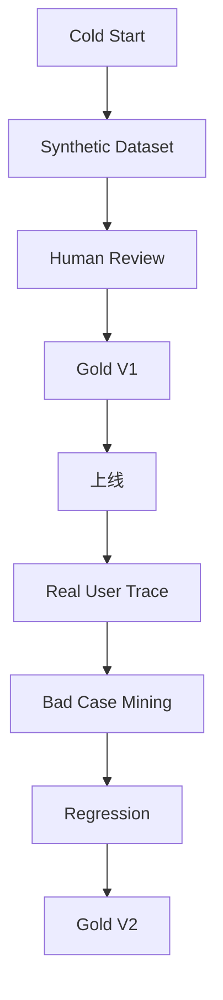

# Agent 评测指标系统 · 完全教程

> **四支视频综合 · 逐帧还原 + 系统化补全**
>
> 原视频：① [怎么写好 rubric](https://v.douyin.com/dMUFZl8f8d4/) ｜ ② [黄金数据集](https://v.douyin.com/2q-HrmCUJGM/) ｜ ③ [指标设计](https://v.douyin.com/0yUtsSTLV-k/) ｜ ④ [客服 Metrics 实战](https://v.douyin.com/dywhU4BsezE/)（均为抖音 @煮caicai，2026-07）
>
> 配套文件：[index.html（图文阅读版，24 张 SVG）](index.html)
>
> 姊妹篇：[RAG 评测完全教程（在线阅读）](../rag-evaluation-tutorial/RAG评测完全教程.html) ｜ [Agent 评测体系完全教程（在线阅读）](../agent-evaluation-tutorial/Agent评测体系完全教程.html) ｜ [评测驱动 Agent 迭代（在线阅读）](../agent-eval-driven-tutorial/Agent评测驱动迭代完全教程.html) ｜ [Agent 开发架构选型（在线阅读）](../agent-architecture-tutorial/Agent开发架构选型完全教程.html)

---

## 目录

- [0. 四支视频速览与保真约定](#0-四支视频速览与保真约定)
- [1. 全片结构地图](#1-全片结构地图)
- [2. 指标体系总览：你衡量什么就得到什么](#2-指标体系总览你衡量什么就得到什么)
- [3. 指标设计流程：从业务目标与真实失败中长出来](#3-指标设计流程从业务目标与真实失败中长出来)
- [4. 好指标的四原则](#4-好指标的四原则)
- [5. 实战起点：客服 Agent 的 Task 与 Workflow](#5-实战起点客服-agent-的-task-与-workflow)
- [6. 退款 Workflow：每一步都是一个 Metric](#6-退款-workflow每一步都是一个-metric)
- [7. 三张 Metrics 表：逐条计算方式与 Target](#7-三张-metrics-表逐条计算方式与-target)
- [8. 指标分层与优先级：先守红线，再谈体验](#8-指标分层与优先级先守红线再谈体验)
- [9. Rubric：把「什么叫好」翻译成机器可判断的行为](#9-rubric把什么叫好翻译成机器可判断的行为)
- [10. 好 Rubric 的三标准与四步写法](#10-好-rubric-的三标准与四步写法)
- [11. 黄金数据集：种子期靠合成，成长期靠打捞](#11-黄金数据集种子期靠合成成长期靠打捞)
- [12. 数据集五类覆盖与三项管理](#12-数据集五类覆盖与三项管理)
- [13. 用指标推动迭代：需要的是看板，而不是总分](#13-用指标推动迭代需要的是看板而不是总分)
- [14. 综合方法论：把四支视频拼成一条闭环](#14-综合方法论把四支视频拼成一条闭环)
- [15. 补充篇 A：专业名词速查（64 条）](#15-补充篇-a专业名词速查64-条)
- [16. 补充篇 B：与本站既有评测体系对齐](#16-补充篇-b与本站既有评测体系对齐)
- [17. 补充篇 C：可运行代码](#17-补充篇-c可运行代码)
- [18. 补充篇 D：常见误区](#18-补充篇-d常见误区)
- [19. 附录](#19-附录)

---

## 一页速览：四支视频的 7 个结论

| # | 结论 | 位置 |
|---|---|---|
| 1 | **指标是隐形指挥棒**：你衡量什么就得到什么 | [第 2 章](#2-指标体系总览你衡量什么就得到什么) |
| 2 | **指标从业务目标与真实失败中长出来** | [第 3 章](#3-指标设计流程从业务目标与真实失败中长出来) |
| 3 | **好指标四原则**：可行动 / 业务相关 / 可比较 / 平衡 | [第 4 章](#4-好指标的四原则) |
| 4 | **每一步 Workflow 都是一个 Metric**：三张表 15 项 | [第 7 章](#7-三张-metrics-表逐条计算方式与-target) |
| 5 | **指标要分优先级**：红线 → 业务 → 过程 → 体验 | [第 8 章](#8-指标分层与优先级先守红线再谈体验) |
| 6 | **Rubric = 维度 + 分级 + 描述**，重点写 3 分 | [第 9–10 章](#9-rubric把什么叫好翻译成机器可判断的行为) |
| 7 | **Dataset 覆盖比数量重要**，种子期合成 + 成长期打捞 | [第 11 章](#11-黄金数据集种子期靠合成成长期靠打捞) |

---

## 0. 四支视频速览与保真约定

**【视频原述】** 本教程综合抖音 @煮caicai 的四支连续内容：《agent评测：怎么写好rubric》《Agent产品黄金数据集怎么构建？》《Agent评估指标怎么设计？》《AI产品实战：客服Agent的metrics到底怎么定？》。四支视频分别回答「什么叫好」「拿什么测」「衡量什么」「怎么落地」，合起来正好是一套 Agent 评测指标系统。

| # | 视频 / 视频 ID | 发布 | 时长 | 官方章节 |
|---|---|---|---|---|
| ① | 怎么写好 rubric `7659780313228756468` | 2026-07-07 | 6:03 | 引言 / 什么是rubric / 好的rubric标准 / 如何写出第一份 / 结语（5 段） |
| ② | 黄金数据集怎么构建 `7662707705844547279` | 2026-07-15 | 5:08 | 引言 / 数据集的构建 / 数据集的管理 / 结语（4 段） |
| ③ | Agent评估指标怎么设计 `7663469055694133608` | 2026-07-17 | 5:56 | 引言 / 设计流程 / 好的指标原则 / 推动产品迭代 / 总结（5 段） |
| ④ | 客服Agent的metrics怎么定 `7663825652516165492` | 2026-07-18 | 5:39 | 引言 / 任务与指标 / 指标分层 / 总结（4 段） |

合计 **22 分 46 秒**、**18 段官方章节**。画面均为白底手绘风幻灯片或 Excalidraw 白板录屏（前三支为静态幻灯片，第四支为现场绘制白板 + DeepSeek 网页截图），底部烧录字幕；无主讲人画中画。

> **三种标记**：**【视频原述】**画面文字或烧录字幕确实出现过的表述；**【按画面重绘】**把视频手绘图 / 表格按原结构画成矢量图；**【补充】**由本站既有教程、Anthropic 公开工程文章与通用工程实践补齐，不属于视频原述。

> **保真边界**。① 第四支视频画面写「参考 **Astropy** 和 open AI 的经验」，疑为 **Anthropic** 的口误／笔误，本教程保留画面原文并在 [19.3 校正表](#193-校正表ocr-与自动摘要)说明，不擅自改写。② 三张 Metrics 表是作者把 Workflow 交给 DeepSeek 生成的**示例**，Target 健康值是示例阈值而非行业标准。③ 官方自动章节是机器生成，与画面目录有几十秒偏差，正文一律以画面与逐帧文字为准。④ 本轮未做 ASR，口播按烧录字幕 OCR 时间线 + 画面文字归纳，未凭空补写台词。

**还原方法**：解析 4 个分享短链 → 抓 `aweme/detail` 取视频 ID、官方章节与最高清晰度地址 → 下载 1080 档原片 23.3 MB（前三支 1080×1086 / 1080×1080，第四支 1546×1080）→ 每 3 秒抽帧 **456 张** → macOS Vision `VNRecognizeTextRequest`（zh-Hans + en-US，accurate，关闭语言纠正）得到 **6,170 行**带坐标文本 → 按 y 坐标与跨帧相似度分离画面文字（86 条幻灯片）与烧录字幕（412 条时间线）→ 对三张 Metrics 表、双阶段流程图、四层优先级等关键帧裁剪放大逐字校对 → 与本站既有评测体系及公开资料交叉核对。

---

## 1. 全片结构地图


**图 1｜四支视频与综合主线（按画面目录与官方章节重绘）**

四支视频不是四个孤立话题，而是一条从「判据」到「决策」的链：**Rubric** 定义什么叫好 → **Golden Dataset** 提供测什么 → **Metrics** 定义衡量什么 → **客服实战**把三者落到一条真实工作流上。本教程按「设计 → 落地 → 判据 → 数据 → 决策」重排，每章都标注视频出处。

| 模块 | 回答的问题 | 主要来源 | 本教程 |
|---|---|---|---|
| 指标体系 | 衡量什么 / 怎么设计 / 怎么算好 | 视频 ③ | 第 2–4 章 |
| 实战落地 | Task、Workflow、什么叫成功 | 视频 ④ | 第 5–8 章 |
| 评分判据 | 什么叫好 / 怎么写出 Rubric | 视频 ① | 第 9–10 章 |
| 评测数据 | 第一份数据集 / 覆盖 / 管理 | 视频 ② | 第 11–12 章 |
| 决策闭环 | 看板 / 上线判断 / 持续迭代 | 视频 ③④ | 第 13–14 章 |

> 全片可压成一句话：**业务目标 → 用户任务 → 失败点 → 指标体系 → Rubric 分档 → 黄金数据集 → 看板 → 优先级 → 回归，闭环。**

---

## 2. 指标体系总览：你衡量什么就得到什么

**【视频原述】** 「你衡量什么就得到什么」——指标是 Agent 开发中**隐形的指挥棒**。Metrics 的作用，是把产品经理眼中的业务目标，翻译成一个可以持续优化、持续比较的数字系统；翻译错了，研发方向就会南辕北辙。


**图 2｜从业务目标到指标体系的四层关系重绘**



**图 3｜单一指标诱导效应与平衡体系重绘**

**【视频原述】** 画面给出三个反例：只考核响应速度，Agent 学会给出短而无用的回答来强行提速；只考核回答深度，Agent 学会绕圈子、把简单问题复杂化；只考核安全性，Agent 变成「我无法回答」的拒绝机器。

> **结论**：真正优秀的 Metrics 不是一个数字，而是一套**能够相互制衡的指标体系**；这与本站《评测驱动 Agent 迭代 · 完全教程》的「主指标 + 护栏指标」是同一条原则。

---

## 3. 指标设计流程：从业务目标与真实失败中长出来

**【视频原述】** 「不要先想我要监控哪些指标」，而要先问 **Agent 在线上到底失败在哪里**。一个合理的设计流程是：业务目标 → 用户任务 → 失败点 → 指标，并由两条路径共同供给。



**图 4｜top-down / bottom-up 双路径重绘**

### 3.1 Top-down 自上而下

**【视频原述】** 例：订票 Agent 的业务目标是「降低人工客服压力」，对应的指标就**不只是「回答正确」**，而是**订单成功率**与**人工接管率**。指标必须直接承接业务目标，而不是承接模型能力。

### 3.2 Bottom-up 自下而上

**【视频原述】** 从线上 Bad Case 归纳失败类型：是意图识别错误、工具或参数提取错误，还是不符合业务规范？不同类型的失败对应不同的 Metrics。画面举例：若 40% 的失败来自工具参数错误，就应新增 `Tool Parameter Accuracy`；用户反馈「Agent 说话太啰嗦」，就建立**冗余度得分**。

> **【补充】** Anthropic 公开实践同样强调「从真实生产失败构建首版评测集」，并建议用 held-out 测试集防止对评测题目过拟合；这与 bottom-up 是同一套工程直觉。

---

## 4. 好指标的四原则

**【视频原述】** 很多团队的误区是「指标越来越多，却越来越没有指导意义」。视频给出四条原则。



**图 5｜好指标四原则重绘**

| 原则 | 英文 | 画面口径 | 反例 |
|---|---|---|---|
| 能够指导行动 | Actionable | 指标下降时，研发知道该改 prompt 还是改工具 | 一个笼统的「Agent 综合评分」 |
| 与业务目标直接相关 | Business-driven | 不为追求模型分数优化模型，而为业务变好 | 只看回复是否优美，不看任务是否完成 |
| 能够长期持续比较 | Comparable | 换模型 / 改 prompt / 加 memory 之后看长期趋势 | 每次换一套题目，分数无法对比 |
| 形成平衡 | Balanced | 不孤立优化某一个指标，指标之间要互相制衡 | 成功率↑ 但 Token 与时延暴涨 |

**【视频原述】** 画面特别点名：应把综合评分拆成 `Tool Accuracy`、`Planning Success`、`Memory Recall Accuracy` 等多个独立指标，每个指标都对应一个明确的优化方向。

---

## 5. 实战起点：客服 Agent 的 Task 与 Workflow

**【视频原述】** 第四支视频从评论区提问切入：指标到底怎么定？作者先不谈指标，而是先问「这个 Agent 是帮助用户完成哪些任务」。客服 Agent 的任务树包括查订单、开发票、退款、催物流、投诉等，任务成功就是**又快、又好、又稳定地完成用户任务**。



**图 6｜客服 Agent 任务树与「任务成功」追问重绘**

以「退款」为例，关键追问是 **「什么叫退款成功？」**——不是「调用了退款 API」，而是整个工作流闭环完成。作者把这条 Workflow 写进 prompt 交给 DeepSeek，要求输出三张 Metrics 表。

---

## 6. 退款 Workflow：每一步都是一个 Metric


**图 7｜退款 6 步 Workflow 与分支重绘**

**【视频原述】** 画面 prompt 里的完整流程（逐字还原）：`用户：我要退款 → [Step 1] 意图识别（退款意图 ✓ 继续 / 误识别 ✗ 转人工·重新识别）→ [Step 2] 订单信息抽取（抽到订单号 ✓ 继续 / 抽不到 ✗ 反问用户）→ [Step 3] 退款资格校验（在退款时限内 ✓ 继续 / 已拆封 ✗ 拒绝）→ [Step 4] 调用退款 API（调用成功 ✓ 继续 / 失败 ✗ 重试·转人工）→ [Step 5] 退款到账 → [Step 6] 回复用户 → 任务结束`。

> **核心洞察**：「这个工作流里面，其实每一步就是一个 Metric」。意图没识别对、订单号没抽到、资格误拦、API 失败、回复太慢——每个分支都对应一条可计算的过程指标；涉及资金的分支对应**红线指标**。

**【视频原述】** 要求 AI 输出的表结构也由画面给出：**每张表包含 Metric 名称、计算方式、Target 健康值**，共三张：① `Outcome Metrics（任务结果）` ② `Process Metrics（过程执行）` ③ `Experience Metrics（用户感受）`。



**图 8｜指标方法论闭环重绘**

---

## 7. 三张 Metrics 表：逐条计算方式与 Target

**【视频原述】** DeepSeek 返回的说明是：「基于你提供的『退款』工作流，我为你设计了三张 Evaluation Metrics 表。这套指标遵循了『结果-过程-体验』的评估框架，既关注任务是否完成，也关注完成的质量和用户的感受。」


**图 9｜三张表的关系与指标数量重绘**

### 7.1 Outcome Metrics（任务结果）｜4 项



**图 10｜Outcome Metrics 表逐项重绘**

| Metric | 计算方式 | Target |
|---|---|---|
| 任务解决率 Resolution Rate | (成功退款单数 + 合理拒绝并获用户接受单数) / 总退款会话数 | ≥ 85% |
| 自动化退单率 Auto-Refund Rate | 无需人工介入的退款成功单数 / 总退款成功单数 | ≥ 70% |
| 资金损失率 Refund Leakage Rate | 不应退款却执行了退款的金额 / 总退款金额 | < 0.1% |
| 转化挽留率 Save Rate | 被合理拒绝（如已拆封）后未转人工投诉的单数 / 总被拒绝退款单数 | ≥ 30% |

> **指标说明（画面原文）**：任务解决率关注 Agent 是否独立完成了闭环，无论结果是「退」还是「拒」；资金损失率是**风控底线**，防止 Agent 被 prompt injection 或错误逻辑误导而乱退款。

### 7.2 Process Metrics（过程执行）｜6 项



**图 11｜Process Metrics 表逐项重绘**

| Metric | 计算方式 | Target |
|---|---|---|
| 意图识别准确率 Intent Precision | 正确识别为「退款」意图的会话数 / 总退款会话数 | ≥ 95% |
| 关键实体提取率 Slot Filling Rate | 一次交互即提取到完整订单号的会话数 / 总退款会话数 | ≥ 80% |
| 规则误拦率 False Positive Blocking | 符合退款条件但被 Step 3 错误拦截的订单数 / 总拦截数 | < 2% |
| API 调用成功率 API Success Rate | Step 4 一次调用成功的次数 / 总调用次数 | ≥ 99.5% |
| 节点流转耗时 Step Duration | 每个 Step 的平均处理时长（特别是 Step 1 + Step 2） | P95 < 1.5s |
| 反问有效率 Ask-back Effectiveness | 用户反问后成功提供信息的次数 / Agent 发起反问的总次数 | ≥ 70% |

### 7.3 Experience Metrics（用户感受）｜5 项



**图 12｜Experience Metrics 表逐项重绘**

| Metric | 计算方式 | Target |
|---|---|---|
| 首解率 First Contact Resolution, FCR | 用户在一次会话内无需再次联系即解决的单数 / 总解决单数 | ≥ 75% |
| 用户情绪负向翻转率 Sentiment Flip Rate | (初始情绪负面，最终转为中立/正面的会话数) / 初始负面情绪会话数 | ≥ 40% |
| 对话轮次效率 Conversation Turns | 从用户发起退款到 Step 6 回复结果的总对话轮次 | Median ≤ 5 轮 |
| 用户主动转人工率 Manual Escalation Rate | 用户在流程未结束前主动要求「转人工」的次数 / 总会话数 | < 10% |
| 回复延迟感知 Response Latency | Agent 发送最后一条确认消息的时间 − 用户最后一条消息的时间（不含外部 API 等待） | P95 < 3s |

> **指标说明（画面原文）**：首解率是体验的黄金指标，用户第一次来就能解决、不用再跑一趟；情绪负向翻转率特别关注那些因为「无法退款」而生气的用户，客服话术是否能安抚他们。

> **口径提醒**：`P95` 与 `Median` 是尾部／中位数口径，不是平均值；`资金损失率` 是越低越好，其余多为越高越好。**Target 是示例值**，上线前必须按真实业务量与风控口径重新校准。

---

## 8. 指标分层与优先级：先守红线，再谈体验

**【视频原述】** AI 给出的指标很多，作者强调「指标不能特别多，要分优先级」，并给出自己的四层判断准则。



**图 13｜四层指标优先级金字塔重绘**

| 层级 | 定位 | 包含指标 | 何时盯 |
|---|---|---|---|
| 第一层 · 红线 | 绝对不能出问题 | 退款金额不能错（对应资金损失率） | MVP 之前就要确立 |
| 第二层 · 业务 | 直接影响结果 | Task Success Rate（任务完成率）、Human Handoff Rate（人工接管率） | 每次上线判断 |
| 第三层 · 过程 | 判断执行质量 | Intent Accuracy、Tool Success Rate（API 调用成功率）、Hallucination Rate（幻觉率） | 定位故障时下钻 |
| 第四层 · 体验 | 上线后再优化 | Latency（延迟）、CSAT（满意度）、Token Cost（成本） | 有真实流量后逐步优化 |

**【视频原述】** 口播里的判断很务实：如果什么都交给人工做，这个 Agent 就没有真正自动化；MVP 阶段任务完成率可以适当放低，但**资金安全不能让步**；延迟、满意度、成本属于「上线后拿数据再慢慢优化」的事情。

> **【补充】** 这个分层与本站《指标地图》的 P0/P1/P2 优先级、以及「主指标 + 护栏指标」可以直接对齐：红线 = 护栏（一票否决），业务 = 主指标，过程 = 归因层，体验 = 长期优化层。

---

## 9. Rubric：把「什么叫好」翻译成机器可判断的行为

**【视频原述】** 第一支视频开场就是一个反面案例：为了评估效果，你写了一句「回复专业、自然、有人情味」，结果打开线上日志，Agent 的回复「好像什么错都没有」——问题不在架子不行，而在 **rubric 本身就是一句废话**，「你所谓的回复专业自然有人情味，这就是 garbage in」。


**图 14｜Rubric 三要素重绘**

**【视频原述】** **Rubric 不是一句话，它是一套多维度的坐标体系**：把「好坏」拆解成**维度（Dimensions）+ 分级（Scales）+ 描述（Descriptions）**。本质是把产品直觉翻译成机器可以判断的行为。


**图 15｜跳水评分类比重绘**

**【视频原述】** 画面类比奥运会跳水评分：评委不说「跳得真漂亮」，而是看起跳高度、空中姿态、入水水花，每项都有明确的加分项与扣分项。映射到 Agent，就是「必须先回应用户情绪」「涉及退款必须说明依据」「不编造订单状态」这类可验证动作。

---

## 10. 好 Rubric 的三标准与四步写法


**图 16｜好 Rubric 三标准重绘**

| 标准 | 英文 | 画面口径 | 自检 |
|---|---|---|---|
| 可观察 | Observable | 不评价感觉，只评价行为 | 把「更有人味」换成「必须先回应用户情绪」 |
| 可区分 | Discriminative | 必须能把好答案和坏答案拉开差距 | 拿三条真实回复 A/B/C，能否稳定评出 A > B > C |
| 可行动 | Actionable | 每一个维度都应该对应一次产品优化 | 评完知道该改 prompt、personal 还是 safety |

### 10.1 四步写出第一份 Rubric


**图 17｜四步写出第一份 Rubric 重绘**

1. **找 5–10 个真实 case**：不要从「我觉得用户会问什么」开始，从线上日志／客服记录里挑真实请求，刻意覆盖 1–2 个边界 case 与 1–2 个历史翻车 case。这 5–10 个 case 就是 rubric 种子。
2. **手写每个 case 的「理想答案」**：整个过程里最值钱的一步。写的过程中才会发现真实偏好——「表格比段落好读」「『我帮你做』比『已为你处理』更友好」。把理想答案给团队几个人看，**分歧点就是 rubric 里必须明确写出的维度**。
3. **从理想答案里提炼维度**：把这些答案摆在一起，问「我是按什么标准写出这些答案的」——反复出现的判断标准（有没有完成用户问题、有没有不该说的东西）就是维度。
4. **写 1–5 分的评分标准**：rubric 不是想出来的，是总结出来的。它像 PRD 告诉研发「要做什么」一样，告诉 evaluation「产品做到什么程度才算真正成功」。


**图 18｜1–5 分分档与 3 分尺度重绘**

**【视频原述】** 画面特意强调分档：「分档最重要，因为大多数输出会落在 3 分附近。1 分和 5 分是极端情况，描述清楚就行；**3 分才是真正日常使用的尺度**。」

> **【补充】** Anthropic 公开文章对 grader 的建议与此高度一致：把判据做成 **atomic 且 binary 的 yes/no 问题**，而不是一个总体分；并**明确写出「什么不算满足该判据」**以解决边界样本，rubric 由领域专家制定。

---

## 11. 黄金数据集：种子期靠合成，成长期靠打捞

**【视频原述】** 第二支视频接在 rubric 与 LLM-as-a-judge 之后：决定 Agent 能否上线的，是 **Dataset**。产品上线后在物流、售后、投诉上频繁出错，往往是因为「之前没有刷过这些题」。数据集不是静态的，也不是越多越好。



**图 19｜黄金数据集双阶段构建流程重绘**

| 阶段 | 区间 | 主手段 | 流程 | 关键动作 |
|---|---|---|---|---|
| 种子期 | 0 → 0.5 | 冷启动靠「合成」Synthetic Data | Cold Start → Synthetic Dataset（模型生成）→ Human Review（人工审核）→ Gold Dataset V1 | 包含核心逻辑与极端 case，就足够跑第一轮评测 |
| 成长期 | 0.5 → 1 | 爆发靠「打捞」Trace-to-Eval | 产品上线 → Real User Trace（真实用户轨迹）→ Bad Case Mining（线上翻车案例）→ Regression Dataset → Gold Dataset V2… | 线上点踩或在 trace 中表现出纠错行为的 session，脱敏后转化为黄金测试集 |

**【视频原述】** 口播里最有力的一句：「**线上的 trace 才是最好的 Eval 的来源，最优秀的用例来自用户的真实报错**」。只要线上用户点了踩，或在 trace 中表现出纠错行为，这个 session 就应该自动脱敏、进入回归测试集。

> **【补充】** 「参考 Astropy 和 open AI 的经验」为画面原文；结合本系列已核对的 [Anthropic《Demystifying evals for AI agents》](https://www.anthropic.com/research/demystifying-evals-for-ai-agents)，疑似指 Anthropic，见 [19.3 校正表](#193-校正表ocr-与自动摘要)。

---

## 12. 数据集五类覆盖与三项管理


**图 20｜数据集五类覆盖重绘**

| 覆盖维度 | 英文 | 画面举例 |
|---|---|---|
| 业务覆盖 | Business Coverage | 客服 Agent：退款、修改地址、发票、投诉、售后、优惠券，不同任务行为不同 |
| 用户覆盖 | User Coverage | 新客 / 老客 / VIP，不同用户策略不同 |
| 难度覆盖 | Difficulty Coverage | 不能全是「你好」；长上下文切换、情绪化表达等长尾才真正拉开水平 |
| 风险覆盖 | Risk Coverage | 平时几乎不出现、一旦出错代价极高的样本（最容易被忽略） |
| 回归覆盖 | Regression Coverage | Agent 每翻车一次，以后无论换模型还是改 prompt 都必须重新通过这道题 |

```mermaid
flowchart LR
 A["版本管理"] --> B["标签管理"] --> C["持续运营"]
```

**图 21｜数据集三项管理机制重绘**

**【视频原述】** 管理上三件事：**版本管理（Versioning）**——否则今天 95 分，你不知道是模型进步了还是题目变简单了；**标签管理（Metadata）**——每条数据带能力类型、来源、是否 regression，按标签局部回归而不必每次全量重跑；**持续运营（Dataset Debt）**——prompt 会老、业务会变，数据集不是一次性建设。

> 「不能把 Dataset 当成一个 Excel，而是应该把它当成一个**产品的资产**」；产品经理除了点击率，还要关注**数据集的覆盖率和准确率**。当手中有 100 条经过平衡处理、且有专家范例的黄金数据集时，才真正拥有了产品的质量指南针。

---

## 13. 用指标推动迭代：需要的是看板，而不是总分

**【视频原述】** 第三支视频的收尾：Agent 的迭代是一场**多维度的取舍**，一个指标上升常伴随另一个下降，所以「你需要的是看板 dashboard，而不是总分」。

```mermaid
flowchart LR
 A["91%→96%"] --> D["看板决策"]
 B["4s→9s"] --> D
 C["成本+60%"] --> D
```

**图 22｜看板而非总分的决策案例重绘**

**【视频原述】** 画面给出上线决策案例：新推理模型让**任务成功率从 91% 提升到 96%**，但**平均响应时间从 4 秒增加到 9 秒**，**单次调用成本提升 60%**。这个模型该上线吗？答案不在具体分数里：如果是深度研究场景，多等几秒完全可以接受，提高准确率是正确选择；如果是实时语音助手，再高的准确率也没有意义。

> 看板真正解决的问题，是**帮助产品经理做出符合业务目标的决策**、找到业务场景下最合理的平衡点；产品经理的核心工作不是设计出最多的指标，而是设计出一套始终围绕业务目标、能够持续驱动迭代的 Metrics 系统。

> **【补充】** 与本系列第三篇的「主指标 + 护栏 + 能力评测毕业成回归评测」拼接后，完整的上线判断是：主指标改善 ∧ 护栏未破 ∧ 回归集无退步 ∧ 场景可接受的时延／成本。

---

## 14. 综合方法论：把四支视频拼成一条闭环

```mermaid
flowchart LR
 A["业务目标"] --> B["Task+Workflow"] --> C["指标体系"] --> D["Rubric"] --> E["Dataset"] --> F["执行"] --> G["看板"] --> A
```

**图 23｜【补充】生产级评测闭环全景**

1. **先定义 Task**：Agent 到底帮用户完成哪些任务（查订单 / 退款 / 投诉…）。
2. **拆 Workflow**：把每个任务写成带成功／失败分支的步骤，每一步都是一个潜在 Metric。
3. **定义 Success**：什么叫「退款成功」——闭环完成、资金无误、用户可接受，而不只是调用成功。
4. **生成 Metrics**：按 Outcome / Process / Experience 三层列出指标，写清计算方式、分母口径与 Target。
5. **分优先级**：红线 → 业务 → 过程 → 体验；MVP 阶段只守前两层。
6. **写 Rubric**：对需要主观判断的输出，用 5–10 个真实 case 与理想答案提炼维度，重点写清 3 分。
7. **建 Dataset**：种子期合成 + 人工审核；成长期从线上 Trace 与 Bad Case 打捞，做五类覆盖与版本管理。
8. **跑评测与看板**：代码／模型／人工三类判据，主指标 + 护栏，按版本对比趋势而非单看总分。
9. **回归闭环**：每翻车一次回填数据集，换模型／改 prompt 后必须重过回归题。

```mermaid
flowchart LR
 A["定义层"] --> B["执行层"] --> C["判据层"]
```

**图 24｜【补充】指标定义模板与代码映射**

这条链把「指标回答衡量什么、Rubric 回答什么叫好、Dataset 回答拿什么测、看板回答能不能上线」串成一套工程体系——evaluation 才真正从一次测试，变成一套推动 action 的持续进化机制。

---

## 15. 补充篇 A：专业名词速查（64 条）

**【补充】** 按「指标与统计 → 三层指标 → Rubric → 数据集 → 工程与决策」分组，均为本片语境下的含义。

| 术语 | 英文 / 别名 | 释义 |
|---|---|---|
| 评测指标 | Metrics | 把业务目标翻译成可持续优化、持续比较的数字系统 |
| 主指标 | Primary Metric | 直接代表业务是否变好的核心指标 |
| 护栏指标 | Guardrail | 不能被高分抵消的红线，如资金损失率 |
| Target 健康值 | Target | 指标应达到的示例阈值，需按业务量校准 |
| P95 | 95th percentile | 95% 样本不超过的耗时，尾部口径 |
| Median | 中位数 | 50% 分位，不受极端值影响 |
| FCR | First Contact Resolution | 首解率，一次会话内解决不再联系 |
| Resolution Rate | 任务解决率 | 闭环完成（含合理拒绝）的比例 |
| Auto-Refund Rate | 自动化退单率 | 无需人工介入的退款成功占比 |
| Refund Leakage Rate | 资金损失率 | 不应退款却执行退款的金额占比 |
| Save Rate | 转化挽留率 | 合理拒绝后未升级投诉的占比 |
| Intent Precision | 意图识别准确率 | 正确识别目标意图的会话占比 |
| Slot Filling Rate | 关键实体提取率 | 一次交互抽到完整订单号的占比 |
| False Positive Blocking | 规则误拦率 | 本应通过却被错误拦截的比例 |
| API Success Rate | API 调用成功率 | 一次调用成功的次数占比 |
| Step Duration | 节点流转耗时 | 每个步骤的平均处理时长 |
| Ask-back Effectiveness | 反问有效率 | 反问后用户成功补齐信息的比例 |
| Sentiment Flip Rate | 情绪负向翻转率 | 初始负面最终转中立／正面的比例 |
| Conversation Turns | 对话轮次效率 | 从发起到结果回复的总轮次 |
| Manual Escalation Rate | 主动转人工率 | 流程结束前用户要求转人工的占比 |
| Response Latency | 回复延迟感知 | 最后确认消息与用户最后消息的间隔 |
| CSAT | 满意度 | 用户主观满意度评分 |
| Token Cost | Token 成本 | 单次调用的模型成本 |
| Hallucination Rate | 幻觉率 | 编造不存在事实的比例 |
| Task Success Rate | 任务完成率 | 任务最终达成的比例 |
| Human Handoff Rate | 人工接管率 | 需要人工介入的会话占比 |
| Tool Parameter Accuracy | 工具参数准确率 | 工具入参正确的调用占比 |
| 冗余度得分 | Redundancy Score | 回答是否啰嗦的可计算度量 |
| 业务目标 | Business Goal | 如降低人工客服压力 |
| 失败点 | Failure Mode | 线上真实出错的环节 |
| Top-down | 自上而下 | 从业务目标推导指标 |
| Bottom-up | 自下而上 | 从 Bad Case 归纳指标 |
| Actionable | 能够指导行动 | 指标下降时知道改哪里 |
| Business-driven | 业务相关 | 指标直接承接业务目标 |
| Comparable | 可长期比较 | 跨版本趋势可比 |
| Balanced | 平衡 | 指标之间相互制衡 |
| 看板 | Dashboard | 多指标并排展示，而非一个总分 |
| Outcome Metrics | 任务结果指标 | 衡量是否最终解决用户问题 |
| Process Metrics | 过程执行指标 | 衡量各节点效率与准确性，用于定位故障 |
| Experience Metrics | 用户感受指标 | 衡量自然度、情绪价值与等待体验 |
| 红线 | Red Line | 绝对不能出问题的一票否决项 |
| Workflow | 工作流 | 带成功／失败分支的任务步骤序列 |
| Task | 任务 | Agent 帮用户完成的一件事 |
| Success | 任务成功 | 整个工作流又快又好又稳地完成 |
| Rubric | 评分标准／量规 | 把「好坏」拆成维度、分级、描述 |
| Dimensions | 维度 | 评什么 |
| Scales | 分级 | 评到几，如 1–5 分 |
| Descriptions | 描述 | 凭什么给这个分，清晰无感情色彩 |
| Observable | 可观察 | 不评价感觉，只评价行为 |
| Discriminative | 可区分 | 能把好答案与坏答案拉开差距 |
| LLM-as-a-judge | 模型评分 | 用模型按 rubric 给输出打分 |
| Grader | 评分器 | 代码／模型／人工三类判据的统称 |
| Atomic / Binary | 原子化二元判据 | 用一组 yes/no 问题替代总体分 |
| Golden Dataset | 黄金数据集 | 经平衡处理且有专家范例的高质量评测集 |
| Synthetic Data | 合成数据 | 冷启动阶段由模型生成的样本 |
| Human Review | 人工审核 | 合成数据进入黄金集前的专家校验 |
| Trace-to-Eval | 轨迹转评测 | 从线上真实用户轨迹打捞用例 |
| Bad Case Mining | 翻车案例挖掘 | 从点踩／纠错 session 中提取样本 |
| Regression Dataset | 回归测试集 | 每次改动都必须重过的历史失败题 |
| Business/User/Difficulty/Risk/Regression Coverage | 五类覆盖 | 数据集完整性的五个维度 |
| Versioning | 版本管理 | 数据集 V1/V2 与评测分数可对齐 |
| Metadata | 标签管理 | 能力类型、来源、是否 regression |
| Dataset Debt | 数据集债 | 样本老化、业务变化带来的持续运营成本 |
| Held-out Set | 留出集 | 防止对评测题目过拟合的独立样本 |
| 脱敏 | Desensitization | 线上 session 转评测用例前移除个人信息 |
| Prompt Injection | 提示词注入 | 诱导 Agent 违规执行退款等动作的攻击 |
| Dataset 覆盖率／准确率 | — | 数据集资产本身的元指标 |

---

## 16. 补充篇 B：与本站既有评测体系对齐

**【补充】** 本系列前三篇与本教程是同一套体系的不同切面，可直接拼接。

| 本教程 | 本站既有内容 | 对应关系 |
|---|---|---|
| Outcome / Process / Experience 三张表 | [三层评测体系（在线阅读）](../agent-evaluation-tutorial/Agent评测体系完全教程.html) | Outcome≈端到端结果，Process≈轨迹层，Experience≈表现层 |
| 红线 / 主指标 / 护栏 | [评测驱动 Agent 迭代（在线阅读）](../agent-eval-driven-tutorial/Agent评测驱动迭代完全教程.html) | 资金损失率是护栏；任务解决率是主指标 |
| 四层优先级 | [Agent Eval 指标地图](../agent-eval-driven-tutorial/指标地图.html) | 红线≈P0 护栏，业务≈P0 主指标，过程≈P1，体验≈P2 |
| 五类覆盖 / 回归覆盖 | 能力评测 → 回归评测「毕业」机制 | 翻车题毕业成回归集，是同一个动作 |
| Rubric 分档 | 三类评分器（代码 / 模型 / 人工）与 Judge 四原则 | Rubric 是模型评分器的判据输入 |
| 看板而非总分 | 主指标 + 护栏 + 跳过机制 | 上线判断需要多维并排，不折叠成一个数 |
| 指标定义模板 | [评测系统原型](../agent-eval-driven-tutorial/评测系统原型.html) | 计算方式与 Target 可映射为平台里的指标配置 |

> 四支视频没有讲 pass@k / pass^k、Trace 归因、执行引擎并发与隔离等工程细节，需要时请回到第三篇与 [RAG 评测完全教程（在线阅读）](../rag-evaluation-tutorial/RAG评测完全教程.html)。

---

## 17. 补充篇 C：可运行代码

**【补充】** 四段均为纯 Python 标准库、可直接运行；把画面里的「计算方式 / Target / 优先级」变成可执行逻辑。

### 17.1 三张表的指标计算引擎

```python
# metrics_engine.py —— python3 metrics_engine.py
from statistics import median

TARGETS = {
    "resolution_rate": (">=", 0.85, "Outcome"),
    "auto_refund_rate": (">=", 0.70, "Outcome"),
    "refund_leakage_rate": ("<", 0.001, "Outcome"),
    "save_rate": (">=", 0.30, "Outcome"),
    "intent_precision": (">=", 0.95, "Process"),
    "slot_filling_rate": (">=", 0.80, "Process"),
    "false_positive_blocking": ("<", 0.02, "Process"),
    "api_success_rate": (">=", 0.995, "Process"),
    "step_duration_p95": ("<", 1.5, "Process"),
    "ask_back_effectiveness": (">=", 0.70, "Process"),
    "fcr": (">=", 0.75, "Experience"),
    "sentiment_flip_rate": (">=", 0.40, "Experience"),
    "conversation_turns_median": ("<=", 5, "Experience"),
    "manual_escalation_rate": ("<", 0.10, "Experience"),
    "response_latency_p95": ("<", 3.0, "Experience"),
}

def p95(xs):
    xs = sorted(xs)
    return xs[min(len(xs) - 1, int(len(xs) * 0.95))]

def compute(sessions):
    n = len(sessions)
    resolved = sum(1 for s in sessions if s["closed_loop"])
    auto = sum(1 for s in sessions if s["closed_loop"] and not s["human"])
    refund_ok = sum(1 for s in sessions if s["refunded"])
    refused = sum(1 for s in sessions if s["refused"])
    saved = sum(1 for s in sessions if s["refused"] and not s["complained"])
    blocked = sum(1 for s in sessions if s["blocked"])
    wrong_block = sum(1 for s in sessions if s["blocked"] and s["eligible"])
    asks = sum(1 for s in sessions if s["asked_back"])
    ask_ok = sum(1 for s in sessions if s["asked_back"] and s["got_info"])
    neg = sum(1 for s in sessions if s["initial_negative"])
    flipped = sum(1 for s in sessions if s["initial_negative"] and not s["final_negative"])
    m = {
        "resolution_rate": resolved / n,
        "auto_refund_rate": auto / max(1, refund_ok),
        "refund_leakage_rate": sum(s["leak_amount"] for s in sessions) / max(1, sum(s["refund_amount"] for s in sessions)),
        "save_rate": saved / max(1, refused),
        "intent_precision": sum(1 for s in sessions if s["intent_ok"]) / n,
        "slot_filling_rate": sum(1 for s in sessions if s["slot_ok"]) / n,
        "false_positive_blocking": wrong_block / max(1, blocked),
        "api_success_rate": sum(1 for s in sessions if s["api_ok"]) / n,
        "step_duration_p95": p95([s["step_seconds"] for s in sessions]),
        "ask_back_effectiveness": ask_ok / max(1, asks),
        "fcr": sum(1 for s in sessions if s["closed_loop"] and not s["recontact"]) / max(1, resolved),
        "sentiment_flip_rate": flipped / max(1, neg),
        "conversation_turns_median": median([s["turns"] for s in sessions]),
        "manual_escalation_rate": sum(1 for s in sessions if s["escalated"]) / n,
        "response_latency_p95": p95([s["reply_seconds"] for s in sessions]),
    }
    return m

def check(m):
    out = []
    for k, (op, t, layer) in TARGETS.items():
        v = m[k]
        ok = (v >= t) if op == ">=" else (v < t) if op == "<" else (v <= t)
        out.append((layer, k, round(v, 4), op, t, "PASS" if ok else "FAIL"))
    return out

if __name__ == "__main__":
    import random
    random.seed(7)
    keys = ("closed_loop","human","refunded","refused","complained","blocked","eligible",
            "intent_ok","slot_ok","api_ok","asked_back","got_info","initial_negative",
            "final_negative","recontact","escalated")
    demo = []
    for i in range(200):
        s = {k: False for k in keys}
        s.update(closed_loop=random.random() < .90, human=random.random() < .22,
                 refunded=random.random() < .70, refused=random.random() < .18,
                 complained=random.random() < .35, blocked=random.random() < .20,
                 eligible=random.random() < .97, intent_ok=random.random() < .96,
                 slot_ok=random.random() < .84, api_ok=random.random() < .996,
                 asked_back=random.random() < .30, got_info=random.random() < .75,
                 initial_negative=random.random() < .35, final_negative=random.random() < .45,
                 recontact=random.random() < .18, escalated=random.random() < .08,
                 leak_amount=0.0, refund_amount=100.0,
                 step_seconds=random.uniform(.4, 2.0), turns=random.randint(2, 7),
                 reply_seconds=random.uniform(.8, 3.6))
        demo.append(s)
    for layer, k, v, op, t, status in check(compute(demo)):
        print(f"{layer:<11} {k:<26} {v:<9} {op}{t:<7} {status}")
```

### 17.2 Rubric 评分器（含三标准自检）

```python
# rubric_scorer.py —— python3 rubric_scorer.py
RUBRIC = {
    "情绪回应": {1: "完全忽略用户情绪", 3: "先回应用户情绪再进入正事", 5: "识别情绪并给出针对性安抚"},
    "依据说明": {1: "无依据直接下结论", 3: "说明退款依据但缺关键字段", 5: "完整给出时限、资格与订单号依据"},
    "事实准确": {1: "编造订单或到账状态", 3: "状态正确但表述含糊", 5: "状态与后台一致且可核验"},
}

def score(answer):
    # 规则版评分器：真实工程里这一层换成 LLM judge + 人工校准
    s = {}
    s["情绪回应"] = 5 if "理解" in answer and "抱歉" in answer else (3 if "理解" in answer else 1)
    s["依据说明"] = 5 if "订单号" in answer and "时限" in answer else (3 if "订单" in answer else 1)
    s["事实准确"] = 1 if "已到账" in answer and "待确认" in answer else (3 if "订单" in answer else 5)
    return s

def discriminative(samples):
    """拿 A/B/C 三条回复，检查 rubric 能否稳定拉开差距。"""
    totals = [sum(score(a).values()) for a in samples]
    return totals, all(totals[i] > totals[i + 1] for i in range(len(totals) - 1))

if __name__ == "__main__":
    A = "理解您的着急，很抱歉。已核对订单号与退款时限，状态待确认，到账后第一时间通知您。"
    B = "理解您的着急。已核对订单，请等待处理。"
    C = "已处理。"
    for name, a in zip(("A", "B", "C"), (A, B, C)):
        print(name, score(a), "总分", sum(score(a).values()))
    totals, ok = discriminative([A, B, C])
    print("区分度 A>B>C:", ok, totals)
    print("维度数:", len(RUBRIC), "| 每档都有描述:", all(len(v) == 3 for v in RUBRIC.values()))
```

### 17.3 数据集覆盖率检查器

```python
# dataset_coverage.py —— python3 dataset_coverage.py
AXES = ("business", "user", "difficulty", "risk", "regression")
NEED = {"business": 4, "user": 3, "difficulty": 3, "risk": 2, "regression": 5}

def audit(items):
    """items: [{id, tags:{axis:[labels]}, source, version, reviewed}]"""
    report = {}
    for ax in AXES:
        labels = sorted({l for it in items for l in it["tags"].get(ax, [])})
        report[ax] = (len(labels), NEED[ax], "OK" if len(labels) >= NEED[ax] else "GAP", labels)
    versions = sorted({it["version"] for it in items})
    unreviewed = [it["id"] for it in items if not it["reviewed"]]
    return report, versions, unreviewed

if __name__ == "__main__":
    items = [
        dict(id="c%02d" % i, tags={"business": ["refund"], "user": ["vip" if i % 3 == 0 else "normal"],
             "difficulty": ["long_context" if i % 4 == 0 else "plain"], "risk": ["injection"] if i == 0 else [],
             "regression": ["bug_%d" % i] if i < 5 else []},
             source="synthetic" if i < 8 else "trace", version="v1" if i < 8 else "v2", reviewed=i != 3)
        for i in range(12)
    ]
    rep, versions, unreviewed = audit(items)
    for ax, (got, need, status, labels) in rep.items():
        print(f"{ax:<11} {got}/{need} {status:<4} {labels}")
    print("版本:", versions, "| 未人工审核:", unreviewed)
```

### 17.4 看板决策器（红线否决 + 场景权重）

```python
# dashboard_decide.py —— python3 dashboard_decide.py
SCENES = {
    "deep_research": {"success": .8, "latency": .1, "cost": .1},
    "realtime_voice": {"success": .2, "latency": .7, "cost": .1},
}

def decide(before, after, scene, redline_ok=True):
    """before/after: {success, latency, cost}；红线一票否决。"""
    if not redline_ok:
        return "BLOCK", "红线指标未通过，禁止上线"
    gain = after["success"] - before["success"]
    norm = {"success": gain * 5,
            "latency": -(after["latency"] - before["latency"]) / max(before["latency"], 1),
            "cost": -(after["cost"] - before["cost"]) / max(before["cost"], 1)}
    w = SCENES[scene]
    score = sum(norm[k] * w[k] for k in w)
    return ("GO" if score > 0 else "HOLD"), f"weighted={score:+.3f} | 明细={norm}"

if __name__ == "__main__":
    before = {"success": .91, "latency": 4.0, "cost": 1.0}
    after = {"success": .96, "latency": 9.0, "cost": 1.6}
    for scene in SCENES:
        print(f"{scene:<16}", *decide(before, after, scene))
    print("红线失败:", *decide(before, after, "deep_research", redline_ok=False))
```

---

## 18. 补充篇 D：常见误区

| # | 误区 | 为什么错 | 正确做法 |
|---|---|---|---|
| 1 | 用「专业、自然、有人情味」当评分标准 | 每个人理解不同，量半天只剩自我感觉 | 写成可观察行为：先回应情绪、涉及退款说明依据 |
| 2 | 指标越多越好 | 越来越多却越来越没有指导意义 | 每个指标对应一个明确优化方向，并分优先级 |
| 3 | 只优化一个总分 | 成功率涨了，Token / 时延 / 成本可能崩 | 看板并排 + 护栏指标，相互制衡 |
| 4 | 把「调用 API 成功」当作任务成功 | 没到账、没回复、资金错了都不算闭环 | 按 Workflow 定义 Success，Outcome 覆盖完整闭环 |
| 5 | Target 直接照抄示例值 | 85% / 1.5s 是视频里的示例，不是行业标准 | 按真实业务量、风控口径与场景重新校准 |
| 6 | 把平均值当 P95 / Median | 尾部长请求会被平均值掩盖 | 分别计算 P95 与 Median，口径写进指标定义 |
| 7 | 把 1 分和 5 分写得最细 | 绝大多数输出落在 3 分附近 | 重点描述 3 分，极端档写清边界即可 |
| 8 | Dataset 只靠合成数据 | 覆盖不了真实长尾与线上翻车 | 种子期合成 + 成长期 Trace 打捞，Bad Case 回填 |
| 9 | 把 Dataset 当一次性 Excel | prompt 会老、业务会变、分数不可比 | 版本管理 + Metadata + 持续运营 |
| 10 | 上线判断只看指标分数 | 同一组数字在不同场景结论相反 | 结合业务场景找最合理平衡点 |
| 11 | 红线与体验一起优化 | MVP 阶段资源有限，资金安全不能让步 | 红线 → 业务 → 过程 → 体验，逐层推进 |
| 12 | 线上 session 直接进评测集 | 含个人信息，且有数据合规风险 | 自动脱敏 + 人工审核后再入库 |

---

## 19. 附录

### 19.1 四支视频官方章节时间轴（逐字）

| 视频 | 时间 | 章节名 |
|---|---|---|
| ① rubric | 00:00 / 00:52 / 02:02 / 04:08 / 05:45 | 引言 / 什么是rubric / 好的rubric的标准 / 如何写出第一份rubri… / 结语 |
| ② 黄金数据集 | 00:00 / 00:40 / 03:46 / 04:53 | 引言 / 数据集的构建 / 数据集的管理 / 结语 |
| ③ 指标设计 | 00:00 / 01:05 / 02:32 / 04:22 / 05:35 | 引言 / 设计流程 / 好的指标原则 / 推动产品迭代 / 总结 |
| ④ 客服实战 | 00:00 / 00:20 / 03:51 / 05:07 | 引言 / 任务与指标 / 指标分层 / 总结 |

### 19.2 配图速查（24 张）

| # | 图名 | 来源 |
|---|---|---|
| 1–2 | 四支视频结构地图 / 指标体系总览 | 画面目录 + 综合重绘 |
| 3–5 | 隐形指挥棒 / 双路径 / 四原则 | 视频 ③ 画面与口播 |
| 6–8 | 客服任务树 / 退款 6 步 Workflow / 方法论闭环 | 视频 ④ 白板 |
| 9–12 | 三张表关系 + Outcome / Process / Experience 逐项 | 视频 ④ DeepSeek 截图逐字重绘 |
| 13 | 四层指标优先级 | 视频 ④ 白板 |
| 14–18 | Rubric 三要素 / 跳水类比 / 三标准 / 四步 / 分档 | 视频 ① 画面 |
| 19–21 | 黄金数据集双阶段 / 五类覆盖 / 三项管理 | 视频 ② 画面 |
| 22 | 看板而非总分（91→96 案例） | 视频 ③ 口播 |
| 23–24 | 【补充】生产级闭环 / 指标定义模板 | 公开工程资料，非视频画面 |

### 19.3 校正表（OCR 与自动摘要）

| 来源写成了 | 正确写法 | 依据 |
|---|---|---|
| `p95 <15s` / `P95 < 15s` | `P95 < 1.5s` | 图 11 帧 Target 列裁剪放大逐字核对 |
| `Astropy` 和 open AI | 画面原文保留；疑为 `Anthropic` + `OpenAI` | 视频 ② 画面字幕 + 本系列已核对的 Anthropic 文章；不擅自改写 |
| `Reeression Coverage` | `Regression Coverage` | 02:30 帧放大 + 上下文 |
| `O6servable` / `Discrim inative` | `Observable` / `Discriminative` | 02:00 帧放大 |
| `CoLd Start`、`SyRthetic Dataset`、`GoLd Dataset` | `Cold Start`、`Synthetic Dataset`、`Gold Dataset` | 手绘字体大小写混排，按英文惯例规范 |
| `task-》 success` / `Step Su=p Duration` | `task → success` / `Step Duration` | 画面手绘符号与 OCR 形近字 |
| `选代`、`edge 的产品`、`德塔赛德` | `迭代`、`Agent 的产品`、`Dataset` | 字幕 OCR 形近字，按上下文校正 |
| `总机用户`、`a级的历史上翻` | `客服／真实用户记录`、`历史 bad case` | 字幕断句 + 画面「找真实 case」上下文 |
| `Agent 评估指标设计 - Derx` / `Deex` | `客服Agent评估指标设计` | Excalidraw 标题栏 OCR 残字，按画面主标题 |
| 官方章节 04:08「如何写出第一份rubri…」 | 完整为「如何写出第一份 Rubric」 | 接口章节名被截断，按画面目录补全 |

### 19.4 还原方法与资料

1. **视频**：① [怎么写好 rubric](https://v.douyin.com/dMUFZl8f8d4/)（ID `7659780313228756468`，2026-07-07，6:03）；② [黄金数据集](https://v.douyin.com/2q-HrmCUJGM/)（ID `7662707705844547279`，2026-07-15，5:08）；③ [指标设计](https://v.douyin.com/0yUtsSTLV-k/)（ID `7663469055694133608`，2026-07-17，5:56）；④ [客服 metrics](https://v.douyin.com/dywhU4BsezE/)（ID `7663825652516165492`，2026-07-18，5:39）。作者均为 @煮caicai。
2. **逐帧**：1080 档原片 23.3 MB；每 3 秒抽帧 456 张；Vision OCR 6,170 行带坐标文本；按 y 坐标与跨帧相似度分离出 86 条画面幻灯片与 412 条字幕时间线；三张 Metrics 表、双阶段流程图、四层优先级等关键帧裁剪放大逐字校对。
3. **公开资料核对**：Anthropic, [Demystifying evals for AI agents](https://www.anthropic.com/research/demystifying-evals-for-ai-agents)、[Building strong safety evaluations](https://www.anthropic.com/research/building-strong-safety-evaluations)（rubric 由领域专家制定、判据 atomic / binary、明确写出反例、held-out 集）；本系列三篇教程与指标地图。
4. **本系列互链**：[RAG 评测完全教程（在线阅读）](../rag-evaluation-tutorial/RAG评测完全教程.html) ｜ [Agent 评测体系完全教程（在线阅读）](../agent-evaluation-tutorial/Agent评测体系完全教程.html) ｜ [评测驱动 Agent 迭代（在线阅读）](../agent-eval-driven-tutorial/Agent评测驱动迭代完全教程.html) ｜ [Agent 开发架构选型（在线阅读）](../agent-architecture-tutorial/Agent开发架构选型完全教程.html)。

> **未做的部分（如实说明）**：本轮未做语音逐字转写（ASR），口播依据烧录字幕 OCR 时间线 + 画面文字归纳；第四支为现场白板绘制，工具栏与绘图元素在 OCR 中形成噪声，已按语义过滤，未逐字转录工具栏文字；三张表由 DeepSeek 生成，属示例产物，不构成生产指标标准。

---

*本教程为学习整理产物；视频与文章版权归各自作者所有。*