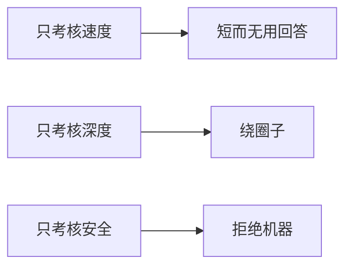
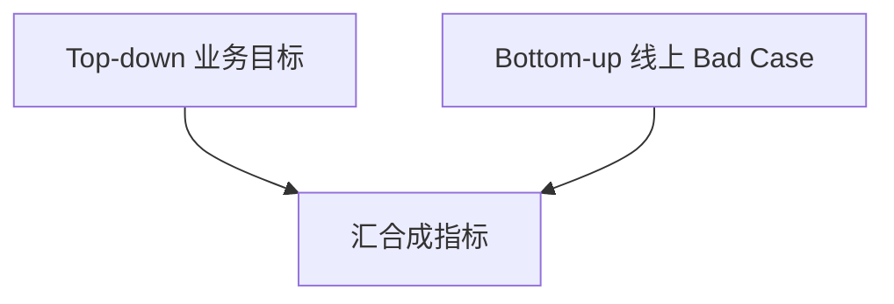
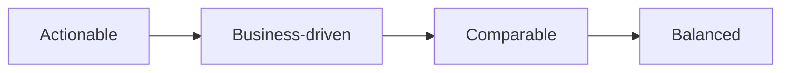
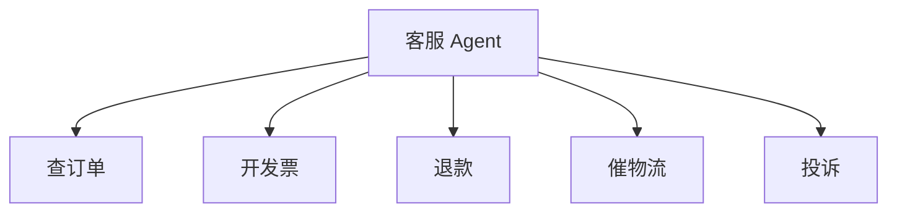
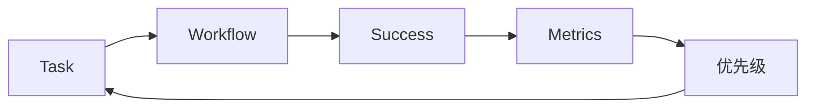
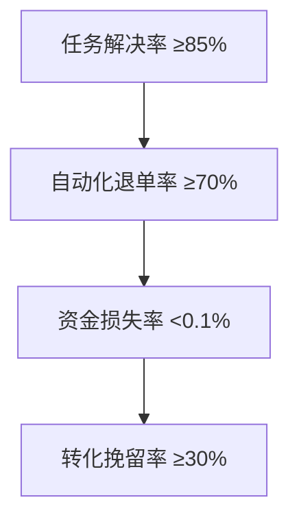
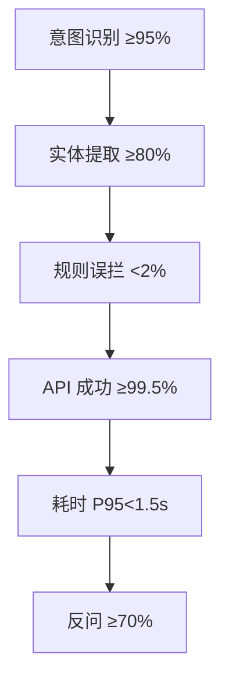
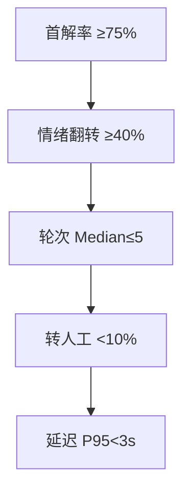
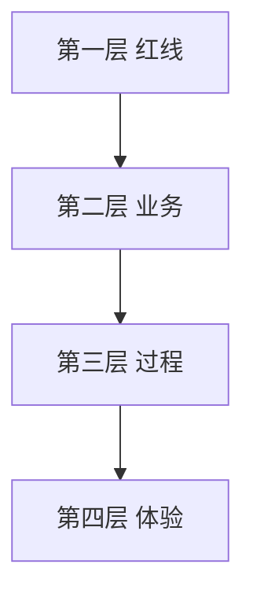
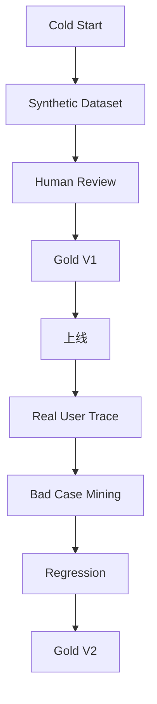

# Agent 评测指标系统 · 完全教程

> **四支视频综合 · 逐帧还原 + 系统化补全**
>
> 原视频：① [怎么写好 rubric](https://v.douyin.com/dMUFZl8f8d4/) ｜ ② [黄金数据集](https://v.douyin.com/2q-HrmCUJGM/) ｜ ③ [指标设计](https://v.douyin.com/0yUtsSTLV-k/) ｜ ④ [客服 Metrics 实战](https://v.douyin.com/dywhU4BsezE/)（均为抖音 @煮caicai，2026-07）
>
> 配套文件：[index.html（图文阅读版，24 张 SVG）](index.html)
>
> 姊妹篇：[RAG 评测完全教程（在线阅读）](../rag-evaluation-tutorial/RAG评测完全教程.html) ｜ [Agent 评测体系完全教程（在线阅读）](../agent-evaluation-tutorial/Agent评测体系完全教程.html) ｜ [评测驱动 Agent 迭代（在线阅读）](../agent-eval-driven-tutorial/Agent评测驱动迭代完全教程.html) ｜ [Agent 开发架构选型（在线阅读）](../agent-architecture-tutorial/Agent开发架构选型完全教程.html)

---

## 目录

- [0. 四支视频速览与保真约定](#0-四支视频速览与保真约定)
- [1. 全片结构地图](#1-全片结构地图)
- [2. 指标体系总览：你衡量什么就得到什么](#2-指标体系总览你衡量什么就得到什么)
- [3. 指标设计流程：从业务目标与真实失败中长出来](#3-指标设计流程从业务目标与真实失败中长出来)
- [4. 好指标的四原则](#4-好指标的四原则)
- [5. 实战起点：客服 Agent 的 Task 与 Workflow](#5-实战起点客服-agent-的-task-与-workflow)
- [6. 退款 Workflow：每一步都是一个 Metric](#6-退款-workflow每一步都是一个-metric)
- [7. 三张 Metrics 表：逐条计算方式与 Target](#7-三张-metrics-表逐条计算方式与-target)
- [8. 指标分层与优先级：先守红线，再谈体验](#8-指标分层与优先级先守红线再谈体验)
- [9. Rubric：把「什么叫好」翻译成机器可判断的行为](#9-rubric把什么叫好翻译成机器可判断的行为)
- [10. 好 Rubric 的三标准与四步写法](#10-好-rubric-的三标准与四步写法)
- [11. 黄金数据集：种子期靠合成，成长期靠打捞](#11-黄金数据集种子期靠合成成长期靠打捞)
- [12. 数据集五类覆盖与三项管理](#12-数据集五类覆盖与三项管理)
- [13. 用指标推动迭代：需要的是看板，而不是总分](#13-用指标推动迭代需要的是看板而不是总分)
- [14. 综合方法论：把四支视频拼成一条闭环](#14-综合方法论把四支视频拼成一条闭环)
- [15. 补充篇 A：专业名词速查（67 条）](#15-补充篇-a专业名词速查67-条)
- [16. 补充篇 B：与本站既有评测体系对齐](#16-补充篇-b与本站既有评测体系对齐)
- [17. 补充篇 C：可运行代码](#17-补充篇-c可运行代码)
- [18. 补充篇 D：常见误区](#18-补充篇-d常见误区)
- [19. 附录](#19-附录)

---

## 一页速览：四支视频的 7 个结论

| # | 结论 | 位置 |
|---|---|---|
| 1 | **指标是隐形指挥棒**：你衡量什么就得到什么 | [第 2 章](#2-指标体系总览你衡量什么就得到什么) |
| 2 | **指标从业务目标与真实失败中长出来** | [第 3 章](#3-指标设计流程从业务目标与真实失败中长出来) |
| 3 | **好指标四原则**：可行动 / 业务相关 / 可比较 / 平衡 | [第 4 章](#4-好指标的四原则) |
| 4 | **每一步 Workflow 都是一个 Metric**：三张表 15 项 | [第 7 章](#7-三张-metrics-表逐条计算方式与-target) |
| 5 | **指标要分优先级**：红线 → 业务 → 过程 → 体验 | [第 8 章](#8-指标分层与优先级先守红线再谈体验) |
| 6 | **Rubric = 维度 + 分级 + 描述**，重点写 3 分 | [第 9–10 章](#9-rubric把什么叫好翻译成机器可判断的行为) |
| 7 | **Dataset 覆盖比数量重要**，种子期合成 + 成长期打捞 | [第 11 章](#11-黄金数据集种子期靠合成成长期靠打捞) |

---

## 0. 四支视频速览与保真约定

**【视频原述】** 本教程综合抖音 @煮caicai 的四支连续内容：《agent评测：怎么写好rubric》《Agent产品黄金数据集怎么构建？》《Agent评估指标怎么设计？》《AI产品实战：客服Agent的metrics到底怎么定？》。四支视频分别回答「什么叫好」「拿什么测」「衡量什么」「怎么落地」，合起来正好是一套 Agent 评测指标系统。

| # | 视频 / 视频 ID | 发布 | 时长 | 官方章节 |
|---|---|---|---|---|
| ① | 怎么写好 rubric `7659780313228756468` | 2026-07-07 | 6:03 | 引言 / 什么是rubric / 好的rubric标准 / 如何写出第一份 / 结语（5 段） |
| ② | 黄金数据集怎么构建 `7662707705844547279` | 2026-07-15 | 5:08 | 引言 / 数据集的构建 / 数据集的管理 / 结语（4 段） |
| ③ | Agent评估指标怎么设计 `7663469055694133608` | 2026-07-17 | 5:56 | 引言 / 设计流程 / 好的指标原则 / 推动产品迭代 / 总结（5 段） |
| ④ | 客服Agent的metrics怎么定 `7663825652516165492` | 2026-07-18 | 5:39 | 引言 / 任务与指标 / 指标分层 / 总结（4 段） |

合计 **22 分 46 秒**、**18 段官方章节**。画面均为白底手绘风幻灯片或 Excalidraw 白板录屏（前三支为静态幻灯片，第四支为现场绘制白板 + DeepSeek 网页截图），底部烧录字幕；无主讲人画中画。

> **三种标记**：**【视频原述】**画面文字或烧录字幕确实出现过的表述；**【按画面重绘】**把视频手绘图 / 表格按原结构画成矢量图；**【补充】**由本站既有教程、Anthropic 公开工程文章与通用工程实践补齐，不属于视频原述。

> **保真边界**。① 第四支视频画面写「参考 **Astropy** 和 open AI 的经验」，疑为 **Anthropic** 的口误／笔误，本教程保留画面原文并在 [19.3 校正表](#193-校正表ocr-与自动摘要)说明，不擅自改写。② 三张 Metrics 表是作者把 Workflow 交给 DeepSeek 生成的**示例**，Target 健康值是示例阈值而非行业标准。③ 官方自动章节是机器生成，与画面目录有几十秒偏差，正文一律以画面与逐帧文字为准。④ 本轮未做 ASR，口播按烧录字幕 OCR 时间线 + 画面文字归纳，未凭空补写台词。

**还原方法**：解析 4 个分享短链 → 抓 `aweme/detail` 取视频 ID、官方章节与最高清晰度地址 → 下载 1080 档原片 23.3 MB（前三支 1080×1086 / 1080×1080，第四支 1546×1080）→ 每 3 秒抽帧 **456 张** → macOS Vision `VNRecognizeTextRequest`（zh-Hans + en-US，accurate，关闭语言纠正）得到 **6,170 行**带坐标文本 → 按 y 坐标与跨帧相似度分离画面文字（86 条幻灯片）与烧录字幕（412 条时间线）→ 对三张 Metrics 表、双阶段流程图、四层优先级等关键帧裁剪放大逐字校对 → 与本站既有评测体系及公开资料交叉核对。

---

## 1. 全片结构地图


**图 1｜四支视频与综合主线（按画面目录与官方章节重绘）**

四支视频不是四个孤立话题，而是一条从「判据」到「决策」的链：**Rubric** 定义什么叫好 → **Golden Dataset** 提供测什么 → **Metrics** 定义衡量什么 → **客服实战**把三者落到一条真实工作流上。本教程按「设计 → 落地 → 判据 → 数据 → 决策」重排，每章都标注视频出处。

| 模块 | 回答的问题 | 主要来源 | 本教程 |
|---|---|---|---|
| 指标体系 | 衡量什么 / 怎么设计 / 怎么算好 | 视频 ③ | 第 2–4 章 |
| 实战落地 | Task、Workflow、什么叫成功 | 视频 ④ | 第 5–8 章 |
| 评分判据 | 什么叫好 / 怎么写出 Rubric | 视频 ① | 第 9–10 章 |
| 评测数据 | 第一份数据集 / 覆盖 / 管理 | 视频 ② | 第 11–12 章 |
| 决策闭环 | 看板 / 上线判断 / 持续迭代 | 视频 ③④ | 第 13–14 章 |

> 全片可压成一句话：**业务目标 → 用户任务 → 失败点 → 指标体系 → Rubric 分档 → 黄金数据集 → 看板 → 优先级 → 回归，闭环。**

---

**本章语音逐字稿（ASR · 已校正，34 句）**

> `[视频③ 00:00]` 哈喽大家今天我们继续 Agent 评测相关的话题的讨论
> `[视频③ 00:04]` 前面我们已经讨论过 Judge
> `[视频③ 00:06]` Rubric
> `[视频③ 00:07]` 然后 Dataset
> `[视频③ 00:08]` 那今天我们来讨论 Metrics
> `[视频③ 00:11]` 有一句话就这么说的
> `[视频③ 00:13]` 你衡量什么就得到什么
> `[视频③ 00:14]` 那在我们的 Agent 的开发中
> `[视频③ 00:16]` Metrics 也就是指标就是那个隐形的指挥棒
> `[视频③ 00:19]` 如果你衡量的是响应速度
> `[视频③ 00:21]` Agent 就会学会敷衍
> `[视频③ 00:23]` 可以说短而无用的回答来强行提速
> `[视频③ 00:26]` 如果你衡量的是对话的轮次
> `[视频③ 00:28]` Agent 就会学会绕圈子
> `[视频③ 00:30]` 把一个简单问题复杂化
> `[视频③ 00:32]` 如果你衡量的是安全性
> `[视频③ 00:33]` Agent 可能会变成一个拒绝机器
> `[视频③ 00:35]` 对什么请求都说对不起我无法回答
> `[视频③ 00:38]` 那所以说 Metrics 的本质
> `[视频③ 00:40]` 是把产品经理眼中的业务目标
> `[视频③ 00:42]` 翻译成一个可以持续优化
> `[视频③ 00:44]` 持续比较的数字系统
> `[视频③ 00:46]` 那如果翻译错了
> `[视频③ 00:48]` 研发的方向就会南辕北辙
> `[视频③ 00:50]` 所以今天我们来讨论一下
> `[视频③ 00:51]` 我们产品经理如何去制定一个 Metrics
> `[视频③ 00:54]` 那什么是一个好的 Metrics
> `[视频③ 00:56]` 那产品经理如何利用这个 Metrics
> `[视频③ 00:57]` 去推动我们的产品迭代
> `[视频③ 00:59]` 这是我们最终的目的
> `[视频③ 01:00]` 我们制定 Metrics 都是为了把产品做好
> `[视频③ 01:03]` 谈到如何去制定 Metrics 呢
> `[视频③ 01:06]` 我觉得我们应该参考一下大厂的事件吧
> `[视频③ 01:09]` 无论是 OpenAI 还是 Anthropic

## 2. 指标体系总览：你衡量什么就得到什么

**【视频原述】** 「你衡量什么就得到什么」——指标是 Agent 开发中**隐形的指挥棒**。Metrics 的作用，是把产品经理眼中的业务目标，翻译成一个可以持续优化、持续比较的数字系统；翻译错了，研发方向就会南辕北辙。


**图 2｜从业务目标到指标体系的四层关系重绘**



**图 3｜单一指标诱导效应与平衡体系重绘**

**【视频原述】** 画面给出三个反例：只考核响应速度，Agent 学会敷衍、给出短而无用的回答来强行提速；只考核回答深度，Agent 学会绕圈子、把简单问题复杂化；只考核安全性，Agent 变成「我无法回答」的拒绝机器。

> **结论**：真正优秀的 Metrics 不是一个数字，而是一套**能够相互制衡的指标体系**；这与本站《评测驱动 Agent 迭代 · 完全教程》的「主指标 + 护栏指标」是同一条原则。

---

**本章语音逐字稿（ASR · 已校正，43 句）**

> `[视频③ 01:11]` 他们都强调一件事情
> `[视频③ 01:12]` 不要先想
> `[视频③ 01:13]` 我要监控哪些指标
> `[视频③ 01:15]` 而是先分析
> `[视频③ 01:16]` Agent 在线上到底失败在哪里
> `[视频③ 01:18]` 因此一个合理的设计流程应该是
> `[视频③ 01:21]` 业务目标到用户任务到
> `[视频③ 01:23]` 错误分析再到 Metrics
> `[视频③ 01:25]` 就一个好的指标设计
> `[视频③ 01:27]` 不能只靠拍脑袋
> `[视频③ 01:28]` 而是通过上下结合的路径去寻找
> `[视频③ 01:31]` 首先自上而下的也就是从目标倒退
> `[视频③ 01:34]` 就问自己
> `[视频③ 01:35]` 这个 Agent 的商业价值是什么
> `[视频③ 01:37]` 譬如
> `[视频③ 01:37]` 订票 Agent 的目标是降低人工客服的压力
> `[视频③ 01:40]` 那么它对应的指标
> `[视频③ 01:41]` 就不只是回答正确
> `[视频③ 01:43]` 而是订单的成功率和人工的接管率
> `[视频③ 01:46]` 因为它降低降低人工客服的压力
> `[视频③ 01:48]` 第二就是 Bottom-up up
> `[视频③ 01:50]` 自下而上的
> `[视频③ 01:51]` 从线上的 Bad Case 去归纳
> `[视频③ 01:53]` Agent 为什么失败呀
> `[视频③ 01:54]` 是意图识别错误吗
> `[视频③ 01:56]` 还是调用错误的工具啊
> `[视频③ 01:58]` 或者是参数提取错误啊
> `[视频③ 01:59]` 又或者是最后一步回复方式
> `[视频③ 02:01]` 不符合业务规范啊
> `[视频③ 02:02]` 不同类型的失败
> `[视频③ 02:04]` 对应不同的 Metrics
> `[视频③ 02:05]` 例如
> `[视频③ 02:06]` 如果40%的失败
> `[视频③ 02:08]` 来自工具参数错误
> `[视频③ 02:09]` 那么应该新增
> `[视频③ 02:10]` To Parameter Accuracy 这个 Metrics
> `[视频③ 02:13]` 如果大量的用户投诉
> `[视频③ 02:14]` 回复 Agent 说话太啰嗦了
> `[视频③ 02:16]` 那我们对应建立的指标
> `[视频③ 02:18]` 就是冗余度得分
> `[视频③ 02:19]` 好的 Metrics
> `[视频③ 02:20]` 不是拍脑袋想出来的
> `[视频③ 02:21]` 而是从真实的错误中长出来的

## 3. 指标设计流程：从业务目标与真实失败中长出来

**【视频原述】** 「不要先想我要监控哪些指标」，而要先问 **Agent 在线上到底失败在哪里**。一个合理的设计流程是：业务目标 → 用户任务 → 失败点 → 指标，并由两条路径共同供给。



**图 4｜top-down / bottom-up 双路径重绘**

### 3.1 Top-down 自上而下

**【视频原述】** 例：订票 Agent 的业务目标是「降低人工客服压力」，对应的指标就**不只是「回答正确」**，而是**订单成功率**与**人工接管率**。指标必须直接承接业务目标，而不是承接模型能力。

### 3.2 Bottom-up 自下而上

**【视频原述】** 从线上 Bad Case 归纳失败类型：是意图识别错误、工具或参数提取错误，还是不符合业务规范？不同类型的失败对应不同的 Metrics。画面举例：若 40% 的失败来自工具参数错误，就应新增 `Tool Parameter Accuracy`；用户反馈「Agent 说话太啰嗦」，就建立**冗余度得分**。

> **【补充】** Anthropic 公开实践同样强调「从真实生产失败构建首版评测集」，并建议用 held-out 测试集防止对评测题目过拟合；这与 bottom-up 是同一套工程直觉。

---

**本章语音逐字稿（ASR · 已校正，33 句）**

> `[视频③ 02:24]` 所以我们产品经理的核心工作
> `[视频③ 02:26]` 就是把这些散乱的 Bad Case
> `[视频③ 02:28]` 抽象成全量评测里的一个又一个 Metrics
> `[视频③ 02:31]` 谈到什么是一个好的 Metrics 建设啊
> `[视频③ 02:33]` 那很多团队最大的误区是指标很多
> `[视频③ 02:37]` 越来越多
> `[视频③ 02:38]` 然后却越来越没有指导意义
> `[视频③ 02:40]` 所以我认为一个好的 Metrics
> `[视频③ 02:42]` 应该满足以下四个原则
> `[视频③ 02:44]` 第一个就是能够指导我们真实的行动
> `[视频③ 02:46]` 就如果一个指标下降
> `[视频③ 02:47]` 那么团队应该立刻知道问题在哪里
> `[视频③ 02:49]` 例如一个 Agent 的综合评分几乎没有意义的啊
> `[视频③ 02:51]` 因为研发不知道到底是 Prompt 出问题
> `[视频③ 02:53]` Memory 出问题还是 Tour 出问题
> `[视频③ 02:55]` 相反我们要把它拆成 Tool Accuracy
> `[视频③ 02:57]` Planning Success
> `[视频③ 02:59]` Memory Recall Accuracy 等多个多个独立的指标
> `[视频③ 03:02]` 每个指标都对应一个明确的优化方向
> `[视频③ 03:04]` 虽然就是要与业务目标直接相关
> `[视频③ 03:07]` 不要为了追求模型分数而优化模型啊
> `[视频③ 03:09]` 真正重要的是业务有没有变好
> `[视频③ 03:10]` 就克服 Agent 应该关注的是首次解决率
> `[视频③ 03:13]` CodingAgent 应该关注的是单元测试通过率
> `[视频③ 03:16]` 情感陪伴 Agent
> `[视频③ 03:17]` 更应该关注的是用户流程
> `[视频③ 03:18]` 而不是回复写的是否优美
> `[视频③ 03:20]` 就你的 Metric 一定是和业务目标直接相关的
> `[视频③ 03:23]` 第三个是否能够长期持续的比较
> `[视频③ 03:26]` 这 Metrics 的价值不是一时的分数啊
> `[视频③ 03:28]` 而是长期的趋势
> `[视频③ 03:29]` 它必须能够回答
> `[视频③ 03:30]` 而升级模型之后 Agent 是变好了还是变差了

## 4. 好指标的四原则

**【视频原述】** 很多团队的误区是「指标越来越多，却越来越没有指导意义」。视频给出四条原则。



**图 5｜好指标四原则重绘**

| 原则 | 英文 | 画面口径 | 反例 |
|---|---|---|---|
| 能够指导行动 | Actionable | 指标下降时，研发知道该改 prompt 还是改工具 | 一个笼统的「Agent 综合评分」 |
| 与业务目标直接相关 | Business-driven | 不为追求模型分数优化模型，而为业务变好 | 只看回复是否优美，不看任务是否完成 |
| 能够长期持续比较 | Comparable | 换模型 / 改 prompt / 加 memory 之后看长期趋势 | 每次换一套题目，分数无法对比 |
| 形成平衡 | Balanced | 不孤立优化某一个指标，指标之间要互相制衡 | 成功率↑ 但 Token 与时延暴涨 |

**【视频原述】** 画面特别点名：应把综合评分拆成 `Tool Accuracy`、`Planning Success`、`Memory Recall Accuracy` 等多个独立指标，每个指标都对应一个明确的优化方向。

---

**本章语音逐字稿（ASR · 已校正，30 句）**

> `[视频③ 03:33]` 修改 Prompt 之后 Tool Accuracy 有没有提升
> `[视频③ 03:36]` 新增 Memory 后用户满意度有没有改善
> `[视频③ 03:39]` 没有版本之间的比较
> `[视频③ 03:41]` 那 Metrics 就失去了意义
> `[视频③ 03:43]` 那最后是要形成平衡而不是单元指标的优化
> `[视频③ 03:47]` 这是 OpenAI 在官方的 Evaluation Best Practices 里面
> `[视频③ 03:50]` 反复强调的观点
> `[视频③ 03:51]` 不要孤立优化某一个指标
> `[视频③ 03:53]` 就任何指标都有副作用
> `[视频③ 03:55]` 你譬如你提高 Success Rate
> `[视频③ 03:58]` 提高成功率可能就导致了 Cost 的保障
> `[视频③ 04:00]` Token 就保障了
> `[视频③ 04:01]` 那降低 Latency
> `[视频③ 04:02]` 可能就导致了 Accuracy 的下降
> `[视频③ 04:04]` 那提高回复长度
> `[视频③ 04:06]` 可能就导致了用户阅读成本的增加
> `[视频③ 04:08]` 所以真正优秀的 Metrics 不是一个数字
> `[视频③ 04:11]` 而是一套能够相互制衡的指标体系
> `[视频③ 04:14]` 所以一个好的 Metrics 一定是符合以上这四个原则
> `[视频③ 04:18]` 我们产品经理如何利用我们建立的 Metrics 与推动产品谍带
> `[视频③ 04:22]` 一句话就是 Agent 的谍带是一个多维度的取舍
> `[视频③ 04:26]` 它是一个 Tradoff
> `[视频③ 04:28]` 它前面也介绍了
> `[视频③ 04:29]` 一个目标的优化可能带来了另一个指标的下降
> `[视频③ 04:33]` 所以我们需要的是一个看板
> `[视频③ 04:35]` 不是一个总分也不是一个平均分
> `[视频③ 04:37]` 是一个看板 dashboard
> `[视频③ 04:39]` Agent 的产品从来不是单目标的优化
> `[视频③ 04:41]` 而是在多个目标之间寻找平衡
> `[视频③ 04:44]` 例如你升级到了新的推理模型

## 5. 实战起点：客服 Agent 的 Task 与 Workflow

**【视频原述】** 第四支视频从评论区提问切入：指标到底怎么定？作者先不谈指标，而是先问「这个 Agent 是帮助用户完成哪些任务」。客服 Agent 的任务树包括查订单、开发票、退款、催物流、投诉等，任务成功就是**又快、又好、又稳定地完成用户任务**。



**图 6｜客服 Agent 任务树与「任务成功」追问重绘**

以「退款」为例，关键追问是 **「什么叫退款成功？」**——不是「调用了退款 API」，而是整个工作流闭环完成。作者把这条 Workflow 写进 prompt 交给 DeepSeek，要求输出三张 Metrics 表。

---

**本章语音逐字稿（ASR · 已校正，42 句）**

> `[视频④ 00:00]` 哈喽大家之前有篇笔记分享了
> `[视频④ 00:03]` Agent 评估的 metrics 怎么设计
> `[视频④ 00:05]` 评论区就有朋友问
> `[视频④ 00:07]` 那有没有实际的落地案例
> `[视频④ 00:09]` 好今天呢
> `[视频④ 00:10]` 我们就用一个真实的场景
> `[视频④ 00:12]` 让我之前做的客服 Agent 这个产品
> `[视频④ 00:14]` 现场推一遍
> `[视频④ 00:16]` 带着大家一起看看我是怎么去设计这个 metrics
> `[视频④ 00:19]` 客服 Agent 我们首先来思考一下
> `[视频④ 00:21]` 它是帮助用户完成的一些任务
> `[视频④ 00:24]` 我们自己想象一下
> `[视频④ 00:25]` 淘宝的客服 Agent 图为例吧
> `[视频④ 00:28]` 我们的任务大概分为
> `[视频④ 00:31]` 以下几种啊
> `[视频④ 00:32]` 第一种就是什么查订单
> `[视频④ 00:34]` 第二个是开发票退款催物流或者是投诉
> `[视频④ 00:38]` 对吧
> `[视频④ 00:39]` 大概有这五种
> `[视频④ 00:40]` 那这些其实不是 metrics 的 metrics 没有还没有关系
> `[视频④ 00:43]` 这些其实是 task
> `[视频④ 00:45]` 就我们之前说的
> `[视频④ 00:46]` 所有的 metrics 都是围绕着用户成功
> `[视频④ 00:48]` 也就是又快又好又稳定完全用户任务
> `[视频④ 00:52]` 这个 task 来设计的
> `[视频④ 00:54]` 那我们来看
> `[视频④ 00:54]` 但是这个背景我们来看
> `[视频④ 00:57]` 假设以这个退款任务为例啊
> `[视频④ 00:59]` 什么叫做退款成功
> `[视频④ 01:00]` 我们想象一下这个工作流是怎么样子的
> `[视频④ 01:03]` 然后用户发起了一个退款的请求
> `[视频④ 01:04]` 我们要正确识别它的用户意图啊
> `[视频④ 01:06]` 而且它是一个退款的意图之后
> `[视频④ 01:08]` 我们要确认这个退款的具体的订单信息
> `[视频④ 01:10]` 确认完之后
> `[视频④ 01:11]` 我们会去调用相应的退款 API
> `[视频④ 01:13]` 对吧
> `[视频④ 01:14]` 业务后台的退款
> `[视频④ 01:15]` 然后退款到用户的账户
> `[视频④ 01:17]` 最后再回复用户啊
> `[视频④ 01:19]` 你这个退款的请求
> `[视频④ 01:20]` 已经完成至整个退款成功的一个完整的工作流

## 6. 退款 Workflow：每一步都是一个 Metric


**图 7｜退款 6 步 Workflow 与分支重绘**

**【视频原述】** 画面 prompt 里的完整流程（逐字还原）：`用户：我要退款 → [Step 1] 意图识别（退款意图 ✓ 继续 / 误识别 ✗ 转人工·重新识别）→ [Step 2] 订单信息抽取（抽到订单号 ✓ 继续 / 抽不到 ✗ 反问用户）→ [Step 3] 退款资格校验（在退款时限内 ✓ 继续 / 已拆封 ✗ 拒绝）→ [Step 4] 调用退款 API（调用成功 ✓ 继续 / 失败 ✗ 重试·转人工）→ [Step 5] 退款到账 → [Step 6] 回复用户 → 任务结束`。

> **核心洞察**：「这个工作流里面，其实每一步就是一个 Metric」。意图没识别对、订单号没抽到、资格误拦、API 失败、回复太慢——每个分支都对应一条可计算的过程指标；涉及资金的分支对应**红线指标**。

**【视频原述】** 要求 AI 输出的表结构也由画面给出：**每张表包含 Metric 名称、计算方式、Target 健康值**，共三张：① `Outcome Metrics（任务结果）` ② `Process Metrics（过程执行）` ③ `Experience Metrics（用户感受）`。



**图 8｜指标方法论闭环重绘**

---

**本章语音逐字稿（ASR · 已校正，49 句）**

> `[视频④ 01:25]` 那这个工作流里面呢
> `[视频④ 01:27]` 其实每一步就是一个 metric
> `[视频④ 01:30]` 比如用户发起退款之后
> `[视频④ 01:31]` 你有没有正确的识别这个用户意图
> `[视频④ 01:34]` 这一步如果你没有正确识别
> `[视频④ 01:35]` 你是不是也不可能成功啊
> `[视频④ 01:37]` 那订单信息你有没有确认成功
> `[视频④ 01:39]` 如果你没有找到正确的订单
> `[视频④ 01:41]` 你这你也不可能成功对吧
> `[视频④ 01:42]` 所以每一步都是一个 metric
> `[视频④ 01:44]` metric 就是围绕着
> `[视频④ 01:45]` 让这个退款成功的整个工作流定的
> `[视频④ 01:49]` 好
> `[视频④ 01:49]` 带着这个具体的退款成功
> `[视频④ 01:51]` 这个我是让 AI 去帮我实现具体的 metric
> `[视频④ 01:55]` 啊设计的
> `[视频④ 01:56]` 那我的提示词如下啊
> `[视频④ 01:57]` 就是我告诉他我要做什么
> `[视频④ 01:59]` 然后这是我的整个工作流了
> `[视频④ 02:01]` 就是我要退款
> `[视频④ 02:02]` 第一步肯定是意图识别
> `[视频④ 02:03]` 如果识别成功了
> `[视频④ 02:04]` 那就继续如果识别错了
> `[视频④ 02:06]` 你就转人工或者是重新识别
> `[视频④ 02:09]` 第二步就到了订单信息去确认
> `[视频④ 02:10]` 如果抽取到订单号就继续
> `[视频④ 02:12]` 如果没有拿到这个正确的订单
> `[视频④ 02:13]` 哪可能要反问用户
> `[视频④ 02:15]` 再去把这个订单号确认一下
> `[视频④ 02:17]` 然后去验证他的退款资格
> `[视频④ 02:19]` 这个人是不是还在有效的一线内
> `[视频④ 02:21]` 对吧
> `[视频④ 02:22]` 然后调用退款的 API
> `[视频④ 02:24]` 最后退款到账
> `[视频④ 02:25]` 然后回复用户
> `[视频④ 02:26]` 我让他说出三张 metrics 表
> `[视频④ 02:28]` 这也对应我们之前在介绍的
> `[视频④ 02:29]` Evaluation 的评估的目标的分层的这个概念
> `[视频④ 02:33]` 就是有结果的成功
> `[视频④ 02:35]` 有过程一定要关注过程的执行啊
> `[视频④ 02:37]` 然后用户的感受
> `[视频④ 02:38]` 最后还有一个是业务的价值
> `[视频④ 02:40]` 这里就不需要了
> `[视频④ 02:40]` 因为这只是一个任务
> `[视频④ 02:42]` 我们针对的只是这个任务来做 metric 嘛
> `[视频④ 02:45]` 嗯
> `[视频④ 02:45]` 所以我让他帮我事儿
> `[视频④ 02:46]` 生成 metric 名称计算方式
> `[视频④ 02:48]` 以及我的指标

## 7. 三张 Metrics 表：逐条计算方式与 Target

**【视频原述】** DeepSeek 返回的说明是：「基于你提供的『退款』工作流，我为你设计了三张 Evaluation Metrics 表。这套指标遵循了『结果-过程-体验』的评估框架，既关注任务是否完成，也关注完成的质量和用户的感受。」


**图 9｜三张表的关系与指标数量重绘**

### 7.1 Outcome Metrics（任务结果）｜4 项



**图 10｜Outcome Metrics 表逐项重绘**

| Metric | 计算方式 | Target |
|---|---|---|
| 任务解决率 Resolution Rate | (成功退款单数 + 合理拒绝并获用户接受单数) / 总退款会话数 | ≥ 85% |
| 自动化退单率 Auto-Refund Rate | 无需人工介入的退款成功单数 / 总退款成功单数 | ≥ 70% |
| 资金损失率 Refund Leakage Rate | 不应退款却执行了退款的金额 / 总退款金额 | < 0.1% |
| 转化挽留率 Save Rate | 被合理拒绝（如已拆封）后未转人工投诉的单数 / 总被拒绝退款单数 | ≥ 30% |

> **指标说明（画面原文）**：任务解决率关注 Agent 是否独立完成了闭环，无论结果是「退」还是「拒」；资金损失率是**风控底线**，防止 Agent 被 prompt injection 或错误逻辑误导而乱退款。

### 7.2 Process Metrics（过程执行）｜6 项



**图 11｜Process Metrics 表逐项重绘**

| Metric | 计算方式 | Target |
|---|---|---|
| 意图识别准确率 Intent Precision | 正确识别为「退款」意图的会话数 / 总退款会话数 | ≥ 95% |
| 关键实体提取率 Slot Filling Rate | 一次交互即提取到完整订单号的会话数 / 总退款会话数 | ≥ 80% |
| 规则误拦率 False Positive Blocking | 符合退款条件但被 Step 3 错误拦截的订单数 / 总拦截数 | < 2% |
| API 调用成功率 API Success Rate | Step 4 一次调用成功的次数 / 总调用次数 | ≥ 99.5% |
| 节点流转耗时 Step Duration | 每个 Step 的平均处理时长（特别是 Step 1 + Step 2） | P95 < 1.5s |
| 反问有效率 Ask-back Effectiveness | 用户反问后成功提供信息的次数 / Agent 发起反问的总次数 | ≥ 70% |

### 7.3 Experience Metrics（用户感受）｜5 项



**图 12｜Experience Metrics 表逐项重绘**

| Metric | 计算方式 | Target |
|---|---|---|
| 首解率 First Contact Resolution, FCR | 用户在一次会话内无需再次联系即解决的单数 / 总解决单数 | ≥ 75% |
| 用户情绪负向翻转率 Sentiment Flip Rate | (初始情绪负面，最终转为中立/正面的会话数) / 初始负面情绪会话数 | ≥ 40% |
| 对话轮次效率 Conversation Turns | 从用户发起退款到 Step 6 回复结果的总对话轮次 | Median ≤ 5 轮 |
| 用户主动转人工率 Manual Escalation Rate | 用户在流程未结束前主动要求「转人工」的次数 / 总会话数 | < 10% |
| 回复延迟感知 Response Latency | Agent 发送最后一条确认消息的时间 − 用户最后一条消息的时间（不含外部 API 等待） | P95 < 3s |

> **指标说明（画面原文）**：首解率是体验的黄金指标，用户第一次来就能解决、不用再跑一趟；情绪负向翻转率特别关注那些因为「无法退款」而生气的用户，客服话术是否能安抚他们。

> **口径提醒**：`P95` 与 `Median` 是尾部／中位数口径，不是平均值；`资金损失率` 是越低越好，其余多为越高越好。**Target 是示例值**，上线前必须按真实业务量与风控口径重新校准。

---

**本章语音逐字稿（ASR · 已校正，57 句）**

> `[视频④ 02:50]` 具体的答标值
> `[视频④ 02:52]` 你看他的结果
> `[视频④ 02:53]` 第一个就是任务的结果
> `[视频④ 02:54]` 他给我生成了四个任务解决
> `[视频④ 02:56]` 你健康值是必须得大于等于85%
> `[视频④ 03:00]` 就是任务解决率要达到85%以上
> `[视频④ 03:02]` 对吧
> `[视频④ 03:03]` 这是基本的上线的要求了
> `[视频④ 03:05]` 然后这个计算方式呢
> `[视频④ 03:06]` 就是成功的退款订单数
> `[视频④ 03:08]` 包括合理的拒绝并被用户接受的单数
> `[视频④ 03:11]` 处于总的退款会话数
> `[视频④ 03:12]` 嗯
> `[视频④ 03:14]` 这个计算方式也有了
> `[视频④ 03:15]` 过程他又给出了更多了12456个 metric
> `[视频④ 03:18]` 意图是被准确率
> `[视频④ 03:19]` 这个大家比较熟悉了
> `[视频④ 03:20]` 然后就是刚刚说到的那个订单的信息
> `[视频④ 03:22]` 是不是完整啊
> `[视频④ 03:23]` 完整到底是是哪个拒绝订单啊
> `[视频④ 03:26]` 包括 API
> `[视频④ 03:26]` 因为你肯定要调后台的退款 API 嘛
> `[视频④ 03:29]` 也有可能会失败啊等等
> `[视频④ 03:30]` 最后这用户感受啊
> `[视频④ 03:31]` 有首解率就是从会话
> `[视频④ 03:33]` 无需再次联系
> `[视频④ 03:35]` 就是那个叫什么 Pass@1
> `[视频④ 03:37]` 然后对话轮次比
> `[视频④ 03:38]` 譬如不是反复确认啊
> `[视频④ 03:40]` 就是 AI 给出的
> `[视频④ 03:41]` 好多个指标
> `[视频④ 03:42]` 接着大家看一下还是不错的
> `[视频④ 03:43]` 对不对
> `[视频④ 03:44]` 那这个提示词我稍后也会发到啊
> `[视频④ 03:47]` 笔记中让大家去看一下啊
> `[视频④ 03:48]` 作为一个参考
> `[视频④ 03:49]` 这是个参考
> `[视频④ 03:50]` 好
> `[视频④ 03:51]` 那拿到这些指标之后
> `[视频④ 03:52]` 我肯定不是直接用的
> `[视频④ 03:53]` 太多了
> `[视频④ 03:54]` 那些分层
> `[视频④ 03:54]` 我会将它分层啊
> `[视频④ 03:55]` 分层去判断吧
> `[视频④ 03:56]` 这个其实也是我的优先级啦
> `[视频④ 03:58]` 嗯轻重缓急的问题
> `[视频④ 04:00]` 那第一个就是红线了
> `[视频④ 04:00]` 绝对不能出问题
> `[视频④ 04:01]` 就刚刚的指标里面
> `[视频④ 04:03]` 这个譬如资金损失率
> `[视频④ 04:05]` 就这个一定要小于0.1%
> `[视频④ 04:07]` 就这个设计要资金安全
> `[视频④ 04:08]` 这是我们的红线
> `[视频④ 04:08]` 这这个率
> `[视频④ 04:09]` Metrics
> `[视频④ 04:10]` 我一定在 MVP 阶段的都要用起来了
> `[视频④ 04:12]` 然后直接印象结果的

## 8. 指标分层与优先级：先守红线，再谈体验

**【视频原述】** AI 给出的指标很多，作者强调「指标不能特别多，要分优先级」，并给出自己的四层判断准则。



**图 13｜四层指标优先级金字塔重绘**

| 层级 | 定位 | 包含指标 | 何时盯 |
|---|---|---|---|
| 第一层 · 红线 | 绝对不能出问题 | 退款金额不能错（对应资金损失率） | MVP 之前就要确立 |
| 第二层 · 业务 | 直接影响结果 | Task Success Rate（任务完成率）、Human Handoff Rate（人工接管率） | 每次上线判断 |
| 第三层 · 过程 | 判断执行质量 | Intent Accuracy、Tool Success Rate（API 调用成功率）、Hallucination Rate（幻觉率） | 定位故障时下钻 |
| 第四层 · 体验 | 上线后再优化 | Latency（延迟）、CSAT（满意度）、Token Cost（成本） | 有真实流量后逐步优化 |

**【视频原述】** 口播里的判断很务实：如果什么都交给人工做，这个 Agent 就没有真正自动化；MVP 阶段任务完成率可以适当放低，但**资金安全不能让步**；延迟、满意度、成本属于「上线后拿数据再慢慢优化」的事情。

> **【补充】** 这个分层与本站《指标地图》的 P0/P1/P2 优先级、以及「主指标 + 护栏指标」可以直接对齐：红线 = 护栏（一票否决），业务 = 主指标，过程 = 归因层，体验 = 长期优化层。

---

**本章语音逐字稿（ASR · 已校正，45 句）**

> `[视频④ 04:14]` 就是业务结果的
> `[视频④ 04:14]` 就是我们之前一直在
> `[视频④ 04:16]` 说的 Agent 最重要就是完成用户任务
> `[视频④ 04:18]` 那你任务完成率达到多少
> `[视频④ 04:19]` 这里设计的任务完成率是85
> `[视频④ 04:22]` 当然我们 MVP 可以稍微低一点了
> `[视频④ 04:24]` 譬如80
> `[视频④ 04:24]` 我就认为它是一个可以上线的 Agent
> `[视频④ 04:29]` 然后是呃人工接管率就是
> `[视频④ 04:31]` 这个 Agent 是不是真的自动化了
> `[视频④ 04:33]` 别人最后退款的事情
> `[视频④ 04:34]` 都交给了人工去做的话
> `[视频④ 04:35]` 那这个就不是一个 Agent
> `[视频④ 04:37]` 第三个是过程质量判断了
> `[视频④ 04:38]` 包括意图识别和这个 API 调用成功率
> `[视频④ 04:40]` 我觉得也是比较重要的
> `[视频④ 04:42]` 最后是上线后可以去慢慢优化的事情
> `[视频④ 04:44]` 就是体验优化
> `[视频④ 04:45]` 它可以结合自己的产品的具体的阶段
> `[视频④ 04:48]` 就不断去优化
> `[视频④ 04:49]` 这个健康值也是变化的
> `[视频④ 04:51]` 在 MVP 阶段可能啊
> `[视频④ 04:53]` 这里可能是15轮
> `[视频④ 04:55]` 15人之内解决这个用户问题
> `[视频④ 04:56]` 我们觉得它也是有效的
> `[视频④ 04:57]` 因为我们要快速上线去拿拿数据
> `[视频④ 05:00]` 让数据飞轮转起来的
> `[视频④ 05:02]` 对吧这都是一个权衡啊
> `[视频④ 05:03]` 这个判断和权衡我觉得
> `[视频④ 05:05]` 是我们基本的一个能力吧
> `[视频④ 05:07]` 总结一下就是
> `[视频④ 05:08]` 我们拿到一个 Agent 这产品
> `[视频④ 05:10]` 先要想这个 Agent 是帮助用户完成哪些任务
> `[视频④ 05:13]` 然后完成这个任务的工作流是怎么样子的
> `[视频④ 05:16]` 就譬如退款是怎样的工作流
> `[视频④ 05:18]` 让这个任务成功退款成功或者投诉成功
> `[视频④ 05:22]` 其实就是我们整个工作流
> `[视频④ 05:23]` 为了让整个工作流的每一步就是我们的一个 metric
> `[视频④ 05:26]` 因为我们说过
> `[视频④ 05:27]` 我们 Agent 不仅要关注它的最后的任务完成率
> `[视频④ 05:30]` 我们还要关注它的过程的质量
> `[视频④ 05:33]` 当然了
> `[视频④ 05:34]` metric 不能特别多啊
> `[视频④ 05:35]` 要有主次之分优先级
> `[视频④ 05:37]` 最后构建一个闭环

## 9. Rubric：把「什么叫好」翻译成机器可判断的行为

**【视频原述】** 第一支视频开场就是一个反面案例：为了评估效果，你写了一句「回复专业、自然、有人情味」，结果打开线上日志，Agent 的回复「好像什么错都没有」——问题不在架子不行，而在 **rubric 本身就是一句废话**，「你所谓的回复专业自然有人情味，这就是 garbage in」。


**图 14｜Rubric 三要素重绘**

**【视频原述】** **Rubric 不是一句话，它是一套多维度的坐标体系**：把「好坏」拆解成**维度（Dimensions）+ 分级（Scales）+ 描述（Descriptions）**。本质是把产品直觉翻译成机器可以判断的行为。


**图 15｜跳水评分类比重绘**

**【视频原述】** 画面类比奥运会跳水评分：评委不说「跳得真漂亮」，而是看起跳高度、空中姿态、入水水花，每项都有明确的加分项与扣分项。映射到 Agent，就是「必须先回应用户情绪」「涉及退款必须说明依据」「不编造订单状态」这类可验证动作。

---

**本章语音逐字稿（ASR · 已校正，72 句）**

> `[视频① 00:00]` 哈喽大家今天我们继续来聊呃 Agent 评测
> `[视频① 00:03]` 大家想象一个场景啊你写了一个客服 Agent
> `[视频① 00:06]` 为了评估效果你写了一句回复专业自然有人情味
> `[视频① 00:11]` 然后呢就让大模型去打分了
> `[视频① 00:13]` 结果是什么平均分4.8分
> `[视频① 00:15]` 你自己打开那个线上的日志你会发现
> `[视频① 00:17]` 哦我们的 Agent 的回复都是这样子的
> `[视频① 00:19]` 感谢您的理解建议您联系客服
> `[视频① 00:22]` 你看一句错都没有但一句有用的话也没有
> `[视频① 00:25]` 为什么不是 Judge 不行啊
> `[视频① 00:27]` 而是 Rubric 本身就是一句废话
> `[视频① 00:30]` 你所谓的回复专业自然有人情味
> `[视频① 00:33]` 这就是 garbage in garbage out
> `[视频① 00:36]` 所以说不好的 Rubric 就像是一张没有刻度的尺子
> `[视频① 00:39]` 你量了半天除了自我感觉良好以外没有任何意义
> `[视频① 00:43]` 所以我们今天想聊一下到底什么是 Rubric
> `[视频① 00:46]` 那什么又是好的 Rubric
> `[视频① 00:48]` 产品经理怎么写出你第一份 Rubric
> `[视频① 00:51]` 第一部分 Rubric 到底是什么
> `[视频① 00:55]` 很多文章会说 Rubric 等于打分标准
> `[视频① 00:58]` 我觉得这不够准确啊
> `[视频① 01:00]` 从产品经理角度来看我更愿意把它定义成
> `[视频① 01:03]` 验收的标准
> `[视频① 01:04]` 它是一套把感性评价翻译成理性坐标的系统
> `[视频① 01:09]` 那一个完整的 Rubric 包含三个核心要素
> `[视频① 01:12]` 第一个是维度就你在乎什么
> `[视频① 01:13]` 比如是事实的准确性啊是语气的调性啊
> `[视频① 01:16]` 是任务的达成率啊
> `[视频① 01:18]` 第二个就是分级就是程度的划分
> `[视频① 01:21]` 比如一分到五分一分代表完成失败
> `[视频① 01:24]` 那五分不仅是完成任务而且超出预期
> `[视频① 01:27]` 那第三个就是描述
> `[视频① 01:30]` 就是告诉Judge 怎么知道这是三分还是五分
> `[视频① 01:34]` 这是最关键的部分
> `[视频① 01:35]` 因为每一个分级的背后必须有清晰的不带感情色彩的判定
> `[视频① 01:40]` 你可以把 Rubric 想象成奥运会跳水比赛的评分标准
> `[视频① 01:45]` 裁判不会只说跳得真漂亮
> `[视频① 01:47]` 他们会看起跳高度空中姿态入水水花
> `[视频① 01:51]` 每一个动作细节都对应着明确的扣分项和加分项
> `[视频① 01:54]` 总之吧
> `[视频① 01:55]` Rubric 的本质就是把产品的直觉翻译成机器可以判断的行为
> `[视频① 02:00]` 那第二部分是什么样的 Rubric 是好的 Rubric
> `[视频① 02:03]` 我觉得大的方面有三个点
> `[视频① 02:05]` 第一个就是可观察
> `[视频① 02:06]` 就你不能评价感觉你要评价行为
> `[视频① 02:09]` 这是所有 Rubric 最重要的一条
> `[视频① 02:12]` 那很多人喜欢写什么回复自然一点
> `[视频① 02:15]` 更有人味更专业
> `[视频① 02:17]` 这些其实都不能评啊
> `[视频① 02:18]` 为什么
> `[视频① 02:18]` 因为每个人的理解都不同
> `[视频① 02:20]` Judge 也不知道怎么什么叫自然
> `[视频① 02:22]` 最真正好的 Rubric 一定描述成可以观察到的行为
> `[视频① 02:26]` 例如第一轮回复
> `[视频① 02:27]` 必须先回应用户情绪再回答问题
> `[视频① 02:30]` 你看这就是具体的行为了
> `[视频① 02:32]` 譬如你引用政策时必须说明依据
> `[视频① 02:35]` 你看或者你说涉及退款
> `[视频① 02:37]` 必须先完成身份校验
> `[视频① 02:39]` 你看这些都是可以观察可以验证的
> `[视频① 02:42]` 所以说 Rubric 不描述感觉啊
> `[视频① 02:45]` 只描述行为
> `[视频① 02:46]` 那第二个就是可区分
> `[视频① 02:48]` 是什么意思呢
> `[视频① 02:49]` 一个好的 Rubric
> `[视频① 02:50]` 它必须能把好答案和坏答案拉开差距
> `[视频① 02:54]` 很多 Rubric 最大的问题是什么
> `[视频① 02:56]` 所有回答最后都是四分
> `[视频① 02:57]` 为什么
> `[视频① 02:58]` 因为维度没有区分能力
> `[视频① 03:00]` 举个例子
> `[视频① 03:00]` 如果你的 Rubric 叫整体体验

## 10. 好 Rubric 的三标准与四步写法


**图 16｜好 Rubric 三标准重绘**

| 标准 | 英文 | 画面口径 | 自检 |
|---|---|---|---|
| 可观察 | Observable | 不评价感觉，只评价行为 | 把「更有人味」换成「必须先回应用户情绪」 |
| 可区分 | Discriminative | 必须能把好答案和坏答案拉开差距 | 拿三条真实回复 A/B/C，能否稳定评出 A > B > C |
| 可行动 | Actionable | 每一个维度都应该对应一次产品优化 | 评完知道该改 prompt、personal 还是 safety |

### 10.1 四步写出第一份 Rubric


**图 17｜四步写出第一份 Rubric 重绘**

1. **找 5–10 个真实 case**：不要从「我觉得用户会问什么」开始，从线上日志／客服记录里挑真实请求，刻意覆盖 1–2 个边界 case 与 1–2 个历史翻车 case。这 5–10 个 case 就是 rubric 种子。
2. **手写每个 case 的「理想答案」**：整个过程里最值钱的一步。写的过程中才会发现真实偏好——「表格比段落好读」「『我帮你做』比『已为你处理』更友好」。把理想答案给团队几个人看，**分歧点就是 rubric 里必须明确写出的维度**。
3. **从理想答案里提炼维度**：把这些答案摆在一起，问「我是按什么标准写出这些答案的」——反复出现的判断标准（有没有完成用户问题、有没有不该说的东西）就是维度。
4. **写 1–5 分的评分标准**：rubric 不是想出来的，是总结出来的。它像 PRD 告诉研发「要做什么」一样，告诉 evaluation「产品做到什么程度才算真正成功」。


**图 18｜1–5 分分档与 3 分尺度重绘**

**【视频原述】** 画面特意强调分档：「分档最重要，因为大多数输出会落在 3 分附近。1 分和 5 分是极端情况，描述清楚就行；**3 分才是真正日常使用的尺度**。」

> **【补充】** Anthropic 公开文章对 grader 的建议与此高度一致：把判据做成 **atomic 且 binary 的 yes/no 问题**，而不是一个总体分；并**明确写出「什么不算满足该判据」**以解决边界样本，rubric 由领域专家制定。

---

**本章语音逐字稿（ASR · 已校正，100 句）**

> `[视频① 03:03]` 那几乎没有意义
> `[视频① 03:04]` 因为大家只能凭感觉打分
> `[视频① 03:05]` 真正好的 Rubric 会拆成
> `[视频① 03:08]` 是否正确理解用户意图啊
> `[视频① 03:10]` 是否调用正确工具啊
> `[视频① 03:11]` 是否符合品牌语气啊
> `[视频① 03:13]` 这样优秀回答普通回答、差回答
> `[视频① 03:15]` 才能真正拉开分数
> `[视频① 03:17]` 一个非常实用的办法就是
> `[视频① 03:19]` 你拿三条真实的回复啊
> `[视频① 03:20]` ABC 去试
> `[视频① 03:21]` 如果这个 Rubric 不能评定
> `[视频① 03:24]` 稳定的评出 A 大于 B 大于 C
> `[视频① 03:26]` 就说明这个 Rubric 有问题了
> `[视频① 03:27]` 因为它不可区分嘛
> `[视频① 03:29]` 第三就是可行动
> `[视频① 03:30]` 就每一个维度都应该对应一次产品的优化
> `[视频① 03:34]` 不然你测试它干嘛呢对吧
> `[视频① 03:35]` 很多人写什么
> `[视频① 03:37]` Rubric 是写成 AI 感
> `[视频① 03:38]` 要有人味、智商高
> `[视频① 03:40]` 这些维度评完以后
> `[视频① 03:41]` 工程师也不知道怎么办呢
> `[视频① 03:43]` 你 prompt 是怎么改啊
> `[视频① 03:44]` memory 怎么调啊
> `[视频① 03:45]` 模型要不要换啊
> `[视频① 03:46]` 完全不知道
> `[视频① 03:47]` 这就是无效的 Rubric
> `[视频① 03:48]` 真正好的 Rubric
> `[视频① 03:50]` 它要写成什么
> `[视频① 03:51]` tool accuracy
> `[视频① 03:52]` 那你 prompt 就可以优化了对不对
> `[视频① 03:54]` 或者是 personal
> `[视频① 03:55]` just system prompt 可以优化
> `[视频① 03:57]` 或者你写成 safety
> `[视频① 03:59]` 那你的安全护栏可以优化
> `[视频① 04:01]` 所以说一个维度必须对应一个优化方向
> `[视频① 04:04]` 因为我们 evaluation 的目的
> `[视频① 04:05]` 还是让这个产品变得更好
> `[视频① 04:07]` 产品经历如何写出你的第一份 Rubric 呢
> `[视频① 04:10]` Rubric 不是想出来的啊
> `[视频① 04:12]` 是总结出来的
> `[视频① 04:14]` 我建议是有三步
> `[视频① 04:15]` 第一步就是找五到十个真实的 case
> `[视频① 04:18]` 不要从我觉得的用户会问什么开始
> `[视频① 04:20]` 而是从种子用户
> `[视频① 04:21]` 或者种子用户那里找真实的请求
> `[视频① 04:24]` 挑 case 的时候要刻意的去覆盖
> `[视频① 04:26]` 一到两个典型的成功 case
> `[视频① 04:28]` 一到两个边界 case
> `[视频① 04:29]` 就是用户问的比较模糊的那种 case
> `[视频① 04:31]` 一到两个 Agent 线上翻过车的 case
> `[视频① 04:33]` 这五到十个 case 就是你的 Rubric 种子
> `[视频① 04:36]` 第二步
> `[视频① 04:37]` 就手写每个 case 的理想答案
> `[视频① 04:39]` 这不是整个过程里最值钱的一步啊
> `[视频① 04:41]` 对每个 case 你自己亲手写一遍
> `[视频① 04:43]` 你心目中的理想答案
> `[视频① 04:44]` 写的时候你会发现
> `[视频① 04:45]` 你以为你想要简洁
> `[视频① 04:47]` 但写出来发现简洁加粒子更清楚
> `[视频① 04:49]` 你以为你不在乎格式
> `[视频① 04:50]` 但写出来发现表格比段落好读
> `[视频① 04:54]` 你以为你不在乎语气
> `[视频① 04:55]` 但写出来发现
> `[视频① 04:55]` 我帮你做比以为你处理更友好
> `[视频① 04:58]` 这些你在写答案过程中发现的偏好
> `[视频① 05:01]` 就是你 Rubric 的维度
> `[视频① 05:03]` 那写完之后
> `[视频① 05:04]` 把这些你想答案的给团队的几个人看一看
> `[视频① 05:07]` 问一个问题啊
> `[视频① 05:08]` 你觉得这个答案是在几分呢
> `[视频① 05:09]` 好在哪呀
> `[视频① 05:10]` 不好在哪呀
> `[视频① 05:11]` 如果大家看法一致
> `[视频① 05:12]` 那你想答案已经隐含了一份 Rubric
> `[视频① 05:14]` 如果大家看法不一致
> `[视频① 05:16]` 那分析点就是你 Rubric 需要明确写出来的维度
> `[视频① 05:20]` 那第三步就从理想答案里去体现维度了
> `[视频① 05:23]` 就刚刚说的
> `[视频① 05:24]` 把这五到十个理想答案摆在一起
> `[视频① 05:26]` 回顾一下我是按什么标准来写出这些答案的呀
> `[视频① 05:28]` 你会发现自己的反复做这几类判断
> `[视频① 05:30]` 就是这个答案有没有完成用户的问题啊
> `[视频① 05:33]` 信息准不准确啊
> `[视频① 05:34]` 有没有不该说的东西啊
> `[视频① 05:35]` 表达是不是清晰啊
> `[视频① 05:36]` 你看这些反复出现的判断标准
> `[视频① 05:38]` 就是你的 Rubric 的维度
> `[视频① 05:40]` 然后你给每个维度写一个一到五的五分的评分标准
> `[视频① 05:44]` 最后我想说就很多人把 Rubric 当成评分标准
> `[视频① 05:47]` 但我更愿意把它理解成
> `[视频① 05:49]` 呃产品质量的设计文档啊
> `[视频① 05:51]` 就我们写 PRD 是告诉研发
> `[视频① 05:53]` 呃产品应该做什么
> `[视频① 05:54]` 那 Rubric 就是告诉 evaluation
> `[视频① 05:56]` 产品做到什么程度
> `[视频① 05:57]` 才算真正成功
> `[视频① 05:59]` 所以 Rubric 不是 evaluation 的附属品
> `[视频① 06:01]` 而是产品质量体系的起点

## 11. 黄金数据集：种子期靠合成，成长期靠打捞

**【视频原述】** 第二支视频接在 rubric 与 LLM-as-a-judge 之后：决定 Agent 能否上线的，是 **Dataset**。产品上线后在物流、售后、投诉上频繁出错，往往是因为「之前没有刷过这些题」。数据集不是静态的，也不是越多越好。



**图 19｜黄金数据集双阶段构建流程重绘**

| 阶段 | 区间 | 主手段 | 流程 | 关键动作 |
|---|---|---|---|---|
| 种子期 | 0 → 0.5 | 冷启动靠「合成」Synthetic Data | Cold Start → Synthetic Dataset（模型生成）→ Human Review（人工审核）→ Gold Dataset V1 | 包含核心逻辑与极端 case，就足够跑第一轮评测 |
| 成长期 | 0.5 → 1 | 爆发靠「打捞」Trace-to-Eval | 产品上线 → Real User Trace（真实用户轨迹）→ Bad Case Mining（线上翻车案例）→ Regression Dataset → Gold Dataset V2… | 线上点踩或在 trace 中表现出纠错行为的 session，脱敏后转化为黄金测试集 |

**【视频原述】** 口播里最有力的一句：「**线上的 trace 才是最好的 Eval 的来源，最优秀的用例来自用户的真实报错**」。只要线上用户点了踩，或在 trace 中表现出纠错行为，这个 session 就应该自动脱敏、进入回归测试集。

> **【补充】** 「参考 Astropy 和 open AI 的经验」为画面原文；结合本系列已核对的 [Anthropic《Demystifying evals for AI agents》](https://www.anthropic.com/research/demystifying-evals-for-ai-agents)，疑似指 Anthropic，见 [19.3 校正表](#193-校正表ocr-与自动摘要)。

---

**本章语音逐字稿（ASR · 已校正，16 句）**

> `[视频② 00:00]` 哈喽大家前面我们介绍了 Rubric 也介绍了 LLM-as-Judge
> `[视频② 00:05]` 那决定 AI 产品上线的还包括另一个决定性的因素玩就是 Dataset
> `[视频② 00:11]` 譬如你做一个客服 Agent 如果 Dataset 全部是退款那么上线之后物流售后投诉
> `[视频② 00:18]` 它可能就会经常出错了并不是 Agent 不行是因为它之前没有刷过这些题
> `[视频② 00:23]` 所以说 Dataset 必须要进行科学的构造
> `[视频② 00:26]` 那另一方面我们有很多人认为只要攒够了500条数据跑一下看评测就结束了
> `[视频② 00:33]` 那 openai 和 Anthropic、OpenAI 的时间告诉我们数据即 Dataset 这不是静态的而是一个动态演进的
> `[视频② 00:40]` 今天我们就来聊一下产品经理如何去构建我们的第一份 Dataset
> `[视频② 00:45]` 那 Dataset 是越多就越好吗我们产品经理如何去管理它去推进我们 AI 的产品越来越好
> `[视频② 00:53]` 参考 Anthropic、OpenAI 的经验这个 Dataset 它应该是随着产品节奏自然长出来的从一开始冷启动阶段
> `[视频② 01:03]` 大冷启动阶段我们可能是没有数据的对吧没有那么多数据那我们可能会利用一个比较智能的模型
> `[视频② 01:10]` 结合我们的 prd 和业务需求文档去生成去合成然后将这个合成的数据送给我们人工专家去审核
> `[视频② 01:18]` 作为我们的第一版你看 Dataset 其实有版本管理的作为我们的第一版 Dataset
> `[视频② 01:23]` 然后产品上线之后我们就有真实的用户去使用了就会收集到很多的用户轨迹了那么也有很多的 Bad Case 了
> `[视频② 01:29]` 我们把这些自动回归到我们的回归测试集中这就是我们构成的一个 Dataset 的第二版本
> `[视频② 01:36]` 总结起来就是在种子期就是产品的冷启动阶段呢因为没有上线没有用户嘛也没有数据对吧

## 12. 数据集五类覆盖与三项管理


**图 20｜数据集五类覆盖重绘**

| 覆盖维度 | 英文 | 画面举例 |
|---|---|---|
| 业务覆盖 | Business Coverage | 客服 Agent：退款、修改地址、发票、投诉、售后、优惠券，不同任务行为不同 |
| 用户覆盖 | User Coverage | 新客 / 老客 / VIP，不同用户策略不同 |
| 难度覆盖 | Difficulty Coverage | 不能全是「你好」；长上下文切换、情绪化表达等长尾才真正拉开水平 |
| 风险覆盖 | Risk Coverage | 平时几乎不出现、一旦出错代价极高的样本（最容易被忽略） |
| 回归覆盖 | Regression Coverage | Agent 每翻车一次，以后无论换模型还是改 prompt 都必须重新通过这道题 |

```mermaid
flowchart LR
 A["版本管理"] --> B["标签管理"] --> C["持续运营"]
```

**图 21｜数据集三项管理机制重绘**

**【视频原述】** 管理上三件事：**版本管理（Versioning）**——否则今天 95 分，你不知道是模型进步了还是题目变简单了；**标签管理（Metadata）**——每条数据带能力类型、来源、是否 regression，按标签局部回归而不必每次全量重跑；**持续运营（Dataset Debt）**——prompt 会老、业务会变，数据集不是一次性建设。

> 「不能把 Dataset 当成一个 Excel，而是应该把它当成一个**产品的资产**」；产品经理除了点击率，还要关注**数据集的覆盖率和准确率**。当手中有 100 条经过平衡处理、且有专家范例的黄金数据集时，才真正拥有了产品的质量指南针。

---

**本章语音逐字稿（ASR · 已校正，15 句）**

> `[视频② 01:44]` 那我们参考 Anthropic 的做法呢就是用模型去出题
> `[视频② 01:49]` 当然我们产品经理其实不需要等到500条就20-50条就开始了只要这20条包含了核心逻辑和极端的 case 就足够我们去跑第一轮的评测了
> `[视频② 02:00]` 那到成长期就这时候的爆发数据集的爆发是靠打捞的 OpenAI 的做法就是他认为线上的 Trace 才是最好的 Eval 的来源
> `[视频② 02:08]` 最优秀的用例来自用户的真实报错
> `[视频② 02:11]` 所以我们产品经理怎么做呢只要线上用户点了踩或者在 trace 中表现出纠错行为的
> `[视频② 02:17]` 那么这个会话就应该自动脱敏并存入待审核的库有我们产品经理把它转化为黄金测试集
> `[视频② 02:23]` 这就是我们如何去构建我们的 Dataset 在整个产品的周期中分成两个阶段种子期和成长期
> `[视频② 02:29]` 第三就是 Dataset 并不是越多越好啊而是覆盖
> `[视频② 02:33]` 一个成熟的数据集至少应该覆盖这五个维度第一维度就是业务覆盖
> `[视频② 02:37]` 就是是不是所有业务都有了例如客服 Agent 他是否包含了查询订单退款修改地址发票投诉售后优惠券等等
> `[视频② 02:46]` 这些业务场景的 case 都有第二就是用户覆盖就不同用户啊 Agent 的行为应该是不同的
> `[视频② 02:53]` 譬如他是普通用户他是 vip 用户他是海外用户他是黑名单用户那这些不同的用户应该都为他构造了不同的 case
> `[视频② 03:01]` 第三就是难度的覆盖就不能全部都是你好帮我退款还应该包含多轮对话啊上下文切换啊拼写错误啦中英文混合输入啦情绪化的表达呀多意图的请求啊
> `[视频② 03:12]` 就真正拉开 Agent 的水平的往往都是这些长尾的场景第四是风险覆盖就是很多团队很很容易忽略的一项就是 Prompt Injection 啊
> `[视频② 03:23]` 最后就是我们的回归覆盖我认为这是最重要的理想就是 Agent 的每翻车一次 Dataset 都应该新增一道题以后呢无论换模型改 prompt 升级 memory 都必须重新通过这道题一句话不要让同一个 bug 出现两次嘛这就是 regression 的 Dataset

## 13. 用指标推动迭代：需要的是看板，而不是总分

**【视频原述】** 第三支视频的收尾：Agent 的迭代是一场**多维度的取舍**，一个指标上升常伴随另一个下降，所以「你需要的是看板 dashboard，而不是总分」。

```mermaid
flowchart LR
 A["91%→96%"] --> D["看板决策"]
 B["4s→9s"] --> D
 C["成本+60%"] --> D
```

**图 22｜看板而非总分的决策案例重绘**

**【视频原述】** 画面给出上线决策案例：新推理模型让**任务成功率从 91% 提升到 96%**，但**平均响应时间从 4 秒增加到 9 秒**，**单次调用成本提升 60%**。这个模型该上线吗？答案不在具体分数里：如果是深度研究场景，多等几秒完全可以接受，提高准确率是正确选择；如果是实时语音助手，再高的准确率也没有意义。

> 看板真正解决的问题，是**帮助产品经理做出符合业务目标的决策**、找到业务场景下最合理的平衡点；产品经理的核心工作不是设计出最多的指标，而是设计出一套始终围绕业务目标、能够持续驱动迭代的 Metrics 系统。

> **【补充】** 与本系列第三篇的「主指标 + 护栏 + 能力评测毕业成回归评测」拼接后，完整的上线判断是：主指标改善 ∧ 护栏未破 ∧ 回归集无退步 ∧ 场景可接受的时延／成本。

---

**本章语音逐字稿（ASR · 已校正，30 句）**

> `[视频③ 04:46]` 测试结果显示
> `[视频③ 04:47]` 成功率从91%提升到了96%
> `[视频③ 04:50]` 与此同时平均响应时间从4秒增加到了9秒
> `[视频③ 04:54]` 单次调用成本提升了60%
> `[视频③ 04:56]` 这时候应该上线吗
> `[视频③ 04:58]` 这个新的推理模型应该上线吗
> `[视频③ 05:00]` 答案并不在这具体的指标分数中
> `[视频③ 05:02]` 而是在我们的业务场景中对不对
> `[视频③ 05:04]` 如果这是一个后台财务审核 Agent 的
> `[视频③ 05:06]` 多等待几秒钟完全可以接受
> `[视频③ 05:08]` 那么提高准确率就是正确选择
> `[视频③ 05:10]` 如果你是一个实时的语音助手
> `[视频③ 05:13]` 用户无法接受9秒钟的等待
> `[视频③ 05:15]` 那么再高的准确率也没有意义
> `[视频③ 05:17]` 因此这个看板 Dashboard
> `[视频③ 05:19]` 从来不是为了告诉你哪个指标最高
> `[视频③ 05:21]` 它真正解决的问题是
> `[视频③ 05:22]` 在多个指标发生冲突的时候
> `[视频③ 05:24]` 帮助我们做出符合业务目标的决策
> `[视频③ 05:28]` 就产品经理不应该追求某一个指标做到最好
> `[视频③ 05:30]` 应该是找到业务场景下
> `[视频③ 05:32]` 那个最合理的平衡点
> `[视频③ 05:34]` 所以总结一下
> `[视频③ 05:36]` 那优秀的产品经理
> `[视频③ 05:37]` 不是设计出最多的指标
> `[视频③ 05:38]` 而是设计出一套始终围绕业务标
> `[视频③ 05:42]` 能够持续驱动产品迭代的 Metrics 系统
> `[视频③ 05:46]` 只有当 Metrics 成为团队的共同语言
> `[视频③ 05:49]` 以 Evaluation 才真正从一次测试
> `[视频③ 05:51]` 变成一套推动 Asian 的持续进化的工程体系

## 14. 综合方法论：把四支视频拼成一条闭环

```mermaid
flowchart LR
 A["业务目标"] --> B["Task+Workflow"] --> C["指标体系"] --> D["Rubric"] --> E["Dataset"] --> F["执行"] --> G["看板"] --> A
```

**图 23｜【补充】生产级评测闭环全景**

1. **先定义 Task**：Agent 到底帮用户完成哪些任务（查订单 / 退款 / 投诉…）。
2. **拆 Workflow**：把每个任务写成带成功／失败分支的步骤，每一步都是一个潜在 Metric。
3. **定义 Success**：什么叫「退款成功」——闭环完成、资金无误、用户可接受，而不只是调用成功。
4. **生成 Metrics**：按 Outcome / Process / Experience 三层列出指标，写清计算方式、分母口径与 Target。
5. **分优先级**：红线 → 业务 → 过程 → 体验；MVP 阶段只守前两层。
6. **写 Rubric**：对需要主观判断的输出，用 5–10 个真实 case 与理想答案提炼维度，重点写清 3 分。
7. **建 Dataset**：种子期合成 + 人工审核；成长期从线上 Trace 与 Bad Case 打捞，做五类覆盖与版本管理。
8. **跑评测与看板**：代码／模型／人工三类判据，主指标 + 护栏，按版本对比趋势而非单看总分。
9. **回归闭环**：每翻车一次回填数据集，换模型／改 prompt 后必须重过回归题。

```mermaid
flowchart LR
 A["定义层"] --> B["执行层"] --> C["判据层"]
```

**图 24｜【补充】指标定义模板与代码映射**

这条链把「指标回答衡量什么、Rubric 回答什么叫好、Dataset 回答拿什么测、看板回答能不能上线」串成一套工程体系——evaluation 才真正从一次测试，变成一套推动 action 的持续进化机制。

---

**本章语音逐字稿（ASR · 已校正，10 句）**

> `[视频② 03:46]` 那前面说了 Dataset 其实它是一个动态演进的那产品经理如何管理 Dataset 呢我们不能把 Dataset 当成一个 excel 一个静态的数据
> `[视频② 03:54]` 而是应该把它当成一个产品的资产一个我们要做版本管理就我在前面其实也介绍了就是代码有版本对吧 prompt 有版本的对吧 side 应该也是有版本的
> `[视频② 04:03]` 因为我们 Dataset 它是在不断的变化的对吧你线上会有不同的 buckets 它会不断的收集它会有不断的变化所以一定要有版本做好版本管理
> `[视频② 04:11]` 不然的话今天你 Evaluation%了明天又90%了你根本不知道到底是模型进步了还是数据集变了就是因为它数据集是不断变化的所以我们一定要做版本管理
> `[视频② 04:20]` 第二是标签管理这是 openai 的一个优秀建议就是每条数据都应该拥有它的 metadata
> `[视频② 04:25]` 譬如你是业务类型的是能力类型的你的难度是多少你的来源是从哪里来
> `[视频② 04:33]` 你的模型的版本你是否是 regression 分层标签管理不用每次修改就要全量回归而是可以做到按照标签去回归对吧
> `[视频② 04:41]` 大家一定要记住的 Dataset 是一个持续运营的持续变化的一个状态就模型会老 prompt 会老那 Dataset 也会老的
> `[视频② 04:48]` 所以说我们 Dataset 不是一次性建设而是持续运营的最后说几点就是互联网时代我们产品经理经常关注的是点击率转化率
> `[视频② 04:57]` 那 ai 时代我们还要关注 Dataset 的覆盖率和准确率当我们手中有一百条经过平衡处理代标签且有专家范例的黄金数据集我们才真正拥有了产品的质量基准

## 15. 补充篇 A：专业名词速查（67 条）

**【补充】** 按「指标与统计 → 三层指标 → Rubric → 数据集 → 工程与决策」分组，均为本片语境下的含义。

| 术语 | 英文 / 别名 | 释义 |
|---|---|---|
| 评测指标 | Metrics | 把业务目标翻译成可持续优化、持续比较的数字系统 |
| 主指标 | Primary Metric | 直接代表业务是否变好的核心指标 |
| 护栏指标 | Guardrail | 不能被高分抵消的红线，如资金损失率 |
| Target 健康值 | Target | 指标应达到的示例阈值，需按业务量校准 |
| P95 | 95th percentile | 95% 样本不超过的耗时，尾部口径 |
| Median | 中位数 | 50% 分位，不受极端值影响 |
| FCR | First Contact Resolution | 首解率，一次会话内解决不再联系 |
| Resolution Rate | 任务解决率 | 闭环完成（含合理拒绝）的比例 |
| Auto-Refund Rate | 自动化退单率 | 无需人工介入的退款成功占比 |
| Refund Leakage Rate | 资金损失率 | 不应退款却执行退款的金额占比 |
| Save Rate | 转化挽留率 | 合理拒绝后未升级投诉的占比 |
| Intent Precision | 意图识别准确率 | 正确识别目标意图的会话占比 |
| Slot Filling Rate | 关键实体提取率 | 一次交互抽到完整订单号的占比 |
| False Positive Blocking | 规则误拦率 | 本应通过却被错误拦截的比例 |
| API Success Rate | API 调用成功率 | 一次调用成功的次数占比 |
| Step Duration | 节点流转耗时 | 每个步骤的平均处理时长 |
| Ask-back Effectiveness | 反问有效率 | 反问后用户成功补齐信息的比例 |
| Sentiment Flip Rate | 情绪负向翻转率 | 初始负面最终转中立／正面的比例 |
| Conversation Turns | 对话轮次效率 | 从发起到结果回复的总轮次 |
| Manual Escalation Rate | 主动转人工率 | 流程结束前用户要求转人工的占比 |
| Response Latency | 回复延迟感知 | 最后确认消息与用户最后消息的间隔 |
| CSAT | 满意度 | 用户主观满意度评分 |
| Token Cost | Token 成本 | 单次调用的模型成本 |
| Hallucination Rate | 幻觉率 | 编造不存在事实的比例 |
| Task Success Rate | 任务完成率 | 任务最终达成的比例 |
| Human Handoff Rate | 人工接管率 | 需要人工介入的会话占比 |
| Tool Parameter Accuracy | 工具参数准确率 | 工具入参正确的调用占比 |
| 冗余度得分 | Redundancy Score | 回答是否啰嗦的可计算度量 |
| 业务目标 | Business Goal | 如降低人工客服压力 |
| 失败点 | Failure Mode | 线上真实出错的环节 |
| Top-down | 自上而下 | 从业务目标推导指标 |
| Bottom-up | 自下而上 | 从 Bad Case 归纳指标 |
| Actionable | 能够指导行动 | 指标下降时知道改哪里 |
| Business-driven | 业务相关 | 指标直接承接业务目标 |
| Comparable | 可长期比较 | 跨版本趋势可比 |
| Balanced | 平衡 | 指标之间相互制衡 |
| 看板 | Dashboard | 多指标并排展示，而非一个总分 |
| Outcome Metrics | 任务结果指标 | 衡量是否最终解决用户问题 |
| Process Metrics | 过程执行指标 | 衡量各节点效率与准确性，用于定位故障 |
| Experience Metrics | 用户感受指标 | 衡量自然度、情绪价值与等待体验 |
| 红线 | Red Line | 绝对不能出问题的一票否决项 |
| Workflow | 工作流 | 带成功／失败分支的任务步骤序列 |
| Task | 任务 | Agent 帮用户完成的一件事 |
| Success | 任务成功 | 整个工作流又快又好又稳地完成 |
| Rubric | 评分标准／量规 | 把「好坏」拆成维度、分级、描述 |
| Dimensions | 维度 | 评什么 |
| Scales | 分级 | 评到几，如 1–5 分 |
| Descriptions | 描述 | 凭什么给这个分，清晰无感情色彩 |
| Observable | 可观察 | 不评价感觉，只评价行为 |
| Discriminative | 可区分 | 能把好答案与坏答案拉开差距 |
| LLM-as-a-judge | 模型评分 | 用模型按 rubric 给输出打分 |
| Grader | 评分器 | 代码／模型／人工三类判据的统称 |
| Atomic / Binary | 原子化二元判据 | 用一组 yes/no 问题替代总体分 |
| Golden Dataset | 黄金数据集 | 经平衡处理且有专家范例的高质量评测集 |
| Synthetic Data | 合成数据 | 冷启动阶段由模型生成的样本 |
| Human Review | 人工审核 | 合成数据进入黄金集前的专家校验 |
| Trace-to-Eval | 轨迹转评测 | 从线上真实用户轨迹打捞用例 |
| Bad Case Mining | 翻车案例挖掘 | 从点踩／纠错 session 中提取样本 |
| Regression Dataset | 回归测试集 | 每次改动都必须重过的历史失败题 |
| Business/User/Difficulty/Risk/Regression Coverage | 五类覆盖 | 数据集完整性的五个维度 |
| Versioning | 版本管理 | 数据集 V1/V2 与评测分数可对齐 |
| Metadata | 标签管理 | 能力类型、来源、是否 regression |
| Dataset Debt | 数据集债 | 样本老化、业务变化带来的持续运营成本 |
| Held-out Set | 留出集 | 防止对评测题目过拟合的独立样本 |
| 脱敏 | Desensitization | 线上 session 转评测用例前移除个人信息 |
| Prompt Injection | 提示词注入 | 诱导 Agent 违规执行退款等动作的攻击 |
| Dataset 覆盖率／准确率 | — | 数据集资产本身的元指标 |

---

## 16. 补充篇 B：与本站既有评测体系对齐

**【补充】** 本系列前三篇与本教程是同一套体系的不同切面，可直接拼接。

| 本教程 | 本站既有内容 | 对应关系 |
|---|---|---|
| Outcome / Process / Experience 三张表 | [三层评测体系（在线阅读）](../agent-evaluation-tutorial/Agent评测体系完全教程.html) | Outcome≈端到端结果，Process≈轨迹层，Experience≈表现层 |
| 红线 / 主指标 / 护栏 | [评测驱动 Agent 迭代（在线阅读）](../agent-eval-driven-tutorial/Agent评测驱动迭代完全教程.html) | 资金损失率是护栏；任务解决率是主指标 |
| 四层优先级 | [Agent Eval 指标地图](../agent-eval-driven-tutorial/指标地图.html) | 红线≈P0 护栏，业务≈P0 主指标，过程≈P1，体验≈P2 |
| 五类覆盖 / 回归覆盖 | 能力评测 → 回归评测「毕业」机制 | 翻车题毕业成回归集，是同一个动作 |
| Rubric 分档 | 三类评分器（代码 / 模型 / 人工）与 Judge 四原则 | Rubric 是模型评分器的判据输入 |
| 看板而非总分 | 主指标 + 护栏 + 跳过机制 | 上线判断需要多维并排，不折叠成一个数 |
| 指标定义模板 | [评测系统原型](../agent-eval-driven-tutorial/评测系统原型.html) | 计算方式与 Target 可映射为平台里的指标配置 |

> 四支视频没有讲 pass@k / pass^k、Trace 归因、执行引擎并发与隔离等工程细节，需要时请回到第三篇与 [RAG 评测完全教程（在线阅读）](../rag-evaluation-tutorial/RAG评测完全教程.html)。

---

## 17. 补充篇 C：可运行代码

**【补充】** 四段均为纯 Python 标准库、可直接运行；把画面里的「计算方式 / Target / 优先级」变成可执行逻辑。

### 17.1 三张表的指标计算引擎

```python
# metrics_engine.py —— python3 metrics_engine.py
from statistics import median

TARGETS = {
    "resolution_rate": (">=", 0.85, "Outcome"),
    "auto_refund_rate": (">=", 0.70, "Outcome"),
    "refund_leakage_rate": ("<", 0.001, "Outcome"),
    "save_rate": (">=", 0.30, "Outcome"),
    "intent_precision": (">=", 0.95, "Process"),
    "slot_filling_rate": (">=", 0.80, "Process"),
    "false_positive_blocking": ("<", 0.02, "Process"),
    "api_success_rate": (">=", 0.995, "Process"),
    "step_duration_p95": ("<", 1.5, "Process"),
    "ask_back_effectiveness": (">=", 0.70, "Process"),
    "fcr": (">=", 0.75, "Experience"),
    "sentiment_flip_rate": (">=", 0.40, "Experience"),
    "conversation_turns_median": ("<=", 5, "Experience"),
    "manual_escalation_rate": ("<", 0.10, "Experience"),
    "response_latency_p95": ("<", 3.0, "Experience"),
}

def p95(xs):
    xs = sorted(xs)
    return xs[min(len(xs) - 1, int(len(xs) * 0.95))]

def compute(sessions):
    n = len(sessions)
    resolved = sum(1 for s in sessions if s["closed_loop"])
    auto = sum(1 for s in sessions if s["closed_loop"] and not s["human"])
    refund_ok = sum(1 for s in sessions if s["refunded"])
    refused = sum(1 for s in sessions if s["refused"])
    saved = sum(1 for s in sessions if s["refused"] and not s["complained"])
    blocked = sum(1 for s in sessions if s["blocked"])
    wrong_block = sum(1 for s in sessions if s["blocked"] and s["eligible"])
    asks = sum(1 for s in sessions if s["asked_back"])
    ask_ok = sum(1 for s in sessions if s["asked_back"] and s["got_info"])
    neg = sum(1 for s in sessions if s["initial_negative"])
    flipped = sum(1 for s in sessions if s["initial_negative"] and not s["final_negative"])
    m = {
        "resolution_rate": resolved / n,
        "auto_refund_rate": auto / max(1, refund_ok),
        "refund_leakage_rate": sum(s["leak_amount"] for s in sessions) / max(1, sum(s["refund_amount"] for s in sessions)),
        "save_rate": saved / max(1, refused),
        "intent_precision": sum(1 for s in sessions if s["intent_ok"]) / n,
        "slot_filling_rate": sum(1 for s in sessions if s["slot_ok"]) / n,
        "false_positive_blocking": wrong_block / max(1, blocked),
        "api_success_rate": sum(1 for s in sessions if s["api_ok"]) / n,
        "step_duration_p95": p95([s["step_seconds"] for s in sessions]),
        "ask_back_effectiveness": ask_ok / max(1, asks),
        "fcr": sum(1 for s in sessions if s["closed_loop"] and not s["recontact"]) / max(1, resolved),
        "sentiment_flip_rate": flipped / max(1, neg),
        "conversation_turns_median": median([s["turns"] for s in sessions]),
        "manual_escalation_rate": sum(1 for s in sessions if s["escalated"]) / n,
        "response_latency_p95": p95([s["reply_seconds"] for s in sessions]),
    }
    return m

def check(m):
    out = []
    for k, (op, t, layer) in TARGETS.items():
        v = m[k]
        ok = (v >= t) if op == ">=" else (v < t) if op == "<" else (v <= t)
        out.append((layer, k, round(v, 4), op, t, "PASS" if ok else "FAIL"))
    return out

if __name__ == "__main__":
    import random
    random.seed(7)
    keys = ("closed_loop","human","refunded","refused","complained","blocked","eligible",
            "intent_ok","slot_ok","api_ok","asked_back","got_info","initial_negative",
            "final_negative","recontact","escalated")
    demo = []
    for i in range(200):
        s = {k: False for k in keys}
        s.update(closed_loop=random.random() < .90, human=random.random() < .22,
                 refunded=random.random() < .70, refused=random.random() < .18,
                 complained=random.random() < .35, blocked=random.random() < .20,
                 eligible=random.random() < .97, intent_ok=random.random() < .96,
                 slot_ok=random.random() < .84, api_ok=random.random() < .996,
                 asked_back=random.random() < .30, got_info=random.random() < .75,
                 initial_negative=random.random() < .35, final_negative=random.random() < .45,
                 recontact=random.random() < .18, escalated=random.random() < .08,
                 leak_amount=0.0, refund_amount=100.0,
                 step_seconds=random.uniform(.4, 2.0), turns=random.randint(2, 7),
                 reply_seconds=random.uniform(.8, 3.6))
        demo.append(s)
    for layer, k, v, op, t, status in check(compute(demo)):
        print(f"{layer:<11} {k:<26} {v:<9} {op}{t:<7} {status}")
```

### 17.2 Rubric 评分器（含三标准自检）

```python
# rubric_scorer.py —— python3 rubric_scorer.py
RUBRIC = {
    "情绪回应": {1: "完全忽略用户情绪", 3: "先回应用户情绪再进入正事", 5: "识别情绪并给出针对性安抚"},
    "依据说明": {1: "无依据直接下结论", 3: "说明退款依据但缺关键字段", 5: "完整给出时限、资格与订单号依据"},
    "事实准确": {1: "编造订单或到账状态", 3: "状态正确但表述含糊", 5: "状态与后台一致且可核验"},
}

def score(answer):
    # 规则版评分器：真实工程里这一层换成 LLM judge + 人工校准
    s = {}
    s["情绪回应"] = 5 if "理解" in answer and "抱歉" in answer else (3 if "理解" in answer else 1)
    s["依据说明"] = 5 if "订单号" in answer and "时限" in answer else (3 if "订单" in answer else 1)
    s["事实准确"] = 1 if "已到账" in answer and "待确认" in answer else (3 if "订单" in answer else 5)
    return s

def discriminative(samples):
    """拿 A/B/C 三条回复，检查 rubric 能否稳定拉开差距。"""
    totals = [sum(score(a).values()) for a in samples]
    return totals, all(totals[i] > totals[i + 1] for i in range(len(totals) - 1))

if __name__ == "__main__":
    A = "理解您的着急，很抱歉。已核对订单号与退款时限，状态待确认，到账后第一时间通知您。"
    B = "理解您的着急。已核对订单，请等待处理。"
    C = "已处理。"
    for name, a in zip(("A", "B", "C"), (A, B, C)):
        print(name, score(a), "总分", sum(score(a).values()))
    totals, ok = discriminative([A, B, C])
    print("区分度 A>B>C:", ok, totals)
    print("维度数:", len(RUBRIC), "| 每档都有描述:", all(len(v) == 3 for v in RUBRIC.values()))
```

### 17.3 数据集覆盖率检查器

```python
# dataset_coverage.py —— python3 dataset_coverage.py
AXES = ("business", "user", "difficulty", "risk", "regression")
NEED = {"business": 4, "user": 3, "difficulty": 3, "risk": 2, "regression": 5}

def audit(items):
    """items: [{id, tags:{axis:[labels]}, source, version, reviewed}]"""
    report = {}
    for ax in AXES:
        labels = sorted({l for it in items for l in it["tags"].get(ax, [])})
        report[ax] = (len(labels), NEED[ax], "OK" if len(labels) >= NEED[ax] else "GAP", labels)
    versions = sorted({it["version"] for it in items})
    unreviewed = [it["id"] for it in items if not it["reviewed"]]
    return report, versions, unreviewed

if __name__ == "__main__":
    items = [
        dict(id="c%02d" % i, tags={"business": ["refund"], "user": ["vip" if i % 3 == 0 else "normal"],
             "difficulty": ["long_context" if i % 4 == 0 else "plain"], "risk": ["injection"] if i == 0 else [],
             "regression": ["bug_%d" % i] if i < 5 else []},
             source="synthetic" if i < 8 else "trace", version="v1" if i < 8 else "v2", reviewed=i != 3)
        for i in range(12)
    ]
    rep, versions, unreviewed = audit(items)
    for ax, (got, need, status, labels) in rep.items():
        print(f"{ax:<11} {got}/{need} {status:<4} {labels}")
    print("版本:", versions, "| 未人工审核:", unreviewed)
```

### 17.4 看板决策器（红线否决 + 场景权重）

```python
# dashboard_decide.py —— python3 dashboard_decide.py
SCENES = {
    "deep_research": {"success": .8, "latency": .1, "cost": .1},
    "realtime_voice": {"success": .2, "latency": .7, "cost": .1},
}

def decide(before, after, scene, redline_ok=True):
    """before/after: {success, latency, cost}；红线一票否决。"""
    if not redline_ok:
        return "BLOCK", "红线指标未通过，禁止上线"
    gain = after["success"] - before["success"]
    norm = {"success": gain * 5,
            "latency": -(after["latency"] - before["latency"]) / max(before["latency"], 1),
            "cost": -(after["cost"] - before["cost"]) / max(before["cost"], 1)}
    w = SCENES[scene]
    score = sum(norm[k] * w[k] for k in w)
    return ("GO" if score > 0 else "HOLD"), f"weighted={score:+.3f} | 明细={norm}"

if __name__ == "__main__":
    before = {"success": .91, "latency": 4.0, "cost": 1.0}
    after = {"success": .96, "latency": 9.0, "cost": 1.6}
    for scene in SCENES:
        print(f"{scene:<16}", *decide(before, after, scene))
    print("红线失败:", *decide(before, after, "deep_research", redline_ok=False))
```

---

## 18. 补充篇 D：常见误区

| # | 误区 | 为什么错 | 正确做法 |
|---|---|---|---|
| 1 | 用「专业、自然、有人情味」当评分标准 | 每个人理解不同，量半天只剩自我感觉 | 写成可观察行为：先回应情绪、涉及退款说明依据 |
| 2 | 指标越多越好 | 越来越多却越来越没有指导意义 | 每个指标对应一个明确优化方向，并分优先级 |
| 3 | 只优化一个总分 | 成功率涨了，Token / 时延 / 成本可能崩 | 看板并排 + 护栏指标，相互制衡 |
| 4 | 把「调用 API 成功」当作任务成功 | 没到账、没回复、资金错了都不算闭环 | 按 Workflow 定义 Success，Outcome 覆盖完整闭环 |
| 5 | Target 直接照抄示例值 | 85% / 1.5s 是视频里的示例，不是行业标准 | 按真实业务量、风控口径与场景重新校准 |
| 6 | 把平均值当 P95 / Median | 尾部长请求会被平均值掩盖 | 分别计算 P95 与 Median，口径写进指标定义 |
| 7 | 把 1 分和 5 分写得最细 | 绝大多数输出落在 3 分附近 | 重点描述 3 分，极端档写清边界即可 |
| 8 | Dataset 只靠合成数据 | 覆盖不了真实长尾与线上翻车 | 种子期合成 + 成长期 Trace 打捞，Bad Case 回填 |
| 9 | 把 Dataset 当一次性 Excel | prompt 会老、业务会变、分数不可比 | 版本管理 + Metadata + 持续运营 |
| 10 | 上线判断只看指标分数 | 同一组数字在不同场景结论相反 | 结合业务场景找最合理平衡点 |
| 11 | 红线与体验一起优化 | MVP 阶段资源有限，资金安全不能让步 | 红线 → 业务 → 过程 → 体验，逐层推进 |
| 12 | 线上 session 直接进评测集 | 含个人信息，且有数据合规风险 | 自动脱敏 + 人工审核后再入库 |

---

## 19. 附录

### 19.1 四支视频官方章节时间轴（逐字）

| 视频 | 时间 | 章节名 |
|---|---|---|
| ① rubric | 00:00 / 00:52 / 02:02 / 04:08 / 05:45 | 引言 / 什么是rubric / 好的rubric的标准 / 如何写出第一份rubri… / 结语 |
| ② 黄金数据集 | 00:00 / 00:40 / 03:46 / 04:53 | 引言 / 数据集的构建 / 数据集的管理 / 结语 |
| ③ 指标设计 | 00:00 / 01:05 / 02:32 / 04:22 / 05:35 | 引言 / 设计流程 / 好的指标原则 / 推动产品迭代 / 总结 |
| ④ 客服实战 | 00:00 / 00:20 / 03:51 / 05:07 | 引言 / 任务与指标 / 指标分层 / 总结 |

### 19.2 配图速查（24 张）

| # | 图名 | 来源 |
|---|---|---|
| 1–2 | 四支视频结构地图 / 指标体系总览 | 画面目录 + 综合重绘 |
| 3–5 | 隐形指挥棒 / 双路径 / 四原则 | 视频 ③ 画面与口播 |
| 6–8 | 客服任务树 / 退款 6 步 Workflow / 方法论闭环 | 视频 ④ 白板 |
| 9–12 | 三张表关系 + Outcome / Process / Experience 逐项 | 视频 ④ DeepSeek 截图逐字重绘 |
| 13 | 四层指标优先级 | 视频 ④ 白板 |
| 14–18 | Rubric 三要素 / 跳水类比 / 三标准 / 四步 / 分档 | 视频 ① 画面 |
| 19–21 | 黄金数据集双阶段 / 五类覆盖 / 三项管理 | 视频 ② 画面 |
| 22 | 看板而非总分（91→96 案例） | 视频 ③ 口播 |
| 23–24 | 【补充】生产级闭环 / 指标定义模板 | 公开工程资料，非视频画面 |

### 19.3 校正表（OCR 与自动摘要）

| 来源写成了 | 正确写法 | 依据 |
|---|---|---|
| `p95 <15s` / `P95 < 15s` | `P95 < 1.5s` | 图 11 帧 Target 列裁剪放大逐字核对 |
| `agent就会学会复言` | `Agent 学会敷衍` | 字幕 OCR 音近误字；与「给出短而无用的回答」语义一致 |
| `Ruby是写成A感`、`智商高` | `Rubric 写成笼统主观维度`、`智商高` | 字幕 OCR 残字；图 16 不保留残字，按语义概括 |
| `Astropy` 和 open AI | 画面原文保留；疑为 `Anthropic` + `OpenAI` | 视频 ② 画面字幕 + 本系列已核对的 Anthropic 文章；不擅自改写 |
| `Reeression Coverage` | `Regression Coverage` | 02:30 帧放大 + 上下文 |
| `O6servable` / `Discrim inative` | `Observable` / `Discriminative` | 02:00 帧放大 |
| `CoLd Start`、`SyRthetic Dataset`、`GoLd Dataset` | `Cold Start`、`Synthetic Dataset`、`Gold Dataset` | 手绘字体大小写混排，按英文惯例规范 |
| `task-》 success` / `Step Su=p Duration` | `task → success` / `Step Duration` | 画面手绘符号与 OCR 形近字 |
| `选代`、`edge 的产品`、`德塔赛德` | `迭代`、`Agent 的产品`、`Dataset` | 字幕 OCR 形近字，按上下文校正 |
| `总机用户`、`a级的历史上翻` | `客服／真实用户记录`、`历史 bad case` | 字幕断句 + 画面「找真实 case」上下文 |
| `Agent 评估指标设计 - Derx` / `Deex` | `客服Agent评估指标设计` | Excalidraw 标题栏 OCR 残字，按画面主标题 |
| 官方章节 04:08「如何写出第一份rubri…」 | 完整为「如何写出第一份 Rubric」 | 接口章节名被截断，按画面目录补全 |

### 19.4 还原方法与资料

1. **视频**：① [怎么写好 rubric](https://v.douyin.com/dMUFZl8f8d4/)（ID `7659780313228756468`，2026-07-07，6:03）；② [黄金数据集](https://v.douyin.com/2q-HrmCUJGM/)（ID `7662707705844547279`，2026-07-15，5:08）；③ [指标设计](https://v.douyin.com/0yUtsSTLV-k/)（ID `7663469055694133608`，2026-07-17，5:56）；④ [客服 metrics](https://v.douyin.com/dywhU4BsezE/)（ID `7663825652516165492`，2026-07-18，5:39）。作者均为 @煮caicai。
2. **逐帧**：1080 档原片 23.3 MB；每 3 秒抽帧 456 张；Vision OCR 6,170 行带坐标文本；按 y 坐标与跨帧相似度分离出 86 条画面幻灯片与 412 条字幕时间线；三张 Metrics 表、双阶段流程图、四层优先级等关键帧裁剪放大逐字校对。
3. **公开资料核对**：Anthropic, [Demystifying evals for AI agents](https://www.anthropic.com/research/demystifying-evals-for-ai-agents)、[Building strong safety evaluations](https://www.anthropic.com/research/building-strong-safety-evaluations)（rubric 由领域专家制定、判据 atomic / binary、明确写出反例、held-out 集）；本系列三篇教程与指标地图。
4. **本系列互链**：[RAG 评测完全教程（在线阅读）](../rag-evaluation-tutorial/RAG评测完全教程.html) ｜ [Agent 评测体系完全教程（在线阅读）](../agent-evaluation-tutorial/Agent评测体系完全教程.html) ｜ [评测驱动 Agent 迭代（在线阅读）](../agent-eval-driven-tutorial/Agent评测驱动迭代完全教程.html) ｜ [Agent 开发架构选型（在线阅读）](../agent-architecture-tutorial/Agent开发架构选型完全教程.html)。

> **未做的部分（如实说明）**：本轮未做语音逐字转写（ASR），口播依据烧录字幕 OCR 时间线 + 画面文字归纳；第四支为现场白板绘制，工具栏与绘图元素在 OCR 中形成噪声，已按语义过滤，未逐字转录工具栏文字；三张表由 DeepSeek 生成，属示例产物，不构成生产指标标准。

---

*本教程为学习整理产物；视频与文章版权归各自作者所有。*

### 19.5 全片语音逐字稿（ASR · 576 段 · 按视频/章节分组）

由离线语音识别还原的完整口播，逐段保留时间码。视频作者制作的烧录字幕为精简重排版，两者不完全逐字对应属正常现象。

**视频①（逐字 · 172 句）**

> `[视频① 00:00]` 哈喽大家今天我们继续来聊呃 Agent 评测
> `[视频① 00:03]` 大家想象一个场景啊你写了一个客服 Agent
> `[视频① 00:06]` 为了评估效果你写了一句回复专业自然有人情味
> `[视频① 00:11]` 然后呢就让大模型去打分了
> `[视频① 00:13]` 结果是什么平均分4.8分
> `[视频① 00:15]` 你自己打开那个线上的日志你会发现
> `[视频① 00:17]` 哦我们的 Agent 的回复都是这样子的
> `[视频① 00:19]` 感谢您的理解建议您联系客服
> `[视频① 00:22]` 你看一句错都没有但一句有用的话也没有
> `[视频① 00:25]` 为什么不是 Judge 不行啊
> `[视频① 00:27]` 而是 Rubric 本身就是一句废话
> `[视频① 00:30]` 你所谓的回复专业自然有人情味
> `[视频① 00:33]` 这就是 garbage in garbage out
> `[视频① 00:36]` 所以说不好的 Rubric 就像是一张没有刻度的尺子
> `[视频① 00:39]` 你量了半天除了自我感觉良好以外没有任何意义
> `[视频① 00:43]` 所以我们今天想聊一下到底什么是 Rubric
> `[视频① 00:46]` 那什么又是好的 Rubric
> `[视频① 00:48]` 产品经理怎么写出你第一份 Rubric
> `[视频① 00:51]` 第一部分 Rubric 到底是什么
> `[视频① 00:55]` 很多文章会说 Rubric 等于打分标准
> `[视频① 00:58]` 我觉得这不够准确啊
> `[视频① 01:00]` 从产品经理角度来看我更愿意把它定义成
> `[视频① 01:03]` 验收的标准
> `[视频① 01:04]` 它是一套把感性评价翻译成理性坐标的系统
> `[视频① 01:09]` 那一个完整的 Rubric 包含三个核心要素
> `[视频① 01:12]` 第一个是维度就你在乎什么
> `[视频① 01:13]` 比如是事实的准确性啊是语气的调性啊
> `[视频① 01:16]` 是任务的达成率啊
> `[视频① 01:18]` 第二个就是分级就是程度的划分
> `[视频① 01:21]` 比如一分到五分一分代表完成失败
> `[视频① 01:24]` 那五分不仅是完成任务而且超出预期
> `[视频① 01:27]` 那第三个就是描述
> `[视频① 01:30]` 就是告诉Judge 怎么知道这是三分还是五分
> `[视频① 01:34]` 这是最关键的部分
> `[视频① 01:35]` 因为每一个分级的背后必须有清晰的不带感情色彩的判定
> `[视频① 01:40]` 你可以把 Rubric 想象成奥运会跳水比赛的评分标准
> `[视频① 01:45]` 裁判不会只说跳得真漂亮
> `[视频① 01:47]` 他们会看起跳高度空中姿态入水水花
> `[视频① 01:51]` 每一个动作细节都对应着明确的扣分项和加分项
> `[视频① 01:54]` 总之吧
> `[视频① 01:55]` Rubric 的本质就是把产品的直觉翻译成机器可以判断的行为
> `[视频① 02:00]` 那第二部分是什么样的 Rubric 是好的 Rubric
> `[视频① 02:03]` 我觉得大的方面有三个点
> `[视频① 02:05]` 第一个就是可观察
> `[视频① 02:06]` 就你不能评价感觉你要评价行为
> `[视频① 02:09]` 这是所有 Rubric 最重要的一条
> `[视频① 02:12]` 那很多人喜欢写什么回复自然一点
> `[视频① 02:15]` 更有人味更专业
> `[视频① 02:17]` 这些其实都不能评啊
> `[视频① 02:18]` 为什么
> `[视频① 02:18]` 因为每个人的理解都不同
> `[视频① 02:20]` Judge 也不知道怎么什么叫自然
> `[视频① 02:22]` 最真正好的 Rubric 一定描述成可以观察到的行为
> `[视频① 02:26]` 例如第一轮回复
> `[视频① 02:27]` 必须先回应用户情绪再回答问题
> `[视频① 02:30]` 你看这就是具体的行为了
> `[视频① 02:32]` 譬如你引用政策时必须说明依据
> `[视频① 02:35]` 你看或者你说涉及退款
> `[视频① 02:37]` 必须先完成身份校验
> `[视频① 02:39]` 你看这些都是可以观察可以验证的
> `[视频① 02:42]` 所以说 Rubric 不描述感觉啊
> `[视频① 02:45]` 只描述行为
> `[视频① 02:46]` 那第二个就是可区分
> `[视频① 02:48]` 是什么意思呢
> `[视频① 02:49]` 一个好的 Rubric
> `[视频① 02:50]` 它必须能把好答案和坏答案拉开差距
> `[视频① 02:54]` 很多 Rubric 最大的问题是什么
> `[视频① 02:56]` 所有回答最后都是四分
> `[视频① 02:57]` 为什么
> `[视频① 02:58]` 因为维度没有区分能力
> `[视频① 03:00]` 举个例子
> `[视频① 03:00]` 如果你的 Rubric 叫整体体验
> `[视频① 03:03]` 那几乎没有意义
> `[视频① 03:04]` 因为大家只能凭感觉打分
> `[视频① 03:05]` 真正好的 Rubric 会拆成
> `[视频① 03:08]` 是否正确理解用户意图啊
> `[视频① 03:10]` 是否调用正确工具啊
> `[视频① 03:11]` 是否符合品牌语气啊
> `[视频① 03:13]` 这样优秀回答普通回答、差回答
> `[视频① 03:15]` 才能真正拉开分数
> `[视频① 03:17]` 一个非常实用的办法就是
> `[视频① 03:19]` 你拿三条真实的回复啊
> `[视频① 03:20]` ABC 去试
> `[视频① 03:21]` 如果这个 Rubric 不能评定
> `[视频① 03:24]` 稳定的评出 A 大于 B 大于 C
> `[视频① 03:26]` 就说明这个 Rubric 有问题了
> `[视频① 03:27]` 因为它不可区分嘛
> `[视频① 03:29]` 第三就是可行动
> `[视频① 03:30]` 就每一个维度都应该对应一次产品的优化
> `[视频① 03:34]` 不然你测试它干嘛呢对吧
> `[视频① 03:35]` 很多人写什么
> `[视频① 03:37]` Rubric 是写成 AI 感
> `[视频① 03:38]` 要有人味、智商高
> `[视频① 03:40]` 这些维度评完以后
> `[视频① 03:41]` 工程师也不知道怎么办呢
> `[视频① 03:43]` 你 prompt 是怎么改啊
> `[视频① 03:44]` memory 怎么调啊
> `[视频① 03:45]` 模型要不要换啊
> `[视频① 03:46]` 完全不知道
> `[视频① 03:47]` 这就是无效的 Rubric
> `[视频① 03:48]` 真正好的 Rubric
> `[视频① 03:50]` 它要写成什么
> `[视频① 03:51]` tool accuracy
> `[视频① 03:52]` 那你 prompt 就可以优化了对不对
> `[视频① 03:54]` 或者是 personal
> `[视频① 03:55]` just system prompt 可以优化
> `[视频① 03:57]` 或者你写成 safety
> `[视频① 03:59]` 那你的安全护栏可以优化
> `[视频① 04:01]` 所以说一个维度必须对应一个优化方向
> `[视频① 04:04]` 因为我们 evaluation 的目的
> `[视频① 04:05]` 还是让这个产品变得更好
> `[视频① 04:07]` 产品经历如何写出你的第一份 Rubric 呢
> `[视频① 04:10]` Rubric 不是想出来的啊
> `[视频① 04:12]` 是总结出来的
> `[视频① 04:14]` 我建议是有三步
> `[视频① 04:15]` 第一步就是找五到十个真实的 case
> `[视频① 04:18]` 不要从我觉得的用户会问什么开始
> `[视频① 04:20]` 而是从种子用户
> `[视频① 04:21]` 或者种子用户那里找真实的请求
> `[视频① 04:24]` 挑 case 的时候要刻意的去覆盖
> `[视频① 04:26]` 一到两个典型的成功 case
> `[视频① 04:28]` 一到两个边界 case
> `[视频① 04:29]` 就是用户问的比较模糊的那种 case
> `[视频① 04:31]` 一到两个 Agent 线上翻过车的 case
> `[视频① 04:33]` 这五到十个 case 就是你的 Rubric 种子
> `[视频① 04:36]` 第二步
> `[视频① 04:37]` 就手写每个 case 的理想答案
> `[视频① 04:39]` 这不是整个过程里最值钱的一步啊
> `[视频① 04:41]` 对每个 case 你自己亲手写一遍
> `[视频① 04:43]` 你心目中的理想答案
> `[视频① 04:44]` 写的时候你会发现
> `[视频① 04:45]` 你以为你想要简洁
> `[视频① 04:47]` 但写出来发现简洁加粒子更清楚
> `[视频① 04:49]` 你以为你不在乎格式
> `[视频① 04:50]` 但写出来发现表格比段落好读
> `[视频① 04:54]` 你以为你不在乎语气
> `[视频① 04:55]` 但写出来发现
> `[视频① 04:55]` 我帮你做比以为你处理更友好
> `[视频① 04:58]` 这些你在写答案过程中发现的偏好
> `[视频① 05:01]` 就是你 Rubric 的维度
> `[视频① 05:03]` 那写完之后
> `[视频① 05:04]` 把这些你想答案的给团队的几个人看一看
> `[视频① 05:07]` 问一个问题啊
> `[视频① 05:08]` 你觉得这个答案是在几分呢
> `[视频① 05:09]` 好在哪呀
> `[视频① 05:10]` 不好在哪呀
> `[视频① 05:11]` 如果大家看法一致
> `[视频① 05:12]` 那你想答案已经隐含了一份 Rubric
> `[视频① 05:14]` 如果大家看法不一致
> `[视频① 05:16]` 那分析点就是你 Rubric 需要明确写出来的维度
> `[视频① 05:20]` 那第三步就从理想答案里去体现维度了
> `[视频① 05:23]` 就刚刚说的
> `[视频① 05:24]` 把这五到十个理想答案摆在一起
> `[视频① 05:26]` 回顾一下我是按什么标准来写出这些答案的呀
> `[视频① 05:28]` 你会发现自己的反复做这几类判断
> `[视频① 05:30]` 就是这个答案有没有完成用户的问题啊
> `[视频① 05:33]` 信息准不准确啊
> `[视频① 05:34]` 有没有不该说的东西啊
> `[视频① 05:35]` 表达是不是清晰啊
> `[视频① 05:36]` 你看这些反复出现的判断标准
> `[视频① 05:38]` 就是你的 Rubric 的维度
> `[视频① 05:40]` 然后你给每个维度写一个一到五的五分的评分标准
> `[视频① 05:44]` 最后我想说就很多人把 Rubric 当成评分标准
> `[视频① 05:47]` 但我更愿意把它理解成
> `[视频① 05:49]` 呃产品质量的设计文档啊
> `[视频① 05:51]` 就我们写 PRD 是告诉研发
> `[视频① 05:53]` 呃产品应该做什么
> `[视频① 05:54]` 那 Rubric 就是告诉 evaluation
> `[视频① 05:56]` 产品做到什么程度
> `[视频① 05:57]` 才算真正成功
> `[视频① 05:59]` 所以 Rubric 不是 evaluation 的附属品
> `[视频① 06:01]` 而是产品质量体系的起点

**视频②（逐字 · 41 句）**

> `[视频② 00:00]` 哈喽大家前面我们介绍了 Rubric 也介绍了 LLM-as-Judge
> `[视频② 00:05]` 那决定 AI 产品上线的还包括另一个决定性的因素玩就是 Dataset
> `[视频② 00:11]` 譬如你做一个客服 Agent 如果 Dataset 全部是退款那么上线之后物流售后投诉
> `[视频② 00:18]` 它可能就会经常出错了并不是 Agent 不行是因为它之前没有刷过这些题
> `[视频② 00:23]` 所以说 Dataset 必须要进行科学的构造
> `[视频② 00:26]` 那另一方面我们有很多人认为只要攒够了500条数据跑一下看评测就结束了
> `[视频② 00:33]` 那 openai 和 Anthropic、OpenAI 的时间告诉我们数据即 Dataset 这不是静态的而是一个动态演进的
> `[视频② 00:40]` 今天我们就来聊一下产品经理如何去构建我们的第一份 Dataset
> `[视频② 00:45]` 那 Dataset 是越多就越好吗我们产品经理如何去管理它去推进我们 AI 的产品越来越好
> `[视频② 00:53]` 参考 Anthropic、OpenAI 的经验这个 Dataset 它应该是随着产品节奏自然长出来的从一开始冷启动阶段
> `[视频② 01:03]` 大冷启动阶段我们可能是没有数据的对吧没有那么多数据那我们可能会利用一个比较智能的模型
> `[视频② 01:10]` 结合我们的 prd 和业务需求文档去生成去合成然后将这个合成的数据送给我们人工专家去审核
> `[视频② 01:18]` 作为我们的第一版你看 Dataset 其实有版本管理的作为我们的第一版 Dataset
> `[视频② 01:23]` 然后产品上线之后我们就有真实的用户去使用了就会收集到很多的用户轨迹了那么也有很多的 Bad Case 了
> `[视频② 01:29]` 我们把这些自动回归到我们的回归测试集中这就是我们构成的一个 Dataset 的第二版本
> `[视频② 01:36]` 总结起来就是在种子期就是产品的冷启动阶段呢因为没有上线没有用户嘛也没有数据对吧
> `[视频② 01:44]` 那我们参考 Anthropic 的做法呢就是用模型去出题
> `[视频② 01:49]` 当然我们产品经理其实不需要等到500条就20-50条就开始了只要这20条包含了核心逻辑和极端的 case 就足够我们去跑第一轮的评测了
> `[视频② 02:00]` 那到成长期就这时候的爆发数据集的爆发是靠打捞的 OpenAI 的做法就是他认为线上的 Trace 才是最好的 Eval 的来源
> `[视频② 02:08]` 最优秀的用例来自用户的真实报错
> `[视频② 02:11]` 所以我们产品经理怎么做呢只要线上用户点了踩或者在 trace 中表现出纠错行为的
> `[视频② 02:17]` 那么这个会话就应该自动脱敏并存入待审核的库有我们产品经理把它转化为黄金测试集
> `[视频② 02:23]` 这就是我们如何去构建我们的 Dataset 在整个产品的周期中分成两个阶段种子期和成长期
> `[视频② 02:29]` 第三就是 Dataset 并不是越多越好啊而是覆盖
> `[视频② 02:33]` 一个成熟的数据集至少应该覆盖这五个维度第一维度就是业务覆盖
> `[视频② 02:37]` 就是是不是所有业务都有了例如客服 Agent 他是否包含了查询订单退款修改地址发票投诉售后优惠券等等
> `[视频② 02:46]` 这些业务场景的 case 都有第二就是用户覆盖就不同用户啊 Agent 的行为应该是不同的
> `[视频② 02:53]` 譬如他是普通用户他是 vip 用户他是海外用户他是黑名单用户那这些不同的用户应该都为他构造了不同的 case
> `[视频② 03:01]` 第三就是难度的覆盖就不能全部都是你好帮我退款还应该包含多轮对话啊上下文切换啊拼写错误啦中英文混合输入啦情绪化的表达呀多意图的请求啊
> `[视频② 03:12]` 就真正拉开 Agent 的水平的往往都是这些长尾的场景第四是风险覆盖就是很多团队很很容易忽略的一项就是 Prompt Injection 啊
> `[视频② 03:23]` 最后就是我们的回归覆盖我认为这是最重要的理想就是 Agent 的每翻车一次 Dataset 都应该新增一道题以后呢无论换模型改 prompt 升级 memory 都必须重新通过这道题一句话不要让同一个 bug 出现两次嘛这就是 regression 的 Dataset
> `[视频② 03:46]` 那前面说了 Dataset 其实它是一个动态演进的那产品经理如何管理 Dataset 呢我们不能把 Dataset 当成一个 excel 一个静态的数据
> `[视频② 03:54]` 而是应该把它当成一个产品的资产一个我们要做版本管理就我在前面其实也介绍了就是代码有版本对吧 prompt 有版本的对吧 side 应该也是有版本的
> `[视频② 04:03]` 因为我们 Dataset 它是在不断的变化的对吧你线上会有不同的 buckets 它会不断的收集它会有不断的变化所以一定要有版本做好版本管理
> `[视频② 04:11]` 不然的话今天你 Evaluation%了明天又90%了你根本不知道到底是模型进步了还是数据集变了就是因为它数据集是不断变化的所以我们一定要做版本管理
> `[视频② 04:20]` 第二是标签管理这是 openai 的一个优秀建议就是每条数据都应该拥有它的 metadata
> `[视频② 04:25]` 譬如你是业务类型的是能力类型的你的难度是多少你的来源是从哪里来
> `[视频② 04:33]` 你的模型的版本你是否是 regression 分层标签管理不用每次修改就要全量回归而是可以做到按照标签去回归对吧
> `[视频② 04:41]` 大家一定要记住的 Dataset 是一个持续运营的持续变化的一个状态就模型会老 prompt 会老那 Dataset 也会老的
> `[视频② 04:48]` 所以说我们 Dataset 不是一次性建设而是持续运营的最后说几点就是互联网时代我们产品经理经常关注的是点击率转化率
> `[视频② 04:57]` 那 ai 时代我们还要关注 Dataset 的覆盖率和准确率当我们手中有一百条经过平衡处理代标签且有专家范例的黄金数据集我们才真正拥有了产品的质量基准

**视频③（逐字 · 170 句）**

> `[视频③ 00:00]` 哈喽大家今天我们继续 Agent 评测相关的话题的讨论
> `[视频③ 00:04]` 前面我们已经讨论过 Judge
> `[视频③ 00:06]` Rubric
> `[视频③ 00:07]` 然后 Dataset
> `[视频③ 00:08]` 那今天我们来讨论 Metrics
> `[视频③ 00:11]` 有一句话就这么说的
> `[视频③ 00:13]` 你衡量什么就得到什么
> `[视频③ 00:14]` 那在我们的 Agent 的开发中
> `[视频③ 00:16]` Metrics 也就是指标就是那个隐形的指挥棒
> `[视频③ 00:19]` 如果你衡量的是响应速度
> `[视频③ 00:21]` Agent 就会学会敷衍
> `[视频③ 00:23]` 可以说短而无用的回答来强行提速
> `[视频③ 00:26]` 如果你衡量的是对话的轮次
> `[视频③ 00:28]` Agent 就会学会绕圈子
> `[视频③ 00:30]` 把一个简单问题复杂化
> `[视频③ 00:32]` 如果你衡量的是安全性
> `[视频③ 00:33]` Agent 可能会变成一个拒绝机器
> `[视频③ 00:35]` 对什么请求都说对不起我无法回答
> `[视频③ 00:38]` 那所以说 Metrics 的本质
> `[视频③ 00:40]` 是把产品经理眼中的业务目标
> `[视频③ 00:42]` 翻译成一个可以持续优化
> `[视频③ 00:44]` 持续比较的数字系统
> `[视频③ 00:46]` 那如果翻译错了
> `[视频③ 00:48]` 研发的方向就会南辕北辙
> `[视频③ 00:50]` 所以今天我们来讨论一下
> `[视频③ 00:51]` 我们产品经理如何去制定一个 Metrics
> `[视频③ 00:54]` 那什么是一个好的 Metrics
> `[视频③ 00:56]` 那产品经理如何利用这个 Metrics
> `[视频③ 00:57]` 去推动我们的产品迭代
> `[视频③ 00:59]` 这是我们最终的目的
> `[视频③ 01:00]` 我们制定 Metrics 都是为了把产品做好
> `[视频③ 01:03]` 谈到如何去制定 Metrics 呢
> `[视频③ 01:06]` 我觉得我们应该参考一下大厂的事件吧
> `[视频③ 01:09]` 无论是 OpenAI 还是 Anthropic
> `[视频③ 01:11]` 他们都强调一件事情
> `[视频③ 01:12]` 不要先想
> `[视频③ 01:13]` 我要监控哪些指标
> `[视频③ 01:15]` 而是先分析
> `[视频③ 01:16]` Agent 在线上到底失败在哪里
> `[视频③ 01:18]` 因此一个合理的设计流程应该是
> `[视频③ 01:21]` 业务目标到用户任务到
> `[视频③ 01:23]` 错误分析再到 Metrics
> `[视频③ 01:25]` 就一个好的指标设计
> `[视频③ 01:27]` 不能只靠拍脑袋
> `[视频③ 01:28]` 而是通过上下结合的路径去寻找
> `[视频③ 01:31]` 首先自上而下的也就是从目标倒退
> `[视频③ 01:34]` 就问自己
> `[视频③ 01:35]` 这个 Agent 的商业价值是什么
> `[视频③ 01:37]` 譬如
> `[视频③ 01:37]` 订票 Agent 的目标是降低人工客服的压力
> `[视频③ 01:40]` 那么它对应的指标
> `[视频③ 01:41]` 就不只是回答正确
> `[视频③ 01:43]` 而是订单的成功率和人工的接管率
> `[视频③ 01:46]` 因为它降低降低人工客服的压力
> `[视频③ 01:48]` 第二就是 Bottom-up up
> `[视频③ 01:50]` 自下而上的
> `[视频③ 01:51]` 从线上的 Bad Case 去归纳
> `[视频③ 01:53]` Agent 为什么失败呀
> `[视频③ 01:54]` 是意图识别错误吗
> `[视频③ 01:56]` 还是调用错误的工具啊
> `[视频③ 01:58]` 或者是参数提取错误啊
> `[视频③ 01:59]` 又或者是最后一步回复方式
> `[视频③ 02:01]` 不符合业务规范啊
> `[视频③ 02:02]` 不同类型的失败
> `[视频③ 02:04]` 对应不同的 Metrics
> `[视频③ 02:05]` 例如
> `[视频③ 02:06]` 如果40%的失败
> `[视频③ 02:08]` 来自工具参数错误
> `[视频③ 02:09]` 那么应该新增
> `[视频③ 02:10]` To Parameter Accuracy 这个 Metrics
> `[视频③ 02:13]` 如果大量的用户投诉
> `[视频③ 02:14]` 回复 Agent 说话太啰嗦了
> `[视频③ 02:16]` 那我们对应建立的指标
> `[视频③ 02:18]` 就是冗余度得分
> `[视频③ 02:19]` 好的 Metrics
> `[视频③ 02:20]` 不是拍脑袋想出来的
> `[视频③ 02:21]` 而是从真实的错误中长出来的
> `[视频③ 02:24]` 所以我们产品经理的核心工作
> `[视频③ 02:26]` 就是把这些散乱的 Bad Case
> `[视频③ 02:28]` 抽象成全量评测里的一个又一个 Metrics
> `[视频③ 02:31]` 谈到什么是一个好的 Metrics 建设啊
> `[视频③ 02:33]` 那很多团队最大的误区是指标很多
> `[视频③ 02:37]` 越来越多
> `[视频③ 02:38]` 然后却越来越没有指导意义
> `[视频③ 02:40]` 所以我认为一个好的 Metrics
> `[视频③ 02:42]` 应该满足以下四个原则
> `[视频③ 02:44]` 第一个就是能够指导我们真实的行动
> `[视频③ 02:46]` 就如果一个指标下降
> `[视频③ 02:47]` 那么团队应该立刻知道问题在哪里
> `[视频③ 02:49]` 例如一个 Agent 的综合评分几乎没有意义的啊
> `[视频③ 02:51]` 因为研发不知道到底是 Prompt 出问题
> `[视频③ 02:53]` Memory 出问题还是 Tour 出问题
> `[视频③ 02:55]` 相反我们要把它拆成 Tool Accuracy
> `[视频③ 02:57]` Planning Success
> `[视频③ 02:59]` Memory Recall Accuracy 等多个多个独立的指标
> `[视频③ 03:02]` 每个指标都对应一个明确的优化方向
> `[视频③ 03:04]` 虽然就是要与业务目标直接相关
> `[视频③ 03:07]` 不要为了追求模型分数而优化模型啊
> `[视频③ 03:09]` 真正重要的是业务有没有变好
> `[视频③ 03:10]` 就克服 Agent 应该关注的是首次解决率
> `[视频③ 03:13]` CodingAgent 应该关注的是单元测试通过率
> `[视频③ 03:16]` 情感陪伴 Agent
> `[视频③ 03:17]` 更应该关注的是用户流程
> `[视频③ 03:18]` 而不是回复写的是否优美
> `[视频③ 03:20]` 就你的 Metric 一定是和业务目标直接相关的
> `[视频③ 03:23]` 第三个是否能够长期持续的比较
> `[视频③ 03:26]` 这 Metrics 的价值不是一时的分数啊
> `[视频③ 03:28]` 而是长期的趋势
> `[视频③ 03:29]` 它必须能够回答
> `[视频③ 03:30]` 而升级模型之后 Agent 是变好了还是变差了
> `[视频③ 03:33]` 修改 Prompt 之后 Tool Accuracy 有没有提升
> `[视频③ 03:36]` 新增 Memory 后用户满意度有没有改善
> `[视频③ 03:39]` 没有版本之间的比较
> `[视频③ 03:41]` 那 Metrics 就失去了意义
> `[视频③ 03:43]` 那最后是要形成平衡而不是单元指标的优化
> `[视频③ 03:47]` 这是 OpenAI 在官方的 Evaluation Best Practices 里面
> `[视频③ 03:50]` 反复强调的观点
> `[视频③ 03:51]` 不要孤立优化某一个指标
> `[视频③ 03:53]` 就任何指标都有副作用
> `[视频③ 03:55]` 你譬如你提高 Success Rate
> `[视频③ 03:58]` 提高成功率可能就导致了 Cost 的保障
> `[视频③ 04:00]` Token 就保障了
> `[视频③ 04:01]` 那降低 Latency
> `[视频③ 04:02]` 可能就导致了 Accuracy 的下降
> `[视频③ 04:04]` 那提高回复长度
> `[视频③ 04:06]` 可能就导致了用户阅读成本的增加
> `[视频③ 04:08]` 所以真正优秀的 Metrics 不是一个数字
> `[视频③ 04:11]` 而是一套能够相互制衡的指标体系
> `[视频③ 04:14]` 所以一个好的 Metrics 一定是符合以上这四个原则
> `[视频③ 04:18]` 我们产品经理如何利用我们建立的 Metrics 与推动产品谍带
> `[视频③ 04:22]` 一句话就是 Agent 的谍带是一个多维度的取舍
> `[视频③ 04:26]` 它是一个 Tradoff
> `[视频③ 04:28]` 它前面也介绍了
> `[视频③ 04:29]` 一个目标的优化可能带来了另一个指标的下降
> `[视频③ 04:33]` 所以我们需要的是一个看板
> `[视频③ 04:35]` 不是一个总分也不是一个平均分
> `[视频③ 04:37]` 是一个看板 dashboard
> `[视频③ 04:39]` Agent 的产品从来不是单目标的优化
> `[视频③ 04:41]` 而是在多个目标之间寻找平衡
> `[视频③ 04:44]` 例如你升级到了新的推理模型
> `[视频③ 04:46]` 测试结果显示
> `[视频③ 04:47]` 成功率从91%提升到了96%
> `[视频③ 04:50]` 与此同时平均响应时间从4秒增加到了9秒
> `[视频③ 04:54]` 单次调用成本提升了60%
> `[视频③ 04:56]` 这时候应该上线吗
> `[视频③ 04:58]` 这个新的推理模型应该上线吗
> `[视频③ 05:00]` 答案并不在这具体的指标分数中
> `[视频③ 05:02]` 而是在我们的业务场景中对不对
> `[视频③ 05:04]` 如果这是一个后台财务审核 Agent 的
> `[视频③ 05:06]` 多等待几秒钟完全可以接受
> `[视频③ 05:08]` 那么提高准确率就是正确选择
> `[视频③ 05:10]` 如果你是一个实时的语音助手
> `[视频③ 05:13]` 用户无法接受9秒钟的等待
> `[视频③ 05:15]` 那么再高的准确率也没有意义
> `[视频③ 05:17]` 因此这个看板 Dashboard
> `[视频③ 05:19]` 从来不是为了告诉你哪个指标最高
> `[视频③ 05:21]` 它真正解决的问题是
> `[视频③ 05:22]` 在多个指标发生冲突的时候
> `[视频③ 05:24]` 帮助我们做出符合业务目标的决策
> `[视频③ 05:28]` 就产品经理不应该追求某一个指标做到最好
> `[视频③ 05:30]` 应该是找到业务场景下
> `[视频③ 05:32]` 那个最合理的平衡点
> `[视频③ 05:34]` 所以总结一下
> `[视频③ 05:36]` 那优秀的产品经理
> `[视频③ 05:37]` 不是设计出最多的指标
> `[视频③ 05:38]` 而是设计出一套始终围绕业务标
> `[视频③ 05:42]` 能够持续驱动产品迭代的 Metrics 系统
> `[视频③ 05:46]` 只有当 Metrics 成为团队的共同语言
> `[视频③ 05:49]` 以 Evaluation 才真正从一次测试
> `[视频③ 05:51]` 变成一套推动 Asian 的持续进化的工程体系

**视频④（逐字 · 193 句）**

> `[视频④ 00:00]` 哈喽大家之前有篇笔记分享了
> `[视频④ 00:03]` Agent 评估的 metrics 怎么设计
> `[视频④ 00:05]` 评论区就有朋友问
> `[视频④ 00:07]` 那有没有实际的落地案例
> `[视频④ 00:09]` 好今天呢
> `[视频④ 00:10]` 我们就用一个真实的场景
> `[视频④ 00:12]` 让我之前做的客服 Agent 这个产品
> `[视频④ 00:14]` 现场推一遍
> `[视频④ 00:16]` 带着大家一起看看我是怎么去设计这个 metrics
> `[视频④ 00:19]` 客服 Agent 我们首先来思考一下
> `[视频④ 00:21]` 它是帮助用户完成的一些任务
> `[视频④ 00:24]` 我们自己想象一下
> `[视频④ 00:25]` 淘宝的客服 Agent 图为例吧
> `[视频④ 00:28]` 我们的任务大概分为
> `[视频④ 00:31]` 以下几种啊
> `[视频④ 00:32]` 第一种就是什么查订单
> `[视频④ 00:34]` 第二个是开发票退款催物流或者是投诉
> `[视频④ 00:38]` 对吧
> `[视频④ 00:39]` 大概有这五种
> `[视频④ 00:40]` 那这些其实不是 metrics 的 metrics 没有还没有关系
> `[视频④ 00:43]` 这些其实是 task
> `[视频④ 00:45]` 就我们之前说的
> `[视频④ 00:46]` 所有的 metrics 都是围绕着用户成功
> `[视频④ 00:48]` 也就是又快又好又稳定完全用户任务
> `[视频④ 00:52]` 这个 task 来设计的
> `[视频④ 00:54]` 那我们来看
> `[视频④ 00:54]` 但是这个背景我们来看
> `[视频④ 00:57]` 假设以这个退款任务为例啊
> `[视频④ 00:59]` 什么叫做退款成功
> `[视频④ 01:00]` 我们想象一下这个工作流是怎么样子的
> `[视频④ 01:03]` 然后用户发起了一个退款的请求
> `[视频④ 01:04]` 我们要正确识别它的用户意图啊
> `[视频④ 01:06]` 而且它是一个退款的意图之后
> `[视频④ 01:08]` 我们要确认这个退款的具体的订单信息
> `[视频④ 01:10]` 确认完之后
> `[视频④ 01:11]` 我们会去调用相应的退款 API
> `[视频④ 01:13]` 对吧
> `[视频④ 01:14]` 业务后台的退款
> `[视频④ 01:15]` 然后退款到用户的账户
> `[视频④ 01:17]` 最后再回复用户啊
> `[视频④ 01:19]` 你这个退款的请求
> `[视频④ 01:20]` 已经完成至整个退款成功的一个完整的工作流
> `[视频④ 01:25]` 那这个工作流里面呢
> `[视频④ 01:27]` 其实每一步就是一个 metric
> `[视频④ 01:30]` 比如用户发起退款之后
> `[视频④ 01:31]` 你有没有正确的识别这个用户意图
> `[视频④ 01:34]` 这一步如果你没有正确识别
> `[视频④ 01:35]` 你是不是也不可能成功啊
> `[视频④ 01:37]` 那订单信息你有没有确认成功
> `[视频④ 01:39]` 如果你没有找到正确的订单
> `[视频④ 01:41]` 你这你也不可能成功对吧
> `[视频④ 01:42]` 所以每一步都是一个 metric
> `[视频④ 01:44]` metric 就是围绕着
> `[视频④ 01:45]` 让这个退款成功的整个工作流定的
> `[视频④ 01:49]` 好
> `[视频④ 01:49]` 带着这个具体的退款成功
> `[视频④ 01:51]` 这个我是让 AI 去帮我实现具体的 metric
> `[视频④ 01:55]` 啊设计的
> `[视频④ 01:56]` 那我的提示词如下啊
> `[视频④ 01:57]` 就是我告诉他我要做什么
> `[视频④ 01:59]` 然后这是我的整个工作流了
> `[视频④ 02:01]` 就是我要退款
> `[视频④ 02:02]` 第一步肯定是意图识别
> `[视频④ 02:03]` 如果识别成功了
> `[视频④ 02:04]` 那就继续如果识别错了
> `[视频④ 02:06]` 你就转人工或者是重新识别
> `[视频④ 02:09]` 第二步就到了订单信息去确认
> `[视频④ 02:10]` 如果抽取到订单号就继续
> `[视频④ 02:12]` 如果没有拿到这个正确的订单
> `[视频④ 02:13]` 哪可能要反问用户
> `[视频④ 02:15]` 再去把这个订单号确认一下
> `[视频④ 02:17]` 然后去验证他的退款资格
> `[视频④ 02:19]` 这个人是不是还在有效的一线内
> `[视频④ 02:21]` 对吧
> `[视频④ 02:22]` 然后调用退款的 API
> `[视频④ 02:24]` 最后退款到账
> `[视频④ 02:25]` 然后回复用户
> `[视频④ 02:26]` 我让他说出三张 metrics 表
> `[视频④ 02:28]` 这也对应我们之前在介绍的
> `[视频④ 02:29]` Evaluation 的评估的目标的分层的这个概念
> `[视频④ 02:33]` 就是有结果的成功
> `[视频④ 02:35]` 有过程一定要关注过程的执行啊
> `[视频④ 02:37]` 然后用户的感受
> `[视频④ 02:38]` 最后还有一个是业务的价值
> `[视频④ 02:40]` 这里就不需要了
> `[视频④ 02:40]` 因为这只是一个任务
> `[视频④ 02:42]` 我们针对的只是这个任务来做 metric 嘛
> `[视频④ 02:45]` 嗯
> `[视频④ 02:45]` 所以我让他帮我事儿
> `[视频④ 02:46]` 生成 metric 名称计算方式
> `[视频④ 02:48]` 以及我的指标
> `[视频④ 02:50]` 具体的答标值
> `[视频④ 02:52]` 你看他的结果
> `[视频④ 02:53]` 第一个就是任务的结果
> `[视频④ 02:54]` 他给我生成了四个任务解决
> `[视频④ 02:56]` 你健康值是必须得大于等于85%
> `[视频④ 03:00]` 就是任务解决率要达到85%以上
> `[视频④ 03:02]` 对吧
> `[视频④ 03:03]` 这是基本的上线的要求了
> `[视频④ 03:05]` 然后这个计算方式呢
> `[视频④ 03:06]` 就是成功的退款订单数
> `[视频④ 03:08]` 包括合理的拒绝并被用户接受的单数
> `[视频④ 03:11]` 处于总的退款会话数
> `[视频④ 03:12]` 嗯
> `[视频④ 03:14]` 这个计算方式也有了
> `[视频④ 03:15]` 过程他又给出了更多了12456个 metric
> `[视频④ 03:18]` 意图是被准确率
> `[视频④ 03:19]` 这个大家比较熟悉了
> `[视频④ 03:20]` 然后就是刚刚说到的那个订单的信息
> `[视频④ 03:22]` 是不是完整啊
> `[视频④ 03:23]` 完整到底是是哪个拒绝订单啊
> `[视频④ 03:26]` 包括 API
> `[视频④ 03:26]` 因为你肯定要调后台的退款 API 嘛
> `[视频④ 03:29]` 也有可能会失败啊等等
> `[视频④ 03:30]` 最后这用户感受啊
> `[视频④ 03:31]` 有首解率就是从会话
> `[视频④ 03:33]` 无需再次联系
> `[视频④ 03:35]` 就是那个叫什么 Pass@1
> `[视频④ 03:37]` 然后对话轮次比
> `[视频④ 03:38]` 譬如不是反复确认啊
> `[视频④ 03:40]` 就是 AI 给出的
> `[视频④ 03:41]` 好多个指标
> `[视频④ 03:42]` 接着大家看一下还是不错的
> `[视频④ 03:43]` 对不对
> `[视频④ 03:44]` 那这个提示词我稍后也会发到啊
> `[视频④ 03:47]` 笔记中让大家去看一下啊
> `[视频④ 03:48]` 作为一个参考
> `[视频④ 03:49]` 这是个参考
> `[视频④ 03:50]` 好
> `[视频④ 03:51]` 那拿到这些指标之后
> `[视频④ 03:52]` 我肯定不是直接用的
> `[视频④ 03:53]` 太多了
> `[视频④ 03:54]` 那些分层
> `[视频④ 03:54]` 我会将它分层啊
> `[视频④ 03:55]` 分层去判断吧
> `[视频④ 03:56]` 这个其实也是我的优先级啦
> `[视频④ 03:58]` 嗯轻重缓急的问题
> `[视频④ 04:00]` 那第一个就是红线了
> `[视频④ 04:00]` 绝对不能出问题
> `[视频④ 04:01]` 就刚刚的指标里面
> `[视频④ 04:03]` 这个譬如资金损失率
> `[视频④ 04:05]` 就这个一定要小于0.1%
> `[视频④ 04:07]` 就这个设计要资金安全
> `[视频④ 04:08]` 这是我们的红线
> `[视频④ 04:08]` 这这个率
> `[视频④ 04:09]` Metrics
> `[视频④ 04:10]` 我一定在 MVP 阶段的都要用起来了
> `[视频④ 04:12]` 然后直接印象结果的
> `[视频④ 04:14]` 就是业务结果的
> `[视频④ 04:14]` 就是我们之前一直在
> `[视频④ 04:16]` 说的 Agent 最重要就是完成用户任务
> `[视频④ 04:18]` 那你任务完成率达到多少
> `[视频④ 04:19]` 这里设计的任务完成率是85
> `[视频④ 04:22]` 当然我们 MVP 可以稍微低一点了
> `[视频④ 04:24]` 譬如80
> `[视频④ 04:24]` 我就认为它是一个可以上线的 Agent
> `[视频④ 04:29]` 然后是呃人工接管率就是
> `[视频④ 04:31]` 这个 Agent 是不是真的自动化了
> `[视频④ 04:33]` 别人最后退款的事情
> `[视频④ 04:34]` 都交给了人工去做的话
> `[视频④ 04:35]` 那这个就不是一个 Agent
> `[视频④ 04:37]` 第三个是过程质量判断了
> `[视频④ 04:38]` 包括意图识别和这个 API 调用成功率
> `[视频④ 04:40]` 我觉得也是比较重要的
> `[视频④ 04:42]` 最后是上线后可以去慢慢优化的事情
> `[视频④ 04:44]` 就是体验优化
> `[视频④ 04:45]` 它可以结合自己的产品的具体的阶段
> `[视频④ 04:48]` 就不断去优化
> `[视频④ 04:49]` 这个健康值也是变化的
> `[视频④ 04:51]` 在 MVP 阶段可能啊
> `[视频④ 04:53]` 这里可能是15轮
> `[视频④ 04:55]` 15人之内解决这个用户问题
> `[视频④ 04:56]` 我们觉得它也是有效的
> `[视频④ 04:57]` 因为我们要快速上线去拿拿数据
> `[视频④ 05:00]` 让数据飞轮转起来的
> `[视频④ 05:02]` 对吧这都是一个权衡啊
> `[视频④ 05:03]` 这个判断和权衡我觉得
> `[视频④ 05:05]` 是我们基本的一个能力吧
> `[视频④ 05:07]` 总结一下就是
> `[视频④ 05:08]` 我们拿到一个 Agent 这产品
> `[视频④ 05:10]` 先要想这个 Agent 是帮助用户完成哪些任务
> `[视频④ 05:13]` 然后完成这个任务的工作流是怎么样子的
> `[视频④ 05:16]` 就譬如退款是怎样的工作流
> `[视频④ 05:18]` 让这个任务成功退款成功或者投诉成功
> `[视频④ 05:22]` 其实就是我们整个工作流
> `[视频④ 05:23]` 为了让整个工作流的每一步就是我们的一个 metric
> `[视频④ 05:26]` 因为我们说过
> `[视频④ 05:27]` 我们 Agent 不仅要关注它的最后的任务完成率
> `[视频④ 05:30]` 我们还要关注它的过程的质量
> `[视频④ 05:33]` 当然了
> `[视频④ 05:34]` metric 不能特别多啊
> `[视频④ 05:35]` 要有主次之分优先级
> `[视频④ 05:37]` 最后构建一个闭环

### 19.6 语音识别与三重校验方法

| 项目 | 说明 |
|---|---|
| 音轨 | `ffmpeg` 从原片提取 16 kHz 单声道 WAV |
| 识别模型 | `faster-whisper 1.2.1` + `small`，CPU int8，`beam_size=5`，离线运行 |
| 原始输出 | 576 段带起止时间码的转写 |
| 繁简归一 | `OpenCC t2s` |
| 第一重：ASR | 完整口播，覆盖字幕省略的过渡句 |
| 第二重：烧录字幕 | 逐帧 OCR 还原作者精简字幕，作为文字校对基准 |
| 第三重：官方术语 | 本教程术语表与官方文档，强制校正专有名词拼写 |
| 校正量 | 146 处 / 28 类，逐条见下方清单 |
| **边界** | **未做人工逐句听校**：ASR 与 OCR 都不能保证 100% 零偏差；专名与明显误识别已全部校正并附依据，可结合字幕对照复核。 |

### 19.7 ASR 校正清单（28 类 / 146 处）

按「校正为 + 依据」聚合，全部校正项附依据，可结合下方字幕对照复核。

| 校正为 | 依据 | 出现次数 |
|---|---|---|
| Agent | 通用技术词规范 | 38 |
| Rubric | 通用技术词规范 | 34 |
| Dataset | 黄金数据集 Dataset | 22 |
| Metrics | 指标 Metrics | 17 |
| API | 通用技术词规范 | 4 |
| 冷启动 | 产品冷启动阶段 | 3 |
| prompt | 提示词 prompt | 2 |
| Rubric | 官方术语 Rubric | 2 |
| AI | AI 产品 | 2 |
| Anthropic、OpenAI | 官方资料来源 | 2 |
| 动态演进 | 数据集持续演进 | 2 |
| trace | 执行轨迹 trace | 2 |
| LLM-as-Judge | 判据名 | 1 |
| 攒够了 | 口播语义 | 1 |
| OpenAI | OpenAI | 1 |
| 成长期 | 数据集成长期 | 1 |
| 用例 | 评测用例 | 1 |
| 点了踩 | 用户负反馈 | 1 |
| Evaluation | 官方术语表：evaluation95 → Evaluation | 1 |
| 难度 | 样本难度 | 1 |
| 分层标签管理 | 标签管理 | 1 |
| 质量基准 | 口播语义 | 1 |
| 评测 | Agent 评测 | 1 |
| Judge | LLM Judge | 1 |
| Dataset | 数据集 Dataset | 1 |
| Bottom-up | 官方术语表：Bottom → Bottom-up | 1 |
| Parameter | 官方术语表：Permeter → Parameter | 1 |
| Evaluation | 官方术语表：Valuation → Evaluation | 1 |


### 19.8 完整连读脚本（ASR 整理稿 · 300 句 / 69 段）

以下由本章附录的 ASR 逐字稿合并而成：**已按术语表与上下文校正 ASR 音译错字，并补充标点符号与分段**。标点依据语音停顿与语义停顿，分段依据视频官方章节（或各支视频）边界，每组内每五句一段。

**视频①**

哈喽大家今天我们继续来聊呃 Agent 评测，大家想象一个场景啊你写了一个客服 Agent。为了评估效果你写了一句回复专业自然有人情味。然后呢就让大模型去打分了。结果是什么平均分4.8分，你自己打开那个线上的日志你会发现：哦我们的 Agent 的回复都是这样子的。感谢您的理解建议您联系客服，你看一句错都没有但一句有用的话也没有，为什么不是 Judge 不行啊？

而是 Rubric 本身就是一句废话，你所谓的回复专业自然有人情味。这就是 garbage in garbage out。所以说不好的 Rubric 就像是一张没有刻度的尺子，你量了半天除了自我感觉良好以外没有任何意义。所以我们今天想聊一下到底什么是 Rubric。那什么又是好的 Rubric，产品经理怎么写出你第一份 Rubric。

第一部分 Rubric 到底是什么，很多文章会说 Rubric 等于打分标准。我觉得这不够准确啊，从产品经理角度来看我更愿意把它定义成。验收的标准，它是一套把感性评价翻译成理性坐标的系统。那一个完整的 Rubric 包含三个核心要素。第一个是维度就你在乎什么。

比如是事实的准确性啊是语气的调性啊，是任务的达成率啊。第二个就是分级就是程度的划分。比如一分到五分一分代表完成失败。那五分不仅是完成任务而且超出预期。那第三个就是描述，就是告诉Judge 怎么知道这是三分还是五分。

这是最关键的部分。因为每一个分级的背后必须有清晰的不带感情色彩的判定，你可以把 Rubric 想象成奥运会跳水比赛的评分标准。裁判不会只说跳得真漂亮，他们会看起跳高度空中姿态入水水花。每一个动作细节都对应着明确的扣分项和加分项。总之吧，Rubric 的本质就是把产品的直觉翻译成机器可以判断的行为，那第二部分是什么样的 Rubric 是好的 Rubric。

我觉得大的方面有三个点。第一个就是可观察，就你不能评价感觉你要评价行为，这是所有 Rubric 最重要的一条。那很多人喜欢写什么回复自然一点，更有人味更专业，这些其实都不能评啊。为什么，因为每个人的理解都不同，Judge 也不知道怎么什么叫自然。最真正好的 Rubric 一定描述成可以观察到的行为，例如第一轮回复，必须先回应用户情绪再回答问题。

你看这就是具体的行为了。譬如你引用政策时必须说明依据，你看或者你说涉及退款。必须先完成身份校验，你看这些都是可以观察可以验证的，所以说 Rubric 不描述感觉啊。只描述行为，那第二个就是可区分。是什么意思呢，一个好的 Rubric。

它必须能把好答案和坏答案拉开差距，很多 Rubric 最大的问题是什么？所有回答最后都是四分，为什么，因为维度没有区分能力。举个例子，如果你的 Rubric 叫整体体验。那几乎没有意义，因为大家只能凭感觉打分。真正好的 Rubric 会拆成，是否正确理解用户意图啊？

是否调用正确工具啊，是否符合品牌语气啊？这样优秀回答普通回答、差回答，才能真正拉开分数。一个非常实用的办法就是，你拿三条真实的回复啊。ABC 去试，如果这个 Rubric 不能评定。稳定的评出 A 大于 B 大于 C，就说明这个 Rubric 有问题了。

因为它不可区分嘛。第三就是可行动，就每一个维度都应该对应一次产品的优化。不然你测试它干嘛呢对吧，很多人写什么，Rubric 是写成 AI 感。要有人味、智商高，这些维度评完以后。工程师也不知道怎么办呢，你 prompt 是怎么改啊。

memory 怎么调啊，模型要不要换啊，完全不知道。这就是无效的 Rubric，真正好的 Rubric。它要写成什么，tool accuracy。那你 prompt 就可以优化了对不对，或者是 personalization 可以优化，或者你写成 safety。

那你的安全护栏可以优化。所以说一个维度必须对应一个优化方向，因为我们 evaluation 的目的，还是让这个产品变得更好。产品经历如何写出你的第一份 Rubric 呢，Rubric 不是想出来的啊。是总结出来的。我建议是有三步，第一步就是找五到十个真实的 case。

不要从我觉得的用户会问什么开始，而是从种子用户，或者种子用户那里找真实的请求。挑 case 的时候要刻意的去覆盖，一到两个典型的成功 case。一到两个边界 case，就是用户问的比较模糊的那种 case。一到两个 Agent 线上翻过车的 case，这五到十个 case 就是你的 Rubric 种子。第二步，就手写每个 case 的理想答案。

这不是整个过程里最值钱的一步啊。对每个 case 你自己亲手写一遍，你心目中的理想答案。写的时候你会发现：你以为你想要简洁。但写出来发现简洁加粒子更清楚，你以为你不在乎格式。但写出来发现表格比段落好读，你以为你不在乎语气。

但写出来发现：我帮你做比以为你处理更友好。这些你在写答案过程中发现的偏好，就是你 Rubric 的维度。那写完之后，把这些你想答案的给团队的几个人看一看：问一个问题啊。你觉得这个答案是在几分呢？好在哪呀，不好在哪呀，如果大家看法一致。

那你想答案已经隐含了一份 Rubric。如果大家看法不一致。那分析点就是你 Rubric 需要明确写出来的维度。那第三步就从理想答案里去体现维度了，就刚刚说的，把这五到十个理想答案摆在一起。回顾一下我是按什么标准来写出这些答案的呀，你会发现自己的反复做这几类判断。

就是这个答案有没有完成用户的问题啊，信息准不准确啊，有没有不该说的东西啊。表达是不是清晰啊，你看这些反复出现的判断标准。就是你的 Rubric 的维度。然后你给每个维度写一个一到五的五分的评分标准。最后我想说就很多人把 Rubric 当成评分标准。

但我更愿意把它理解成，呃产品质量的设计文档啊。就我们写 PRD 是告诉研发，呃产品应该做什么。那 Rubric 就是告诉 evaluation，产品做到什么程度。才算真正成功，所以 Rubric 不是 evaluation 的附属品。而是产品质量体系的起点。

**视频②**

哈喽大家前面我们介绍了 Rubric 也介绍了 LLM-as-Judge。那决定 AI 产品上线的还包括另一个决定性的因素玩就是 Dataset。譬如你做一个客服 Agent 如果 Dataset 全部是退款那么上线之后物流售后投诉，它可能就会经常出错了并不是 Agent 不行是因为它之前没有刷过这些题。所以说 Dataset 必须要进行科学的构造。

那另一方面我们有很多人认为只要攒够了500条数据跑一下看评测就结束了。那 openai 和 Anthropic、OpenAI 的时间告诉我们数据即 Dataset 这不是静态的而是一个动态演进的，今天我们就来聊一下产品经理如何去构建我们的第一份 Dataset。

那 Dataset 是越多就越好吗我们产品经理如何去管理它去推进我们 AI 的产品越来越好，参考 Anthropic、OpenAI 的经验这个 Dataset 它应该是随着产品节奏自然长出来的从一开始冷启动阶段。大冷启动阶段我们可能是没有数据的对吧没有那么多数据那我们可能会利用一个比较智能的模型，结合我们的 prd 和业务需求文档去生成去合成然后将这个合成的数据送给我们人工专家去审核。

作为我们的第一版你看 Dataset 其实有版本管理的作为我们的第一版 Dataset。然后产品上线之后我们就有真实的用户去使用了就会收集到很多的用户轨迹了那么也有很多的 Bad Case 了，我们把这些自动回归到我们的回归测试集中这就是我们构成的一个 Dataset 的第二版本。总结起来就是在种子期就是产品的冷启动阶段呢因为没有上线没有用户嘛也没有数据对吧。

那我们参考 Anthropic 的做法呢就是用模型去出题。当然我们产品经理其实不需要等到500条就20-50条就开始了只要这20条包含了核心逻辑和极端的 case 就足够我们去跑第一轮的评测了。那到成长期就这时候的爆发数据集的爆发是靠打捞的 OpenAI 的做法就是他认为线上的 Trace 才是最好的 Eval 的来源，最优秀的用例来自用户的真实报错。

所以我们产品经理怎么做呢只要线上用户点了踩或者在 trace 中表现出纠错行为的，那么这个会话就应该自动脱敏并存入待审核的库有我们产品经理把它转化为黄金测试集。这就是我们如何去构建我们的 Dataset 在整个产品的周期中分成两个阶段种子期和成长期。第三就是 Dataset 并不是越多越好啊而是覆盖，一个成熟的数据集至少应该覆盖这五个维度第一维度就是业务覆盖。

就是是不是所有业务都有了例如客服 Agent 他是否包含了查询订单退款修改地址发票投诉售后优惠券等等，这些业务场景的 case 都有第二就是用户覆盖就不同用户啊 Agent 的行为应该是不同的，譬如他是普通用户他是 vip 用户他是海外用户他是黑名单用户那这些不同的用户应该都为他构造了不同的 case。

第三就是难度的覆盖就不能全部都是你好帮我退款还应该包含多轮对话啊上下文切换啊拼写错误啦中英文混合输入啦情绪化的表达呀多意图的请求啊，就真正拉开 Agent 的水平的往往都是这些长尾的场景第四是风险覆盖就是很多团队很很容易忽略的一项就是 Prompt Injection 啊。

最后就是我们的回归覆盖我认为这是最重要的理想就是 Agent 的每翻车一次 Dataset 都应该新增一道题以后呢无论换模型改 prompt 升级 memory 都必须重新通过这道题一句话不要让同一个 bug 出现两次嘛这就是 regression 的 Dataset。

那前面说了 Dataset 其实它是一个动态演进的那产品经理如何管理 Dataset 呢我们不能把 Dataset 当成一个 excel 一个静态的数据，而是应该把它当成一个产品的资产一个我们要做版本管理就我在前面其实也介绍了就是代码有版本对吧 prompt 有版本的对吧 side 应该也是有版本的，因为我们 Dataset 它是在不断的变化的对吧你线上会有不同的 buckets 它会不断的收集它会有不断的变化所以一定要有版本做好版本管理。

不然的话今天你 evaluation95%了明天又90%了你根本不知道到底是模型进步了还是数据集变了就是因为它数据集是不断变化的所以我们一定要做版本管理。第二是标签管理这是 openai 的一个优秀建议就是每条数据都应该拥有它的 metadata。譬如你是业务类型的是能力类型的你的难度是多少你的来源是从哪里来。

你的模型的版本你是否是 regression 分层标签管理不用每次修改就要全量回归而是可以做到按照标签去回归对吧，大家一定要记住的 Dataset 是一个持续运营的持续变化的一个状态就模型会老 prompt 会老那 Dataset 也会老的，所以说我们 Dataset 不是一次性建设而是持续运营的最后说几点就是互联网时代我们产品经理经常关注的是点击率转化率。

那 ai 时代我们还要关注 Dataset 的覆盖率和准确率当我们手中有一百条经过平衡处理代标签且有专家范例的黄金数据集我们才真正拥有了产品的质量基准。

**视频③**

哈喽大家今天我们继续 Agent 评测相关的话题的讨论，前面我们已经讨论过 Judge。Rubric，然后 Dataset。那今天我们来讨论 Metrics，有一句话就这么说的，你衡量什么就得到什么。那在我们的 Agent 的开发中，Metrics 也就是指标就是那个隐形的指挥棒。如果你衡量的是响应速度，Agent 就会学会敷衍。

可以说短而无用的回答来强行提速。如果你衡量的是对话的轮次，Agent 就会学会绕圈子。把一个简单问题复杂化。如果你衡量的是安全性，Agent 可能会变成一个拒绝机器。对什么请求都说对不起我无法回答。

那所以说 Metrics 的本质，是把产品经理眼中的业务目标。翻译成一个可以持续优化，持续比较的数字系统。那如果翻译错了，研发的方向就会南辕北辙。所以今天我们来讨论一下，我们产品经理如何去制定一个 Metrics。那什么是一个好的 Metrics。

那产品经理如何利用这个 Metrics，去推动我们的产品迭代。这是我们最终的目的，我们制定 Metrics 都是为了把产品做好。谈到如何去制定 Metrics 呢，我觉得我们应该参考一下大厂的事件吧。无论是 OpenAI 还是 Anthropic，他们都强调一件事情。不要先想，我要监控哪些指标？

而是先分析，Agent 在线上到底失败在哪里。因此一个合理的设计流程应该是，业务目标到用户任务到，错误分析再到 Metrics。就一个好的指标设计，不能只靠拍脑袋，而是通过上下结合的路径去寻找。首先自上而下的也就是从目标倒退，就问自己，这个 Agent 的商业价值是什么？譬如，订票 Agent 的目标是降低人工客服的压力。

那么它对应的指标，就不只是回答正确。而是订单的成功率和人工的接管率。因为它降低降低人工客服的压力。第二就是 Bottom up，自下而上的，从线上的 Bad Case 去归纳。Agent 为什么失败呀，是意图识别错误吗？

还是调用错误的工具啊，或者是参数提取错误啊。又或者是最后一步回复方式，不符合业务规范啊。不同类型的失败，对应不同的 Metrics。例如，如果40%的失败。来自工具参数错误。

那么应该新增，Tool Parameter Accuracy 这个 Metrics。如果大量的用户投诉，回复 Agent 说话太啰嗦了。那我们对应建立的指标，就是冗余度得分，好的 Metrics。不是拍脑袋想出来的，而是从真实的错误中长出来的，所以我们产品经理的核心工作。就是把这些散乱的 Bad Case，抽象成全量评测里的一个又一个 Metrics。

谈到什么是一个好的 Metrics 建设啊。那很多团队最大的误区是指标很多，越来越多，然后却越来越没有指导意义。所以我认为一个好的 Metrics，应该满足以下四个原则，第一个就是能够指导我们真实的行动。就如果一个指标下降。那么团队应该立刻知道问题在哪里。

例如一个 Agent 的综合评分几乎没有意义的啊。因为研发不知道到底是 Prompt 出问题，Memory 出问题还是 Tour 出问题。相反我们要把它拆成 Tool Accuracy，Planning Success。Memory Recall Accuracy 等多个多个独立的指标，每个指标都对应一个明确的优化方向，虽然就是要与业务目标直接相关。不要为了追求模型分数而优化模型啊，真正重要的是业务有没有变好。

就克服 Agent 应该关注的是首次解决率，CodingAgent 应该关注的是单元测试通过率。情感陪伴 Agent，更应该关注的是用户流程。而不是回复写的是否优美，就你的 Metric 一定是和业务目标直接相关的，第三个是否能够长期持续的比较？这 Metrics 的价值不是一时的分数啊，而是长期的趋势，它必须能够回答。

而升级模型之后 Agent 是变好了还是变差了，修改 Prompt 之后 Tool Accuracy 有没有提升。新增 Memory 后用户满意度有没有改善，没有版本之间的比较。那 Metrics 就失去了意义。那最后是要形成平衡而不是单元指标的优化，这是 OpenAI 在官方的 Evaluation Best Practices 里面。反复强调的观点，不要孤立优化某一个指标。

就任何指标都有副作用，你譬如你提高 Success Rate。提高成功率可能就导致了 Cost 的保障，Token 就保障了。那降低 Latency，可能就导致了 Accuracy 的下降。那提高回复长度，可能就导致了用户阅读成本的增加。所以真正优秀的 Metrics 不是一个数字，而是一套能够相互制衡的指标体系。

所以一个好的 Metrics 一定是符合以上这四个原则，我们产品经理如何利用我们建立的 Metrics 与推动产品谍带。一句话就是 Agent 的谍带是一个多维度的取舍，它是一个 Tradoff。它前面也介绍了，一个目标的优化可能带来了另一个指标的下降。所以我们需要的是一个看板，不是一个总分也不是一个平均分。是一个看板 dashboard，Agent 的产品从来不是单目标的优化。

而是在多个目标之间寻找平衡。例如你升级到了新的推理模型，测试结果显示，成功率从91%提升到了96%。与此同时平均响应时间从4秒增加到了9秒，单次调用成本提升了60%。这时候应该上线吗，这个新的推理模型应该上线吗？答案并不在这具体的指标分数中，而是在我们的业务场景中对不对，如果这是一个后台财务审核 Agent 的。

多等待几秒钟完全可以接受。那么提高准确率就是正确选择。如果你是一个实时的语音助手，用户无法接受9秒钟的等待。那么再高的准确率也没有意义。因此这个看板 Dashboard，从来不是为了告诉你哪个指标最高。

它真正解决的问题是，在多个指标发生冲突的时候，帮助我们做出符合业务目标的决策。就产品经理不应该追求某一个指标做到最好，应该是找到业务场景下。那个最合理的平衡点。所以总结一下。那优秀的产品经理，不是设计出最多的指标。

而是设计出一套始终围绕业务标，能够持续驱动产品迭代的 Metrics 系统。只有当 Metrics 成为团队的共同语言，以 Valuation 才真正从一次测试。变成一套推动 Asian 的持续进化的工程体系。

**视频④**

哈喽大家之前有篇笔记分享了，Agent 评估的 metrics 怎么设计？评论区就有朋友问。那有没有实际的落地案例。好今天呢，我们就用一个真实的场景。让我之前做的客服 Agent 这个产品，现场推一遍，带着大家一起看看我是怎么去设计这个 metrics。

客服 Agent 我们首先来思考一下，它是帮助用户完成的一些任务。我们自己想象一下，淘宝的客服 Agent 图为例吧。我们的任务大概分为：以下几种啊，第一种就是什么查订单？第二个是开发票退款催物流或者是投诉。对吧，大概有这五种，那这些其实不是 metrics 的 metrics 没有还没有关系。

这些其实是 task，就我们之前说的，所有的 metrics 都是围绕着用户成功。也就是又快又好又稳定完全用户任务，这个 task 来设计的，那我们来看。但是这个背景我们来看。假设以这个退款任务为例啊，什么叫做退款成功。我们想象一下这个工作流是怎么样子的，然后用户发起了一个退款的请求。

我们要正确识别它的用户意图啊。而且它是一个退款的意图之后，我们要确认这个退款的具体的订单信息。确认完之后，我们会去调用相应的退款 API。对吧，业务后台的退款，然后退款到用户的账户。最后再回复用户啊，你这个退款的请求。

已经完成至整个退款成功的一个完整的工作流。那这个工作流里面呢？其实每一步就是一个 metric。比如用户发起退款之后，你有没有正确的识别这个用户意图。这一步如果你没有正确识别，你是不是也不可能成功啊。

那订单信息你有没有确认成功。如果你没有找到正确的订单，你这你也不可能成功对吧。所以每一步都是一个 metric，metric 就是围绕着。让这个退款成功的整个工作流定的，好，带着这个具体的退款成功。这个我是让 AI 去帮我实现具体的 metric，啊设计的，那我的提示词如下啊。

就是我告诉他我要做什么。然后这是我的整个工作流了，就是我要退款，第一步肯定是意图识别。如果识别成功了，那就继续如果识别错了。你就转人工或者是重新识别。第二步就到了订单信息去确认。

如果抽取到订单号就继续。如果没有拿到这个正确的订单，哪可能要反问用户。再去把这个订单号确认一下。然后去验证他的退款资格，这个人是不是还在有效的一线内。对吧，然后调用退款的 API。

最后退款到账，然后回复用户，我让他说出三张 metrics 表。这也对应我们之前在介绍的，ami 的评估的目标的分层的这个概念。就是有结果的成功，有过程一定要关注过程的执行啊。然后用户的感受，最后还有一个是业务的价值。这里就不需要了，因为这只是一个任务。

我们针对的只是这个任务来做 metric 嘛，嗯，所以我让他帮我事儿。生成 metric 名称计算方式，以及我的指标，具体的答标值。你看他的结果，第一个就是任务的结果。他给我生成了四个任务解决，你健康值是必须得大于等于85%。就是任务解决率要达到85%以上，对吧，这是基本的上线的要求了。

然后这个计算方式呢，就是成功的退款订单数。包括合理的拒绝并被用户接受的单数，处于总的退款会话数。嗯。这个计算方式也有了，过程他又给出了更多了12456个 metric。意图是被准确率，这个大家比较熟悉了。

然后就是刚刚说到的那个订单的信息，是不是完整啊，完整到底是是哪个拒绝订单啊。包括 API，因为你肯定要调后台的退款 API 嘛。也有可能会失败啊等等，最后这用户感受啊。有首解率就是从会话，无需再次联系，就是那个叫什么 Pass@1。然后对话轮次比，譬如不是反复确认啊。

就是 AI 给出的，好多个指标，接着大家看一下还是不错的。对不对，那这个提示词我稍后也会发到啊。笔记中让大家去看一下啊，作为一个参考，这是个参考。好，那拿到这些指标之后，我肯定不是直接用的。太多了，那些分层，我会将它分层啊。

分层去判断吧，这个其实也是我的优先级啦。嗯轻重缓急的问题。那第一个就是红线了，绝对不能出问题，就刚刚的指标里面。这个譬如资金损失率，就这个一定要小于0.1%。就这个设计要资金安全，这是我们的红线，这这个率。

Metrics，我一定在 MVP 阶段的都要用起来了。然后直接印象结果的，就是业务结果的，就是我们之前一直在。说的 Agent 最重要就是完成用户任务。那你任务完成率达到多少，这里设计的任务完成率是85。当然我们 MVP 可以稍微低一点了。

譬如80，我就认为它是一个可以上线的 Agent。然后是呃人工接管率就是，这个 Agent 是不是真的自动化了。别人最后退款的事情，都交给了人工去做的话。那这个就不是一个 Agent。第三个是过程质量判断了，包括意图识别和这个 API 调用成功率。

我觉得也是比较重要的，最后是上线后可以去慢慢优化的事情。就是体验优化，它可以结合自己的产品的具体的阶段。就不断去优化，这个健康值也是变化的，在 MVP 阶段可能啊。这里可能是15轮，15人之内解决这个用户问题。我们觉得它也是有效的，因为我们要快速上线去拿拿数据。

让数据飞轮转起来的，对吧这都是一个权衡啊。这个判断和权衡我觉得，是我们基本的一个能力吧。总结一下就是，我们拿到一个 Agent 这产品。先要想这个 Agent 是帮助用户完成哪些任务？然后完成这个任务的工作流是怎么样子的，就譬如退款是怎样的工作流。

让这个任务成功退款成功或者投诉成功。其实就是我们整个工作流，为了让整个工作流的每一步就是我们的一个 metric。因为我们说过，我们 Agent 不仅要关注它的最后的任务完成率。我们还要关注它的过程的质量。当然了，metric 不能特别多啊。

要有主次之分优先级。最后构建一个闭环。

---

