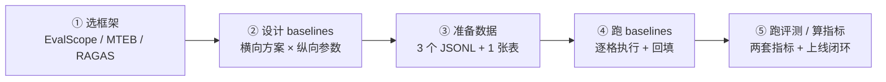
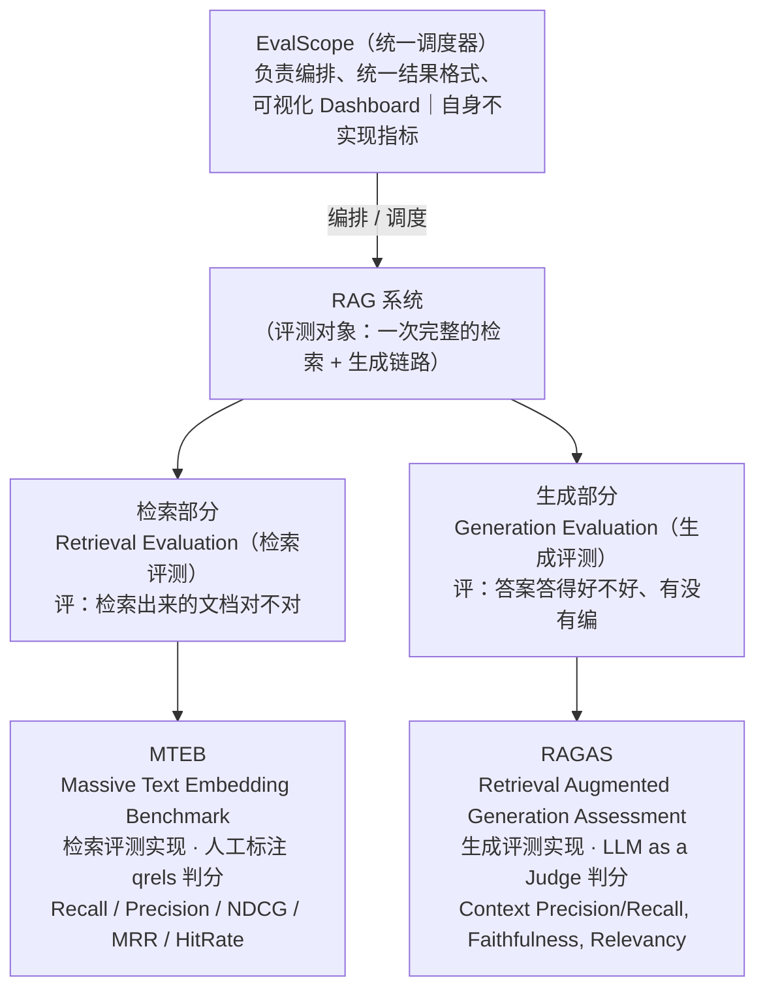
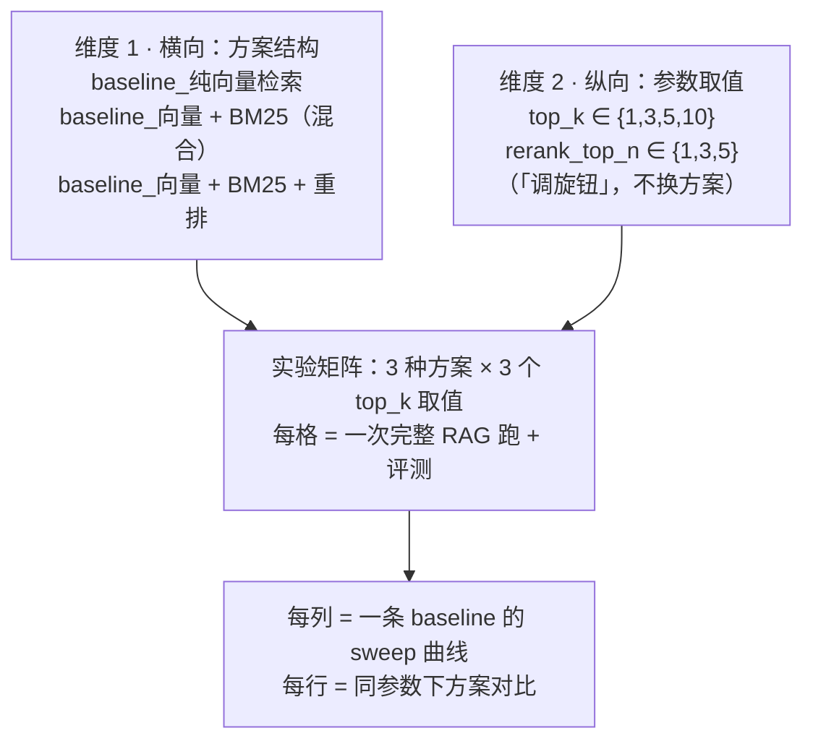
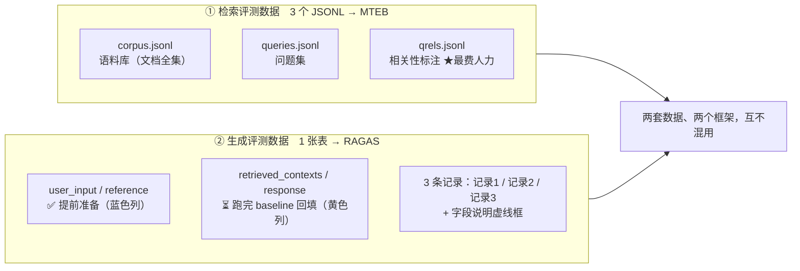
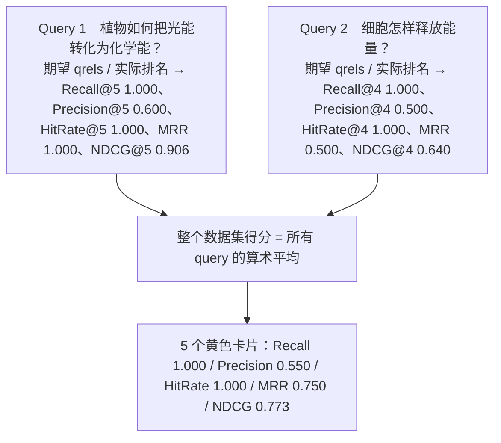
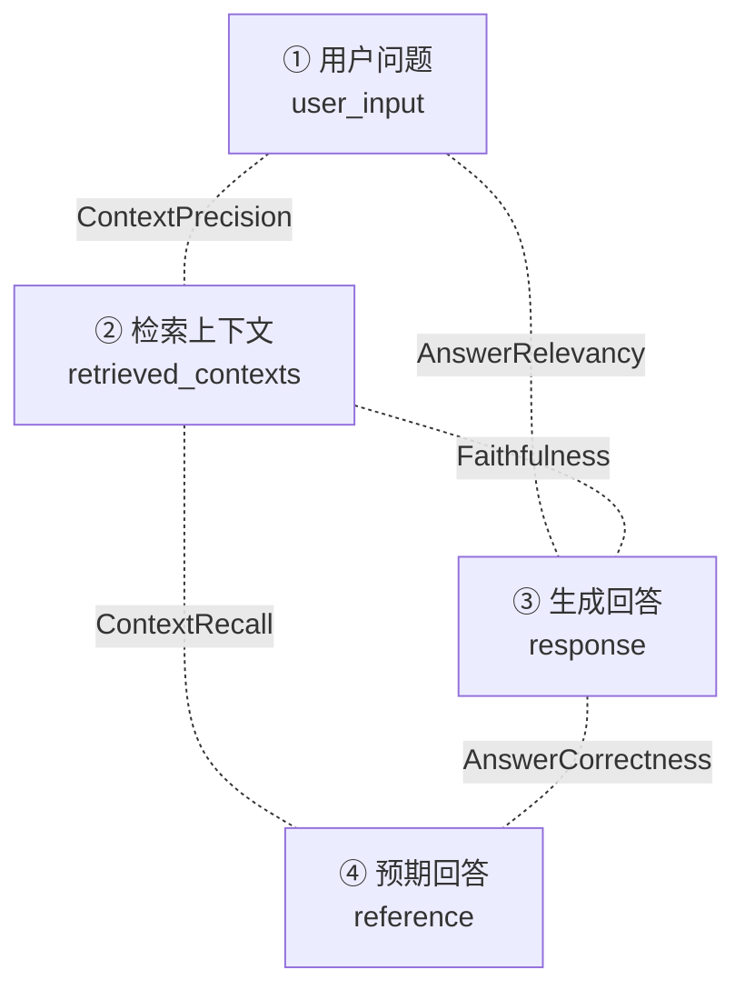
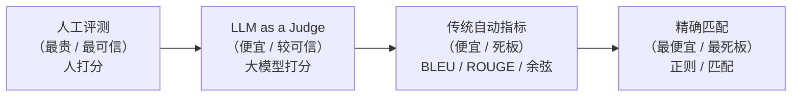
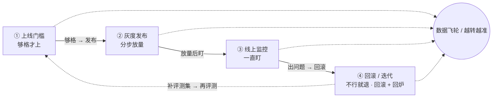

# RAG 评测体系 · 完全教程

> 基于抖音 @Harbor404《10 分钟带你彻底搞懂 rag 评测》（Agent 系列第 20 集，2026-10-14 发布，时长 13:03）逐帧还原，并补齐视频未展开的术语、原理、代码与工程实践。
>
> 配套图文版：[`index.html`](./index.html)（含 8 张精确重绘架构图与一页速览，不嵌入视频截图；视频原图对照见本文 5.1 节）。
>
> **原视频**：[抖音分享链接](https://v.douyin.com/ABG22aehmWk/) ｜ [网页版](https://www.douyin.com/video/7696458980251487515) ｜ 视频 ID `7696458980251487515` ｜ @Harbor404《10 分钟带你彻底搞懂 rag 评测》（2026-10-14 发布）。姊妹篇：[Agent 评测体系完全教程（在线阅读）](../agent-evaluation-tutorial/index.html)。

## 保真约定

| 标记 | 含义 |
| --- | --- |
| **【视频原述】/【原图重绘】** | 严格按视频画面还原：框架名、指标名、字段名、公式、示例数值、配色结构。经「下载 1080P 原视频 → 每 5 秒抽帧 157 张 → 全帧中文 OCR → 关键图示放大逐字目视校对」核对。 |
| **【补充】** | 视频未讲或未展开的官方定义、术语、代码、其他框架、工程落地，单独标注，不与视频原述混写。 |

口播按平台官方章节要点与画面烧录字幕归纳，**不做逐字转写**；知识性结论一律以画面文档为准。⚠️ 平台自动生成的章节要点含多处语音识别错字（`MTB`、`Jason`、`NGCG`、`蒸汽匹配`、`REC 系统`、`评测级`），本教程以画面为准，见[附录 5.3](#53-平台自动章节摘要--画面文字-校正表)。

---

## 0. 视频速览与文档结构

【视频原述】左侧大纲全文：

```
RAG 评测体系
一、体系架构
二、详解
    2.1 选框架          → EvalScope-调度器 / MTEB-检索评测框架 / RAGAS-生成评测框架
    2.2 设计 baselines
    2.3 准备数据
    2.4 跑 baselines
    2.5 跑评测框架，计算指标 → MTEB 指标 / RAGAS 指标 / 联系
    评测方法架构思考
三、上线与迭代
```

| 时间 | 章节 | 平台章节要点（原文，含错字） |
| --- | --- | --- |
| 00:00 | 引言 | — |
| 00:34 | 架构 | 评测体系包括选框架、设计 baselines、准备评测级、跑 baselines、计算评测指标。 |
| 01:02 | 选择框架 | 可选择开源框架或自研框架，适应业内常用的开源框架，如 REC 系统。 |
| 01:51 | 设计 baselines | 设计 baselines 有横向和纵向两个维度，横向确定不同方案，纵向确定具体参数。 |
| 02:58 | 准备数据 | 准备两套数据，MTB 框架需要 3 个 Jason，RAG assessment 框架需要一张表。 |
| 04:48 | 计算指标 | MTB 框架计算 5 个指标，RAG assessment 框架计算 5 个指标，线上主要关注召回率和 NGCG。 |
| 11:06 | 评测方法架构思考 | 评测方法架构包括人工评测、大模型评测、自动指标评测、蒸汽匹配。 |
| 11:55 | 上线和迭代 | 上线和迭代包括检测指标、灰度发布、线上监控、数据飞轮。 |

---

## 1. 体系架构：五步流程

【视频原述】核心判断：「**RAG 本身包含检索和大模型生成两部分，所以评测也相应拆成两部分。**」



视频文档「一、体系架构」步骤条原文：`① 选框架 → ② 设计 baselines → ③ 准备数据 → ④ 跑 baselines → ⑤ 跑评测`。

【补充】为什么必须「先拆再测」：RAG 的失败有两个独立来源——检索没找到对的资料，或资料找到了但模型没照着说。只用一个端到端分数无法区分二者，也就无法判断该换 embedding、改切分、加 rerank，还是改 prompt / 模型。分层评测的价值在于**可归因**。

> 视频原图：[`assets/frame_0008.jpg`](./assets/frame_0008.jpg)

---

**本章语音逐字稿（ASR · 已校正，28 句）**

> `[00:00]` hello 大家好我是小副
> `[00:01]` 如果面试官问你你在项目里面是怎么做的 RAG 的评测
> `[00:05]` 你会怎么回答
> `[00:07]` 那如果你对评测这个问题还不太熟悉
> `[00:10]` 就不妨花几分钟跟我一起学习一下
> `[00:12]` 那这个视频大体会分三部分
> `[00:14]` 第一部分我会说一下 RAG 评测
> `[00:16]` 我们一整个体系架构是什么样子
> `[00:18]` 第二部分会详解每一部分
> `[00:20]` 我们应该怎么做
> `[00:21]` 以及我们企业里面是怎么落地的
> `[00:23]` 第三方面我们会说一下
> `[00:25]` 评测之后我们是如何上线和迭代
> `[00:27]` 最终是用一个 loop 去持续的 self-evolution
> `[00:31]` 那好不多说我们直接开始
> `[00:33]` 首先第一部分
> `[00:34]` 其实关于评测不只是 RAG
> `[00:36]` 就是我们 Agent 里面也有评测嘛对吧
> `[00:39]` 其实所有的评测大体都是属于一套体系
> `[00:42]` 首先你要先选好你的框架
> `[00:44]` 其次你要设计你的 Baseline
> `[00:47]` 然后你要准备好你的评测集
> `[00:49]` 接着你要用这些评测集去跑你的 Baseline
> `[00:53]` 最后根据跑出来的数据
> `[00:55]` 去把评测的指标算出来
> `[00:57]` 这就是我们整体的链路
> `[00:59]` 下面我们就来具体看一下每一部分是怎么做的
> `[01:01]` 首先第一部分选框架

## 2. 详解（2.1–2.6）

### 2.1 选框架：EvalScope + MTEB + RAGAS

【视频原述】「框架选型的思路是：**用 EvalScope 做统一调度，底层用 MTEB 和 RAGAS 分别负责检索评测和生成评测。**」



图上方注释：`RAG 拆成「检索 + 生成」两部分 → 分别用 MTEB / RAGAS 评测，由 EvalScope 统一编排`；图下方注释：`RAG 评测 = 检索评测（MTEB）+ 生成评测（RAGAS），由 EvalScope 统一调度`。

| 框架 | 视频给出的定位 | 评测对象 | 判分方式 | 代表指标 / 输出 |
| --- | --- | --- | --- | --- |
| **EvalScope** | 统一调度器；阿里魔搭（ModelScope）出的评测调度框架；负责统一编排、统一结果格式、统一可视化（Dashboard），**自身不实现任何指标**。类比「考试组织方」——不命题、不批卷，只负责安排考什么、汇总成绩 | 整个评测流程 | 不判分，只编排 | Dashboard、统一结果格式 |
| **MTEB** | 检索评测框架；全称 *Massive Text Embedding Benchmark*（大规模文本嵌入基准） | 检索 / embedding 层 | 人工标注 `qrels` 判分 | Recall@K、Precision@K、NDCG@K、MRR、HitRate@K |
| **RAGAS** | 生成评测框架；全称 *Retrieval Augmented Generation Assessment* | 生成层（及上下文质量） | `LLM as a Judge` 判分 | Faithfulness、AnswerRelevancy、ContextPrecision、ContextRecall、AnswerCorrectness |

【补充 · 官方口径校准】视频把 EvalScope 概括为「不实现任何指标的调度器」，在**本视频的 RAG 评测链路语境下是准确的**；但从框架全局看要补一句：EvalScope 是魔搭社区官方的模型评测与性能基准框架，其 `RAGEval` 后端确实支持「用 MTEB/CMTEB 独立评测 embedding 与 reranker 模型 + 用 RAGAS 做端到端 RAG 评测」；它还有 Native / OpenCompass / VLMEvalKit 等后端，内置 MMLU、CMMLU、C-Eval、GSM8K 等基准与指标。「自身不实现指标」指的是**在 RAG 评测链路里它不做判分**，而非框架整体没有指标实现。

【补充】三者并非同一层级：MTEB 原是面向**文本嵌入模型**的大规模基准（检索、重排、分类、聚类、STS 等任务），检索任务沿用 BEIR 风格的 `corpus / queries / qrels` 三件套，主指标常用 `NDCG@10`；RAGAS 是面向 **RAG 流水线输出**的指标库，多数指标以 LLM 作裁判。把两者接到同一调度层下，是视频这套体系的工程价值。

> 视频原图：[`assets/frame_0016.jpg`](./assets/frame_0016.jpg) ｜ 放大核对：[`assets/arch.png`](./assets/arch.png)

### 2.2 设计 baselines：横向方案 × 纵向参数

【视频原述】「从两个正交维度设计 baseline」：

- **横向 · 方案结构**：变方案 → 产生新 baseline（比如 `纯向量` / `向量 + BM25` / `向量 + BM25 + 重排`）。
- **纵向 · 参数取值**：变参数 → 属于同一 baseline 的 `parameter sweep`（比如 `top_k`、`rerank_top_n`）。
- 「两个维度正交组合 → 实验矩阵（每格一次完整 RAG 跑 + 评测），**矩阵总格数 = 各条 baseline 的 sweep 次数之和（Σ）**。」



视频图中：`top_k=3` 这一行**不写「运行」**——前两列区域是一个**黄色虚线框（框内留白）**，第三列位置另放一个白色注释框「← 我们这次实际只做了这一行」，箭头指向黄色框；`top_k=1` 与 `top_k=5` 两行的三格均为「运行」。矩阵下方还有一条黄色公式条：

> `总运行次数 = Σ n_i（每条 baseline × 该 baseline 的 sweep 次数）`，其中 `Σ = baseline 条数`、`n_i = 第 i 条 baseline 的 sweep 次数`。

| 维度 | 变的是什么 | 产出 | 回答问题 | 视频中的例子 |
| --- | --- | --- | --- | --- |
| 横向：baseline 对比 | 方案结构（加减模块） | 3–5 条候选方案，粒度粗 | 「某个优化有没有用」→ 决定**用不用** | 纯向量 / 向量+BM25 / 向量+BM25+重排 |
| 纵向：parameter sweep | 参数取值（调旋钮） | 每个方案一条曲线，粒度细 | 「最优参数值 / 拐点」→ 决定**设多少** | `top_k ∈ {1,3,5,10}`、`rerank_top_n ∈ {1,3,5}` |

【视频原述】同页小字给出的顺序：**「先横向对照（决定用不用某模块），再纵向 sweep（决定参数取多少）」**。

【补充】这本质是**消融实验（ablation）** + **超参搜索**的组合：横向每加一个模块都在做控制变量，纵向是网格搜索（grid search）；参数多时改用随机搜索 / 贝叶斯优化更省算力。实验必须固定随机种子、语料版本、judge 模型与 prompt 版本，否则「指标提升」可能只是噪声；样本量小时建议用配对比较 + 显著性检验（bootstrap 置信区间）。

> 视频原图：[`assets/frame_0024.jpg`](./assets/frame_0024.jpg) ｜ 放大核对：[`assets/matrix.png`](./assets/matrix.png)

### 2.3 准备数据：两套互不复用的评测数据集

【视频原述】「实际上就是两套评测数据集的构建：**检索评测一套（3 个 JSONL，喂 MTEB）、生成评测一套（1 张表，喂 RAGAS）**。」

**① 检索评测数据**（3 个 JSONL 文件 → 喂 MTEB，每条一行 JSON）

| 文件 | 作用 | 视频示例 |
| --- | --- | --- |
| `corpus.jsonl` | 语料库（文档全集） | `{"_id":"doc1", "title":"光合作用", "text":"绿色植物将光能转化为化学能…"}`、`{"_id":"doc2", "title":"细胞呼吸", "text":"细胞分解葡萄糖释放能量…"}`、`{"_id":"doc3", "title":"蒸腾作用", "text":"水分从叶片气孔散失…"}` |
| `queries.jsonl` | 问题集 | `{"_id":"q1", "text":"植物如何将光能转化为化学能？"}`、`{"_id":"q2", "text":"细胞怎样释放能量？"}`、`{"_id":"q3", "text":"水在植物体内怎么运输？"}` |
| `qrels.jsonl` | 相关性标注 ★最费人力（1 个 query 对应多个 doc） | `{"query-id":"q1", "corpus-id":"doc1", "score":2}` # 强相关；`{"query-id":"q1", "corpus-id":"doc3", "score":1}` # 弱相关；`{"query-id":"q1", "corpus-id":"doc2", "score":0}` # 不相关 |

**② 生成评测数据**（1 张表 → 喂 RAGAS，每行一条记录、4 个字段）

| `user_input` | `reference` | `retrieved_contexts` | `response` |
| --- | --- | --- | --- |
| 用户问题 | 标准答案 | 召回的文档（多条） | 生成答案 |
| ✅ 可提前准备 | ✅ 可提前准备 | ⏳ 跑完 baseline 回填 | ⏳ 跑完 baseline 回填 |


**视频配图还原**（对应 HTML 版图 4）：



视频配图中的 3 条示例记录（逐字段展开）：

| 记录 | `user_input` | `reference` | `retrieved_contexts` | `response` |
| --- | --- | --- | --- | --- |
| 记录 1 | 植物如何将光能转化为化学能？ | 绿色植物利用光能，将二氧化碳和水合成葡萄糖… | 「绿色植物将光能转化为化学能…」「叶绿体是光合作用的场所」「光反应与暗反应两阶段…」 | 植物通过光合作用把光能变成化学能 |
| 记录 2 | 细胞怎样释放能量？ | 细胞分解葡萄糖，释放能量的过程叫呼吸作用… | 「细胞分解葡萄糖释放能量…」「线粒体是有氧呼吸的主要场所…」 | 细胞通过呼吸作用分解葡萄糖释放能量 |
| 记录 3 | 水在植物体内怎么运输？ | 水分由根吸收，经导管向上运输到叶片… | 「水分从根经导管运输到叶片」「蒸腾作用提供向上拉力…」「导管位于木质部」 | 水靠蒸腾拉力在导管中自下而上运输 |

【视频原述 · 关键点】

- **检索三件套**：`corpus.jsonl`（语料库）、`queries.jsonl`（问题集）、`qrels.jsonl`（相关性标注 ★最费人力，**不是答案**）。
- **生成四字段**：`user_input / reference` 可提前准备；`retrieved_contexts`（召回的文档，多条）`/ response` 需跑完 baseline 回填——**但要把表先建好**。
- **对齐**：每份都多条记录，逐条对齐（`q1 ↔ doc1 ↔ 问题1 ↔ 答案1`）。
- 图下注释：`两套数据、两个框架，互不混用：MTEB 读 3 个 JSONL 算检索指标，RAGAS 读 1 张表算生成指标`。

【补充 · 为什么 qrels 最贵】qrels（query relevance judgments）是「问题—文档」相关性的人工标注，是检索指标的**唯一基准真相**。工程上常用 pooling（汇总多个检索系统的 Top-K 去重后交标注）+ 双人标注 + Cohen's Kappa 一致性检查控制质量。

【补充 · 测试集题型】简单单跳、多跳 / 多文档、错别字与口语、知识库**根本没有答案**（检验拒答而非幻觉）、新旧文档冲突、权限差异、超长 / 表格 / 图片型文档。只测送分题会得到虚高分数。

> 视频原图：[`assets/frame_0040.jpg`](./assets/frame_0040.jpg)

### 2.4 跑 baselines：逐格执行 + 只回填生成数据表

【视频原述】「对照实验矩阵，逐格执行每次 rag baseline。」每一格执行：

```
问题 →【检索】→ 召回文档（contexts）→【生成】→ 答案（response）
                              ↓
                    回填到「生成数据表」的对应空位
```

**跑完后：**

- **生成数据表**：`retrieved_contexts + response` 已回填齐全 → 4 字段凑齐，可喂 RAGAS。
- **检索数据表**：**不用回填**（`corpus / queries / qrels` 是只读的比对基准）。系统跑出的实际排名只用于和 `qrels` 比对算指标（`Recall@K / NDCG@K` 等），不写回这三个文件。

【补充】检索评测 = 用「系统实际排名」对比「qrels 期望」，实际排名是运行时产物而不是新数据集；生成评测 = 用「真实跑出来的 contexts + response」填表。切勿用标准答案倒推 contexts（会人为抬高 Faithfulness / ContextRecall）。每格还要记录 baseline 名、参数快照、embedding / rerank / LLM 版本、prompt 版本、语料版本、随机种子、耗时与 Token 成本。

> 视频原图：[`assets/frame_0056.jpg`](./assets/frame_0056.jpg)

### 2.5 跑评测框架，计算指标

【视频原述】「分两个框架的两套指标。」

#### 2.5.1 MTEB 侧：5 个检索指标

| 指标 | 含义（视频原表） |
| --- | --- |
| `Recall@K` | Top-K 命中相关文档的比例 |
| `Precision@K` | Top-K 里相关文档的比例 |
| `NDCG@K` | 带相关度等级的排序质量（**最常用**） |
| `MRR` | 第一个相关文档的排名倒数 |
| `HitRate@K` | 是否至少命中一个相关文档 |

**检索指标的本质**：`qrels` 给出「哪些文档相关」（期望），系统给出「实际排名」，两者一比。而且**不是算一次，是每个 query 各算一遍，再取平均**。

#### 2.5.2 逐 query 计算示例（视频画面数值，1:1 还原）


**视频配图还原**（对应 HTML 版图 5）：



| 项 | Query 1「植物如何把光能转化为化学能？」 | Query 2「细胞怎样释放能量？」 |
| --- | --- | --- |
| 期望 qrels | `doc1(rel2) doc2(rel1) doc3(rel2)` | `doc5(rel2) doc6(rel1)` |
| 实际排名 | `1.doc3✓ > 2.doc7✗ > 3.doc1✓ > 4.doc9✗ > 5.doc2✓` | `1.doc8✗ > 2.doc5✓ > 3.doc2✗ > 4.doc6✓` |
| Recall | 命中 3 / 相关 3 = **1.000**（@5） | 命中 2 / 相关 2 = **1.000**（@4） |
| Precision | 命中 3 / 返回 5 = **0.600**（@5） | 命中 2 / 返回 4 = **0.500**（@4） |
| HitRate | 3 个命中，1 → 是 = **1.000** | 2 个命中，1 → 是 = **1.000** |
| MRR | 第 1 个相关在第 1 位 = **1.000** | 第 1 个相关在第 2 位 = **0.500** |
| NDCG | DCG / IDCG（按位置折损）= **0.906**（@5） | DCG / IDCG = **0.640**（@4） |

**整个数据集得分 = 所有 query 的算术平均**（视频 5 张黄色卡片；该配图在 HTML 版按图 5 完整重绘）：

| Recall | Precision | HitRate | MRR | NDCG |
| --- | --- | --- | --- | --- |
| Q1 1.000 / Q2 1.000 → **1.000** | Q1 0.600 / Q2 0.500 → **0.550** | Q1 1.000 / Q2 1.000 → **1.000** | Q1 1.000 / Q2 0.500 → **0.750** | Q1 0.906 / Q2 0.640 → **0.773** |

视频小字：「单次排序只给一个分数，评测报告里报的是『整批 query 的平均』——这才是可比、可复现的指标。」

> 视频原图放大：[`assets/queries.png`](./assets/queries.png)、[`assets/cards.png`](./assets/cards.png)

#### 2.5.3 五个指标的算法（视频原表）

| 指标 | 算法 | 一句话含义 |
| --- | --- | --- |
| `Recall@K` | 命中的相关文档数 / 全部相关文档数 | 相关文档找全了没有 |
| `Precision@K` | 命中的相关文档数 / 返回的 K 个 | 返回的结果准不准（掺没掺噪声） |
| `HitRate@K` | 实际结果里是否至少命中 1 个相关文档（是=1，否=0） | 有没有命中相关文档 |
| `MRR` | 1 / 第一个相关文档在实际检索结果里的排名 | 第一个对的结果排得靠不靠前 |
| `NDCG@K` | DCG / IDCG（按位置折减的累计相关度除以理想值） | 整体排序质量好不好（结合位置与相关等级） |

视频补充：「其中 NDCG 的 DCG 用 `Σ(2^rel − 1) / log₂(位置+1)`，IDCG 是『把相关文档排到最前』的理想 DCG。」

【补充】严谨写法：设位置 `i` 上文档相关度等级为 `rel_i`，则 `DCG@K = Σ_{i=1..K} (2^{rel_i} − 1) / log₂(i + 1)`；`IDCG@K` 是按 `rel` 降序排列后的 DCG；`NDCG@K = DCG@K / IDCG@K ∈ [0,1]`；`MRR = (1/|Q|)·Σ_q 1/rank_q`。本教程 [4.4 节](#44-可运行实战代码) 的代码可精确复现视频的 0.906 / 0.640 / 0.773。

#### 2.5.4 RAGAS 侧：四元素 × 五指标

【视频原述】「四个元素两两比较，每条连线 = 一个评测指标；标签居中压线」「指标 = 两个元素之间『比一比』：5 条有效连线对应 5 个指标」。



| 指标 | 连线（元素关系） | 视频表格中的「一句话含义」 |
| --- | --- | --- |
| `ContextPrecision` | 问题 ↔ 上下文 | 检索准不准 |
| `ContextRecall` | 上下文 ↔ 标准答案 | 该找的找全了吗 |
| `Faithfulness` | 回答 ↔ 上下文 | 答案忠于上下文吗（编没编） |
| `AnswerRelevancy` | 回答 ↔ 问题 | 答案切不切题 |
| `AnswerCorrectness` | 回答 ↔ 标准答案 | 答案对不对 |

【视频原述】「每个指标 = 两个元素的关系。出自 RAGAS 官方源码。核心规律：**「LLM 做局部判断 + 确定性公式聚合」**。」

| 指标 | 步骤（视频原表） | 公式（视频原表） |
| --- | --- | --- |
| `Faithfulness` | ① LLM 拆答案成陈述句 → ② LLM 逐句判「能否从上下文推出」 | 忠实句数 / 总句数 |
| `AnswerRelevancy` | ① LLM 只看答案反推「这答案在回答什么问题」 → ② 算假想问题与原问题的余弦相似度 | `mean(余弦相似度)` |
| `ContextPrecision` | ① LLM 逐文档判是否相关 → ② 算平均精度 | `Σ(相关位置 k · 前 k 个中的相关数 / k) / 总相关数` |
| `ContextRecall` | ① 把标准答案拆句 → ② LLM 逐句判「能否归因于上下文」 | 被覆盖句数 / 标准答案总句数 |
| `AnswerCorrectness` | ① 双方拆句 → ② LLM 分 TP/FP/FN 算事实 F1 | `0.75 × 事实 F1 + 0.25 × 语义相似度` |

【补充 · 版本口径】上表是 RAGAS 0.2.x 时代 `AnswerCorrectness` 的典型权重；新版本已将事实正确性拆为 `FactualCorrectness`、语义相似度拆为 `SemanticSimilarity`，并新增 `NonLLMContextPrecisionWithReference` 等免 LLM 变体与 Agent 指标（`ToolCallAccuracy`、`AgentGoalAccuracy` 等）。**写评测代码要锁定 RAGAS 版本**，否则同一份数据跨版本分数不可比。

> 视频原图：[`assets/frame_0110.jpg`](./assets/frame_0110.jpg)（架构图）、[`assets/frame_0115.jpg`](./assets/frame_0115.jpg)（步骤+公式表）

#### 2.5.5 联系：两套指标其实有重叠

【视频原述】「两部分指标不是绝对分割，而是有重合的。最明显的重合：`ContextPrecision / ContextRecall` vs MTEB 的 `Precision / Recall`——都在衡量『召回得对不对』，只是思想不同」：

| 对比项 | MTEB 的 Precision / Recall | RAGAS 的 ContextPrecision / ContextRecall |
| --- | --- | --- |
| 判断「相关」依据 | 人工标注 `qrels`（标准答案） | LLM 现场判断 |
| 参照物 | 文档 ID 标注 | 标准答案（自然语言） |
| 视角 | 检索器视角 | 生成器视角 |

**所以指标按评测对象可再归位：**

- 评**检索**：MTEB 全部 + RAGAS 的 Context 系列（后者本质也在评检索，只是换成 LLM 判）。
- 评**生成**：RAGAS 其余三个（`Faithfulness / AnswerRelevancy / AnswerCorrectness`）。

> 这是视频最有价值的方法论之一：**不要按框架名归类指标，要按被评测对象归类指标**。RAGAS 名字里有 Generation，但两个 Context 指标测的其实是检索质量。

【补充 · 从指标到动作】

| 症状 | 最可能出问题的层 | 优先排查 / 动作 |
| --- | --- | --- |
| Recall 低、ContextRecall 低 | 检索召回 | 切分粒度、embedding 模型、Top-K、混合检索（BM25）、查询改写 |
| Recall 高但 ContextPrecision / NDCG 低 | 排序 / 噪声 | 加 rerank、调 `rerank_top_n`、去冗余、上下文压缩 |
| ContextRecall 高但 Faithfulness 低 | 生成 | prompt 约束、引用格式、换更强生成模型、降低温度 |
| Faithfulness 高但 AnswerRelevancy 低 | 意图 / 改写 | 问题理解、多轮指代消解、答案组织方式 |
| Faithfulness 高但 AnswerCorrectness 低 | 语料 / 标准答案 | 知识库过期、文档冲突、reference 标注错误 |
| 知识库无答案时仍硬答 | 拒答策略 | 补「不可回答」样本、置信阈值与拒答模板 |

### 2.6 评测方法架构思考：四级方法谱系

【视频原述】


**视频配图还原**（对应 HTML 版图 7）：



| 方法 | 成本 / 可信度 | 打分方式 | 本体系中对应 |
| --- | --- | --- | --- |
| 人工评测 | 最贵 / 最可信 | 人打分 | MTEB 的 `qrels`（人工标注相关性） |
| LLM as a Judge | 便宜 / 较可信 | 大模型打分 | RAGAS 全部指标 |
| 传统自动指标 | 便宜 / 死板 | BLEU / ROUGE / 余弦 | `NDCG / MRR`、余弦相似度 |
| 精确匹配 | 最便宜 / 最死板 | 正则 / 匹配 | （视频未列对应项） |

流程：`人工评测 → LLM as a Judge → 传统自动指标 → 精确匹配`（可信度↓ / 成本↓ / 规模化能力↑）。

**视频结论**：「成熟方案是**三重校验**：自动指标打底 + LLM Judge 规模化 + 人工抽样校准。」

【补充】人工评测能捕捉语气、有用性、业务合规等隐性质量；LLM Judge 有**裁判偏见**（同厂商模型互评偏宽松）、位置偏见、长度偏见与 prompt 敏感，需与人工标注做一致性校准（相关系数 / Kappa）；BLEU / ROUGE 对「换一种说法但完全正确」的答案极不友好；精确匹配适合结构化输出、JSON 字段、拒答标记等确定性断言，是 CI 里最稳的硬门槛。

> 视频原图：[`assets/frame_0135.jpg`](./assets/frame_0135.jpg)

---

**本章语音逐字稿（ASR · 已校正，377 句）**

> `[01:04]` 其实这里就分为两种
> `[01:06]` 你可以用一些开源的比较好的框架
> `[01:09]` 你也可以去自研框架
> `[01:12]` 我们这里是用了业内比较好用一些开源框架
> `[01:15]` 比如说我们整个 RAG 系统
> `[01:17]` 我们使用的是阿里的 EvalScope
> `[01:21]` 做了一个统一的调度
> `[01:22]` 因为 RAG 系统分两部分
> `[01:24]` 第一部分是检索
> `[01:26]` 第二部分是生成
> `[01:27]` 为了评价我检索这一部分的效果
> `[01:29]` 我们用的是 MTEB
> `[01:31]` 这个开源的框架
> `[01:33]` 为了评价生成这一部分的效果
> `[01:35]` 我们用的是 RAGAS 这个框架
> `[01:38]` MTEB 有一些指标
> `[01:39]` 比如说召回率准确率
> `[01:41]` NDCG、MRR、Hit Rate
> `[01:43]` RAGAS 有一些指标是
> `[01:45]` Context Precision Recall
> `[01:47]` Faithfulness
> `[01:48]` 这些指标我们一会会详细介绍
> `[01:50]` 然后选完框架之后
> `[01:51]` 我们下一步就来设计我们的 Baseline
> `[01:53]` Baseline 的设计其实有两个维度
> `[01:55]` 第一个是你可以设计出不同的方案
> `[01:58]` 比如说
> `[01:59]` 那我第一条 Baseline 就可以干嘛呢
> `[02:01]` 纯向量检索
> `[02:03]` 那第二条 Baseline 就可以混合检索
> `[02:06]` 加上我的关键词 BM25
> `[02:07]` 那第三个方案
> `[02:08]` 我可以验证我重排的一个效果
> `[02:10]` 加上一个 RERANK
> `[02:12]` 那这样的话
> `[02:12]` 这三条 Baseline 就能测出不同的效果
> `[02:15]` 这是我们的横向
> `[02:16]` 那剩下我们还可以怎么测呢
> `[02:18]` 比如说纯向量检索里面
> `[02:20]` 我们可以改变它的某个参数
> `[02:22]` 做一个 Parameter Sweep
> `[02:24]` 比如说它的 Top-K 可以取1
> `[02:26]` 可以取3可以取5
> `[02:28]` 那这样的话
> `[02:30]` 我就可以得到一个更精细的效果
> `[02:32]` 所以说
> `[02:32]` 横向和纵向就形成了不同的实验方案
> `[02:36]` 横向的话就是我确定好每一组方案
> `[02:39]` 我先做一个粗排
> `[02:41]` 确定好哪一种方案是最好的
> `[02:43]` 纵向的话
> `[02:43]` 我们确定每种方案里面
> `[02:45]` 它具体的参数怎么调
> `[02:47]` 这是属于一种精调
> `[02:49]` 那我所有这些方案需要跑的次数
> `[02:51]` 就是每条 Baseline
> `[02:53]` 都用它的参数 Sweep 的次数再求和
> `[02:56]` 这就是我们 Baseline 的设计
> `[02:57]` 那设定完 Baseline 之后
> `[02:58]` 我们就要准备我们的数据了
> `[03:00]` 那其实这里是要准备两套数据
> `[03:02]` 因为我们前面的是两套框架
> `[03:04]` MTEB 这个框架需要的数据有三个 JSONL
> `[03:08]` 我们分别来看它们的格式
> `[03:10]` 第一个 JSONL 是 Corpus
> `[03:12]` 它里面会存语料库的一些信息
> `[03:15]` 比如说语料库的 ID
> `[03:17]` 比如说它的标题
> `[03:18]` 比如说它的正文
> `[03:20]` 这里面是完整的正文
> `[03:21]` 那第二个 JSONL 还会存一个 queries
> `[03:23]` 指的是我的问题集
> `[03:25]` 那第三个会存一个 qrels
> `[03:28]` 问题相关性的一个标注
> `[03:30]` 这里面就会首先存一个问题
> `[03:33]` 语料库里面的一个文档
> `[03:34]` 以及一个相关性
> `[03:36]` 对这个相关性是什么意思呢
> `[03:38]` 就是我们会让人力去标注每一个问题
> `[03:42]` 和它对应的语料库里面的一个关系
> `[03:44]` 如果说越相关
> `[03:45]` 我这个分数越高
> `[03:47]` 注意这里是人工标注的
> `[03:48]` 就是我们要请一些了解业务的人
> `[03:51]` 去给它们标注一下
> `[03:52]` 那这个数据是干嘛的呢
> `[03:54]` 以后我们讲指标的时候会提到它
> `[03:56]` 那这就是 MTEB 需要准备的评测的数据
> `[03:58]` 那第二个是我们生成评测的数据
> `[04:01]` 这其实就是为我们 RAGAS 的这个框架准备
> `[04:04]` 那这个框架具体来说就是一张表
> `[04:06]` 然后这张表里面有四个字段
> `[04:08]` 第一个字段是用户的问题
> `[04:09]` 第二个字段是检索的结果
> `[04:11]` 第三个字段是标准的答案
> `[04:13]` 第四个字段是实际的答案
> `[04:15]` 那你看这里
> `[04:16]` 我们用户的问题和标准的答案
> `[04:19]` 其实都是可以提前确定的
> `[04:20]` 但是检索的结果和实际的答案
> `[04:23]` 要等我们 Baseline 实际跑完之后
> `[04:25]` 再回填回来
> `[04:26]` 那这样的话
> `[04:27]` 两个框架需要了两大评测数据
> `[04:29]` 都已经准备好了
> `[04:30]` 下面我们就开始跑我们的 Baseline
> `[04:32]` 根据我们前面这种正交矩阵
> `[04:34]` 我们确定好了几种方案
> `[04:36]` 把所有的数据跑完
> `[04:38]` 跑完之后
> `[04:39]` 我们根据得到的结果
> `[04:40]` 把生成评测数据里面
> `[04:42]` 还缺了数据回填回来
> `[04:44]` 那这样的话
> `[04:45]` 我们整套数据是不是就全了
> `[04:47]` 那下面就剩最后一步了
> `[04:48]` 就是我们要跑我们的评测框架
> `[04:50]` 然后去介绍我们的指标
> `[04:52]` 这个时候我们 EvalScope
> `[04:54]` 就会把我们跑完的数据
> `[04:57]` 交给这两个框架
> `[04:58]` MTEB 和 RAGAS
> `[05:00]` 让他们分别去计算
> `[05:01]` 各自的五个指标
> `[05:03]` 比如说 MTEB 这里会计算五个指标
> `[05:05]` 召回率准确率
> `[05:06]` NDCG MRR Hit Rate
> `[05:08]` 我们这里
> `[05:09]` 具体看一下
> `[05:10]` 这五个指标分别代表什么含义
> `[05:12]` 以及它会怎么算
> `[05:13]` 召回率的意思是
> `[05:15]` 我要看你实际筛选出的结果
> `[05:17]` 它有没有筛选全
> `[05:20]` 比如说我们看这个示例图
> `[05:21]` 我们看第一个问题
> `[05:23]` 我问这个问题之后
> `[05:24]` 我期望召回的结果是
> `[05:26]` 第一个文档
> `[05:27]` 第二个文档
> `[05:28]` 第三个文档对吧
> `[05:29]` 那假如说你实际召回的文档
> `[05:31]` 里面有五个文档
> `[05:32]` 并且123都在里面
> `[05:35]` 就是你召回全了
> `[05:37]` 那说明你的召回率
> `[05:39]` 就是100%
> `[05:40]` 对吧
> `[05:41]` 那什么是准确率呢
> `[05:42]` 准确率指的是就是
> `[05:44]` 你此次召回的文档里面
> `[05:45]` 有多少是跟我期望的相关的
> `[05:49]` 那我们知道
> `[05:50]` 相关的是123嘛对吧
> `[05:52]` 你像这个7和9就是不相关
> `[05:54]` 那它的准确率就是3除以5
> `[05:56]` 就是60%
> `[05:58]` 第三个指标
> `[05:59]` Hit Rate
> `[06:00]` Hit Rate是什么意思呢
> `[06:00]` 其实从 Hit Rate 到 MRR
> `[06:02]` 到 NDCG
> `[06:03]` 是逐渐清晰的一个指标信息
> `[06:06]` 它们的含义都是指
> `[06:07]` 我召回的效果
> `[06:08]` Hit Rate指的是
> `[06:10]` 你此次召回的结果里面
> `[06:12]` 有没有至少一个
> `[06:13]` 是我期望的文档
> `[06:16]` 它是一个布尔值啊
> `[06:17]` 就是只要你至少有一个
> `[06:18]` 它就是1
> `[06:19]` 如果它一个都没有
> `[06:20]` 就是0
> `[06:21]` 那 MRR 其实更精细了
> `[06:24]` 就是它会算
> `[06:25]` 你实际排名里面召回的文档
> `[06:28]` 第一个相关的它的排名
> `[06:30]` 比如说我们这个
> `[06:32]` 文档3
> `[06:33]` 它是第一个相关的对吧
> `[06:34]` 它会取一个倒数
> `[06:35]` 那它就是1分之1
> `[06:37]` 答案就是1嘛对吧
> `[06:38]` 那假如说我们看这个问题2
> `[06:40]` 我们期望的是5和6 对吧
> `[06:42]` 我们第一个召回的
> `[06:43]` 是不是5
> `[06:44]` 它排的第二名
> `[06:45]` 那它就是1除1 2
> `[06:46]` 就是0.5
> `[06:47]` 大家理解了吗
> `[06:49]` 再看 NDCG
> `[06:50]` NDCG 这个指标就更复杂了
> `[06:53]` 就是我们前面
> `[06:54]` Hit Rate和 MRR
> `[06:55]` 其实指的都是有没有
> `[06:56]` 以及第一个的排序
> `[06:57]` NDCG 指的是整体的一个排序
> `[06:59]` NDCG 它具体计算是很麻烦的
> `[07:03]` 但是我可以给大家概括
> `[07:04]` 就是它首先会根据我们前面
> `[07:07]` 我们是不是在这个标注里面
> `[07:09]` 一个相关性的一个分数对吧
> `[07:11]` 会根据这个分数
> `[07:12]` 去算一个值
> `[07:13]` 如果说你的检测结果
> `[07:15]` 是满足我期望的这个结果
> `[07:17]` 那这个公式算出来的值
> `[07:19]` 就是1
> `[07:20]` 也就是说我这个 NDCG
> `[07:22]` NDCG 就是最理想的情况下
> `[07:24]` 它的一个分数就是1
> `[07:26]` 那前面这个 NDCG 是啥呢
> `[07:28]` NDCG 指的就是
> `[07:30]` 你此次实际跑出来的分数
> `[07:32]` 并且它这个公式
> `[07:34]` 保证了如果说你的结果
> `[07:36]` 它的检索出的文档
> `[07:38]` 以及它的排序越接近理想情况
> `[07:41]` 它的值越大
> `[07:42]` 如果说检测出来的文档
> `[07:44]` 和它的排序差了越多
> `[07:46]` 它的 NDCG 就会越小
> `[07:47]` 它满足这种单调性
> `[07:49]` 那这就是 NDCG
> `[07:50]` 它的全名叫做按位置去折损
> `[07:53]` 所以说它能反映出
> `[07:54]` 整体的一个文档的
> `[07:56]` 命中情况以及排名情况
> `[07:58]` 然后刚刚我们说的这些概念
> `[08:00]` 其实都是基于单个问题
> `[08:02]` 因为我们一次评测
> `[08:03]` 所以我们要跑很多问题
> `[08:04]` 那最后我们会把所有问题的指标
> `[08:06]` 做一个算术平均值
> `[08:08]` 作为我们整个评测集的一个指标
> `[08:10]` 那这就是我们 MTEB
> `[08:12]` 算 GT 指标的一个过程
> `[08:13]` 但是实际上因为指标比较多
> `[08:16]` 我们其实
> `[08:17]` 线上主要看的是两个指标
> `[08:18]` 一个是召回率
> `[08:20]` 一个是 NDCG
> `[08:22]` 因为召回率能够直接反映
> `[08:23]` 你召回率全不全
> `[08:24]` 至于准不准这个其实不重要
> `[08:25]` 因为你除了粗召回
> `[08:27]` 会不会还有精排
> `[08:28]` 那 NDCG 它能够反映
> `[08:31]` 整体的一个情况
> `[08:32]` 所以我们主要考虑这两个指标
> `[08:34]` 那关于 RAGAS 的这个框架
> `[08:36]` 其实也很简单
> `[08:37]` 我们知道上面我们说过
> `[08:39]` 我们准备数据的时候
> `[08:40]` 它的样子是这样的
> `[08:42]` 它是一张表里面有四个字段
> `[08:44]` 那这个指标其实就是
> `[08:45]` 分析了这四个字段之间的相互关系
> `[08:48]` 比如说
> `[08:49]` 我用户的问题
> `[08:50]` 对吧
> `[08:50]` 和你的上下文
> `[08:51]` 其实就是我们刚刚
> `[08:54]` MTEB 里边的一个准确率
> `[08:56]` 对吧
> `[08:56]` 那 Recall 就是召回率
> `[08:58]` 对吧
> `[08:59]` 忠实度是什么意思呢
> `[09:00]` 就是你的回答
> `[09:01]` 有没有基于你的上下文去做
> `[09:03]` 对吧
> `[09:03]` 有没有出现幻觉
> `[09:04]` 准确率是什么呢
> `[09:05]` 就是你召回的回答
> `[09:06]` 有没有和我预计的回答是一样的
> `[09:08]` 对吧
> `[09:09]` 那相关性是什么呢
> `[09:11]` 就是你生成的回答和我用户的问题
> `[09:12]` 相不相关
> `[09:13]` 切不切题
> `[09:14]` 所以 RAGAS
> `[09:15]` 这里面的五个指标
> `[09:17]` 就是基于我们这张表里的四个字段
> `[09:19]` 它们的相互关系
> `[09:20]` 很好理解对吧
> `[09:21]` 然后具体怎么算呢
> `[09:22]` 它这里算的话就
> `[09:24]` 相比比较复杂
> `[09:25]` 就是会分两步
> `[09:26]` 每一个指标都会先用大模型
> `[09:29]` 做一个局部的判断
> `[09:30]` 再加一个确定性的公式
> `[09:32]` 对
> `[09:33]` 我们这里只提
> `[09:34]` 两个比较重要的指标的计算
> `[09:36]` 一个是忠实度
> `[09:37]` 因为忠实度它分析的是
> `[09:39]` 我们生成的回答和上下文的一个关系
> `[09:41]` 它能够反映出你有没有幻觉
> `[09:44]` 我们首先会大模型把答案拆成陈述句
> `[09:47]` 一个一个陈述句
> `[09:49]` 然后大模型逐句的去判
> `[09:50]` 每个陈述句能不能由上下文去推出
> `[09:53]` 所以它就可以反映出
> `[09:55]` 你每个句子是不是忠实
> `[09:56]` 有没有幻觉
> `[09:57]` 然后最后算出来你忠实的句数
> `[10:00]` 除以总的句数
> `[10:00]` 这就是你的忠实度
> `[10:02]` 那第二个比较关键的是
> `[10:04]` 这个 Answer Correctness
> `[10:06]` 它会把标准答案和生成的回答
> `[10:08]` 所有的回答都拆成句子
> `[10:10]` 然后去算它们的 TP
> `[10:12]` FP
> `[10:13]` FN 这几个指标
> `[10:15]` 算出一个事实 F1
> `[10:16]` 算出 F1之后
> `[10:17]` 还会经过一个加权0.75
> `[10:19]` 乘以 F1
> `[10:20]` 加上 0.25 乘以语义相似度
> `[10:22]` 去计算最终的一个分数
> `[10:24]` 这其实是我们
> `[10:24]` RAGAS 的里面
> `[10:25]` 源码的一些逻辑了
> `[10:26]` 大家不用太在意
> `[10:28]` 也可以说一下这个 relevancy
> `[10:31]` 这个 relevancy 的计算也很有意思
> `[10:32]` 它会算你用户的问题
> `[10:33]` 生成的回答相不相关
> `[10:34]` 它怎么算的呢
> `[10:35]` 它会把你这个回答交给大模型
> `[10:37]` 让这个大模型去反过来判断
> `[10:40]` 你在问什么问题
> `[10:41]` 然后把你真实的问题
> `[10:43]` 和大模型反推的问题
> `[10:44]` 算一下它们的相似度
> `[10:46]` 然后把这个相似度作为分数
> `[10:48]` 我觉得这个很有意思
> `[10:49]` 就是反向推问题
> `[10:51]` 算问题的相似度
> `[10:52]` 以及这里面我们能够看到
> `[10:54]` 就是我们 relevancy 和 Precision
> `[10:56]` 其实是跟我们 MTEB 里面是重合的
> `[11:00]` 但是它们算的方式不一样
> `[11:02]` 然后这就是我们整套的一个评测流程
> `[11:04]` 对吧
> `[11:05]` 然后这里再说一下
> `[11:06]` 我们评测方法的一个架构的思考
> `[11:08]` 其实我们评测里面
> `[11:10]` 如果从技术角度可以分很多种
> `[11:13]` 就是第一个是我们的人工评测
> `[11:14]` 对吧
> `[11:15]` 就是找我们一些专门的这些数据标注员
> `[11:18]` 他们其实是最可信的
> `[11:20]` 但他们的人工成本比较高
> `[11:22]` 第二个就是大模型作为一个裁判
> `[11:24]` 这种是比较可信的
> `[11:25]` 而且成本比较低
> `[11:26]` 现在也是比较火的一个方向
> `[11:28]` 传统的话就是我们一些自动指标
> `[11:31]` 我们根据我们跑的评测的结果
> `[11:32]` 去自动算一些指标
> `[11:33]` 对这种也很便宜
> `[11:35]` 但是它比较死板
> `[11:36]` 再就是精确匹配
> `[11:37]` 这种就是一些确定性的断言
> `[11:40]` 我们生产上应该是用这种自动指标
> `[11:44]` 对吧
> `[11:44]` 做一个兜底
> `[11:45]` 然后用大模型做一个规模化
> `[11:47]` 最后有一些人工的抽样
> `[11:50]` 去做一个校准
> `[11:51]` 那这就是我们整个评测的链路
> `[11:54]` 那最后我们说一下

## 3. 上线与迭代：从评测到上线的一个闭环

【视频原述】「**评测不是终点。离线分数只是入场券**，真正决定成败的是上线后怎么盯、怎么退、怎么再往前走。」小字：「评测不是一次性动作 → 上线即持续监控，跑出 bad case 回流，再跑一轮」。



| 节点 | 视频原图中的内容（逐条还原） |
| --- | --- |
| **① 上线门槛**（够格才上） | 看三层主指标：检索 `Recall / NDCG`、生成 `Faithfulness / Correctness`、系统 `延迟`；判定标准相对上一版：① 优化项 ≥ 上一版且统计显著；② 其余下降须在容差内（±2%）；③ 红线（延迟）不超预算 → 一票否决。 |
| **② 灰度发布**（分步放量） | 影子流量（只记不答）→ 小流量 A/B（5%）→ 逐步放量（30%–70%）→ 全量。 |
| **③ 线上监控**（一直盯） | 系统：延迟 / 成本 / 错误率；质量：LLM Judge 抽样 + 用户 👍👎 反馈；漂移：query 分布变了没有。 |
| **④ 回滚 / 迭代**（不行就退 · 回滚 + 回炉） | 指标掉 → 立刻回滚到老版本；捞出 bad case → 补进评测集；评测集越滚越大 → 下次门槛更严（这才是长期护城河）。 |
| **中心：数据飞轮** | 越转越准；四节点顺时针流转：够格→发布、放量后盯、出问题→回滚、补评测集→再评测。 |

图下注释：`评测 → 门槛 → 灰度 → 监控 → 回流 / 回归（补数据）→ 再评测：这是一条不断上行的 loop`。

【视频原述】结尾小节「① 上线门槛 —— 够格才上（放行标准）」：「先明确看哪几个指标，生产里只看三层主指标」，表格表头 `层 | 主指标 | 看什么`，可见首行 `检索 | Recall / NDCG | 找全了没、排序好不好`；视频在此结束，后两行未在画面中完整出现。

【补充 · 把表补完整】

| 层 | 主指标 | 看什么 |
| --- | --- | --- |
| 检索 | `Recall / NDCG` | 找全了没、排序好不好 |
| 生成 | `Faithfulness / AnswerCorrectness` | 编没编、答得对不对 |
| 系统 | `P95 延迟 / 单次成本 / 错误率` | 能不能扛住线上 SLA |

【补充 · 工程落地】影子流量 = 复制真实请求打到新版本但**不把结果返回用户**，零风险对比；A/B 要保证分流稳定（同一用户始终落同一桶）；LLM Judge 线上通常抽 5%–10% 流量异步执行；query 漂移可用 embedding 聚类、类目占比、拒答率、新词率监测；视频中的红线是「延迟不超预算」；工程上还应预定义幻觉率、越权、P95 超时等红线并自动化；bad case 回流需人工去标识化与打标后并入 golden dataset。

> 视频原图：[`assets/frame_0157.jpg`](./assets/frame_0157.jpg) ｜ 放大核对：[`assets/loop.png`](./assets/loop.png)

---

**本章语音逐字稿（ASR · 已校正，41 句）**

> `[11:55]` 我们这个上线和迭代应该怎么做
> `[11:56]` 那总体来说是一个数据飞轮的概念
> `[11:59]` 主要包括四步
> `[12:00]` 第一步就是我们会检测
> `[12:02]` 我们上面的模糊指标
> `[12:04]` 比如说我们检索阶段
> `[12:06]` 我们要看召回率和 NDCG
> `[12:08]` 那生成阶段我们会看忠实度和相关性
> `[12:11]` 包括我们还会看一些
> `[12:13]` 系统的一些延迟
> `[12:14]` 成本
> `[12:15]` 安全
> `[12:16]` 还有稳定性
> `[12:18]` 可扩展性
> `[12:18]` 这些
> `[12:19]` 那如果说满足我们的一个标准
> `[12:21]` 比如说我们这次优化的项
> `[12:23]` 要大于上一版
> `[12:24]` 而且比较显著
> `[12:25]` 第二个是其他那些不关键的指标
> `[12:27]` 它们也要在合理范围内
> `[12:29]` 然后包括我们系统的延迟成本
> `[12:32]` 不超预算
> `[12:33]` 我们一般会灰度发布
> `[12:34]` 发布之后我们要在线上监控
> `[12:36]` 要看它的一些系统指标
> `[12:38]` 质量以及 query 有没有漂移
> `[12:40]` 如果出问题的话我们就回滚
> `[12:42]` 对吧
> `[12:42]` 那如果没出问题
> `[12:43]` 我们也要把线上用户反馈的 Bad Case
> `[12:46]` 再补进我们的评测集
> `[12:47]` 再做下一次的迭代
> `[12:49]` 那这样我们就成为一个 loop
> `[12:51]` 我们数据飞轮就越转越准
> `[12:53]` 这就是我们上线与迭代的一个过程
> `[12:56]` 那说到这
> `[12:57]` 整个 RAG 的评测体系就介绍了差不多了
> `[12:59]` 如果大家有什么问题
> `[13:00]` 可以在评论区跟我交流
> `[13:02]` 嗯拜拜

## 4. 补充篇：视频没讲完的部分

> 本章全部为【补充】内容。

### 4.1 专业名词速查

| 名词 | 含义 |
| --- | --- |
| **RAG** | Retrieval-Augmented Generation，检索增强生成：先召回外部知识片段，再与问题一起交给 LLM 生成答案。 |
| **检索 / 生成两层** | RAG 的两段流水线；视频全部评测设计的出发点就是「两层分别测」。 |
| **chunk / 切分** | 把长文档切成可检索片段；太大噪声多、太小语义断，直接决定 Recall 上限。 |
| **embedding / 向量检索** | 文本映射为向量按语义相似度召回；擅长同义改写，弱于精确术语与编号。 |
| **BM25 / 混合检索** | BM25 是基于词频的经典稀疏检索；与向量检索融合称混合检索（视频第 2 条 baseline）。 |
| **rerank（重排）** | 用交叉编码器对初召回结果二次排序，提升 NDCG / ContextPrecision；`rerank_top_n` 是保留条数。 |
| **Top-K / top_k** | 检索返回的前 K 条；K 变大通常 Recall↑、Precision↓、成本↑。 |
| **baseline** | 作为比较基准的一套固定方案；「跑 baseline」= 用该方案完整跑一遍 RAG 链路。 |
| **parameter sweep** | 同一方案内只改参数逐个取值跑，形成指标—参数曲线，用于找拐点。 |
| **消融实验（ablation）** | 逐个加减模块观察指标变化，对应视频的「横向 baseline 对比」。 |
| **corpus / queries / qrels** | 语料库、问题集、相关性标注；BEIR / MTEB 检索评测标准三件套（JSONL，每行一条 JSON）。 |
| **qrels / rel / score** | query–doc 人工相关性判断；可为二值（0/1）或多级（0/1/2），多级支撑 NDCG。 |
| **ground truth / reference / golden dataset** | 标准答案（自然语言）；带标准答案与证据标注的高质量评测集称 golden dataset。 |
| **Recall@K** | 前 K 条命中相关文档数 / 全部相关文档数；「该找的找全了吗」。 |
| **Precision@K** | 前 K 条命中相关文档数 / K；「返回里掺了多少噪声」。 |
| **HitRate@K** | 前 K 条是否至少有一个相关文档（0/1），对多跳问题过宽松。 |
| **MRR** | Mean Reciprocal Rank，第一个相关文档排名倒数的均值；关注「第一条对不对」。 |
| **NDCG@K** | Normalized Discounted Cumulative Gain；DCG 除以理想 DCG，同时考虑**位置**与**相关度等级**，检索排序最常用。 |
| **DCG / IDCG** | `DCG = Σ(2^rel−1)/log₂(i+1)`；IDCG 是把相关文档按 rel 降序排列后的 DCG。 |
| **Faithfulness / 忠实度** | 答案中每个事实是否都能由检索上下文推出；对应幻觉检测，但**不等于**答案正确。 |
| **Groundedness / 有据性** | 与 Faithfulness 近义，TruLens RAG Triad 之一，强调回答有据可查。 |
| **AnswerRelevancy** | 答案是否切题；RAGAS 经典做法是从答案反推「假想问题」再算与原问题余弦相似度。 |
| **ContextPrecision / ContextRecall** | 上下文精确率（相关片段是否排前）/ 上下文召回率（标准答案句子能否归因到上下文）；**本质是检索层指标**。 |
| **AnswerCorrectness** | 答案相对标准答案的事实正确性；视频公式 `0.75×事实F1 + 0.25×语义相似度`。 |
| **事实 F1 / TP·FP·FN** | 把答案与标准答案拆成原子事实，按真阳性 / 假阳性 / 假阴性算 F1。 |
| **LLM-as-a-Judge** | 用大模型按评分细则当裁判；可规模化，但存在裁判偏见、位置/长度偏见与 prompt 敏感。 |
| **BLEU / ROUGE** | 基于 n-gram 重叠的传统生成指标；对「换个说法但正确」不友好，只适合字面相似场景。 |
| **余弦相似度 / 语义相似度** | embedding 向量夹角衡量语义接近程度。 |
| **Exact Match（精确匹配）** | 字符串 / 正则 / 结构化字段完全一致才通过；最便宜也最死板，适合 JSON 字段、拒答标记断言。 |
| **EvalScope** | 魔搭社区官方模型评测与性能基准框架；RAGEval 后端串联 MTEB/CMTEB 与 RAGAS，本视频作「统一调度器」。 |
| **MTEB / CMTEB / BEIR** | 大规模文本嵌入基准 / 中文版 / 检索评测数据集格式与基准的常用来源。 |
| **RAGAS** | Retrieval Augmented Generation Assessment；面向 RAG 的指标库，多数指标用 LLM 局部判断再确定性聚合。 |
| **Dashboard** | 统一结果可视化面板；视频中 EvalScope 三大职责之一。 |
| **A/B 测试 / 灰度发布** | 小比例真实流量对比新旧版本；灰度按比例逐步放量。 |
| **影子流量（shadow traffic）** | 复制线上请求打给新版本但「只记不答」，零风险离线对比。 |
| **回滚（rollback）** | 指标触发红线时切回上一版本；需预定义红线与自动化开关。 |
| **数据飞轮** | bad case 回流 → 补进评测集 → 门槛更严 → 下一轮更准的正循环。 |
| **bad case** | 线上真实失败样本；比人工构造的送分题更有价值。 |
| **query 漂移 / 数据漂移** | 线上问题分布随时间变化（新词、新类目、新问法），会让离线评测集失效。 |
| **P95 延迟 / Token 成本** | 95 分位响应耗时、单次请求大模型 Token 开销；属于「系统层」主指标。 |
| **CI 回归 / 质量门禁** | 每次改 prompt、embedding、切分或模型版本自动跑固定评测集并设阈值，未达标阻断合入。 |
| **拒答 / 幻觉** | 知识库无答案时应说明资料不足；硬编答案即幻觉，是最高优先级红线。 |
| **judge bias / 人工抽检校准** | 裁判模型系统性偏差；需定期人工打分做一致性校准（相关系数 / Kappa）。 |
| **Trace / Span（Agent 评测）** | 一次完整执行轨迹 / 轨迹中单个组件调用；Agent 评测按 span 定位失败。 |

### 4.2 框架全景与选型

| 工具 | 定位 | 最适合场景 | 与视频体系的关系 |
| --- | --- | --- | --- |
| **EvalScope** | 评测与性能基准框架、统一编排与报告 | 多后端统一调度、模型横评、压测、Dashboard | 视频中的「统一调度器」 |
| **MTEB / CMTEB** | embedding / reranker 模型基准 | 选 embedding 模型、检索层离线指标 | 视频中的「检索评测框架」 |
| **RAGAS** | RAG 专项指标库（含 LLM Judge） | 批量评测 RAG 输出、部分免 ground truth 指标 | 视频中的「生成评测框架」 |
| **DeepEval** | Pytest 风格 LLM 测试框架 | CI/CD 质量门禁、自定义 G-Eval、Agent 指标 | 可把视频阈值门禁写成测试用例 |
| **TruLens** | Tracing + Feedback Functions | 生产可观测、定位「哪个 chunk 被忽略」 | 补齐视频「线上监控」的追踪能力 |
| **LangSmith / Arize Phoenix** | 可观测性平台 | 全链路日志、trace 上跑评估、漂移检测 | 线上监控与数据飞轮基础设施 |
| **ARES / RAGBench / RGB / CRUD-RAG** | 研究型评测框架 / 基准数据集 | 学术对比、抗噪声与鲁棒性专项 | 更严格实验结论时补充 |
| **BEIR / 自建 golden dataset** | 检索评测数据格式与业务评测集 | 让指标贴合真实业务问题分布 | 视频 2.3 节「准备数据」的落地形态 |

> 落地建议：**开发期用 RAGAS 快速迭代 → CI 用 DeepEval / 自写断言设门禁 → 生产用 TruLens / LangSmith 抽样监控**；EvalScope 负责把多后端结果统一成一份报告。不同框架 judge 模型与 prompt 不同，**不要跨框架直接比分数**。

### 4.3 测试集与质量门禁设计

| 样本类型 | 考察点 | 建议占比（参考） |
| --- | --- | --- |
| 单跳事实查询 | 基础检索与生成是否跑通 | 40% |
| 多跳 / 跨文档 | Recall、上下文组装、答案完整性 | 20% |
| 模糊 / 口语 / 错别字 / 多轮指代 | 查询改写、意图识别 | 15% |
| 知识库无答案（应拒答） | 幻觉红线、拒答率 | 10% |
| 新旧文档冲突 / 时效性 | 版本选择、元数据过滤 | 5% |
| 权限隔离 / 敏感信息 | 越权检索、注入防护 | 5% |
| 线上 bad case 回流 | 真实分布、持续回归 | 持续追加 |

**门禁阈值写法**：分层设阈值，不用单一加权总分，例如 `NDCG@10 ≥ 0.80`、`Recall@10 ≥ 0.90`、`Faithfulness ≥ 0.90`、`AnswerCorrectness ≥ 0.80`、`P95 ≤ 2s`、`拒答正确率 ≥ 0.95`；相对上一版要求优化项显著改善、其余下降不超容差（视频给 ±2%）；视频红线是「延迟不超预算」；工程上还会把幻觉 / 越权 / 泄露 / 超时一并列入红线；保留逐 query 明细以便下钻。

### 4.4 可运行实战代码

**① 构造两套评测数据（视频 2.3 节）**

```python
import json

corpus = [
    {"_id": "doc1", "title": "光合作用", "text": "绿色植物通过叶绿体将光能转化为化学能。"},
    {"_id": "doc2", "title": "细胞呼吸", "text": "细胞分解葡萄糖释放能量。"},
    {"_id": "doc3", "title": "能量转化", "text": "光能转化为化学能并储存在有机物中。"},
]
queries = [
    {"_id": "q1", "text": "绿色植物如何将光能转化为化学能？"},
    {"_id": "q2", "text": "细胞怎样释放能量？"},
]
qrels = [  # score: 2=强相关 1=弱相关 0=不相关（★ 人工标注，最费人力）
    {"query-id": "q1", "corpus-id": "doc1", "score": 2},
    {"query-id": "q1", "corpus-id": "doc3", "score": 2},
    {"query-id": "q1", "corpus-id": "doc2", "score": 1},
    {"query-id": "q2", "corpus-id": "doc5", "score": 2},
    {"query-id": "q2", "corpus-id": "doc6", "score": 1},
]

def write_jsonl(path, rows):
    with open(path, "w", encoding="utf-8") as f:
        for r in rows:
            f.write(json.dumps(r, ensure_ascii=False) + "\n")

write_jsonl("corpus.jsonl", corpus)      # 喂 MTEB
write_jsonl("queries.jsonl", queries)
write_jsonl("qrels.jsonl", qrels)

# 生成评测表：先建好 4 字段，跑完 baseline 再回填后两列
samples = [{"user_input": "绿色植物如何将光能转化为化学能？",
            "reference": "通过光合作用把光能转化为化学能储存在有机物中。",
            "retrieved_contexts": [],   # 待回填：实际召回的文档片段（多条）
            "response": ""}]            # 待回填：baseline 生成的答案
write_jsonl("ragas_samples.jsonl", [samples[0]])   # 喂 RAGAS
```

**② 纯 Python 实现视频的 5 个检索指标（已验证可复现 0.906 / 0.640 / 0.773）**

```python
import math

def dcg(gains):
    return sum((2 ** rel - 1) / math.log2(i + 2) for i, rel in enumerate(gains))

def evaluate_one(ranked, qrel):
    """ranked: 实际排名得到的 doc id 列表; qrel: {doc_id: 相关度等级}"""
    k = len(ranked)
    gains = [qrel.get(d, 0) for d in ranked]
    relevant = {d for d, r in qrel.items() if r > 0}
    hits = sum(1 for d in ranked if d in relevant)
    first = next((i for i, d in enumerate(ranked, 1) if d in relevant), None)
    ideal = sorted((r for r in qrel.values() if r > 0), reverse=True)
    idcg = dcg(ideal[:k]) or 1.0
    return {
        f"Recall@{k}":    hits / len(relevant),
        f"Precision@{k}": hits / k,
        f"HitRate@{k}":   1.0 if hits > 0 else 0.0,
        "MRR":            1.0 / first if first else 0.0,
        f"NDCG@{k}":      dcg(gains) / idcg,
    }

cases = [
    # Query 1：视频示例，K=5
    (["doc3", "doc7", "doc1", "doc9", "doc2"], {"doc1": 2, "doc2": 1, "doc3": 2}),
    # Query 2：视频示例，K=4
    (["doc8", "doc5", "doc2", "doc6"], {"doc5": 2, "doc6": 1}),
]
results = [evaluate_one(*c) for c in cases]
for i, r in enumerate(results, 1):
    print("Query", i, {k: round(v, 3) for k, v in r.items()})

# 整个数据集得分 = 所有 query 的算术平均（视频 5 张黄色卡片）
for key in ["Recall", "Precision", "HitRate", "MRR", "NDCG"]:
    vals = [next(v for k, v in r.items() if k.startswith(key)) for r in results]
    print(key, "平均 =", round(sum(vals) / len(vals), 3))
# 输出：Recall 1.000 / Precision 0.550 / HitRate 1.000 / MRR 0.750 / NDCG 0.773
```

**③ RAGAS 评测调用（以 0.2.x API 为例）**

```python
from datasets import Dataset
from ragas import evaluate
from ragas.metrics import (faithfulness, answer_relevancy, context_precision,
                           context_recall, answer_correctness)

ds = Dataset.from_dict({
    "user_input": ["绿色植物如何将光能转化为化学能？"],
    "retrieved_contexts": [["绿色植物通过叶绿体将光能转化为化学能。",
                            "光能转化为化学能并储存在有机物中。"]],
    "response": ["绿色植物通过光合作用把光能转化为化学能储存在有机物中。"],
    "reference": ["通过光合作用把光能转化为化学能储存在有机物中。"],
})
result = evaluate(ds, metrics=[faithfulness, answer_relevancy, context_precision,
                               context_recall, answer_correctness])
print(result)
# 注意：锁定 ragas 版本；0.4+ 改用 SingleTurnSample / EvaluationDataset API
```

**④ EvalScope 串联 MTEB（官方 RAGEval 配置形态）**

```python
from evalscope.run import run_task

task_cfg = {
    "eval_backend": "RAGEval",
    "eval_config": {
        "tool": "MTEB",
        "models": [{"model_name_or_path": "your-embedding-model",
                    "encode_kwargs": {"batch_size": 32}}],
        "eval": {"task_names": ["your-retrieval-task"], "top_k": 10,
                 "output_folder": "outputs"},
    },
}
run_task(task_cfg=task_cfg)   # 报告落在 outputs/，含 NDCG@10 等主分数
```

**⑤ CI 质量门禁（把视频「上线门槛」写成断言）**

```python
GATES = {"ndcg@10": 0.80, "recall@10": 0.90, "faithfulness": 0.90,
         "answer_correctness": 0.80, "p95_latency_s": 2.0}

def check(current, baseline=None, tolerance=0.02):
    for k, threshold in GATES.items():
        v = current[k]
        if k == "p95_latency_s":
            assert v <= threshold, f"{k} 超时: {v}"
        else:
            assert v >= threshold, f"{k} 未达门槛: {v} < {threshold}"
        if baseline and k != "p95_latency_s":
            assert v >= baseline[k] * (1 - tolerance), f"{k} 相对上一版下降超容差"
    assert current["hallucination_redline_hits"] == 0, "触发幻觉红线，一票否决"
    return True
```

### 4.5 常见误区与 Agent 评测衔接

| 误区 | 正确做法 |
| --- | --- |
| 只看一个「答案准确率」 | 检索层与生成层分开测，才能归因到该换 embedding 还是该改 prompt |
| 用 reference 倒推 retrieved_contexts | 必须回填真实跑出来的 contexts，否则 Faithfulness / ContextRecall 虚高 |
| 测试集全是「一问一答」送分题 | 补多跳、不可回答、冲突、口语、权限等题型 |
| 换 judge 模型 / prompt / embedding 后直接比分数 | 锁定版本，或在同一次实验里跑完所有 baseline |
| 只看平均分 | 保留逐 query 明细，重点看低分样本与长尾 |
| 把 RAGAS 的 Context 系列当「生成指标」 | 按评测对象归位：Context 系列本质是检索指标 |
| Faithfulness 高就认为答案正确 | 还要看 AnswerCorrectness；上下文本身可能过期或错误 |
| 离线分数漂亮就直接全量上线 | 灰度 + 影子流量 + 线上监控 + 红线回滚 |
| 评测集一次建好不再维护 | bad case 回流、定期去噪、监控 query 漂移 |
| 用同厂商模型当裁判且不校准 | 换不同模型族做 judge，定期人工抽检算一致性 |
| 忽略延迟 / Token 成本 | 系统层与质量层一起设门槛，看 P95 而非均值 |

**与 Agent 评测的衔接**：本视频是「Agent」合集第 20 集，紧邻第 21 集为《5min 带你搞懂 Agent 评测体系》。RAG 指标回答「说得好不好」，Agent 评测还要回答「做得对不对、省不省」：

| 层次 | 关注对象 | 典型指标 |
| --- | --- | --- |
| RAG 层（本视频） | 检索片段 + 生成答案 | Recall / NDCG / Faithfulness / AnswerCorrectness 等 |
| Agent 层（延伸） | 完整执行轨迹（Trace / Span） | 任务完成度、规划合理性、工具选择与参数正确性、步骤效率、循环/重试检测、多轮主题一致性 |

两者互补：Agent 内部往往包含 RAG 检索这一步，应在对应 span 上挂 RAG 指标，在整条 trace 上挂 Agent 指标，分开采集、分开告警。

---

## 5. 附录

### 5.1 视频原图索引

| 文件 | 对应时间 | 内容 |
| --- | --- | --- |
| [`assets/frame_0008.jpg`](./assets/frame_0008.jpg) | 00:35 | 体系架构五步流程 + 大纲 |
| [`assets/frame_0016.jpg`](./assets/frame_0016.jpg) / [`assets/arch.png`](./assets/arch.png) | 01:15 | RAG 评测框架架构图（放大版可核对小字） |
| [`assets/frame_0021.jpg`](./assets/frame_0021.jpg) | 01:40 | EvalScope 调度器 / MTEB 小节说明 |
| [`assets/frame_0024.jpg`](./assets/frame_0024.jpg) / [`assets/matrix.png`](./assets/matrix.png) | 01:55 | 实验矩阵 |
| [`assets/frame_0040.jpg`](./assets/frame_0040.jpg) | 03:15 | 两套评测数据集 |
| [`assets/frame_0056.jpg`](./assets/frame_0056.jpg) | 04:35 | 跑 baselines 与回填规则 |
| [`assets/frame_0060.jpg`](./assets/frame_0060.jpg) | 04:55 | MTEB 五指标表 |
| [`assets/frame_0102.jpg`](./assets/frame_0102.jpg) / [`assets/queries.png`](./assets/queries.png) / [`assets/cards.png`](./assets/cards.png) | 08:25 | 逐 query 计算示例与平均卡片 |
| [`assets/frame_0110.jpg`](./assets/frame_0110.jpg) | 09:10 | RAGAS 四元素 × 五指标架构图 |
| [`assets/frame_0115.jpg`](./assets/frame_0115.jpg) | 09:30 | RAGAS 五指标「步骤 + 公式」表 |
| [`assets/frame_0135.jpg`](./assets/frame_0135.jpg) | 11:10 | 联系表 + 评测方法谱系 + 三重校验 |
| [`assets/frame_0150.jpg`](./assets/frame_0150.jpg) / [`assets/loop.png`](./assets/loop.png) | 12:25 | 从评测到上线：一个闭环 |
| [`assets/frame_0157.jpg`](./assets/frame_0157.jpg) | 12:55 | 视频结尾：闭环图 + 上线门槛表格开头 |

### 5.2 全书配图清单（8 张；HTML 版精确重绘，本文以 Mermaid / 表格还原）

1. 体系架构五步流程（视频原文的一行带圈数字步骤条）
2. RAG 评测框架（EvalScope → RAG 系统 → 检索/生成 → MTEB/RAGAS）
3. 实验矩阵（横向方案 × 纵向参数，含 top_k=3 黄色虚线高亮行、注释框与总运行次数公式条）
4. 两套评测数据集（左 3 个 JSONL、右 1 张四字段表 3 条记录）
5. 检索指标：逐 query 算 → 再取平均（两个 Query 卡片 + 5 个平均值卡片）
6. RAGAS 四元素 × 五指标
7. 评测方法四级谱系
8. 从评测到上线：一个闭环

### 5.3 平台自动章节摘要 → 画面文字 校正表

| 章节摘要中的写法 | 视频画面中的正确写法 | 说明 |
| --- | --- | --- |
| MTB 框架 | **MTEB** | Massive Text Embedding Benchmark |
| RAG assessment 框架 | **RAGAS** | Retrieval Augmented Generation Assessment |
| 3 个 Jason | **3 个 JSONL** | corpus.jsonl / queries.jsonl / qrels.jsonl |
| NGCG | **NDCG** | Normalized Discounted Cumulative Gain |
| 蒸汽匹配 | **精确匹配** | Exact Match / 正则 / 匹配 |
| 评测级 | **评测集**（数据集） | 2.3 节构建的两套数据集 |
| REC 系统 | **RAG 系统**（结合 2.1 节上下文） | 架构图中的「RAG 系统（评测对象：一次完整的检索 + 生成链路）」 |
| 检测指标 | **上线门槛 / 主指标** | 第 3 节「三层主指标」与放行标准 |

### 5.4 还原方法与资料来源

> **原视频**：[抖音分享链接](https://v.douyin.com/ABG22aehmWk/) ｜ [网页版](https://www.douyin.com/video/7696458980251487515) ｜ 视频 ID `7696458980251487515` ｜ @Harbor404《10 分钟带你彻底搞懂 rag 评测》（2026-10-14 发布）。
**还原流程**：解析分享短链取得视频 ID `7696458980251487515` → 通过渲染后的网页取得官方视频详情（标题、作者、时长 783.208 秒、章节列表）→ 下载 1080P 视频（1662×1080，35.7 MB）→ 每 5 秒抽帧共 157 张 → 全帧中文 OCR（macOS Vision，约 1 万行识别结果）→ 对核心图示做局部放大逐字目视校对 → 与平台章节要点、烧录字幕交叉验证。所有框架名、指标名、字段名、公式、示例数值均以**画面文档**为准；[4.4 节代码](#44-可运行实战代码) 已精确复现视频中的 NDCG 0.906 / 0.640 与平均 0.773，作为数值交叉验证。

**补充内容的核实资料**：

- [EvalScope 官方文档 · Introduction](https://evalscope.readthedocs.io/en/v0.11.0/get_started/introduction.html)：RAGEval 后端支持 MTEB/CMTEB 独立评测与 RAGAS 端到端评测、整体架构与可视化能力。
- [EvalScope 官方文档 · MTEB 文本嵌入评测](https://evalscope.readthedocs.io/en/v1.15.0/user_guides/backend/rageval_backend/mteb.html)：JSONL 自定义数据集格式、`_id / query-id / corpus-id / score` 字段、检索主分数 NDCG@10。
- [RAGAS 官方文档](https://docs.ragas.io/) 与 [Azure Databricks · RAGAS 记分器清单](https://learn.microsoft.com/zh-cn/azure/databricks/mlflow3/genai/eval-monitor/third-party-scorers/ragas)：指标定义、非 LLM 变体与 Agent 类指标。
- 主流框架对比参考：DeepEval / TruLens / LangSmith / Arize Phoenix 的公开文档与 2026 年评测框架横评资料。

> **口径提示**：视频中的 RAGAS 公式（尤其 `AnswerCorrectness = 0.75×事实F1 + 0.25×语义相似度`）对应 RAGAS 0.2.x 时代的典型实现；新版已拆分指标。教程保留视频原式以保真，并在 2.5.4 标注版本差异。

---

*本教程为学习整理用途，视频内容版权归原作者 @Harbor404 所有；关键帧截图仅用于与原图对照核验。*

### 5.5 全片语音逐字稿（ASR · 446 段 · 按视频/章节分组）

由离线语音识别还原的完整口播，逐段保留时间码。视频作者制作的烧录字幕为精简重排版，两者不完全逐字对应属正常现象。

**引言（逐字 · 16 句）**

> `[00:00]` hello 大家好我是小副
> `[00:01]` 如果面试官问你你在项目里面是怎么做的 RAG 的评测
> `[00:05]` 你会怎么回答
> `[00:07]` 那如果你对评测这个问题还不太熟悉
> `[00:10]` 就不妨花几分钟跟我一起学习一下
> `[00:12]` 那这个视频大体会分三部分
> `[00:14]` 第一部分我会说一下 RAG 评测
> `[00:16]` 我们一整个体系架构是什么样子
> `[00:18]` 第二部分会详解每一部分
> `[00:20]` 我们应该怎么做
> `[00:21]` 以及我们企业里面是怎么落地的
> `[00:23]` 第三方面我们会说一下
> `[00:25]` 评测之后我们是如何上线和迭代
> `[00:27]` 最终是用一个 loop 去持续的 self-evolution
> `[00:31]` 那好不多说我们直接开始
> `[00:33]` 首先第一部分

**架构（逐字 · 12 句）**

> `[00:34]` 其实关于评测不只是 RAG
> `[00:36]` 就是我们 Agent 里面也有评测嘛对吧
> `[00:39]` 其实所有的评测大体都是属于一套体系
> `[00:42]` 首先你要先选好你的框架
> `[00:44]` 其次你要设计你的 Baseline
> `[00:47]` 然后你要准备好你的评测集
> `[00:49]` 接着你要用这些评测集去跑你的 Baseline
> `[00:53]` 最后根据跑出来的数据
> `[00:55]` 去把评测的指标算出来
> `[00:57]` 这就是我们整体的链路
> `[00:59]` 下面我们就来具体看一下每一部分是怎么做的
> `[01:01]` 首先第一部分选框架

**选择框架（逐字 · 23 句）**

> `[01:04]` 其实这里就分为两种
> `[01:06]` 你可以用一些开源的比较好的框架
> `[01:09]` 你也可以去自研框架
> `[01:12]` 我们这里是用了业内比较好用一些开源框架
> `[01:15]` 比如说我们整个 RAG 系统
> `[01:17]` 我们使用的是阿里的 EvalScope
> `[01:21]` 做了一个统一的调度
> `[01:22]` 因为 RAG 系统分两部分
> `[01:24]` 第一部分是检索
> `[01:26]` 第二部分是生成
> `[01:27]` 为了评价我检索这一部分的效果
> `[01:29]` 我们用的是 MTEB
> `[01:31]` 这个开源的框架
> `[01:33]` 为了评价生成这一部分的效果
> `[01:35]` 我们用的是 RAGAS 这个框架
> `[01:38]` MTEB 有一些指标
> `[01:39]` 比如说召回率准确率
> `[01:41]` NDCG、MRR、Hit Rate
> `[01:43]` RAGAS 有一些指标是
> `[01:45]` Context Precision Recall
> `[01:47]` Faithfulness
> `[01:48]` 这些指标我们一会会详细介绍
> `[01:50]` 然后选完框架之后

**设计 baselines（逐字 · 36 句）**

> `[01:51]` 我们下一步就来设计我们的 Baseline
> `[01:53]` Baseline 的设计其实有两个维度
> `[01:55]` 第一个是你可以设计出不同的方案
> `[01:58]` 比如说
> `[01:59]` 那我第一条 Baseline 就可以干嘛呢
> `[02:01]` 纯向量检索
> `[02:03]` 那第二条 Baseline 就可以混合检索
> `[02:06]` 加上我的关键词 BM25
> `[02:07]` 那第三个方案
> `[02:08]` 我可以验证我重排的一个效果
> `[02:10]` 加上一个 RERANK
> `[02:12]` 那这样的话
> `[02:12]` 这三条 Baseline 就能测出不同的效果
> `[02:15]` 这是我们的横向
> `[02:16]` 那剩下我们还可以怎么测呢
> `[02:18]` 比如说纯向量检索里面
> `[02:20]` 我们可以改变它的某个参数
> `[02:22]` 做一个 Parameter Sweep
> `[02:24]` 比如说它的 Top-K 可以取1
> `[02:26]` 可以取3可以取5
> `[02:28]` 那这样的话
> `[02:30]` 我就可以得到一个更精细的效果
> `[02:32]` 所以说
> `[02:32]` 横向和纵向就形成了不同的实验方案
> `[02:36]` 横向的话就是我确定好每一组方案
> `[02:39]` 我先做一个粗排
> `[02:41]` 确定好哪一种方案是最好的
> `[02:43]` 纵向的话
> `[02:43]` 我们确定每种方案里面
> `[02:45]` 它具体的参数怎么调
> `[02:47]` 这是属于一种精调
> `[02:49]` 那我所有这些方案需要跑的次数
> `[02:51]` 就是每条 Baseline
> `[02:53]` 都用它的参数 Sweep 的次数再求和
> `[02:56]` 这就是我们 Baseline 的设计
> `[02:57]` 那设定完 Baseline 之后

**准备数据（逐字 · 57 句）**

> `[02:58]` 我们就要准备我们的数据了
> `[03:00]` 那其实这里是要准备两套数据
> `[03:02]` 因为我们前面的是两套框架
> `[03:04]` MTEB 这个框架需要的数据有三个 JSONL
> `[03:08]` 我们分别来看它们的格式
> `[03:10]` 第一个 JSONL 是 Corpus
> `[03:12]` 它里面会存语料库的一些信息
> `[03:15]` 比如说语料库的 ID
> `[03:17]` 比如说它的标题
> `[03:18]` 比如说它的正文
> `[03:20]` 这里面是完整的正文
> `[03:21]` 那第二个 JSONL 还会存一个 queries
> `[03:23]` 指的是我的问题集
> `[03:25]` 那第三个会存一个 qrels
> `[03:28]` 问题相关性的一个标注
> `[03:30]` 这里面就会首先存一个问题
> `[03:33]` 语料库里面的一个文档
> `[03:34]` 以及一个相关性
> `[03:36]` 对这个相关性是什么意思呢
> `[03:38]` 就是我们会让人力去标注每一个问题
> `[03:42]` 和它对应的语料库里面的一个关系
> `[03:44]` 如果说越相关
> `[03:45]` 我这个分数越高
> `[03:47]` 注意这里是人工标注的
> `[03:48]` 就是我们要请一些了解业务的人
> `[03:51]` 去给它们标注一下
> `[03:52]` 那这个数据是干嘛的呢
> `[03:54]` 以后我们讲指标的时候会提到它
> `[03:56]` 那这就是 MTEB 需要准备的评测的数据
> `[03:58]` 那第二个是我们生成评测的数据
> `[04:01]` 这其实就是为我们 RAGAS 的这个框架准备
> `[04:04]` 那这个框架具体来说就是一张表
> `[04:06]` 然后这张表里面有四个字段
> `[04:08]` 第一个字段是用户的问题
> `[04:09]` 第二个字段是检索的结果
> `[04:11]` 第三个字段是标准的答案
> `[04:13]` 第四个字段是实际的答案
> `[04:15]` 那你看这里
> `[04:16]` 我们用户的问题和标准的答案
> `[04:19]` 其实都是可以提前确定的
> `[04:20]` 但是检索的结果和实际的答案
> `[04:23]` 要等我们 Baseline 实际跑完之后
> `[04:25]` 再回填回来
> `[04:26]` 那这样的话
> `[04:27]` 两个框架需要了两大评测数据
> `[04:29]` 都已经准备好了
> `[04:30]` 下面我们就开始跑我们的 Baseline
> `[04:32]` 根据我们前面这种正交矩阵
> `[04:34]` 我们确定好了几种方案
> `[04:36]` 把所有的数据跑完
> `[04:38]` 跑完之后
> `[04:39]` 我们根据得到的结果
> `[04:40]` 把生成评测数据里面
> `[04:42]` 还缺了数据回填回来
> `[04:44]` 那这样的话
> `[04:45]` 我们整套数据是不是就全了
> `[04:47]` 那下面就剩最后一步了

**计算指标（逐字 · 234 句）**

> `[04:48]` 就是我们要跑我们的评测框架
> `[04:50]` 然后去介绍我们的指标
> `[04:52]` 这个时候我们 EvalScope
> `[04:54]` 就会把我们跑完的数据
> `[04:57]` 交给这两个框架
> `[04:58]` MTEB 和 RAGAS
> `[05:00]` 让他们分别去计算
> `[05:01]` 各自的五个指标
> `[05:03]` 比如说 MTEB 这里会计算五个指标
> `[05:05]` 召回率准确率
> `[05:06]` NDCG MRR Hit Rate
> `[05:08]` 我们这里
> `[05:09]` 具体看一下
> `[05:10]` 这五个指标分别代表什么含义
> `[05:12]` 以及它会怎么算
> `[05:13]` 召回率的意思是
> `[05:15]` 我要看你实际筛选出的结果
> `[05:17]` 它有没有筛选全
> `[05:20]` 比如说我们看这个示例图
> `[05:21]` 我们看第一个问题
> `[05:23]` 我问这个问题之后
> `[05:24]` 我期望召回的结果是
> `[05:26]` 第一个文档
> `[05:27]` 第二个文档
> `[05:28]` 第三个文档对吧
> `[05:29]` 那假如说你实际召回的文档
> `[05:31]` 里面有五个文档
> `[05:32]` 并且123都在里面
> `[05:35]` 就是你召回全了
> `[05:37]` 那说明你的召回率
> `[05:39]` 就是100%
> `[05:40]` 对吧
> `[05:41]` 那什么是准确率呢
> `[05:42]` 准确率指的是就是
> `[05:44]` 你此次召回的文档里面
> `[05:45]` 有多少是跟我期望的相关的
> `[05:49]` 那我们知道
> `[05:50]` 相关的是123嘛对吧
> `[05:52]` 你像这个7和9就是不相关
> `[05:54]` 那它的准确率就是3除以5
> `[05:56]` 就是60%
> `[05:58]` 第三个指标
> `[05:59]` Hit Rate
> `[06:00]` Hit Rate是什么意思呢
> `[06:00]` 其实从 Hit Rate 到 MRR
> `[06:02]` 到 NDCG
> `[06:03]` 是逐渐清晰的一个指标信息
> `[06:06]` 它们的含义都是指
> `[06:07]` 我召回的效果
> `[06:08]` Hit Rate指的是
> `[06:10]` 你此次召回的结果里面
> `[06:12]` 有没有至少一个
> `[06:13]` 是我期望的文档
> `[06:16]` 它是一个布尔值啊
> `[06:17]` 就是只要你至少有一个
> `[06:18]` 它就是1
> `[06:19]` 如果它一个都没有
> `[06:20]` 就是0
> `[06:21]` 那 MRR 其实更精细了
> `[06:24]` 就是它会算
> `[06:25]` 你实际排名里面召回的文档
> `[06:28]` 第一个相关的它的排名
> `[06:30]` 比如说我们这个
> `[06:32]` 文档3
> `[06:33]` 它是第一个相关的对吧
> `[06:34]` 它会取一个倒数
> `[06:35]` 那它就是1分之1
> `[06:37]` 答案就是1嘛对吧
> `[06:38]` 那假如说我们看这个问题2
> `[06:40]` 我们期望的是5和6 对吧
> `[06:42]` 我们第一个召回的
> `[06:43]` 是不是5
> `[06:44]` 它排的第二名
> `[06:45]` 那它就是1除1 2
> `[06:46]` 就是0.5
> `[06:47]` 大家理解了吗
> `[06:49]` 再看 NDCG
> `[06:50]` NDCG 这个指标就更复杂了
> `[06:53]` 就是我们前面
> `[06:54]` Hit Rate和 MRR
> `[06:55]` 其实指的都是有没有
> `[06:56]` 以及第一个的排序
> `[06:57]` NDCG 指的是整体的一个排序
> `[06:59]` NDCG 它具体计算是很麻烦的
> `[07:03]` 但是我可以给大家概括
> `[07:04]` 就是它首先会根据我们前面
> `[07:07]` 我们是不是在这个标注里面
> `[07:09]` 一个相关性的一个分数对吧
> `[07:11]` 会根据这个分数
> `[07:12]` 去算一个值
> `[07:13]` 如果说你的检测结果
> `[07:15]` 是满足我期望的这个结果
> `[07:17]` 那这个公式算出来的值
> `[07:19]` 就是1
> `[07:20]` 也就是说我这个 NDCG
> `[07:22]` NDCG 就是最理想的情况下
> `[07:24]` 它的一个分数就是1
> `[07:26]` 那前面这个 NDCG 是啥呢
> `[07:28]` NDCG 指的就是
> `[07:30]` 你此次实际跑出来的分数
> `[07:32]` 并且它这个公式
> `[07:34]` 保证了如果说你的结果
> `[07:36]` 它的检索出的文档
> `[07:38]` 以及它的排序越接近理想情况
> `[07:41]` 它的值越大
> `[07:42]` 如果说检测出来的文档
> `[07:44]` 和它的排序差了越多
> `[07:46]` 它的 NDCG 就会越小
> `[07:47]` 它满足这种单调性
> `[07:49]` 那这就是 NDCG
> `[07:50]` 它的全名叫做按位置去折损
> `[07:53]` 所以说它能反映出
> `[07:54]` 整体的一个文档的
> `[07:56]` 命中情况以及排名情况
> `[07:58]` 然后刚刚我们说的这些概念
> `[08:00]` 其实都是基于单个问题
> `[08:02]` 因为我们一次评测
> `[08:03]` 所以我们要跑很多问题
> `[08:04]` 那最后我们会把所有问题的指标
> `[08:06]` 做一个算术平均值
> `[08:08]` 作为我们整个评测集的一个指标
> `[08:10]` 那这就是我们 MTEB
> `[08:12]` 算 GT 指标的一个过程
> `[08:13]` 但是实际上因为指标比较多
> `[08:16]` 我们其实
> `[08:17]` 线上主要看的是两个指标
> `[08:18]` 一个是召回率
> `[08:20]` 一个是 NDCG
> `[08:22]` 因为召回率能够直接反映
> `[08:23]` 你召回率全不全
> `[08:24]` 至于准不准这个其实不重要
> `[08:25]` 因为你除了粗召回
> `[08:27]` 会不会还有精排
> `[08:28]` 那 NDCG 它能够反映
> `[08:31]` 整体的一个情况
> `[08:32]` 所以我们主要考虑这两个指标
> `[08:34]` 那关于 RAGAS 的这个框架
> `[08:36]` 其实也很简单
> `[08:37]` 我们知道上面我们说过
> `[08:39]` 我们准备数据的时候
> `[08:40]` 它的样子是这样的
> `[08:42]` 它是一张表里面有四个字段
> `[08:44]` 那这个指标其实就是
> `[08:45]` 分析了这四个字段之间的相互关系
> `[08:48]` 比如说
> `[08:49]` 我用户的问题
> `[08:50]` 对吧
> `[08:50]` 和你的上下文
> `[08:51]` 其实就是我们刚刚
> `[08:54]` MTEB 里边的一个准确率
> `[08:56]` 对吧
> `[08:56]` 那 Recall 就是召回率
> `[08:58]` 对吧
> `[08:59]` 忠实度是什么意思呢
> `[09:00]` 就是你的回答
> `[09:01]` 有没有基于你的上下文去做
> `[09:03]` 对吧
> `[09:03]` 有没有出现幻觉
> `[09:04]` 准确率是什么呢
> `[09:05]` 就是你召回的回答
> `[09:06]` 有没有和我预计的回答是一样的
> `[09:08]` 对吧
> `[09:09]` 那相关性是什么呢
> `[09:11]` 就是你生成的回答和我用户的问题
> `[09:12]` 相不相关
> `[09:13]` 切不切题
> `[09:14]` 所以 RAGAS
> `[09:15]` 这里面的五个指标
> `[09:17]` 就是基于我们这张表里的四个字段
> `[09:19]` 它们的相互关系
> `[09:20]` 很好理解对吧
> `[09:21]` 然后具体怎么算呢
> `[09:22]` 它这里算的话就
> `[09:24]` 相比比较复杂
> `[09:25]` 就是会分两步
> `[09:26]` 每一个指标都会先用大模型
> `[09:29]` 做一个局部的判断
> `[09:30]` 再加一个确定性的公式
> `[09:32]` 对
> `[09:33]` 我们这里只提
> `[09:34]` 两个比较重要的指标的计算
> `[09:36]` 一个是忠实度
> `[09:37]` 因为忠实度它分析的是
> `[09:39]` 我们生成的回答和上下文的一个关系
> `[09:41]` 它能够反映出你有没有幻觉
> `[09:44]` 我们首先会大模型把答案拆成陈述句
> `[09:47]` 一个一个陈述句
> `[09:49]` 然后大模型逐句的去判
> `[09:50]` 每个陈述句能不能由上下文去推出
> `[09:53]` 所以它就可以反映出
> `[09:55]` 你每个句子是不是忠实
> `[09:56]` 有没有幻觉
> `[09:57]` 然后最后算出来你忠实的句数
> `[10:00]` 除以总的句数
> `[10:00]` 这就是你的忠实度
> `[10:02]` 那第二个比较关键的是
> `[10:04]` 这个 Answer Correctness
> `[10:06]` 它会把标准答案和生成的回答
> `[10:08]` 所有的回答都拆成句子
> `[10:10]` 然后去算它们的 TP
> `[10:12]` FP
> `[10:13]` FN 这几个指标
> `[10:15]` 算出一个事实 F1
> `[10:16]` 算出 F1之后
> `[10:17]` 还会经过一个加权0.75
> `[10:19]` 乘以 F1
> `[10:20]` 加上 0.25 乘以语义相似度
> `[10:22]` 去计算最终的一个分数
> `[10:24]` 这其实是我们
> `[10:24]` RAGAS 的里面
> `[10:25]` 源码的一些逻辑了
> `[10:26]` 大家不用太在意
> `[10:28]` 也可以说一下这个 relevancy
> `[10:31]` 这个 relevancy 的计算也很有意思
> `[10:32]` 它会算你用户的问题
> `[10:33]` 生成的回答相不相关
> `[10:34]` 它怎么算的呢
> `[10:35]` 它会把你这个回答交给大模型
> `[10:37]` 让这个大模型去反过来判断
> `[10:40]` 你在问什么问题
> `[10:41]` 然后把你真实的问题
> `[10:43]` 和大模型反推的问题
> `[10:44]` 算一下它们的相似度
> `[10:46]` 然后把这个相似度作为分数
> `[10:48]` 我觉得这个很有意思
> `[10:49]` 就是反向推问题
> `[10:51]` 算问题的相似度
> `[10:52]` 以及这里面我们能够看到
> `[10:54]` 就是我们 relevancy 和 Precision
> `[10:56]` 其实是跟我们 MTEB 里面是重合的
> `[11:00]` 但是它们算的方式不一样
> `[11:02]` 然后这就是我们整套的一个评测流程
> `[11:04]` 对吧
> `[11:05]` 然后这里再说一下

**评测方法架构（逐字 · 27 句）**

> `[11:06]` 我们评测方法的一个架构的思考
> `[11:08]` 其实我们评测里面
> `[11:10]` 如果从技术角度可以分很多种
> `[11:13]` 就是第一个是我们的人工评测
> `[11:14]` 对吧
> `[11:15]` 就是找我们一些专门的这些数据标注员
> `[11:18]` 他们其实是最可信的
> `[11:20]` 但他们的人工成本比较高
> `[11:22]` 第二个就是大模型作为一个裁判
> `[11:24]` 这种是比较可信的
> `[11:25]` 而且成本比较低
> `[11:26]` 现在也是比较火的一个方向
> `[11:28]` 传统的话就是我们一些自动指标
> `[11:31]` 我们根据我们跑的评测的结果
> `[11:32]` 去自动算一些指标
> `[11:33]` 对这种也很便宜
> `[11:35]` 但是它比较死板
> `[11:36]` 再就是精确匹配
> `[11:37]` 这种就是一些确定性的断言
> `[11:40]` 我们生产上应该是用这种自动指标
> `[11:44]` 对吧
> `[11:44]` 做一个兜底
> `[11:45]` 然后用大模型做一个规模化
> `[11:47]` 最后有一些人工的抽样
> `[11:50]` 去做一个校准
> `[11:51]` 那这就是我们整个评测的链路
> `[11:54]` 那最后我们说一下

**上线和迭代（逐字 · 41 句）**

> `[11:55]` 我们这个上线和迭代应该怎么做
> `[11:56]` 那总体来说是一个数据飞轮的概念
> `[11:59]` 主要包括四步
> `[12:00]` 第一步就是我们会检测
> `[12:02]` 我们上面的模糊指标
> `[12:04]` 比如说我们检索阶段
> `[12:06]` 我们要看召回率和 NDCG
> `[12:08]` 那生成阶段我们会看忠实度和相关性
> `[12:11]` 包括我们还会看一些
> `[12:13]` 系统的一些延迟
> `[12:14]` 成本
> `[12:15]` 安全
> `[12:16]` 还有稳定性
> `[12:18]` 可扩展性
> `[12:18]` 这些
> `[12:19]` 那如果说满足我们的一个标准
> `[12:21]` 比如说我们这次优化的项
> `[12:23]` 要大于上一版
> `[12:24]` 而且比较显著
> `[12:25]` 第二个是其他那些不关键的指标
> `[12:27]` 它们也要在合理范围内
> `[12:29]` 然后包括我们系统的延迟成本
> `[12:32]` 不超预算
> `[12:33]` 我们一般会灰度发布
> `[12:34]` 发布之后我们要在线上监控
> `[12:36]` 要看它的一些系统指标
> `[12:38]` 质量以及 query 有没有漂移
> `[12:40]` 如果出问题的话我们就回滚
> `[12:42]` 对吧
> `[12:42]` 那如果没出问题
> `[12:43]` 我们也要把线上用户反馈的 Bad Case
> `[12:46]` 再补进我们的评测集
> `[12:47]` 再做下一次的迭代
> `[12:49]` 那这样我们就成为一个 loop
> `[12:51]` 我们数据飞轮就越转越准
> `[12:53]` 这就是我们上线与迭代的一个过程
> `[12:56]` 那说到这
> `[12:57]` 整个 RAG 的评测体系就介绍了差不多了
> `[12:59]` 如果大家有什么问题
> `[13:00]` 可以在评论区跟我交流
> `[13:02]` 嗯拜拜

### 5.6 语音识别与三重校验方法

| 项目 | 说明 |
|---|---|
| 音轨 | `ffmpeg` 从原片提取 16 kHz 单声道 WAV |
| 识别模型 | `faster-whisper 1.2.1` + `small`，CPU int8，`beam_size=5`，离线运行 |
| 原始输出 | 446 段带起止时间码的转写 |
| 繁简归一 | `OpenCC t2s` |
| 第一重：ASR | 完整口播，覆盖字幕省略的过渡句 |
| 第二重：烧录字幕 | 逐帧 OCR 还原作者精简字幕，作为文字校对基准 |
| 第三重：官方术语 | 本教程术语表与官方文档，强制校正专有名词拼写 |
| 校正量 | 72 处 / 26 类，逐条见下方清单 |
| **边界** | **未做人工逐句听校**：ASR 与 OCR 都不能保证 100% 零偏差；专名与明显误识别已全部校正并附依据，可结合字幕对照复核。 |

### 5.7 ASR 校正清单（26 类 / 72 处）

按「校正为 + 依据」聚合，全部校正项附依据，可结合下方字幕对照复核。

| 校正为 | 依据 | 出现次数 |
|---|---|---|
| NDCG | 官方指标名 NDCG | 14 |
| Baseline | 口播 baseline | 10 |
| RAG | 官方缩写 RAG | 8 |
| MTEB | 评测框架 MTEB | 8 |
| 评测集 | 口播语义 | 3 |
| JSON | 数据格式 JSON | 3 |
| JSONL | 官方术语表：JSON → JSONL | 3 |
| RAG | 通用技术词规范 | 3 |
| score | 官方术语表：scope → score | 2 |
| Corpus | 语料集 Corpus | 2 |
| 详解 | 第二部分详解 | 1 |
| 企业里面 | 落地场景 | 1 |
| 迭代 | 上线与迭代 | 1 |
| self-evolution | 持续自演进 | 1 |
| Evaluation | 官方术语表：evolution → Evaluation | 1 |
| 不多说 | 口播习惯语 | 1 |
| Agent | Agent 评测 | 1 |
| 接着 | 繁简残留 | 1 |
| evaluate | 官方术语表：evaluated → evaluate | 1 |
| 检索这一部分 | RAG 检索部分 | 1 |
| Context | 官方术语表：Contest → Context | 1 |
| Precision | 官方术语表：Precession → Precision | 1 |
| Top-K | 官方术语表：TopK → Top-K | 1 |
| 问题集 | 评测数据集 | 1 |
| relevance | 官方术语表：Relevances → relevance | 1 |
| Precision | 官方术语表：precession → Precision | 1 |


### 5.8 完整连读脚本（ASR 整理稿 · 225 句 / 46 段）

以下由本章附录的 ASR 逐字稿合并而成：**已按术语表与上下文校正 ASR 音译错字，并补充标点符号与分段**。标点依据语音停顿与语义停顿，分段依据视频官方章节（或各支视频）边界，每组内每五句一段。

**引言**

hello 大家好我是小副。如果面试官问你你在项目里面是怎么做的 RAG 的评测，你会怎么回答？那如果你对评测这个问题还不太熟悉，就不妨花几分钟跟我一起学习一下。那这个视频大体会分三部分。第一部分我会说一下 RAG 评测，我们一整个体系架构是什么样子。

第二部分会详解每一部分，我们应该怎么做，以及我们企业里面是怎么落地的。第三方面我们会说一下：评测之后我们是如何上线和迭代。最终是用一个 loop 去持续的 self-evolution。那好不多说我们直接开始。首先第一部分。

**架构**

其实关于评测不只是 RAG，就是我们 Agent 里面也有评测嘛对吧。其实所有的评测大体都是属于一套体系。首先你要先选好你的框架。其次你要设计你的 Baseline。然后你要准备好你的评测集。

接着你要用这些评测集去跑你的 Baseline。最后根据跑出来的数据，去把评测的指标算出来。这就是我们整体的链路，下面我们就来具体看一下每一部分是怎么做的，首先第一部分选框架。

**选择框架**

其实这里就分为两种：你可以用一些开源的比较好的框架。你也可以去自研框架，我们这里是用了业内比较好用一些开源框架。比如说我们整个 RAG 系统，我们使用的是阿里的 EvalScope，做了一个统一的调度。因为 RAG 系统分两部分。

第一部分是检索。第二部分是生成，为了评价我检索这一部分的效果，我们用的是 MTEB，这个开源的框架。为了评价生成这一部分的效果，我们用的是 RAGAS 这个框架。MTEB 有一些指标。

比如说召回率、准确率、NDCG、MRR、Hit Rate。RAGAS 有一些指标是，Context Precision / Recall、Faithfulness 等，这些指标我们一会会详细介绍。然后选完框架之后。

**设计 baselines**

我们下一步就来设计我们的 Baseline，Baseline 的设计其实有两个维度。第一个是你可以设计出不同的方案。比如说，那我第一条 Baseline 就可以干嘛呢？纯向量检索。那第二条 Baseline 就可以混合检索，加上我的关键词 BM25。

那第三个方案，我可以验证我重排的一个效果。加上一个 RERANK。那这样的话，这三条 Baseline 就能测出不同的效果。这是我们的横向。那剩下我们还可以怎么测呢？

比如说纯向量检索里面，我们可以改变它的某个参数。做一个 Parameter Sweep。比如说它的 Top-K 可以取 1，可以取3可以取5。那这样的话，我就可以得到一个更精细的效果。所以说，横向和纵向就形成了不同的实验方案。

横向的话就是我确定好每一组方案，我先做一个粗排。确定好哪一种方案是最好的，纵向的话，我们确定每种方案里面。它具体的参数怎么调，这是属于一种精调。那我所有这些方案需要跑的次数，就是每条 Baseline。都用它的参数 Sweep 的次数再求和，这就是我们 Baseline 的设计。那设定完 Baseline 之后。

**准备数据**

我们就要准备我们的数据了。那其实这里是要准备两套数据。因为我们前面的是两套框架，MTEB 这个框架需要的数据有三个 JSONL。我们分别来看它们的格式。第一个 JSONL 是 Corpus，它里面会存语料库的一些信息。

比如说语料库的 ID。比如说它的标题，比如说它的正文，这里面是完整的正文。那第二个 JSONL 还会存一个 queries，指的是我的问题集。那第三个会存一个 qrels，问题相关性的一个标注。这里面就会首先存一个问题，语料库里面的一个文档。

以及一个相关性。对这个相关性是什么意思呢，就是我们会让人力去标注每一个问题。和它对应的语料库里面的一个关系。如果说越相关，我这个分数越高。注意这里是人工标注的，就是我们要请一些了解业务的人。

去给它们标注一下。那这个数据是干嘛的呢，以后我们讲指标的时候会提到它。那这就是 MTEB 需要准备的评测的数据。那第二个是我们生成评测的数据，这其实就是为我们 RAGAS 的这个框架准备。那这个框架具体来说就是一张表。

然后这张表里面有四个字段。第一个字段是用户的问题。第二个字段是检索的结果。第三个字段是标准的答案。第四个字段是实际的答案。

那你看这里，我们用户的问题和标准的答案。其实都是可以提前确定的，但是检索的结果和实际的答案。要等我们 Baseline 实际跑完之后，再回填回来，那这样的话。两个框架需要了两大评测数据，都已经准备好了，下面我们就开始跑我们的 Baseline。根据我们前面这种正交矩阵，我们确定好了几种方案。

把所有的数据跑完，跑完之后，我们根据得到的结果。把生成评测数据里面，还缺了数据回填回来。那这样的话，我们整套数据是不是就全了。那下面就剩最后一步了。

**计算指标**

就是我们要跑我们的评测框架。然后去介绍我们的指标，这个时候我们 EvalScope 就会把我们跑完的数据，交给这两个框架 MTEB 和 RAGAS，让它们分别计算各自的五个指标，比如说 MTEB 这里会计算五个指标。召回率准确率，NDCG MRR Hit Rate。

我们这里，具体看一下，这五个指标分别代表什么含义。以及它会怎么算，召回率的意思是，我要看你实际筛选出的结果。它有没有筛选全，比如说我们看这个示例图。我们看第一个问题，我问这个问题之后，我期望召回的结果是：第一个文档、第二个文档、第三个文档，对吧。

那假如说你实际召回的文档，里面有五个文档，并且123都在里面。就是你召回全了，那说明你的召回率就是 100%，对吧，那什么是准确率呢？准确率指的是就是，你此次召回的文档里面。有多少是跟我期望的相关的，那我们知道，相关的是123嘛对吧。

你像这个7和9就是不相关。那它的准确率就是3除以5，就是60%，第三个指标 Hit Rate。Hit Rate 是什么意思呢？其实从 Hit Rate 到 MRR，到 NDCG，是逐渐清晰的一组指标。它们的含义都是指我召回的效果，Hit Rate 指的是。

你此次召回的结果里面，有没有至少一个，是我期望的文档。它是一个布尔值啊，就是只要你至少有一个，它就是 1，如果它一个都没有，就是0。那 MRR 其实更精细了，就是它会算，你实际排名里面召回的文档。第一个相关的它的排名。

比如说我们这个，文档3，它是第一个相关的对吧。它会取一个倒数，那它就是 1/1，答案就是 1 嘛，对吧。那假如说我们看这个问题2，我们期望的是5和6 对吧。我们第一个召回的，是不是5，它排的第二名。

那它就是 1 除以 2，就是 0.5。大家理解了吗，再看 NDCG，NDCG 这个指标就更复杂了。就是我们前面 Hit Rate 和 MRR，其实指的都是有没有，以及第一个的排序。NDCG 指的是整体的一个排序，NDCG 它具体计算是很麻烦的，但是我可以给大家概括：

就是它首先会根据我们前面在这个标注里的一个相关性分数，对吧，会根据这个分数，去算一个值。如果说你的检测结果满足我期望的这个结果，那这个公式算出来的值就是 1，也就是说我这个 NDCG，NDCG 就是最理想的情况下，它的一个分数就是1。

那前面这个 NDCG 是啥呢，NDCG 指的就是，你此次实际跑出来的分数。并且它这个公式保证了，如果说你的结果检索出的文档，以及它的排序越接近理想情况。它的值越大；如果说检索出来的文档和它的排序差得越多，它的 NDCG 就会越小。

它满足这种单调性，那这就是 NDCG，它的全名叫做按位置去折损。所以说它能反映出整体的文档命中情况以及排名情况。然后刚刚我们说的这些概念。其实都是基于单个问题。

因为我们一次评测，所以要跑很多问题。那最后我们会把所有问题的指标，做一个算术平均值。作为我们整个评测集的一个指标，那这就是我们 MTEB 算 GT 指标的一个过程。

但是实际上因为指标比较多，我们线上主要看的是两个指标。一个是召回率，一个是 NDCG。因为召回率能够直接反映，你召回得全不全，至于准不准这个其实不重要。因为你粗召回之后，还会不会有精排，那 NDCG 它能够反映。整体的一个情况，所以我们主要考虑这两个指标。

那关于 RAGAS 的这个框架。其实也很简单，我们知道上面我们说过。我们准备数据的时候，它的样子是这样的，它是一张表里面有四个字段。那这个指标其实就是，分析了这四个字段之间的相互关系。比如说，我用户的问题，对吧。

和你的上下文，其实就是我们刚刚 MTEB 里边的准确率。对吧，那 Recall 就是召回率。对吧，忠实度是什么意思呢？就是你的回答有没有基于你的上下文去做。

对吧，有没有出现幻觉，准确率是什么呢？就是你召回的回答有没有和我预计的回答一样，对吧。那相关性是什么呢，就是你生成的回答和我用户的问题。相不相关，切不切题，所以 RAGAS 这里面的五个指标，就是基于我们这张表里的四个字段。

它们的相互关系，很好理解对吧，然后具体怎么算呢？它这里算的话就相对比较复杂，就是会分两步。每一个指标都会先用大模型做一个局部的判断，再加一个确定性的公式。对，我们这里只提两个比较重要的指标的计算。

一个是忠实度，因为忠实度分析的是我们生成的回答和上下文的关系。它能够反映出你有没有幻觉，我们首先会让大模型把答案拆成陈述句。拆成一个一个陈述句，然后大模型逐句去判每个陈述句能不能由上下文推出。所以它就可以反映出，你每个句子是不是忠实。

有没有幻觉，然后最后算出来你忠实的句数除以总的句数，这就是你的忠实度。那第二个比较关键的是，这个 Answer Correctness。它会把标准答案和生成的回答都拆成句子。然后去算它们的 TP，FP，FN 这几个指标。

算出一个事实 F1，算出 F1 之后，还会经过一个加权 0.75 乘以 F1，加上 0.25 乘以语义相似度，去计算最终的一个分数。这其实是我们，RAGAS 里面源码的一些逻辑了，大家不用太在意，也可以说一下这个 relevancy。这个 relevancy 的计算也很有意思，它会算你用户的问题和生成的回答相不相关。

它怎么算的呢，它会把你这个回答交给大模型。让这个大模型去反过来判断，你在问什么问题，然后把你真实的问题和大模型反推的问题，算一下它们的相似度。然后把这个相似度作为分数，我觉得这个很有意思。就是反向推问题，算问题的相似度，以及这里面我们能够看到。

就是我们 Relevancy 和 Precision，其实跟我们 MTEB 里面是重合的，但是它们算的方式不一样。然后这就是我们整套的一个评测流程。对吧，然后这里再说一下：

**评测方法架构**

我们评测方法的一个架构的思考。其实我们评测里面，如果从技术角度可以分很多种，就是第一个是我们的人工评测。对吧，就是找我们一些专门的这些数据标注员。他们其实是最可信的，但他们的人工成本比较高。

第二个就是大模型作为一个裁判，这种是比较可信的，而且成本比较低。现在也是比较火的一个方向，传统的话就是我们一些自动指标，我们根据跑的评测结果，去自动算一些指标。这种也很便宜，但是它比较死板，再就是精确匹配，这种就是一些确定性的断言，我们生产上应该是用这种自动指标。

对吧，做一个兜底，然后用大模型做规模化。最后有一些人工的抽样，去做一个校准，那这就是我们整个评测的链路。那最后我们说一下：

**上线和迭代**

我们这个上线和迭代应该怎么做？那总体来说是一个数据飞轮的概念，主要包括四步，第一步就是我们会检测上面的模糊指标。比如说我们检索阶段，我们要看召回率和 NDCG。那生成阶段我们会看忠实度和相关性，包括我们还会看一些。

系统的一些延迟、成本、安全。还有稳定性，可扩展性，这些。那如果说满足我们的一个标准，比如说我们这次优化的项，要大于上一版，而且比较显著。第二个是其他那些不关键的指标，它们也要在合理范围内。

然后包括我们系统的延迟成本，不超预算，我们一般会灰度发布。发布之后我们要在线上监控，要看它的一些系统指标。质量以及 query 有没有漂移。如果出问题的话我们就回滚；对吧，那如果没出问题，我们也要把线上用户反馈的 Bad Case。

再补进我们的评测集，再做下一次的迭代。这样就形成了一个 loop，我们数据飞轮就越转越准。这就是我们上线与迭代的一个过程。那说到这，整个 RAG 的评测体系就介绍了差不多了。如果大家有什么问题，可以在评论区跟我交流。嗯拜拜。

---

